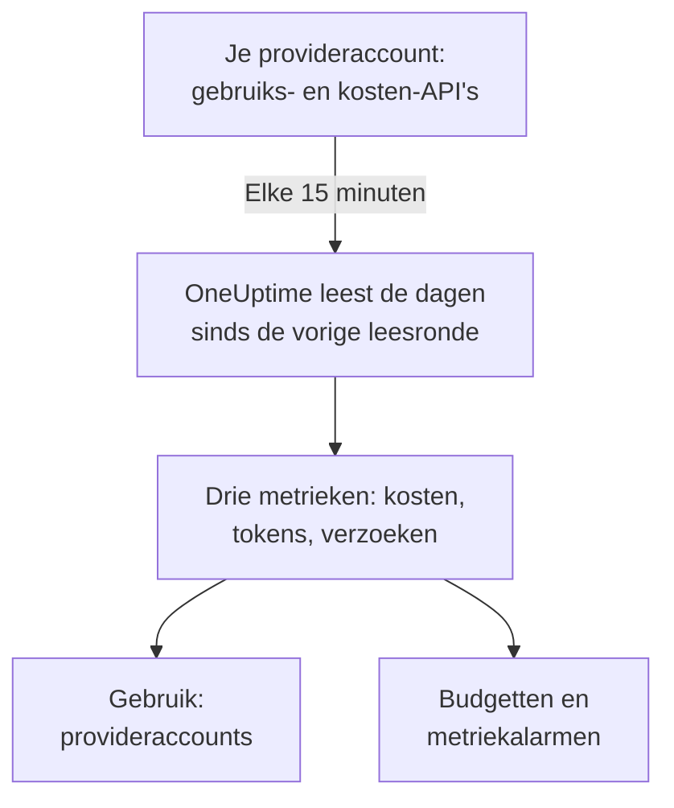

# Accounts bij AI-providers

Zie wat je accounts bij AI-providers hebben verbruikt en wat dat kostte, zonder je apps te veranderen. Koppel een account bij OpenAI, Anthropic, Azure OpenAI en Microsoft Foundry, Amazon Bedrock of Google Vertex AI met inloggegevens die alleen kunnen lezen, en OneUptime leest het gebruik ervan elke 15 minuten in **Gebruik**, **Budgetten** en metrieken waarop je kunt alarmeren.

:::cards
- [Een account koppelen](#een-account-koppelen): Kies de provider, plak de inloggegevens, test ze en koppel.
- [Wat elke provider levert](#wat-elke-provider-levert): Kosten, tokens en verzoeken, en hoe elke provider ze groepeert.
- [Het gebruik bekijken](#het-gebruik-bekijken): Per model, persoon, project of resource, API-sleutel en verbinding.
- [Budgetten en alarmen](#budgetten-en-alarmen): Een dagbudget op de rekening en alarmen op de metrieken.
:::

## Hoe het werkt

Elke 15 minuten vraagt OneUptime elk gekoppeld account om zijn gebruik per UTC-dag en bewaart het als drie metrieken van de eigen service van de verbinding. Elke leesronde haalt de dagen sinds de vorige leesronde op, en opnieuw de laatste 3 dagen, vandaag inbegrepen, omdat providers vandaag blijven aanvullen en de net voorbije dagen corrigeren.

Het gebruik van een account is wat er in rekening is gebracht, dag voor dag. Het bevat geen gesprekken, prompts of antwoorden: stuur daarvoor de AI-aanroepen van je apps, zoals [AI- / LLM-observability](/docs/telemetry/ai-llm-observability) laat zien. De twee blijven gescheiden, dus niets wordt dubbel geteld.

## Voordat je begint

- De rol Project Owner of Project Admin. Alleen zij kunnen een account koppelen, wijzigen of verwijderen; iedereen die de telemetrie van het project leest, ziet de verbindingen en het gebruik.
- Inloggegevens voor het account, van iemand die het beheert. De sectie van elke provider hieronder zegt welke en waar je ze maakt.
- Niets te installeren: OneUptime roept de API van de provider aan vanaf zijn eigen servers.

## Een account koppelen

:::steps
### Open Koppelen

Open **Producten → AI / LLM → Koppelen**. Klik onder **Je accounts bij AI-providers** op de tegel van de provider.

### Plak de inloggegevens

Vul bij **Inloggegevens** in wat de provider vraagt. Geheimen worden versleuteld opgeslagen en nooit meer getoond, niet in het Dashboard en niet via de API. **Naam** en de instellingen die de meeste mensen laten staan, vind je onder **Meer velden**.

### Test ze

Klik bij **Testen** op **Verbinding testen**. OneUptime leest het gebruik van de laatste 7 dagen en laat zien wat het vond: kosten, tokens, verzoeken, modellen, personen, sleutels en projecten. Er wordt niets bewaard tot je koppelt.

### Koppel

Klik op **Koppelen**. De eerste leesronde start binnen een minuut en haalt de laatste 30 dagen op.
:::

Gekoppelde accounts staan onder de tegels, met hun **Status** en **Laatst gelezen**. **Nu lezen** leest meteen, **Testen** controleert de opgeslagen instellingen opnieuw, **Uitzetten** stopt met lezen en houdt wat gelezen is, en **Bewerken** wijzigt de instellingen: een leeg gelaten geheim houdt het opgeslagen geheim. **View error** toont waarom een leesronde mislukte, zonder enig geheim.

## Wat elke provider levert

| Provider | Kosten | Gegroepeerd per | Inloggegevens |
| --- | --- | --- | --- |
| OpenAI | Wat OpenAI rapporteert | Project, API-sleutel, persoon en model | Een beheerderssleutel |
| Anthropic | Wat Anthropic rapporteert | Workspace, API-sleutel, persoon en model | Een beheerderssleutel |
| Azure OpenAI en Microsoft Foundry | Geschat op basis van tokens | Resource en model | Een app met Monitoring Reader |
| Amazon Bedrock | Geschat op basis van tokens | Regio en model | Een toegangssleutel die CloudWatch leest |
| Google Vertex AI | Geschat op basis van tokens | Regio en model | Een serviceaccount met Monitoring Viewer |

Elke provider behalve Anthropic telt ook verzoeken: het gebruiksrapport van Anthropic heeft er geen. Geschatte kosten gebruiken de prijslijst uit [Wat een aanroep kost](/docs/telemetry/ai-llm-observability#wat-een-aanroep-kost) en je eigen prijzen uit **Prijzen**, en zijn als schatting gemarkeerd. Een model dat de prijslijst niet kent, heeft geen kosten tot je het daar een prijs geeft.

Geen van deze inloggegevens kan een model aanroepen: elk leest gebruik, kosten of metrieken, en verder niets.

## OpenAI

OneUptime leest je OpenAI-organisatie met een beheerderssleutel: het gebruik van completions en embeddings per dag, model, project, API-sleutel en persoon, en de kosten van elke dag per project en kostenpost. Een kostenpost wordt verdeeld over de sleutels en personen die het model ervan gebruikten, zodat ook de rij van een persoon kosten heeft. Project- en sleutelnamen en de e-mailadressen van personen vervangen de ID's van OpenAI.

:::steps
### Maak een OpenAI-beheerderssleutel

Open in het dashboard van OpenAI Settings, Organization, Admin keys en maak een sleutel. Alleen eigenaren van de organisatie kunnen dat. Hij begint met `sk-admin-`.

### Koppel OpenAI

Plak de sleutel als **Beheerderssleutel**.
:::

## Anthropic

OneUptime leest je Claude API-organisatie met een beheerderssleutel: het gebruiksrapport van berichten per dag, model, workspace, API-sleutel en persoon, en het kostenrapport per workspace en post, op dezelfde manier verdeeld. Claude Code, gebruikt met de sleutels of Console-aanmeldingen van de organisatie, staat ook in deze rapporten, onder de persoon of sleutel die het gebruikte.

:::steps
### Maak een Anthropic-beheerderssleutel

Open in de Claude Console Settings, Admin keys en maak een sleutel. Alleen beheerders van de organisatie kunnen dat. Hij begint met `sk-ant-admin01-`.

### Koppel Anthropic

Plak de sleutel als **Beheerderssleutel**.
:::

## Azure OpenAI en Microsoft Foundry

OneUptime leest elke Azure OpenAI- en Foundry-resource van een abonnement uit Azure Monitor: tokens en verzoeken per dag, resource en model. Azure Monitor telt tokens, geen geld, en noemt geen persoon of sleutel, dus de kosten zijn de schatting van OneUptime en persoon en sleutel blijven leeg.

:::steps
### Registreer een app

Registreer in Microsoft Entra ID een app en maak er een clientgeheim voor.

### Laat hem de metrieken lezen

Geef de app op het abonnement de rol Monitoring Reader.

### Koppel Azure

Vul **Directory-ID (tenant)**, **Applicatie-ID (client)**, **Abonnements-ID** en **Clientgeheim** in. Wijzig voor Azure Government **Cloud** onder **Meer velden**.
:::

## Amazon Bedrock

OneUptime leest de CloudWatch-metrieken `AWS/Bedrock` van elke regio die je noemt: invoer-, uitvoer- en cachetokens en aanroepen, per dag en model. CloudWatch telt tokens, geen geld, en noemt geen persoon of sleutel: de kosten zijn de schatting van OneUptime, en elke regio staat als een project vermeld.

:::steps
### Maak een toegangssleutel

Maak een IAM-gebruiker of -rol waarvan het beleid `cloudwatch:GetMetricData` en `cloudwatch:ListMetrics` toestaat, en een toegangssleutel ervoor.

### Koppel Bedrock

Vul **Toegangssleutel-ID**, **Geheime toegangssleutel** en **Regio's** in, gescheiden door komma's: `us-east-1` als je het niet wijzigt.
:::

## Google Vertex AI

OneUptime leest de Cloud Monitoring-metrieken die Vertex AI publiceert voor zijn modellen, Gemini en partnermodellen zoals Claude: invoer- en uitvoertokens en aanroepen, per dag, regio en model. Cloud Monitoring telt tokens, geen geld, en noemt geen persoon of sleutel: de kosten zijn de schatting van OneUptime.

:::steps
### Maak een serviceaccount

Maak in het project een serviceaccount met de rol Monitoring Viewer, en een JSON-sleutel ervoor.

### Koppel Vertex AI

Vul **Project-ID** in en plak het hele sleutelbestand als **Serviceaccountsleutel (JSON)**.
:::

## Het gebruik bekijken

Open **Gebruik** en kies **Provideraccounts**. Je ziet er de kosten, tokens en verzoeken die je accounts voor de periode rapporteerden, gerangschikt per **Model**, **Persoon**, **Provider**, **Project of resource**, **API-sleutel** of **Verbinding**. De periode begint om middernacht UTC van de eerste dag, omdat providers hele dagen rapporteren.

**Provideraccounts** en **Je AI-aanroepen** worden nooit opgeteld. Een aanroep die je app doet met een sleutel van een gekoppeld account zit in beide, dus optellen zou hem dubbel tellen.

## Budgetten en alarmen

Een budget telt het een of het ander. Maak bij **Budgetten** een budget en zet **Uitgaven tellen vanuit** op **Provideraccounts**: het telt wat de gekoppelde accounts voor de UTC-dag in rekening kregen, beperkt door **LLM-provider (optioneel)** en **LLM-model (optioneel)** als je die instelt. Providers rapporteren het gebruik van een dag minuten tot uren later, dus budgetteer voor alarmen binnen minuten liever **Je AI-aanroepen**.

Het gebruik van elk account wordt bewaard als drie metrieken, die je in een [dashboard](/docs/dashboards/index) kunt tonen of met een [Metrics-monitor](/docs/monitor/metrics-monitor) kunt bewaken:

| Metriek | Wat het is |
| --- | --- |
| `oneuptime.llm.provider.cost` | De kosten van een dag, in USD |
| `oneuptime.llm.provider.tokens` | De tokens van een dag, per `gen_ai.token.type`: `input` (cachetokens inbegrepen), `output`, `cache_read` en `cache_write` |
| `oneuptime.llm.provider.requests` | De verzoeken van een dag |

Elk punt krijgt als tijdstempel het begin van zijn UTC-dag. Het draagt `oneuptime.llm.connection.id` en `oneuptime.llm.connection.name`, en wat de provider noemt: `gen_ai.provider.name`, `gen_ai.request.model`, `user.email`, `oneuptime.llm.provider.project` en `oneuptime.llm.provider.api_key`. Geschatte kosten dragen `oneuptime.llm.cost.estimated`.

## Wanneer er gelezen wordt

| Leesronde | Wanneer |
| --- | --- |
| De eerste | Binnen een minuut na het koppelen, 30 dagen terug |
| De volgende | Elke 15 minuten |
| Nadat een sleutel of machtiging is geweigerd | 60 minuten later |
| Na elke andere fout | 15 minuten later |
| Uitgeschakeld | Geen, tot ze weer aan staat |

Een abonnement zonder telemetriefuncties leest niets. Een verbinding verwijderen stopt haar leesrondes en houdt wat ze las tot de bewaring van de service het verwijdert.

## Waarom OneUptime geen eigen gateway heeft

OneUptime leest je accounts; het staat nooit tussen je apps en de providers. Een proxy zou je providersleutels bewaren en een tussenstap toevoegen aan elke modelaanroep van je apps. Gaat je modelverkeer al via LiteLLM, Portkey of OpenRouter, stuur dan de traces van de gateway naar OneUptime zoals [AI-gateways](/docs/telemetry/ai-gateways) laat zien, en koppel het account voor de rekening ervan.

## Probleemoplossing

:::details De test zegt dat de sleutel of het geheim niet werd geaccepteerd
Controleer of je alles hebt gekopieerd, of hij niet is ingetrokken en of het de soort is die deze provider vraagt: een beheerderssleutel van OpenAI of Anthropic, geen project- of API-sleutel.
:::

:::details De inloggegevens werken, maar mogen niet lezen wat de verbinding nodig heeft
Geef ze de rol die deze pagina voor de provider noemt: Monitoring Reader op het Azure-abonnement, de twee CloudWatch-acties in AWS, Monitoring Viewer op het Google Cloud-project.
:::

:::details De test slaagt, maar voor vandaag verschijnt niets
Providers rapporteren het gebruik van een dag minuten tot uren later en corrigeren het nog een dag of twee. De volgende leesrondes halen het op.
:::

:::details De kosten wijken af van de factuur
Gerapporteerde kosten zijn het bedrag van de provider vóór belastingen, tegoeden en kortingen. Geschatte kosten zijn tokens tegen catalogusprijs, of tegen je eigen prijzen uit **Prijzen**.
:::

## Volgende stappen

:::cards
- [AI- / LLM-observability](/docs/telemetry/ai-llm-observability): Gesprekken, alarmen en kosten van de AI-aanroepen van je eigen apps.
- [AI-tools van je bedrijf](/docs/telemetry/ai-company-tools): Wat je mensen aan Claude Enterprise en Microsoft 365 Copilot vragen.
- [AI-gateways](/docs/telemetry/ai-gateways): Elke modelaanroep via LiteLLM, Portkey of OpenRouter tracen.
- [Metrics-monitor](/docs/monitor/metrics-monitor): Alarmeren op de providermetrieken.
:::
