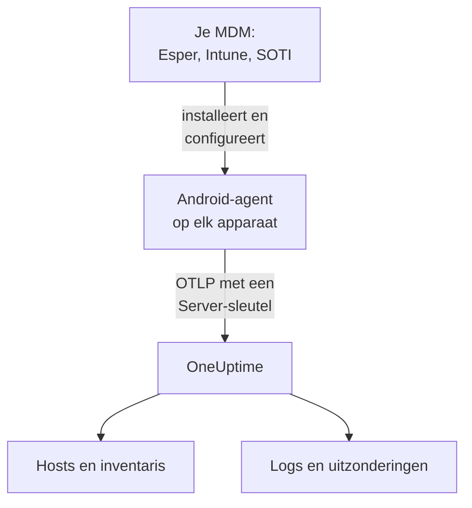

# Android-agent

De Android-agent van OneUptime rapporteert aan OneUptime over een Android-apparaat van je organisatie, zoals een bestelkiosk, een kassaterminal, een handheld of een digital-signage-speler: zijn geheugen, opslag, netwerk, batterij en temperatuur, zijn herstarts, de apps die erop staan, en de crashes en logs van die apps. Je MDM installeert en configureert hem in één keer op de hele vloot. Elk apparaat wordt een host in **Hosts** en een item in **Inventaris**, naast je servers en Windows-machines.

:::cards
- [Wanneer je hem gebruikt](#de-agent-of-app-instrumentatie): De agent ziet het apparaat, app-instrumentatie ziet je app.
- [Uitrollen met Esper](#uitrollen-met-esper): Upload de APK, push de instellingen, start hem één keer.
- [Instellingen](#instellingen): Elke sleutel van zijn beheerde configuratie.
- [Logs van andere apps lezen](#logs-van-andere-apps-lezen): Verleen READ_LOGS één keer, met adb of met je MDM.
:::

## Zo werkt het

De agent is een kleine app die als voorgrondservice draait. Elke minuut leest hij de gezondheid van het apparaat en stuurt die via OTLP naar je OneUptime met een **Server**-ingestiesleutel, samen met de herstarts, de geïnstalleerde apps en de logs van het apparaat. Hij start vanzelf wanneer het apparaat opstart, bewaart wat hij verzamelt op het apparaat zolang het netwerk plat ligt, en verstuurt het zodra het netwerk terug is. Hij houdt een slapend apparaat nooit wakker, en comprimeert wat hij verstuurt.



## De agent of app-instrumentatie

| | [OpenTelemetry Android](/docs/rum/android-setup) in je app | De Android-agent |
| --- | --- | --- |
| Wat hij ziet | Je app: zijn crashes, ANR's, schermen, sessies, verzoeken en workflows | Het apparaat: geheugen, opslag, netwerk, batterij, herstarts, geïnstalleerde apps, en de crashes en ANR's van elke app |
| Waar het verschijnt | **Real User Monitoring**, **Traces** en **Uitzonderingen** | **Hosts**, **Inventaris**, **Logboeken** en **Uitzonderingen** |
| Hoe je het installeert | In de code van je app | Als app, via je MDM |

Gebruik op apparaten die je bezit allebei, en geef het apparaat in beide dezelfde naam: de instelling `device_name` van de agent en de `host.name` die je app instelt. Het apparaat is dan één item in **Inventaris**, met de telemetrie van de app en die van het apparaat bij elkaar.

## Voordat je begint

- Apparaten met Android 7.0 of later, beheerd door een MDM die de beheerde configuraties van Android ondersteunt: Esper, Microsoft Intune, Workspace ONE, SOTI en andere MDM's voor Android Enterprise. Voor één enkel apparaat is adb genoeg.
- Een **Server**-ingestiesleutel, aangemaakt onder **Projectinstellingen → Telemetrie & APM → Ingestiesleutels** met **Ingestiesleutel aanmaken**.
- De agent: `oneuptime-android-agent.apk`, als bijlage bij elke [release van OneUptime](https://github.com/OneUptime/oneuptime/releases/latest).
- Uitgaand HTTPS van de apparaten naar je OneUptime-URL. De agent weigert een URL die niet met `https://` begint, omdat elk verzoek de ingestiesleutel meestuurt.

## Uitrollen met Esper

:::steps
### De APK uploaden

Upload `oneuptime-android-agent.apk` in de Esper-console naar de **App Library**, en voeg hem toe aan de blueprint van de apparaten die je wilt bewaken.

### De instellingen pushen

Open in de blueprint de **Managed Configuration** van de agent en plak zijn instellingen erin. Esper vult de placeholders op elk apparaat in, met Esper Agent 8.00.0764 of later:

```json title="Managed configuration"
{
  "oneuptime_url": "https://oneuptime.com",
  "oneuptime_token": "YOUR_TELEMETRY_INGESTION_TOKEN",
  "device_name": "${esper.deviceName}",
  "device_serial": "${esper.serialNumber}",
  "device_type": "kiosk",
  "labels": "region=emea"
}
```

Host je OneUptime zelf, zet dan je eigen URL in `oneuptime_url`. Laat de apparaten daarna convergeren, zodat ze de nieuwe instellingen lezen.

### Eén keer starten

Android start een pas geïnstalleerde app niet bij het opstarten zolang die nog nooit is geopend. Zet **Launch on Start** aan voor de agent in de blueprint, in de Multi-App-modus, of open de agent één keer op elk apparaat. Vanaf dan start hij vanzelf telkens wanneer het apparaat opstart, en na elke update.

### De apparaten vinden in OneUptime

Binnen een minuut verschijnt elk apparaat onder **Hosts**, met zijn `device_name` als naam, en in **Inventaris**. Het eigen scherm van de agent op het apparaat laat zien of hij rapporteert, en wat hem tegenhoudt als dat niet zo is.
:::

Andere MDM's werken op dezelfde manier: voeg de APK toe als line-of-business-app of interne app, stel dezelfde sleutels in bij de appconfiguratie, en open de app één keer op elk apparaat.

## Instellingen

De agent leest deze sleutels uit zijn beheerde configuratie. Een apparaat zonder beheerde configuratie kun je in plaats daarvan instellen op het eigen scherm van de agent, met de URL, de ingestiesleutel en de naam van het apparaat. Een sleutel die je daar invoert, wordt versleuteld opgeslagen met de Android Keystore.

| Sleutel | Wat hij instelt | Standaard |
| --- | --- | --- |
| `oneuptime_url` | Je OneUptime-URL | `https://oneuptime.com` |
| `oneuptime_token` | Een **Server**-ingestiesleutel | Geen: zonder sleutel verstuurt de agent niets |
| `device_name` | De naam van het apparaat in **Hosts** en **Inventaris**, die daar zijn identiteit is | Zijn model en het begin van zijn Android ID |
| `device_serial` | Zijn serienummer, dat Android vanaf Android 10 niet aan apps geeft | Geen |
| `device_type` | Wat het is, zoals een kiosk, een kassaterminal of een handheld | `Android device` |
| `device_location` | Waar het staat, zoals het nummer van een winkel | Geen |
| `labels` | Labels voor de host, als paren `name=value` gescheiden door komma's | Geen |
| `collection_interval_seconds` | Hoe vaak hij rapporteert, van 30 tot 600 seconden | `60` |
| `logcat_enabled` | Of hij verstuurt wat hij uit Logcat leest | `true` |
| `logcat_min_level` | De minst ernstige Logcat-regels die hij op Android 12 en eerder verstuurt: `verbose`, `debug`, `info`, `warn`, `error` of `fatal` | `warn` |
| `installed_apps_enabled` | Of hij de geïnstalleerde apps verstuurt | `true` |

Een placeholder die je MDM niet heeft ingevuld, zoals `${esper.deviceName}` dat letterlijk zo wordt verstuurd, wordt genegeerd, en het scherm van de agent meldt dat. Houd `device_name` hetzelfde zodra een apparaat rapporteert: een nieuwe naam is een nieuwe host.

## Logs van andere apps lezen

Android laat een app de logs van andere apps alleen lezen met de toestemming READ_LOGS, en alleen adb kan die verlenen: niet de app zelf, en ook geen apparaatbeleid. Verleen ze één keer op elk apparaat, en ze blijft verleend na herstarts en updates:

```bash
adb shell pm grant com.oneuptime.androidagent android.permission.READ_LOGS
```

Voer die opdracht met Esper uit via **Secure Remote ADB**: zet ADB-toegang aan voor het apparaat, maak verbinding met `espercli secureadb connect -d DEVICE_ID` en voer dan de opdracht uit. Android herstart de agent wanneer de toestemming wordt verleend, en de agent begint meteen te lezen.

Wat de agent daarna leest, hangt af van de Android-versie:

- Android 13 en later: de crashes en ANR's van elke app. Android toont de logregels van andere apps alleen aan een app die op het scherm staat, nadat de persoon bij het apparaat dat toestaat, dus een agent die op de achtergrond draait, kan ze niet lezen.
- Android 12 en eerder: de crashes en ANR's van elke app, en de logregels van elke app vanaf `logcat_min_level`.

Zonder READ_LOGS rapporteert de agent al het andere, en zijn scherm en de logs van het apparaat vertellen hoe je de toestemming verleent.

## Wat de agent rapporteert

| Wat | Waar het in OneUptime verschijnt |
| --- | --- |
| Geheugen, opslag, netwerk en uptime | De pagina van het apparaat in **Hosts**: dezelfde metrieken die de collector van een server verstuurt, zodat de waarschuwingssjablonen voor hosts werken |
| Batterijlading en -temperatuur, en of het apparaat op externe voeding is aangesloten | De metrieken `hw.battery.charge`, `hw.temperature` en `android.battery.plugged` |
| Thermische toestand | De metrieken `android.thermal.status` en `android.thermal.headroom` |
| Herstarts | **Logboeken**, met `@event.name:device.boot`: hoe lang het apparaat aan stond, of het netjes is afgesloten, hoe lang het uit stond, en herstartlussen |
| Geïnstalleerde apps | **Logboeken**, met `@event.name:android.package.inventory` één keer per dag, en elke installatie, update en verwijdering |
| Crashes en ANR's van elke app | **Uitzonderingen**, als niet-afgehandeld, genoemd naar de app |
| Merk, model, serienummer, OS-versie en firmware | Het item van het apparaat in **Inventaris** |

Vanaf Android 8 houdt Android het CPU-gebruik van het apparaat verborgen voor apps, dus de agent rapporteert CPU-gebruik alleen op Android 7, en op builds die het toestaan.

De waarschuwingssjablonen voor hosts die bij een apparaat passen, zijn Host Stopped Reporting, High Memory Utilization, High Filesystem Usage en Host Restarted. Een apparaat dat blijft herstarten, logt bij elke start een waarschuwing, met `android.boot.recent_count` ingesteld op het aantal starts in het afgelopen uur.

## Probleemoplossing

:::details Een apparaat verschijnt niet in Hosts
Open de agent op het apparaat: zijn scherm vertelt wat er ontbreekt, zoals een ingestiesleutel, een URL die hij niet kan gebruiken, of een upload die mislukte en waarom. Op een apparaat waarop de agent na de installatie nooit is geopend, is hij ook niet gestart: open hem één keer, of zet **Launch on Start** aan.
:::

:::details De agent meldt dat OneUptime de ingestiesleutel heeft geweigerd
Gebruik een **Server**-sleutel die aanstaat en niet is verlopen. Een **Browser**-sleutel wordt vanaf een apparaat geweigerd.
:::

:::details Geen logs van andere apps
Verleen READ_LOGS, zoals [Logs van andere apps lezen](#logs-van-andere-apps-lezen) beschrijft. Op Android 13 en later worden van andere apps alleen de crashes en ANR's gelezen.
:::

:::details Twee apparaten verschijnen als één host
Ze hebben dezelfde `device_name`. Gebruik een placeholder die per apparaat verschilt, zoals `${esper.deviceName}` of `${esper.serialNumber}`.
:::

## Volgende stappen

:::cards
- [Android-configuratie](/docs/rum/android-setup): Je eigen app instrumenteren met OpenTelemetry Android.
- [Hosts](/docs/telemetry/hosts): De pagina's, metingen en waarschuwingen van een host.
- [Host-monitor](/docs/monitor/host-monitor): Een waarschuwing krijgen wanneer een apparaat stopt met rapporteren of bijna geen opslag meer heeft.
- [Uitzonderingen](/docs/telemetry/exceptions): De crashes en ANR's triëren die je apparaten melden.
:::
