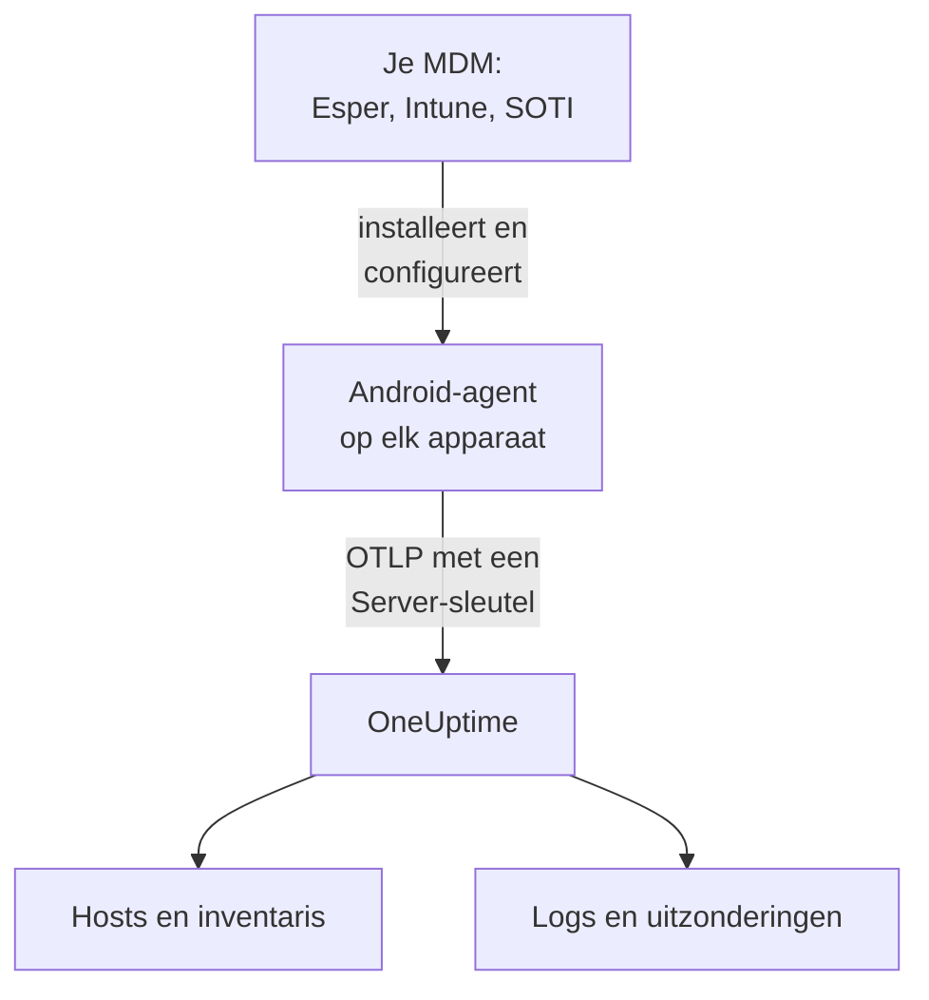

# Android-agent

De Android-agent van OneUptime rapporteert aan OneUptime over een Android-apparaat van je organisatie, zoals een bestelkiosk, een kassaterminal, een handheld of een digital-signage-speler: zijn geheugen, opslag, netwerk, batterij en temperatuur, zijn herstarts, de apps die erop staan, en de crashes en logs van die apps. Je MDM installeert en configureert hem in één keer op de hele vloot. Elk apparaat wordt een host in **Hosts** en een item in **Inventaris**, naast je servers en Windows-machines.

:::cards
- [Wanneer je hem gebruikt](#de-agent-of-app-instrumentatie): De agent ziet het apparaat, app-instrumentatie ziet je app.
- [Uitrollen met Esper](#uitrollen-met-esper): Upload de APK, push de instellingen, start hem één keer.
- [Instellingen](#instellingen): Elke sleutel van zijn beheerde configuratie.
- [Logs van andere apps lezen](#logs-van-andere-apps-lezen): Verleen READ_LOGS één keer, met adb of met je MDM.
- [Logsessies](#logsessies): De logs van elke app, een tijdlang, toegestaan door de persoon bij het apparaat.
:::

## Zo werkt het

De agent is een kleine app die als voorgrondservice draait. Elke minuut leest hij de gezondheid van het apparaat en stuurt die via OTLP naar je OneUptime met een **Server**-ingestiesleutel, samen met de herstarts, de geïnstalleerde apps en de logs van het apparaat. Hij start vanzelf wanneer het apparaat opstart, bewaart wat hij verzamelt op het apparaat zolang het netwerk plat ligt, en verstuurt het zodra het netwerk terug is. Hij houdt een slapend apparaat nooit wakker, en comprimeert wat hij verstuurt.



## De agent of app-instrumentatie

| | [OpenTelemetry Android](/docs/rum/android-setup) in je app | De Android-agent |
| --- | --- | --- |
| Wat hij ziet | Je app: zijn crashes, ANR's, schermen, sessies, verzoeken en workflows | Het apparaat: geheugen, opslag, netwerk, batterij, herstarts, geïnstalleerde apps, en de crashes en ANR's van elke app |
| Waar het verschijnt | **Real User Monitoring**, **Traces** en **Uitzonderingen** | **Hosts**, **Inventaris**, **Logboeken** en **Uitzonderingen** |
| Hoe je het installeert | In de code van je app | Als app, via je MDM |

Gebruik op apparaten die je bezit allebei, en geef het apparaat in beide dezelfde naam: de instelling `device_name` van de agent en de `host.name` die je app instelt. Het apparaat is dan één item in **Inventaris**, met de telemetrie van de app en die van het apparaat bij elkaar.

## Voordat je begint

- Apparaten met Android 7.0 of later, beheerd door een MDM die de beheerde configuraties van Android ondersteunt: Esper, Microsoft Intune, Workspace ONE, SOTI en andere MDM's voor Android Enterprise. Voor één enkel apparaat is adb genoeg.
- Een **Server**-ingestiesleutel, aangemaakt onder **Projectinstellingen → Telemetrie & APM → Ingestiesleutels** met **Ingestiesleutel aanmaken**.
- De agent: `oneuptime-android-agent.apk`, als bijlage bij elke [release van OneUptime](https://github.com/OneUptime/oneuptime/releases/latest).
- Uitgaand HTTPS van de apparaten naar je OneUptime-URL. De agent weigert een URL die niet met `https://` begint, omdat elk verzoek de ingestiesleutel meestuurt.

## Uitrollen met Esper

:::steps
### De APK uploaden

Upload `oneuptime-android-agent.apk` in de Esper-console naar de **App Library**, en voeg hem toe aan de blueprint van de apparaten die je wilt bewaken.

### De instellingen pushen

Open in de blueprint de **Managed Configuration** van de agent en plak zijn instellingen erin. Esper vult de placeholders op elk apparaat in, met Esper Agent 8.00.0764 of later:

```json title="Managed configuration"
{
  "oneuptime_url": "https://oneuptime.com",
  "oneuptime_token": "YOUR_TELEMETRY_INGESTION_TOKEN",
  "device_name": "${esper.deviceName}",
  "device_serial": "${esper.serialNumber}",
  "device_type": "kiosk",
  "labels": "region=emea"
}
```

Host je OneUptime zelf, zet dan je eigen URL in `oneuptime_url`. Laat de apparaten daarna convergeren, zodat ze de nieuwe instellingen lezen.

### Eén keer starten

Android start een pas geïnstalleerde app niet bij het opstarten zolang die nog nooit is geopend. Zet **Launch on Start** aan voor de agent in de blueprint, in de Multi-App-modus, of open de agent één keer op elk apparaat. Vanaf dan start hij vanzelf telkens wanneer het apparaat opstart, en na elke update.

### De apparaten vinden in OneUptime

Binnen een minuut verschijnt elk apparaat onder **Hosts**, met zijn `device_name` als naam, en in **Inventaris**. Het eigen scherm van de agent op het apparaat laat zien of hij rapporteert, en wat hem tegenhoudt als dat niet zo is.
:::

Andere MDM's werken op dezelfde manier: voeg de APK toe als line-of-business-app of interne app, stel dezelfde sleutels in bij de appconfiguratie, en open de app één keer op elk apparaat.

## Instellingen

De agent leest deze sleutels uit zijn beheerde configuratie. Een apparaat zonder beheerde configuratie kun je in plaats daarvan instellen op het eigen scherm van de agent, met de URL, de ingestiesleutel en de naam van het apparaat. Een sleutel die je daar invoert, wordt versleuteld opgeslagen met de Android Keystore.

| Sleutel | Wat hij instelt | Standaard |
| --- | --- | --- |
| `oneuptime_url` | Je OneUptime-URL | `https://oneuptime.com` |
| `oneuptime_token` | Een **Server**-ingestiesleutel | Geen: zonder sleutel verstuurt de agent niets |
| `device_name` | De naam van het apparaat in **Hosts** en **Inventaris**, die daar zijn identiteit is | Zijn model en het begin van zijn Android ID |
| `device_serial` | Zijn serienummer, dat Android vanaf Android 10 niet aan apps geeft | Geen |
| `device_type` | Wat het is, zoals een kiosk, een kassaterminal of een handheld | `Android device` |
| `device_location` | Waar het staat, zoals het nummer van een winkel | Geen |
| `labels` | Labels voor de host, als paren `name=value` gescheiden door komma's | Geen |
| `collection_interval_seconds` | Hoe vaak hij rapporteert, van 30 tot 600 seconden | `60` |
| `logcat_enabled` | Of hij verstuurt wat hij uit Logcat leest | `true` |
| `logcat_min_level` | De minst ernstige Logcat-regels die hij op Android 12 en eerder verstuurt: `verbose`, `debug`, `info`, `warn`, `error` of `fatal` | `warn` |
| `installed_apps_enabled` | Of hij de geïnstalleerde apps verstuurt | `true` |

Een placeholder die je MDM niet heeft ingevuld, zoals `${esper.deviceName}` dat letterlijk zo wordt verstuurd, wordt genegeerd, en het scherm van de agent meldt dat. Houd `device_name` hetzelfde zodra een apparaat rapporteert: een nieuwe naam is een nieuwe host.

Het scherm van de agent, zijn meldingen en de titels en beschrijvingen die je MDM voor deze sleutels toont, zijn in de taal van het apparaat, in elke taal die het dashboard van OneUptime spreekt.

## Logs van andere apps lezen

Android laat een app de logs van andere apps alleen lezen met de toestemming READ_LOGS, en alleen adb kan die verlenen: niet de app zelf, en ook geen apparaatbeleid. Verleen ze één keer op elk apparaat, en ze blijft verleend na herstarts en updates:

```bash
adb shell pm grant com.oneuptime.androidagent android.permission.READ_LOGS
```

Voer die opdracht met Esper uit via **Secure Remote ADB**: zet ADB-toegang aan voor het apparaat, maak verbinding met `espercli secureadb connect --device DEVICE_ID` en voer dan de opdracht uit. Android herstart de agent wanneer de toestemming wordt verleend, en de agent begint meteen te lezen. De kolom **MDM-ID** in de inventaris bevat de `DEVICE_ID` van elk apparaat.

Wat de agent daarna leest, hangt af van de Android-versie:

- Android 13 en later: de crashes en ANR's van elke app. Android toont de logregels van andere apps alleen aan een app die op het scherm staat, nadat de persoon bij het apparaat dat toestaat, dus een agent die op de achtergrond draait, kan ze niet lezen. Vraag ze een tijdlang op met een [logsessie](#logsessies).
- Android 12 en eerder: de crashes en ANR's van elke app, en de logregels van elke app vanaf `logcat_min_level`.

Zonder READ_LOGS rapporteert de agent al het andere, en zijn scherm en de logs van het apparaat vertellen hoe je de toestemming verleent.

### Stack traces van crashes en redenen voor herstarts

Android bewaart het volledige rapport van elke appcrash, native crash en ANR, en de reden van elke herstart, in zijn DropBox. De agent leest ze voor elke app als hij READ_LOGS en gebruikstoegang heeft, en op Android 15 en later READ_DROPBOX_DATA. Verleen ze één keer met adb, net als READ_LOGS:

```bash
adb shell pm grant com.oneuptime.androidagent android.permission.READ_DROPBOX_DATA
adb shell appops set com.oneuptime.androidagent GET_USAGE_STATS allow
```

De eerste opdracht is voor Android 15 en later; gebruikstoegang kun je ook aanzetten in **Instellingen → Gebruikstoegang** van het apparaat. Geen apparaatbeleid kan ze verlenen, en het scherm van de agent toont de opdrachten die je nog moet uitvoeren. Daarmee heeft elke crash in **Uitzonderingen** zijn volledige stacktrace, een native crash zijn signaal en de bibliotheek waarin hij crashte, een ANR de stack van zijn hoofdthread, en een herstart in **Logboeken** de reden die Android ervoor geeft. Kaartnummers, e-mailadressen, tokens en wachtwoorden in wat de agent leest, worden vervangen door `[card number]`, `[email]`, `[token]` en `[redacted]` voordat het wordt verstuurd.

### Ze op een hele vloot verlenen

Elk rapport van de agent vermeldt welke hiervan hij nog mist. Voor een lijst van de apparaten die ze nodig hebben, open je **Inventaris**, dan **Alle items**, en filter je op **Agentmachtigingen**: **Ontbreekt**. Zet de kolom **Agentmachtigingen** aan om te zien wat elk apparaat mist, en exporteer de lijst als CSV. Zet ook de kolom **MDM-ID** aan, dan bevat de export de Esper-ID van elk apparaat, de `DEVICE_ID` die `espercli secureadb connect --device` verwacht.

Geen apparaatbeleid kan ze verlenen: READ_LOGS en READ_DROPBOX_DATA zijn toestemmingen die alleen adb, het systeem of de fabrikant van het apparaat kan geven, en gebruikstoegang wordt ingesteld door adb of door de persoon bij het apparaat. Wat Esper biedt, en waarom niets daarvan ze verleent:

- **Apptoestemmingen**, in een blueprint of met de opdracht `SET_APP_PERMISSION`, lopen via de apparaateigenaar-API van Android, die alleen de toestemmingen verleent die een app aan de persoon bij het apparaat vraagt. Android weigert deze drie.
- **Beheerde configuratie** stelt de eigen instellingen van de agent in, nooit de toestemmingen van Android.
- **Run Shell Script** draait op Linux- en Windows-apparaten, niet op Android-apparaten.
- **Secure Remote ADB** bereikt één apparaat tegelijk, vanaf een computer waarop `espercli` draait. Op apparaten met Esper Foundation is er niemand bij het apparaat nodig. Op andere apparaten moet iemand bij het apparaat de eerste keer **Allow USB debugging?** accepteren.

Verleen ze dus met adb:

- **Voordat een apparaat wordt uitgeleverd**, wanneer het met een USB-kabel wordt klaargemaakt. Dit verleent alle drie op elk apparaat dat op de computer is aangesloten:

  ```bash
  for serial in $(adb devices | awk 'NR > 1 && $2 == "device" { print $1 }'); do
    adb -s "$serial" shell pm grant com.oneuptime.androidagent android.permission.READ_LOGS
    adb -s "$serial" shell pm grant com.oneuptime.androidagent android.permission.READ_DROPBOX_DATA
    adb -s "$serial" shell appops set com.oneuptime.androidagent GET_USAGE_STATS allow
  done
  ```

  Op Android 14 en eerder meldt de tweede opdracht dat de toestemming onbekend is: dat apparaat heeft ze niet nodig.
- **Op een apparaat in het veld**, via Secure Remote ADB, één apparaat uit de lijst **Ontbreekt** tegelijk.
- **Alleen gebruikstoegang** kan de persoon bij het apparaat aanzetten, onder **Instellingen → Gebruikstoegang**, of met de knop op het scherm van de agent.

Binnen een minuut haalt het volgende rapport van het apparaat het van de lijst **Ontbreekt**.

### CPU-gebruik

Vanaf Android 8 houdt Android het CPU-gebruik van een apparaat verborgen voor apps. Alleen een app die apparaateigenaar is, kan het lezen, en alleen op apparaten waarvan de hardware het meldt. De agent leest het als hij de apparaateigenaar is, wat je met adb instelt op een apparaat zonder accounts en zonder andere apparaateigenaar:

```bash
adb shell dpm set-device-owner com.oneuptime.androidagent/.admin.AgentDeviceAdminReceiver
```

Een apparaat waarvan je MDM al eigenaar is, kan geen tweede eigenaar hebben, dus is zijn CPU-gebruik niet beschikbaar, en het scherm van de agent meldt dat. Zijn CPU-gebruik ontbreekt dan in de hostlijst, en het sjabloon **High CPU Utilization** wordt er niet voor aangeboden.

## Logsessies

Een logsessie stuurt een tijdlang de logs van elke app van een apparaat, om problemen ermee op te lossen. Op Android 13 en later is dat de enige manier om de logregels van andere apps te lezen, omdat Android ze alleen toont aan een app die op het scherm staat, nadat de persoon bij het apparaat dat toestaat.

:::steps
### Een logsessie aanvragen

Open het apparaat in **Hosts**, dan **Logboeken**, en klik op **Logsessie aanvragen** in **Logsessies**. Kies hoe lang het apparaat zijn logs verstuurt, van 15 minuten tot 4 uur, en het laagste niveau dat het verstuurt: **Info**, **Debug** of **Uitgebreid**. Voeg een **Notitie** toe om te zeggen waarom je erom vraagt, zoals "Uitzoeken waarom de betaalapp na 18.00 uur vastloopt".

### Toestaan op het apparaat

Binnen een minuut toont het apparaat een melding dat iemand om zijn logs heeft gevraagd, met diens naam en je notitie. De persoon bij het apparaat opent de agent, waar het verzoek staat met je notitie eronder, en tikt op **Toestaan**. Op Android 13 en later vraagt Android daarna om toegang tot alle apparaatlogboeken toe te staan, en ook dat staat die persoon toe.

### De regels lezen

De sessie staat op **Wordt verzameld**, en de regels van elke app komen binnen in de logs van het apparaat. Klik op **Regels tonen** om de regels van de sessie apart te zien, of op **Regels downloaden** om ze als bestand op te slaan. De sessie eindigt als de tijd om is, of als iemand haar op het apparaat stopt of in OneUptime annuleert.
:::

De notitie is één regel van maximaal 200 tekens. Het apparaat toont haar zoals je haar schreef, tussen aanhalingstekens, in de melding en op het scherm van de agent zolang de sessie wacht of loopt; ze wordt nooit vertaald. Regeleinden worden spaties, en kaartnummers, e-mailadressen, tokens en wachtwoorden erin worden vervangen door `[card number]`, `[email]`, `[token]` en `[redacted]` voordat ze wordt bewaard, net als in wat de agent verstuurt. De lijst met sessies toont haar onder wie erom vroeg, en de **Auditlogboeken** van de host bewaren haar bij het verzoek.

**Regels downloaden** slaat de regels van de sessie op als tekstbestand in de indeling die `logcat -v threadtime` afdrukt en die de support van een leverancier kan lezen: elke regel met zijn tijd tot op de milliseconde, zijn proces en thread, zijn niveau, zijn tag en zijn bericht. Tijden staan in UTC. De eerste regels van het bestand vermelden om welke sessie, welk apparaat en welke notitie het gaat, en wie erom vroeg. Het bevat de regels die **Logboeken** toont, zoals de agent ze heeft gemaskeerd, dus het vereist dezelfde toestemming als het lezen van de logs van het apparaat. Een bestand bevat hoogstens 100.000 regels en 32 MB; het bestand van een langere sessie vermeldt aan het eind hoeveel regels de sessie heeft.

Een sessie heeft READ_LOGS en `logcat_enabled` nodig; zonder die staat ze op **Niet beschikbaar**. Er draait één sessie tegelijk op een apparaat. Een verzoek dat niemand binnen een uur toestaat, verloopt, en een sessie waarin het apparaat herstart, eindigt daarmee, omdat de toestemming van Android eindigt met het proces van de agent. Een sessie aanvragen vereist toestemming om de host te bewerken, en de **Auditlogboeken** van de host houden bij wie erom vroeg, en wanneer.

## Wat de agent rapporteert

| Wat | Waar het in OneUptime verschijnt |
| --- | --- |
| Geheugen, opslag, netwerk en uptime | De pagina van het apparaat in **Hosts**: dezelfde metrieken die de collector van een server verstuurt, zodat de waarschuwingssjablonen voor hosts werken |
| Batterijlading en -temperatuur, en of het apparaat op externe voeding is aangesloten | De metrieken `hw.battery.charge`, `hw.temperature` en `android.battery.plugged` |
| Thermische toestand | De metrieken `android.thermal.status` en `android.thermal.headroom` |
| CPU-gebruik | De metriek `system.cpu.utilization`: op Android 7, en op Android 8 en later als de agent de [apparaateigenaar](#cpu-gebruik) is |
| Herstarts | **Logboeken**, met `@event.name:device.boot`: hoe lang het apparaat aan stond, of het netjes is afgesloten, hoe lang het uit stond, waarom het herstartte, en herstartlussen |
| Geïnstalleerde apps | **Logboeken**, met `@event.name:android.package.inventory` één keer per dag, en elke installatie, update en verwijdering |
| Crashes en ANR's van elke app | **Uitzonderingen**, als niet-afgehandeld, genoemd naar de app, met hun stacks als de agent [DropBox](#stack-traces-van-crashes-en-redenen-voor-herstarts) leest |
| Merk, model, serienummer, OS-versie, beveiligingspatchniveau en firmware | Het item van het apparaat in **Inventaris**, met het filter en de kolom **Beveiligingspatchniveau** |
| Hoe oud zijn beveiligingspatchniveau is | De metriek `android.os.security_patch.age`, in dagen |
| Wat er nog aan de agent verleend moet worden | Het item van het apparaat in **Inventaris**, met het filter en de kolom **Agentmachtigingen** |

In **Hosts** staat als OS van het apparaat Android, met het logo van Android.

Een apparaat loopt achter met zijn beveiligingspatches als zijn beveiligingspatchniveau ouder is dan 90 dagen. Google publiceert elke maand een Android-beveiligingsbulletin, en Android Enterprise Recommended verplicht de fabrikant van een apparaat om elk daarvan binnen 90 dagen uit te brengen, dus een apparaat dat verder achterloopt, mist fixes die zijn fabrikant al had moeten uitbrengen. In **Inventaris** toont het filter **Beveiligingspatchniveau** de apparaten die **Niet actueel** zijn; het sjabloon **Security Patch Out of Date** geeft voor elk ervan een waarschuwing. Voor een Android-apparaat dat een MDM importeert en waarop de agent niet draait, waarschuwt het eigen sjabloon van zijn koppeling, zoals **Esper Security Patch Out of Date**, op basis van het patchniveau dat de MDM meldt; een apparaat waarop de agent draait, wordt aan dit sjabloon overgelaten, zodat het nooit twee keer waarschuwt.

Het aantal starts van het apparaat in het afgelopen uur is de metriek `android.boot.recent_count`, en een apparaat dat blijft herstarten, logt bij elke start een waarschuwing. In **Hosts** krijgt een Android-apparaat eigen waarschuwingssjablonen aangeboden: Device Unplugged, Low Battery, Device Overheating, Restart Loop, Storage Nearly Full en Security Patch Out of Date, met Host Stopped Reporting, Host Restarted en High Memory Utilization, en High CPU Utilization zodra het CPU-gebruik meldt. De eerste debugopdrachten van elke waarschuwing zijn adb-opdrachten. Zie [Host-monitor](/docs/monitor/host-monitor#android-apparaten).

## Probleemoplossing

:::details Een apparaat verschijnt niet in Hosts
Open de agent op het apparaat: zijn scherm vertelt wat er ontbreekt, zoals een ingestiesleutel, een URL die hij niet kan gebruiken, of een upload die mislukte en waarom. Op een apparaat waarop de agent na de installatie nooit is geopend, is hij ook niet gestart: open hem één keer, of zet **Launch on Start** aan.
:::

:::details De agent meldt dat OneUptime de ingestiesleutel heeft geweigerd
Gebruik een **Server**-sleutel die aanstaat en niet is verlopen. Een **Browser**-sleutel wordt vanaf een apparaat geweigerd.
:::

:::details Geen logs van andere apps
Verleen READ_LOGS, zoals [Logs van andere apps lezen](#logs-van-andere-apps-lezen) beschrijft. Op Android 13 en later worden van andere apps alleen de crashes en ANR's gelezen, tenzij er een [logsessie](#logsessies) loopt.
:::

:::details Een logsessie blijft op Wacht op goedkeuring staan
Nog niemand bij het apparaat heeft haar toegestaan. Iemand moet de agent op het apparaat openen en op **Toestaan** tikken, en op Android 13 en later ook de vraag van Android toestaan, terwijl de agent op het scherm staat. Een sessie die in de vraag van Android is geweigerd, staat op **Geweigerd**: vraag een nieuwe aan.
:::

:::details Twee apparaten verschijnen als één host
Ze hebben dezelfde `device_name`. Gebruik een placeholder die per apparaat verschilt, zoals `${esper.deviceName}` of `${esper.serialNumber}`.
:::

## Volgende stappen

:::cards
- [Android-configuratie](/docs/rum/android-setup): Je eigen app instrumenteren met OpenTelemetry Android.
- [Hosts](/docs/telemetry/hosts): De pagina's, metingen en waarschuwingen van een host.
- [Host-monitor](/docs/monitor/host-monitor): Een waarschuwing krijgen wanneer een apparaat stopt met rapporteren of bijna geen opslag meer heeft.
- [Uitzonderingen](/docs/telemetry/exceptions): De crashes en ANR's triëren die je apparaten melden.
:::
