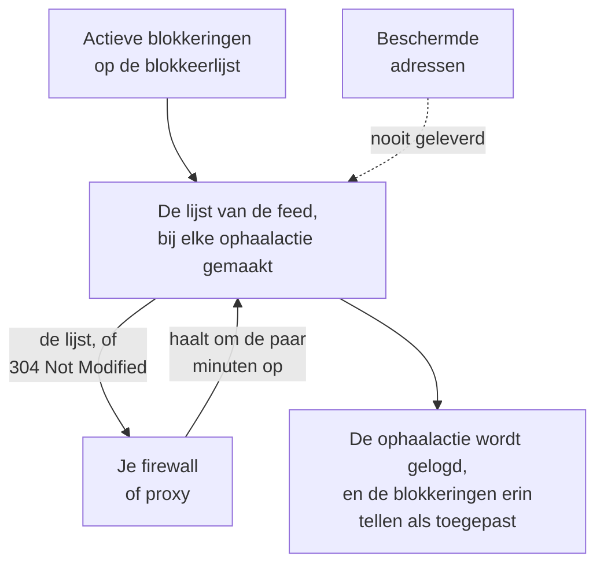

# Blokkeerlijstfeeds voor firewalls en proxy's

Een blokkeerlijstfeed is een geheime URL waarvan je firewall of proxy om de paar minuten de [blokkeerlijst](/docs/telemetry/security-cases#blokkeerlijst) van je project leest. Palo Alto Networks, FortiGate, Check Point, Cisco Secure Firewall, OPNsense en pfSense lezen hem als externe lijst, en opdrachten die je uit OneUptime kopieert, passen hem toe met nftables, ipset, nginx, HAProxy of Windows Firewall. Je firewall maakt zelf verbinding met OneUptime: OneUptime heeft nooit een route naar je netwerk of een wachtwoord voor je firewall nodig.

:::cards
- [Een feed aanmaken](#een-feed-aanmaken): Kies de firewall, kopieer het geheim en volg de stappen.
- [Je firewall instellen](#je-firewall-instellen): De stappen voor elke firewall en proxy, en hoe vaak die ophaalt.
- [Wanneer een blokkering is toegepast](#wanneer-een-blokkering-is-toegepast): Pas zodra een firewall een lijst heeft opgehaald waarin ze staat.
- [Het geheim roteren of intrekken](#het-geheim-roteren-of-intrekken): Een nieuw geheim met een dag overlap, of meteen helemaal geen.
:::

## Hoe het werkt



Elke ophaalactie maakt de lijst uit de blokkeringen die op dat moment actief zijn. Een blokkering die verloopt of wordt opgeheven, ontbreekt bij de volgende ophaalactie, en een beschermd adres staat er nooit in, ook niet een adres dat pas na de blokkering is beschermd. Een blokkering telt pas als toegepast bij de feed zodra een firewall een lijst heeft opgehaald waarin ze staat.

## Voordat je begint

- Een firewall of proxy die een lijst met adressen leest van een `https`-URL, of een Linux- of Windows-host waarop je opdrachten kunt uitvoeren als root of als administrator.
- Een uitgaande verbinding van de firewall naar OneUptime via HTTPS: `https://oneuptime.com`, of het adres van je eigen OneUptime-server.
- Een rol die feeds kan aanmaken: Projecteigenaar, Projectbeheerder of Beveiligingsbeheerder. Beveiligingslid en Beveiligingskijker kunnen feeds en hun ophaalacties lezen. Zie [Rollen](/docs/permissions/reference#rollen).

## Een feed aanmaken

:::steps
### Ga naar Blokkeerlijstfeeds

Open **Producten → Beveiligingsgebeurtenissen → Playbooks → Blokkeerlijstfeeds**.

### Maak de feed aan

Klik op **Blokkeerlijstfeed aanmaken** en kies de **Firewall** die de feed leest. **Naam** is hoe de Blokkeerlijst de feed noemt waar een blokkering wordt toegepast; leeg gelaten krijgt de feed de naam van de firewall, zoals "FortiGate feed". Onder **Meer velden** kiest **Levert** IPv4 en IPv6, alleen IPv4 of alleen IPv6, en **Toegestane bronadressen** beperkt wie de feed mag lezen.

### Kopieer het geheim

De pagina van de feed opent met het geheim, dat één keer wordt getoond: OneUptime bewaart alleen de hash ervan. Kopieer het en klik daarna op **Klaar**. Tot je de pagina verlaat, vullen de stappen erop het geheim voor je in.

### Volg de stappen voor je firewall

**Je firewall instellen** toont de URL om te plakken, hoe je firewall het geheim verstuurt en de stappen in de eigen console van de firewall, ingevuld. Kies daar een andere firewall om in plaats daarvan diens stappen te zien. Na de eerste ophaalactie van je firewall toont de status van de feed **Bezig met uitlezen**, en **Ophaalacties** toont de ophaalactie.
:::

## Wat een feed levert

| Bestand | Voor | Wat het bevat |
| --- | --- | --- |
| `blocklist.txt` | Palo Alto Networks, pfSense, ipset, HAProxy, Windows Firewall en elke andere firewall | Eén adres of bereik per regel. |
| `blocklist.txt?comments=1` | FortiGate, Check Point, Cisco Secure Firewall en OPNsense, die regels overslaan die met `#` beginnen | Elk adres of bereik na een regel die zegt waarom het is geblokkeerd. |
| `nftables.nft` | nftables | Een bestand voor `nft -f` dat de sets `blocklist_v4` en `blocklist_v6` van de tabel `inet oneuptime` leegmaakt en opnieuw vult. |
| `nginx.conf` | nginx | Een `deny`-regel voor elk adres of bereik. |
| De naam van een bestand gevolgd door `.md5`, zoals `blocklist.txt.md5` | Cisco Secure Firewall | De MD5 van het bestand, zodat de firewall de lijst alleen downloadt als die is gewijzigd. |

De URL van een feed is `https://oneuptime.com/api/blocklist-feed/<feed ID>/<file>`, en de pagina van de feed toont die ingevuld voor je firewall. Met `?comments=1` ziet de lijst er zo uit:

```text
# OneUptime case CASE-42 until 2026-11-21 10:42 UTC
203.0.113.7
# OneUptime blocklist until lifted
198.51.100.0/24
```

Een feed levert de actieve blokkeringen waarvan de actie **Blokkeren** is. Een challenge levert hij nooit, want dat kan een firewall niet, en een feed die alleen IPv4 of alleen IPv6 levert, laat de andere adressen weg. Het nftables-bestand laat een adres weg dat al in een bereik van de lijst valt, omdat nftables overlappende items in een set weigert.

Als er niets is geblokkeerd, bevat `blocklist.txt` één adres, `192.0.2.1` (`2001:db8::1` voor een feed die alleen IPv6 levert). Dat adres is gereserveerd voor documentatie, en er komt geen verkeer op internet van: Palo Alto Networks en Cisco houden de laatst gelezen lijst aan als een lijst leeg terugkomt, dus een lege lijst zou blijven blokkeren wat je hebt opgeheven.

Elk antwoord bevat een `ETag`. Een firewall die die terugstuurt in `If-None-Match`, krijgt `304 Not Modified` zolang de lijst ongewijzigd is, en de opdrachten die OneUptime je geeft, doen dat.

## Hoe een firewall het geheim verstuurt

| Hoe | Wat de firewall verstuurt | Gebruikt door |
| --- | --- | --- |
| Basic-authenticatie | Een willekeurige gebruikersnaam, zoals `oneuptime`, met het geheim als wachtwoord | Palo Alto Networks (alleen via HTTPS), FortiGate en Check Point |
| Bearer-token | `Authorization: Bearer <secret>` | De opdrachten voor nftables, ipset, nginx, HAProxy en Windows Firewall |
| Geheim in de URL | `https://oneuptime.com/api/blocklist-feed/<feed ID>/<secret>/blocklist.txt` | Cisco Secure Firewall, OPNsense en pfSense, die geen manier documenteren om het mee te sturen |

Een verzoek zonder geheim, of met een verkeerd geheim, krijgt `401 Unauthorized`. Een URL met een verkeerd geheim erin krijgt `404 Not Found`, net als een adres dat niet bestaat. De eigen webserver van OneUptime schrijft geen feed-URL's naar zijn toegangslog, dus een geheim in een URL komt daar niet terecht.

## Beperken wie een feed mag lezen

**Toegestane bronadressen**, onder **Meer velden**, accepteert tot 50 adressen en bereiken, één per regel, zoals `203.0.113.7` of `198.51.100.0/24`. Een verzoek van een ander adres krijgt `403 Forbidden`, zelfs met het juiste geheim. Laat het veld leeg om elk adres dat het geheim heeft de feed te laten lezen.

Elk adres kan een feed 60 keer per minuut ophalen, en feeds in totaal 600 keer per minuut. Daarboven krijgt het `429 Too Many Requests` met een `Retry-After`-header.

## Wanneer een blokkering is toegepast

Een blokkering telt als toegepast bij een feed zodra een firewall, nadat de blokkering is gemaakt, een lijst heeft opgehaald waarin ze staat, en dat tien minuten lang na elke zulke ophaalactie. Een antwoord `304 Not Modified` telt als een ophaalactie van dezelfde lijst. Op de **Blokkeerlijst** wordt de chip van de feed in **Toegepast bij** dan groen, en de tooltip zegt hoe lang na de blokkering de firewall die ophaalde, zoals "Een firewall heeft deze blokkering 3 min na het aanmaken opgehaald van FortiGate feed. Laatst opgehaald 2 minuten geleden."

Na tien minuten zonder ophaalactie zegt de chip dat de firewall de feed sindsdien niet heeft opgehaald: de firewall blokkeert het adres misschien nog, maar OneUptime kan dat niet zien. Laat je firewall de feed daarom elke vijf minuten of vaker ophalen. Een firewall die minder vaak ophaalt, zoals OPNsense, blokkeert tussen zijn ophaalacties nog steeds, en OneUptime noemt de blokkering daar alleen toegepast voor de tien minuten na elke ophaalactie.

Een blokkering die verloopt of wordt opgeheven, ontbreekt bij de volgende ophaalactie, en de chip wacht tot een firewall de lijst zonder die blokkering ophaalt. Als OneUptime niet kan lezen welke adressen beschermd zijn, antwoordt de feed met `503 Service Unavailable` en `Retry-After: 60` in plaats van een lijst waar er een in zou kunnen staan, en houdt de firewall de lijst die hij heeft.

## Wanneer een firewall stopt met lezen

OneUptime leert hoe vaak elke feed wordt opgehaald. Als een feed drie keer zijn gebruikelijke interval lang niet is opgehaald, en minstens tien minuten, toont de status **Gestopt met uitlezen**, noemt de **Blokkeerlijst** de feed boven de lijst, en krijgen de Projecteigenaars één e-mail: "Your firewall stopped reading the blocklist feed _feednaam_". Tot een firewall een feed twee keer heeft opgehaald, verwacht OneUptime elke vijf minuten een ophaalactie, van OPNsense elk uur en van pfSense elke dag.

De volgende ophaalactie heft dat op, en een latere stop stuurt opnieuw een e-mail. Een feed waarvan het geheim is ingetrokken, telt nooit als gestopt.

## Het geheim roteren of intrekken

**Geheim roteren**, op de pagina van de feed, maakt een nieuw geheim aan en toont het één keer. Het geheim dat het vervangt, blijft 24 uur werken, zodat je elke firewall het nieuwe kunt geven; **Ophaalacties** markeert een ophaalactie die nog het oude stuurde als **Vorig geheim**. Opnieuw roteren binnen die 24 uur beëindigt het oudste geheim meteen.

**Geheim intrekken** beëindigt het geheim en het vorige meteen: gebruik het als een geheim is uitgelekt. De feed antwoordt dan niemand meer, en de firewalls ervan houden de lijst die ze hebben zonder die te vernieuwen, tot **Geheim roteren** een nieuw geheim aanmaakt. Een feed verwijderen beëindigt de feed, het geheim en de ophaalacties.

## Je firewall instellen

De pagina van de feed toont deze stappen voor de firewall die je kiest, met de URL, de gebruikersnaam en, direct nadat het geheim is aangemaakt, het geheim ingevuld.

| Firewall | Bestand | Geheim | Ophalen elke | Bevat maximaal |
| --- | --- | --- | --- | --- |
| Palo Alto Networks | `blocklist.txt` | Basic-authenticatie | 5 minuten, het kortste dat het biedt | 30 aangepaste lijsten, en in totaal 50.000 adressen (150.000 op de series PA-3200, PA-5200 en PA-7000) |
| FortiGate | `blocklist.txt?comments=1` | Basic-authenticatie | 5 minuten (1 tot 43.200; standaard 5) | 300.000 adressen, verdeeld over al zijn dreigingsfeeds |
| Check Point | `blocklist.txt?comments=1`, IPv4 | Basic-authenticatie | 5 minuten (standaard elk uur) | 50.000 adressen in een feed |
| Cisco Secure Firewall | `blocklist.txt?comments=1` en de MD5 ervan | In de URL | 5 minuten (standaard 2 uur) | |
| OPNsense | `blocklist.txt?comments=1` | In de URL | 1 uur, het kortste dat het biedt | |
| pfSense | `blocklist.txt` | In de URL | 1 dag, het kortste dat het biedt | |
| nftables, ipset, nginx, HAProxy, Windows Firewall | Hun eigen | Bearer-token | 1 minuut | |

### Palo Alto Networks

1. Ga in de webinterface naar **Objects → External Dynamic Lists** en klik op **Add**.
2. Zet **Type** op **IP List** en **Source** op de URL van de feed, `https://oneuptime.com/api/blocklist-feed/<feed ID>/blocklist.txt`.
3. Schakel **Client Authentication** in, met **Username** `oneuptime` en het geheim van de feed als **Password**.
4. Zet **Check for updates** op **Every Five Minutes**, klik op **OK** en voer een commit uit.
5. Voeg in **Policies → Security** een regel toe met de lijst als **Source Address** en de actie **Deny**, en voer een commit uit.

Palo Alto Networks verstuurt de gebruikersnaam en het wachtwoord alleen via HTTPS. Het leest een opmerking alleen na een adres, nooit op een eigen regel, dus de feed ervoor is de gewone lijst. Zie [Configure the Firewall to Access an External Dynamic List](https://docs.paloaltonetworks.com/pan-os/11-1/pan-os-admin/policy/use-an-external-dynamic-list-in-policy/configure-the-firewall-to-access-an-external-dynamic-list).

### FortiGate

1. Ga naar **Security Fabric → External Connectors**, klik op **Create New** en kies **IP Address** onder **Threat Feeds**.
2. Zet **URL of external resource** op de URL van de feed, `https://oneuptime.com/api/blocklist-feed/<feed ID>/blocklist.txt?comments=1`.
3. Schakel **HTTP basic authentication** in, met **Username** `oneuptime` en het geheim van de feed als **Password**.
4. Zet **Refresh Rate** op 5 minuten en klik op **OK**.
5. Gebruik in **Policy & Objects → Firewall Policy** de feed als **Source** van een policy en zet **Action** op **DENY**.

Zie [Configuring a threat feed](https://docs.fortinet.com/document/fortigate/7.6.0/administration-guide/379433/configuring-a-threat-feed).

### Check Point

1. Open in SmartConsole de **Object Explorer** en kies **New → More → Network Object → Network Feed**.
2. Zet **Feed URL** op de URL van de feed, `https://oneuptime.com/api/blocklist-feed/<feed ID>/blocklist.txt?comments=1`, **Format** op **Flat list** en **Data type** op **IP Address**.
3. Voer onder **Advanced Settings** als **Username** `oneuptime` in, en het geheim van de feed als wachtwoord voor **Authentication**.
4. Zet **Check feed interval** op 5 minuten, klik op **Test Feed** en daarna op **OK**.
5. Gebruik de feed als **Source** van een Access Control-regel met de actie **Drop**, en installeer de policy.

Check Point documenteert IPv4-adressen voor een netwerkfeed, dus een feed die ervoor is gemaakt, levert alleen IPv4. Zie [Network Feed](https://sc1.checkpoint.com/documents/R82/WebAdminGuides/EN/CP_R82_SecurityManagement_AdminGuide/Content/Topics-SECMG/Network_Feed.htm).

### Cisco Secure Firewall

1. Kies in het management center **Objects → Security Intelligence** en klik op **Add Network Lists and Feeds**.
2. Zet **Type** op **Feed**, **Feed URL** op de URL van de feed, `https://oneuptime.com/api/blocklist-feed/<feed ID>/<secret>/blocklist.txt?comments=1`, en **MD5 URL** op dezelfde URL met `.md5` na `blocklist.txt`.
3. Zet **Update Frequency** op 5 minuten en sla op.
4. Open in je toegangsbeleid **Security Intelligence → Networks**, voeg de feed toe aan de **Block List**, sla daarna op en implementeer.

Cisco heeft een MD5-URL nodig voor een updatefrequentie van 30 minuten of minder, en de beheerde apparaten halen elke 30 minuten updates op bij het management center, dus een blokkering bereikt ze tot 30 minuten nadat de feed is opgehaald. Zie [Creating Security Intelligence feeds](https://docs.manage.security.cisco.com/cdfmc/t_creating_security_intelligence_feeds.html).

### OPNsense

1. Ga naar **Firewall → Aliases** en voeg een alias van het type **URL Table (IPs)** toe.
2. Zet **Content** op de URL van de feed, `https://oneuptime.com/api/blocklist-feed/<feed ID>/<secret>/blocklist.txt?comments=1`, en **Refresh Frequency** op 0 dagen en 1 uur.
3. Sla op en klik op **Apply**, en voeg daarna in **Firewall → Rules** een regel toe die verkeer blokkeert waarvan de **Source** de alias is.

OPNsense haalt een URL-tabel hooguit elk uur op, dus OneUptime bevestigt de blokkeringen daar alleen voor de tien minuten na elke ophaalactie. Daartussen blokkeert OPNsense ze nog steeds. Zie [Aliases](https://docs.opnsense.org/manual/aliases.html).

### pfSense

1. Ga naar **Firewall → Aliases**, klik op **Add** en kies **URL Table (IPs)**.
2. Voer de URL van de feed in, `https://oneuptime.com/api/blocklist-feed/<feed ID>/<secret>/blocklist.txt`, en stel het vernieuwingsinterval in op 1 dag.
3. Klik op **Save** en **Apply Changes**, en voeg daarna in **Firewall → Rules** een regel toe met de alias als **Source** en de actie **Block**.

> [!WARNING]
> pfSense haalt een URL-tabel hooguit één keer per dag op: te traag om een aanval te blokkeren terwijl die bezig is. Gebruik het voor lange blokkeringen, naast een firewall die om de paar minuten ophaalt.

Zie [Alias Types](https://docs.netgate.com/pfsense/en/latest/firewall/aliases-types.html).

### nftables

Voer als root één keer de opdrachten uit die de pagina van de feed toont. Ze maken de tabel `inet oneuptime` met twee sets, `blocklist_v4` en `blocklist_v6`, regels in de chains `input` en `forward` die verkeer van de adressen erin verwerpen, en het script `/usr/local/sbin/oneuptime-blocklist`, dat het geheim bewaart in `/etc/oneuptime-blocklist`, alleen leesbaar voor root.

```bash
# Run once, as root.
install -d -m 700 /etc/oneuptime-blocklist /var/lib/oneuptime-blocklist
printf 'Authorization: Bearer %s\n' 'YOUR_FEED_SECRET' > /etc/oneuptime-blocklist/auth
chmod 600 /etc/oneuptime-blocklist/auth
cat > /usr/local/sbin/oneuptime-blocklist <<'SCRIPT'
#!/bin/sh
# Loads the OneUptime blocklist into nftables when it changed.
set -eu
URL='https://oneuptime.com/api/blocklist-feed/<feed ID>/nftables.nft'
STATE=/var/lib/oneuptime-blocklist
if ! nft list table inet oneuptime >/dev/null 2>&1; then
  rm -f "$STATE/etag"
  nft -f - <<'NFT'
table inet oneuptime {
  set blocklist_v4 { type ipv4_addr; flags interval; auto-merge; }
  set blocklist_v6 { type ipv6_addr; flags interval; auto-merge; }
  chain input {
    type filter hook input priority filter; policy accept;
    ip saddr @blocklist_v4 drop
    ip6 saddr @blocklist_v6 drop
  }
  chain forward {
    type filter hook forward priority filter; policy accept;
    ip saddr @blocklist_v4 drop
    ip6 saddr @blocklist_v6 drop
  }
}
NFT
fi
TMP=$(mktemp)
trap 'rm -f "$TMP" "$TMP.h"' EXIT
ETAG=$(cat "$STATE/etag" 2>/dev/null || true)
CODE=$(curl --silent --show-error --max-time 60 --header @/etc/oneuptime-blocklist/auth \
  ${ETAG:+--header "If-None-Match: $ETAG"} \
  --dump-header "$TMP.h" --output "$TMP" --write-out '%{http_code}' "$URL")
[ "$CODE" = 304 ] && exit 0
[ "$CODE" = 200 ] || { echo "oneuptime-blocklist: the feed answered $CODE" >&2; exit 1; }
nft -f "$TMP"
sed -n 's/^[Ee][Tt][Aa][Gg]:[[:space:]]*//p' "$TMP.h" | tr -d '\r' > "$STATE/etag"
SCRIPT
chmod 700 /usr/local/sbin/oneuptime-blocklist
echo '* * * * * root flock -n /run/oneuptime-blocklist.lock /usr/local/sbin/oneuptime-blocklist' > /etc/cron.d/oneuptime-blocklist
/usr/local/sbin/oneuptime-blocklist
```

Het script draait elke minuut via `/etc/cron.d/oneuptime-blocklist`. Het laadt `nftables.nft` alleen als de lijst is gewijzigd, in één transactie, zodat de sets nooit halfvol zijn. Zie [Sets](https://wiki.nftables.org/wiki-nftables/index.php/Sets).

### ipset en iptables

Voer als root één keer de opdrachten uit die de pagina van de feed toont. Ze maken twee sets, `oneuptime_v4` en `oneuptime_v6`, en regels in de chain `PREROUTING` van de tabel `raw`, voor iptables en ip6tables, die verkeer van de adressen erin verwerpen.

Het script draait elke minuut via cron. Als de lijst is gewijzigd, vult het twee nieuwe sets en wisselt ze om met de oude, zodat de regels nooit een halfvolle set zien. Zie [ipset](https://ipset.netfilter.org/ipset.man.html).

### nginx

Voeg de include-regel toe aan het `server`-blok van elke site die je wilt beschermen, en voer daarna als root één keer de opdrachten uit die de pagina van de feed toont:

```nginx
server {
    include /etc/nginx/oneuptime-blocklist.conf;
}
```

```bash
# Run once, as root.
install -d -m 700 /etc/oneuptime-blocklist /var/lib/oneuptime-blocklist
printf 'Authorization: Bearer %s\n' 'YOUR_FEED_SECRET' > /etc/oneuptime-blocklist/auth
chmod 600 /etc/oneuptime-blocklist/auth
touch /etc/nginx/oneuptime-blocklist.conf
cat > /usr/local/sbin/oneuptime-blocklist <<'SCRIPT'
#!/bin/sh
# Writes the OneUptime blocklist for nginx when it changed, and reloads nginx.
set -eu
URL='https://oneuptime.com/api/blocklist-feed/<feed ID>/nginx.conf'
STATE=/var/lib/oneuptime-blocklist
TMP=$(mktemp)
trap 'rm -f "$TMP" "$TMP.h"' EXIT
ETAG=$(cat "$STATE/etag" 2>/dev/null || true)
CODE=$(curl --silent --show-error --max-time 60 --header @/etc/oneuptime-blocklist/auth \
  ${ETAG:+--header "If-None-Match: $ETAG"} \
  --dump-header "$TMP.h" --output "$TMP" --write-out '%{http_code}' "$URL")
[ "$CODE" = 304 ] && exit 0
[ "$CODE" = 200 ] || { echo "oneuptime-blocklist: the feed answered $CODE" >&2; exit 1; }
cp /etc/nginx/oneuptime-blocklist.conf "$STATE/last.conf"
cp "$TMP" /etc/nginx/oneuptime-blocklist.conf
if nginx -t -q; then nginx -s reload; else cp "$STATE/last.conf" /etc/nginx/oneuptime-blocklist.conf; exit 1; fi
sed -n 's/^[Ee][Tt][Aa][Gg]:[[:space:]]*//p' "$TMP.h" | tr -d '\r' > "$STATE/etag"
SCRIPT
chmod 700 /usr/local/sbin/oneuptime-blocklist
echo '* * * * * root flock -n /run/oneuptime-blocklist.lock /usr/local/sbin/oneuptime-blocklist' > /etc/cron.d/oneuptime-blocklist
/usr/local/sbin/oneuptime-blocklist

# Then add this line to the server block of the site to protect, and reload nginx:
#   include /etc/nginx/oneuptime-blocklist.conf;
```

Het script draait elke minuut via cron. Als de lijst is gewijzigd, schrijft het `/etc/nginx/oneuptime-blocklist.conf`, controleert het de configuratie met `nginx -t` en herlaadt het nginx, en zet het het vorige bestand terug als de controle mislukt.

Achter een load balancer of een CDN ziet nginx het adres van de balancer, niet dat van de bezoeker, tenzij de realip-module is ingesteld: zet `set_real_ip_from` op de adressen van de balancer en `real_ip_header` op de header die hij stuurt, of blokkeer in plaats daarvan bij de balancer. Zie [ngx_http_access_module](https://nginx.org/en/docs/http/ngx_http_access_module.html).

### HAProxy

Maak als root het lijstbestand aan en voeg twee regels toe aan `haproxy.cfg`, en herlaad HAProxy daarna één keer: de Runtime API werkt alleen een lijst bij die HAProxy al leest.

```text
global
    stats socket /run/haproxy/admin.sock mode 660 level admin

frontend www
    http-request deny if { src -n -f /etc/haproxy/oneuptime-blocklist.lst }
```

Voer daarna de rest van de opdrachten uit die de pagina van de feed toont. Het script draait elke minuut via cron en schrijft, als de lijst is gewijzigd, `/etc/haproxy/oneuptime-blocklist.lst` en werkt HAProxy bij via de Runtime API, zonder herladen. Zie [The Runtime API](https://docs.haproxy.org/3.4/management.html#9.3).

### Windows Firewall

Voer in PowerShell als administrator één keer de opdrachten uit die de pagina van de feed toont. Ze slaan een script en het geheim op in `C:\ProgramData\OneUptime\Blocklist`, dat alleen SYSTEM en Administrators kunnen lezen, en registreren de geplande taak "OneUptime Blocklist", die het script elke minuut als SYSTEM uitvoert.

Het script houdt inkomende regels bij die elk adres op de lijst blokkeren, 1.000 per regel: "OneUptime blocklist 0", "OneUptime blocklist 1" enzovoort. Zie [Set-NetFirewallRule](https://learn.microsoft.com/en-us/powershell/module/netsecurity/set-netfirewallrule).

### Andere firewalls

1. Richt je firewall of proxy op de URL van de feed, `https://oneuptime.com/api/blocklist-feed/<feed ID>/blocklist.txt`: één adres of bereik per regel.
2. Stuur het geheim van de feed als wachtwoord voor Basic-authenticatie, met een willekeurige gebruikersnaam, of als bearer-token.
3. Laat de lijst elke 5 minuten of vaker ophalen: een blokkering telt daar na elke ophaalactie tien minuten lang als toegepast.

### Kubernetes

Blokkeer aan de edge of bij de cloud-WAF vóór het cluster, gekoppeld als bestemming van de blokkeerlijst onder **Beveiligingsverbindingen** of **Cloudkoppelingen**, of op een proxy die je ervoor draait met de opdrachten voor nginx of HAProxy. De community-controller Ingress NGINX is met pensioen gegaan en de repository is in maart 2026 gearchiveerd, dus OneUptime documenteert de annotaties ervan niet. Zie [Ingress NGINX Retirement](https://kubernetes.io/blog/2025/11/11/ingress-nginx-retirement/).

## Limieten

| Wat | Limiet |
| --- | --- |
| Items in een feed | 20.000 |
| Toegestane bronadressen | 50 adressen en bereiken |
| Ophaalacties van één feed vanaf één adres | 60 per minuut |
| Ophaalacties van alle feeds vanaf één adres | 600 per minuut |
| Een vervangen geheim blijft werken | 24 uur |
| Een blokkering telt als toegepast na een ophaalactie | 10 minuten |
| Bewaarde ophaalacties | 30 dagen |

## Probleemoplossing

:::details De firewall krijgt 401 Unauthorized
Het geheim dat hij stuurt, is niet dat van de feed. Controleer of het wachtwoord, of het bearer-token, het hele geheim is, zonder iets ervoor of erna. Een geheim dat meer dan 24 uur geleden is vervangen, werkt niet meer: **Geheim roteren** maakt een nieuw aan.
:::

:::details De firewall krijgt 404 Not Found
De URL noemt een feed die niet bestaat, een bestand dat een feed niet levert, of een verkeerd geheim. Kopieer de URL opnieuw van de pagina van de feed.
:::

:::details De firewall krijgt 403 Forbidden
**Toegestane bronadressen** van de feed bevat niet het adres waarvandaan de firewall ophaalt. **Ophaalacties** toont het adres waar elke ophaalactie vandaan kwam.
:::

:::details De chip van een blokkering wacht tot een firewall de feed ophaalt
Geen enkele firewall heeft de feed opgehaald sinds de blokkering is gemaakt. Controleer **Ophaalacties** op de pagina van de feed: een firewall die elke vijf minuten ophaalt, heeft de blokkering binnen vijf minuten.
:::

## Volgende stappen

:::cards
- [Beveiligingszaken en playbooks](/docs/telemetry/security-cases): Blokkeer een adres vanuit een zaak, met de hand of vanuit een playbook.
- [Dreigingsinformatie](/docs/telemetry/threat-intelligence): Breng bekende kwaadaardige adressen naar OneUptime.
- [Beveiligingsgebeurtenissen](/docs/telemetry/security-events): Vind de adressen die het blokkeren waard zijn.
:::
