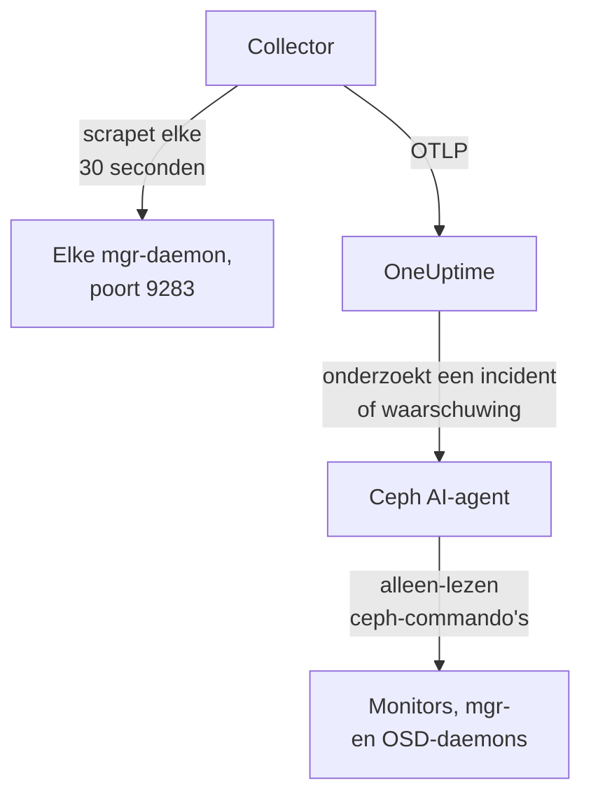

# Ceph-agent

De OneUptime Ceph-agent bewaakt een Ceph-cluster: de gezondheid, het monitorquorum, de OSD's, pools en placement groups. Hij scrapet de Ceph-mgr-module `prometheus` op elke mgr-daemon, stempelt elke metric met de naam van je cluster en stuurt die naar OneUptime, waar het cluster verschijnt met zijn OSD's, pools en daemons. [Ceph-monitors](/docs/monitor/ceph-monitor) waarschuwen op wat er binnenkomt.

:::cards
- [De agent installeren](#de-agent-installeren): Schakel de mgr-module in, daarna het installatiescript of Docker Compose.
- [Wat de agent verzamelt](#wat-de-agent-verzamelt): De series achter de Ceph-pagina's, metrics en waarschuwingssjablonen.
- [AI-agent](#ai-agent): Laat OneUptime AI het cluster lezen terwijl het onderzoekt.
- [Problemen oplossen](#problemen-oplossen): Een diagnosescript, en de gebruikelijke problemen.
:::

## Hoe het werkt

De agent bestaat uit twee containers die je met Docker Compose op één machine draait. Een OpenTelemetry Collector scrapet de mgr-module `prometheus` op elke mgr-daemon, elke 30 seconden. Alleen de actieve mgr antwoordt met metrics, dus als die overschakelt naar een standby, blijven de metrics zonder enige wijziging binnenkomen. De Ceph AI-agent ernaast laat OneUptime AI alleen-lezen `ceph`-commando's uitvoeren terwijl het een incident of waarschuwing onderzoekt.



Het cluster registreert zich met zijn eerste gegevens, onder de naam die de agent als `ceph.cluster.name` op elke metric stempelt.

## Voordat je begint

- Docker Engine 20.10 of nieuwer met de Docker Compose v2-plugin, op een machine die je Ceph-mgr-daemons op poort 9283 kan bereiken.
- Een shell op een Ceph-beheernode, waar de `ceph`-CLI met beheerrechten werkt.
- Een ingestiesleutel. Maak er een aan onder **Projectinstellingen → Telemetrie & APM → Ingestiesleutels** en kopieer de waarde.
- Uitgaand HTTPS van die machine naar je OneUptime-URL.

## De agent installeren

:::steps
### De mgr-module prometheus inschakelen

Op een Ceph-beheernode:

```bash
ceph mgr module enable prometheus
```

Elke mgr-daemon serveert dan Prometheus-metrics op poort `9283` onder `/metrics`. Alleen de actieve mgr geeft metrics terug: standby-mgr's antwoorden met een leeg antwoord, of met een HTTP-fout als `mgr/prometheus/standby_behaviour` op `error` staat. Daarom scrapet de agent elke mgr. Vraag ze op:

```bash
ceph mgr stat                    # active mgr
ceph orch ps --daemon-type mgr   # all mgrs (cephadm clusters)
```

### De agent installeren en starten

:::tabs
@tab install.sh
Download het installatiescript en voer het uit op de machine die de agent gaat hosten:

```bash
curl -sSL https://raw.githubusercontent.com/OneUptime/oneuptime/master/agents/CephAgent/install.sh -o install.sh
bash install.sh
```

Het script vraagt om je OneUptime-URL, de ingestiesleutel, een naam voor het cluster en de mgr-endpoints, en of de [AI-agent](#ai-agent) fixes mag toepassen. Waar `ceph` met beheerrechten werkt, biedt het ook aan om de eigen Ceph-client van de AI-agent aan te maken. Het installeert naar `/opt/oneuptime-ceph-agent`, schrijft een `.env`-bestand met `0600` en start de agent met Docker Compose. Het script opnieuw uitvoeren hergebruikt alles in die `.env` in plaats van opnieuw te vragen; zo [werk je de agent bij](#de-agent-upgraden).
@tab Docker Compose
Download `docker-compose.yml` en `otel-collector-config.yaml` uit de [CephAgent-map](https://github.com/OneUptime/oneuptime/tree/master/agents/CephAgent) naar een nieuwe map:

```bash
mkdir oneuptime-ceph-agent && cd oneuptime-ceph-agent
curl -fsSLO https://raw.githubusercontent.com/OneUptime/oneuptime/master/agents/CephAgent/docker-compose.yml
curl -fsSLO https://raw.githubusercontent.com/OneUptime/oneuptime/master/agents/CephAgent/otel-collector-config.yaml
```

Maak er een `.env`-bestand naast:

```bash title=".env"
ONEUPTIME_URL=YOUR_ONEUPTIME_URL
ONEUPTIME_TELEMETRY_INGESTION_KEY=YOUR_TELEMETRY_INGESTION_TOKEN
CEPH_CLUSTER_NAME=my-ceph-cluster
CEPH_MGR_ENDPOINTS=[ceph-mon-1:9283,ceph-mon-2:9283,ceph-mon-3:9283]
```

Noem elke mgr-daemon, de actieve en de standby's, gescheiden door komma's en tussen vierkante haken: door de haken leest de collector de waarde als een lijst met scrape-doelen. Start de agent:

```bash
docker compose up -d
```

De container van de AI-agent start ook, en wacht op een eigen Ceph-client: zie [AI-agent](#ai-agent).
:::

### Controleren of de agent draait

```bash
docker compose ps
docker logs -f oneuptime-ceph-agent
```

`docker compose ps` toont de collector (`oneuptime-ceph-agent`) en de AI-agent (`oneuptime-ceph-ai-agent`). Zodra de collector is gestart, horen zijn logs deze regel te tonen:

```text
Everything is ready. Begin running and processing data.
```

### Het cluster vinden in OneUptime

Open **Producten → Infrastructuur → Ceph → Alle clusters**. Het cluster verschijnt binnen ongeveer een minuut onder zijn `CEPH_CLUSTER_NAME`, met zijn OSD's, pools en daemons.
:::

## Omgevingsvariabelen

Het installatiescript schrijft deze naar `/opt/oneuptime-ceph-agent/.env`; een Docker Compose-installatie leest ze uit de `.env` naast `docker-compose.yml`. Voer na het wijzigen van een waarde `docker compose up -d` uit in die map.

| Variabele | Vereist | Beschrijving |
| --- | --- | --- |
| `ONEUPTIME_URL` | Ja | Je OneUptime-URL, zoals `https://oneuptime.com` of je zelf-gehoste instantie. Gebruik `http://` en de poort als de instantie alleen HTTP spreekt. |
| `ONEUPTIME_TELEMETRY_INGESTION_KEY` | Ja | De ingestiesleutel uit **Projectinstellingen → Telemetrie & APM → Ingestiesleutels**. |
| `CEPH_CLUSTER_NAME` | Ja | De naam van het cluster in OneUptime, op elke metric gestempeld als het resource-attribuut `ceph.cluster.name`. Houd hem stabiel: een latere wijziging registreert een tweede cluster. Standaard `ceph`. |
| `CEPH_MGR_ENDPOINTS` | Ja | Elke mgr-daemon als een door komma's gescheiden `host:port`-lijst tussen vierkante haken, zoals `[ceph-mon-1:9283,ceph-mon-2:9283,ceph-mon-3:9283]`. Het installatiescript zet de haken er voor je omheen. |

De eigen instellingen van de AI-agent staan onder [AI-agent](#ai-agent).

## Hoe de agent scrapet

- **Elke mgr, elke 30 seconden.** De mgr-module `prometheus` cachet elke scrape gedurende `mgr/prometheus/scrape_interval` (standaard 15 seconden). Scrape nooit vaker: je zou alleen de cache opnieuw lezen.
- **`honor_labels: true`.** De labels die Ceph exporteert (`ceph_daemon`, `pool_id`, instantielabels per daemon) blijven zoals ze zijn. Zonder deze instelling zou het label `instance` voor elk scrape-doel worden herschreven en veranderen telkens als de actieve mgr wisselt, wat elke serie breekt.

## Wat de agent verzamelt

De agent stuurt alles wat de mgr-module `prometheus` exporteert. De Ceph-pagina's, de metriccatalogus en de waarschuwingssjablonen van OneUptime zijn op deze series gebouwd:

| Categorie | Metrics |
| --- | --- |
| Clustergezondheid | `ceph_health_status` (0 = OK, 1 = WARN, 2 = ERR), `ceph_health_detail` (één serie per actieve gezondheidscontrole, met de labels `name` en `severity`, vanaf Quincy; de basis van de waarschuwingssjablonen voor gezondheidscontroles en van de **Active Health Checks** in het overzicht), `ceph_healthcheck_slow_ops`, `ceph_daemon_health_metrics` (per daemon, op `type`), `ceph_mon_quorum_status`, `ceph_mon_metadata`, `ceph_cluster_total_bytes`, `ceph_cluster_total_used_bytes` |
| OSD | `ceph_osd_up`, `ceph_osd_in`, `ceph_osd_apply_latency_ms`, `ceph_osd_commit_latency_ms`, `ceph_osd_stat_bytes`, `ceph_osd_stat_bytes_used`, `ceph_osd_numpg`, `ceph_osd_metadata`, per OSD via het label `ceph_daemon` (zoals `osd.3`) |
| Pool | `ceph_pool_stored`, `ceph_pool_max_avail`, `ceph_pool_objects`, `ceph_pool_rd`, `ceph_pool_wr`, `ceph_pool_rd_bytes`, `ceph_pool_wr_bytes`, `ceph_pool_metadata`. De dataseries dragen alleen een label `pool_id`; de naam van de pool staat op `ceph_pool_metadata`. |
| Placement groups | `ceph_pg_total`, `ceph_pg_active`, `ceph_pg_clean`, `ceph_pg_degraded`, `ceph_pg_undersized` (allemaal per pool, op `pool_id`), `ceph_num_objects_degraded`, `ceph_num_objects_misplaced` |
| Daemons | `ceph_mgr_metadata`, `ceph_mds_metadata` en `ceph_rgw_metadata`, naast de monitor- en OSD-metadata hierboven. Elk noemt een daemon en draagt zijn versie in het label `ceph_version`: de pagina **Daemons** toont ze. |

### Meer scrape-doelen

De mgr-module dekt de gezondheid en capaciteit van het cluster. Voeg voor een nadere blik meer jobs toe onder `scrape_configs` in `otel-collector-config.yaml`:

- **`ceph-exporter` (Reef 18.2 en later).** cephadm draait een daemon `ceph-exporter` op elke clusterhost, die prestatiecounters per daemon serveert op poort `9926`. Voeg één doel per host toe.
- **`node_exporter`.** De gebruikelijke metgezel voor de CPU-, geheugen-, schijf- en netwerkmetrics van elke Ceph-host, standaard op poort `9100`.

Beide krijgen het resource-attribuut `ceph.cluster.name` van de meegeleverde processor `resource`, zodat ze op hetzelfde cluster in OneUptime terechtkomen.

## Optioneel — Het Ceph-clusterlog versturen

De agent kan `/var/log/ceph/ceph.log` volgen en naar OneUptime sturen, wat de pagina **Cluster Log** van het cluster vult. Dit staat standaard uit, omdat de agent dan moet draaien op een host die het clusterlog heeft: standaard een monitorhost.

:::steps
### De receiver inschakelen

Haal in `otel-collector-config.yaml` de receiver `filelog` en de pipeline `logs` uit commentaar.

### De logmap koppelen

Haal in `docker-compose.yml` het volume uit commentaar dat de map in de collector koppelt:

```yaml
- /var/log/ceph:/var/log/ceph:ro
```

### De agent herstarten

```bash
docker compose up -d
```
:::

Regels worden verstuurd zodra ze worden geschreven. OneUptime leest het formaat van `ceph.log` (tijd, daemon, niveau `INF`/`WRN`/`ERR`, bericht) wanneer het ze toont, en de processor `resource` stempelt `ceph.cluster.name`, zodat het log op dit cluster terechtkomt.

## Het cluster labelen met projectlabels

Een resource-attribuut dat begint met `oneuptime.label.` wordt een projectlabel op het cluster: `oneuptime.label.<dimension>=<value>` is het label `<dimension>:<value>`. Voeg de attributen toe aan de processor `resource` in `otel-collector-config.yaml`, naast `ceph.cluster.name`:

```yaml
processors:
  resource:
    attributes:
      # ...existing attributes...
      - key: oneuptime.label.team
        value: storage
        action: upsert
      - key: oneuptime.label.env
        value: production
        action: upsert
```

De collector leest zijn configuratie alleen bij het starten: voer `docker compose restart oneuptime-ceph-agent` uit. Het cluster toont dan de labels `team:storage` en `env:production`. Labels worden zonder onderscheid tussen hoofd- en kleine letters vergeleken, dus een bestaand label `Production` wordt hergebruikt in plaats van gedupliceerd, en de agent verwijdert nooit een label dat iemand in OneUptime heeft toegevoegd.

## Draaien als systemd-service

Installeer de systemd-unit van de agent om hem met de machine te starten en hem te herstarten als hij faalt. De unit gaat ervan uit dat de agent in `/opt/oneuptime-ceph-agent` staat, waar het installatiescript hem neerzet:

```bash
sudo curl -fsSL https://raw.githubusercontent.com/OneUptime/oneuptime/master/agents/CephAgent/systemd/oneuptime-ceph-agent.service -o /etc/systemd/system/oneuptime-ceph-agent.service
sudo systemctl daemon-reload
sudo systemctl enable --now oneuptime-ceph-agent
```

## De agent upgraden

De agent meldt de collectorversie die zijn bestanden vastzetten als zijn **Agentversie**. Is die ouder dan de versie die deze OneUptime-release vastzet, dan verschijnt er een waarschuwingsteken naast in het **Overzicht** van het cluster. Selecteer het om deze commando's te zien. Een agent die is geïnstalleerd voordat zijn bestanden een versie meldden, toont er geen tot hij op deze manier is geüpgraded.

De collectorimage is vastgezet in `docker-compose.yml` en de configuratie ervan is een bestand ernaast, dus alleen pullen brengt de agent niet verder. Voer `install.sh` opnieuw uit: het hergebruikt elke waarde in je bestaande `.env` (er wordt niets opnieuw gevraagd), vernieuwt `docker-compose.yml` en `otel-collector-config.yaml` (een bestand dat je hebt bewerkt, wordt bewaard als `<file>.bak.<timestamp>`), pullt de images en maakt de agent opnieuw aan zodat de collector zijn nieuwe configuratie leest. De map `ceph/` van de AI-agent blijft zoals hij is.

```bash
curl -sSL https://raw.githubusercontent.com/OneUptime/oneuptime/master/agents/CephAgent/install.sh -o install.sh
bash install.sh
```

Heb je hem in plaats daarvan met Docker Compose geïnstalleerd? Download in de map van de agent beide bestanden opnieuw (en voer eventuele wijzigingen die je erin had gedaan opnieuw door), pull daarna de images en maak de agent opnieuw aan:

```bash
curl -fsSLO https://raw.githubusercontent.com/OneUptime/oneuptime/master/agents/CephAgent/docker-compose.yml
curl -fsSLO https://raw.githubusercontent.com/OneUptime/oneuptime/master/agents/CephAgent/otel-collector-config.yaml
docker compose pull
docker compose up -d --force-recreate
```

## De agent verwijderen

```bash
cd /opt/oneuptime-ceph-agent
docker compose down
```

Heb je de Ceph-client van de AI-agent aangemaakt, verwijder hem dan op een beheernode met `ceph auth del client.oneuptime-ai`.

## AI-agent

De `docker-compose.yml` van de agent draait ook de **Ceph-AI-agent**, `oneuptime-ceph-ai-agent` (image `oneuptime/resource-ai-agent:release`). Terwijl OneUptime AI een incident of waarschuwing op dit cluster onderzoekt, voert het daarmee alleen-lezen `ceph`-commando's uit — `ceph health detail`, `ceph osd tree`, `ceph pg dump_stuck`, `ceph crash ls` — en past het, alleen als je dat toestaat, fixes toe zoals een OSD weer op in zetten of `noout` wissen. Hij registreert zich, net als de collector, als het cluster met de naam `CEPH_CLUSTER_NAME` en verschijnt in OneUptime op de pagina **AI → AI-agent** van het cluster.

- **AI-onderzoeken staan standaard aan.** Zodra de agent verbinding maakt, onderzoekt OneUptime AI er incidenten en waarschuwingen op dit cluster mee, en het **Overzicht** van het cluster toont de status van de agent. Om te stoppen, stel je `ONEUPTIME_AI_INVESTIGATION=false` in waar de agent draait (**Wijzigen** onder **Wat AI mag doen** op de pagina van de AI-agent laat zien hoe), of laat je de agent weg.
- **Zijn eigen Ceph-client is de harde grens.** Hij verbindt als `client.oneuptime-ai`, met de minimale `ceph.conf` van het cluster en de keyring van die client in een map `ceph/` naast `docker-compose.yml` (alleen-lezen gekoppeld op `/etc/ceph`). Met leescaps kan niets wat hij uitvoert het cluster wijzigen. Bij een nieuwe installatie biedt `install.sh` aan de client aan te maken; opnieuw uitvoeren doet dat nooit. Zet nooit de admin-keyring in die map.
- Hij is **alleen-lezen**, tenzij je `ONEUPTIME_AI_ALLOW_WRITES=true` instelt en de client de caps voor de fixes geeft (de README van de agent noemt ze); `ONEUPTIME_AI_WRITE_TARGETS` (bijvoorbeeld `osd.*,cluster`) beperkt wat een fix mag aanraken. `ONEUPTIME_AI_FIXES` in dezelfde `.env` bepaalt hoe fixes verlopen — `ask-for-approval` (een persoon keurt elke fix goed), `automatic` of `bypass-approval` — en de pagina van de AI-agent toont dit alleen-lezen ([Wat AI mag doen, ingesteld door de agent](/docs/ai/infrastructure-ai-agents#what-ai-may-do-set-by-the-agent)).
- Hij maakt uitgaande verbindingen met de monitors (TCP 3300 en 6789) en de mgr- en OSD-daemons (TCP 6800–7300), draait als UID 1000 zonder capabilities en voert nooit `auth`, `config-key`, `tell` of iets uit dat gegevens verwijdert. Verwijder de service `oneuptime-ceph-ai-agent` uit `docker-compose.yml` als je OneUptime AI niet gebruikt.

Voer dit uit op een Ceph-beheernode, in de map van de agent, om de client met de hand aan te maken (kopieer de twee bestanden naar de map `ceph/` op de machine van de agent als dat een andere is):

```bash
mkdir -p ceph
ceph config generate-minimal-conf > ceph/ceph.conf
ceph auth get-or-create client.oneuptime-ai mon 'allow r' mgr 'allow r' osd 'allow r' -o ceph/ceph.client.oneuptime-ai.keyring
sudo chown 1000:1000 ceph/ceph.client.oneuptime-ai.keyring
sudo chmod 600 ceph/ceph.client.oneuptime-ai.keyring
docker compose up -d
```

Wat hij mag uitvoeren, hoe fixes werken en hoe je hem probleemoplost: [Infrastructure AI Agents](/docs/ai/infrastructure-ai-agents#ceph-clusters).

## Problemen oplossen

:::details Voer eerst het diagnosescript uit
De agent wordt geleverd met een script, [`troubleshoot.sh`](https://github.com/OneUptime/oneuptime/blob/master/agents/CephAgent/troubleshoot.sh), dat de hele keten controleert: de container-runtime, elk geconfigureerd mgr-endpoint, de clusternaam die op elke metric is gestempeld, de vorm van het token, de eigen metrics van de collector, en of OneUptime de ingestiesleutel accepteert. Het waarschuwt als geen enkel endpoint `ceph_health_status` teruggeeft, of als er maar één is geconfigureerd, omdat alleen de actieve mgr metrics serveert. De sleutelcontrole is het belangrijkst. OneUptime weigert een onjuiste sleutel met `401` (`422` voor een uitgeschakelde sleutel of een browsersleutel), en de collector behandelt beide als permanent: hij laat de batch vallen en logt één fout `Exporting failed`, die makkelijk over het hoofd wordt gezien terwijl de container gezond blijft. Het script vraagt `GET <url>/otlp/v1/validate` op vanuit het netwerk van de agent voor een direct `200` (geldig) of `401` (ongeldig), en valt op oudere servers terug op `POST /fluentd/v1/logs`.

```bash
curl -sSL https://raw.githubusercontent.com/OneUptime/oneuptime/master/agents/CephAgent/troubleshoot.sh -o troubleshoot.sh
bash troubleshoot.sh    # add -d <dir> if you installed outside /opt/oneuptime-ceph-agent
```

Het eindigt met een oordeel dat de meest waarschijnlijke oorzaak noemt.
:::

:::details Er verschijnt geen cluster in OneUptime
1. Lees de logs van de collector: `docker logs oneuptime-ceph-agent`. Een `401` bij het exporteren betekent een onjuiste ingestiesleutel; een geweigerde verbinding betekent een onjuiste `ONEUPTIME_URL`.
2. Controleer of een mgr metrics serveert: `curl http://ACTIVE_MGR_HOST:9283/metrics | head` hoort `ceph_*`-regels te tonen. Zo niet, schakel de module dan in met `ceph mgr module enable prometheus`.
3. Controleer of `CEPH_MGR_ENDPOINTS` tussen vierkante haken staat. Zonder haken leest de collector de hele door komma's gescheiden lijst als één doel, dat niet bestaat.
:::

:::details Het cluster wordt als verbroken weergegeven
Een cluster krijgt de status verbroken zodra OneUptime er 15 minuten niets van heeft ontvangen; OneUptime controleert elke 5 minuten, en tijd waarin het zelf geen gegevens ontving, telt niet mee. Controleer of de collector draait (`docker compose ps`), of zijn logs geen exportfouten tonen en of de machine je OneUptime-URL nog bereikt. Met zijn volgende gegevens is het cluster weer verbonden.
:::

:::details Metrics stoppen na een mgr-failover
Waarschijnlijk scrape je alleen de mgr die eerder actief was. Noem elke mgr-daemon in `CEPH_MGR_ENDPOINTS`: de standby's scrapen kost bijna niets, en ze antwoorden met lege antwoorden.
:::

:::details Scrapefouten voor standby-mgr's in de logs van de collector
Verwacht als `mgr/prometheus/standby_behaviour` op je cluster op `error` staat: standby's antwoorden dan met HTTP 500. De scrape van de actieve mgr slaagt nog steeds, dus de fouten zijn ruis; zet het gedrag terug op `default` om ze stil te krijgen.
:::

:::details Metrics komen bij het verkeerde cluster terecht
OneUptime registreert een Ceph-cluster aan de hand van zijn `ceph.cluster.name`, die de agent uit `CEPH_CLUSTER_NAME` haalt. Die na de eerste gegevens wijzigen maakt een tweede cluster aan in plaats van het eerste te hernoemen.
:::

## Volgende stappen

:::cards
- [Ceph-monitor](/docs/monitor/ceph-monitor): Waarschuw op gezondheid, OSD's, placement groups, capaciteit, crashes en trage operaties.
- [Proxmox-agent](/docs/telemetry/proxmox): Draait Ceph onder Proxmox VE? Bewaak ook het cluster.
- [Infrastructure AI Agents](/docs/ai/infrastructure-ai-agents): Wat de Ceph AI-agent mag uitvoeren en hoe fixes werken.
- [OpenTelemetry-collector op de host](/docs/telemetry/host-otel-collector): De weergave van het besturingssysteem van elke Ceph-host.
:::
