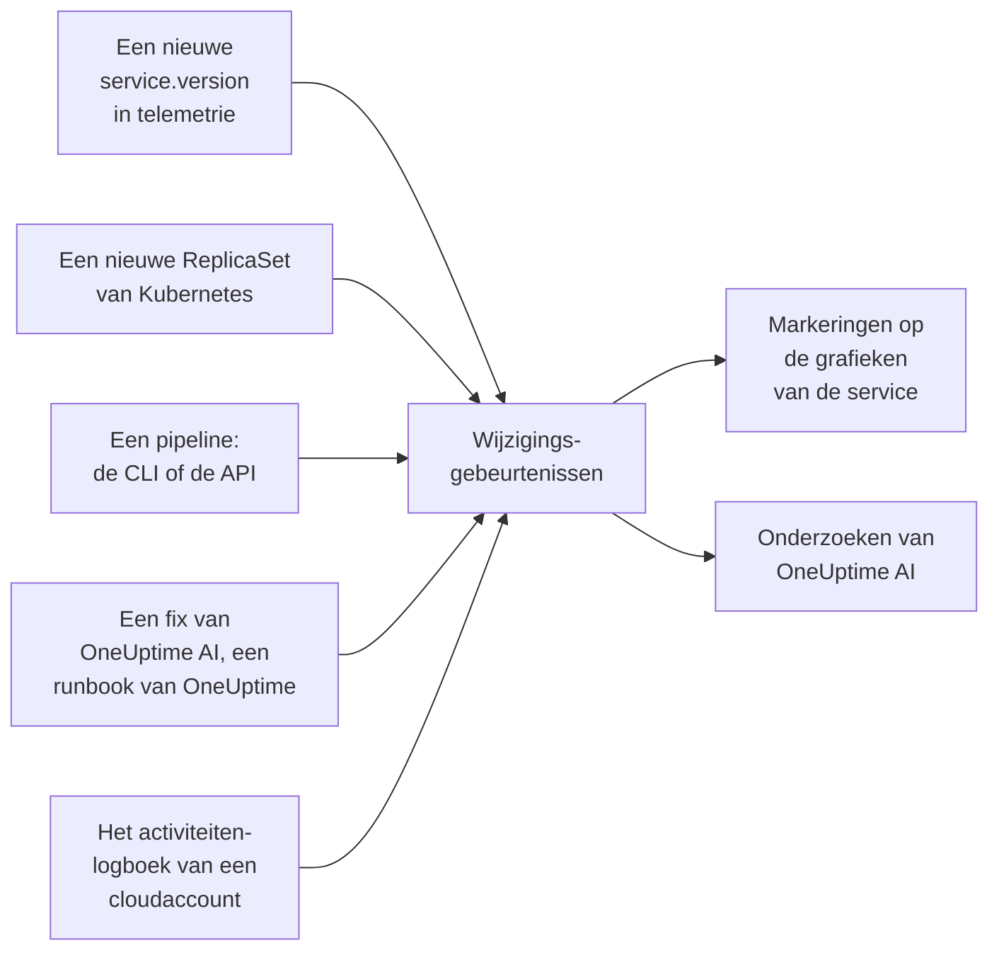

# Deploys en wijzigingen

OneUptime houdt bij wat er in je project is veranderd: deploys, Kubernetes-rollouts, configuratiewijzigingen, de wijzigingen in je gekoppelde cloudaccounts en de fixes die het zelf heeft uitgevoerd. Elke wijziging wordt als markering getekend op de grafieken van de bijbehorende service of cloudresource, en OneUptime AI leest ze wanneer het een incident onderzoekt, zodat "het begon vlak na de deploy van 10:02" het eerste is wat je te weten komt, niet het laatste.

:::cards
- [Wat OneUptime zelf vastlegt](#wat-oneuptime-zelf-vastlegt): Deploys en rollouts uit telemetrie, de wijzigingen van je cloudaccounts, en de eigen fixes van OneUptime.
- [Een deploy vastleggen vanuit een pipeline](#een-deploy-vastleggen-vanuit-een-pipeline): De CLI, GitHub Actions en de API.
- [Hoe OneUptime AI wijzigingen gebruikt](#hoe-oneuptime-ai-wijzigingen-gebruikt): De verdachte wijzigingen in elk onderzoek.
- [Referentie](#referentie): Velden, attributen en limieten.
:::

## Hoe het werkt



## Wat OneUptime zelf vastlegt

Hiervoor hoef je niets te sturen. OneUptime legt ze vast op basis van de telemetrie die het al ontvangt, en van wat het zelf doet.

| Wijziging | Vastgelegd wanneer | Bron |
| --- | --- | --- |
| Een deploy | Een service begint een `service.version` te rapporteren die hij in zijn omgeving nog niet eerder heeft gerapporteerd | `service-version` |
| Een rollout | De pods van een Kubernetes-Deployment beginnen een ReplicaSet te draaien die ze nog niet eerder hebben gedraaid: een nieuw image, een gewijzigde omgevingsvariabele of configuratieverwijzing, of een herstart | `kubernetes` |
| Een fix die OneUptime AI uitvoerde | Een AI-agent meldt het resultaat van een opdracht die iets wijzigt, zoals `kubectl rollout restart` | `oneuptime-ai` |
| Een runbook | Een runbook dat OneUptime uitvoerde, wordt voltooid, mislukt of wordt geannuleerd nadat het is gestart | `runbook` |
| Een cloudwijziging | Het activiteitenlogboek van een gekoppeld cloudaccount legt een wijziging vast: AWS CloudTrail, het Azure-activiteitenlogboek of het auditlogboek Admin Activity van Google Cloud | `cloud` |
| Een gebeurtenis van de provider | De cloudprovider publiceert een statusgebeurtenis over het account: AWS Health, Azure Service Health of Resource Health, of Google Cloud Service Health | `cloud-health` |

- **De eerste versie die een service rapporteert, is zijn uitgangspunt, geen deploy.** Een service die al maanden draait, wordt niet gedeployd op het moment dat OneUptime zijn telemetrie begint te ontvangen.
- **Een rollback naar een versie die in de afgelopen 30 dagen is gezien, wordt niet vastgelegd,** omdat die versie niet nieuw is. Een rollback die OneUptime AI uitvoert, wordt als fix vastgelegd.
- **Boven 6 nieuwe versies of ReplicaSets per uur wordt er niets meer vastgelegd tot het uur voorbij is.** Een "versie" die met elke pod verandert, zoals een build-tijdstempel, zou anders voor elke pod een deploy vastleggen.

Een deploy wordt alleen vastgelegd voor een service die `service.version` rapporteert. Stel die in, samen met de omgeving en de commit, in de resource-attributen van je OpenTelemetry-SDK of -collector:

```bash
OTEL_RESOURCE_ATTRIBUTES="service.version=2.3.1,deployment.environment.name=production,vcs.ref.head.revision=$GIT_SHA"
```

Een rollout heeft de [Kubernetes-agent](/docs/telemetry/kubernetes-agent) nodig, die de telemetrie van elke pod voorziet van zijn Deployment en ReplicaSet.

Een cloudwijziging of een gebeurtenis van de provider heeft een [gekoppeld cloudaccount](/docs/telemetry/cloud-accounts) nodig. Elk ervan wordt gekoppeld aan de cloudresource die het noemt, als OneUptime die resource vermeldt, en getekend op de grafieken van de resource. Het type volgt uit de bewerking: `deployment`, `scaling` of `rollback` als de naam van de bewerking dat zegt, anders `config-change`, en `provider-event` voor een statusgebeurtenis. Grafieken die op geen enkele resource zijn gefilterd, laten het activiteitenlogboek van een cloudaccount weg, zodat een druk account je deploys niet verdringt; de statusgebeurtenissen van de provider blijven erop staan.

## Een deploy vastleggen vanuit een pipeline

Een pipeline kan een deploy, of elke andere wijziging, vastleggen op het moment dat die gebeurt: een configuratiewijziging, een migratie, een feature flag. Hij schrijft met een telemetrie-ingestiesleutel van je project, het soort waarmee je applicaties telemetrie sturen. Maak er een aan onder **Projectinstellingen → Telemetrie & APM → Ingestiesleutels**.

Een sleutel die aan één service is gekoppeld, legt elke wijziging onder die service vast.

:::tabs
@tab CLI
```bash
oneuptime deploy \
  --service checkout \
  --service-version 2.3.1 \
  --commit "$GIT_SHA" \
  --environment production \
  --url https://oneuptime.com \
  --ingestion-key "$ONEUPTIME_TELEMETRY_INGESTION_KEY"
```
@tab GitHub Actions
```yaml title=".github/workflows/deploy.yml"
- name: Record the deploy in OneUptime
  env:
    ONEUPTIME_URL: https://oneuptime.com
    ONEUPTIME_TELEMETRY_INGESTION_KEY: ${{ secrets.ONEUPTIME_TELEMETRY_INGESTION_KEY }}
  run: |
    npx -y @oneuptime/cli deploy \
      --service checkout \
      --service-version "${{ github.ref_name }}" \
      --commit "${{ github.sha }}" \
      --repository "${{ github.server_url }}/${{ github.repository }}" \
      --environment production
```
@tab API
```bash
curl -X POST https://oneuptime.com/telemetry/change-events/v1/ingest \
  -H "Content-Type: application/json" \
  -H "x-oneuptime-token: $ONEUPTIME_TELEMETRY_INGESTION_KEY" \
  -d '{"events": [{"serviceName": "checkout", "version": "2.3.1", "commit": "1a2b3c4", "environment": "production"}]}'
```
:::

Gebruik op een zelfgehoste OneUptime je eigen adres in plaats van `https://oneuptime.com`. De API antwoordt met hoeveel gebeurtenissen hij heeft opgeslagen en hoeveel hij heeft overgeslagen:

```json
{ "ingested": 1, "skipped": 0 }
```

Zie [`oneuptime deploy`](/docs/cli/command-reference#oneuptime-deploy) voor elke optie van de CLI.

## Hoe OneUptime AI wijzigingen gebruikt

Elk [AI-onderzoek](/docs/ai/ai-sre) van een incident of een waarschuwing begint bij de wijzigingen die zijn vastgelegd in de 2 uur ervoor, en in de 10 minuten erna, voor een pipeline die zijn deploy pas vastlegt als de rollout klaar is. De wijzigingen op de services, clusters, hosts en cloudresources waaraan het incident is gekoppeld, komen eerst.

Voor maximaal 4 daarvan die een service noemen, leest OneUptime de telemetrie van de service in de 30 minuten voor en na de wijziging, en markeert het de wijziging als **verdacht** wanneer de service direct daarna meetbaar slechter werd:

| Signaal | Verdacht wanneer |
| --- | --- |
| Mislukte spans | Het foutpercentage is minstens verdubbeld en met minstens één procentpunt gestegen, over minstens 10 mislukte spans |
| Latentie | De p99 is met minstens de helft gestegen, en met minstens 100 ms |
| Exceptions | Minstens drie keer zoveel per minuut, en minstens 10 ervan |
| Nieuwe exceptions | Een exceptiontype dat tussen 10 minuten voor en 30 minuten na de wijziging voor het eerst werd gezien in de versie die met de wijziging werd uitgerold, kwam minstens 3 keer voor |

OneUptime bepaalt welke wijziging verdacht is op basis van deze cijfers, niet op basis van wat de titel van een wijziging zegt. Het onderzoek controleert eerst een verdachte wijziging, zegt of die het incident heeft veroorzaakt, en zegt of terugdraaien de snelste veilige fix is.

Als de verdachte wijziging een Kubernetes-rollout is op een cluster waarvan de [AI-fixes](/docs/ai/ai-sre#zo-werken-fixes) aan staan, draait OneUptime AI die eerst terug, met een `kubectl rollout undo` die OneUptime samenstelt uit de vastgelegde wijziging. Een deploy die code uitrolt, wordt teruggedraaid via zijn commits: het onderzoek noemt de commit of pull request die het probleem veroorzaakte, zodat een [pull request met een fix](/docs/ai/ai-sre#automatische-codefixes) precies die kan terugdraaien.

OneUptime controleert ook zelf elke deploy, of er nu iemand wordt opgeroepen of niet. Zodra de 30 minuten na een deploy voorbij zijn, vergelijkt het die met de 30 minuten ervoor volgens dezelfde drempels, en als de service slechter werd, noemt een [AI-inzicht](/docs/ai/ai-sre#inzichten-proactieve-detectie) de deploy op die service.

Een pull request met een fix die OneUptime AI opende, wordt op dezelfde manier gecontroleerd: zodra een vastgelegde deploy de commit ervan bevat, houdt OneUptime daar in de gaten waarvoor de fix bedoeld was - de exception, de bewerking die hij sneller maakte, de monitor achter het incident of de melding, de telemetrie die hij toevoegt - en zegt het of de fix heeft gewerkt (zie [Automatische codefixes](/docs/ai/ai-sre#automatische-codefixes)). De uitgerolde fix wordt alleen in de versie van de deploy gelezen wanneer de eigen telemetrie van de service die versie meldt, en anders vanaf 10 minuten na de deploy, wanneer oude instanties zijn gestopt.

In een onderzoek en in [Ask AI](/docs/ai/ask-ai) toont `recent_changes` de wijzigingen in elk tijdvenster, en laat `get_change_details` zien wat een deploy heeft uitgerold: de commits sinds de vorige deploy van de service, hun auteurs, de pull requests en de bestanden die ze hebben gewijzigd. Daarvoor zijn de commit bij de wijziging en de repository ervan nodig, verbonden in Code: via de [GitHub App](/docs/ai/github-app), of een GitLab-, Forgejo- of Gitea-verbinding (zie [Een repository verbinden](/docs/ai/ai-agent#een-repository-verbinden)).

## Referentie

### Velden

| Veld | Wat het is |
| --- | --- |
| `title` | Wat er veranderde, zoals `Deploy 2.3.1`. Een deploy die `version` meestuurt, mag het weglaten |
| `eventType` | Het soort wijziging: `deployment` (de standaard), `config-change`, `scaling`, `rollback`, `feature-flag` of een eigen soort |
| `serviceName` | De service waar de wijziging bij hoort. Zonder service geldt de wijziging voor het hele project |
| `time` | Wanneer het gebeurde, als ISO 8601 of als epoch in seconden of milliseconden. De standaard is het moment van aankomst |
| `description` | Details van de wijziging |
| `version` | De gedeployde versie |
| `previousVersion` | De versie die erdoor werd vervangen |
| `commit` | De gedeployde commit (ook `commitSha` of `sha`) |
| `repository` | De repository van de commit (ook `repositoryUrl`) |
| `branch` | De gedeployde branch |
| `pullRequest` | De gedeployde pull request |
| `environment` | De omgeving waarnaar is gedeployd |
| `attributes` | Maximaal 50 extra attributen, als tekst, getallen of booleans |

De velden op het hoogste niveau worden opgeslagen als attributen onder de namen van OpenTelemetry: `version` als `service.version`, `commit` als `vcs.ref.head.revision`, `repository` als `vcs.repository.url.full`, `branch` als `vcs.ref.head.name`, `pullRequest` als `vcs.change.id` en `environment` als `deployment.environment.name`. Een attribuut dat onder een van die namen wordt gestuurd, gaat voor op het bijbehorende veld.

Attributen waarvan de naam begint met `oneuptime.` zijn van OneUptime zelf en worden weggelaten uit wat een pipeline stuurt. Elke wijziging die een pipeline vastlegt, vermeldt dat in `oneuptime.change.source`, met de waarde `api`.

Een wijziging die uit een cloudaccount is gelezen, noemt het account en de resource onder de namen van OpenTelemetry, `cloud.provider`, `cloud.account.id`, `cloud.region` en `cloud.resource_id`, en bewaart de bewerking in `oneuptime.cloud.operation`, wie hem uitvoerde in `oneuptime.cloud.actor`, of hij mislukte in `oneuptime.change.status` en het cloudaccount in `oneuptime.cloud_account.id`.

### Limieten

| Limiet | Waarde |
| --- | --- |
| Gebeurtenissen per verzoek | 100 |
| Titel | 500 tekens |
| Beschrijving | 5.000 tekens |
| Attributen | 50 |
| Tijd | Een tijd van meer dan 366 dagen geleden, of meer dan 60 minuten in de toekomst, wordt vervangen door het tijdstip waarop de gebeurtenis binnenkwam |

## Volgende stappen

:::cards
- [AI SRE](/docs/ai/ai-sre): Wat een onderzoek leest, en hoe het herstelt wat het vindt.
- [Opdrachtreferentie](/docs/cli/command-reference): Elke opdracht van de CLI.
- [OpenTelemetry](/docs/telemetry/open-telemetry): Stuur de telemetrie van je services, met hun versies.
- [Een cloudaccount koppelen](/docs/telemetry/cloud-accounts): De wijzigingen en statusgebeurtenissen van je AWS-, Azure- en Google Cloud-accounts.
:::
