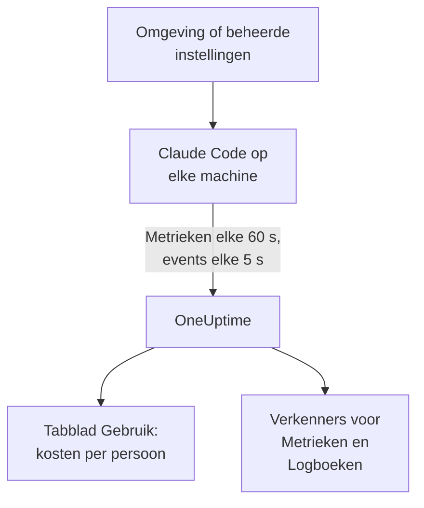

# Claude Code

Claude Code exporteert zelf OpenTelemetry-metrieken en -events, rechtstreeks naar OneUptime: geen collector en geen gateway ertussen. Zet het aan met een paar omgevingsvariabelen, of voor een hele vloot met één bestand met beheerde instellingen, en zie kosten, tokens, sessies, commits en geaccepteerde bewerkingen per ontwikkelaar.

:::cards
- [Eén machine instellen](#eén-machine-instellen): Zes omgevingsvariabelen en een herstart.
- [Uitrollen naar de vloot](#uitrollen-naar-de-vloot): Eén bestand met beheerde instellingen op elke machine.
- [Uitgaven aan personen toewijzen](#gebruik-toewijzen-aan-personen-en-teams): Wie er is ingelogd, en wanneer je de identiteit zelf moet instellen.
- [Problemen oplossen](#problemen-oplossen): Wat je controleert als er niets binnenkomt.
:::

## Hoe het werkt



Claude Code stuurt:

- **Kosten en tokens**: `claude_code.cost.usage` (USD) en `claude_code.token.usage`, per model, per hoofdagent of subagent, en per agent, skill, plugin of MCP-server die de aanroep deed.
- **Activiteit**: sessies, commits, pull requests, toegevoegde en verwijderde regels code, en actieve tijd.
- **Bewerkingsbeslissingen**: `claude_code.code_edit_tool.decision` telt geaccepteerde en geweigerde bewerkingen, dus de acceptatiegraad is `accept / (accept + reject)`, per taal en per tool.
- **Events**: prompts, toolresultaten, API-aanvragen en -fouten, wijzigingen van de machtigingsmodus en verbindingen met MCP-servers, als OTLP-logrecords.

Elk datapunt van een metriek en elk event draagt `user.email` wanneer de ontwikkelaar is ingelogd met een Claude-account, en OneUptime leest dat als de medewerker op de metrieken, waar de kosten en tokens staan.

## Voordat je begint

1. Maak een telemetrie-ingestiesleutel aan onder **Projectinstellingen → Telemetrie & APM → Ingestiesleutels**.
2. Je OTLP-endpoint is `https://oneuptime.com/otlp`, of `https://YOUR-ONEUPTIME-HOST/otlp` als je OneUptime zelf host.
3. Gebruik één sleutel voor de hele vloot. Hij komt op elke ontwikkelaarsmachine terecht, dus behandel hem als een gedeelde referentie die alleen gegevens kan sturen, en roteer hem zoals elke andere.

## Eén machine instellen

:::steps
### Exporteer de variabelen

Voeg ze toe aan je shellprofiel (`.zshrc` of `.bashrc`), of exporteer ze in de terminal waaruit je Claude Code start:

```bash
export CLAUDE_CODE_ENABLE_TELEMETRY=1
export OTEL_METRICS_EXPORTER=otlp
export OTEL_LOGS_EXPORTER=otlp
export OTEL_EXPORTER_OTLP_PROTOCOL=http/protobuf
export OTEL_EXPORTER_OTLP_ENDPOINT="https://oneuptime.com/otlp"
export OTEL_EXPORTER_OTLP_HEADERS="x-oneuptime-token=YOUR_INGESTION_TOKEN"
```

| Variabele | Wat hij doet |
| --- | --- |
| `CLAUDE_CODE_ENABLE_TELEMETRY` | De hoofdschakelaar: zonder deze wordt niets geëxporteerd. |
| `OTEL_METRICS_EXPORTER`, `OTEL_LOGS_EXPORTER` | `otlp` stuurt naar OneUptime. `otlp,console` print ook wat er wordt gestuurd, handig tijdens het instellen. |
| `OTEL_EXPORTER_OTLP_PROTOCOL` | `http/protobuf`; `http/json` en `grpc` werken ook. |
| `OTEL_EXPORTER_OTLP_ENDPOINT` | De basis-URL. Claude Code voegt zelf `/v1/metrics` en `/v1/logs` toe. |
| `OTEL_EXPORTER_OTLP_HEADERS` | Kommagescheiden `key=value`-paren; hier je ingestiesleutel. |

### Herstart Claude Code

De variabelen worden gelezen wanneer Claude Code start. Metrieken worden elke 60 seconden gestuurd en events elke 5 seconden, dus gebruik Claude Code een minuut voordat je gaat kijken.

### Controleer of de gegevens binnenkomen

Open **Metrieken** en zoek naar `claude_code.token.usage`, open daarna **Producten → AI / LLM** en ga naar **Gebruik**: je kosten staan onder je e-mailadres, gemarkeerd met **uit GenAI-metrieken**.
:::

Om metrieken en events naar verschillende plekken te sturen, stel je in plaats daarvan `OTEL_EXPORTER_OTLP_METRICS_ENDPOINT` en `OTEL_EXPORTER_OTLP_LOGS_ENDPOINT` in, met het volledige pad (`https://oneuptime.com/otlp/v1/metrics`, `https://oneuptime.com/otlp/v1/logs`).

## Uitrollen naar de vloot

Voor een organisatie lever je dezelfde variabelen in een bestand met beheerde instellingen. Het heeft de vorm van `settings.json`, met de variabelen in een `env`-blok:

```json title="managed-settings.json"
{
  "env": {
    "CLAUDE_CODE_ENABLE_TELEMETRY": "1",
    "OTEL_METRICS_EXPORTER": "otlp",
    "OTEL_LOGS_EXPORTER": "otlp",
    "OTEL_EXPORTER_OTLP_PROTOCOL": "http/protobuf",
    "OTEL_EXPORTER_OTLP_ENDPOINT": "https://oneuptime.com/otlp",
    "OTEL_EXPORTER_OTLP_HEADERS": "x-oneuptime-token=YOUR_INGESTION_TOKEN",
    "OTEL_RESOURCE_ATTRIBUTES": "team.id=platform,cost_center=eng-123"
  }
}
```

:::steps
### Zet het bestand waar Claude Code het leest

| Platform | Pad |
| --- | --- |
| macOS | `/Library/Application Support/ClaudeCode/managed-settings.json` |
| Linux en WSL | `/etc/claude-code/managed-settings.json` |
| Windows | `C:\Program Files\ClaudeCode\managed-settings.json` |

Claude Code leest het oude Windows-pad `C:\ProgramData\ClaudeCode\managed-settings.json` niet meer. Lever je al een bestand met beheerde instellingen, voeg dan in plaats daarvan een aanvullend bestand toe, zoals `managed-settings.d/10-telemetry.json` ernaast: Claude Code voegt eerst `managed-settings.json` samen, daarna elk `*.json`-bestand in `managed-settings.d/` in alfabetische volgorde.

### Controleer één machine

Voer `/status` uit in Claude Code. De regel `Setting sources` moet `Enterprise managed settings (file)` zeggen, of `(drop-ins)` of `(file + drop-ins)` voor een aanvullend bestand. Een andere bron tussen haakjes betekent dat een hoger gerangschikte bron won, en dat de jouwe niet is gebruikt.

### Zie de vloot binnenkomen

Op het tabblad **Gebruik** verschijnt elke ontwikkelaar als rij zodra die Claude Code met de nieuwe instellingen heeft gebruikt.
:::

Dezelfde JSON kan ook komen uit door de server beheerde instellingen in de beheerconsole van claude.ai (opgehaald bij het opstarten en elk uur), uit een macOS-configuratieprofiel in het domein `com.anthropic.claudecode`, of uit een `Settings`-waarde onder `HKLM\SOFTWARE\Policies\ClaudeCode` op Windows.

:::details Welke beheerde bron wint, en hoe de telemetrievariabelen samengaan
Standaard gebruikt Claude Code de hoogst gerangschikte bron die een beleidssleutel instelt, en negeert het de andere: door de server beheerde instellingen, dan een MDM- of besturingssysteembeleid, dan de bestanden met beheerde instellingen, dan de registerwaarde `HKCU` per gebruiker. Het `env`-blok is de uitzondering: sinds versie 2.1.223 wordt het variabele voor variabele samengevoegd over de beheerbronnen heen.

De telemetrievariabelen niet: de variabelen `OTEL_EXPORTER_OTLP_*`, de inhoudsschakelaars `OTEL_LOG_*`, `OTEL_LOGS_EXPORTER` en de variabelen van de tracing-bèta komen samen uit de hoogst gerangschikte bron die er een van instelt, zodat een endpoint uit de ene bron nooit wordt gecombineerd met de referenties uit een andere. Stelt een hoger gerangschikte bron er een van in, dan draagt een aanvullend telemetriebestand niets bij.

Door de server beheerde instellingen vragen één stap meer: een niet-lege `OTEL_EXPORTER_OTLP_ENDPOINT` wordt pas toegepast nadat elke ontwikkelaar in een interactieve sessie een beveiligingsdialoog heeft goedgekeurd, en wijzigingen in de exporterinstellingen gelden bij de volgende start. Bestanden en MDM-beleid hebben geen dialoog.
:::

:::details De ingestiesleutel roteren zonder elke machine te bewerken
Stel in plaats van een vaste header `"otelHeadersHelper": "/path/to/generate-otel-headers.sh"` in de instellingen in. Het script print een plat JSON-object met headers, zoals `{"x-oneuptime-token":"..."}`. Claude Code voert het uit bij het opstarten en opnieuw elke `CLAUDE_CODE_OTEL_HEADERS_HELPER_DEBOUNCE_MS` milliseconden (standaard `1740000`, 29 minuten). Fouten verschijnen in `/status`.
:::

## Gebruik toewijzen aan personen en teams

**De medewerker is `user.email`.** Claude Code stuurt het wanneer de ontwikkelaar is ingelogd met een Claude-account, en er is geen variabele om het uit te zetten. OneUptime leest het uit elk datapunt van kosten en tokens, zonder instellingen.

**Andere aanmeldingen sturen geen e-mailadres.** Met een API-sleutel, of met Claude op Amazon Bedrock, Google Cloud of Microsoft Foundry, zit er geen Claude-account in de sessie, en stuurt Claude Code alleen `user.id` en `session.id`. Stel de identiteit zelf in, per machine, in de beheerde instellingen of een startscript:

```bash
export OTEL_RESOURCE_ATTRIBUTES="user.email=jdoe@example.com,team.id=platform"
```

**`user.id` is geen persoon.** Het is een willekeurig id dat Claude Code bij de eerste start in `~/.claude.json` schrijft: één per installatie, en een nieuw als het bestand wordt verwijderd. Zonder e-mailadres verschijnt elke installatie als eigen rij. Eén uitzondering: een sessie die is aangemeld bij een gateway voor Claude-apps stuurt de aangemelde identiteit (`user.id` is het subject van de identiteitsprovider, `user.email` het e-mailadres) en negeert `user.*`-sleutels die je zelf instelt.

**Teams en kostenplaatsen** komen uit `OTEL_RESOURCE_ATTRIBUTES`: OneUptime leest `team.id`, `team`, `cost_center` en `department`. Waarden mogen geen spaties bevatten, en aanhalingstekens beschermen ze niet: schrijf `team=Platform_Engineering`, of gebruik procentcodering, zoals in `team=Platform%20Engineering`. Claude Code kopieert deze sleutels naar elk datapunt (`OTEL_METRICS_INCLUDE_RESOURCE_ATTRIBUTES`, standaard aan), en OneUptime leest ze hoe dan ook. Een sleutel die je zelf instelt, overschrijft nooit een sleutel die Claude Code zelf instelt.

## Wat OneUptime toont

Op **Producten → AI / LLM → Gebruik** voedt `claude_code.cost.usage` de tabellen **Medewerker**, **Team** en **Model**, en `claude_code.token.usage` de tokentotalen. Twee regels bepalen wat je ziet:

- **De metrieken vullen spans aan; ze worden er nooit bij opgeteld.** Als hetzelfde project GenAI-spans met kosten van je eigen apps ontvangt, verschijnen de uitgaven van Claude Code niet. Stuur Claude Code naar een eigen project. Zie [Spans eerst, metrieken vullen aan](/docs/telemetry/ai-llm-observability#spans-eerst-metrieken-vullen-aan).
- **Een rij uit metrieken draagt alleen kosten.** De cellen voor aanroepen en tokens tonen `—`, en de tabellen **Provider** en **Applicatie / Service** blijven leeg: de metrieken noemen geen provider en horen bij geen enkele OneUptime-service.

Al het andere, zoals acceptatiegraad, regels code, commits en pull requests per ontwikkelaar, of uitgaven per `query_source`, zet je in een [dashboard](/docs/dashboards/index) op basis van de metrieken hieronder, en daarop waarschuw je met een [metrics-monitor](/docs/monitor/metrics-monitor).

## Metrieken

Elke metriek is een teller, en draagt de standaardattributen naast zijn eigen attributen.

| Metriek | Eenheid | Eigen attributen |
| --- | --- | --- |
| `claude_code.session.count` | geen | `start_type`: `fresh`, `resume`, `continue`, `agents_view` |
| `claude_code.lines_of_code.count` | geen | `type`: `added`, `removed`; `model` |
| `claude_code.commit.count` | geen | geen |
| `claude_code.pull_request.count` | geen | geen |
| `claude_code.cost.usage` | USD | `model`; `query_source`: `main`, `subagent`, `auxiliary`; `speed`: `fast`, `normal`; `effort`; `agent.name`, `skill.name`, `plugin.name`, `marketplace.name`, `mcp_server.name`, `mcp_tool.name` |
| `claude_code.token.usage` | tokens | `type`: `input`, `output`, `cacheRead`, `cacheCreation`; en dezelfde attributen als `claude_code.cost.usage` |
| `claude_code.code_edit_tool.decision` | geen | `tool_name`: `Edit`, `Write`, `NotebookEdit`; `decision`: `accept`, `reject`; `source`; `language` |
| `claude_code.active_time.total` | s | `type`: `user` (aan het toetsenbord), `cli` (tools en modelantwoorden) |

De standaardattributen zijn `session.id`, `app.version`, `app.entrypoint`, `organization.id`, `user.account_uuid`, `user.account_id`, `user.id`, `user.email` en `terminal.type`, plus je `OTEL_RESOURCE_ATTRIBUTES`. Sommige kun je uitzetten: zie [Houd het metriekvolume laag](#houd-het-metriekvolume-laag).

- De cachetokentypes zijn in camelCase: `cacheRead` en `cacheCreation`. De tokentotalen van OneUptime tellen alleen `input` en `output`.
- Op de kosten- en tokenmetrieken staan de namen van je eigen agents en MCP-servers, en van plugins en skills van derden, als `custom` of `third-party`, tenzij `OTEL_LOG_TOOL_DETAILS=1` is ingesteld (Claude Code 2.1.273 of later).

## Events

Events komen binnen als OTLP-logrecords, elk met `event.name`, `event.timestamp` en `event.sequence`. De events die je het meest gebruikt:

| Event | Wat het vastlegt |
| --- | --- |
| `claude_code.user_prompt` | Een prompt: de lengte en het commando; de tekst alleen als je dat aanzet |
| `claude_code.api_request` | Een modelaanvraag: `model`, `cost_usd`, `cost_usd_micros`, `duration_ms`, `input_tokens`, `output_tokens`, cachetokens |
| `claude_code.api_error` | Een aanvraag die na de nieuwe pogingen mislukte: `model`, `error`, `status_code`, `attempt` |
| `claude_code.tool_result` | Een tooluitvoering: `tool_name`, `success`, `duration_ms`, en de beslissing die hem toestond |
| `claude_code.tool_decision` | Of een tool werd toegestaan, en waardoor |
| `claude_code.mcp_server_connection` | Een MCP-server die verbinding maakt of faalt |

Claude Code stuurt er nog veel meer, zoals weigeringen, wijzigingen van de machtigingsmodus en events van plugins, hooks en skills: de [monitoringreferentie](https://code.claude.com/docs/en/monitoring-usage) van Anthropic noemt ze allemaal. In `cost_usd_micros` zijn de kosten een geheel aantal miljoenste delen van een USD, dat optelt zonder afrondingsverschillen.

## Houd het metriekvolume laag

Claude Code zet standaard `session.id` op elk datapunt, en elke sessie is een nieuwe reeks. Over een vloot drijft dat ene attribuut het metriekvolume op, en kostenrapportage heeft het niet nodig:

```bash
export OTEL_METRICS_INCLUDE_SESSION_ID=false
```

| Variabele | Standaard | Voegt toe |
| --- | --- | --- |
| `OTEL_METRICS_INCLUDE_SESSION_ID` | `true` | `session.id`, elke sessie een nieuwe waarde |
| `OTEL_METRICS_INCLUDE_VERSION` | `false` | `app.version` |
| `OTEL_METRICS_INCLUDE_ACCOUNT_UUID` | `true` | `user.account_uuid` en `user.account_id` |
| `OTEL_METRICS_INCLUDE_ENTRYPOINT` | `false` | `app.entrypoint` |
| `OTEL_METRICS_INCLUDE_RESOURCE_ATTRIBUTES` | `true` | Je sleutels uit `OTEL_RESOURCE_ATTRIBUTES` |
| `OTEL_METRICS_INCLUDE_REPOSITORY` | `false` | De `vcs.*`-attributen van de repository |

`user.email`, `user.id`, `organization.id` en `terminal.type` hebben geen schakelaar. Events zijn het drukkere signaal: elke actieve ontwikkelaar verstuurt elke 5 seconden (`OTEL_LOGS_EXPORT_INTERVAL`, in milliseconden). Verhoog die waarde om minder vaak grotere batches te sturen, of zet `OTEL_LOGS_EXPORTER=none` als je alleen kosten en gebruik nodig hebt, die allemaal in de metrieken staan.

## Prompt- en toolinhoud staan standaard uit

Claude Code exporteert geen prompts, antwoorden, toolargumenten of tooluitvoer, tenzij je elk ervan aanzet:

| Variabele | Standaard | Wat `1` aanzet |
| --- | --- | --- |
| `OTEL_LOG_USER_PROMPTS` | uit | Prompttekst |
| `OTEL_LOG_ASSISTANT_RESPONSES` | uit | Antwoordtekst; als hij niet is ingesteld, volgt hij `OTEL_LOG_USER_PROMPTS` |
| `OTEL_LOG_TOOL_DETAILS` | uit | Toolparameters, Bash-commando's, en de echte namen van agents, plugins, skills en MCP-servers |
| `OTEL_LOG_TOOL_CONTENT` | uit | Toolinvoer en -uitvoer, alleen op tracespans |
| `OTEL_LOG_RAW_API_BODIES` | uit | Volledige bodies van API-aanvragen en -antwoorden (`file:<dir>` schrijft ze in plaats daarvan naar schijf) |

We raden aan ze uit te laten: de metrieken en de geredigeerde events beantwoorden al wie wat uitgaf, met welk model en met welke acceptatiegraad. Inhoud vastleggen verplaatst prompts, broncode en tooluitvoer naar een telemetrieopslag met andere toegangscontroles dan je repositories. Zet je het aan voor een onderzoek, dan beperkt `CLAUDE_CODE_OTEL_CONTENT_MAX_LENGTH` (standaard `61440`) hoeveel er per record meegaat, en maskeren of laten de **Scrub-regels** en **Drop-filters** van de traces, onder **Traces → Instellingen**, het vallen voordat het wordt opgeslagen.

## Metrieken komen binnen als delta's

Claude Code stuurt standaard deltametrieken: elk datapunt is de toename sinds de laatste export, geen lopend totaal. Wanneer je ze in een grafiek zet of erop waarschuwt, tel je de datapunten over het venster op, en pas je geen rate- of counter-resetfunctie toe zoals bij een cumulatieve teller: de getallen kloppen dan niet, zonder dat het kapot lijkt.

```bash
export OTEL_EXPORTER_OTLP_METRICS_TEMPORALITY_PREFERENCE=cumulative
```

Zet `cumulative` alleen vast als elke exporter in je organisatie het gebruikt, en meng de twee niet binnen een vloot.

## Traces (bèta)

Claude Code heeft ook een bèta-exporter voor traces, die elke interactie tekent als een boom van spans: `claude_code.interaction`, met `claude_code.llm_request` en `claude_code.tool` eronder.

```bash
export CLAUDE_CODE_ENHANCED_TELEMETRY_BETA=1
export OTEL_TRACES_EXPORTER=otlp
```

> [!WARNING]
> Houd de traces-bèta weg uit het project dat je voor uitgaven gebruikt. De modelspans dragen `gen_ai.system` en `gen_ai.request.model`, dus OneUptime toont ze onder **Aanroepen**, maar hun tokens staan in `input_tokens` en `output_tokens`, niet in de `gen_ai.usage.*`-sleutels, dus ze komen binnen zonder tokens en zonder kosten. Zodra ze bestaan, zijn het de rijen die de tabellen **Medewerker**, **Team** en **Model** tonen, voor $0, in plaats van de uitgaven uit de metrieken.

In Agent SDK-sessies en niet-interactieve `-p`-sessies pikt Claude Code een binnenkomende `TRACEPARENT` op, zodat zijn spans aansluiten bij de trace van de aanroeper; interactieve sessies negeren hem. De header `traceparent` gaat alleen naar het model als `ANTHROPIC_BASE_URL` niet is ingesteld of de Anthropic-API is; zet achter je eigen proxy `CLAUDE_CODE_PROPAGATE_TRACEPARENT=1`.

## Problemen oplossen

:::details Er komt helemaal niets binnen
Controleer eerst `CLAUDE_CODE_ENABLE_TELEMETRY=1`: zonder die variabele doet geen enkele andere iets. Voeg daarna `console` toe aan de exporters (`OTEL_METRICS_EXPORTER=otlp,console`) en kijk naar de terminal: worden er datapunten geprint, dan werkt Claude Code en ligt het probleem bij het endpoint, de sleutel of het netwerk.
:::

:::details Het bestand met beheerde instellingen lijkt te worden genegeerd
Voer `/status` uit en lees de regel `Setting sources`. Staat er geen beheerde bron, dan staat het bestand op het verkeerde pad, is het geen geldige JSON of kan het account van de ontwikkelaar het niet lezen. Staat er een andere bron, dan won die, en is de jouwe niet gebruikt. Door de server beheerde instellingen wachten bovendien tot de ontwikkelaar de goedkeuringsdialoog in een interactieve sessie heeft geaccepteerd.
:::

:::details Uitgaven verschijnen als Niet toegewezen, of als één rij per installatie
Die ontwikkelaars zijn niet ingelogd met een Claude-account: ze gebruiken een API-sleutel, Amazon Bedrock, Google Cloud of Microsoft Foundry. Stel voor hen `user.email` in `OTEL_RESOURCE_ATTRIBUTES` in, zoals [Gebruik toewijzen aan personen en teams](#gebruik-toewijzen-aan-personen-en-teams) laat zien.
:::

:::details Het team of de kostenplaats ontbreekt
Controleer of `OTEL_RESOURCE_ATTRIBUTES` op de machine is ingesteld, geen spaties bevat en geen sleutel hergebruikt die Claude Code zelf instelt: de waarde van Claude Code wint.
:::

:::details De getallen lijken te klein of te groot
Claude Code stuurt delta's: tel de datapunten over het venster op, zoals [Metrieken komen binnen als delta's](#metrieken-komen-binnen-als-deltas) uitlegt. En wacht een volle minuut: metrieken worden elke 60 seconden gestuurd.
:::

:::details De sleutel wordt geweigerd
OneUptime weigert een verkeerde `x-oneuptime-token`. Kopieer de sleutel opnieuw uit **Projectinstellingen → Telemetrie & APM → Ingestiesleutels**, en controleer of de header `x-oneuptime-token=YOUR_INGESTION_TOKEN` luidt, zonder spaties rond het `=`.
:::

## Volgende stappen

:::cards
- [AI-codeerassistenten](/docs/telemetry/ai-coding-assistants): Hoe uitgaven over elke codeerassistent worden toegewezen.
- [AI- / LLM-observability](/docs/telemetry/ai-llm-observability): Gesprekken, waarschuwingen, kosten en budgetten voor je eigen AI-aanroepen.
- [Metrics-monitor](/docs/monitor/metrics-monitor): Waarschuw op uitgaven of tokens per ontwikkelaar.
:::
