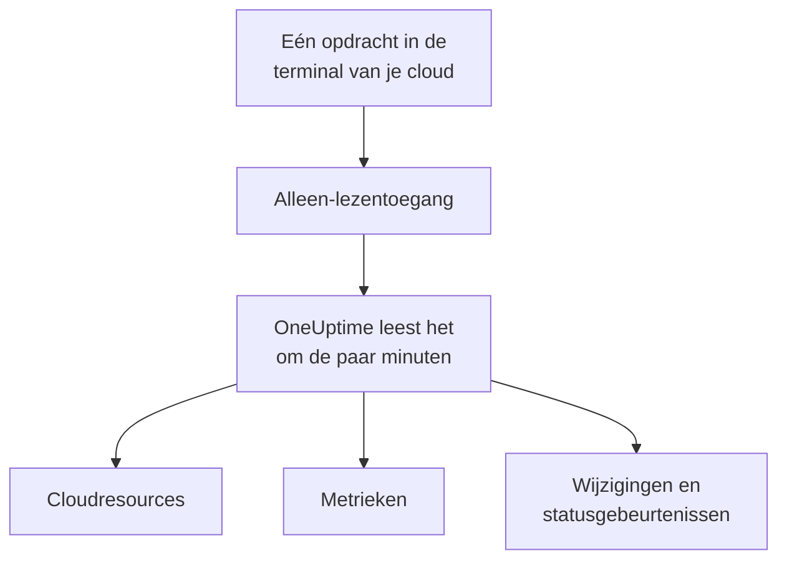

# Een cloudaccount koppelen

Koppel een AWS-account, een Azure-abonnement of een Google Cloud-project vanuit het dashboard, en OneUptime toont elke resource erin, leest hun belangrijkste metrieken en legt vast wat er in ze is gewijzigd en wat je cloudprovider over hun status zegt. Je voert één opdracht uit in de browserterminal van je cloud en plakt wat die toont: er is geen collector om te draaien en niets om te installeren.

:::cards
- [Amazon Web Services](#amazon-web-services): Een IAM-rol waarmee OneUptime zich aanmeldt, of een toegangssleutel.
- [Microsoft Azure](#microsoft-azure): Een app met de rol Monitoring Reader.
- [Google Cloud](#google-cloud): Een serviceaccount met vier rollen die alleen lezen.
- [Wat OneUptime leest](#wat-oneuptime-leest): Resources, metrieken, wijzigingen en statusgebeurtenissen, hoe vaak, en wat het kost.
- [AI problemen laten oplossen](#ai-problemen-laten-oplossen): Nog één opdracht, en OneUptime AI kan oplossen wat het vindt.
:::

## Hoe het werkt



- **De toegang kan alleen lezen.** De opdracht maakt toegang die je resources en hun instellingen, hun metrieken, wat er is gewijzigd en de statusgebeurtenissen van je provider leest, en verder niets: de acties hieronder op AWS, de rol **Monitoring Reader** op Azure en vier leesrollen op Google Cloud. OneUptime leest er nooit gegevens of geheimen mee, behalve logregels als je AI de logs van een account laat lezen. Verwijder haar om OneUptime de toegang te ontnemen.
- **OneUptime leest volgens een schema.** Elke 5 minuten voor Azure en Google Cloud, en elke 10 minuten voor AWS, tenzij je bij het koppelen een ander interval kiest. Elke keer lezen legt ook vast wat er sinds de vorige keer is gewijzigd, en elke 30 minuten toont een leesbeurt alle resources opnieuw.
- **Elke resource krijgt een eigen pagina.** Resources verschijnen onder **Cloud → Alle resources** met hun belangrijkste metrieken, eigenaren en labels. De pagina van een vermelde resource toont ook de **Verbonden resources** (waarin die draait, wat er verkeer naartoe stuurt), de endpoints, tags en instellingen, en de **Incidenten**, **Waarschuwingen** en **Wijzigingen**.
- **Elk account krijgt een eigen pagina.** Accounts verschijnen onder **Cloud → Accounts** met hun resources per type en regio, hun **Wijzigingen** en een **Topologie** van hoe hun resources samenhangen.
- **OneUptime AI leest wat er is gewijzigd.** Een onderzoek naar een incident of waarschuwing dat aan een cloudresource is gekoppeld, leest eerst de wijzigingen van die resource en leest bij de start het activiteitenlogboek van het account opnieuw.

## Voordat je begint

- **Een projecteigenaar of -beheerder.** Alleen zij kunnen cloudaccounts koppelen, testen en bewerken.
- **De terminal van je cloud** (AWS CloudShell, Azure Cloud Shell of Google Cloud Shell), aangemeld als iemand die een IAM-rol of -gebruiker, een app-registratie of een serviceaccount mag maken.

## Amazon Web Services

:::steps
### Het AWS-formulier openen

Ga naar **Cloud → Koppelen** en kies **Amazon Web Services**.

### De opdracht uitvoeren in AWS CloudShell

Kies hoe OneUptime zich aanmeldt. Een **IAM-rol** is de aanbevolen manier: er wordt niets geheims opgeslagen en je kunt de rol op elk moment verwijderen. Het formulier toont de opdracht die voor je project is geschreven: die maakt een rol die het AWS-account van OneUptime vertrouwt met de externe ID van je project, en toont de ARN van de rol.

Kies onder **Wat lezen** dit account of elk account in je AWS Organization. Voer de opdracht van de organisatie uit in het beheeraccount ervan: die voegt een StackSet toe dat dezelfde rol in elk account zet, nu en wanneer er accounts bijkomen, en laat de rol van het beheeraccount de accounts tonen. Eén koppeling leest maximaal 50 accounts.

Gebruik een **Toegangssleutel** als een rol niet mogelijk is: die leest alleen zijn eigen account. Deze opdracht maakt een gebruiker met dezelfde rechten en toont diens sleutel:

```bash
aws iam create-user --user-name OneUptimeReadOnly > /dev/null 2>&1 || true
aws iam put-user-policy --user-name OneUptimeReadOnly --policy-name OneUptimeReadOnly --policy-document '{"Version":"2012-10-17","Statement":[{"Effect":"Allow","Action":["cloudwatch:GetMetricData","cloudwatch:ListMetrics","tag:GetResources","iam:ListAccountAliases","cloudformation:ListResources","ec2:DescribeInstances","ec2:DescribeVolumes","ec2:DescribeVpcs","ec2:DescribeNatGateways","autoscaling:DescribeAutoScalingGroups","elasticloadbalancing:DescribeLoadBalancers","elasticloadbalancing:DescribeLoadBalancerAttributes","elasticloadbalancing:DescribeTargetGroups","elasticloadbalancing:DescribeTargetGroupAttributes","elasticloadbalancing:DescribeTargetHealth","elasticloadbalancing:DescribeTags","ecs:ListClusters","ecs:DescribeClusters","ecs:ListServices","ecs:DescribeServices","lambda:ListFunctions","rds:DescribeDBInstances","rds:DescribeDBClusters","elasticache:DescribeReplicationGroups","sqs:ListQueues","sqs:GetQueueAttributes","sns:ListTopics","sns:GetTopicAttributes","sns:ListSubscriptionsByTopic","dynamodb:ListTables","dynamodb:DescribeTable","kinesis:ListStreams","kinesis:DescribeStreamSummary","states:ListStateMachines","states:DescribeStateMachine","cloudfront:ListDistributions","elasticfilesystem:DescribeFileSystems","es:ListDomainNames","es:DescribeDomains","apprunner:ListServices","apprunner:DescribeService","cloudtrail:LookupEvents","health:DescribeEvents","health:DescribeEventDetails","rds:DescribeEvents","autoscaling:DescribeScalingActivities","ec2:DescribeInstanceStatus","ecs:DescribeTaskDefinition","lambda:GetFunctionConfiguration","lambda:GetFunctionConcurrency","lambda:GetAlias","servicequotas:ListServiceQuotas","logs:DescribeLogGroups","logs:FilterLogEvents"],"Resource":"*"},{"Effect":"Allow","Action":["apigateway:GET"],"Resource":["arn:aws:apigateway:*::/restapis","arn:aws:apigateway:*::/restapis/*","arn:aws:apigateway:*::/apis","arn:aws:apigateway:*::/apis/*"]}]}'
aws iam create-access-key --user-name OneUptimeReadOnly
```

### Plakken wat de AWS-opdracht toonde

Plak alles wat de opdracht toonde in **Wat de opdracht heeft getoond**. OneUptime haalt er de ARN van de rol uit, of de toegangssleutel-ID en het geheim ervan.

### AWS testen en koppelen

OneUptime test de koppeling zodra deze stap opent: het meldt zich aan, telt de resources die het vindt en zegt wat het lezen ervan kost. Kies **Koppelen** om op te slaan.
:::

De rol en de gebruiker kunnen dit, en verder niets:

| Waarvoor OneUptime ze gebruikt | Acties |
| --- | --- |
| De resources vinden die metrieken melden, en hun metrieken lezen | `cloudwatch:GetMetricData`, `cloudwatch:ListMetrics` |
| Elke resource een naam geven en de tags ervan lezen | `tag:GetResources`, `iam:ListAccountAliases` |
| Elke resource en de configuratie ervan tonen, via Cloud Control | `cloudformation:ListResources`, `ec2:DescribeInstances`, `ec2:DescribeVolumes`, `ec2:DescribeVpcs`, `ec2:DescribeNatGateways`, `autoscaling:DescribeAutoScalingGroups`, `elasticloadbalancing:DescribeLoadBalancers`, `elasticloadbalancing:DescribeLoadBalancerAttributes`, `elasticloadbalancing:DescribeTargetGroups`, `elasticloadbalancing:DescribeTargetGroupAttributes`, `elasticloadbalancing:DescribeTargetHealth`, `elasticloadbalancing:DescribeTags`, `ecs:ListClusters`, `ecs:DescribeClusters`, `ecs:ListServices`, `ecs:DescribeServices`, `lambda:ListFunctions`, `rds:DescribeDBInstances`, `rds:DescribeDBClusters`, `elasticache:DescribeReplicationGroups`, `sqs:ListQueues`, `sqs:GetQueueAttributes`, `sns:ListTopics`, `sns:GetTopicAttributes`, `sns:ListSubscriptionsByTopic`, `dynamodb:ListTables`, `dynamodb:DescribeTable`, `kinesis:ListStreams`, `kinesis:DescribeStreamSummary`, `states:ListStateMachines`, `states:DescribeStateMachine`, `cloudfront:ListDistributions`, `elasticfilesystem:DescribeFileSystems`, `es:ListDomainNames`, `es:DescribeDomains`, `apprunner:ListServices`, `apprunner:DescribeService`, `apigateway:GET` |
| Lezen wat er is gewijzigd: de beheergebeurtenissen van het account | `cloudtrail:LookupEvents` |
| De eigen statusgebeurtenissen van AWS voor het account lezen | `health:DescribeEvents`, `health:DescribeEventDetails` |
| De actuele status en recente gebeurtenissen van een resource lezen tijdens een onderzoek | `rds:DescribeEvents`, `autoscaling:DescribeScalingActivities`, `ec2:DescribeInstanceStatus`, `ecs:DescribeTaskDefinition`, `lambda:GetFunctionConfiguration`, `lambda:GetFunctionConcurrency`, `lambda:GetAlias` |
| De quota van het account lezen tijdens een onderzoek | `servicequotas:ListServiceQuotas` |
| Logregels lezen, alleen als je AI de logs van een account laat lezen | `logs:DescribeLogGroups`, `logs:FilterLogEvents` |
| De accounts van de organisatie tonen, vanuit het beheeraccount | `organizations:ListAccounts` |

`apigateway:GET` is alleen toegestaan op de definities van de API's zelf, nooit op hun sleutels, en alleen de rol van het beheeraccount mag de accounts van de organisatie tonen. AWS Health antwoordt alleen accounts met een Business-, Enterprise On-Ramp- of Enterprise-supportplan: zonder een plan vraagt OneUptime het een dag later opnieuw.

> [!NOTE]
> Bij een zelfgehoste OneUptime heeft de manier met een **IAM-rol** een eigen AWS-identiteit van OneUptime nodig: stel `CLOUD_CONNECT_AWS_ACCESS_KEY_ID` en `CLOUD_CONNECT_AWS_SECRET_ACCESS_KEY` in op de sleutel van een IAM-gebruiker die `sts:AssumeRole` mag aanroepen. Zonder die biedt het formulier een **Toegangssleutel** aan.

## Microsoft Azure

:::steps
### Het Azure-formulier openen

Ga naar **Cloud → Koppelen** en kies **Microsoft Azure**.

### De opdracht uitvoeren in Azure Cloud Shell

De opdracht maakt een app met de rol **Monitoring Reader** op je huidige abonnement, en toont de gegevens ervan met de datum waarop het geheim verloopt:

```bash
SCOPE="/subscriptions/$(az account show --query id --output tsv)"
OUT=$(az ad sp create-for-rbac --name OneUptimeReadOnly --role "Monitoring Reader" --scopes "$SCOPE")
APP=$(echo "$OUT" | jq -r .appId)
END=$(az ad app credential list --id "$APP" --query "max([].endDateTime)" --output tsv)
echo "$OUT" | jq --arg end "$END" '. + {endDateTime: $end}'
```

Kies onder **Wat lezen** in plaats daarvan elk abonnement in de tenant, en de rol komt op de hoofdbeheergroep van de tenant:

```bash
SCOPE="/providers/Microsoft.Management/managementGroups/$(az account show --query tenantId --output tsv)"
OUT=$(az ad sp create-for-rbac --name OneUptimeReadOnly --role "Monitoring Reader" --scopes "$SCOPE")
APP=$(echo "$OUT" | jq -r .appId)
END=$(az ad app credential list --id "$APP" --query "max([].endDateTime)" --output tsv)
echo "$OUT" | jq --arg end "$END" '. + {endDateTime: $end}'
```

### Plakken wat de Azure-opdracht toonde

Plak alles wat de opdracht toonde in **Wat de opdracht heeft getoond**. OneUptime haalt er de `tenant`, de `appId`, het `password` en de verloopdatum uit.

### Azure testen en koppelen

OneUptime test de koppeling zodra deze stap opent. Kies **Koppelen** om op te slaan.
:::

Om meer abonnementen met dezelfde app te lezen, geef je haar de rol op elk ervan:

```bash
az role assignment create --assignee <APP_ID> --role "Monitoring Reader" --scope /subscriptions/<SUBSCRIPTION_ID>
```

OneUptime leest elk abonnement dat de app kan lezen, maximaal 50, tenzij je er enkele vermeldt onder **Abonnementen**. Het geheim van de app werkt niet meer na de verloopdatum: vanaf 30 dagen ervoor waarschuwt elke leesbeurt ervoor. Voer de opdracht opnieuw uit en plak wat die toont om haar een nieuw geheim te geven.

## Google Cloud

:::steps
### Het Google Cloud-formulier openen

Ga naar **Cloud → Koppelen** en kies **Google Cloud**.

### De opdracht uitvoeren in Google Cloud Shell

Voer haar uit in het project dat je wilt bewaken. Ze zet de API's aan die OneUptime leest, maakt een serviceaccount met de rollen **Monitoring Viewer**, **Cloud Asset Viewer**, **Logs Viewer** en **Service Health Viewer**, en toont de sleutel ervan:

```bash
PROJECT_ID=$(gcloud config get-value project)
gcloud services enable monitoring.googleapis.com cloudasset.googleapis.com logging.googleapis.com cloudresourcemanager.googleapis.com servicehealth.googleapis.com
gcloud iam service-accounts create oneuptime-read-only --display-name "OneUptime (read only)" > /dev/null 2>&1 || true
gcloud projects add-iam-policy-binding "$PROJECT_ID" --member "serviceAccount:oneuptime-read-only@$PROJECT_ID.iam.gserviceaccount.com" --role roles/monitoring.viewer --condition=None > /dev/null
gcloud projects add-iam-policy-binding "$PROJECT_ID" --member "serviceAccount:oneuptime-read-only@$PROJECT_ID.iam.gserviceaccount.com" --role roles/cloudasset.viewer --condition=None > /dev/null
gcloud projects add-iam-policy-binding "$PROJECT_ID" --member "serviceAccount:oneuptime-read-only@$PROJECT_ID.iam.gserviceaccount.com" --role roles/logging.viewer --condition=None > /dev/null
gcloud projects add-iam-policy-binding "$PROJECT_ID" --member "serviceAccount:oneuptime-read-only@$PROJECT_ID.iam.gserviceaccount.com" --role roles/servicehealth.viewer --condition=None > /dev/null
gcloud iam service-accounts keys create oneuptime-key.json --iam-account "oneuptime-read-only@$PROJECT_ID.iam.gserviceaccount.com"
cat oneuptime-key.json && rm oneuptime-key.json
```

Kies onder **Wat lezen** in plaats daarvan elk project in de organisatie, en de rollen komen op de organisatie van het project:

```bash
PROJECT_ID=$(gcloud config get-value project)
ORG_ID=$(gcloud projects get-ancestors "$PROJECT_ID" --format="value(id)" | tail -1)
gcloud services enable monitoring.googleapis.com cloudasset.googleapis.com logging.googleapis.com cloudresourcemanager.googleapis.com servicehealth.googleapis.com
gcloud iam service-accounts create oneuptime-read-only --display-name "OneUptime (read only)" > /dev/null 2>&1 || true
gcloud organizations add-iam-policy-binding "$ORG_ID" --member "serviceAccount:oneuptime-read-only@$PROJECT_ID.iam.gserviceaccount.com" --role roles/monitoring.viewer --condition=None > /dev/null
gcloud organizations add-iam-policy-binding "$ORG_ID" --member "serviceAccount:oneuptime-read-only@$PROJECT_ID.iam.gserviceaccount.com" --role roles/cloudasset.viewer --condition=None > /dev/null
gcloud organizations add-iam-policy-binding "$ORG_ID" --member "serviceAccount:oneuptime-read-only@$PROJECT_ID.iam.gserviceaccount.com" --role roles/logging.viewer --condition=None > /dev/null
gcloud organizations add-iam-policy-binding "$ORG_ID" --member "serviceAccount:oneuptime-read-only@$PROJECT_ID.iam.gserviceaccount.com" --role roles/servicehealth.viewer --condition=None > /dev/null
gcloud iam service-accounts keys create oneuptime-key.json --iam-account "oneuptime-read-only@$PROJECT_ID.iam.gserviceaccount.com"
cat oneuptime-key.json && rm oneuptime-key.json
```

### De sleutel plakken

Plak alles wat de opdracht toonde. OneUptime leest het eigen project van de sleutel en slaat de sleutel versleuteld op.

### Google Cloud testen en koppelen

OneUptime test de koppeling zodra deze stap opent. Kies **Koppelen** om op te slaan.
:::

Om meer projecten met hetzelfde serviceaccount te lezen, geef je het de vier rollen in elk ervan en vermeld je ze onder **Projecten**:

```bash
for ROLE in roles/monitoring.viewer roles/cloudasset.viewer roles/logging.viewer roles/servicehealth.viewer; do gcloud projects add-iam-policy-binding <PROJECT_ID> --member "serviceAccount:oneuptime-read-only@<KEY_PROJECT_ID>.iam.gserviceaccount.com" --role "$ROLE"; done
```

De koppeling van een organisatie leest maximaal 50 van haar projecten, tenzij je er enkele vermeldt onder **Projecten**.

## Wat OneUptime leest

| | AWS | Azure | Google Cloud |
| --- | --- | --- | --- |
| Resources | Elke resource van de typen die OneUptime kent, in elke regio die je gebruikt, uit Cloud Control | Elke resource in de abonnementen, uit Resource Graph | Elke resource in de projecten, uit Cloud Asset Inventory |
| Metrieken | De belangrijkste metrieken van elke service, zoals de CPU, het netwerk en de statuscontroles van een instance | Maximaal 8 belangrijke metrieken per resource | De belangrijkste metrieken van elk resourcetype |
| Wijzigingen | De beheergebeurtenissen van CloudTrail | De beheergebeurtenissen van het activiteitenlogboek | Het auditlogboek Admin Activity |
| Statusgebeurtenissen | AWS Health | Service Health en Resource Health | Service Health |
| Gelezen elke | 10 minuten | 5 minuten | 5 minuten |
| Een verwijderde resource | Gearchiveerd zodra een volledige lijst hem niet meer bevat | Gearchiveerd zodra een volledige lijst hem niet meer bevat | Gearchiveerd zodra een volledige lijst hem niet meer bevat |

Elke leesbeurt gaat verder waar de vorige stopte, zodat elk datapunt en elke wijziging één keer wordt geschreven. De eerste leesbeurt van een nieuwe koppeling start binnen een minuut en gaat een uur terug voor metrieken en 2 uur voor wijzigingen; na een pauze gaat een leesbeurt hooguit 6 uur terug. Een resource die alleen metrieken meldt, en die geen enkele lijst bevat, wordt na 7 dagen zonder metrieken gearchiveerd.

De aanroepen van OneUptime worden aan je cloudaccount gefactureerd, tegen de prijzen van je cloud. Resources tonen en wijzigingen en statusgebeurtenissen lezen kost op alle drie de clouds niets; metrieken lezen wel. De test schat de kosten van wat hij vindt, en minder vaak lezen kost minder: wijzig **Leesinterval voor metrieken** onder **Meer velden**.

| Cloud | Prijs |
| --- | --- |
| AWS | CloudWatch `GetMetricData`: $0.01 per 1.000 metrieken, en elke belangrijke metriek van een resource is één metriek per leesbeurt |
| Azure | De eerste 1.000.000 metriekleesbeurten per maand van elk abonnement zijn gratis, daarna $0.01 per 1.000 |
| Google Cloud | De eerste 1.000.000 gelezen tijdreeksen per maand zijn gratis, daarna $0.50 per miljoen |

## Wat je in OneUptime ziet

- **De pagina van een account.** Onder **Cloud → Accounts** telt het overzicht van een account de resources per type en regio en zegt het wanneer een koppeling het voor het laatst las. De **Middelen** tonen ze, de **Wijzigingen** tonen wat er is gewijzigd, de nieuwste eerst, en de **Topologie** tekent de regio's, de netwerken erin en wat in elk draait, met de open incidenten en waarschuwingen op de resources waaraan ze zijn gekoppeld.
- **De wijzigingen van een resource.** Een wijziging wordt bewaard als wijzigingsgebeurtenis, gekoppeld aan de resource die ze wijzigde en aan het account ervan, en getekend als markering in de metriekgrafieken van de resource, samen met de incidenten en waarschuwingen. Grafieken die op geen enkele resource zijn gefilterd, laten het activiteitenlogboek van een cloudaccount weg, zodat een druk account je deploys niet verdringt; de statusgebeurtenissen van de provider blijven erop staan.
- **Incidenten en waarschuwingen.** Koppel een cloudresource aan een monitor, een incident of een waarschuwing onder de gekoppelde resources ervan, en de incidenten en waarschuwingen worden op de pagina van de resource vermeld. Een website-, API-, SSL-, ping- of poortmonitor waarvan de host naar een endpoint van een resource leidt, rechtstreeks of via DNS, toont de resource onder **Voorgestelde cloud-resources** op de kaart **Gekoppelde resources**: kies **Resource koppelen** om hem te koppelen.

## AI problemen laten oplossen

OneUptime AI leest elk gekoppeld account tijdens het onderzoeken, met de alleen-lezen-toegang hierboven. Wil je dat het ook problemen oplost, zoals een service herstarten, uitschalen of terugdraaien, open dan het account onder **Cloud → Accounts** en kies **AI problemen laten oplossen** op de kaart **AI-agent** van het **Overzicht** ervan.

Het dialoogvenster stelt één vraag, **Hoe ver mag AI gaan?**: **Eerst aan mij vragen**, de standaard, waarbij OneUptime AI elke fix voorstelt en iemand die met één klik goedkeurt, of **Veilige problemen zelf oplossen**, waarbij veilige wijzigingen vanzelf worden uitgevoerd en riskantere nog steeds op goedkeuring wachten. Al het andere heeft een veilige standaard onder **Geavanceerd**. Daarna toont het één opdracht, geschreven voor dit account: voer die uit in AWS CloudShell, Azure Cloud Shell of Google Cloud Shell, aangemeld als iemand die rollen in het account mag aanmaken. De opdracht maakt een rol aan die alleen de ingeschakelde wijzigingen mag doorvoeren, en start daarmee de Cloud-AI-agent in je account. De agent maakt binnen een paar minuten zelf verbinding, en het dialoogvenster meldt dat: je hoeft niets terug te plakken.

De agent is één kleine container die de hele maand in je account draait, door je cloud gefactureerd tegen de lijstprijzen ervan:

| Cloud | Wat er draait | Ongeveer |
| --- | --- | --- |
| AWS | Eén ECS Fargate-taak van 0.25 vCPU en 0.5 GB, en het openbare IPv4-adres ervan, tegen de prijzen van `us-east-1` | $13 per maand |
| Azure | Eén Container Apps-replica van 0.25 vCPU en 0.5 GiB, na de maandelijkse gratis toewijzing van het abonnement van 180.000 vCPU-seconden en 360.000 GiB-seconden | $14 per maand |
| Google Cloud | Eén Cloud Run-instantie van 1 vCPU en 0.5 GiB met altijd toegewezen CPU, die een hele vCPU in beslag neemt, na de maandelijkse gratis laag van 240.000 vCPU-seconden en 450.000 GiB-seconden | $45 per maand |

Wat de agent mag wijzigen, hoe elke wijziging een niveau krijgt en ongedaan wordt gemaakt, en hoe je zijn logs leest: [AI-agents voor de infrastructuur](/docs/ai/infrastructure-ai-agents#in-een-cloudaccount).

## Problemen oplossen

:::details De test zegt dat de sleutel of het geheim niet is geaccepteerd
Kopieer alles wat de opdracht toonde en plak het opnieuw. Een sleutel die een minuut geleden is gemaakt, kan een minuut nodig hebben om te werken. Een verlopen Azure-geheim wordt ook geweigerd: voer de opdracht opnieuw uit.
:::

:::details De test meldt zich aan, maar kan niet lezen
Voer de opdracht opnieuw uit: die kent de rollen toe die OneUptime nodig heeft. Voer bij AWS de opdracht uit die het formulier voor dit project toont: een rol die voor een ander project is gemaakt, vertrouwt de externe ID van dat project, niet die van dit project.
:::

:::details Google Cloud laat de opdracht geen sleutel maken
Een organisatiebeleid, `iam.disableServiceAccountKeyCreation`, kan sleutels voor serviceaccounts verbieden. Vraag de beheerder van je organisatie om een uitzondering voor het project, of [stuur de metrieken met je eigen collector](/docs/telemetry/cloud-resources).
:::

:::details Er verschijnen geen resources
De eerste leesbeurt toont elke resource van het account, of die nu metrieken meldt of niet. Als een koppeling niet werkt, zegt **View error** onder **Cloud → Koppelen** waarom de laatste leesbeurt mislukte.
:::

:::details Sommige accounts van de organisatie ontbreken
Eén koppeling leest maximaal 50 accounts, abonnementen of projecten, en elke leesbeurt zegt het als het er meer zijn. Koppel de andere met een eigen koppeling.
:::

## Volgende stappen

:::cards
- [Cloudresources](/docs/telemetry/cloud-resources): Draai in plaats daarvan je eigen OpenTelemetry Collector, of stream CloudWatch-metrieken.
- [Deploys en wijzigingen](/docs/telemetry/change-events): Elke wijziging die OneUptime vastlegt, en hoe OneUptime AI ze leest.
- [Metriekmonitor](/docs/monitor/metrics-monitor): Waarschuw op de metrieken van een resource.
:::
