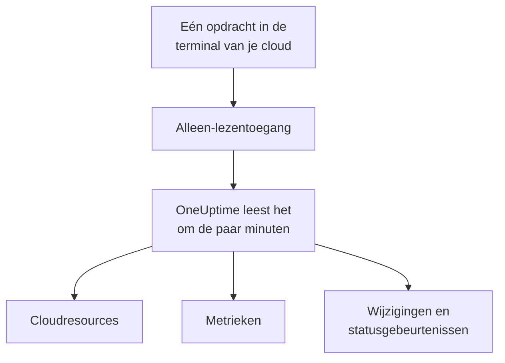

# Een cloudaccount koppelen

Koppel een AWS-account, een Azure-abonnement of een Google Cloud-project vanuit het dashboard, en OneUptime toont elke resource erin, leest hun belangrijkste metrieken en zegt hoe het met elke resource gaat, legt vast wat er in ze is gewijzigd en wat je cloudprovider over hun status zegt, en leest wat het account kost en hoe het minder zou kunnen kosten. Je voert één opdracht uit in de browserterminal van je cloud en plakt wat die toont: er is geen collector om te draaien en niets om te installeren.

:::cards
- [Amazon Web Services](#amazon-web-services): Een IAM-rol waarmee OneUptime zich aanmeldt, of een toegangssleutel.
- [Microsoft Azure](#microsoft-azure): Een app met de rollen Monitoring Reader en Cost Management Reader.
- [Google Cloud](#google-cloud): Een serviceaccount met zes rollen die alleen lezen.
- [Wat OneUptime leest](#wat-oneuptime-leest): Resources, metrieken, wijzigingen, statusgebeurtenissen en kosten, hoe vaak, en wat het lezen ervan kost.
- [Cloudkosten en besparingen](/docs/telemetry/cloud-costs): Wat elk account kost, de manieren om minder uit te geven en budgetten die waarschuwen.
- [CloudWatch-metrieken en -logboeken streamen](/docs/telemetry/cloud-streaming): Elke metriek binnen enkele minuten, en CloudWatch Logs, via Amazon Data Firehose.
- [Azure Monitor-metrieken en -logboeken streamen](/docs/telemetry/cloud-streaming-azure): Belangrijke metrieken binnen enkele minuten, en resourcelogboeken, gelezen uit Event Hubs in uw abonnement.
- [Google Cloud-logboeken streamen](/docs/telemetry/cloud-streaming-google-cloud): Elk logboek zodra het wordt geschreven, gepusht via Pub/Sub.
- [Gegevensbeveiliging](#gegevensbeveiliging): Wat de koppeling Gegevensbeveiliging laat lezen, en wat elk niveau aan de opdracht toevoegt.
- [AI problemen laten oplossen](#ai-problemen-laten-oplossen): Nog één opdracht, en OneUptime AI kan oplossen wat het vindt.
:::

## Hoe het werkt



- **De toegang kan alleen lezen.** De opdracht maakt toegang die je resources en hun instellingen, hun metrieken, wat er is gewijzigd, de statusgebeurtenissen van je provider en wat het account kost leest, en verder niets: de acties hieronder op AWS, de rollen **Monitoring Reader** en **Cost Management Reader** op Azure en zes leesrollen op Google Cloud. OneUptime leest er nooit gegevens of geheimen mee, behalve logregels als je AI de logs van een account laat lezen, en inhoudsvoorbeelden als je ze aanzet voor [Gegevensbeveiliging](#gegevensbeveiliging). Verwijder haar om OneUptime de toegang te ontnemen.
- **OneUptime leest volgens een schema.** Elke 5 minuten voor Azure en Google Cloud, en elke 10 minuten voor AWS, tenzij je bij het koppelen een ander interval kiest. Elke keer lezen legt ook vast wat er sinds de vorige keer is gewijzigd, en elke 30 minuten toont een leesbeurt alle resources opnieuw.
- **Elke resource krijgt een eigen pagina.** Resources verschijnen onder **Cloud → Alle resources** met hun status, belangrijkste metrieken, eigenaren en labels. De pagina van een vermelde resource toont ook de **Verbonden resources** (waarin die draait, wat er verkeer naartoe stuurt), de endpoints, tags en instellingen, en de **Incidenten**, **Waarschuwingen** en **Wijzigingen**.
- **Elk account krijgt een eigen pagina.** Accounts verschijnen onder **Cloud → Accounts** met hun resources per type en regio, hun **Kosten**, hun **Wijzigingen** en een **Topologie** van hoe hun resources samenhangen.
- **Cloud opent op zijn overzicht.** **Cloud → Overzicht** toont de resources die aandacht nodig hebben en waarom, wat de accounts deze maand kosten en wat je clouds zeggen dat er bespaard kan worden. [Cloudkosten en besparingen](/docs/telemetry/cloud-costs) legt uit hoe kosten, besparingen en budgetten worden gelezen. Als je accounts apps draaien op beheerde app-platforms, telt de kaart **App-platforms** hun omgevingen en apps, en elk getal opent die lijst in App-platforms, al gefilterd op die accounts.
- **OneUptime AI leest wat er is gewijzigd.** Een onderzoek naar een incident of waarschuwing dat aan een cloudresource is gekoppeld, leest eerst de wijzigingen van die resource en leest bij de start het activiteitenlogboek van het account opnieuw.

## Voordat je begint

- **Een projecteigenaar of -beheerder.** Alleen zij kunnen cloudaccounts koppelen, testen en bewerken.
- **De terminal van je cloud** (AWS CloudShell, Azure Cloud Shell of Google Cloud Shell), aangemeld als iemand die een IAM-rol of -gebruiker, een app-registratie of een serviceaccount mag maken.

## Amazon Web Services

:::steps
### Het AWS-formulier openen

Ga naar **Cloud → Koppelen** en kies **Amazon Web Services**.

### De opdracht uitvoeren in AWS CloudShell

Kies hoe OneUptime zich aanmeldt. Een **IAM-rol** is de aanbevolen manier: er wordt niets geheims opgeslagen en je kunt de rol op elk moment verwijderen. Het formulier toont de opdracht die voor je project is geschreven: die maakt een rol die het AWS-account van OneUptime vertrouwt met de externe ID van je project, en toont de ARN van de rol.

Kies onder **Wat lezen** dit account of elk account in je AWS Organization. Voer de opdracht van de organisatie uit in het beheeraccount ervan: die voegt een StackSet toe dat dezelfde rol in elk account zet, nu en wanneer er accounts bijkomen, en laat de rol van het beheeraccount de accounts tonen. Eén koppeling leest maximaal 50 accounts.

Gebruik een **Toegangssleutel** als een rol niet mogelijk is: die leest alleen zijn eigen account. Deze opdracht maakt een gebruiker met dezelfde rechten en toont diens sleutel:

```bash
aws iam create-user --user-name OneUptimeReadOnly > /dev/null 2>&1 || true
aws iam put-user-policy --user-name OneUptimeReadOnly --policy-name OneUptimeReadOnly --policy-document '{"Version":"2012-10-17","Statement":[{"Effect":"Allow","Action":["cloudwatch:GetMetricData","cloudwatch:ListMetrics","tag:GetResources","iam:ListAccountAliases","cloudformation:ListResources","ec2:DescribeInstances","ec2:DescribeVolumes","ec2:DescribeVpcs","ec2:DescribeNatGateways","autoscaling:DescribeAutoScalingGroups","elasticloadbalancing:DescribeLoadBalancers","elasticloadbalancing:DescribeLoadBalancerAttributes","elasticloadbalancing:DescribeTargetGroups","elasticloadbalancing:DescribeTargetGroupAttributes","elasticloadbalancing:DescribeTargetHealth","elasticloadbalancing:DescribeTags","ecs:ListClusters","ecs:DescribeClusters","ecs:ListServices","ecs:DescribeServices","lambda:ListFunctions","rds:DescribeDBInstances","rds:DescribeDBClusters","elasticache:DescribeReplicationGroups","sqs:ListQueues","sqs:GetQueueAttributes","sns:ListTopics","sns:GetTopicAttributes","sns:ListSubscriptionsByTopic","dynamodb:ListTables","dynamodb:DescribeTable","kinesis:ListStreams","kinesis:DescribeStreamSummary","states:ListStateMachines","states:DescribeStateMachine","cloudfront:ListDistributions","elasticfilesystem:DescribeFileSystems","es:ListDomainNames","es:DescribeDomains","apprunner:ListServices","apprunner:DescribeService","elasticbeanstalk:DescribeEnvironments","cloudtrail:LookupEvents","health:DescribeEvents","health:DescribeEventDetails","ce:GetCostAndUsage","ce:GetCostAndUsageWithResources","ce:GetSavingsPlansCoverage","ce:GetSavingsPlansUtilization","ce:GetReservationCoverage","ce:GetReservationUtilization","cost-optimization-hub:ListRecommendations","rds:DescribeEvents","autoscaling:DescribeScalingActivities","ec2:DescribeInstanceStatus","ecs:DescribeTaskDefinition","lambda:GetFunctionConfiguration","lambda:GetFunctionConcurrency","lambda:GetAlias","servicequotas:ListServiceQuotas","logs:DescribeLogGroups","logs:FilterLogEvents"],"Resource":"*"},{"Effect":"Allow","Action":["apigateway:GET"],"Resource":["arn:aws:apigateway:*::/restapis*","arn:aws:apigateway:*::/apis*"]}]}'
aws iam create-access-key --user-name OneUptimeReadOnly
```

### Plakken wat de AWS-opdracht toonde

Plak alles wat de opdracht toonde in **Wat de opdracht heeft getoond**. OneUptime haalt er de ARN van de rol uit, of de toegangssleutel-ID en het geheim ervan.

### AWS testen en koppelen

OneUptime test de koppeling zodra deze stap opent: het meldt zich aan, telt de resources die het vindt en zegt wat het lezen ervan kost. Kies **Koppelen** om op te slaan.
:::

De rol en de gebruiker kunnen dit, en verder niets:

| Waarvoor OneUptime ze gebruikt | Acties |
| --- | --- |
| De resources vinden die metrieken melden, en hun metrieken lezen | `cloudwatch:GetMetricData`, `cloudwatch:ListMetrics` |
| Elke resource een naam geven en de tags ervan lezen | `tag:GetResources`, `iam:ListAccountAliases` |
| Elke resource en de configuratie ervan tonen, via Cloud Control | `cloudformation:ListResources`, `ec2:DescribeInstances`, `ec2:DescribeVolumes`, `ec2:DescribeVpcs`, `ec2:DescribeNatGateways`, `autoscaling:DescribeAutoScalingGroups`, `elasticloadbalancing:DescribeLoadBalancers`, `elasticloadbalancing:DescribeLoadBalancerAttributes`, `elasticloadbalancing:DescribeTargetGroups`, `elasticloadbalancing:DescribeTargetGroupAttributes`, `elasticloadbalancing:DescribeTargetHealth`, `elasticloadbalancing:DescribeTags`, `ecs:ListClusters`, `ecs:DescribeClusters`, `ecs:ListServices`, `ecs:DescribeServices`, `lambda:ListFunctions`, `rds:DescribeDBInstances`, `rds:DescribeDBClusters`, `elasticache:DescribeReplicationGroups`, `sqs:ListQueues`, `sqs:GetQueueAttributes`, `sns:ListTopics`, `sns:GetTopicAttributes`, `sns:ListSubscriptionsByTopic`, `dynamodb:ListTables`, `dynamodb:DescribeTable`, `kinesis:ListStreams`, `kinesis:DescribeStreamSummary`, `states:ListStateMachines`, `states:DescribeStateMachine`, `cloudfront:ListDistributions`, `elasticfilesystem:DescribeFileSystems`, `es:ListDomainNames`, `es:DescribeDomains`, `apprunner:ListServices`, `apprunner:DescribeService`, `elasticbeanstalk:DescribeEnvironments`, `apigateway:GET` |
| Lezen wat er is gewijzigd: de beheergebeurtenissen van het account | `cloudtrail:LookupEvents` |
| De eigen statusgebeurtenissen van AWS voor het account lezen | `health:DescribeEvents`, `health:DescribeEventDetails` |
| Lezen wat het account kost, uit Cost Explorer | `ce:GetCostAndUsage`, `ce:GetCostAndUsageWithResources`, `ce:GetSavingsPlansCoverage`, `ce:GetSavingsPlansUtilization`, `ce:GetReservationCoverage`, `ce:GetReservationUtilization` |
| De manieren lezen om minder uit te geven, uit Cost Optimization Hub | `cost-optimization-hub:ListRecommendations` |
| De actuele status en recente gebeurtenissen van een resource lezen tijdens een onderzoek | `rds:DescribeEvents`, `autoscaling:DescribeScalingActivities`, `ec2:DescribeInstanceStatus`, `ecs:DescribeTaskDefinition`, `lambda:GetFunctionConfiguration`, `lambda:GetFunctionConcurrency`, `lambda:GetAlias` |
| De quota van het account lezen tijdens een onderzoek | `servicequotas:ListServiceQuotas` |
| Logregels lezen, alleen als je AI de logs van een account laat lezen | `logs:DescribeLogGroups`, `logs:FilterLogEvents` |
| De accounts van de organisatie tonen, vanuit het beheeraccount | `organizations:ListAccounts` |

`apigateway:GET` is alleen toegestaan op de definities van de API's zelf, nooit op hun sleutels, en alleen de rol van het beheeraccount mag de accounts van de organisatie tonen. AWS Health antwoordt alleen accounts met een Business-, Enterprise On-Ramp- of Enterprise-supportplan: zonder een plan vraagt OneUptime het een dag later opnieuw.

> [!NOTE]
> Bij een zelfgehoste OneUptime heeft de manier met een **IAM-rol** een eigen AWS-identiteit van OneUptime nodig: stel `CLOUD_CONNECT_AWS_ACCESS_KEY_ID` en `CLOUD_CONNECT_AWS_SECRET_ACCESS_KEY` in op de sleutel van een IAM-gebruiker die `sts:AssumeRole` mag aanroepen. Zonder die biedt het formulier een **Toegangssleutel** aan.

## Microsoft Azure

:::steps
### Het Azure-formulier openen

Ga naar **Cloud → Koppelen** en kies **Microsoft Azure**.

### De opdracht uitvoeren in Azure Cloud Shell

De opdracht maakt een app met de rollen **Monitoring Reader** en **Cost Management Reader** op je huidige abonnement, en toont de gegevens ervan met de datum waarop het geheim verloopt:

```bash
SCOPE="/subscriptions/$(az account show --query id --output tsv)"
OUT=$(az ad sp create-for-rbac --name OneUptimeReadOnly --role "Monitoring Reader" --scopes "$SCOPE")
APP=$(echo "$OUT" | jq -r .appId)
az role assignment create --assignee "$APP" --role "Cost Management Reader" --scope "$SCOPE" > /dev/null
END=$(az ad app credential list --id "$APP" --query "max([].endDateTime)" --output tsv)
echo "$OUT" | jq --arg end "$END" '. + {endDateTime: $end}'
```

Kies onder **Wat lezen** in plaats daarvan elk abonnement in de tenant, en de rol komt op de hoofdbeheergroep van de tenant:

```bash
SCOPE="/providers/Microsoft.Management/managementGroups/$(az account show --query tenantId --output tsv)"
OUT=$(az ad sp create-for-rbac --name OneUptimeReadOnly --role "Monitoring Reader" --scopes "$SCOPE")
APP=$(echo "$OUT" | jq -r .appId)
az role assignment create --assignee "$APP" --role "Cost Management Reader" --scope "$SCOPE" > /dev/null
END=$(az ad app credential list --id "$APP" --query "max([].endDateTime)" --output tsv)
echo "$OUT" | jq --arg end "$END" '. + {endDateTime: $end}'
```

### Plakken wat de Azure-opdracht toonde

Plak alles wat de opdracht toonde in **Wat de opdracht heeft getoond**. OneUptime haalt er de `tenant`, de `appId`, het `password` en de verloopdatum uit.

### Azure testen en koppelen

OneUptime test de koppeling zodra deze stap opent. Kies **Koppelen** om op te slaan.
:::

Om meer abonnementen met dezelfde app te lezen, geef je haar beide rollen op elk ervan:

```bash
az role assignment create --assignee <APP_ID> --role "Monitoring Reader" --scope /subscriptions/<SUBSCRIPTION_ID>
az role assignment create --assignee <APP_ID> --role "Cost Management Reader" --scope /subscriptions/<SUBSCRIPTION_ID>
```

OneUptime leest elk abonnement dat de app kan lezen, maximaal 50, tenzij je er enkele vermeldt onder **Abonnementen**. Het geheim van de app werkt niet meer na de verloopdatum: vanaf 30 dagen ervoor waarschuwt elke leesbeurt ervoor. Voer de opdracht opnieuw uit en plak wat die toont om haar een nieuw geheim te geven.

## Google Cloud

:::steps
### Het Google Cloud-formulier openen

Ga naar **Cloud → Koppelen** en kies **Google Cloud**.

### De opdracht uitvoeren in Google Cloud Shell

Voer haar uit in het project dat je wilt bewaken. Ze zet de API's aan die OneUptime leest, maakt een serviceaccount met de rollen **Monitoring Viewer**, **Cloud Asset Viewer**, **Logs Viewer**, **Service Health Viewer**, **BigQuery Job User** en **Compute Recommender Viewer**, en toont de sleutel ervan:

```bash
PROJECT_ID=$(gcloud config get-value project)
gcloud services enable monitoring.googleapis.com cloudasset.googleapis.com logging.googleapis.com cloudresourcemanager.googleapis.com servicehealth.googleapis.com bigquery.googleapis.com recommender.googleapis.com
gcloud iam service-accounts create oneuptime-read-only --display-name "OneUptime (read only)" > /dev/null 2>&1 || true
gcloud projects add-iam-policy-binding "$PROJECT_ID" --member "serviceAccount:oneuptime-read-only@$PROJECT_ID.iam.gserviceaccount.com" --role roles/monitoring.viewer --condition=None > /dev/null
gcloud projects add-iam-policy-binding "$PROJECT_ID" --member "serviceAccount:oneuptime-read-only@$PROJECT_ID.iam.gserviceaccount.com" --role roles/cloudasset.viewer --condition=None > /dev/null
gcloud projects add-iam-policy-binding "$PROJECT_ID" --member "serviceAccount:oneuptime-read-only@$PROJECT_ID.iam.gserviceaccount.com" --role roles/logging.viewer --condition=None > /dev/null
gcloud projects add-iam-policy-binding "$PROJECT_ID" --member "serviceAccount:oneuptime-read-only@$PROJECT_ID.iam.gserviceaccount.com" --role roles/servicehealth.viewer --condition=None > /dev/null
gcloud projects add-iam-policy-binding "$PROJECT_ID" --member "serviceAccount:oneuptime-read-only@$PROJECT_ID.iam.gserviceaccount.com" --role roles/bigquery.jobUser --condition=None > /dev/null
gcloud projects add-iam-policy-binding "$PROJECT_ID" --member "serviceAccount:oneuptime-read-only@$PROJECT_ID.iam.gserviceaccount.com" --role roles/recommender.computeViewer --condition=None > /dev/null
gcloud iam service-accounts keys create oneuptime-key.json --iam-account "oneuptime-read-only@$PROJECT_ID.iam.gserviceaccount.com"
cat oneuptime-key.json && rm oneuptime-key.json
```

Kies onder **Wat lezen** in plaats daarvan elk project in de organisatie, en de rollen komen op de organisatie van het project:

```bash
PROJECT_ID=$(gcloud config get-value project)
ORG_ID=$(gcloud projects get-ancestors "$PROJECT_ID" --format="value(id)" | tail -1)
gcloud services enable monitoring.googleapis.com cloudasset.googleapis.com logging.googleapis.com cloudresourcemanager.googleapis.com servicehealth.googleapis.com bigquery.googleapis.com recommender.googleapis.com
gcloud iam service-accounts create oneuptime-read-only --display-name "OneUptime (read only)" > /dev/null 2>&1 || true
gcloud organizations add-iam-policy-binding "$ORG_ID" --member "serviceAccount:oneuptime-read-only@$PROJECT_ID.iam.gserviceaccount.com" --role roles/monitoring.viewer --condition=None > /dev/null
gcloud organizations add-iam-policy-binding "$ORG_ID" --member "serviceAccount:oneuptime-read-only@$PROJECT_ID.iam.gserviceaccount.com" --role roles/cloudasset.viewer --condition=None > /dev/null
gcloud organizations add-iam-policy-binding "$ORG_ID" --member "serviceAccount:oneuptime-read-only@$PROJECT_ID.iam.gserviceaccount.com" --role roles/logging.viewer --condition=None > /dev/null
gcloud organizations add-iam-policy-binding "$ORG_ID" --member "serviceAccount:oneuptime-read-only@$PROJECT_ID.iam.gserviceaccount.com" --role roles/servicehealth.viewer --condition=None > /dev/null
gcloud organizations add-iam-policy-binding "$ORG_ID" --member "serviceAccount:oneuptime-read-only@$PROJECT_ID.iam.gserviceaccount.com" --role roles/bigquery.jobUser --condition=None > /dev/null
gcloud organizations add-iam-policy-binding "$ORG_ID" --member "serviceAccount:oneuptime-read-only@$PROJECT_ID.iam.gserviceaccount.com" --role roles/recommender.computeViewer --condition=None > /dev/null
gcloud iam service-accounts keys create oneuptime-key.json --iam-account "oneuptime-read-only@$PROJECT_ID.iam.gserviceaccount.com"
cat oneuptime-key.json && rm oneuptime-key.json
```

### De sleutel plakken

Plak alles wat de opdracht toonde. OneUptime leest het eigen project van de sleutel en slaat de sleutel versleuteld op.

### Google Cloud testen en koppelen

OneUptime test de koppeling zodra deze stap opent. Kies **Koppelen** om op te slaan.
:::

Om meer projecten met hetzelfde serviceaccount te lezen, geef je het deze rollen in elk ervan en vermeld je ze onder **Projecten**:

```bash
for ROLE in roles/monitoring.viewer roles/cloudasset.viewer roles/logging.viewer roles/servicehealth.viewer roles/recommender.computeViewer; do gcloud projects add-iam-policy-binding <PROJECT_ID> --member "serviceAccount:oneuptime-read-only@<KEY_PROJECT_ID>.iam.gserviceaccount.com" --role "$ROLE"; done
```

De koppeling van een organisatie leest maximaal 50 van haar projecten, tenzij je er enkele vermeldt onder **Projecten**.

Google Cloud heeft geen API voor de kosten van een project: OneUptime leest ze uit de export van je factureringsaccount naar BigQuery, zodra je de tabel ervan opgeeft onder **Tabel van de factuurexport**. [Cloudkosten en besparingen](/docs/telemetry/cloud-costs#google-cloud) laat zien hoe.

## Gegevensbeveiliging

Dezelfde koppeling kan [Gegevensbeveiliging](/docs/data-security/index) de gegevensopslagen van het account laten lezen: de buckets, databases en datawarehouses. Onder **Meer velden** staat **Gegevensbeveiliging** op **Uit** tot je iets anders kiest, en de opdracht die het formulier toont, verandert mee:

| Gegevensbeveiliging | Wat Gegevensbeveiliging mag lezen | Wat de opdracht toevoegt |
| --- | --- | --- |
| **Uit** | Geen enkele opslag van het account | Niets |
| **Alleen configuratie** | Wie bij elke opslag kan, en hoe die is versleuteld, geback-upt en gelogd. Nooit gegevens. | Op AWS een tweede inline-beleid, `OneUptimeDataSecurity`, met leesacties. Op Azure en Google Cloud niets: **Monitoring Reader** en **Cloud Asset Viewer** lezen dat al. |
| **Configuratie en inhoudsvoorbeelden** | Dat, en voorbeelden van objecten en rijen, om er gevoelige gegevens in te vinden | Op AWS hetzelfde beleid met `s3:ListBucket`, `s3:GetObject` en `kms:Decrypt`, alleen via S3. Op Azure **Storage Blob Data Reader**. Op Google Cloud `roles/storage.objectViewer` en `roles/bigquery.dataViewer`. |

Op AWS voegt de opdracht van de rol het beleid toe met één regel extra. Op het inhoudsniveau is dat:

```bash
aws iam put-role-policy --role-name "$ROLE" --policy-name OneUptimeDataSecurity --policy-document '{"Version":"2012-10-17","Statement":[{"Effect":"Allow","Action":["s3:ListAllMyBuckets","s3:GetBucketLocation","s3:GetBucketPolicyStatus","s3:GetBucketPublicAccessBlock","s3:GetAccountPublicAccessBlock","s3:GetBucketAcl","s3:GetBucketPolicy","s3:GetEncryptionConfiguration","s3:GetBucketVersioning","s3:GetBucketLogging","s3:GetBucketOwnershipControls","s3:GetReplicationConfiguration","s3:GetBucketTagging","rds:DescribeDBInstances","rds:DescribeDBClusters","rds:DescribeDBSnapshots","rds:DescribeDBSnapshotAttributes","rds:DescribeDBClusterSnapshots","rds:DescribeDBClusterSnapshotAttributes","dynamodb:ListTables","dynamodb:DescribeTable","dynamodb:DescribeContinuousBackups","redshift:DescribeClusters","redshift:DescribeLoggingStatus","es:ListDomainNames","es:DescribeDomains","elasticache:DescribeReplicationGroups","elasticfilesystem:DescribeFileSystems","kms:ListAliases","iam:GetAccountAuthorizationDetails","iam:GenerateCredentialReport","iam:GetCredentialReport"],"Resource":"*"},{"Effect":"Allow","Action":["s3:ListBucket"],"Resource":"arn:aws:s3:::*"},{"Effect":"Allow","Action":["s3:GetObject"],"Resource":"arn:aws:s3:::*/*"},{"Effect":"Allow","Action":["kms:Decrypt"],"Resource":"*","Condition":{"StringLike":{"kms:ViaService":"s3.*.amazonaws.com"}}}]}'
```

IAM beperkt de eigen inline-beleidsdocumenten van een gebruiker tot samen 2.048 tekens, dus met een **Toegangssleutel** gaat het beleid op een groep, `OneUptimeDataSecurity`, waaraan de gebruiker wordt toegevoegd:

```bash
aws iam create-user --user-name OneUptimeReadOnly > /dev/null 2>&1 || true
aws iam put-user-policy --user-name OneUptimeReadOnly --policy-name OneUptimeReadOnly --policy-document '{"Version":"2012-10-17","Statement":[{"Effect":"Allow","Action":["cloudwatch:GetMetricData","cloudwatch:ListMetrics","tag:GetResources","iam:ListAccountAliases","cloudformation:ListResources","ec2:DescribeInstances","ec2:DescribeVolumes","ec2:DescribeVpcs","ec2:DescribeNatGateways","autoscaling:DescribeAutoScalingGroups","elasticloadbalancing:DescribeLoadBalancers","elasticloadbalancing:DescribeLoadBalancerAttributes","elasticloadbalancing:DescribeTargetGroups","elasticloadbalancing:DescribeTargetGroupAttributes","elasticloadbalancing:DescribeTargetHealth","elasticloadbalancing:DescribeTags","ecs:ListClusters","ecs:DescribeClusters","ecs:ListServices","ecs:DescribeServices","lambda:ListFunctions","rds:DescribeDBInstances","rds:DescribeDBClusters","elasticache:DescribeReplicationGroups","sqs:ListQueues","sqs:GetQueueAttributes","sns:ListTopics","sns:GetTopicAttributes","sns:ListSubscriptionsByTopic","dynamodb:ListTables","dynamodb:DescribeTable","kinesis:ListStreams","kinesis:DescribeStreamSummary","states:ListStateMachines","states:DescribeStateMachine","cloudfront:ListDistributions","elasticfilesystem:DescribeFileSystems","es:ListDomainNames","es:DescribeDomains","apprunner:ListServices","apprunner:DescribeService","elasticbeanstalk:DescribeEnvironments","cloudtrail:LookupEvents","health:DescribeEvents","health:DescribeEventDetails","ce:GetCostAndUsage","ce:GetCostAndUsageWithResources","ce:GetSavingsPlansCoverage","ce:GetSavingsPlansUtilization","ce:GetReservationCoverage","ce:GetReservationUtilization","cost-optimization-hub:ListRecommendations","rds:DescribeEvents","autoscaling:DescribeScalingActivities","ec2:DescribeInstanceStatus","ecs:DescribeTaskDefinition","lambda:GetFunctionConfiguration","lambda:GetFunctionConcurrency","lambda:GetAlias","servicequotas:ListServiceQuotas","logs:DescribeLogGroups","logs:FilterLogEvents"],"Resource":"*"},{"Effect":"Allow","Action":["apigateway:GET"],"Resource":["arn:aws:apigateway:*::/restapis*","arn:aws:apigateway:*::/apis*"]}]}'
aws iam create-group --group-name OneUptimeDataSecurity > /dev/null 2>&1 || true
aws iam put-group-policy --group-name OneUptimeDataSecurity --policy-name OneUptimeDataSecurity --policy-document '{"Version":"2012-10-17","Statement":[{"Effect":"Allow","Action":["s3:ListAllMyBuckets","s3:GetBucketLocation","s3:GetBucketPolicyStatus","s3:GetBucketPublicAccessBlock","s3:GetAccountPublicAccessBlock","s3:GetBucketAcl","s3:GetBucketPolicy","s3:GetEncryptionConfiguration","s3:GetBucketVersioning","s3:GetBucketLogging","s3:GetBucketOwnershipControls","s3:GetReplicationConfiguration","s3:GetBucketTagging","rds:DescribeDBInstances","rds:DescribeDBClusters","rds:DescribeDBSnapshots","rds:DescribeDBSnapshotAttributes","rds:DescribeDBClusterSnapshots","rds:DescribeDBClusterSnapshotAttributes","dynamodb:ListTables","dynamodb:DescribeTable","dynamodb:DescribeContinuousBackups","redshift:DescribeClusters","redshift:DescribeLoggingStatus","es:ListDomainNames","es:DescribeDomains","elasticache:DescribeReplicationGroups","elasticfilesystem:DescribeFileSystems","kms:ListAliases","iam:GetAccountAuthorizationDetails","iam:GenerateCredentialReport","iam:GetCredentialReport"],"Resource":"*"},{"Effect":"Allow","Action":["s3:ListBucket"],"Resource":"arn:aws:s3:::*"},{"Effect":"Allow","Action":["s3:GetObject"],"Resource":"arn:aws:s3:::*/*"},{"Effect":"Allow","Action":["kms:Decrypt"],"Resource":"*","Condition":{"StringLike":{"kms:ViaService":"s3.*.amazonaws.com"}}}]}'
aws iam add-user-to-group --user-name OneUptimeReadOnly --group-name OneUptimeDataSecurity
aws iam create-access-key --user-name OneUptimeReadOnly
```

Op Azure voegt het inhoudsniveau **Storage Blob Data Reader** toe, op hetzelfde bereik als **Monitoring Reader**:

```bash
SCOPE="/subscriptions/$(az account show --query id --output tsv)"
OUT=$(az ad sp create-for-rbac --name OneUptimeReadOnly --role "Monitoring Reader" --scopes "$SCOPE")
APP=$(echo "$OUT" | jq -r .appId)
az role assignment create --assignee "$APP" --role "Cost Management Reader" --scope "$SCOPE" > /dev/null
az role assignment create --assignee "$APP" --role "Storage Blob Data Reader" --scope "$SCOPE" > /dev/null
END=$(az ad app credential list --id "$APP" --query "max([].endDateTime)" --output tsv)
echo "$OUT" | jq --arg end "$END" '. + {endDateTime: $end}'
```

Op Google Cloud voegt het de twee rollen toe:

```bash
PROJECT_ID=$(gcloud config get-value project)
gcloud services enable monitoring.googleapis.com cloudasset.googleapis.com logging.googleapis.com cloudresourcemanager.googleapis.com servicehealth.googleapis.com bigquery.googleapis.com recommender.googleapis.com
gcloud iam service-accounts create oneuptime-read-only --display-name "OneUptime (read only)" > /dev/null 2>&1 || true
gcloud projects add-iam-policy-binding "$PROJECT_ID" --member "serviceAccount:oneuptime-read-only@$PROJECT_ID.iam.gserviceaccount.com" --role roles/monitoring.viewer --condition=None > /dev/null
gcloud projects add-iam-policy-binding "$PROJECT_ID" --member "serviceAccount:oneuptime-read-only@$PROJECT_ID.iam.gserviceaccount.com" --role roles/cloudasset.viewer --condition=None > /dev/null
gcloud projects add-iam-policy-binding "$PROJECT_ID" --member "serviceAccount:oneuptime-read-only@$PROJECT_ID.iam.gserviceaccount.com" --role roles/logging.viewer --condition=None > /dev/null
gcloud projects add-iam-policy-binding "$PROJECT_ID" --member "serviceAccount:oneuptime-read-only@$PROJECT_ID.iam.gserviceaccount.com" --role roles/servicehealth.viewer --condition=None > /dev/null
gcloud projects add-iam-policy-binding "$PROJECT_ID" --member "serviceAccount:oneuptime-read-only@$PROJECT_ID.iam.gserviceaccount.com" --role roles/bigquery.jobUser --condition=None > /dev/null
gcloud projects add-iam-policy-binding "$PROJECT_ID" --member "serviceAccount:oneuptime-read-only@$PROJECT_ID.iam.gserviceaccount.com" --role roles/recommender.computeViewer --condition=None > /dev/null
gcloud projects add-iam-policy-binding "$PROJECT_ID" --member "serviceAccount:oneuptime-read-only@$PROJECT_ID.iam.gserviceaccount.com" --role roles/storage.objectViewer --condition=None > /dev/null
gcloud projects add-iam-policy-binding "$PROJECT_ID" --member "serviceAccount:oneuptime-read-only@$PROJECT_ID.iam.gserviceaccount.com" --role roles/bigquery.dataViewer --condition=None > /dev/null
gcloud iam service-accounts keys create oneuptime-key.json --iam-account "oneuptime-read-only@$PROJECT_ID.iam.gserviceaccount.com"
cat oneuptime-key.json && rm oneuptime-key.json
```

De opdracht van een lager niveau vervangt het AWS-beleid door het lagere. **Uit** voegt niets toe, dus het laat staan wat een eerdere opdracht gaf, tot je dat verwijdert: het beleid `OneUptimeDataSecurity` op AWS, met `aws iam delete-role-policy --role-name <your role> --policy-name OneUptimeDataSecurity`, en de rollen van het inhoudsniveau op Azure en Google Cloud. Gegevensbeveiliging stopt hoe dan ook meteen met lezen: het leest alleen wat het niveau van de koppeling zegt. [Gegevensbeveiliging instellen](/docs/data-security/setup) somt elke actie van het beleid op, en wat Gegevensbeveiliging bewaart van wat het leest.

## Wat OneUptime leest

| | AWS | Azure | Google Cloud |
| --- | --- | --- | --- |
| Resources | Elke resource van de typen die OneUptime kent, in elke regio die je gebruikt, uit Cloud Control | Elke resource in de abonnementen, uit Resource Graph | Elke resource in de projecten, uit Cloud Asset Inventory |
| Metrieken | De belangrijkste metrieken van elke service, zoals de CPU, het netwerk en de statuscontroles van een instance | Maximaal 8 belangrijke metrieken per resource | De belangrijkste metrieken van elk resourcetype |
| Wijzigingen | De beheergebeurtenissen van CloudTrail | De beheergebeurtenissen van het activiteitenlogboek | Het auditlogboek Admin Activity |
| Statusgebeurtenissen | AWS Health | Service Health en Resource Health | Service Health |
| Kosten | Die van elke dag, per dienst en regio, en per resource met Kosten per resource aan, uit Cost Explorer | Die van elke dag, per resource en dienst, uit Cost Management | Die van elke dag, per dienst, regio en resource, uit je factuurexport naar BigQuery |
| Manieren om minder uit te geven | Cost Optimization Hub | Azure Advisor | De Recommender |
| Toezeggingen | Savings Plans en Reserved Instances: wat ze dekken en hoeveel ervan wordt gebruikt, uit Cost Explorer | Besparingsplannen en reserveringen, uit Cost Management | Kortingen voor toegezegd gebruik, uit je factuurexport naar BigQuery |
| Gelezen elke | 10 minuten | 5 minuten | 5 minuten |
| Een verwijderde resource | Gearchiveerd zodra een volledige lijst hem niet meer bevat | Gearchiveerd zodra een volledige lijst hem niet meer bevat | Gearchiveerd zodra een volledige lijst hem niet meer bevat |

Elke leesbeurt gaat verder waar de vorige stopte, zodat elk datapunt en elke wijziging één keer wordt geschreven. Met **Cloud-auditlogboeken** aan in Beveiligingsgebeurtenissen bewaren dezelfde leesbeurten de auditlogs van de accounts ook als [beveiligingsgebeurtenissen](/docs/telemetry/security-events#de-auditlogs-van-uw-cloudaccounts-lezen). De eerste leesbeurt van een nieuwe koppeling start binnen een minuut en gaat een uur terug voor metrieken en 2 uur voor wijzigingen; na een pauze gaat een leesbeurt hooguit 6 uur terug. Een resource die alleen metrieken meldt, en die geen enkele lijst bevat, wordt na 7 dagen zonder metrieken gearchiveerd. Kosten worden twee keer per dag gelezen, en de manieren om minder uit te geven en de toezeggingen één keer per dag.

De aanroepen van OneUptime worden aan je cloudaccount gefactureerd, tegen de prijzen van je cloud. Resources tonen, wijzigingen en statusgebeurtenissen lezen, de manieren lezen om minder uit te geven en de kosten van Azure lezen kost niets; metrieken lezen wel, en ook de kosten van AWS en Google Cloud lezen. De test schat de kosten van wat hij vindt, en minder vaak lezen kost minder: wijzig **Leesinterval voor metrieken** onder **Meer velden**.

| Cloud | Prijs |
| --- | --- |
| AWS | CloudWatch `GetMetricData`: $0.01 per 1.000 metrieken, en elke belangrijke metriek van een resource is één metriek per leesbeurt |
| AWS-kosten | Cost Explorer: $0.01 per verzoek. Een leesbeurt van de kosten doet er een paar, de toezeggingen vier per dag en Kosten per resource nog een paar per dag |
| Azure | De eerste 1.000.000 metriekleesbeurten per maand van elk abonnement zijn gratis, daarna $0.01 per 1.000 |
| Google Cloud | De eerste 1.000.000 gelezen tijdreeksen per maand zijn gratis, daarna $0.50 per miljoen |
| Google Cloud-kosten | BigQuery factureert de query op je factuurexport: de eerste 1 TiB per maand is gratis, daarna $6.25 per TiB |

De belangrijkste metrieken van een Service Bus- of Event Hubs-namespace worden per wachtrij, topic en event hub gelezen, opgesplitst naar de dimensie `EntityName`, in dezelfde ene aanroep per namespace en leesbeurt: bij een leesbeurt elke 5 minuten kost een namespace met 50 wachtrijen 12 aanroepen per uur, net zoveel als een namespace met één wachtrij. Een leesbeurt leest er tot 1.000 per namespace, en meldt het als er meer zijn. De metrieken van elk ervan staan op de eigen pagina onder [Wachtrijen](/docs/telemetry/queues#azure-service-bus), toegewezen zoals de `azure_monitor`-receiver van de collector ze toewijst, en waar die receiver een metriek van een wachtrij ook leest, blijven zijn waarden behouden en worden die van de koppeling weggelaten, zodat niets dubbel wordt geteld.

## Wat je in OneUptime ziet

- **De pagina van een account.** Onder **Cloud → Accounts** telt het overzicht van een account de resources per type en regio en zegt het wanneer een koppeling het voor het laatst las. De **Middelen** tonen ze, de **Wijzigingen** tonen wat er is gewijzigd, de nieuwste eerst, en de **Topologie** tekent de regio's, de netwerken erin en wat in elk draait, met de open incidenten en waarschuwingen op de resources waaraan ze zijn gekoppeld. Op **Wijzigingen** staat bij een wijziging die OneUptime AI heeft gemaakt **OneUptime AI**, met het incident of de waarschuwing die ze verhielp, wie ze goedkeurde of dat ze vanzelf liep, en een link naar haar item in de **AI-logboeken** van het account. De **Feed** legt vast hoe het account in OneUptime kwam, wanneer de Cloud-AI-agent verbinding maakte of opnieuw werd ingesteld, en wie wijzigde wat OneUptime AI erin mag doen.
- **De wijzigingen van een resource.** Een wijziging wordt bewaard als wijzigingsgebeurtenis, gekoppeld aan de resource die ze wijzigde en aan het account ervan, en getekend als markering in de metriekgrafieken van de resource, samen met de incidenten en waarschuwingen. Grafieken die op geen enkele resource zijn gefilterd, laten het activiteitenlogboek van een cloudaccount weg, zodat een druk account je deploys niet verdringt; de statusgebeurtenissen van de provider blijven erop staan.
- **Incidenten en waarschuwingen.** Koppel een cloudresource aan een monitor, een incident of een waarschuwing onder de gekoppelde resources ervan, en de incidenten en waarschuwingen worden op de pagina van de resource vermeld. Een website-, API-, SSL-, ping- of poortmonitor waarvan de host naar een endpoint van een resource leidt, rechtstreeks of via DNS, toont de resource onder **Voorgestelde cloud-resources** op de kaart **Gekoppelde resources**: kies **Resource koppelen** om hem te koppelen.
- **De status van een resource.** Elke leesbeurt bewaart de nieuwste waarde van de belangrijkste metrieken van een resource en beoordeelt ze: een resource toont **Gezond**, **Verminderd** of **Ongezond**, met de reden, zoals mislukte statuscontroles of bijna volle opslag, en **Rapporteert niet** zodra de metrieken stoppen. **Cloud → Overzicht** en het overzicht van een account tonen wat aandacht nodig heeft, het dringendste eerst.
- **Aanbevolen monitors.** De **Aanbevelingen** van een account tonen de monitors die OneUptime voor zijn resources aanbeveelt, per type resource, met de resources waarvoor elke monitor bedoeld is en hoeveel hem al hebben: voeg er een toe aan een resource, of aan alle resources van dat type tegelijk, en het zijmenu telt de monitors die nog moeten worden ingesteld. Het tabblad **Aanbevelingen** van een resource biedt zijn eigen monitors aan. Elke monitor leest de belangrijkste metrieken die de verbinding leest, elke 5 minuten, over de laatste 30 minuten op AWS en de laatste 15 op Azure en Google Cloud, en is gekoppeld aan zijn resource. Een aantal, zoals fouten of beperkte aanvragen, wordt over dat venster opgeteld, zodat een account dat [zijn metrieken streamt](/docs/telemetry/cloud-streaming) en een account dat wordt gelezen gelijk alarmeren, het gestreamde eerder. De dagen tot een certificaat verloopt, die ACM twee keer per dag publiceert, worden eens per uur gelezen: de monitor ervan leest de laatste 2 dagen en alarmeert zodra het certificaat nog 30 dagen of minder geldig is, of zodra ACM ze niet meer publiceert omdat het verlopen is. De verbindingen van een RDS-instantie worden afgemeten aan 90% van de verbindingslimiet van haar klasse en engine. Zolang een [onderhoudsgebeurtenis](/docs/scheduled-maintenance/creating-events) een resource bevat, openen zijn monitors geen incident of waarschuwing.
- **Wat de accounts kosten.** **Cloud → Uitgaven → Kosten** tekent de uitgaven van elke dag en waar ze naartoe gaan, **Cloud → Uitgaven → Besparingen** toont de manieren om minder uit te geven, en **Cloud → Uitgaven → Budgetten** waarschuwt voordat een maand meer kost dan zou moeten: [Cloudkosten en besparingen](/docs/telemetry/cloud-costs).

## AI problemen laten oplossen

OneUptime AI leest elk gekoppeld account tijdens het onderzoeken, met de alleen-lezen-toegang hierboven. Wil je dat het ook problemen oplost, zoals een service herstarten, uitschalen of terugdraaien, open dan het account onder **Cloud → Accounts** en kies **AI problemen laten oplossen** op de kaart **AI-agent** van het **Overzicht** ervan.

Het dialoogvenster stelt één vraag, **Hoe ver mag AI gaan?**: **Eerst aan mij vragen**, de standaard, waarbij OneUptime AI elke fix voorstelt en iemand die met één klik goedkeurt, of **Veilige problemen zelf oplossen**, waarbij veilige wijzigingen vanzelf worden uitgevoerd en riskantere nog steeds op goedkeuring wachten. Al het andere heeft een veilige standaard onder **Meer velden**. Daarna toont het één opdracht, geschreven voor dit account: voer die uit in AWS CloudShell, Azure Cloud Shell of Google Cloud Shell, aangemeld als iemand die rollen in het account mag aanmaken. De opdracht maakt een rol aan die alleen de ingeschakelde wijzigingen mag doorvoeren, en start daarmee de Cloud-AI-agent in je account. De agent maakt binnen een paar minuten zelf verbinding, en het dialoogvenster meldt dat: je hoeft niets terug te plakken.

De opdracht bevat een sleutel die alleen voor de agent van dit account is gemaakt en een dag lang werkt totdat de agent ermee verbinding maakt: open het venster opnieuw voor een nieuwe. Alleen wie de agent mag resetten en het account mag bewerken, krijgt er een.

Bij een AWS-account dat is gevonden door een koppeling die een AWS Organization leest, vraagt het dialoogvenster ook **Welke accounts?**: **Elk account van de organisatie** richt met één opdracht in de AWS CloudShell van het beheeraccount een agent in elk van haar accounts in, elke agent met een eigen sleutel en dezelfde rol met minimale rechten, en toont welke agents verbinding hebben gemaakt.

De agent draait de hele maand in je account, door je cloud gefactureerd tegen de lijstprijzen ervan. In Google Cloud draait hij op een eigen kleine VM, in een netwerk dat niets binnenlaat; kies voor een project waarvan de organisatie geen enkele VM een extern IP-adres toestaat **Cloud Run** bij **Waar de agent draait**, onder **Meer velden**:

| Cloud | Wat er draait | Ongeveer |
| --- | --- | --- |
| AWS | Eén ECS Fargate-taak van 0.25 vCPU en 0.5 GB, en het openbare IPv4-adres ervan, tegen de prijzen van `us-east-1` | $13 per maand |
| Azure | Eén Container Apps-replica van 0.25 vCPU en 0.5 GiB, na de maandelijkse gratis toewijzing van het abonnement van 180.000 vCPU-seconden en 360.000 GiB-seconden | $14 per maand |
| Google Cloud | Eén `e2-micro`-VM in Compute Engine, met de standaard-opstartschijf van 10 GB en het externe IPv4-adres ervan, tegen de prijzen van `us-central1`. De gratis laag van Google Cloud dekt één `e2-micro`-VM per maand in `us-central1`, `us-west1` en `us-east1` | $10 per maand |
| Google Cloud, op Cloud Run | Eén Cloud Run-instantie van 1 vCPU en 0.5 GiB met altijd toegewezen CPU, die een hele vCPU in beslag neemt, na de maandelijkse gratis laag van 240.000 vCPU-seconden en 450.000 GiB-seconden | $45 per maand |

Wat de agent mag wijzigen, hoe elke wijziging een niveau krijgt en ongedaan wordt gemaakt, en hoe je zijn logs leest: [AI-agents voor de infrastructuur](/docs/ai/infrastructure-ai-agents#in-een-cloudaccount).

## Problemen oplossen

:::details De test zegt dat de sleutel of het geheim niet is geaccepteerd
Kopieer alles wat de opdracht toonde en plak het opnieuw. Een sleutel die een minuut geleden is gemaakt, kan een minuut nodig hebben om te werken. Een verlopen Azure-geheim wordt ook geweigerd: voer de opdracht opnieuw uit.
:::

:::details De test meldt zich aan, maar kan niet lezen
Voer de opdracht opnieuw uit: die kent de rollen toe die OneUptime nodig heeft. Voer bij AWS de opdracht uit die het formulier voor dit project toont: een rol die voor een ander project is gemaakt, vertrouwt de externe ID van dat project, niet die van dit project.
:::

:::details Google Cloud laat de opdracht geen sleutel maken
Een organisatiebeleid, `iam.disableServiceAccountKeyCreation`, kan sleutels voor serviceaccounts verbieden. Vraag de beheerder van je organisatie om een uitzondering voor het project, of [stuur de metrieken met je eigen collector](/docs/telemetry/cloud-resources).
:::

:::details Er verschijnen geen resources
De eerste leesbeurt toont elke resource van het account, of die nu metrieken meldt of niet. Als een koppeling niet werkt, zegt **Fout bekijken** onder **Cloud → Koppelen** waarom de laatste leesbeurt mislukte.
:::

:::details Sommige accounts van de organisatie ontbreken
Eén koppeling leest maximaal 50 accounts, abonnementen of projecten, en elke leesbeurt zegt het als het er meer zijn. Koppel de andere met een eigen koppeling.
:::

:::details Een leesbeurt heeft waarschuwingen
Een leesbeurt die werkt, kan toch iets overslaan, zoals een metriek die de cloud voor sommige resources niet teruggaf, of de wachtrijen van een namespace na de eerste 1.000. Onder **Cloud → Koppelen** zegt de status van de koppeling dan hoeveel waarschuwingen de laatste leesbeurt had: selecteer ze om ze een voor een te lezen.
:::

## Volgende stappen

:::cards
- [Cloudresources](/docs/telemetry/cloud-resources): Draai in plaats daarvan je eigen OpenTelemetry Collector, of stream CloudWatch-metrieken.
- [Deploys en wijzigingen](/docs/telemetry/change-events): Elke wijziging die OneUptime vastlegt, en hoe OneUptime AI ze leest.
- [Metriekmonitor](/docs/monitor/metrics-monitor): Waarschuw op de metrieken van een resource.
:::
