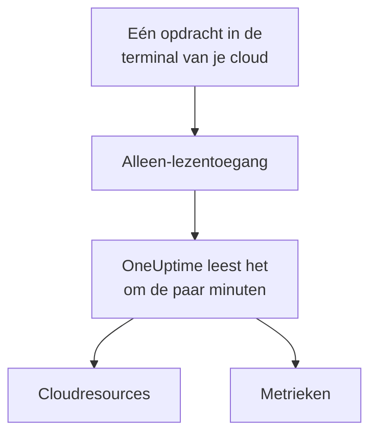

# Een cloudaccount koppelen

Koppel een AWS-account, een Azure-abonnement of een Google Cloud-project vanuit het dashboard, en OneUptime toont de resources ervan en leest hun belangrijkste metrieken volgens een schema. Je voert één opdracht uit in de browserterminal van je cloud en plakt wat die toont: geen collector om te draaien en niets om te installeren.

:::cards
- [Amazon Web Services](#amazon-web-services): Een IAM-rol waarmee OneUptime zich aanmeldt, of een toegangssleutel.
- [Microsoft Azure](#microsoft-azure): Een app met de rol Monitoring Reader.
- [Google Cloud](#google-cloud): Een serviceaccount met de rol Monitoring Viewer.
- [Wat OneUptime leest](#wat-oneuptime-leest): Welke resources en metrieken, hoe vaak, en wat het kost.
:::

## Hoe het werkt



- **De toegang kan alleen lezen.** De opdracht maakt toegang die metrieken leest en verder niets: drie leesacties op AWS, de rol **Monitoring Reader** op Azure en de rol **Monitoring Viewer** op Google Cloud. Verwijder hem om OneUptime de toegang te ontnemen.
- **OneUptime leest volgens een schema.** Elke 5 minuten voor Azure en Google Cloud, en elke 10 minuten voor AWS, tenzij je bij het koppelen een ander interval kiest.
- **Elke resource krijgt een eigen pagina.** Resources verschijnen onder **Cloud → Alle resources** met hun belangrijkste metrieken, eigenaren en labels, net als de resources die een collector meldt.

## Voordat je begint

- **Een projecteigenaar of -beheerder.** Alleen zij kunnen cloudaccounts koppelen, testen en bewerken.
- **De terminal van je cloud** (AWS CloudShell, Azure Cloud Shell of Google Cloud Shell), aangemeld als iemand die een IAM-rol of -gebruiker, een app-registratie of een serviceaccount mag maken.

## Amazon Web Services

:::steps
### Het AWS-formulier openen

Ga naar **Cloud → Koppelen** en kies **Amazon Web Services**.

### De opdracht uitvoeren in AWS CloudShell

Kies hoe OneUptime zich aanmeldt. Een **IAM-rol** is de aanbevolen manier: er wordt niets geheims opgeslagen, en je kunt de rol op elk moment verwijderen. Het formulier toont de opdracht, geschreven voor je project: die maakt een rol die het AWS-account van OneUptime vertrouwt met de externe ID van je project, en toont de ARN van de rol. Gebruik een **Toegangssleutel** als een rol niet mogelijk is. Deze opdracht maakt een gebruiker met dezelfde rechten en toont de sleutel:

```bash
aws iam create-user --user-name OneUptimeReadOnly > /dev/null 2>&1 || true
aws iam put-user-policy --user-name OneUptimeReadOnly --policy-name OneUptimeReadOnly --policy-document '{"Version":"2012-10-17","Statement":[{"Effect":"Allow","Action":["cloudwatch:GetMetricData","cloudwatch:ListMetrics","tag:GetResources"],"Resource":"*"}]}'
aws iam create-access-key --user-name OneUptimeReadOnly
```

### Plakken wat de AWS-opdracht toonde

Plak alles wat de opdracht heeft getoond in **Wat de opdracht heeft getoond**. OneUptime haalt er de ARN van de rol uit, of de toegangssleutel-ID en het geheim.

### AWS testen en koppelen

OneUptime test de verbinding zodra deze stap opent: het meldt zich aan, telt de resources die het vindt en zegt wat het lezen ervan kost. Kies **Koppelen** om op te slaan.
:::

De rol en de gebruiker kunnen drie dingen doen, en verder niets:

| Actie | Waarvoor OneUptime die gebruikt |
| --- | --- |
| `cloudwatch:ListMetrics` | De resources vinden die metrieken rapporteren, in elke regio |
| `cloudwatch:GetMetricData` | Hun belangrijkste metrieken lezen |
| `tag:GetResources` | Elke resource benoemen naar zijn `Name`-tag |

> [!NOTE]
> Op een zelfgehoste OneUptime heeft de manier **IAM-rol** een eigen AWS-identiteit van OneUptime nodig: stel `CLOUD_CONNECT_AWS_ACCESS_KEY_ID` en `CLOUD_CONNECT_AWS_SECRET_ACCESS_KEY` in op de sleutel van een IAM-gebruiker die `sts:AssumeRole` mag aanroepen. Zonder deze biedt het formulier een **Toegangssleutel** aan.

## Microsoft Azure

:::steps
### Het Azure-formulier openen

Ga naar **Cloud → Koppelen** en kies **Microsoft Azure**.

### De opdracht uitvoeren in Azure Cloud Shell

De opdracht maakt een app met de rol **Monitoring Reader** op je huidige abonnement, en toont de gegevens ervan:

```bash
az ad sp create-for-rbac --name OneUptimeReadOnly --role "Monitoring Reader" --scopes "/subscriptions/$(az account show --query id --output tsv)"
```

### Plakken wat de Azure-opdracht toonde

Plak alles wat de opdracht heeft getoond in **Wat de opdracht heeft getoond**. OneUptime haalt er `tenant`, `appId` en `password` uit.

### Azure testen en koppelen

OneUptime test de verbinding zodra deze stap opent. Kies **Koppelen** om op te slaan.
:::

Om meer abonnementen met dezelfde app te lezen, geef je de app de rol op elk ervan:

```bash
az role assignment create --assignee <APP_ID> --role "Monitoring Reader" --scope /subscriptions/<SUBSCRIPTION_ID>
```

OneUptime leest elk abonnement dat de app kan lezen, tenzij je er een paar opgeeft onder **Abonnementen**.

## Google Cloud

:::steps
### Het Google Cloud-formulier openen

Ga naar **Cloud → Koppelen** en kies **Google Cloud**.

### De opdracht uitvoeren in Google Cloud Shell

Voer hem uit in het project dat je wilt monitoren. Hij zet de Cloud Monitoring API aan, maakt een serviceaccount met de rol **Monitoring Viewer** en toont de sleutel ervan:

```bash
PROJECT_ID=$(gcloud config get-value project)
gcloud services enable monitoring.googleapis.com
gcloud iam service-accounts create oneuptime-read-only --display-name "OneUptime (read only)"
gcloud projects add-iam-policy-binding "$PROJECT_ID" --member "serviceAccount:oneuptime-read-only@$PROJECT_ID.iam.gserviceaccount.com" --role roles/monitoring.viewer --condition=None > /dev/null
gcloud iam service-accounts keys create oneuptime-key.json --iam-account "oneuptime-read-only@$PROJECT_ID.iam.gserviceaccount.com"
cat oneuptime-key.json && rm oneuptime-key.json
```

### De sleutel plakken

Plak alles wat de opdracht heeft getoond. OneUptime leest het eigen project van de sleutel, en slaat de sleutel versleuteld op.

### Google Cloud testen en koppelen

OneUptime test de verbinding zodra deze stap opent. Kies **Koppelen** om op te slaan.
:::

Om meer projecten met hetzelfde serviceaccount te lezen, geef je het de rol in elk ervan en geef je ze op onder **Projecten**:

```bash
gcloud projects add-iam-policy-binding <PROJECT_ID> --member "serviceAccount:oneuptime-read-only@<KEY_PROJECT_ID>.iam.gserviceaccount.com" --role roles/monitoring.viewer
```

## Wat OneUptime leest

| | AWS | Azure | Google Cloud |
| --- | --- | --- | --- |
| Resources | Die metrieken rapporteren aan CloudWatch, in elke regio die je gebruikt | Elke resource in de abonnementen | Die metrieken rapporteren aan Cloud Monitoring |
| Metrieken | De belangrijkste metrieken van elke service, zoals de CPU, het netwerk en de statuscontroles van een instance | Tot 8 belangrijke metrieken per resource | De belangrijkste metrieken van elk resourcetype |
| Gelezen elke | 10 minuten | 5 minuten | 5 minuten |
| Een verwijderde resource | Gearchiveerd na 7 dagen zonder metrieken | Gearchiveerd bij de volgende leesactie | Gearchiveerd na 7 dagen zonder metrieken |

Elke leesactie gaat verder waar de vorige stopte, zodat elk datapunt één keer wordt geschreven. De eerste leesactie van een nieuwe koppeling start binnen een minuut en gaat een uur terug; na een pauze gaat een leesactie hooguit 6 uur terug.

De aanroepen van OneUptime worden aan je cloudaccount gefactureerd, tegen de prijzen van je cloud. De test schat de kosten van wat hij vindt, en minder vaak lezen kost minder: wijzig **Leesinterval voor metrieken** onder **Meer velden**.

| Cloud | Prijs |
| --- | --- |
| AWS | CloudWatch `GetMetricData`: $0.01 per 1.000 metrieken, en elke belangrijke metriek van een resource is één metriek per leesactie |
| Azure | De eerste 1.000.000 metriekleesacties per maand van elk abonnement zijn gratis, daarna $0.01 per 1.000 |
| Google Cloud | De eerste 1.000.000 gelezen tijdreeksen per maand zijn gratis, daarna $0.50 per miljoen |

## Problemen oplossen

:::details De test zegt dat de sleutel of het geheim niet is geaccepteerd
Kopieer alles wat de opdracht heeft getoond en plak het opnieuw. Een sleutel die een minuut geleden is gemaakt, kan een minuut nodig hebben om te werken.
:::

:::details De test meldt zich aan, maar kan niet lezen
Voer de opdracht opnieuw uit: die kent de rol toe die OneUptime nodig heeft. Voer op AWS de opdracht uit die het formulier voor dit project toont: een rol die voor een ander project is gemaakt, vertrouwt de externe ID van dat project, niet die van dit project.
:::

:::details Google Cloud laat de opdracht geen sleutel maken
Een organisatiebeleid, `iam.disableServiceAccountKeyCreation`, kan sleutels voor serviceaccounts verbieden. Vraag de beheerder van je organisatie om een uitzondering voor het project, of [verstuur de metrieken met je eigen collector](/docs/telemetry/cloud-resources).
:::

:::details Er verschijnen geen resources
Op AWS en Google Cloud verschijnt een resource zodra die metrieken rapporteert. Als een koppeling niet werkt, zegt **View error** onder **Cloud → Koppelen** waarom de laatste leesactie mislukte.
:::

## Volgende stappen

:::cards
- [Cloudresources](/docs/telemetry/cloud-resources): Draai in plaats daarvan je eigen OpenTelemetry Collector, of stream CloudWatch-metrieken.
- [Metriekmonitor](/docs/monitor/metrics-monitor): Waarschuw op de metrieken van een resource.
:::
