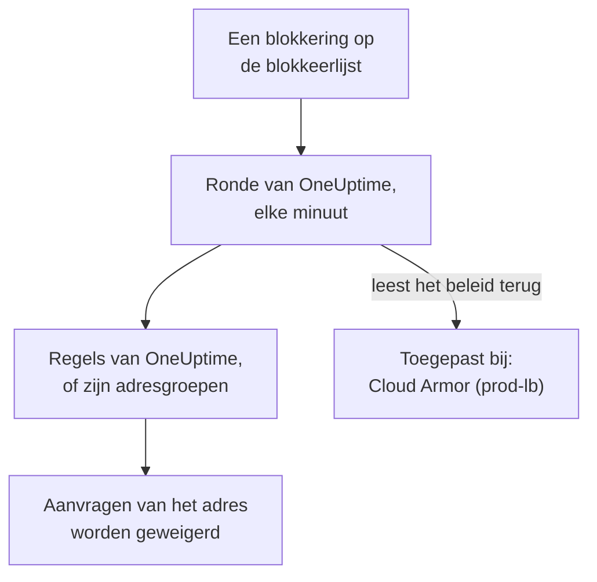

# Adressen blokkeren in Cloud Armor

De blokkeerlijst van je project kan worden toegepast in het beveiligingsbeleid van Google Cloud Armor van je load balancers. Zet het aan voor een Google Cloud-koppeling die je al hebt, kies het beveiligingsbeleid, en elk adres dat de blokkeerlijst blokkeert, wordt daar geblokkeerd, of een persoon, een playbook of OneUptime AI het nu heeft geblokkeerd.

:::cards
- [Inschakelen](#inschakelen): Eén instelling op de Google Cloud-koppeling, en de rol die ze nodig heeft.
- [Wat OneUptime aanmaakt](#wat-oneuptime-aanmaakt): Eigen regels in elk beleid, of adresgroepen met Cloud Armor Enterprise.
- [Welk adres wordt vergeleken](#welk-adres-wordt-vergeleken): Het adres dat verbinding maakte, of het gebruikers-IP achter een proxy.
:::

## Hoe het werkt

OneUptime houdt eigen regels bij in elk beveiligingsbeleid dat je kiest, en zet daarin de adressen die de blokkeerlijst blokkeert. Elke minuut wijzigt het wat er is veranderd, één regel tegelijk, en daarna leest het het beleid terug. Op de pagina **Blokkeerlijst** noemt **Toegepast bij** van een blokkering pas Cloud Armor (prod-lb) zodra het beleid de blokkering bevat; tot dan wordt ze niet toegepast.

## Voordat je begint

- Een Google Cloud-project dat aan OneUptime is gekoppeld (zie [Een cloudaccount koppelen](/docs/telemetry/cloud-accounts#google-cloud)).
- Een rol die mag wijzigen waar de blokkeerlijst wordt toegepast: **Projecteigenaar**, **Projectbeheerder** of **Beveiligingsbeheerder**.
- Iemand die rollen mag aanmaken en verlenen in het Google Cloud-project, om één opdracht uit te voeren in Cloud Shell.

## Inschakelen

:::steps
### De koppeling openen
Open **Cloud → Koppelen** en bewerk de Google Cloud-koppeling.

### De instelling aanzetten
Zet onder **Meer velden** de instelling **Adressen blokkeren in Cloud Armor** op **Aan** en sla op. De installatieopdracht die het formulier nu toont, verleent de rol hieronder waar ze de andere verleent. Een koppeling die je al hebt, hoeft die niet opnieuw uit te voeren: het dialoogvenster **WAF toevoegen** geeft de opdrachten die de rol in het project van het beleid verlenen.

### Het beveiligingsbeleid toevoegen
Open **Beveiligingsgebeurtenissen → Playbooks → Blokkeerlijst**. Klik onder **Cloud-WAF's** op **WAF toevoegen** en kies een beveiligingsbeleid. OneUptime vraagt Google Cloud of de koppeling het beleid mag schrijven, zonder iets te schrijven.

### De rol verlenen, als die ontbreekt
Als er een machtiging ontbreekt, toont het dialoogvenster de opdrachten die haar in het project van het beleid verlenen. Voer ze uit in Cloud Shell, klik op **Opnieuw controleren** en voeg daarna het beleid toe. De **Status** ervan toont **Wordt toegepast** zodra OneUptime het heeft ingericht.
:::

Het beveiligingsbeleid komt uit de inventaris van de koppeling: een beleid dat OneUptime nog niet heeft gelezen, verschijnt na de volgende uitlezing. Zolang een beleid de blokkeerlijst toepast, kan de instelling van de koppeling niet worden uitgezet en kan de koppeling niet worden verwijderd: verwijder eerst het beleid, zodat OneUptime zijn regels eruit haalt.

## Wat OneUptime aanmaakt

OneUptime kiest hoe een beleid de blokkeerlijst bevat wanneer je het toevoegt.

| Wat | Naam | Waar |
| --- | --- | --- |
| Regels die weigeren met 403, elk met maximaal 10 adressen of bereiken | Hun beschrijving begint met `OneUptime blocklist <project> #1`, `#2`, ... | In elk beleid dat je kiest, maximaal 20. |
| Twee adresgroepen, IPv4 en IPv6 | `oneuptime-<project>-block-ipv4`, `oneuptime-<project>-block-ipv6` | Globaal, in het project van het beleid. Alleen met Cloud Armor Enterprise. |
| Eén regel die met 403 weigert wat een van beide groepen bevat | Zijn beschrijving begint met `OneUptime blocklist <project>, address groups` | In elk globaal backendbeleid dat je kiest, met Cloud Armor Enterprise. |

`<project>` zijn de eerste acht tekens van de externe ID van je project, zodat twee OneUptime-projecten die hetzelfde beleid kiezen nooit elkaars regels schrijven. Cloud Armor noemt een regel alleen bij zijn prioriteit, dus OneUptime herkent zijn eigen regels aan hun beschrijving.

- **Regels.** Cloud Armor bevat 10 adressen of bereiken in een regel, dus een beleid bevat tot 200 blokkeringen in de 20 regels van OneUptime; een blokkering die er niet meer in past, meldt dat op haar rij.
- **Adresgroepen.** Een globaal backendbeleid van een project met Cloud Armor Enterprise bevat de blokkeerlijst in plaats daarvan in twee adresgroepen: 10.000 IPv4- en 2.000 IPv6-bereiken. Elk zulk beleid van het project deelt ze, en één regel in elk beleid weigert wat ze bevatten. De groepen nemen 16.000 eenheden van het adresgroepquotum van het project in beslag.

OneUptime voegt elk van zijn regels apart toe, en wijzigt en verwijdert ze ook apart, met de regelmethoden van Cloud Armor: het schrijft het beleid nooit in zijn geheel, en schrijft nooit een regel van jou. Eén adres wordt geschreven als `/32` of `/128`.

## De plek van de regels in het beleid

OneUptime zet zijn regels op vrije prioriteiten vóór je eerste regel die een aanvraag doorlaat, de laagste eerst, zodat geen regel van jou een geblokkeerd adres doorlaat: een regel die toestaat, beperkt, op basis van frequentie verbant of eerlijk verdeelt. Een regel van jou die weigert, mag ervoor staan. OneUptime nummert een regel van jou nooit opnieuw, en wijzigt of verwijdert hem nooit: als er vóór je eerste zulke regel geen prioriteit vrij is, toont het beleid **Geen vrije prioriteit**, en voegt OneUptime zijn regel toe zodra je er een vrijmaakt.

## Welk adres wordt vergeleken

| Beveiligingsbeleid | Clientadres | Wanneer kiezen |
| --- | --- | --- |
| Backend | **Het adres dat verbinding maakte met de load balancer (origin.ip)** | De standaard. |
| Backend | Het gebruikers-IP uit de aanvraagheaders van het beleid (origin.user_ip) | Voor een load balancer achter een andere proxy of een ander CDN. |
| Edge | Het adres dat verbinding maakte met de load balancer (origin.ip) | De enige keuze: een edgebeleid leest geen ander adres. |

`origin.user_ip` is het adres in de aanvraagheaders voor het gebruikers-IP van het beleid (`userIpRequestHeaders`), die een proxy of CDN vóór de load balancer schrijft. Als er geen is ingesteld, of als er geen geldig adres in staat, is het `origin.ip`. Kies het alleen als zo'n proxy ze schrijft, want een client die de load balancer rechtstreeks bereikt, kan ze zelf schrijven. De keuze staat onder **Meer velden** in het dialoogvenster **WAF toevoegen**, en je kunt haar later wijzigen met **Clientadres** in de rij van het beleid.

Een netwerkedge-beveiligingsbeleid, voor passthrough-netwerkloadbalancers, kan niet worden gekozen, en het dialoogvenster **WAF toevoegen** meldt waarom: de regels ervan matchen pakketten, geen aanvragen.

De regels van OneUptime in Cloud Armor weigeren alleen. Een blokkering die vraagt om een adres een challenge voor te leggen, wordt in Cloud Armor niet toegepast, en meldt dat. De challenge van een beleid voor automatische reactie wordt daar voor dezelfde tijd als blokkering toegepast.

## Als een regel handmatig wordt gewijzigd

Als iemand een van de regels van OneUptime in de voorbeeldmodus zet, wijzigt of verwijdert, of een van zijn adresgroepen verwijdert, laat OneUptime alles zoals die persoon het achterliet. Het beleid toont **Handmatig gewijzigd**, en de blokkeringen die erin stonden, worden niet toegepast, met de reden, totdat iemand op **Terugzetten** klikt in de rij van het beleid. Terugzetten schrijft de regel opnieuw zoals OneUptime hem schrijft, op zijn eigen prioriteit zolang die vrij is, en maakt een verwijderde adresgroep opnieuw aan.

OneUptime controleert niet of een beleid aan een backendservice is gekoppeld. Een beleid dat aan geen enkele is gekoppeld, blokkeert niets.

## Een beleid in Terraform beheren

Een `google_compute_security_policy` met `rule`-blokken beheert elke regel van het beleid, dus het volgende plan ervan verwijdert de regels van OneUptime. Beheer je regels als `google_compute_security_policy_rule`-resources, die andere regels met rust laten, of voeg `ignore_changes = [rule]` toe aan het `lifecycle`-blok van het beleid.

## Machtigingen

De installatieopdracht voegt een aangepaste rol toe, `oneuptimeCloudArmorBlocklist`, waar ze de andere rollen van de koppeling verleent, en verleent die aan het serviceaccount van de koppeling. De opdrachten die het dialoogvenster **WAF toevoegen** toont, voegen dezelfde rol toe in het project van het beleid. Een beleid in regelmodus heeft alleen de machtigingen voor beleid nodig.

| Machtiging | Waarom |
| --- | --- |
| `compute.securityPolicies.get`, `compute.securityPolicies.update` | Een globaal beleid lezen en er de regels van OneUptime in wijzigen. |
| `compute.regionSecurityPolicies.get`, `compute.regionSecurityPolicies.update` | Een regionaal beleid lezen en er de regels van OneUptime in wijzigen. |
| `compute.globalOperations.get`, `compute.regionOperations.get` | Wachten tot een wijziging klaar is. |
| `compute.projects.get` | Lezen of het project Cloud Armor Enterprise heeft. |
| `networksecurity.addressGroups.get`, `networksecurity.addressGroups.list`, `networksecurity.addressGroups.create`, `networksecurity.addressGroups.update`, `networksecurity.addressGroups.delete`, `networksecurity.addressGroups.use` | De adresgroepen van OneUptime bijhouden, en er vanuit zijn regel naar verwijzen. Alleen met Cloud Armor Enterprise. |
| `networksecurity.operations.get` | Wachten tot de wijziging van een adresgroep klaar is. |

De rol kan geen beleid verwijderen, en OneUptime schrijft nooit iets anders. De installatieopdracht zet ook de API's van Compute Engine en Network Security aan.

## Verwijderen

:::steps
### Het beveiligingsbeleid verwijderen
Klik in **Beveiligingsgebeurtenissen → Playbooks → Blokkeerlijst** op **Verwijderen** in de rij van het beleid. OneUptime haalt zijn regels uit het beleid, en verwijdert zijn adresgroepen zodra geen ander beleid van het project ze nog gebruikt.

### De instelling uitzetten
Bewerk de koppeling, zet **Adressen blokkeren in Cloud Armor** op **Uit** en sla op. De instelling kan worden uitgezet zodra geen beleid van de koppeling de blokkeerlijst nog toepast.
:::

Als OneUptime het beleid niet meer mag schrijven, vink je **Alleen uit OneUptime verwijderen** aan in het dialoogvenster **WAF verwijderen**. OneUptime haalt het beleid uit de blokkeerlijst en noemt de regels en adresgroepen die het heeft laten staan: die blijven blokkeren wat ze bevatten, totdat je ze in Google Cloud verwijdert.

## Problemen oplossen

:::details Wordt niet toegepast
De status van het beleid vertelt wat Google Cloud antwoordde en wat je moet doen. Een weigering noemt de machtiging die ontbreekt: voer de opdrachten uit die **WAF toevoegen** voor het beleid toont, en klik daarna op **Opnieuw controleren**. Een weigering om een quotum noemt dat quotum: vraag Google Cloud om meer, of verwijder regels die je niet meer gebruikt.
:::

:::details Geen vrije prioriteit
Elke prioriteit vóór je eerste regel die een aanvraag doorlaat, is bezet. Geef die regel een hoger nummer en klik daarna op **Opnieuw controleren**.
:::

:::details Een beleid staat niet in de lijst
OneUptime toont het beveiligingsbeleid van koppelingen waarbij de instelling aanstaat, zodra het dat heeft gelezen. Een beleid dat sindsdien is toegevoegd, verschijnt na de volgende uitlezing van de koppeling.
:::

## Volgende stappen

:::cards
- [Beveiligingszaken en playbooks](/docs/telemetry/security-cases): Blokkeer een adres vanuit een zaak, en zie hoe de stap ervan wordt gecontroleerd.
- [Een cloudaccount koppelen](/docs/telemetry/cloud-accounts): De koppeling waar deze instelling bij hoort.
:::
