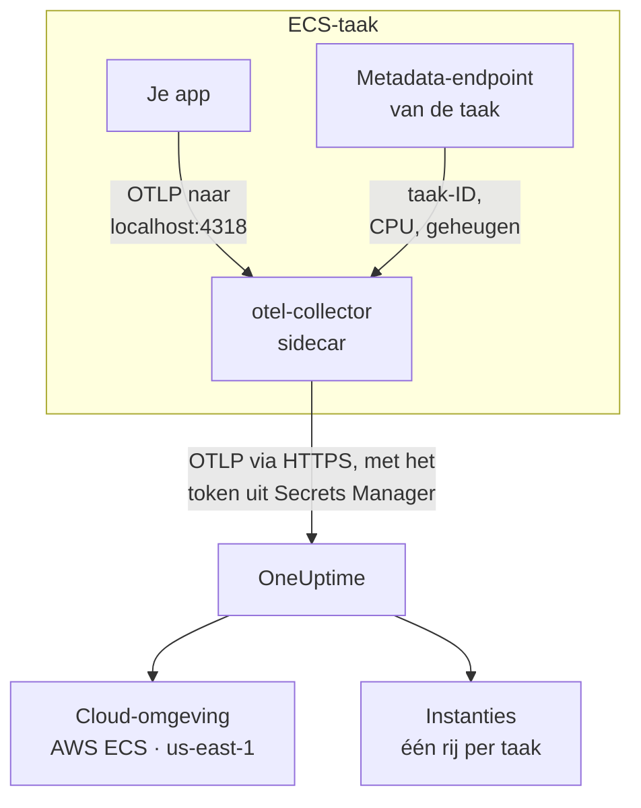

# AWS ECS / Fargate

Stuur de traces, logs en metrieken van je Amazon ECS-taken naar OneUptime, op zowel het Fargate- als het EC2-starttype. Elke taak die `cloud.platform=aws_ecs` meldt, komt terecht in één **Cloud Environment** per AWS-account en regio, zoals _AWS ECS · us-east-1 · 123456789012_, of er nu één service draait of vijftig.

:::cards
- [Hoe het werkt](#hoe-het-werkt): Wat de ECS-detector en de sidecar-collector doen.
- [Instellen](#instellen): Het token opslaan, de instellingen aan de taakdefinitie toevoegen, uitrollen en controleren.
- [De volledige taakdefinitie](#de-volledige-taakdefinitie): Een complete Fargate-taakdefinitie om te registreren.
- [Problemen oplossen](#problemen-oplossen): Taken die in PENDING blijven hangen, geweigerde exports, lege instanties of tegels.
:::

## Hoe het werkt



- **De ECS-detector geeft de omgeving haar naam.** De ECS-resource-detector van OpenTelemetry, in de SDK of in een collector, leest het metadata-endpoint dat ECS aan elke container geeft en stempelt het account, de regio en de taak op alles wat de taak verstuurt. Niets is hard gecodeerd.
- **De taak geeft elke instantie haar naam.** Het tabblad **Instanties** van de omgeving toont de draaiende taken op taak-ID, met hun CPU en geheugen.
- **Een sidecar-collector voegt CPU en geheugen toe.** Zijn receiver `awsecscontainermetrics` leest de CPU en het geheugen van elke taak uit hetzelfde endpoint, en hij bewaart het token, zodat de applicatie het nooit ziet.

De ECS-detector stelt deze resource-attributen in:

| Attribuut | Ingesteld door de ECS-detector | Waarvoor |
| ------------------------------------------------------------------ | ----------------------- | --------------------------------------------------------------------------------------------------------- |
| `cloud.platform` | `aws_ecs` | Archiveert de telemetrie onder **Cloud-omgevingen**. De waarde moet exact zijn |
| `cloud.account.id` | `123456789012` | Deel van de omgevingssleutel |
| `cloud.region` | `us-east-1` | Deel van de omgevingssleutel |
| `aws.ecs.task.arn` | de taak-ARN | Geeft één draaiende taak een naam onder **Instanties**, via het taak-ID aan het eind |
| `aws.ecs.task.id` | het taak-ID | Hetzelfde; nieuwere detectorversies stellen beide in |
| `aws.ecs.cluster.arn`, `aws.ecs.task.family`, `aws.ecs.launchtype` | het cluster en de taak | Blijven op elke span, log en metriek staan zodat je erop kunt zoeken; geen deel van de omgeving |

De omgevingssleutel is `aws_ecs|123456789012|us-east-1`. Het taak-ID geeft een instantie haar naam, ook als de SDK daarnaast `service.instance.id` instelt: de containermetrieken van de sidecar dragen alleen het taak-ID, dus door daarop te sleutelen blijven de spans van een taak en haar CPU en geheugen op één rij. Zie [Cloud-omgevingen](/docs/telemetry/cloud-environments) voor de volledige regel.

## Voordat je begint

- **Een ingestiesleutel.** Maak een sleutel van het type **Server** aan onder **Projectinstellingen → Telemetrie & APM → Ingestiesleutels** en kopieer het token.
- **Een ECS-cluster en een taakdefinitie die je kunt herzien**, en de AWS CLI ingesteld voor dat account.
- **Je applicatie geïnstrumenteerd met een OpenTelemetry-SDK** die OTLP exporteert, in welke taal dan ook.

## Kiezen hoe telemetrie de taak verlaat

| | Sidecar collector | SDK direct |
| ----------------------- | ---------------------------------------------- | ----------------------------------------------- |
| Extra container | `otel-collector` in elke taak | Geen |
| CPU en geheugen per taak | Ja, uit de receiver `awsecscontainermetrics` | Nee |
| Bewaart het token | De collector | De applicatie |
| Het geheim bevat | Alleen het token | De hele header `x-oneuptime-token=...` |

De meeste teams gebruiken de sidecar-collector: die stempelt de attributen `cloud.*` zelfs op telemetrie van bibliotheken die niets van ECS weten. SDK direct is de eenvoudigste keuze voor één service. Elke stap hieronder heeft voor beide een tabblad; kies er een en elke stap volgt die keuze.

## Instellen

:::steps
### Het token opslaan in Secrets Manager

> [!IMPORTANT]
> Het token is een geheim. Bewaar het in AWS Secrets Manager en verwijs ernaar vanuit de taakdefinitie met `secrets` en `valueFrom`. Een token in een gewone vermelding onder `environment` is zichtbaar voor iedereen die de taakdefinitie kan lezen, en verschijnt in elke uitvoer van `describe-task-definition` en elke CloudFormation-diff.

:::tabs
@tab Sidecar collector
```bash
aws secretsmanager create-secret \
  --name oneuptime/ingestion-token \
  --region us-east-1 \
  --secret-string "YOUR_TELEMETRY_INGESTION_TOKEN"
```

De collectorconfiguratie voegt de headernaam toe, dus dit geheim bevat alleen het token.
@tab SDK direct
```bash
aws secretsmanager create-secret \
  --name oneuptime/ingestion-token \
  --region us-east-1 \
  --secret-string "x-oneuptime-token=YOUR_TELEMETRY_INGESTION_TOKEN"
```

ECS zet de waarde van een geheim ongewijzigd in de variabele, en `OTEL_EXPORTER_OTLP_HEADERS` heeft het hele paar `name=value` nodig, dus dit geheim bevat de volledige header.
:::

Noteer de ARN die het commando afdrukt. Die eindigt op een willekeurig achtervoegsel, zoals `oneuptime/ingestion-token-AbCdEf`, en je plakt hem in de taakdefinitie.

### De taak het geheim laten lezen

De taakuitvoeringsrol (de rol waarmee ECS de taak start, niet de rol waaronder je code draait) moet het geheim kunnen lezen. Koppel dit beleid aan `ecsTaskExecutionRole`:

```json title="secret-access-policy.json"
{
  "Version": "2012-10-17",
  "Statement": [
    {
      "Effect": "Allow",
      "Action": ["secretsmanager:GetSecretValue"],
      "Resource": "arn:aws:secretsmanager:us-east-1:123456789012:secret:oneuptime/ingestion-token-*"
    }
  ]
}
```

Als een door de klant beheerde KMS-sleutel het geheim versleutelt, heeft de rol ook `kms:Decrypt` op die sleutel nodig. Zonder een van beide start de taak niet: hij stopt met `ResourceInitializationError: unable to pull secrets`.

### De instellingen aan de taakdefinitie toevoegen

:::tabs
@tab Sidecar collector
1. **AWS Console → Amazon Elastic Container Service → Task definitions** → selecteer de familie → **Create new revision**.
2. Klap onder **Container - 1** (je applicatie) **Environment variables** uit en voeg de applicatievariabelen hieronder toe.
3. **+ Add container**: naam `otel-collector`, image `otel/opentelemetry-collector-contrib:latest` (zet een versie vast zodra het werkt), **Essential container: No**. Vul onder **Docker configuration → Command** `--config=env:OTEL_COLLECTOR_CONFIG` in.
4. Voeg op de collectorcontainer de omgevingsvariabele `ONEUPTIME_TOKEN` toe met **Value type: ValueFrom** en de ARN van het geheim, en `OTEL_COLLECTOR_CONFIG` met **Value type: Value** en de collectorconfiguratie hieronder.
5. Voeg onder **Startup dependency ordering** op de applicatiecontainer `otel-collector` toe met de voorwaarde **Start**, zodat de applicatie nooit start voordat er iets op poort 4318 luistert.
6. Controleer onder **Task execution role** dat dit de rol is waaraan je het beleid hebt gekoppeld.

Applicatievariabelen. In de netwerkmodus `awsvpc` (altijd, op Fargate) delen de containers van een taak één netwerk, dus `localhost` is de sidecar:

```bash
OTEL_SERVICE_NAME=checkout-api
OTEL_EXPORTER_OTLP_ENDPOINT=http://localhost:4318
OTEL_EXPORTER_OTLP_PROTOCOL=http/protobuf
```

Collectorconfiguratie. De collector leest alles uit de variabele `OTEL_COLLECTOR_CONFIG`, dus er hoeft geen bestand in een image te worden ingebouwd, en hij vult `${env:ONEUPTIME_TOKEN}` in vanuit het geheim dat ECS in zijn omgeving zet:

```yaml title="OTEL_COLLECTOR_CONFIG"
receivers:
  otlp:
    protocols:
      http:
        endpoint: 0.0.0.0:4318
      grpc:
        endpoint: 0.0.0.0:4317
  # Per-task and per-container CPU / memory from the ECS task metadata
  # endpoint. This is what fills the CPU and memory tiles in OneUptime.
  awsecscontainermetrics:
    collection_interval: 20s
processors:
  # Stamps cloud.provider, cloud.platform=aws_ecs, cloud.account.id,
  # cloud.region and aws.ecs.task.arn on every span, log and metric.
  resourcedetection:
    detectors: [env, ecs]
    timeout: 5s
  batch: {}
exporters:
  otlphttp/oneuptime:
    endpoint: https://oneuptime.com/otlp
    headers:
      x-oneuptime-token: ${env:ONEUPTIME_TOKEN}
service:
  pipelines:
    traces:
      receivers: [otlp]
      processors: [resourcedetection, batch]
      exporters: [otlphttp/oneuptime]
    metrics:
      receivers: [otlp, awsecscontainermetrics]
      processors: [resourcedetection, batch]
      exporters: [otlphttp/oneuptime]
    logs:
      receivers: [otlp]
      processors: [resourcedetection, batch]
      exporters: [otlphttp/oneuptime]
```

De detector `ecs` en de receiver `awsecscontainermetrics` hebben geen van beide een IAM-recht nodig: beide lezen het metadata-endpoint dat ECS aan elke container geeft in `ECS_CONTAINER_METADATA_URI_V4`.
@tab SDK direct
1. **AWS Console → Amazon Elastic Container Service → Task definitions** → selecteer de familie → **Create new revision**.
2. Klap onder **Container - 1** (je applicatie) **Environment variables** uit en voeg de variabelen hieronder toe. Voeg `OTEL_EXPORTER_OTLP_HEADERS` toe met **Value type: ValueFrom** en de ARN van het geheim als waarde.
3. Voeg de schakelaar toe die de ECS-resource-detector van je taal aanzet, uit de tabel hieronder.
4. Controleer onder **Task execution role** dat dit de rol is waaraan je het beleid hebt gekoppeld.

```bash
OTEL_SERVICE_NAME=checkout-api
OTEL_EXPORTER_OTLP_ENDPOINT=https://oneuptime.com/otlp
OTEL_EXPORTER_OTLP_PROTOCOL=http/protobuf
# Injected from Secrets Manager (secrets / valueFrom), not typed here.
OTEL_EXPORTER_OTLP_HEADERS=x-oneuptime-token=YOUR_TELEMETRY_INGESTION_TOKEN
```

| Taal | De ECS-detector aanzetten |
| -------- | --------------------------------------------------------------------------------------------------------------- |
| Node.js | `OTEL_NODE_RESOURCE_DETECTORS=env,host,os,aws` (auto-instrumentations-node) |
| Python | `pip install opentelemetry-sdk-extension-aws`, daarna `OTEL_EXPERIMENTAL_RESOURCE_DETECTORS=aws_ecs` |
| Java | `-Dotel.resource.providers.aws.enabled=true` (de agent levert de provider uitgeschakeld) |
| Go | `import "go.opentelemetry.io/contrib/detectors/aws/ecs"` en geef `ecs.NewResourceDetector()` door aan `resource.New` |
| .NET | Het pakket `OpenTelemetry.Resources.AWS`: `.ConfigureResource(r => r.AddAWSECSDetector())` |

In een taakdefinitiebestand is het geheim `"secrets": [{ "name": "OTEL_EXPORTER_OTLP_HEADERS", "valueFrom": "<secret ARN>" }]`.
:::

Als je OneUptime zelf host, gebruik dan `https://YOUR-ONEUPTIME-HOST/otlp` als endpoint.

### De nieuwe revisie uitrollen

Klik op **Create**, daarna op **Clusters → your cluster → Services → select the service → Update → Task definition revision: latest → Deploy**. Of via de CLI:

```bash
aws ecs update-service \
  --cluster production \
  --service checkout-api \
  --task-definition checkout-api
```

### De verbinding controleren

Controleer eerst het token: dat is de goedkoopste controle, en niets daarna werkt zonder.

```bash
curl -i https://oneuptime.com/otlp/v1/validate \
  -H "x-oneuptime-token: YOUR_TELEMETRY_INGESTION_TOKEN"
```

`200` met `"valid": true` betekent dat het token is geaccepteerd. `401` betekent dat het onbekend, ingetrokken, uitgeschakeld of verlopen is. Voer hetzelfde commando met ECS Exec uit binnen de taak, om te bewijzen dat de taak zelf OneUptime kan bereiken:

```bash
aws ecs execute-command --cluster production --task <task id> \
  --container app --interactive --command "sh"
```

De CloudWatch-logstream van de collector (`otel/otel-collector/...`) moet `Everything is ready` tonen, zonder regels met `401` of `connection refused`. Binnen een minuut na de eerste span, log of metriek verschijnt de omgeving onder **Cloud → All Environments** als _AWS ECS · us-east-1 · 123456789012_.
:::

## De volledige taakdefinitie

De sidecar-opzet als bestand dat je registreert met `aws ecs register-task-definition --cli-input-json file://task-definition.json`. Vervang het account-ID, de regio, de image en de ARN van het geheim:

```json title="task-definition.json"
{
  "family": "checkout-api",
  "requiresCompatibilities": ["FARGATE"],
  "networkMode": "awsvpc",
  "cpu": "512",
  "memory": "1024",
  "executionRoleArn": "arn:aws:iam::123456789012:role/ecsTaskExecutionRole",
  "taskRoleArn": "arn:aws:iam::123456789012:role/checkout-api-task-role",
  "containerDefinitions": [
    {
      "name": "app",
      "image": "123456789012.dkr.ecr.us-east-1.amazonaws.com/checkout-api:1.4.2",
      "essential": true,
      "portMappings": [{ "containerPort": 8080, "protocol": "tcp" }],
      "environment": [
        { "name": "OTEL_SERVICE_NAME", "value": "checkout-api" },
        {
          "name": "OTEL_EXPORTER_OTLP_ENDPOINT",
          "value": "http://localhost:4318"
        },
        { "name": "OTEL_EXPORTER_OTLP_PROTOCOL", "value": "http/protobuf" }
      ],
      "dependsOn": [
        { "containerName": "otel-collector", "condition": "START" }
      ],
      "logConfiguration": {
        "logDriver": "awslogs",
        "options": {
          "awslogs-group": "/ecs/checkout-api",
          "awslogs-region": "us-east-1",
          "awslogs-stream-prefix": "app"
        }
      }
    },
    {
      "name": "otel-collector",
      "image": "otel/opentelemetry-collector-contrib:latest",
      "essential": false,
      "command": ["--config=env:OTEL_COLLECTOR_CONFIG"],
      "secrets": [
        {
          "name": "ONEUPTIME_TOKEN",
          "valueFrom": "arn:aws:secretsmanager:us-east-1:123456789012:secret:oneuptime/ingestion-token-AbCdEf"
        }
      ],
      "environment": [
        {
          "name": "OTEL_COLLECTOR_CONFIG",
          "value": "receivers:\n  otlp:\n    protocols:\n      http:\n        endpoint: 0.0.0.0:4318\n      grpc:\n        endpoint: 0.0.0.0:4317\n  awsecscontainermetrics:\n    collection_interval: 20s\nprocessors:\n  resourcedetection:\n    detectors: [env, ecs]\n    timeout: 5s\n  batch: {}\nexporters:\n  otlphttp/oneuptime:\n    endpoint: https://oneuptime.com/otlp\n    headers:\n      x-oneuptime-token: ${env:ONEUPTIME_TOKEN}\nservice:\n  pipelines:\n    traces:\n      receivers: [otlp]\n      processors: [resourcedetection, batch]\n      exporters: [otlphttp/oneuptime]\n    metrics:\n      receivers: [otlp, awsecscontainermetrics]\n      processors: [resourcedetection, batch]\n      exporters: [otlphttp/oneuptime]\n    logs:\n      receivers: [otlp]\n      processors: [resourcedetection, batch]\n      exporters: [otlphttp/oneuptime]\n"
        }
      ],
      "logConfiguration": {
        "logDriver": "awslogs",
        "options": {
          "awslogs-group": "/ecs/checkout-api",
          "awslogs-region": "us-east-1",
          "awslogs-stream-prefix": "otel"
        }
      }
    }
  ]
}
```

De waarde van `OTEL_COLLECTOR_CONFIG` is de collectorconfiguratie als één JSON-string. In plaats van die met de hand te escapen, bewaar je de YAML in `collector.yaml` en laat je `jq` het doen:

```bash
jq --rawfile cfg collector.yaml \
  '.containerDefinitions[1].environment[0].value = $cfg' \
  task-definition.json > task-definition.rendered.json
aws ecs register-task-definition --cli-input-json file://task-definition.rendered.json
```

## Netwerk

De taak moet twee dingen buiten je VPC bereiken: Secrets Manager, om te starten, en OneUptime, om te exporteren.

- **Fargate-taken in privé-subnetten** hebben een route naar internet nodig: een NAT-gateway in de routetabel van het subnet, of een openbaar subnet met `assignPublicIp=ENABLED`. Een taak zonder een van beide blijft in `PENDING` hangen op het geheim, voordat de collector iets verstuurt.
- **Uitgaand verkeer in de security group** moet TCP 443 naar de OneUptime-host toestaan: `oneuptime.com`, of je eigen host op de poort waarop die luistert. De standaard security group staat al het uitgaande verkeer toe; een dichtgetimmerde vaak niet. Telemetrie heeft geen inkomende regel nodig.
- **VPC-interface-endpoints** voor `com.amazonaws.us-east-1.secretsmanager` (en `ecr.api`, `ecr.dkr` en S3 voor het ophalen van images) houden de AWS-aanroepen buiten het NAT-pad. OneUptime zelf heeft de route naar internet nog steeds nodig.

```bash
aws ecs update-service \
  --cluster production \
  --service checkout-api \
  --task-definition checkout-api \
  --network-configuration "awsvpcConfiguration={subnets=[subnet-0abc1234],securityGroups=[sg-0def5678],assignPublicIp=ENABLED}"
```

## Wat je krijgt

- **Overzicht**: aanvragen, foutpercentage en p95-latentie uit je traces, de tegels **CPU** en **Geheugen** en **Topinstanties op CPU**. De tegels worden gevuld uit `ecs.task.cpu.utilized` en `ecs.task.memory.utilized` van de receiver `awsecscontainermetrics`, of uit elke metriek `container.cpu.utilization` en `container.memory.usage` die de identiteit van de taak draagt. SDK direct levert geen van beide.
- **Instanties**: één rij per draaiende taak, met het taak-ID als naam (het eind van `aws.ecs.task.arn`), met de laatste CPU, het geheugen en het tijdstip waarop de taak het laatst is gezien. Een taak die niet meer rapporteert, wordt **Stale**.
- **Logboeken**, **Traces** en **Metrieken**: alles wat `cloud.platform=aws_ecs` droeg voor dit account en deze regio.
- **Services**: dezelfde taken, uitgesplitst naar `service.name`.

## Problemen oplossen

De ECS-storingen, in de volgorde waarin ze optreden:

:::details Een taak blijft in PENDING hangen met "unable to pull secrets"
De volledige fout is `ResourceInitializationError: unable to pull secrets`. Ofwel mist de taakuitvoeringsrol `secretsmanager:GetSecretValue` op het geheim (of `kms:Decrypt` op de sleutel ervan), ofwel heeft de taak geen route naar Secrets Manager: geen NAT-gateway en geen VPC-endpoint. Zie [Netwerk](#netwerk).
:::

:::details De collector logt 401
Het geheim bevat de verkeerde waarde. Voor de sidecar-collector moet het alleen het token zijn; voor SDK direct de hele header `x-oneuptime-token=...`. Controleer het token zelf met het commando in [De verbinding controleren](#de-verbinding-controleren).
:::

:::details De omgeving verschijnt, maar Instanties is leeg
De telemetrie draagt geen taakidentiteit. Zorg dat de detector `ecs` draait: de resource moet `aws.ecs.task.arn`, `aws.ecs.task.id` of `service.instance.id` dragen.
:::

:::details Instanties vult zich, maar de tegels CPU en Geheugen blijven leeg
De receiver `awsecscontainermetrics` ontbreekt in de pipeline `metrics`, of die pipeline slaat de processor `resourcedetection` over, zodat de containermetrieken zonder `cloud.platform` binnenkomen. SDK direct vult deze tegels nooit.
:::

Een omgeving die nooit verschijnt, onder **Hosts** of **Serverless functies** belandt, **Verbinding verbroken** toont of in tweeën splitst, wordt behandeld op [Cloud-probleemoplossing](/docs/telemetry/cloud-troubleshooting).

## Volgende stappen

:::cards
- [Cloud-omgevingen](/docs/telemetry/cloud-environments): Hoe omgevingen en instanties worden herkend.
- [Cloud-probleemoplossing](/docs/telemetry/cloud-troubleshooting): De storingen die alle platforms gemeen hebben.
- [Cloud-resources (IaaS en PaaS)](/docs/telemetry/cloud-resources): Je load balancers, RDS-databases en buckets, uit CloudWatch.
- [OpenTelemetry](/docs/telemetry/open-telemetry): Je applicatie instrumenteren, en de endpoints en limieten.
:::
