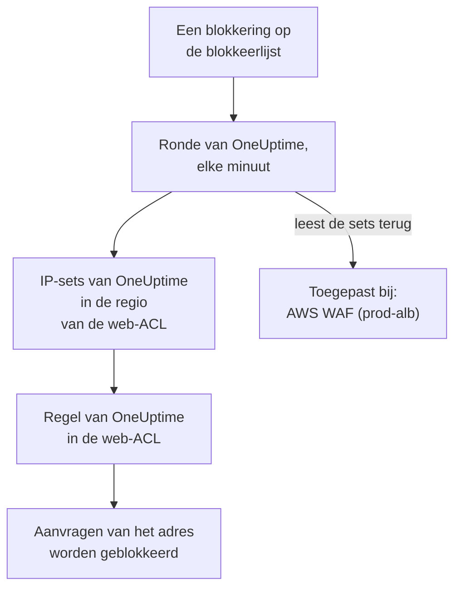

# Adressen blokkeren in AWS WAF

De blokkeerlijst van je project kan worden toegepast in de web-ACL's van AWS WAF vóór je CloudFront-distributies, load balancers en API Gateway-API's. Zet het aan voor een AWS-cloudkoppeling die je al hebt, kies de web-ACL's, en elk adres dat de blokkeerlijst blokkeert, wordt daar geblokkeerd, of een persoon, een playbook of OneUptime AI het nu heeft geblokkeerd.

:::cards
- [Inschakelen](#inschakelen): Eén instelling op de AWS-koppeling, en de installatieopdracht ervan opnieuw.
- [Wat OneUptime aanmaakt](#wat-oneuptime-aanmaakt): Vier IP-sets per regio, en twee regels per web-ACL.
- [De web-ACL in code beheren](#de-web-acl-in-code-beheren): Voeg de regels zelf toe in Terraform of CloudFormation.
:::

## Hoe het werkt

OneUptime houdt eigen IP-sets bij in elke regio waarin een gekozen web-ACL staat, en in elke web-ACL een regel die de adressen daarin blokkeert. Elke minuut schrijft het elke set één keer met wat de blokkeerlijst bevat, en daarna leest het de sets terug. Op de pagina **Blokkeerlijst** noemt **Toegepast bij** van een blokkering pas AWS WAF (prod-alb) zodra AWS WAF de blokkering bevat en de regel van de web-ACL de set van die blokkering blokkeert; tot dan wordt ze niet toegepast.

## Voordat je begint

- Een AWS-account dat aan OneUptime is gekoppeld (zie [Een cloudaccount koppelen](/docs/telemetry/cloud-accounts#amazon-web-services)).
- Een rol die mag wijzigen waar de blokkeerlijst wordt toegepast: **Projecteigenaar**, **Projectbeheerder** of **Beveiligingsbeheerder**.
- Iemand die de installatieopdracht van de koppeling opnieuw kan uitvoeren in het AWS-account.

## Inschakelen

:::steps
### De koppeling openen
Open **Cloud → Koppelen** en bewerk de AWS-koppeling.

### Kiezen wie de regel toevoegt
Zet onder **Meer velden** de instelling **Adressen blokkeren in AWS WAF** op **Aan, en OneUptime voegt zijn regel toe**, of op **Aan, en ik voeg de regel toe in code** als je web-ACL's in Terraform of CloudFormation worden beheerd.

### De installatieopdracht opnieuw uitvoeren
De opdracht die het formulier nu toont, verleent de IP-sets, en de regel als OneUptime die toevoegt. Voer hem uit in AWS CloudShell en sla daarna de koppeling op.

### De web-ACL's toevoegen
Open **Beveiligingsgebeurtenissen → Playbooks → Blokkeerlijst**. Klik onder **Cloud-WAF's** op **Web-ACL toevoegen**, kies een web-ACL en waar die het adres van de client leest, en voeg hem toe. OneUptime stelt hem meteen in, en de **Status** ervan toont **Wordt toegepast** zodra de regel ervan de sets blokkeert.
:::

De web-ACL's komen uit de inventaris van de koppeling: een web-ACL die OneUptime nog niet heeft gelezen, verschijnt na de volgende uitlezing. Zolang een web-ACL de blokkeerlijst toepast, kan de instelling van de koppeling niet worden uitgezet en niet worden omgezet van de regel die OneUptime toevoegt naar de regel in code, en kan de koppeling niet worden verwijderd: verwijder eerst de web-ACL, zodat OneUptime zijn regel eruit haalt.

## Wat OneUptime aanmaakt

| Wat | Naam | Waar |
| --- | --- | --- |
| Vier IP-sets: blokkeren en challenge, IPv4 en IPv6 | `oneuptime-<project>-block-ipv4`, `oneuptime-<project>-block-ipv6`, `oneuptime-<project>-challenge-ipv4`, `oneuptime-<project>-challenge-ipv6` | In elke regio waarin een gekozen web-ACL staat. De web-ACL's van CloudFront zijn globaal, en hun sets staan in `us-east-1`. |
| Twee regels: één blokkeert, één legt een challenge voor | `OneUptime-Blocklist-<project>`, `OneUptime-Challenge-<project>` | In elke gekozen web-ACL, als OneUptime zijn regel toevoegt. |

`<project>` zijn de eerste acht tekens van de externe ID van je project, zodat twee OneUptime-projecten in één account nooit elkaars sets schrijven. Web-ACL's in één regio delen de sets. Eén adres wordt geschreven als `/32` of `/128`. AWS WAF bevat 10.000 adressen in een set, en 100 IP-sets in een regio, tenzij AWS dat voor je heeft verhoogd; een blokkering die er niet meer in past, meldt dat op haar rij.

## De plek van de regel in de web-ACL

OneUptime zet zijn twee regels op vrije prioriteiten onder die van je eerste regel, zodat ze vóór de regels draaien die je zelf hebt geschreven. Zonder regels in de web-ACL krijgen ze de prioriteiten 0 en 1. OneUptime nummert een regel van jou nooit opnieuw, en wijzigt of verwijdert hem nooit: als er onder je eerste regel geen twee prioriteiten vrij zijn, toont de web-ACL **Geen vrije prioriteit**, en voegt OneUptime zijn regels toe zodra je er twee vrijmaakt.

Elke regel matcht als een van zijn sets, IPv4 of IPv6, het adres van de client bevat. AWS WAF werkt een web-ACL in zijn geheel bij, dus OneUptime leest hem, voegt zijn regels toe en schrijft hem terug met het lock-token van de web-ACL, en leest hem opnieuw als iemand anders hem intussen heeft geschreven.

## Doorgestuurde adressen

Een web-ACL achter een andere proxy of een ander CDN ziet het adres van de proxy, niet dat van de client. Kies onder **Clientadres** waar hij het adres van de client leest:

| Clientadres | Wat de regel leest |
| --- | --- |
| **Het bronadres van de aanvraag** | Het adres waar de aanvraag vandaan kwam. De standaard. |
| Het laatste adres in de `X-Forwarded-For`-header | Het adres dat de laatste proxy heeft toegevoegd. Een adres daarvóór is er een dat de aanvraag alleen beweerde. |
| De `CF-Connecting-IP`-header | Het ene adres dat Cloudflare schrijft. |
| De `True-Client-IP`-header | Het ene adres dat Akamai of Cloudflare Enterprise schrijft. |

Een aanvraag zonder de header matcht niet: AWS WAF laat die door in plaats van het adres van een proxy te blokkeren.

## De web-ACL in code beheren

Met **Aan, en ik voeg de regel toe in code** maakt OneUptime alleen de IP-sets aan en schrijft het nooit naar je web-ACL. Klik op **Regel tonen** in de rij van de web-ACL: daar staan beide regels als Terraform (`rule`-blokken van `aws_wafv2_web_acl`) en als CloudFormation, met de ARN van elke set en de header die de web-ACL leest. Voeg ze in je code toe vóór je andere regels en pas de code toe.

Zolang de regels er niet staan, toont de web-ACL **Wacht op je regel**, en worden de blokkeringen ervan niet toegepast. OneUptime leest de web-ACL bij elke ronde, en de blokkeringen worden toegepast vanaf de eerste ronde die voor elke set een regel vindt die de set blokkeert, hoe je die regel ook hebt genoemd.

## Machtigingen

De installatieopdracht voegt een inline-beleid, `OneUptimeWafBlocklist`, toe aan de rol. Met een toegangssleutel komt het, door de limiet die IAM stelt aan de eigen beleidsdocumenten van een gebruiker, op een groep, `OneUptimeWafBlocklist-<project>`, waaraan de gebruiker wordt toegevoegd.

| Actie | Resource | Waarom |
| --- | --- | --- |
| `wafv2:ListIPSets` | Alle | De IP-sets van OneUptime in een regio vinden. |
| `wafv2:GetIPSet`, `wafv2:CreateIPSet`, `wafv2:UpdateIPSet`, `wafv2:DeleteIPSet` | Alleen de IP-sets van OneUptime (`oneuptime-<project>-*`) | De sets bijhouden, en ze verwijderen als je de laatste web-ACL van een regio verwijdert. |
| `wafv2:GetSampledRequests` | Web-ACL's | De aanvragen lezen die een regel heeft afgewezen: het bewijs waarmee de blokkeerstap van een zaak wordt gecontroleerd. |
| `wafv2:UpdateWebACL` | Web-ACL's, en de IP-sets, regex-sets en regelgroepen waarnaar ze verwijzen | De regels van OneUptime toevoegen. Alleen met **Aan, en OneUptime voegt zijn regel toe**. |

Het lezen van een web-ACL, `wafv2:GetWebACL`, zit al in het alleen-lezenbeleid van de koppeling.

## Verwijderen

:::steps
### De web-ACL verwijderen
Klik in **Beveiligingsgebeurtenissen → Playbooks → Blokkeerlijst** op **Verwijderen** in de rij van de web-ACL. OneUptime haalt zijn regels uit de web-ACL, en leegt en verwijdert zijn IP-sets zodra geen andere web-ACL van de regio ze nog gebruikt.

### De instelling uitzetten
Bewerk de koppeling, zet **Adressen blokkeren in AWS WAF** op **Uit** en sla op. De instelling kan worden uitgezet zodra geen web-ACL van de koppeling de blokkeerlijst nog toepast.
:::

Als OneUptime de web-ACL niet meer mag schrijven, vink je **Alleen uit OneUptime verwijderen** aan in het dialoogvenster **Web-ACL verwijderen**. OneUptime haalt de web-ACL uit de blokkeerlijst en noemt de regels en IP-sets die het in AWS WAF heeft laten staan: die blijven blokkeren wat ze bevatten, totdat je ze daar verwijdert. Een regel van jou die nog naar een set verwijst, houdt die set ook in stand: OneUptime maakt hem leeg en noemt hem.

## Problemen oplossen

:::details Wordt niet toegepast
De status van de web-ACL vertelt wat AWS antwoordde en wat je moet doen. Een weigering noemt de actie en de instelling die haar verleent: zet de instelling aan, of kies **Aan, en OneUptime voegt zijn regel toe**, voer daarna de installatieopdracht van de koppeling opnieuw uit en klik op **Opnieuw controleren**.
:::

:::details Geen vrije prioriteit
Je eerste regel heeft prioriteit 0 of 1, dus er zijn onder die regel geen twee prioriteiten vrij. Verhoog de prioriteitsnummers van je regels met twee en klik daarna op **Opnieuw controleren**.
:::

:::details Een web-ACL staat niet in de lijst
OneUptime toont de web-ACL's van koppelingen waarbij de instelling aanstaat, zodra het ze heeft gelezen. Web-ACL's die alleen via hun metrieken zijn gezien, hebben de installatieopdracht van de koppeling opnieuw nodig, waarmee OneUptime ze kan lezen.
:::

## Volgende stappen

:::cards
- [Beveiligingszaken en playbooks](/docs/telemetry/security-cases): Blokkeer een adres vanuit een zaak, en zie hoe de stap ervan wordt gecontroleerd.
- [Een cloudaccount koppelen](/docs/telemetry/cloud-accounts): De koppeling waar deze instelling bij hoort.
:::
