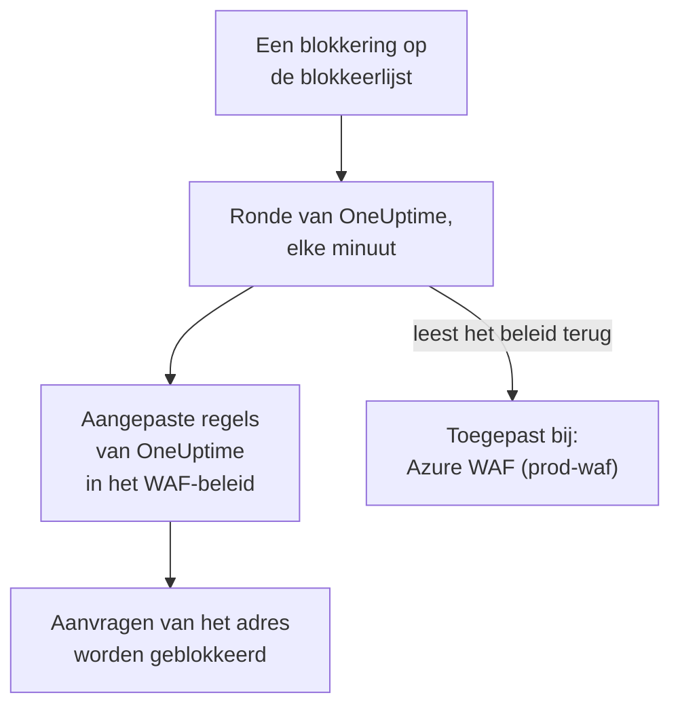

# Adressen blokkeren in Azure WAF

De blokkeerlijst van je project kan worden toegepast in het Azure WAF-beleid van je Application Gateways en Front Doors. Zet het aan voor een Azure-cloudkoppeling die je al hebt, kies het WAF-beleid, en elk adres dat de blokkeerlijst blokkeert, wordt daar geblokkeerd, of een persoon, een playbook of OneUptime AI het nu heeft geblokkeerd.

:::cards
- [Inschakelen](#inschakelen): Eén instelling op de Azure-koppeling, en de rol die ze nodig heeft.
- [Wat OneUptime aanmaakt](#wat-oneuptime-aanmaakt): Eigen aangepaste regels in elk beleid dat je kiest.
- [Welk adres wordt vergeleken](#welk-adres-wordt-vergeleken): Het adres dat verbinding maakte, of de oorspronkelijke client achter een proxy.
:::

## Hoe het werkt

OneUptime houdt eigen aangepaste regels bij in elk WAF-beleid dat je kiest, en zet daarin de adressen die de blokkeerlijst blokkeert. Elke minuut schrijft het het beleid één keer met wat de blokkeerlijst bevat, en daarna leest het het beleid terug. Op de pagina **Blokkeerlijst** noemt **Toegepast bij** van een blokkering pas Azure WAF (prod-waf) zodra het beleid de blokkering bevat en Azure de wijziging heeft doorgevoerd; tot dan wordt ze niet toegepast.

## Voordat je begint

- Een Azure-abonnement dat aan OneUptime is gekoppeld (zie [Een cloudaccount koppelen](/docs/telemetry/cloud-accounts#microsoft-azure)).
- Een rol die mag wijzigen waar de blokkeerlijst wordt toegepast: **Projecteigenaar**, **Projectbeheerder** of **Beveiligingsbeheerder**.
- Iemand die rollen mag toewijzen in het Azure-abonnement, om één opdracht uit te voeren in Azure Cloud Shell.

## Inschakelen

:::steps
### De koppeling openen
Open **Cloud → Koppelen** en bewerk de Azure-koppeling.

### De instelling aanzetten
Zet onder **Meer velden** de instelling **Adressen blokkeren in Azure WAF** op **Aan** en sla op. De installatieopdracht die het formulier nu toont, verleent de rol hieronder op het hele abonnement. Een koppeling die je al hebt, hoeft die niet opnieuw uit te voeren: het dialoogvenster **WAF toevoegen** geeft de opdrachten die de rol op één beleid verlenen.

### Het WAF-beleid toevoegen
Open **Beveiligingsgebeurtenissen → Playbooks → Blokkeerlijst**. Klik onder **Cloud-WAF's** op **WAF toevoegen** en kies een WAF-beleid. OneUptime vraagt Azure of de koppeling het beleid mag schrijven, zonder iets te schrijven.

### De rol verlenen, als die ontbreekt
Als er een machtiging ontbreekt, toont het dialoogvenster de opdrachten die haar op alleen dat beleid verlenen. Voer ze uit in Azure Cloud Shell, klik op **Opnieuw controleren** en voeg daarna het beleid toe. De **Status** ervan toont **Wordt toegepast** zodra OneUptime het heeft gelezen.
:::

Het WAF-beleid komt uit de inventaris van de koppeling: een beleid dat OneUptime nog niet heeft gelezen, verschijnt na de volgende uitlezing. Zolang een beleid de blokkeerlijst toepast, kan de instelling van de koppeling niet worden uitgezet en kan de koppeling niet worden verwijderd: verwijder eerst het beleid, zodat OneUptime zijn regels eruit haalt.

## Wat OneUptime aanmaakt

| Wat | Naam | Waar |
| --- | --- | --- |
| Aangepaste regels, elk met één IP-matchvoorwaarde en de actie Block | `OneUptime<project>Block1`, `OneUptime<project>Block2`, ... | In elk WAF-beleid dat je kiest, maximaal 10. |

`<project>` zijn de eerste acht tekens van de externe ID van je project, zodat twee OneUptime-projecten die hetzelfde beleid kiezen nooit elkaars regels schrijven. Een regel bevat 540 adressen of bereiken op Application Gateway, 600 met CRS 3.2 of een Default Rule Set, en 600 op Front Door. Met tien regels bevat een beleid 5.400 of 6.000 blokkeringen; een blokkering die er niet meer in past, meldt dat op haar rij.

OneUptime wijzigt niets in een beleid behalve zijn eigen regels. Azure schrijft een WAF-beleid alleen in zijn geheel, dus OneUptime leest het beleid met de ETag ervan, wijzigt zijn eigen regels en schrijft het terug met de ETag in `If-Match`: elke andere regel, instelling en beheerde regelset wordt geschreven zoals hij werd gelezen. Als iemand anders het beleid intussen heeft geschreven, weigert Azure het schrijven, en leest OneUptime het opnieuw en brengt het zijn wijziging aan op wat die ander schreef.

## De plek van de regels in het beleid

OneUptime zet zijn regels op vrije prioriteiten vóór je eerste regel die verkeer toestaat, de laagste eerst, zodat geen regel van jou een geblokkeerd adres doorlaat. Een regel van jou die blokkeert of logt, mag ervoor staan. OneUptime nummert een regel van jou nooit opnieuw, en wijzigt of verwijdert hem nooit: als er vóór je eerste Allow-regel geen prioriteit vrij is, toont het beleid **Geen vrije prioriteit**, en voegt OneUptime zijn regel toe zodra je er een vrijmaakt.

## Welk adres wordt vergeleken

| WAF-beleid | Clientadres | Wanneer kiezen |
| --- | --- | --- |
| Front Door | **Het adres dat verbinding maakte met Front Door (SocketAddr)** | De standaard. |
| Front Door | De oorspronkelijke client, uit X-Forwarded-For (RemoteAddr) | Voor een Front Door achter een andere proxy of een ander CDN. |
| Application Gateway | Het adres dat verbinding maakte met de gateway (RemoteAddr) | De enige keuze: zijn IP-match leest geen ander adres. |

Front Door haalt `RemoteAddr` uit de `X-Forwarded-For`-header, die een client die rechtstreeks met Front Door verbinding maakt zelf schrijft. Kies het alleen als een andere proxy of een ander CDN vóór Front Door die header schrijft. De keuze staat onder **Meer velden** in het dialoogvenster **WAF toevoegen**, en je kunt haar later wijzigen met **Clientadres** in de rij van het beleid.

De IP-match van Application Gateway leest alleen IPv4-adressen, dus een IPv6-blokkering wordt daar niet toegepast, en de rij ervan meldt waarom.

De regels van OneUptime in Azure WAF blokkeren alleen. Een blokkering die vraagt om een adres een challenge voor te leggen, wordt in Azure WAF niet toegepast, en meldt dat. De challenge van een beleid voor automatische reactie wordt daar voor dezelfde tijd als blokkering toegepast.

## Hoe lang een wijziging duurt

Application Gateway voert een wijziging door zodra Azure haar schrijft. Front Door accepteert de wijziging en verspreidt haar in de minuten daarna naar zijn edges: het beleid toont **Bezig met doorvoeren**, en **Toegepast bij** van een nieuwe blokkering wacht op het beleid tot Azure meldt dat het is ingericht. Vanaf dan wordt de blokkering toegepast.

## Als een regel handmatig wordt gewijzigd

Als iemand een van de regels van OneUptime in Azure uitzet, wijzigt of verwijdert, laat OneUptime hem zoals die persoon hem achterliet. Het beleid toont **Handmatig gewijzigd**, en de blokkeringen die die regel bevatte, worden niet toegepast, met de reden, totdat iemand op **Terugzetten** klikt in de rij van het beleid. Terugzetten schrijft de regel opnieuw zoals OneUptime hem schrijft, op zijn eigen prioriteit zolang die vrij is.

Een beleid dat niets blokkeert, meldt dat ook, en de blokkeringen ervan worden niet toegepast:

- Een beleid dat uitstaat.
- Een beleid in de modus **Detection**, dat alleen vastlegt wat de regels van OneUptime matchen.
- Een beleid dat niet is gekoppeld aan een application gateway, een listener, een padregel of een Front Door-domein.

## Een beleid in Terraform beheren

Ook Terraform schrijft een WAF-beleid in zijn geheel, dus het volgende plan ervan verwijdert de regels van OneUptime. Om OneUptime ze te laten behouden, voeg je `ignore_changes = [custom_rules]` toe aan het `lifecycle`-blok van een `azurerm_web_application_firewall_policy`, of `ignore_changes = [custom_rule]` aan dat van een `azurerm_cdn_frontdoor_firewall_policy`, en houd je je eigen aangepaste regels buiten de code van dat beleid.

## Machtigingen

De installatieopdracht voegt een aangepaste rol toe, `OneUptime WAF Blocklist`, en wijst die toe aan de app van de koppeling op het abonnement. De opdrachten die het dialoogvenster **WAF toevoegen** toont, wijzen dezelfde rol toe op één beleid.

| Actie | Waarom |
| --- | --- |
| `Microsoft.Network/ApplicationGatewayWebApplicationFirewallPolicies/read`, `Microsoft.Network/ApplicationGatewayWebApplicationFirewallPolicies/write` | Een WAF-beleid van Application Gateway lezen en er de regels van OneUptime in schrijven. |
| `Microsoft.Network/FrontDoorWebApplicationFirewallPolicies/read`, `Microsoft.Network/FrontDoorWebApplicationFirewallPolicies/write` | Een WAF-beleid van Front Door lezen en er de regels van OneUptime in schrijven. |

De rol kan geen beleid verwijderen, en OneUptime schrijft nooit iets anders.

## Verwijderen

:::steps
### Het WAF-beleid verwijderen
Klik in **Beveiligingsgebeurtenissen → Playbooks → Blokkeerlijst** op **Verwijderen** in de rij van het beleid. OneUptime haalt zijn regels uit het beleid en wijzigt er verder niets in.

### De instelling uitzetten
Bewerk de koppeling, zet **Adressen blokkeren in Azure WAF** op **Uit** en sla op. De instelling kan worden uitgezet zodra geen beleid van de koppeling de blokkeerlijst nog toepast.
:::

Als OneUptime het beleid niet meer mag schrijven, vink je **Alleen uit OneUptime verwijderen** aan in het dialoogvenster **WAF verwijderen**. OneUptime haalt het beleid uit de blokkeerlijst en noemt de regels die het erin heeft laten staan: die blijven blokkeren wat ze bevatten, totdat je ze in Azure verwijdert.

## Problemen oplossen

:::details Wordt niet toegepast
De status van het beleid vertelt wat Azure antwoordde en wat je moet doen. Een weigering noemt de machtiging die ontbreekt: voer de opdrachten uit die **WAF toevoegen** voor het beleid toont, en klik daarna op **Opnieuw controleren**.
:::

:::details Geen vrije prioriteit
Je eerste regel die verkeer toestaat, heeft prioriteit 1, of elke prioriteit ervóór is bezet. Verhoog het prioriteitsnummer ervan en klik daarna op **Opnieuw controleren**.
:::

:::details Een beleid staat niet in de lijst
OneUptime toont het WAF-beleid van koppelingen waarbij de instelling aanstaat, zodra het dat heeft gelezen. Een beleid dat sindsdien is toegevoegd, verschijnt na de volgende uitlezing van de koppeling.
:::

## Volgende stappen

:::cards
- [Beveiligingszaken en playbooks](/docs/telemetry/security-cases): Blokkeer een adres vanuit een zaak, en zie hoe de stap ervan wordt gecontroleerd.
- [Een cloudaccount koppelen](/docs/telemetry/cloud-accounts): De koppeling waar deze instelling bij hoort.
:::
