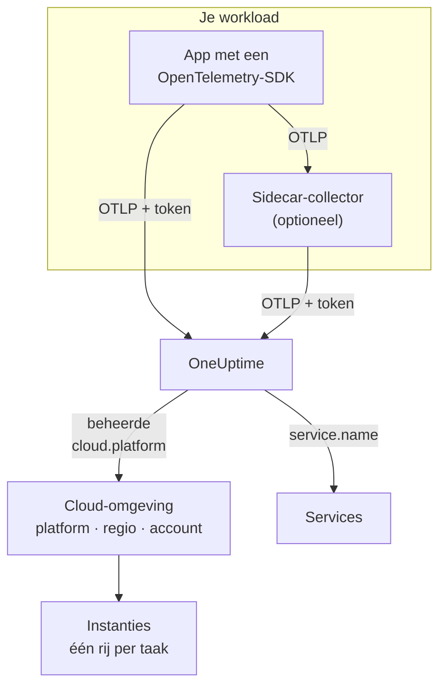

# Cloud-omgevingen

Een **Cloud Environment** is de plek waar je containers draaien op een beheerd cloudplatform: het account en de regio van een ECS-cluster, het project en de regio van Cloud Run, het abonnement en de regio van Container Apps. OneUptime maakt er een aan de eerste keer dat je telemetrie binnenkomt met de juiste resource-attributen, en bundelt elke workload die daar draait. Je hoeft niets met de hand te registreren.

:::cards
- [AWS ECS / Fargate](/docs/telemetry/cloud-aws-ecs): Taken op Fargate of EC2, met CPU en geheugen per taak.
- [Google Cloud Run](/docs/telemetry/cloud-gcp-cloud-run): Services en jobs, ook vermeld als serverless functies.
- [Azure Container Apps](/docs/telemetry/cloud-azure-container-apps): Replica's, met de regio en het abonnement met de hand ingesteld.
- [Andere cloudplatforms](/docs/telemetry/cloud-other-platforms): Elastic Beanstalk, App Runner, App Engine, App Service en Container Instances.
:::

## Hoe het werkt



- **Een resource-detector vertelt waar de workload draait.** Een OpenTelemetry-resource-detector, in de SDK of in een collector, leest de metadata van het platform en zet `cloud.platform`, `cloud.account.id` en `cloud.region` op alles wat de workload verstuurt. Waar geen detector bestaat, stel je ze zelf in.
- **De omgeving bundelt alles.** Elke workload met hetzelfde platform, hetzelfde account en dezelfde regio komt in één omgeving terecht. De services houden hun eigen rijen onder **Services**.
- **Elke draaiende taak is een instantie.** Het tabblad **Instanties** van de omgeving toont de draaiende taken, instanties of replica's, met live CPU en geheugen waar het platform die kan leveren.

## Voordat je begint

- **Een ingestiesleutel.** Maak een sleutel van het type **Server** aan onder **Projectinstellingen → Telemetrie & APM → Ingestiesleutels** en kopieer het token: zie [Een ingestiesleutel maken](/docs/telemetry/open-telemetry#een-ingestiesleutel-maken). Het is een geheim: elke platformpagina laat zien waar je het bewaart in de geheimenopslag van die cloud.
- **OpenTelemetry in je applicatie.** Een OpenTelemetry-SDK die OTLP exporteert, of een OpenTelemetry Collector die naast de applicatie draait.

## Ondersteunde platforms

| Platform | `cloud.platform` | `cloud.*` ingevuld door | Instantie-identiteit | Handleiding |
| ------------------------- | --------------------------- | ---------------------- | --------------------------------- | ------------------------------------------------------------------ |
| AWS ECS / Fargate | `aws_ecs` | resource-detector | `aws.ecs.task.arn` | [AWS ECS / Fargate](/docs/telemetry/cloud-aws-ecs) |
| AWS Elastic Beanstalk | `aws_elastic_beanstalk` | resource-detector | `host.id` | [Andere cloudplatforms](/docs/telemetry/cloud-other-platforms) |
| AWS App Runner | `aws_app_runner` | met de hand | `host.name` | [Andere cloudplatforms](/docs/telemetry/cloud-other-platforms) |
| Google Cloud Run | `gcp_cloud_run` | resource-detector | `faas.instance` | [Google Cloud Run](/docs/telemetry/cloud-gcp-cloud-run) |
| Google App Engine | `gcp_app_engine` | resource-detector | `faas.instance` | [Andere cloudplatforms](/docs/telemetry/cloud-other-platforms) |
| Azure Container Apps | `azure_container_apps` | resource-detector | `azure.container_app.instance.id` | [Azure Container Apps](/docs/telemetry/cloud-azure-container-apps) |
| Azure Container Instances | `azure_container_instances` | met de hand | `host.name` | [Andere cloudplatforms](/docs/telemetry/cloud-other-platforms) |
| Azure App Service | `azure_app_service` | resource-detector | `host.id` | [Andere cloudplatforms](/docs/telemetry/cloud-other-platforms) |

- **Resource-detector:** een OpenTelemetry-resource-detector, in de SDK of in de processor `resourcedetection` van de Collector, stelt de attributen `cloud.*` voor je in.
- **Met de hand:** er bestaat geen detector, dus je zet de attributen in `OTEL_RESOURCE_ATTRIBUTES`. De pagina van het platform toont de exacte regel.
- **Azure-detectors weten minder.** De detectors van Container Apps kennen de regio noch het abonnement, en die van App Service kennen het abonnement niet: stel zelf in wat ontbreekt.
- **Azure-spellingen met een punt werken.** De Azure-detectors voor Node.js en .NET schrijven `azure.container_apps` en `azure.app_service`. OneUptime herschrijft ze bij ontvangst naar de bovenstaande waarden met een underscore.

## Hoe OneUptime een omgeving herkent

Er bestaat één omgeving voor elke combinatie van drie resource-attributen:

| Attribuut | Verplicht | Wat het is |
| ------------------ | -------- | ------------------------------------------------------------------------------------------- |
| `cloud.platform` | Ja | Een van de waarden in [Ondersteunde platforms](#ondersteunde-platforms) |
| `cloud.account.id` | Nee | Het AWS-account-ID, het Google Cloud-project-ID of het Azure-abonnements-ID |
| `cloud.region` | Nee | De regio, zoals `us-east-1`, `us-central1` of `eastus` |

OneUptime voegt de drie met `|` samen tot de **omgevingssleutel**, en noemt de omgeving naar dezelfde waarden, zoals _AWS ECS · us-east-1 · 123456789012_:

```text title="Environment keys"
aws_ecs|123456789012|us-east-1
gcp_cloud_run|my-project|us-central1
azure_container_apps|00000000-0000-0000-0000-000000000000|eastus
```

> [!IMPORTANT]
> Een ontbrekend deel blijft als leeg segment in de sleutel staan: `aws_ecs||us-east-1`. Een workload die `cloud.account.id` weglaat, komt dus in een andere omgeving terecht dan een workload die het wel instelt. Dat is de gebruikelijke reden dat je twee omgevingen ziet waar je er één verwachtte.

### Instantie-identiteit

Binnen een omgeving krijgt elke draaiende taak, instantie of replica één rij onder **Instanties**. De naam komt van het eerste van deze resource-attributen dat de telemetrie meedraagt:

1. `aws.ecs.task.id`
2. `aws.ecs.task.arn` (ingekort tot het taak-ID)
3. `faas.instance`
4. `azure.container_app.instance.id`
5. `service.instance.id`
6. `container.id`
7. `host.id`
8. `host.name`

De eigen identiteit van het platform komt bewust eerst. Een sidecar-collector en de SDK van de applicatie zien die allebei, en ze overleeft herstarts. Een SDK verzint meestal een nieuwe `service.instance.id` voor elk proces (de Node.js-SDK doet dat standaard), dus als die als eerste sleutel diende, zou één ECS-taak in twee rijen uiteenvallen. `service.instance.id` wordt gebruikt als het platform zelf geen identiteit instelt. De kolom **Instantie-identiteit** in [Ondersteunde platforms](#ondersteunde-platforms) noemt het attribuut dat een gangbare opzet op elk platform gebruikt.

### Omgevingen die je met de hand aanmaakt

Dat is zelden nodig: de ingestie maakt omgevingen voor je aan. Om er een aan te maken voordat de telemetrie binnenkomt, open je **Cloud → All Environments** en klik je op **Cloud-resource aanmaken**. Kies het **Cloud-platform** en typ de **Cloud-account-ID** en de **Cloud-regio** precies zoals je telemetrie ze meldt. OneUptime bouwt de sleutel `platform|account|region` uit deze drie, en de ingestie koppelt een omgeving uitsluitend op basis van die sleutel. De omgeving krijgt de naam die de ingestie ook zou geven; wil je een andere naam tonen, open dan **Meer velden** en typ een **Weergavenaam**.

## Wat geen cloud-omgeving is

| Je draait op | Waar het verschijnt | Waarom |
| ------------------------------------------------------------------------------------------------- | ------------------------ | ---------------------------------------------------------------------------------------------------- |
| EC2, Compute Engine, Azure VM (`aws_ec2`, `gcp_compute_engine`, `azure_vm`) | **Hosts** | Een virtuele machine is een host. Zie [OpenTelemetry-collector op de host](/docs/telemetry/host-otel-collector) |
| EKS, GKE, AKS, zelfbeheerde Kubernetes | **Kubernetes** | Gerouteerd op de attributen `k8s.*`. Zie [Kubernetes-agent](/docs/telemetry/kubernetes-agent) |
| Lambda, Cloud Functions, Azure Functions (`aws_lambda`, `gcp_cloud_functions`, `azure_functions`) | **Serverless functies** | Gerouteerd op `faas.name`, of op `service.name` bij een `cloud.platform` voor FaaS. Zie [Serverless functies](/docs/telemetry/serverless-functions) |
| Load balancers, buckets, beheerde databases en andere IaaS- of PaaS-resources | **Cloud Resources** | Ontdekt uit de metrieken die Azure Monitor, CloudWatch en Cloud Monitoring publiceren. Zie [Cloud-resources](/docs/telemetry/cloud-resources) |

> [!NOTE]
> Cloud Run en App Engine verschijnen bewust op twee plekken. Hun detector stelt zowel een beheerde `cloud.platform` als `faas.name` in, dus elke service is ook een eigen **Serverless functie**, terwijl de **Cloud Environment** elke service in dat project en die regio groepeert. Dezelfde telemetrie wordt onder beide gearchiveerd.

## Een workload koppelen

Elke platformpagina heeft deze stappen met de eigen commando's en consoleschermen van die cloud. In grote lijnen:

:::steps
### De cloud-attributen op je telemetrie zetten

:::tabs
@tab Sidecar collector
Een tweede container in de taak, instantie of replica. De applicatie exporteert naar `localhost:4318`, en de processor `resourcedetection` van de collector stempelt `cloud.*` op alles wat erdoorheen gaat. De collector bewaart het token, en op ECS verstuurt hij ook CPU en geheugen per taak:

```yaml title="collector.yaml"
processors:
  resourcedetection:
    detectors: [env, ecs] # [env, gcp] on Cloud Run and App Engine; [env, azurecontainerapps] on Container Apps
    timeout: 5s
```
@tab SDK direct
De SDK van de applicatie exporteert rechtstreeks naar OneUptime. Zet de resource-detector van het platform aan in de SDK, zoals `OTEL_NODE_RESOURCE_DETECTORS=env,host,os,aws` in Node.js: elke platformpagina noemt de schakelaar voor elke taal. Er is geen extra container, en geen CPU of geheugen van de container.
:::

### OTLP naar OneUptime exporteren

:::tabs
@tab Sidecar collector
```yaml title="collector.yaml"
exporters:
  otlphttp/oneuptime:
    endpoint: https://oneuptime.com/otlp
    headers:
      x-oneuptime-token: ${env:ONEUPTIME_TOKEN}

service:
  pipelines:
    traces:
      receivers: [otlp]
      processors: [resourcedetection, batch]
      exporters: [otlphttp/oneuptime]
    metrics:
      receivers: [otlp]
      processors: [resourcedetection, batch]
      exporters: [otlphttp/oneuptime]
    logs:
      receivers: [otlp]
      processors: [resourcedetection, batch]
      exporters: [otlphttp/oneuptime]
```

De collector vult `${env:ONEUPTIME_TOKEN}` in vanuit een omgevingsvariabele die het platform vult uit zijn geheimenopslag: Secrets Manager, Secret Manager of de geheimen van Container Apps.
@tab SDK direct
```bash
OTEL_EXPORTER_OTLP_ENDPOINT="https://oneuptime.com/otlp"
OTEL_EXPORTER_OTLP_HEADERS="x-oneuptime-token=YOUR_TELEMETRY_INGESTION_TOKEN"
```
:::

Als je OneUptime zelf host, gebruik dan `https://YOUR-ONEUPTIME-HOST/otlp`.

### De verbinding controleren

```bash
curl -i https://oneuptime.com/otlp/v1/validate \
  -H "x-oneuptime-token: YOUR_TELEMETRY_INGESTION_TOKEN"
```

`200` met `"valid": true` betekent dat het token is geaccepteerd. `401` betekent dat het onbekend, ingetrokken, uitgeschakeld of verlopen is, en de `message` van het antwoord zegt welke van deze. Binnen een minuut na de eerste span, log of metriek verschijnt de omgeving onder **Cloud → All Environments**.
:::

> [!TIP]
> Dezelfde stappen staan in het dashboard, met je token al ingevuld: onder **Cloud → All Environments** totdat je eerste omgeving binnenkomt, en op het tabblad **Documentatie** van elke omgeving.

## Wat je krijgt

Het **Overzicht** van een omgeving toont:

- **Aanvragen**, **Foutpercentage** en **p95 latency**, uit je traces, met grafieken van aanvragen, fouten en geheugen over het tijdsbereik dat je kiest.
- **CPU** en **Geheugen** over de live instanties, en een lijst **Topinstanties op CPU**. Die komen uit de metrieken `container.cpu.utilization` en `container.memory.usage` die de instantie-identiteit meedragen; op ECS uit `ecs.task.cpu.utilized` en `ecs.task.memory.utilized` van de receiver `awsecscontainermetrics`.
- **Instanties**: hoeveel er in de laatste 15 minuten hebben gerapporteerd. Het tabblad **Instanties** heeft één rij per instantie.
- De tabbladen **Logboeken**, **Traces** en **Metrieken**, gefilterd op de omgeving.

Een omgeving waarvan de telemetrie 15 minuten stopt, toont **Verbinding verbroken**, en de volgende span, log of metriek brengt haar terug naar **Verbonden**. Tijd waarin OneUptime zelf plat lag of een achterstand inhaalde, telt niet mee voor de 15 minuten.

### Labels en eigenaren

- **Uit je telemetrie:** een resource-attribuut zoals `oneuptime.label.team=payments` voegt het label `team:payments` toe aan de omgeving.
- **Uit regels:** **Cloud → Instellingen → Labelregels** en **Eigenaarsregels** voegen labels en eigenaren toe aan omgevingen die overeenkomen. Zie [Label- en eigenaarsregels](/docs/configuration/label-and-owner-rules).

## Problemen oplossen

[Cloud-probleemoplossing](/docs/telemetry/cloud-troubleshooting) loopt elke storing door in de volgorde waarin die optreedt: een omgeving die nooit verschijnt, onder **Hosts** of alleen onder **Serverless functies** belandt, geen instanties of geen CPU en geheugen heeft, **Verbinding verbroken** toont, in tweeën splitst, of met de hand is gemaakt en nooit overeenkomt.

## Volgende stappen

:::cards
- [AWS ECS / Fargate](/docs/telemetry/cloud-aws-ecs): De meest gebruikte opzet, met een volledige taakdefinitie.
- [Cloud-probleemoplossing](/docs/telemetry/cloud-troubleshooting): Wat je controleert als een omgeving ontbreekt of niet klopt.
- [Cloud-resources (IaaS en PaaS)](/docs/telemetry/cloud-resources): Load balancers, buckets en beheerde databases, uit de eigen monitoring van je cloud.
- [Serverless functies](/docs/telemetry/serverless-functions): Lambda, Cloud Functions en Azure Functions.
:::
