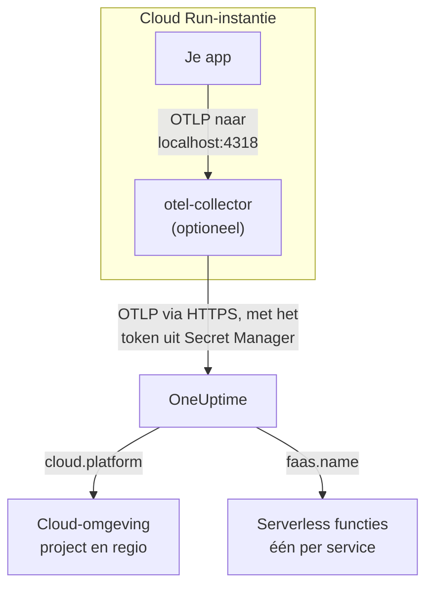

# Google Cloud Run

Stuur de traces, logs en metrieken van je Cloud Run-services en -jobs naar OneUptime. Alles wat `cloud.platform=gcp_cloud_run` meldt, komt terecht in één **Cloud Environment** per Google Cloud-project en regio, zoals _GCP Cloud Run · us-central1 · my-project_, en elke service verschijnt ook onder **Serverless functies**.

:::cards
- [Hoe het werkt](#hoe-het-werkt): Wat de GCP-detector instelt, en waarom een service op twee plekken verschijnt.
- [Instellen](#instellen): Het token opslaan, de service configureren, uitrollen en controleren.
- [De service-YAML met een sidecar](#de-service-yaml-met-een-sidecar): Een complete Cloud Run-service met een collector.
- [Problemen oplossen](#problemen-oplossen): Fouten met geheimen, de startvolgorde van de sidecar en ontbrekende omgevingen.
:::

## Hoe het werkt



De GCP-resource-detector van OpenTelemetry leest de metadataserver en de omgevingsvariabelen `K_SERVICE` en `K_REVISION`, en stelt in:

| Attribuut | Waarde op Cloud Run | Waarvoor |
| ------------------ | ------------------------------ | ----------------------------------------------------------------------------------------- |
| `cloud.platform` | `gcp_cloud_run` | Archiveert de telemetrie onder **Cloud-omgevingen** |
| `cloud.account.id` | het project-ID | Deel van de omgevingssleutel |
| `cloud.region` | `us-central1` | Deel van de omgevingssleutel |
| `faas.name` | de servicenaam (`K_SERVICE`) | Vermeldt de service ook onder **Serverless functies** |
| `faas.version` | de revisie (`K_REVISION`) | Getoond op het overzicht van de serverless functie van de service; de omgeving gebruikt het niet |
| `faas.instance` | het instantie-ID | Geeft één draaiende instantie een naam: één rij per instantie onder **Instanties** |

> [!NOTE]
> Cloud Run verschijnt bewust op twee plekken. Omdat de detector `faas.name` instelt, is elke service ook een **Serverless functie**, met eigen aanroepen, foutpercentage en duur. De **Cloud Environment** bundelt elke service in dat project en die regio. Niets wordt dubbel opgeslagen: dezelfde telemetrie wordt onder beide gearchiveerd.

De omgevingssleutel is `gcp_cloud_run|my-project|us-central1`.

## Voordat je begint

- **Een ingestiesleutel.** Maak een sleutel van het type **Server** aan onder **Projectinstellingen → Telemetrie & APM → Ingestiesleutels** en kopieer het token.
- **`gcloud`**, aangemeld bij het project, met de Secret Manager API ingeschakeld: `gcloud services enable secretmanager.googleapis.com`.
- **Je applicatie geïnstrumenteerd met een OpenTelemetry-SDK** die OTLP exporteert.

## Kiezen hoe telemetrie de service verlaat

| | SDK direct | Sidecar collector |
| --------------- | ---------------------------------------------------- | ---------------------------------------------------------------------- |
| Extra container | Geen | `otel-collector` in de service |
| Het best voor | Eén service, en Cloud Run-jobs | Meerdere services in één project, of een SDK die geen detector kan draaien |
| Bewaart het token | De applicatie | De collector |
| Het geheim | `oneuptime-otlp-headers`, de hele header | `oneuptime-ingestion-token`, alleen het token |

Een job draait tot hij klaar is, dus er is niets om een sidecar voor in leven te houden: gebruik SDK direct. Elke stap hieronder heeft voor beide een tabblad; kies er een en elke stap volgt die keuze.

## Instellen

:::steps
### Het token opslaan in Secret Manager

> [!IMPORTANT]
> Het token is een geheim. Zet het in Secret Manager en verwijs ernaar vanuit de service als omgevingsvariabele op basis van een geheim. Een gewone omgevingsvariabele is zichtbaar voor iedereen die het project kan bekijken, in de console en in `gcloud run services describe`.

:::tabs
@tab SDK direct
```bash
printf '%s' "x-oneuptime-token=YOUR_TELEMETRY_INGESTION_TOKEN" | gcloud secrets create oneuptime-otlp-headers \
  --data-file=- \
  --replication-policy=automatic

gcloud secrets add-iam-policy-binding oneuptime-otlp-headers \
  --member="serviceAccount:checkout-api@my-project.iam.gserviceaccount.com" \
  --role="roles/secretmanager.secretAccessor"
```

Cloud Run zet de waarde van een geheim ongewijzigd in de variabele, en `OTEL_EXPORTER_OTLP_HEADERS` heeft het hele paar `name=value` nodig, dus dit geheim bevat de volledige header.
@tab Sidecar collector
```bash
printf '%s' "YOUR_TELEMETRY_INGESTION_TOKEN" | gcloud secrets create oneuptime-ingestion-token \
  --data-file=- \
  --replication-policy=automatic

gcloud secrets add-iam-policy-binding oneuptime-ingestion-token \
  --member="serviceAccount:checkout-api@my-project.iam.gserviceaccount.com" \
  --role="roles/secretmanager.secretAccessor"
```

De collectorconfiguratie voegt de headernaam toe, dus dit geheim bevat alleen het token.
:::

Zet in `--member` het runtime-serviceaccount van de service, niet je eigen gebruiker. Zonder `roles/secretmanager.secretAccessor` mislukt het uitrollen van de revisie met `Permission denied on secret`. Draait de service nog als het standaard compute-serviceaccount, ken de rol dan aan dat account toe, en overweeg de service een eigen account te geven: het standaardaccount wordt door alles in het project gedeeld.

### De service configureren

:::tabs
@tab SDK direct
1. **Google Cloud console → Cloud Run → click the service → Edit & deploy new revision**.
2. Open op het tabblad **Containers** je container en ga naar **Variables & Secrets**. Voeg de variabelen hieronder toe.
3. Klik op **Reference a secret**, kies `oneuptime-otlp-headers`, versie `latest`, en stel het beschikbaar als de omgevingsvariabele `OTEL_EXPORTER_OTLP_HEADERS`.
4. Controleer op het tabblad **Security** dat het **Service account** het account is waaraan je `roles/secretmanager.secretAccessor` hebt toegekend.

```bash
OTEL_SERVICE_NAME=checkout-api
OTEL_EXPORTER_OTLP_ENDPOINT=https://oneuptime.com/otlp
OTEL_EXPORTER_OTLP_PROTOCOL=http/protobuf
# Secret-backed (Variables & Secrets → Reference a secret), not typed here.
OTEL_EXPORTER_OTLP_HEADERS=x-oneuptime-token=YOUR_TELEMETRY_INGESTION_TOKEN
```

Zet daarna de GCP-resource-detector van je taal aan:

| Taal | De GCP-detector aanzetten |
| -------- | ------------------------------------------------------------------------------------------------------------------- |
| Node.js | `OTEL_NODE_RESOURCE_DETECTORS=env,host,os,gcp` (auto-instrumentations-node) |
| Python | `pip install opentelemetry-resourcedetector-gcp`, daarna `OTEL_EXPERIMENTAL_RESOURCE_DETECTORS=gcp_resource_detector` |
| Java | `-Dotel.resource.providers.gcp.enabled=true` |
| Go | `import "go.opentelemetry.io/contrib/detectors/gcp"` en geef `gcp.NewDetector()` door aan `resource.New` |
| .NET | Het pakket `OpenTelemetry.Resources.Gcp`: `.ConfigureResource(r => r.AddGcpDetector())` |

Of stel alles in via de CLI:

```bash
gcloud run services update checkout-api --region us-central1 \
  --set-env-vars "^@^OTEL_SERVICE_NAME=checkout-api@OTEL_EXPORTER_OTLP_ENDPOINT=https://oneuptime.com/otlp@OTEL_EXPORTER_OTLP_PROTOCOL=http/protobuf@OTEL_NODE_RESOURCE_DETECTORS=env,host,os,gcp" \
  --set-secrets "OTEL_EXPORTER_OTLP_HEADERS=oneuptime-otlp-headers:latest"
```

Het voorvoegsel `^@^` laat `gcloud` de lijst van die vlag splitsen op `@` in plaats van op `,`. Zonder dat voorvoegsel splitst `gcloud` `OTEL_NODE_RESOURCE_DETECTORS=env,host,os,gcp` bij elke komma en mislukt het met `Bad syntax for dict arg [host]`.
@tab Sidecar collector
1. **Google Cloud console → Cloud Run → click the service → Edit & deploy new revision**.
2. Open op het tabblad **Containers** je container en ga naar **Variables & Secrets**. Voeg de applicatievariabelen hieronder toe.
3. Klik op **+ Add container**. Stel de URL van de containerimage in op `otel/opentelemetry-collector-contrib:latest`, en voeg onder **Container command and arguments** het argument `--config=env:OTEL_COLLECTOR_CONFIG` toe.
4. Op het tabblad **Variables & Secrets** van de nieuwe container: **Reference a secret**, `oneuptime-ingestion-token`, als de omgevingsvariabele `ONEUPTIME_TOKEN`. Voeg de variabele `OTEL_COLLECTOR_CONFIG` toe met de collectorconfiguratie uit [De service-YAML met een sidecar](#de-service-yaml-met-een-sidecar).
5. Voeg op het tabblad **Settings** van de collector een **Startup probe** toe (HTTP, pad `/`, poort `13133`), en maak je container onder **Container start-up order** afhankelijk van `otel-collector`.
6. Controleer op het tabblad **Security** dat het **Service account** het account is waaraan je `roles/secretmanager.secretAccessor` hebt toegekend.

Containers in één Cloud Run-instantie delen `localhost`, dus de applicatie exporteert daar naar de sidecar:

```bash
OTEL_SERVICE_NAME=checkout-api
OTEL_EXPORTER_OTLP_ENDPOINT=http://localhost:4318
OTEL_EXPORTER_OTLP_PROTOCOL=http/protobuf
```

Via de CLI is de sidecar de service-YAML hieronder, uitgerold met `gcloud run services replace service.yaml --region us-central1`.
:::

Als je OneUptime zelf host, gebruik dan `https://YOUR-ONEUPTIME-HOST/otlp` als endpoint.

### De nieuwe revisie uitrollen

Klik in de console op **Deploy**. Cloud Run start een nieuwe revisie met de instellingen en stuurt er verkeer naartoe zodra die klaar is. De commando's van `gcloud` rollen zelf al een nieuwe revisie uit.

### De verbinding controleren

```bash
curl -i https://oneuptime.com/otlp/v1/validate \
  -H "x-oneuptime-token: YOUR_TELEMETRY_INGESTION_TOKEN"
```

`200` met `"valid": true` betekent dat het token is geaccepteerd. `401` betekent dat het onbekend, ingetrokken, uitgeschakeld of verlopen is. Stuur daarna één aanvraag naar de service, en zoek in de logs van de collector in Cloud Logging (filter op de container `otel-collector`) naar `401`, `connection refused` of `context deadline exceeded`. Binnen een minuut verschijnt de omgeving onder **Cloud → All Environments** als _GCP Cloud Run · us-central1 · my-project_, en de service onder **Serverless functies**.
:::

## De service-YAML met een sidecar

De collector leest zijn hele configuratie uit `OTEL_COLLECTOR_CONFIG` (`--config=env:OTEL_COLLECTOR_CONFIG`), en het token uit het geheim via `${env:ONEUPTIME_TOKEN}`. De annotatie `run.googleapis.com/container-dependencies` laat Cloud Run eerst de collector starten en op zijn startup probe wachten voordat de applicatie start:

```yaml title="service.yaml"
apiVersion: serving.knative.dev/v1
kind: Service
metadata:
  name: checkout-api
spec:
  template:
    metadata:
      annotations:
        # "app" depends on "otel-collector": the collector starts first and
        # must pass its startup probe before the app container is started.
        run.googleapis.com/container-dependencies: '{"app":["otel-collector"]}'
    spec:
      serviceAccountName: checkout-api@my-project.iam.gserviceaccount.com
      containers:
        - name: app
          image: us-central1-docker.pkg.dev/my-project/apps/checkout-api:1.4.2
          ports:
            - containerPort: 8080
          env:
            - name: OTEL_SERVICE_NAME
              value: checkout-api
            - name: OTEL_EXPORTER_OTLP_ENDPOINT
              value: http://localhost:4318
            - name: OTEL_EXPORTER_OTLP_PROTOCOL
              value: http/protobuf
        - name: otel-collector
          image: otel/opentelemetry-collector-contrib:latest
          args:
            - --config=env:OTEL_COLLECTOR_CONFIG
          env:
            - name: ONEUPTIME_TOKEN
              valueFrom:
                secretKeyRef:
                  name: oneuptime-ingestion-token
                  key: latest
            - name: OTEL_COLLECTOR_CONFIG
              value: |
                receivers:
                  otlp:
                    protocols:
                      http:
                        endpoint: 0.0.0.0:4318
                      grpc:
                        endpoint: 0.0.0.0:4317
                processors:
                  # Stamps cloud.provider, cloud.platform=gcp_cloud_run,
                  # cloud.account.id, cloud.region and faas.* on everything.
                  resourcedetection:
                    detectors: [env, gcp]
                    timeout: 5s
                  batch: {}
                exporters:
                  otlphttp/oneuptime:
                    endpoint: https://oneuptime.com/otlp
                    headers:
                      x-oneuptime-token: ${env:ONEUPTIME_TOKEN}
                extensions:
                  health_check:
                    endpoint: 0.0.0.0:13133
                service:
                  extensions: [health_check]
                  pipelines:
                    traces:
                      receivers: [otlp]
                      processors: [resourcedetection, batch]
                      exporters: [otlphttp/oneuptime]
                    metrics:
                      receivers: [otlp]
                      processors: [resourcedetection, batch]
                      exporters: [otlphttp/oneuptime]
                    logs:
                      receivers: [otlp]
                      processors: [resourcedetection, batch]
                      exporters: [otlphttp/oneuptime]
          startupProbe:
            httpGet:
              path: /
              port: 13133
            periodSeconds: 2
            failureThreshold: 15
          resources:
            limits:
              cpu: 500m
              memory: 256Mi
```

Rol het uit:

```bash
gcloud run services replace service.yaml --region us-central1
```

Alleen de container die aanvragen ontvangt (`app`) declareert `ports`; een sidecar mag dat niet.

## Netwerk

- **Standaard** bereikt een Cloud Run-service internet rechtstreeks, en exporteren naar `oneuptime.com` vraagt niets extra.
- **Met VPC egress: All traffic** (`--vpc-egress all-traffic`, via Direct VPC egress of een Serverless VPC Access-connector) verlaat uitgaand verkeer je VPC, die dan Cloud NAT (of een route naar een proxy) nodig heeft om de OneUptime-host te bereiken. Met de standaardwaarde `private-ranges-only` gebruiken alleen privéadressen de VPC en wordt OneUptime rechtstreeks bereikt.
- **Firewallregels voor uitgaand verkeer** in de VPC moeten TCP 443 naar de OneUptime-host toestaan.
- **Een zelf gehoste OneUptime binnen de VPC** is het omgekeerde geval: leid verkeer via de VPC (`private-ranges-only` of `all-traffic`), zodat `https://YOUR-ONEUPTIME-HOST/otlp` daar wordt opgelost.

## Wat je krijgt

- **Overzicht**: aanvragen, foutpercentage en p95-latentie uit je traces.
- **Instanties**: één rij per Cloud Run-instantie, met `faas.instance` als naam. Cloud Run toont het resourcegebruik van een container niet aan een sidecar, dus de tegels **CPU** en **Geheugen** blijven leeg, tenzij je zelf metrieken `container.cpu.utilization` en `container.memory.usage` met dezelfde `faas.instance` stuurt. Lees hier de tegels voor aanvragen, en laat CPU en geheugen van instanties over aan Cloud Monitoring.
- **Logboeken**, **Traces** en **Metrieken**, gefilterd op de omgeving.
- Dezelfde service onder **Serverless functies** (op `faas.name`) en onder **Services** (op `service.name`).

## Problemen oplossen

:::details De revisie mislukt met "Permission denied on secret"
Het runtime-serviceaccount mist `roles/secretmanager.secretAccessor` op het geheim, of de binding staat op een ander geheim dan het geheim waarnaar de service verwijst. Voer het commando `gcloud secrets add-iam-policy-binding` opnieuw uit met het runtime-serviceaccount als `--member`.
:::

:::details Cloud Run weigert container-dependencies
De annotatie noemt een container die niet bestaat, of de collector heeft geen startup probe, zodat Cloud Run niet kan zien wanneer hij klaar is.
:::

:::details De service staat onder Serverless functies, maar er bestaat geen omgeving
De telemetrie heeft geen `cloud.platform`: de GCP-detector staat niet aan in de SDK, of `gcp` ontbreekt in de lijst `detectors` van de collector.
:::

:::details De omgeving is er, maar Instanties is leeg
De telemetrie heeft `faas.instance` noch `service.instance.id`. De oorzaak is dezelfde: de detector draait niet.
:::

Een omgeving die nooit verschijnt, **Verbinding verbroken** toont of in tweeën splitst, wordt behandeld op [Cloud-probleemoplossing](/docs/telemetry/cloud-troubleshooting).

## Volgende stappen

:::cards
- [Cloud-omgevingen](/docs/telemetry/cloud-environments): Hoe omgevingen en instanties worden herkend.
- [Serverless functies](/docs/telemetry/serverless-functions): De weergave per service van elke Cloud Run-service.
- [Cloud-probleemoplossing](/docs/telemetry/cloud-troubleshooting): De storingen die alle platforms gemeen hebben.
- [Cloud-resources (IaaS en PaaS)](/docs/telemetry/cloud-resources): Je Cloud SQL, load balancers en buckets, uit Cloud Monitoring.
:::
