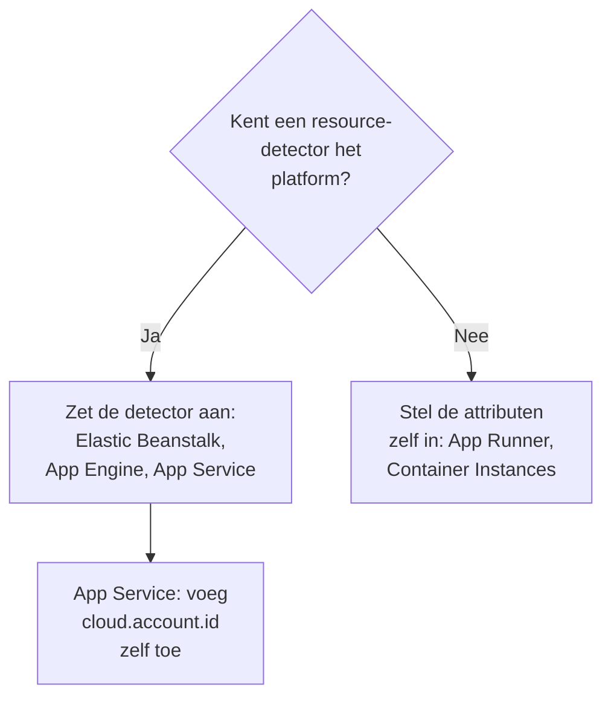

# Andere cloudplatforms

Stel de beheerde platforms in die geen eigen pagina hebben: AWS Elastic Beanstalk, AWS App Runner, Google App Engine, Azure App Service en Azure Container Instances. De regel is dezelfde als op elk platform: telemetrie met een beheerde `cloud.platform`, met `cloud.account.id` en `cloud.region`, komt terecht in één **Cloud Environment** per platform, account en regio, en een instantie-identiteit geeft elke draaiende instantie een rij onder **Instanties**.

:::cards
- [AWS Elastic Beanstalk](#aws-elastic-beanstalk): Een collector op elke instantie, met de detectors voor Beanstalk en EC2.
- [AWS App Runner](#aws-app-runner): De attributen met de hand ingesteld, het token uit Secrets Manager.
- [Google App Engine](#google-app-engine): De GCP-detector, met de instellingen in `app.yaml`.
- [Azure App Service](#azure-app-service): De Azure-detectors, een Key Vault-verwijzing en het abonnement met de hand.
- [Azure Container Instances](#azure-container-instances): De attributen met de hand ingesteld, het token als beveiligde variabele.
:::

## Wat elk platform nodig heeft

Wat tussen deze platforms verschilt, is wie de attributen `cloud.*` instelt, en waar de instellingen in de console van de cloud staan:



| Platform | `cloud.platform` | `cloud.*` ingevuld door | Instantie-identiteit |
| ------------------------- | --------------------------- | ------------------------------------------------------------------------------------------ | ----------------------------------------------------------- |
| AWS Elastic Beanstalk | `aws_elastic_beanstalk` | De detectors `elastic_beanstalk` en `ec2` van de Collector; `aws` in Node.js | `host.id` (verwijder de `service.instance.id` van de deployment) |
| AWS App Runner | `aws_app_runner` | Jij (geen detector) | `host.name` |
| Google App Engine | `gcp_app_engine` | De detector `gcp` (die van de Collector en van elke SDK) | `faas.instance` |
| Azure App Service | `azure_app_service` | `azureappservice` van de Collector, de detectors `azure` voor Node.js en .NET; `cloud.account.id` door jou | `service.instance.id`, daarna `host.id` |
| Azure Container Instances | `azure_container_instances` | Jij (geen detector) | `host.name` |

Elke sectie hieronder heeft een ingestiesleutel van het type **Server** nodig uit **Projectinstellingen → Telemetrie & APM → Ingestiesleutels**, en een applicatie die is geïnstrumenteerd met een OpenTelemetry-SDK. Als je OneUptime zelf host, vervang dan `https://oneuptime.com/otlp` door `https://YOUR-ONEUPTIME-HOST/otlp`.

> [!IMPORTANT]
> Het token is op elk van deze platforms een geheim. Elke sectie noemt de geheimenopslag van het platform. Een token dat in een gewone omgevingsvariabele is getypt, kan worden gelezen door iedereen die de configuratie van de app kan lezen.

## AWS Elastic Beanstalk

`cloud.platform`: `aws_elastic_beanstalk`. De Beanstalk-detector leest `/var/elasticbeanstalk/xray/environment.conf` op de instantie en stelt `cloud.platform`, `service.instance.id`, `service.version` en de omgevingsnaam in. Hij kent het account en de regio niet, dus combineer hem met de EC2-detector, die ze wel kent en die ook `host.id` instelt.

Draai een OpenTelemetry Collector op elke instantie, met deze configuratie:

```yaml title="config.yaml"
receivers:
  otlp:
    protocols:
      http:
        endpoint: 0.0.0.0:4318
      grpc:
        endpoint: 0.0.0.0:4317
processors:
  # elastic_beanstalk sets cloud.platform and service.instance.id; ec2 adds
  # cloud.account.id, cloud.region and host.id. The first detector to set an
  # attribute wins, so elastic_beanstalk comes first.
  resourcedetection:
    detectors: [env, elastic_beanstalk, ec2]
    timeout: 5s
  # The Beanstalk detector's service.instance.id is the deployment ID, shared
  # by every instance of a deployment: drop it, so that ec2's host.id names
  # each instance.
  resource:
    attributes:
      - key: service.instance.id
        action: delete
  batch: {}
exporters:
  otlphttp/oneuptime:
    endpoint: https://oneuptime.com/otlp
    headers:
      x-oneuptime-token: ${env:ONEUPTIME_TOKEN}
service:
  pipelines:
    traces:
      receivers: [otlp]
      processors: [resourcedetection, resource, batch]
      exporters: [otlphttp/oneuptime]
    metrics:
      receivers: [otlp]
      processors: [resourcedetection, resource, batch]
      exporters: [otlphttp/oneuptime]
    logs:
      receivers: [otlp]
      processors: [resourcedetection, resource, batch]
      exporters: [otlphttp/oneuptime]
```

:::steps
1. Sla het token op in Secrets Manager: `aws secretsmanager create-secret --name oneuptime/ingestion-token --secret-string "YOUR_TELEMETRY_INGESTION_TOKEN"`. De omgevingseigenschappen van Beanstalk staan in de configuratie van de omgeving, niet in een geheimenopslag, dus lees het geheim in plaats daarvan uit een platformhook, met het instantieprofiel. Het instantieprofiel heeft daarop `secretsmanager:GetSecretValue` nodig.
2. Installeer de collector vanuit een script in `.platform/hooks/postdeploy/` (of `.ebextensions`): het pakket `otelcol-contrib`, met de configuratie hierboven en het geheim in zijn omgeving als `ONEUPTIME_TOKEN`.
3. **AWS Console → Elastic Beanstalk → Environments → your environment → Configuration**.
4. Klik in de categorie **Updates, monitoring, and logging** op **Edit** en scrol naar **Environment properties**. Voeg `OTEL_SERVICE_NAME` toe, `OTEL_EXPORTER_OTLP_ENDPOINT` ingesteld op `http://localhost:4318`, en `OTEL_EXPORTER_OTLP_PROTOCOL` ingesteld op `http/protobuf`.
5. Klik op **Apply**. Beanstalk herstart de applicatie met de nieuwe eigenschappen.
:::

Node.js-applicaties kunnen de collector overslaan: de detectors van de SDK omvatten Beanstalk en EC2. Stel `OTEL_EXPORTER_OTLP_ENDPOINT` in op `https://oneuptime.com/otlp`, `OTEL_EXPORTER_OTLP_HEADERS` op `x-oneuptime-token=YOUR_TELEMETRY_INGESTION_TOKEN` en `OTEL_NODE_RESOURCE_DETECTORS=env,host,os,aws`. Het token staat dan in een omgevingseigenschap. Controleer daarna de resource-attributen van een trace: als `cloud.platform` de waarde `aws_ec2` heeft, liet je SDK-versie de EC2-detector winnen, en is de collector de betrouwbare weg.

**Netwerk:** instanties in een privé-subnet hebben een NAT-gateway nodig, en de security group van de instantie moet uitgaand verkeer op TCP 443 naar de OneUptime-host toestaan.

## AWS App Runner

`cloud.platform`: `aws_app_runner`. Er bestaat geen detector, dus je stelt de attributen zelf in. App Runner kan een geheim uit Secrets Manager (of SSM Parameter Store) in een omgevingsvariabele zetten.

```bash
OTEL_SERVICE_NAME=checkout-api
OTEL_EXPORTER_OTLP_ENDPOINT=https://oneuptime.com/otlp
OTEL_EXPORTER_OTLP_PROTOCOL=http/protobuf
# From Secrets Manager: the secret holds the whole header.
OTEL_EXPORTER_OTLP_HEADERS=x-oneuptime-token=YOUR_TELEMETRY_INGESTION_TOKEN
OTEL_RESOURCE_ATTRIBUTES=cloud.provider=aws,cloud.platform=aws_app_runner,cloud.region=us-east-1,cloud.account.id=123456789012
OTEL_NODE_RESOURCE_DETECTORS=env,host,os
```

Vervang de regio en het account-ID door die van jou. De detector `host` levert `host.name`, de hostnaam van de container, die voor elke App Runner-instantie anders is, en OneUptime geeft de instantie die naam.

:::steps
1. Sla de hele header op in Secrets Manager: `aws secretsmanager create-secret --name oneuptime/otlp-headers --secret-string "x-oneuptime-token=YOUR_TELEMETRY_INGESTION_TOKEN"`. App Runner zet de waarde van het geheim ongewijzigd in de variabele.
2. **AWS Console → App Runner → Services → your service → Configuration → Configure service** (klik op het tabblad **Configuration** op **Edit**).
3. Klik onder **Environment variables** op **Add environment variable** voor elke gewone waarde hierboven.
4. Voeg `OTEL_EXPORTER_OTLP_HEADERS` toe met **Source: Secrets Manager** en de ARN van het geheim. Kies onder **Security → Instance role** een rol met `secretsmanager:GetSecretValue` op het geheim: de instantierol, niet de toegangsrol die de image ophaalt.
5. Klik op **Save changes**. App Runner rolt een nieuwe versie uit.
:::

**Netwerk:** een service zonder VPC-connector bereikt internet rechtstreeks. Met **Outgoing network traffic: Custom VPC** gaat uitgaand verkeer via je VPC, die een NAT-gateway nodig heeft en een uitgaande regel in de security group voor TCP 443 naar de OneUptime-host.

## Google App Engine

`cloud.platform`: `gcp_app_engine`. De GCP-detector herkent de standaard- en flexibele omgeving van App Engine aan `GAE_SERVICE`, `GAE_VERSION` en `GAE_INSTANCE` en de metadataserver. Hij stelt `cloud.account.id` (het project), `cloud.region`, `faas.name`, `faas.version` en `faas.instance` in. Net als bij Cloud Run laat `faas.name` elke App Engine-service ook onder **Serverless functies** verschijnen, terwijl de omgeving het project en de regio groepeert.

| Taal | De GCP-detector aanzetten |
| -------- | ------------------------------------------------------------------------------------------------------------------- |
| Node.js | `OTEL_NODE_RESOURCE_DETECTORS=env,host,os,gcp` |
| Python | `pip install opentelemetry-resourcedetector-gcp`, daarna `OTEL_EXPERIMENTAL_RESOURCE_DETECTORS=gcp_resource_detector` |
| Java | `-Dotel.resource.providers.gcp.enabled=true` |
| Go | `go.opentelemetry.io/contrib/detectors/gcp` → `gcp.NewDetector()` |
| .NET | `OpenTelemetry.Resources.Gcp` → `.AddGcpDetector()` |

App Engine heeft geen editor voor omgevingsvariabelen in de console: ze staan in `app.yaml`.

```yaml title="app.yaml"
runtime: nodejs22
env_variables:
  OTEL_SERVICE_NAME: checkout-api
  OTEL_EXPORTER_OTLP_ENDPOINT: https://oneuptime.com/otlp
  OTEL_EXPORTER_OTLP_PROTOCOL: http/protobuf
  OTEL_NODE_RESOURCE_DETECTORS: env,host,os,gcp
  # Do not commit the real value. Template it in CI, or read the secret at
  # start-up with the Secret Manager client instead.
  OTEL_EXPORTER_OTLP_HEADERS: x-oneuptime-token=YOUR_TELEMETRY_INGESTION_TOKEN
```

:::steps
1. Sla de hele header op in Secret Manager: `printf '%s' "x-oneuptime-token=YOUR_TELEMETRY_INGESTION_TOKEN" | gcloud secrets create oneuptime-otlp-headers --data-file=-`. Ken het App Engine-serviceaccount (`my-project@appspot.gserviceaccount.com`) daarop `roles/secretmanager.secretAccessor` toe.
2. Zet het geheim in je deploy-pipeline in `app.yaml`, met een placeholder in het gecommitte bestand. Of lees bij het opstarten `projects/PROJECT_ID/secrets/oneuptime-otlp-headers/versions/latest` en geef het in code door aan de optie `headers` van de exporter.
3. Rol uit met `gcloud app deploy`. In de console toont **App Engine → Versions** de nieuwe versie, en **App Engine → Services** de service die onder **Serverless functies** verschijnt.
:::

**Netwerk:** de standaardomgeving van App Engine bereikt internet rechtstreeks. Instanties van de flexibele omgeving staan in een VPC: heeft het subnet geen externe IP's, dan hebben ze Cloud NAT nodig, en een uitgaande firewallregel voor TCP 443 naar de OneUptime-host.

## Azure App Service

`cloud.platform`: `azure_app_service`. De Azure-detectors voor Node.js en .NET, en de detector `azureappservice` van de Collector, lezen de variabelen `WEBSITE_*` die App Service instelt. Ze vullen `cloud.platform`, `cloud.region`, `service.instance.id` (uit `WEBSITE_INSTANCE_ID`), `deployment.environment` (de slot) en `host.id` in. Geen van hen stelt `cloud.account.id` in: voeg het abonnements-ID zelf toe, anders krijgt de omgevingssleutel een leeg accountsegment.

```bash
OTEL_SERVICE_NAME=checkout-api
OTEL_EXPORTER_OTLP_ENDPOINT=https://oneuptime.com/otlp
OTEL_EXPORTER_OTLP_PROTOCOL=http/protobuf
# The Key Vault reference, which resolves to the whole header.
OTEL_EXPORTER_OTLP_HEADERS=@Microsoft.KeyVault(SecretUri=https://my-vault.vault.azure.net/secrets/oneuptime-otlp-headers/)
OTEL_RESOURCE_ATTRIBUTES=cloud.account.id=00000000-0000-0000-0000-000000000000
# Node.js:
OTEL_NODE_RESOURCE_DETECTORS=env,host,os,azure
```

De SDK-detectors schrijven het platform als `azure.app_service`, met een punt; OneUptime herschrijft dat bij ontvangst naar `azure_app_service`. Voeg in .NET `OpenTelemetry.Resources.Azure` toe en roep `.ConfigureResource(r => r.AddAzureAppServiceDetector())` aan. Andere talen voegen `cloud.provider=azure,cloud.platform=azure_app_service,cloud.region=<region>` toe aan `OTEL_RESOURCE_ATTRIBUTES`, en halen `service.instance.id` in code uit `WEBSITE_INSTANCE_ID`.

:::steps
1. Zet de door het systeem toegewezen beheerde identiteit van de app aan (**Settings → Identity**), en geef die **Key Vault Secrets User** op de kluis. Sla de hele header, `x-oneuptime-token=YOUR_TELEMETRY_INGESTION_TOKEN`, op als het geheim `oneuptime-otlp-headers`.
2. **Azure portal → App Services → your app → Settings → Environment variables** (**Configuration → Application settings** in oudere portals).
3. Voeg met **+ Add** elke variabele hierboven toe. De waarde van `OTEL_EXPORTER_OTLP_HEADERS` is de Key Vault-verwijzing.
4. Klik op **Apply** en daarna op **Confirm**: de app herstart met de nieuwe instellingen. Implementatieslots hebben hun eigen instellingen: markeer het token als **deployment slot setting** als maar één slot telemetrie moet sturen.
:::

**Netwerk:** App Service bereikt internet rechtstreeks, tenzij **VNet integration** met **Route All** aan staat. Dan heeft het VNet een NAT-gateway nodig, of een route naar een firewall die TCP 443 naar de OneUptime-host toestaat.

## Azure Container Instances

`cloud.platform`: `azure_container_instances`. Er bestaat geen detector, dus je stelt de attributen zelf in. De omgevingsvariabelen van een containergroep liggen vast bij het aanmaken: er een wijzigen betekent de groep opnieuw aanmaken. Geef het token mee met `--secure-environment-variables`, zodat `az container show` het niet teruggeeft:

```bash
az container create \
  --resource-group my-rg \
  --name checkout-api \
  --image myregistry.azurecr.io/checkout-api:1.4.2 \
  --location eastus \
  --environment-variables \
    OTEL_SERVICE_NAME=checkout-api \
    OTEL_EXPORTER_OTLP_ENDPOINT=https://oneuptime.com/otlp \
    OTEL_EXPORTER_OTLP_PROTOCOL=http/protobuf \
    "OTEL_RESOURCE_ATTRIBUTES=cloud.provider=azure,cloud.platform=azure_container_instances,cloud.region=eastus,cloud.account.id=00000000-0000-0000-0000-000000000000" \
    OTEL_NODE_RESOURCE_DETECTORS=env,host,os \
  --secure-environment-variables \
    "OTEL_EXPORTER_OTLP_HEADERS=x-oneuptime-token=YOUR_TELEMETRY_INGESTION_TOKEN"
```

De `host.name` van de detector `host`, de hostnaam van de containergroep, geeft de instantie haar naam. Een sidecar-collector werkt hier ook, want een containergroep draait meerdere containers zoals een ECS-taak: gebruik het patroon `detectors: [env]` plus `OTEL_RESOURCE_ATTRIBUTES` uit [Azure Container Apps](/docs/telemetry/cloud-azure-container-apps). Dat vult ook de tegels **CPU** en **Geheugen**, als hij `container.cpu.utilization` en `container.memory.usage` met de identiteit van de groep stuurt.

:::steps
1. **Azure portal → Container Instances → + Create**. Vul het tabblad **Basics** in: resourcegroep, naam, regio en image.
2. Voeg op het tabblad **Advanced** onder **Environment variables** elke variabele toe. Zet voor `OTEL_EXPORTER_OTLP_HEADERS` **Mark as secure** op **Yes**, zodat de portal en de API de waarde niet tonen.
3. Klik op **Review + create** en daarna op **Create**. Om later een variabele te wijzigen, verwijder je de groep en maak je die opnieuw aan.
:::

**Netwerk:** een containergroep met een openbaar IP bereikt internet rechtstreeks. Een groep in een VNet-subnet gaat alleen via de route van het VNet naar buiten: voeg een NAT-gateway toe, of sta TCP 443 naar de OneUptime-host toe op de firewall of de NSG.

## De verbinding controleren

Welk platform je ook hebt ingesteld, controleer eerst het token en zoek daarna de omgeving:

```bash
curl -i https://oneuptime.com/otlp/v1/validate \
  -H "x-oneuptime-token: YOUR_TELEMETRY_INGESTION_TOKEN"
```

`200` met `"valid": true` betekent dat het token is geaccepteerd. `401` betekent dat het onbekend, ingetrokken, uitgeschakeld of verlopen is. Binnen een minuut na de eerste span, log of metriek verschijnt de omgeving onder **Cloud → All Environments**, genoemd naar het platform, de regio en het account.

## Problemen oplossen

:::details Beanstalk-instanties verschijnen onder Hosts
De `cloud.platform=aws_ec2` van de EC2-detector heeft gewonnen. De eerste detector die een attribuut instelt, wint, dus houd `elastic_beanstalk` vóór `ec2` in `detectors`. Zonder collector kan ook de Node.js-SDK de EC2-detector voortrekken: draai de collector.
:::

:::details Alle Beanstalk-instanties delen één rij onder Instanties
De `service.instance.id` van de Beanstalk-detector is het deployment-ID, gedeeld door elke instantie van een deployment, en wordt vóór `host.id` gelezen. Houd de processor `resource` die het verwijdert in elke pipeline.
:::

:::details Een App Service-app krijgt 401
De Key Vault-verwijzing is niet opgelost, dus App Service gaf de letterlijke tekst `@Microsoft.KeyVault(...)` door als header. Geef de beheerde identiteit van de app **Key Vault Secrets User** op de kluis, en controleer dat het geheim de hele header `x-oneuptime-token=...` bevat.
:::

:::details Een App Service-omgeving heeft een leeg accountsegment
Geen van de App Service-detectors stelt `cloud.account.id` in. Voeg het abonnements-ID op elke app toe aan `OTEL_RESOURCE_ATTRIBUTES`: telemetrie met en zonder komt in twee omgevingen terecht.
:::

:::details Een gewijzigde Container Instances-variabele heeft geen effect
De omgevingsvariabelen van een containergroep liggen vast bij het aanmaken. Verwijder de groep en maak die opnieuw aan met de nieuwe waarden.
:::

Zie [Cloud-probleemoplossing](/docs/telemetry/cloud-troubleshooting) voor de rest, vooral een omgeving die onder **Hosts** verschijnt, alleen onder **Serverless functies** (App Engine zonder de GCP-detector), of twee keer (`cloud.account.id` ingesteld op sommige deployments en op andere niet).

## Volgende stappen

:::cards
- [Cloud-omgevingen](/docs/telemetry/cloud-environments): Hoe omgevingen en instanties worden herkend.
- [Cloud-probleemoplossing](/docs/telemetry/cloud-troubleshooting): De storingen die alle platforms gemeen hebben.
- [Serverless functies](/docs/telemetry/serverless-functions): Lambda, Cloud Functions en Azure Functions.
- [Cloud-resources (IaaS en PaaS)](/docs/telemetry/cloud-resources): De resources rond je apps, uit de eigen monitoring van je cloud.
:::
