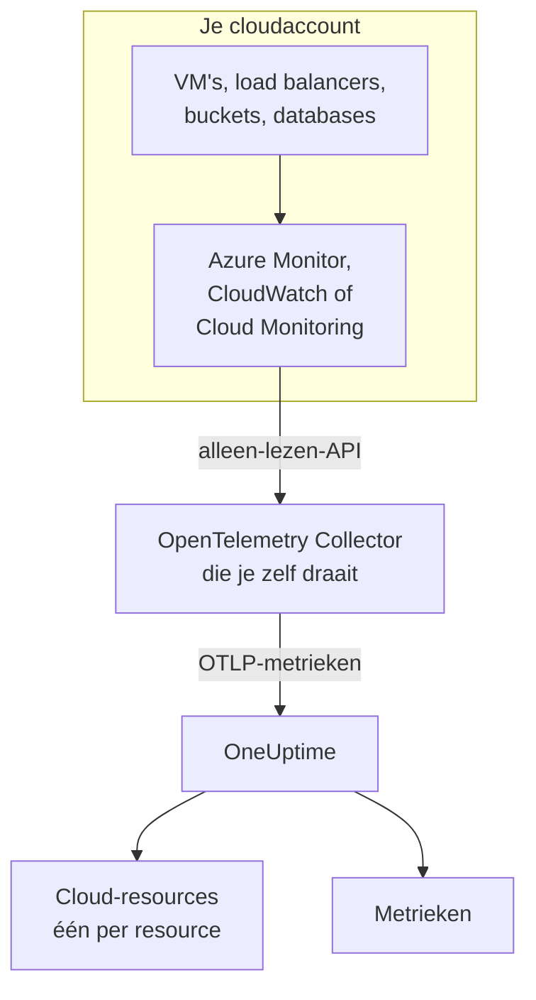
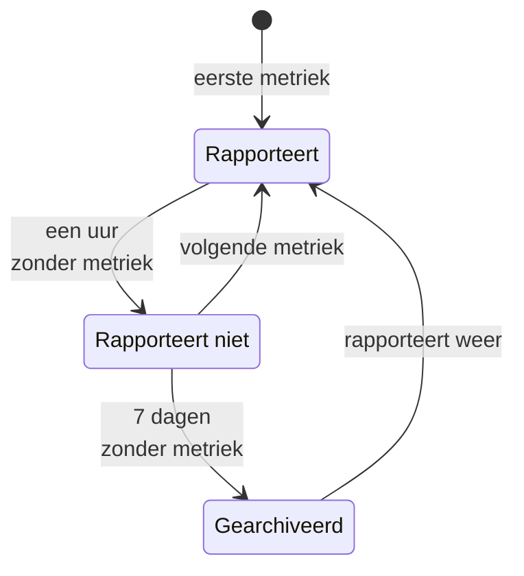

# Cloud-resources (IaaS en PaaS)

**Cloud Resources** toont de IaaS- en PaaS-resources in je AWS-, Azure- en Google Cloud-accounts: virtuele machines, schijven, load balancers, buckets, beheerde databases, caches, wachtrijen, API-gateways en de rest. Elke resource krijgt een eigen pagina, met het type, de regio en het account, het eigen ID dat de provider eraan geeft, elke metriek die de provider erover publiceert, en eigenaren en labels zoals elke andere resource in OneUptime. Je vindt ze onder **Cloud → Alle resources**.

:::cards
- [Azure koppelen](#azure-koppelen): Elke resource in een abonnement lezen uit Azure Monitor.
- [AWS koppelen](#aws-koppelen): CloudWatch pollen, of streamen via Amazon Data Firehose.
- [Google Cloud koppelen](#google-cloud-koppelen): De services van een project lezen uit Cloud Monitoring.
- [Hoe een resource wordt herkend](#hoe-een-resource-wordt-herkend): Elk resourcetype dat OneUptime herkent, per provider.
:::

## Hoe het werkt



- **De provider meet je resources al.** Azure Monitor, Amazon CloudWatch en Google Cloud Monitoring publiceren metrieken over elke resource die ze voor je draaien.
- **Een collector die je zelf draait, leest ze.** Een OpenTelemetry Collector met alleen-lezentoegang tot die monitoringdienst exporteert de metrieken naar OneUptime. Er wordt niets op de resources geïnstalleerd, en OneUptime bewaart nooit je cloudreferenties: de collector doet dat, in je eigen omgeving.
- **Elke resource verschijnt met zijn eerste metriek.** OneUptime leidt uit elk datapunt af over welke resource het gaat, en maakt de cloud-resource aan de eerste keer dat het die ziet.

Cloud-resources zijn een van de plekken waar je cloud verschijnt:

| Je draait | Waar het verschijnt | Hoe |
| --- | --- | --- |
| Containers op ECS, Cloud Run, Container Apps, App Service, … | **Cloud → All Environments** | De eigen telemetrie van je workloads, op basis van hun `cloud.platform`. Zie [Cloud-omgevingen](/docs/telemetry/cloud-environments) |
| Elke IaaS- of PaaS-resource die de provider monitort | **Cloud → Alle resources** | De monitoring-API van de provider, gelezen door een collector: deze pagina |
| Virtuele machines met een OpenTelemetry Collector erop | **Hosts** | De eigen metrieken en logs van de host. Zie [OpenTelemetry-collector op de host](/docs/telemetry/host-otel-collector) |
| Wachtrijen en topics die je applicaties gebruiken | **Queues** | Spans, en dezelfde cloudmetrieken. Zie [Wachtrijen](/docs/telemetry/queues) |

Een resource kan op meer dan één plek verschijnen. Een virtuele machine met de collector erop is een **Host**, en zijn platformmetrieken (CPU-tegoed, schijf en netwerk zoals de hypervisor ze ziet) maken hem ook een **Cloud-resource**. Een SQS-wachtrij is een **Queue** en een **Cloud-resource**. Elke weergave toont wat haar bron weet.

## Voordat je begint

- **Een ingestiesleutel.** Maak een sleutel van het type **Server** aan onder **Projectinstellingen → Telemetrie & APM → Ingestiesleutels**. De collectors hieronder lezen hem uit de omgevingsvariabele `ONEUPTIME_TOKEN`, nooit uit hun configuratiebestand.
- **Een plek om de OpenTelemetry Collector te draaien**: de distributie `otelcol-contrib`, image `otel/opentelemetry-collector-contrib`, met uitgaande toegang tot je cloudprovider en tot OneUptime. Een kleine VM, een container of je Kubernetes-cluster volstaat, en één collector kan meerdere accounts en providers lezen.
- **Leestoegang tot de monitoring-API van de provider.** De eerste stap van elke provider hieronder maakt die aan.

> [!TIP]
> Dezelfde stappen staan in het dashboard, met je token al ingevuld: onder **Cloud → Alle resources** totdat de eerste resource binnenkomt, en op het tabblad **Documentatie** van elke resource, dat op de eigen provider van die resource opent.

Als je OneUptime zelf host, vervang dan `https://oneuptime.com/otlp` door `https://YOUR-ONEUPTIME-HOST/otlp`.

## Azure koppelen

De receiver `azure_monitor` toont de resources van een abonnement en leest elke minuut hun platformmetrieken. Zonder lijst `services` leest hij elk resourcetype, dus elke resource in het abonnement wordt een cloud-resource.

:::steps
### Een service-principal met Monitoring Reader maken

**Monitoring Reader** leest metrieken en toont resources, en kan niets wijzigen:

```bash
az ad sp create-for-rbac \
  --name oneuptime-cloud-collector \
  --role "Monitoring Reader" \
  --scopes /subscriptions/<SUBSCRIPTION_ID>
```

Het commando drukt een `appId` (de client-ID), een `password` (het clientgeheim) en de `tenant` af. Geef dezelfde service-principal de rol op meer abonnementen om ze met dezelfde collector te lezen.

### De Azure Monitor-receiver configureren

Sla dit op als `config.yaml`:

```yaml
extensions:
  azure_auth:
    service_principal:
      tenant_id: ${env:AZURE_TENANT_ID}
      client_id: ${env:AZURE_CLIENT_ID}
      client_secret: ${env:AZURE_CLIENT_SECRET}

receivers:
  azure_monitor:
    subscription_ids: ["${env:AZURE_SUBSCRIPTION_ID}"]
    auth:
      authenticator: azure_auth
    collection_interval: 60s
    # No `services` list: every resource type in the subscription.
    # Series Azure returns per metric and resource (default 10).
    maximum_number_of_records_per_resource: 50

processors:
  batch: {}

exporters:
  otlphttp/oneuptime:
    endpoint: https://oneuptime.com/otlp
    headers:
      x-oneuptime-token: ${env:ONEUPTIME_TOKEN}

service:
  extensions: [azure_auth]
  pipelines:
    metrics:
      receivers: [azure_monitor]
      processors: [batch]
      exporters: [otlphttp/oneuptime]
```

### De Azure-collector draaien

```bash
docker run -d --name oneuptime-cloud-collector --restart unless-stopped \
  -e ONEUPTIME_TOKEN=YOUR_TELEMETRY_INGESTION_TOKEN \
  -e AZURE_TENANT_ID=<TENANT> \
  -e AZURE_CLIENT_ID=<APP_ID> \
  -e AZURE_CLIENT_SECRET=<PASSWORD> \
  -e AZURE_SUBSCRIPTION_ID=<SUBSCRIPTION_ID> \
  -v "$(pwd)/config.yaml:/etc/otelcol-contrib/config.yaml" \
  otel/opentelemetry-collector-contrib:latest
```

Resources verschijnen binnen een paar minuten onder **Cloud → Alle resources**.
:::

Opties van de receiver `azure_monitor`:

| Optie | Wat het doet |
| --- | --- |
| `resource_groups`, `services`, `resource_tags` | Minder lezen: een lijst van resourcegroepen, van Resource Manager-typen (`Microsoft.Compute/virtualMachines`), of van tags die een resource moet hebben |
| `metrics` | Beperkt elk resourcetype tot de metrieken en aggregaties die je opgeeft. Zodra een type in de lijst staat, worden alleen de opgegeven metrieken ervan gelezen |
| `discover_subscriptions: true` | Leest elk abonnement dat de service-principal kan zien, in plaats van `subscription_ids` |
| `maximum_number_of_records_per_resource` | Hoeveel reeksen Azure per metriek en resource teruggeeft (standaard 10). Verhoog het als een metriek opsplitst naar een dimensie met veel waarden |
| `use_batch_api: true` | Voor grote abonnementen. De receiver doet één Resource Manager-aanroep per resource en per batch van 20 metrieken, en Resource Manager staat ongeveer 12.000 leesacties per uur toe; de batch-API leest tot 50 resources per aanroep uit het datavlak van Azure Monitor, waarvan de limiet veel hoger ligt |
| `cache_resources` | Hoe vaak, in seconden, de receiver de resources opsomt: standaard eens per dag. Een resource die is aangemaakt nadat de collector startte, kan tot een dag nodig hebben om te verschijnen; herstart de collector om ze meteen op te sommen |

## AWS koppelen

CloudWatch-metrieken bereiken OneUptime op een van twee manieren:

| | Polling | Metric Streams |
| --- | --- | --- |
| Hoe | De receiver `aws_cloudwatch` van de collector vraagt CloudWatch | CloudWatch pusht via Amazon Data Firehose naar de receiver `awsfirehose` van de collector |
| Nodig aan de AWS-kant | Alleen referenties | Een Firehose-stream en een metric stream in elke regio |
| De collector moet bereikbaar zijn vanuit AWS | Nee | Ja, via HTTPS op poort 443 |
| Vertraging | 10 tot 20 minuten | Een paar minuten |
| Geschikt voor | De meeste accounts | Grote accounts |

### Polling met de receiver aws_cloudwatch

:::steps
#### De collector CloudWatch laten lezen

Koppel dit beleid aan de rol waaronder de collector draait (een EC2-instantieprofiel, een ECS-taakrol, een EKS-serviceaccount), of aan een IAM-gebruiker van wie je hem de toegangssleutels geeft:

```json
{
  "Version": "2012-10-17",
  "Statement": [
    {
      "Effect": "Allow",
      "Action": [
        "cloudwatch:ListMetrics",
        "cloudwatch:GetMetricData",
        "sts:GetCallerIdentity"
      ],
      "Resource": "*"
    }
  ]
}
```

Met `sts:GetCallerIdentity` kan de receiver het account-ID melden, dat de ARN van elke resource nodig heeft.

#### De CloudWatch-receivers configureren

Eén receiver leest één namespace in één regio, dus voeg er een toe voor elke namespace en regio die je wilt. Dit voorbeeld leest de gebruikelijke; sla het op als `config.yaml`:

```yaml
receivers:
  aws_cloudwatch/ec2:
    region: ${env:AWS_REGION}
    metrics:
      collection_interval: 5m
      period: 5m
      delay: 10m
      discovery:
        filters:
          namespace: AWS/EC2
        # Metrics read per scrape, at most. Each costs 4 GetMetricData queries.
        limit: 1000
  aws_cloudwatch/ebs:
    region: ${env:AWS_REGION}
    metrics:
      collection_interval: 5m
      period: 5m
      delay: 10m
      discovery:
        filters:
          namespace: AWS/EBS
        # Metrics read per scrape, at most. Each costs 4 GetMetricData queries.
        limit: 1000
  aws_cloudwatch/applicationelb:
    region: ${env:AWS_REGION}
    metrics:
      collection_interval: 5m
      period: 5m
      delay: 10m
      discovery:
        filters:
          namespace: AWS/ApplicationELB
        # Metrics read per scrape, at most. Each costs 4 GetMetricData queries.
        limit: 1000
  aws_cloudwatch/rds:
    region: ${env:AWS_REGION}
    metrics:
      collection_interval: 5m
      period: 5m
      delay: 10m
      discovery:
        filters:
          namespace: AWS/RDS
        # Metrics read per scrape, at most. Each costs 4 GetMetricData queries.
        limit: 1000
  aws_cloudwatch/lambda:
    region: ${env:AWS_REGION}
    metrics:
      collection_interval: 5m
      period: 5m
      delay: 10m
      discovery:
        filters:
          namespace: AWS/Lambda
        # Metrics read per scrape, at most. Each costs 4 GetMetricData queries.
        limit: 1000
  aws_cloudwatch/dynamodb:
    region: ${env:AWS_REGION}
    metrics:
      collection_interval: 5m
      period: 5m
      delay: 10m
      discovery:
        filters:
          namespace: AWS/DynamoDB
        # Metrics read per scrape, at most. Each costs 4 GetMetricData queries.
        limit: 1000

processors:
  batch: {}

exporters:
  otlphttp/oneuptime:
    endpoint: https://oneuptime.com/otlp
    headers:
      x-oneuptime-token: ${env:ONEUPTIME_TOKEN}

service:
  pipelines:
    metrics:
      receivers: [aws_cloudwatch/ec2, aws_cloudwatch/ebs, aws_cloudwatch/applicationelb, aws_cloudwatch/rds, aws_cloudwatch/lambda, aws_cloudwatch/dynamodb]
      processors: [batch]
      exporters: [otlphttp/oneuptime]
```

#### De CloudWatch-collector draaien

```bash
docker run -d --name oneuptime-cloud-collector --restart unless-stopped \
  -e ONEUPTIME_TOKEN=YOUR_TELEMETRY_INGESTION_TOKEN \
  -e AWS_REGION=us-east-1 \
  -e AWS_ACCESS_KEY_ID=<ACCESS_KEY_ID> \
  -e AWS_SECRET_ACCESS_KEY=<SECRET_ACCESS_KEY> \
  -v "$(pwd)/config.yaml:/etc/otelcol-contrib/config.yaml" \
  otel/opentelemetry-collector-contrib:latest
```

Laat op een EC2-instantie, ECS-taak of EKS-pod die de rol heeft de twee sleutelvariabelen weg.
:::

- **Laat `stats` leeg.** Elke metriek wordt dan gelezen als één samenvatting per periode: vier statistieken, vier query's met `GetMetricData`, en AWS rekent `GetMetricData` per opgevraagde metriek. `discovery.limit` begrenst de metrieken die een receiver per scrape leest (stel het in: de eigen standaard van de receiver is 100), en een langere `collection_interval` leest ze minder vaak.
- **Gegevens komen laat binnen.** `delay` wacht tot CloudWatch een periode publiceert, dus datapunten komen 10 tot 20 minuten na het tijdstip dat ze meten binnen, en resources verschijnen binnen ongeveer twintig minuten.

### Streamen met CloudWatch Metric Streams

:::steps
#### De Firehose-receiver configureren

De collector heeft een certificaat voor zijn adres nodig: Firehose levert alleen aan `https://` op poort 443. Sla dit op als `config.yaml`:

```yaml
extensions:
  awscloudwatchmetricstreams_encoding:
    format: opentelemetry1.0

receivers:
  awsfirehose:
    # Firehose delivers to HTTPS on port 443 only: expose this port as
    # 443, for example behind a load balancer.
    endpoint: 0.0.0.0:4433
    encoding: awscloudwatchmetricstreams_encoding
    access_key: ${env:FIREHOSE_ACCESS_KEY}
    tls:
      cert_file: /etc/otelcol-contrib/tls/server.crt
      key_file: /etc/otelcol-contrib/tls/server.key

processors:
  batch: {}

exporters:
  otlphttp/oneuptime:
    endpoint: https://oneuptime.com/otlp
    headers:
      x-oneuptime-token: ${env:ONEUPTIME_TOKEN}

service:
  extensions: [awscloudwatchmetricstreams_encoding]
  pipelines:
    metrics:
      receivers: [awsfirehose]
      processors: [batch]
      exporters: [otlphttp/oneuptime]
```

#### De Firehose-collector draaien

```bash
docker run -d --name oneuptime-cloud-collector --restart unless-stopped \
  -e ONEUPTIME_TOKEN=YOUR_TELEMETRY_INGESTION_TOKEN \
  -e FIREHOSE_ACCESS_KEY=<A_LONG_RANDOM_SECRET> \
  -p 4433:4433 \
  -v "$(pwd)/tls:/etc/otelcol-contrib/tls:ro" \
  -v "$(pwd)/config.yaml:/etc/otelcol-contrib/config.yaml" \
  otel/opentelemetry-collector-contrib:latest
```

Het certificaat en de sleutel ervan gaan in `tls/`, als `server.crt` en `server.key`. Publiceer poort 4433 achter iets dat op 443 antwoordt, zoals een load balancer.

#### De Firehose-stream en de metric streams maken

1. **Amazon Data Firehose → Create Firehose stream**: bron **Direct PUT**, bestemming **HTTP Endpoint**. De endpoint-URL is het adres `https://` van de collector; de toegangssleutel is `FIREHOSE_ACCESS_KEY`. Kies of maak een S3-bucket voor mislukte leveringen.
2. **CloudWatch → Metrics → Streams → Create metric stream**: de namespaces die je opneemt (of alle), de Firehose-stream en het uitvoerformaat **OpenTelemetry 1.0**.
3. Herhaal dit in elke regio: een metric stream draagt de metrieken van zijn eigen regio.
:::

AWS rekent een metric stream af per metriekupdate die hij levert, plus de datakosten van Firehose, dus neem alleen de namespaces op die je wilt. Een stream in het formaat **JSON** (`format: json` op de coderingsextensie) noemt dezelfde resources, maar schrijft ook elke namespace in `service.name`, zodat elke namespace ook onder **Services** verschijnt: kies liever **OpenTelemetry 1.0**.

## Google Cloud koppelen

De receiver `googlecloudmonitoring` leest de metriektypen die zijn `metrics_list` noemt, voor één project.

:::steps
### Een serviceaccount met Monitoring Viewer maken

**Monitoring Viewer** leest metrieken, en kan niets wijzigen:

```bash
gcloud iam service-accounts create oneuptime-cloud-collector \
  --project <PROJECT_ID>

gcloud projects add-iam-policy-binding <PROJECT_ID> \
  --member "serviceAccount:oneuptime-cloud-collector@<PROJECT_ID>.iam.gserviceaccount.com" \
  --role roles/monitoring.viewer

gcloud iam service-accounts keys create key.json \
  --iam-account oneuptime-cloud-collector@<PROJECT_ID>.iam.gserviceaccount.com
```

Draai de collector op Google Cloud zelf als dit serviceaccount in plaats van een sleutel aan te maken.

### De Cloud Monitoring-receiver configureren

Elk filter leest elk metriektype van één service. Sla dit op als `config.yaml`:

```yaml
receivers:
  googlecloudmonitoring:
    project_id: ${env:GCP_PROJECT_ID}
    collection_interval: 2m
    # Only the metric types these filters list are read.
    metrics_list:
      - metric_descriptor_filter: 'metric.type = starts_with("compute.googleapis.com/")'
      - metric_descriptor_filter: 'metric.type = starts_with("cloudsql.googleapis.com/")'
      - metric_descriptor_filter: 'metric.type = starts_with("loadbalancing.googleapis.com/")'
      - metric_descriptor_filter: 'metric.type = starts_with("storage.googleapis.com/")'
      - metric_descriptor_filter: 'metric.type = starts_with("redis.googleapis.com/")'
      - metric_descriptor_filter: 'metric.type = starts_with("run.googleapis.com/")'

processors:
  batch: {}

exporters:
  otlphttp/oneuptime:
    endpoint: https://oneuptime.com/otlp
    headers:
      x-oneuptime-token: ${env:ONEUPTIME_TOKEN}

service:
  pipelines:
    metrics:
      receivers: [googlecloudmonitoring]
      processors: [batch]
      exporters: [otlphttp/oneuptime]
```

### De Google Cloud-collector draaien

```bash
docker run -d --name oneuptime-cloud-collector --restart unless-stopped \
  -e ONEUPTIME_TOKEN=YOUR_TELEMETRY_INGESTION_TOKEN \
  -e GCP_PROJECT_ID=<PROJECT_ID> \
  -e GOOGLE_APPLICATION_CREDENTIALS=/etc/otelcol-contrib/key.json \
  -v "$(pwd)/key.json:/etc/otelcol-contrib/key.json:ro" \
  -v "$(pwd)/config.yaml:/etc/otelcol-contrib/config.yaml" \
  otel/opentelemetry-collector-contrib:latest
```
:::

- **De lijst wordt gelezen als de collector start:** herstart hem na een wijziging. `metric_name: compute.googleapis.com/instance/cpu/utilization` leest één type in plaats van elk type van een service.
- **Eén receiver leest één project:** voeg er een per project toe.
- **Lezen heeft kosten en een quotum.** Elk metriektype is één leesactie op de Cloud Monitoring-API per verzamelinterval. Het lezen van de eigen metrieken van Google Cloud is gratis binnen de maandelijkse ruimte van de API; een langere `collection_interval` houdt een groot project daarbinnen, en binnen het quotum per minuut.

## Houd de pipeline vrij van resourcedetectie

> [!WARNING]
> Voeg de processor `resourcedetection` niet toe aan de pipeline die de cloudmonitoring leest. Die stempelt de eigen `host.name` en `os.type` van de collectormachine op elk datapunt, en OneUptime archiveert de metrieken van je cloud dan ook onder die machine in **Hosts**. Een collector die ook zijn eigen host monitort, moet dat in een eigen pipeline doen.

## Hoe een resource wordt herkend

Elk datapunt van deze receivers noemt één resource, en OneUptime koppelt de cloud-resource aan de identiteit van die resource, nooit aan zijn naam, die je kunt wijzigen. De identiteit wordt zonder onderscheid tussen hoofd- en kleine letters vergeleken, dus een resource die in twee spellingen wordt gemeld, is één resource.

### Azure

Elk datapunt draagt de Azure-resource-ID van zijn resource (`azuremonitor.resource_id`), dus elke resource die de receiver leest, wordt een cloud-resource: de typen hieronder met een leesbare naam, elk ander type met zijn Resource Manager-type. De resource-ID, de regio, het abonnement en de resourcegroep staan allemaal op de resource.

:::details De Azure-resourcetypen met een leesbare naam
| Resourcetype | Getoond als | Model |
| --- | --- | --- |
| `Microsoft.Compute/virtualMachines` | Virtual Machine | IaaS |
| `Microsoft.Compute/virtualMachineScaleSets` | Virtual Machine Scale Set | IaaS |
| `Microsoft.Compute/disks` | Managed Disk | IaaS |
| `Microsoft.Network/loadBalancers` | Load Balancer | IaaS |
| `Microsoft.Network/applicationGateways` | Application Gateway | IaaS |
| `Microsoft.Network/publicIPAddresses` | Public IP Address | IaaS |
| `Microsoft.Network/natGateways` | NAT Gateway | IaaS |
| `Microsoft.Network/virtualNetworkGateways` | Virtual Network Gateway | IaaS |
| `Microsoft.Network/expressRouteCircuits` | ExpressRoute Circuit | IaaS |
| `Microsoft.Network/azureFirewalls` | Azure Firewall | IaaS |
| `Microsoft.Network/frontdoors` | Front Door (classic) | IaaS |
| `Microsoft.Cdn/profiles` | Front Door and CDN Profile | IaaS |
| `Microsoft.Network/trafficmanagerprofiles` | Traffic Manager Profile | IaaS |
| `Microsoft.Network/networkInterfaces` | Network Interface | IaaS |
| `Microsoft.Network/virtualNetworks` | Virtual Network | IaaS |
| `Microsoft.Network/privateEndpoints` | Private Endpoint | IaaS |
| `Microsoft.Network/dnszones` | DNS Zone | IaaS |
| `Microsoft.Network/bastionHosts` | Bastion | IaaS |
| `Microsoft.Storage/storageAccounts` | Storage Account | IaaS |
| `Microsoft.RecoveryServices/vaults` | Recovery Services Vault | PaaS |
| `Microsoft.Web/sites` | App Service or Function App | PaaS |
| `Microsoft.Web/serverfarms` | App Service Plan | PaaS |
| `Microsoft.Web/staticSites` | Static Web App | PaaS |
| `Microsoft.App/containerApps` | Container App | PaaS |
| `Microsoft.App/managedEnvironments` | Container Apps Environment | PaaS |
| `Microsoft.ContainerInstance/containerGroups` | Container Instance | PaaS |
| `Microsoft.ContainerService/managedClusters` | AKS Cluster | PaaS |
| `Microsoft.ContainerRegistry/registries` | Container Registry | PaaS |
| `Microsoft.SignalRService/SignalR` | SignalR Service | PaaS |
| `Microsoft.Sql/servers/databases` | SQL Database | PaaS |
| `Microsoft.Sql/servers/elasticpools` | SQL Elastic Pool | PaaS |
| `Microsoft.Sql/managedInstances` | SQL Managed Instance | PaaS |
| `Microsoft.DBforPostgreSQL/flexibleServers` | PostgreSQL Flexible Server | PaaS |
| `Microsoft.DBforMySQL/flexibleServers` | MySQL Flexible Server | PaaS |
| `Microsoft.DocumentDB/databaseAccounts` | Cosmos DB Account | PaaS |
| `Microsoft.Cache/redis` | Azure Cache for Redis | PaaS |
| `Microsoft.Cache/redisEnterprise` | Azure Managed Redis | PaaS |
| `Microsoft.ServiceBus/namespaces` | Service Bus Namespace | PaaS |
| `Microsoft.EventHub/namespaces` | Event Hubs Namespace | PaaS |
| `Microsoft.EventGrid/topics` | Event Grid Topic | PaaS |
| `Microsoft.EventGrid/systemTopics` | Event Grid System Topic | PaaS |
| `Microsoft.EventGrid/namespaces` | Event Grid Namespace | PaaS |
| `Microsoft.ApiManagement/service` | API Management | PaaS |
| `Microsoft.Logic/workflows` | Logic App | PaaS |
| `Microsoft.DataFactory/factories` | Data Factory | PaaS |
| `Microsoft.Synapse/workspaces` | Synapse Workspace | PaaS |
| `Microsoft.Kusto/clusters` | Data Explorer Cluster | PaaS |
| `Microsoft.StreamAnalytics/streamingjobs` | Stream Analytics Job | PaaS |
| `Microsoft.CognitiveServices/accounts` | Azure AI Services or OpenAI | PaaS |
| `Microsoft.Search/searchServices` | AI Search Service | PaaS |
| `Microsoft.MachineLearningServices/workspaces` | Machine Learning Workspace | PaaS |
| `Microsoft.KeyVault/vaults` | Key Vault | PaaS |
| `Microsoft.Insights/components` | Application Insights | PaaS |
| `Microsoft.OperationalInsights/workspaces` | Log Analytics Workspace | PaaS |
| `Microsoft.Automation/automationAccounts` | Automation Account | PaaS |
| `Microsoft.Devices/IotHubs` | IoT Hub | PaaS |
:::

### AWS

Een CloudWatch-metriek noemt zijn resource in een dimensie die van de namespace afhangt. Een datapunt dat de dimensies onder **Geïdentificeerd door** draagt, hoort bij die resource, samen met het account en de regio ervan; extra dimensies verfijnen de reeks, niet de resource (de reeksen per doelgroep van een Application Load Balancer horen bij de load balancer). Een datapunt dat over iets anders is geaggregeerd (`InstanceType`, `DatabaseClass`, een totaal voor het hele account) noemt geen resource en wordt niet ontdekt. Een namespace die niet in de lijst staat ook niet: zijn metrieken komen nog steeds in **Metrieken** terecht.

Elke resource wordt getoond met zijn ARN als zijn metrieken die volledig noemen; als ze dat niet doen (de ARN van een Auto Scaling-groep bevat een UUID die geen enkele metriek meldt), met zijn namespace en dimensies.

:::details De CloudWatch-namespaces en de dimensies die een resource identificeren
| Namespace | Geïdentificeerd door | Getoond als | Resourcetype | Model |
| --- | --- | --- | --- | --- |
| `AWS/EC2` | `InstanceId` | EC2 Instance | `AWS::EC2::Instance` | IaaS |
| `AWS/EC2` | `AutoScalingGroupName` (without `InstanceId`) | Auto Scaling Group | `AWS::AutoScaling::AutoScalingGroup` | IaaS |
| `AWS/AutoScaling` | `AutoScalingGroupName` | Auto Scaling Group | `AWS::AutoScaling::AutoScalingGroup` | IaaS |
| `AWS/EBS` | `VolumeId` | EBS Volume | `AWS::EC2::Volume` | IaaS |
| `AWS/ELB` | `LoadBalancerName` | Classic Load Balancer | `AWS::ElasticLoadBalancing::LoadBalancer` | IaaS |
| `AWS/ApplicationELB` | `LoadBalancer` | Elastic Load Balancer (ALB, NLB, GWLB) | `AWS::ElasticLoadBalancingV2::LoadBalancer` | IaaS |
| `AWS/NetworkELB` | `LoadBalancer` | Elastic Load Balancer (ALB, NLB, GWLB) | `AWS::ElasticLoadBalancingV2::LoadBalancer` | IaaS |
| `AWS/GatewayELB` | `LoadBalancer` | Elastic Load Balancer (ALB, NLB, GWLB) | `AWS::ElasticLoadBalancingV2::LoadBalancer` | IaaS |
| `AWS/NATGateway` | `NatGatewayId` | NAT Gateway | `AWS::EC2::NatGateway` | IaaS |
| `AWS/TransitGateway` | `TransitGateway` | Transit Gateway | `AWS::EC2::TransitGateway` | IaaS |
| `AWS/VPN` | `VpnId` | Site-to-Site VPN Connection | `AWS::EC2::VPNConnection` | IaaS |
| `AWS/DX` | `ConnectionId` | Direct Connect Connection | `AWS::DirectConnect::Connection` | IaaS |
| `AWS/CloudFront` | `DistributionId` | CloudFront Distribution | `AWS::CloudFront::Distribution` | IaaS |
| `AWS/GlobalAccelerator` | `Accelerator` (without `Listener`, `EndpointGroup`) | Global Accelerator | `AWS::GlobalAccelerator::Accelerator` | IaaS |
| `AWS/Route53` | `HealthCheckId` | Route 53 Health Check | `AWS::Route53::HealthCheck` | IaaS |
| `AWS/NetworkFirewall` | `FirewallName` | Network Firewall | `AWS::NetworkFirewall::Firewall` | IaaS |
| `AWS/WAFV2` | `WebACL` (without `Rule`, `RuleGroup`) | WAF Web ACL | `AWS::WAFv2::WebACL` | PaaS |
| `AWS/S3` | `BucketName` | S3 Bucket | `AWS::S3::Bucket` | IaaS |
| `AWS/EFS` | `FileSystemId` | EFS File System | `AWS::EFS::FileSystem` | IaaS |
| `AWS/FSx` | `FileSystemId` | FSx File System | `AWS::FSx::FileSystem` | IaaS |
| `AWS/ECS` | `ClusterName` + `ServiceName` | ECS Service | `AWS::ECS::Service` | PaaS |
| `AWS/ECS` | `ClusterName` (without `ServiceName`) | ECS Cluster | `AWS::ECS::Cluster` | PaaS |
| `AWS/AppRunner` | `ServiceName` | App Runner Service | `AWS::AppRunner::Service` | PaaS |
| `AWS/ElasticBeanstalk` | `EnvironmentName` | Elastic Beanstalk Environment | `AWS::ElasticBeanstalk::Environment` | PaaS |
| `AWS/Lambda` | `FunctionName` | Lambda Function | `AWS::Lambda::Function` | PaaS |
| `AWS/States` | `StateMachineArn` | Step Functions State Machine | `AWS::StepFunctions::StateMachine` | PaaS |
| `AWS/RDS` | `DBInstanceIdentifier` | RDS DB Instance | `AWS::RDS::DBInstance` | PaaS |
| `AWS/RDS` | `DBClusterIdentifier` (without `DBInstanceIdentifier`) | Aurora / RDS DB Cluster | `AWS::RDS::DBCluster` | PaaS |
| `AWS/DocDB` | `DBInstanceIdentifier` | DocumentDB Instance | `AWS::DocDB::DBInstance` | PaaS |
| `AWS/DocDB` | `DBClusterIdentifier` (without `DBInstanceIdentifier`) | DocumentDB Cluster | `AWS::DocDB::DBCluster` | PaaS |
| `AWS/Neptune` | `DBInstanceIdentifier` | Neptune Instance | `AWS::Neptune::DBInstance` | PaaS |
| `AWS/Neptune` | `DBClusterIdentifier` (without `DBInstanceIdentifier`) | Neptune Cluster | `AWS::Neptune::DBCluster` | PaaS |
| `AWS/DynamoDB` | `TableName` | DynamoDB Table | `AWS::DynamoDB::Table` | PaaS |
| `AWS/ElastiCache` | `CacheClusterId` | ElastiCache Cluster | `AWS::ElastiCache::CacheCluster` | PaaS |
| `AWS/ElastiCache` | `ReplicationGroupId` (without `CacheClusterId`) | ElastiCache Replication Group | `AWS::ElastiCache::ReplicationGroup` | PaaS |
| `AWS/ElastiCache` | `clusterId` (without `CacheClusterId`) | ElastiCache Serverless Cache | `AWS::ElastiCache::ServerlessCache` | PaaS |
| `AWS/MemoryDB` | `ClusterName` | MemoryDB Cluster | `AWS::MemoryDB::Cluster` | PaaS |
| `AWS/Redshift` | `ClusterIdentifier` | Redshift Cluster | `AWS::Redshift::Cluster` | PaaS |
| `AWS/ES` | `DomainName` | OpenSearch Domain | `AWS::OpenSearchService::Domain` | PaaS |
| `AWS/SQS` | `QueueName` | SQS Queue | `AWS::SQS::Queue` | PaaS |
| `AWS/SNS` | `TopicName` | SNS Topic | `AWS::SNS::Topic` | PaaS |
| `AWS/Kinesis` | `StreamName` | Kinesis Data Stream | `AWS::Kinesis::Stream` | PaaS |
| `AWS/Firehose` | `DeliveryStreamName` | Data Firehose Stream | `AWS::KinesisFirehose::DeliveryStream` | PaaS |
| `AWS/AmazonMQ` | `Broker` | Amazon MQ Broker | `AWS::AmazonMQ::Broker` | PaaS |
| `AWS/Kafka` | `Cluster Name` | MSK Cluster | `AWS::MSK::Cluster` | PaaS |
| `AWS/Events` | `RuleName` | EventBridge Rule | `AWS::Events::Rule` | PaaS |
| `AWS/ApiGateway` | `ApiName` | API Gateway REST API | `AWS::ApiGateway::RestApi` | PaaS |
| `AWS/ApiGateway` | `ApiId` (without `ApiName`) | API Gateway HTTP or WebSocket API | `AWS::ApiGatewayV2::Api` | PaaS |
| `AWS/AppSync` | `GraphQLAPIId` | AppSync GraphQL API | `AWS::AppSync::GraphQLApi` | PaaS |
| `AWS/CertificateManager` | `CertificateArn` | ACM Certificate | `AWS::CertificateManager::Certificate` | PaaS |
| `AWS/KMS` | `KeyId` | KMS Key | `AWS::KMS::Key` | PaaS |
| `AWS/Cognito` | `UserPool` | Cognito User Pool | `AWS::Cognito::UserPool` | PaaS |
| `AWS/SageMaker` | `EndpointName` | SageMaker Endpoint | `AWS::SageMaker::Endpoint` | PaaS |
| `AWS/Logs` | `LogGroupName` | CloudWatch Log Group | `AWS::Logs::LogGroup` | PaaS |
:::

### Google Cloud

Cloud Monitoring noemt de gemonitorde resource van elke metriek met een type en labels. Een datapunt van een type hieronder hoort bij die resource, geïdentificeerd door de vermelde labels; de andere labels van de resource, en de metadatalabels ervan, splitsen hem nooit. Kubernetes-typen (`k8s_container`, `k8s_pod`, …) worden overgelaten aan het product [Kubernetes](/docs/telemetry/kubernetes-agent).

:::details De resourcetypen van Cloud Monitoring en de labels die ze identificeren
| Type gemonitorde resource | Geïdentificeerd door | Getoond als | Model |
| --- | --- | --- | --- |
| `gce_instance` | `project_id`, `zone`, `instance_id` | Compute Engine VM Instance | IaaS |
| `instance_group` | `project_id`, `location`, `instance_group_id` | Instance Group | IaaS |
| `gcs_bucket` | `project_id`, `bucket_name` | Cloud Storage Bucket | IaaS |
| `filestore_instance` | `project_id`, `location`, `instance_name` | Filestore Instance | IaaS |
| `https_lb_rule` | `project_id`, `url_map_name` | External Application Load Balancer | IaaS |
| `internal_http_lb_rule` | `project_id`, `region`, `url_map_name` | Internal Application Load Balancer | IaaS |
| `vpn_gateway` | `project_id`, `region`, `gateway_id` | Cloud VPN Gateway | IaaS |
| `nat_gateway` | `project_id`, `region`, `router_id`, `gateway_name` | Cloud NAT Gateway | IaaS |
| `gce_router` | `project_id`, `region`, `router_id` | Cloud Router | IaaS |
| `cloudsql_database` | `project_id`, `database_id` | Cloud SQL Instance | PaaS |
| `alloydb.googleapis.com/Instance` | `resource_container`, `location`, `cluster_id`, `instance_id` | AlloyDB Instance | PaaS |
| `redis_instance` | `project_id`, `region`, `instance_id` | Memorystore for Redis Instance | PaaS |
| `spanner_instance` | `project_id`, `instance_id` | Spanner Instance | PaaS |
| `bigtable_table` | `project_id`, `instance` | Bigtable Instance | PaaS |
| `bigquery_dataset` | `project_id`, `dataset_id` | BigQuery Dataset | PaaS |
| `cloud_function` | `project_id`, `region`, `function_name` | Cloud Run Function | PaaS |
| `cloud_run_revision` | `project_id`, `location`, `service_name` | Cloud Run Service | PaaS |
| `cloud_run_job` | `project_id`, `location`, `job_name` | Cloud Run Job | PaaS |
| `gae_app` | `project_id`, `module_id` | App Engine Service | PaaS |
| `pubsub_topic` | `project_id`, `topic_id` | Pub/Sub Topic | PaaS |
| `pubsub_subscription` | `project_id`, `subscription_id` | Pub/Sub Subscription | PaaS |
| `cloud_tasks_queue` | `project_id`, `location`, `queue_id` | Cloud Tasks Queue | PaaS |
| `cloud_composer_environment` | `project_id`, `location`, `environment_name` | Cloud Composer Environment | PaaS |
| `dataproc_cluster` | `project_id`, `region`, `cluster_name` | Dataproc Cluster | PaaS |
| `aiplatform.googleapis.com/Endpoint` | `resource_container`, `location`, `endpoint_id` | Vertex AI Endpoint | PaaS |
:::

### Namen

Een resource krijgt de naam die de provider ervoor gebruikt (`vm-prod-01`, `checkout`, `orders`). Namen zijn uniek binnen een project, die van de provider niet: twee abonnementen hebben elk een `web-01`, en een App Service-plan en zijn app heten allebei `checkout`. Een resource waarvan de naam al bezet is, krijgt daarom een naam met zijn type, daarna zijn resourcegroep of regio, daarna zijn account: `web-01 (Virtual Machine, rg-prod)`. Hernoem elke resource op zijn tabblad **Instellingen**: metrieken worden gekoppeld op identiteit, niet op naam.

## Status, archivering en limieten



- **Rapporteert** betekent dat de provider in het afgelopen uur een metriek over de resource heeft gestuurd; na een uur zonder metriek staat er **Rapporteert niet**. Sommige resources zijn van nature stil, zoals een Key Vault die niemand aanriep of een bucket waarvan CloudWatch de opslagmetrieken eens per dag publiceert, en die komen terug met hun volgende datapunt.
- Een resource die **7 dagen geen metriek** stuurt, wordt automatisch gearchiveerd: een instantie die een Auto Scaling-groep heeft vervangen, een verwijderd volume, een bucket die weg is. Hij behoudt zijn labels, eigenaren en geschiedenis onder **Cloud → Geavanceerd → Gearchiveerd**, en wordt vanzelf hersteld zodra hij weer rapporteert. Een resource die je zelf archiveert, blijft gearchiveerd; een resource die je herstelt terwijl hij stil is, blijft in de lijst tot hij rapporteert.
- Een resource verwijderen die de provider nog meldt, houdt geen stand: hij wordt opnieuw ontdekt uit zijn volgende metrieken. Archiveer hem in plaats daarvan.
- Ontdekking stopt met het aanmaken van resources als een project **5.000** live (niet gearchiveerde) resources heeft, en logt een waarschuwing; gearchiveerde resources tellen niet mee.

Zelf gehoste installaties kunnen dit wijzigen met omgevingsvariabelen op de app:

| Variabele | Standaard | Betekenis |
| --- | --- | --- |
| `CLOUD_RESOURCE_AUTO_ARCHIVE_DAYS` | `7` | Dagen zonder metriek voordat een resource wordt gearchiveerd (minstens 1) |
| `CLOUD_RESOURCE_AUTO_CREATE_BUDGET` | `5000` | Live resources die een project mag hebben voordat ontdekking stopt met aanmaken (`0` zet ontdekking uit) |

## Alerts op een resource

:::steps
1. Open de resource en zijn tabblad **Metrieken**, dat elke metriek toont die de provider erover meldt.
2. Open een metriek om die in de metriekverkenner in een grafiek te zien, al gefilterd op de resource.
3. Klik op **Monitor maken vanuit deze weergave**: de monitor bewaakt die metriek voor die resource.
:::

> [!IMPORTANT]
> Cloudmonitoring publiceert elk getal minuten na het tijdstip dat het meet: 10 tot 20 minuten voor CloudWatch dat zoals hierboven wordt gepold, een paar minuten voor Azure Monitor en Cloud Monitoring. Het wordt opgeslagen onder het tijdstip dat het meet. Geef een monitor op deze metrieken een venster dat langer is dan die vertraging (30 minuten voor CloudWatch, 15 voor de andere), anders ziet hij geen gegevens en gaat hij nooit af.

## Inventaris en regels

- **Inventaris:** cloud-resources staan in de [Inventaris](/docs/inventory/overview) als items van het type **Cloud-resource**, met het ID van de provider als `cloud.resource.id` en het type als `cloud.resource.type`. De resourcetools van de AI-agent tonen ze ook.
- **Regels:** **Cloud → Instellingen → Labelregels** en **Eigenaarsregels** gelden voor ze zoals voor cloud-omgevingen.

## Problemen oplossen

### Er verschijnen geen resources

1. Controleer het token: `curl -i https://oneuptime.com/otlp/v1/validate -H "x-oneuptime-token: YOUR_TELEMETRY_INGESTION_TOKEN"` moet `200` met `"valid": true` antwoorden.
2. Lees het log van de collector (`docker logs oneuptime-cloud-collector`). Een autorisatiefout noemt het recht dat ontbreekt: `AuthorizationFailed` (Azure: **Monitoring Reader** op het abonnement), `AccessDenied` op `cloudwatch:GetMetricData` (AWS: het beleid hierboven), `PermissionDenied` (Google Cloud: **Monitoring Viewer**).
3. Zoek in **Metrieken** naar de metrieken van de provider (`azure_…`, `amazonaws.com/aws/…`, `compute.googleapis.com/…`). Staan die er wel maar geen resource, dan noemen de datapunten geen resource die OneUptime herkent: een AWS-namespace of Google Cloud-type dat hierboven niet in de lijst staat, of een datapunt dat over iets anders dan een resource is geaggregeerd.
4. Wacht op late gegevens: CloudWatch dat zoals hierboven wordt gepold, loopt 10 tot 20 minuten achter.

### Er ontbreekt een resource

- **Azure:** de receiver somt de resources eens per dag op; herstart de collector om nieuwe nu op te sommen. Een resourcetype zonder platformmetrieken in Azure Monitor heeft niets te melden.
- **AWS:** elke receiver leest één namespace in één regio, en `discovery.limit` begrenst hoeveel metrieken hij leest: verhoog het als een account er meer heeft.
- **Google Cloud:** `metrics_list` moet de service van de resource noemen.
- **Elke provider:** een project op het budget maakt geen nieuwe resources aan tot er enkele gearchiveerd zijn. Zie [Status, archivering en limieten](#status-archivering-en-limieten).

### Dezelfde resource verschijnt twee keer

Een AWS-resource die één keer met zijn account-ID en één keer zonder wordt gelezen, is twee resources: de polling-receiver meldt het account alleen als hij `sts:GetCallerIdentity` mag aanroepen. Geef elke collector dat recht, en archiveer de kopie zonder account.

### De metrieken van mijn cloud verschijnen onder een host

De pipeline heeft een processor `resourcedetection`. Zie [Houd de pipeline vrij van resourcedetectie](#houd-de-pipeline-vrij-van-resourcedetectie).

## Beperkingen

- **Alleen metrieken.** De monitoring-API's van de providers publiceren geen logs of traces over een resource. Stuur die vanuit je workloads met OpenTelemetry.
- **Ontdekking volgt de metrieken.** Een resource waarover de provider geen metrieken publiceert, of die de collector niet leest, wordt niet ontdekt.
- **Geen eigen bewaarinstelling.** De metrieken van een resource worden even lang bewaard als de rest van de metrieken die zijn collector stuurt.
- **Pollen kost geld** en telt mee voor de limieten van de cloud-API's: zie de opmerkingen van elke provider hierboven.

## Volgende stappen

:::cards
- [Cloud-omgevingen](/docs/telemetry/cloud-environments): Je containers op ECS, Cloud Run en Container Apps, uit hun eigen telemetrie.
- [Wachtrijen](/docs/telemetry/queues): SQS, Service Bus en Pub/Sub, met dezelfde cloudmetrieken.
- [Label- en eigenaarsregels](/docs/configuration/label-and-owner-rules): Resources labelen en eigenaren toewijzen terwijl ze worden ontdekt.
- [Inventaris](/docs/inventory/overview): Elke host, elk apparaat en elke cloud-resource in één lijst.
:::
