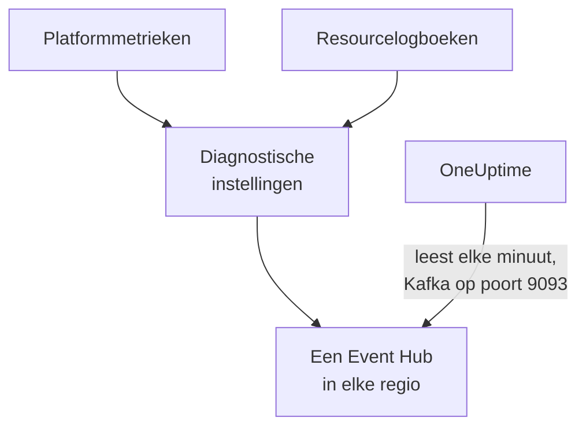

# Azure Monitor-metrieken en -logboeken streamen

Een gekoppeld Azure-abonnement kan zijn Azure Monitor-metrieken en resourcelogboeken naar OneUptime streamen. Diagnostische instellingen sturen ze naar Event Hubs in uw abonnement, en OneUptime leest de Event Hubs elke minuut: belangrijke metrieken komen enkele minuten nadat Azure Monitor ze heeft binnen, in plaats van pas bij de volgende leesactie van de koppeling, en resourcelogboeken komen binnen als OneUptime-logboeken, elk gearchiveerd onder de resource waar het over gaat. Eén opdracht in Azure Cloud Shell zet alles op, en er hoeft niets te draaien.

:::cards
- [Zo werkt het](#zo-werkt-het): Diagnostische instellingen sturen naar een Event Hub in elke regio, en OneUptime leest ze.
- [Streamen instellen](#streamen-instellen): Kies wat er gestreamd wordt, zet het lezen aan en voer één opdracht uit.
- [Wat er binnenkomt](#wat-er-binnenkomt): Metrieken bij de resources die ze meten, en logboeken bij de resources waar ze vandaan komen.
- [Wat de opdracht aanmaakt](#wat-de-opdracht-aanmaakt): Elke resource en elke machtiging die de opdracht in uw abonnement aanmaakt.
- [Streamen stoppen](#streamen-stoppen): Stop het lezen en verwijder daarna wat de opdracht heeft aangemaakt.
:::

## Zo werkt het



- **Een Event Hub in elke regio.** Een diagnostische instelling stuurt alleen naar een Event Hub in de eigen regio van haar resource, dus de opdracht maakt een Event Hubs-namespace in elke regio waar uw resources staan, allemaal in één resourcegroep, en richt de diagnostische instelling van elke resource op die van haar regio.
- **OneUptime leest ze.** Azure Monitor stuurt alleen naar een Event Hub, een opslagaccount of een Log Analytics-werkruimte, nooit naar een adres van u: een Event Hub die OneUptime leest, is de manier waarbij u niets hoeft te draaien. OneUptime meldt zich aan als de eigen app van de koppeling, die die Event Hubs mag lezen en verder niets.
- **De leesacties laten gestreamde metrieken aan de stream over.** Zolang de stream de belangrijke metrieken van een resourcetype in een regio levert, schrijven de leesacties van de koppeling ze niet meer, zodat geen datapunt dubbel telt. De leesacties blijven resources, hun status en hun wijzigingen vinden, en nemen de metrieken terug na 15 minuten zonder event.
- **Er gaat niets verloren zolang OneUptime niet kan lezen.** Events wachten in de Event Hubs tot OneUptime ze leest, zolang de Event Hubs ze bewaren, en OneUptime onthoudt tot waar het elke partitie heeft gelezen, zodat het verdergaat waar het was gebleven.

## Voordat u begint

- **Een gekoppeld Azure-abonnement.** Koppel het eerst onder **Cloud → Koppelen**: zie [Een cloudaccount koppelen](/docs/telemetry/cloud-accounts).
- **Een projecteigenaar of beheerder.** Alleen zij kunnen het lezen aanzetten en het streamen stoppen.
- **Azure Cloud Shell**, aangemeld als **Owner** van de abonnementen, of als **Contributor** die ook **User Access Administrator** is: de opdracht maakt een resourcegroep en een roltoewijzing aan, en wijzigt diagnostische instellingen.
- **Een weg naar Azure, bij een zelf gehoste OneUptime.** OneUptime leest elke namespace op `<namespace>.servicebus.windows.net` via poort 9093, en de namespaces nemen verbindingen vanaf internet aan.

## Streamen instellen

:::steps
### Het streamvenster openen

Ga naar **Cloud → Koppelen** en kies in de rij van het Azure-abonnement **Metrieken en logboeken streamen**.

### Kiezen wat er gestreamd wordt

**Metrieken** streamt elke belangrijke metriek van elke resource, per minuut: de metrieken waarmee OneUptime elke resource in grafieken toont en beoordeelt. **Metrieken en logboeken** voegt de eigen logboeken van elke resource toe, elke categorie die Azure ervoor bijhoudt, en **Logboeken** streamt alleen resourcelogboeken.

### Het lezen aanzetten

Kies **Lezen aanzetten**. OneUptime zoekt elke minuut naar de Event Hubs, en wacht erop tot de opdracht ze heeft aangemaakt.

### De opdracht uitvoeren in Azure Cloud Shell

Kopieer de opdracht, voer hem uit in Azure Cloud Shell en wacht tot hij klaar is. Hij noemt elke regio waarin hij een Event Hub heeft aangemaakt, hoeveel resources ernaar sturen en welke resources hij heeft overgeslagen, met de reden van Azure.

### Wachten op de eerste events

Het venster vraagt om de paar seconden wat er binnenkwam. Azure begint enkele minuten nadat de opdracht klaar is te sturen; het venster zegt dan wat er van waar kwam, en de rij van de koppeling zegt **Streamt**.
:::

**Meer velden** bevat de rest:

| Veld | Wat het doet |
| --- | --- |
| **Abonnementen** | De abonnementen om uit te streamen: eerst de abonnementen die de koppeling leest. Het eerste bevat de Event Hubs, en OneUptime leest ze daar. Maximaal 50 |
| **Op een andere manier instellen** | De namen die de opdracht gebruikt, om het met Terraform of de portal in te stellen |

Als de koppeling nog geen abonnement heeft gelezen, of meer dan 50, vraagt het venster in plaats daarvan vóór zijn stappen om **Abonnementen**.

Als het eerste abonnement niet het abonnement is waarin OneUptime de Event Hubs leest, zegt het venster dat: kies **Daar lezen** voordat u de opdracht uitvoert.

## Wat er binnenkomt

| Wat | Waar het terechtkomt |
| --- | --- |
| Belangrijke metrieken | Bij de cloudresources die ze meten, in dezelfde reeksen die de leesacties van de koppeling schrijven |
| Resourcelogboeken | In de logboekverkenner, onder de telemetrieservice van de koppeling, met het abonnement, de regio en de categorie als attributen |
| Logboeken van een resource die OneUptime kent | Ook bij die resource: haar pagina in Cloud krijgt een tabblad **Logboeken** |

De stream draagt de belangrijke metrieken die de koppeling per minuut leest. Een metriek die ze grover leest, zoals de gebruikte capaciteit van een opslagaccount, blijft bij de leesacties. Een logboekregel wordt onder zijn resource gearchiveerd via de ARM-ID van de resource, meegegeven als `cloud.resource_id`, en houdt zijn categorie, bewerking, resultaat en eigenschappen als attributen, zoals `azure.category`.

Virtuele machines, schaalsets, schijven, netwerkinterfaces, virtuele netwerken, privé-eindpunten, NAT-gateways, DNS-zones en App Service-plannen sturen geen eigen resourcelogboeken, dus hun pagina's hebben geen tabblad **Logboeken**. De logboeken van een opslagaccount zijn die van zijn services, en die van een container-app die van haar omgeving.

## Wat de opdracht aanmaakt

De resourcegroep heet `oneuptime-stream-` gevolgd door de eerste 8 tekens van de ID van de koppeling. Hij geeft OneUptime geen toegang tot uw resources: de app van de koppeling mag de Event Hubs lezen, en meer niet.

| Resource | Wat ze mag |
| --- | --- |
| Een resourcegroep, `oneuptime-stream-<suffix>`, in het eerste abonnement | Bevat de Event Hubs, getagd met de ID van de koppeling als `oneuptime-connection` |
| Een Event Hubs-namespace in elke regio, `oneuptime-<suffix>-<region>`, in de laag Standard met 1 doorvoereenheid | Neemt aan wat de diagnostische instellingen van haar regio sturen |
| Een Event Hub in elke namespace, `oneuptime`, met 2 partities | Bewaart de events tot OneUptime ze leest |
| De rol **Azure Event Hubs Data Receiver** voor de app van de koppeling, alleen op de resourcegroep | Laat de app de Event Hubs lezen, en verder niets |
| Een diagnostische instelling op elke resource, `OneUptime-<suffix>` | Stuurt de metrieken, de logboeken of beide van de resource naar de Event Hub van haar regio |

Een resource van een globale regio, zoals Front Door, stuurt naar de Event Hub van de eerste regio. Een resource waarvan Azure alleen metrieken of alleen logboeken bijhoudt, wordt ingesteld met wat ze heeft, en een die al 5 diagnostische instellingen heeft, het maximum dat Azure toestaat, wordt overgeslagen. Azure brengt de doorvoereenheid van elke namespace per uur in rekening, en de events die de diagnostische instellingen sturen.

## Streamen stoppen

:::steps
### Het lezen stoppen

Kies in de rij van het abonnement onder **Cloud → Koppelen** **Streamen stoppen**. OneUptime stopt direct met het lezen van de Event Hubs, en de koppeling leest al haar metrieken weer volgens schema. Wat is gelezen, blijft.

### Verwijderen wat de opdracht heeft aangemaakt

De Event Hubs en de diagnostische instellingen blijven in Azure, en Azure brengt ze in rekening, totdat ze worden verwijderd. Het venster toont de opdracht: die verwijdert de diagnostische instelling van elke resource en daarna de resourcegroep, in welk abonnement die ook staat.

```bash
oneuptime_stream_stop() {
  local SUB ID N=0
  for SUB in '11111111-aaaa-4aaa-8aaa-111111111111' '22222222-bbbb-4bbb-8bbb-222222222222'; do
    while IFS= read -r ID; do
      if [ -z "$ID" ]; then continue; fi
      az monitor diagnostic-settings delete --name OneUptime-6f1c3a2e --resource "$ID" --output none 2> /dev/null &
      N=$((N + 1))
      if [ $((N % 4)) -eq 0 ]; then wait; fi
    done < <(az resource list --subscription "$SUB" --query "[].id" --output tsv)
  done
  wait
  for SUB in '11111111-aaaa-4aaa-8aaa-111111111111' '22222222-bbbb-4bbb-8bbb-222222222222'; do
    if [ "$(az group exists --subscription "$SUB" --name oneuptime-stream-6f1c3a2e 2> /dev/null)" = true ]; then
      az group delete --subscription "$SUB" --name oneuptime-stream-6f1c3a2e --yes --no-wait && echo "Deleting oneuptime-stream-6f1c3a2e in $SUB."
    fi
  done
}
oneuptime_stream_stop
```
:::

Om te wijzigen wat er gestreamd wordt, opent u opnieuw **Metrieken en logboeken streamen**, kiest u wat er gestreamd wordt en voert u de nieuwe opdracht uit: die werkt bij wat de eerste keer is aangemaakt, en maakt niets dubbel aan.

## Op een andere manier instellen

Maak met Terraform of de portal aan wat de opdracht aanmaakt, met deze namen:

| Instelling | Waarde |
| --- | --- |
| Resourcegroep | `oneuptime-stream-<suffix>`, in het abonnement waarin OneUptime de Event Hubs leest |
| Event Hubs-namespace | `oneuptime-<suffix>-<region>`, één in elke regio van een resource om te streamen |
| Event Hub | `oneuptime`, in elke namespace |
| Diagnostische instelling | `OneUptime-<suffix>` op elke resource, naar de Event Hub van haar regio, met de regel `RootManageSharedAccessKey` van de namespace |
| Rol | **Azure Event Hubs Data Receiver** voor de app van de koppeling, op de resourcegroep |

Zet daarna het lezen aan, met dat abonnement als eerste onder **Abonnementen**.

## Problemen oplossen

:::details Het venster blijft wachten op de eerste events
Controleer of de opdracht klaar is en heeft gezegd dat de Event Hub van een regio klaarstaat: `az eventhubs namespace list --resource-group oneuptime-stream-6f1c3a2e` toont de namespaces. Een diagnostische instelling stuurt alleen wat Azure Monitor heeft, dus een resource die niets doet, stuurt weinig. Een nieuwe rol kan een paar minuten nodig hebben om van kracht te worden: tot dan zien de leesacties de events niet.
:::

:::details De koppeling zegt Stream mislukt
Het venster en de tooltip van de rij zeggen waarom. Als de app de Event Hubs niet mag lezen, voert u de opdracht opnieuw uit: die geeft de app haar rol opnieuw. Als OneUptime ze niet kon bereiken, controleert u of de namespaces verbindingen vanaf internet aannemen, en of een zelf gehoste OneUptime poort 9093 mag bereiken.
:::

:::details De opdracht heeft resources overgeslagen
Hij somt ze op, elk met de reden van Azure. Een resource van een type zonder diagnostische instellingen stuurt niets, en bij een resource die al 5 diagnostische instellingen heeft, moet er eerst een worden verwijderd. Voer de opdracht daarna opnieuw uit.
:::

## Volgende stappen

:::cards
- [Een cloudaccount koppelen](/docs/telemetry/cloud-accounts): Wat een koppeling leest, en hoe vaak.
- [Google Cloud-logboeken streamen](/docs/telemetry/cloud-streaming-google-cloud): De logboeken van een Google Cloud-project, gepusht via Pub/Sub.
- [CloudWatch-metrieken en -logboeken streamen](/docs/telemetry/cloud-streaming): Die van een AWS-account, geleverd door Amazon Data Firehose.
- [Logboekverkenner](/docs/telemetry/logs-explorer): Doorzoek en filter wat de streams hebben geleverd.
:::
