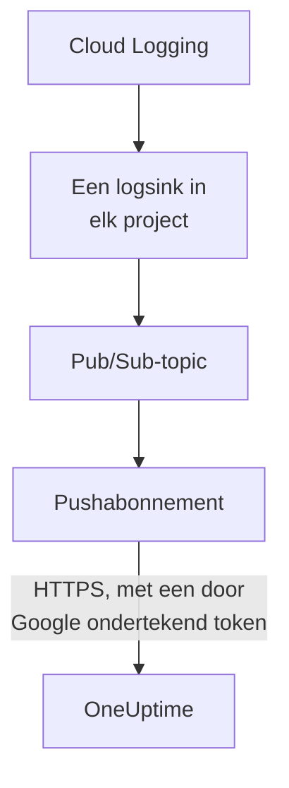

# Google Cloud-logboeken streamen

Een gekoppeld Google Cloud-project kan zijn logboeken naar OneUptime streamen zodra ze worden geschreven. Cloud Logging stuurt ze via een logsink naar een Pub/Sub-topic, en het pushabonnement van het topic levert elke regel binnen een minuut aan OneUptime, als een OneUptime-logboekregel gearchiveerd onder de resource waar hij over gaat. Eén opdracht in Google Cloud Shell zet alles op, en er hoeft niets te draaien. Cloud Monitoring heeft geen export die metrieken pusht, dus de koppeling blijft metrieken volgens schema lezen.

:::cards
- [Zo werkt het](#zo-werkt-het): Een logsink in elk project, een topic en zijn pushabonnement.
- [Streamen instellen](#streamen-instellen): Kies welke logboeken, maak een streamsleutel en voer één opdracht uit.
- [Wat er binnenkomt](#wat-er-binnenkomt): Logboeken bij de resources waar ze vandaan komen.
- [Wat de opdracht aanmaakt](#wat-de-opdracht-aanmaakt): Elke resource en elke machtiging die de opdracht in uw projecten aanmaakt.
- [Streamen stoppen](#streamen-stoppen): Zet de sleutels uit en verwijder daarna wat de opdracht heeft aangemaakt.
:::

## Zo werkt het



- **Een logsink in elk project.** De sink van elk project stuurt de regels die aan zijn filter voldoen naar één Pub/Sub-topic, in het project van het eigen serviceaccount van de koppeling.
- **Twee controles bij elke push.** Pub/Sub ondertekent een OpenID Connect-token voor een serviceaccount dat alleen voor de pushes is gemaakt, en de audience van het token is de streamsleutel van de koppeling. OneUptime neemt een push alleen aan als Google het token voor dat serviceaccount heeft ondertekend en de sleutel een van de koppeling is. De sleutel noemt de koppeling, en daarmee het project: niets in een push bepaalt waar hij wordt geschreven. OneUptime bewaart alleen de SHA-256 van de sleutel.
- **Er gaat niets verloren zolang OneUptime het niet kan aannemen.** Pub/Sub pusht een geweigerde regel opnieuw, met tussen de pogingen een wachttijd van 10 seconden tot 10 minuten, en bewaart hem een dag.

## Voordat u begint

- **Een gekoppeld Google Cloud-project.** Koppel het eerst onder **Cloud → Koppelen**: zie [Een cloudaccount koppelen](/docs/telemetry/cloud-accounts).
- **Een projecteigenaar of beheerder.** Alleen zij kunnen een streamsleutel maken en het streamen stoppen.
- **Google Cloud Shell**, aangemeld als **Owner** van de projecten, of als iemand die er serviceaccounts, Pub/Sub-topics en logsinks mag maken.
- **Een HTTPS-adres, bij een zelf gehoste OneUptime.** Pub/Sub pusht alleen naar `https://`-adressen, met een certificaat dat Google vertrouwt, en het adres moet vanuit Google Cloud bereikbaar zijn.

## Streamen instellen

:::steps
### Het streamvenster openen

Ga naar **Cloud → Koppelen** en kies in de rij van het Google Cloud-project **Logboeken streamen**.

### Kiezen welke logboeken

**Waarschuwingen en fouten** streamt elke regel met ernst `WARNING` of hoger: wat er misging, niet elk verzoek. **Elk logboek** streamt elke regel behalve de Data Access-auditlogboeken, die elke leesactie vastleggen en al het andere dat een project schrijft kunnen overtreffen. **Een eigen filter** streamt de regels die aan een Cloud Logging-query voldoen, geschreven in het veld **Filter**.

### Een streamsleutel maken

Kies **Streamsleutel maken**. De sleutel wordt alleen deze keer getoond, in de opdracht: OneUptime bewaart alleen de SHA-256 ervan.

### De opdracht uitvoeren in Google Cloud Shell

Kopieer de opdracht, voer hem uit in Google Cloud Shell en wacht tot hij klaar is. Hij noemt elk project waarin hij een sink heeft ingesteld, en stopt bij de eerste stap die Google weigert, met de reden van Google.

### Wachten op de eerste push

Het venster vraagt om de paar seconden wat er binnenkwam. Pub/Sub pusht een regel binnen een minuut nadat een project er een schrijft die het filter aanneemt; het venster zegt dan wat er van waar kwam, en de rij van de koppeling zegt **Streamt**.
:::

**Meer velden** bevat de rest:

| Veld | Wat het doet |
| --- | --- |
| **Projecten** | De projecten waarvan logboeken worden gestreamd: eerst de projecten die de koppeling leest. Het topic wordt gemaakt in het project van het serviceaccount van de koppeling. Maximaal 100 |
| **Op een andere manier instellen** | Het push-endpoint, het push-serviceaccount en de sleutel, om het met Terraform of de console in te stellen |

## Wat er binnenkomt

| Wat | Waar het terechtkomt |
| --- | --- |
| Logboeken | In de logboekverkenner, onder de telemetrieservice van de koppeling, met het project, de regio en de logboeknaam als attributen |
| Logboeken van een resource die OneUptime kent | Ook bij die resource: haar pagina in Cloud krijgt een tabblad **Logboeken** |

Elke logboekregel houdt de tijd van zijn regel tot op de nanoseconde, zijn ernst, zijn trace en span, en zijn HTTP-verzoek onder de namen van de semantische conventies van OpenTelemetry. Hij wordt onder een resource gearchiveerd als zijn bewaakte resource een soort is waarvan OneUptime de metrieken leest, zoals een VM (`gce_instance`), een Cloud Run-service (`cloud_run_revision`) of een Cloud SQL-instantie (`cloudsql_database`), en draagt de ID van de resource als `cloud.resource_id`. De verzoeklogboeken van een externe load balancer, geschreven onder `http_load_balancer`, worden gearchiveerd onder zijn URL-map, de `https_lb_rule` waar zijn metrieken terechtkomen.

De logboeken van een instantiegroep zijn die van haar VM's, dus haar pagina heeft geen tabblad **Logboeken**. Een regel van een andere soort wordt toch gestreamd, onder zijn project.

## Wat de opdracht aanmaakt

Haar resources zijn genoemd naar de eerste 8 tekens van de ID van de koppeling. Ze geeft OneUptime geen toegang tot uw projecten: regels gaan alleen naar buiten.

| Resource | Wat ze mag |
| --- | --- |
| Een serviceaccount, `oneuptime-push-<suffix>`, in het project van het serviceaccount van de koppeling | Heeft geen rol: Pub/Sub ondertekent de tokens van zijn pushes ervoor |
| De rol **Service Account OpenID Connect Identity Token Creator** voor de Pub/Sub-serviceagent, alleen op dat serviceaccount | Laat Pub/Sub die tokens maken, en verder niets |
| Een Pub/Sub-topic, `oneuptime-stream-<suffix>` | Bevat de regels die de sinks doorsturen |
| Zijn pushabonnement, `oneuptime-stream-<suffix>-push` | Pusht elke regel naar OneUptime, met een bevestigingstermijn van 60 seconden, en bewaart een dag wat het niet kon pushen |
| Een logsink in elk project, `oneuptime-stream-<suffix>` | Stuurt de regels die aan zijn filter voldoen naar het topic |
| De rol **Pub/Sub Publisher** voor de schrijver van elke sink, alleen op het topic | Laat de sink naar het topic publiceren, en verder niets |

De opdracht zet de API's van Pub/Sub en Cloud Logging aan in het project van het topic als ze uit staan. Google brengt Pub/Sub in rekening voor de geleverde logboeken: stream alleen de logboeken die u nodig hebt.

## Streamen stoppen

:::steps
### De sleutels uitzetten

Kies in de rij van het project onder **Cloud → Koppelen** **Streamen stoppen**. Elke streamsleutel van de koppeling werkt direct niet meer, en OneUptime weigert wat Pub/Sub pusht. Wat is geleverd, blijft.

### Verwijderen wat de opdracht heeft aangemaakt

De sinks, het topic en zijn pushabonnement blijven in Google Cloud, en Pub/Sub blijft pushen, totdat ze worden verwijderd. Het venster toont de opdracht, voor de projecten die de koppeling leest:

```bash
for SOURCE in 'acme-prod' 'acme-data'; do
  gcloud logging sinks delete oneuptime-stream-6f1c3a2e --project "$SOURCE" --quiet
done
gcloud pubsub subscriptions delete oneuptime-stream-6f1c3a2e-push --project 'acme-prod' --quiet
gcloud pubsub topics delete oneuptime-stream-6f1c3a2e --project 'acme-prod' --quiet
gcloud iam service-accounts delete 'oneuptime-push-6f1c3a2e@acme-prod.iam.gserviceaccount.com' --project 'acme-prod' --quiet
```
:::

Om te wijzigen welke logboeken worden gestreamd, opent u opnieuw **Logboeken streamen**, kiest u **Nieuwe sleutel maken** en voert u de nieuwe opdracht uit. De sleutel die hij vervangt, blijft 24 uur werken, zodat er geen push wordt geweigerd terwijl het abonnement wordt bijgewerkt. Maximaal 3 vervangen sleutels werken tegelijk.

## Op een andere manier instellen

Geef een Pub/Sub-topic een pushabonnement met deze waarden, en laat de Pub/Sub-serviceagent tokens maken voor het push-serviceaccount:

| Instelling | Waarde |
| --- | --- |
| Push-endpoint | `https://oneuptime.com/telemetry/gcp-pubsub/v1/logs` |
| Verificatie | Een OpenID Connect-token voor `oneuptime-push-<suffix>@<project>.iam.gserviceaccount.com` |
| Audience | De streamsleutel |
| Payload | Verpakt, zoals Pub/Sub hem stuurt tenzij anders aangegeven |
| Bevestigingstermijn | 60 seconden |
| Berichtbewaring | 1 dag |

Stuur daarna de logboeken van elk project met een logsink naar het topic, en geef de schrijver van elke sink **Pub/Sub Publisher** op het topic. Vervang bij een zelf gehoste OneUptime `https://oneuptime.com` door het HTTPS-adres van uw OneUptime.

OneUptime beantwoordt elke push zoals Pub/Sub verwacht:

| Antwoord | Wanneer | Wat Pub/Sub doet |
| --- | --- | --- |
| `204` | De regel is aangenomen, of was al eerder aangenomen, of het bericht is geen logboekregel | Gaat verder |
| `400` | Het is geen Pub/Sub-push die OneUptime kan lezen | Pusht hem opnieuw, met telkens een langere pauze, een dag lang |
| `401` | Het token is niet door Google ondertekend voor het push-serviceaccount, of zijn audience is geen sleutel van de koppeling | Pusht hem opnieuw, met telkens een langere pauze, een dag lang |
| `402` | Het project kan niet voor telemetrie worden gefactureerd | Pusht hem opnieuw, met telkens een langere pauze, een dag lang |
| `403` | De koppeling staat uit, of het project kan geen telemetrie aannemen | Pusht hem opnieuw, met telkens een langere pauze, een dag lang |
| `413` | Het verzoek is groter dan 1 MiB, of de regel groter dan 512 KiB | Pusht hem opnieuw, met telkens een langere pauze, een dag lang |
| `429` | Het abonnement van de koppeling pushte meer dan 12.000 regels in een minuut | Pusht hem opnieuw, met telkens een langere pauze, een dag lang |
| `503` | OneUptime kon het token op dat moment niet controleren of de regel niet in de wachtrij zetten | Pusht hem opnieuw, met telkens een langere pauze, een dag lang |

## Problemen oplossen

:::details Het venster blijft wachten op de eerste push
Controleer of de opdracht zonder te stoppen klaar is, en of een project een regel heeft geschreven die het filter aanneemt: met **Waarschuwingen en fouten** stuurt een rustig project niets. `gcloud pubsub subscriptions describe oneuptime-stream-6f1c3a2e-push --project acme-prod` toont het endpoint van het abonnement. Controleer bij een zelf gehoste OneUptime of Google Cloud het adres via HTTPS bereikt.
:::

:::details De koppeling zegt Stream geweigerd
Het venster en de tooltip van de rij zeggen waarom. Een verkeerde sleutel betekent dat het abonnement pusht met een sleutel die niet meer werkt: maak een nieuwe sleutel en voer de opdracht opnieuw uit. Een push die niet voor het push-serviceaccount is ondertekend, betekent dat het abonnement als een ander account ondertekent, of dat Pub/Sub er niet voor mag ondertekenen: voer de opdracht opnieuw uit.
:::

:::details De logboeken van een resource verschijnen niet op haar pagina
De pagina toont de logboeken die Cloud Logging archiveert onder de bewaakte resource van de resource, met de labels die haar metrieken hebben. Logboeken die een workload onder een andere resource schrijft, zoals die van een container, worden alleen onder hun project gestreamd.
:::

## Volgende stappen

:::cards
- [Een cloudaccount koppelen](/docs/telemetry/cloud-accounts): Wat een koppeling leest, en hoe vaak.
- [Azure Monitor-metrieken en -logboeken streamen](/docs/telemetry/cloud-streaming-azure): Die van een Azure-abonnement, gelezen uit Event Hubs.
- [CloudWatch-metrieken en -logboeken streamen](/docs/telemetry/cloud-streaming): Die van een AWS-account, geleverd door Amazon Data Firehose.
- [Logboekverkenner](/docs/telemetry/logs-explorer): Doorzoek en filter wat de streams hebben geleverd.
:::
