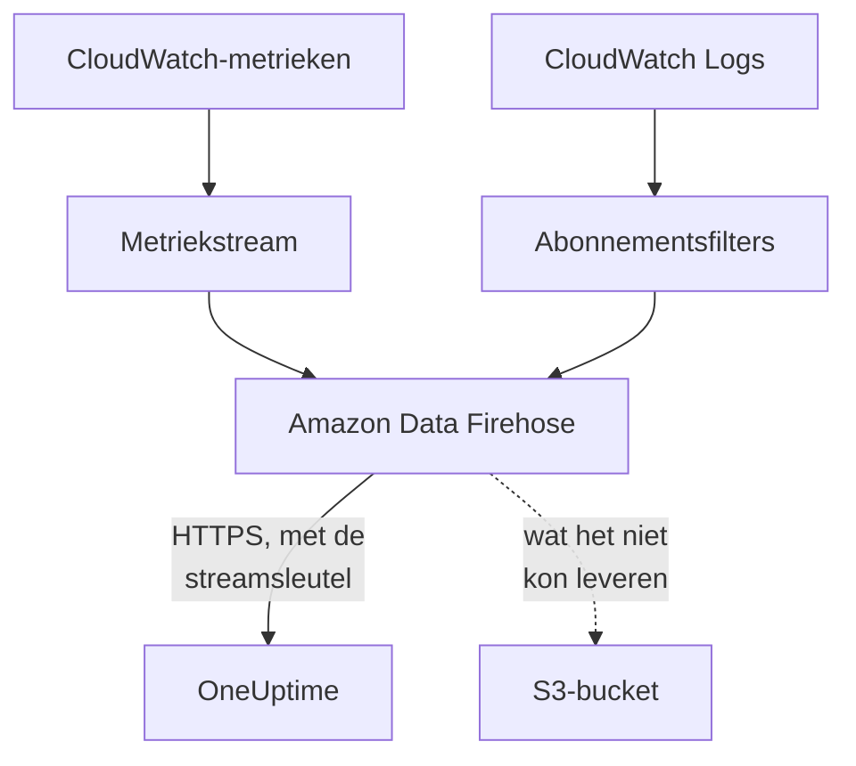

# CloudWatch-metrieken en -logboeken streamen

Een gekoppeld AWS-account kan zijn CloudWatch-metrieken en -logboeken via Amazon Data Firehose naar OneUptime streamen. Metrieken komen dan enkele minuten nadat CloudWatch ze heeft binnen, in plaats van bij de volgende leesactie van de koppeling, en CloudWatch Logs komt binnen als OneUptime-logboeken, elk opgeslagen onder de resource waar het over gaat. Eén opdracht in AWS CloudShell zet alles op, en er hoeft niets te draaien.

:::cards
- [Zo werkt het](#zo-werkt-het): Een metriekstream en logabonnementen in elke regio, geleverd door Firehose.
- [Streamen instellen](#streamen-instellen): Kies wat er gestreamd wordt, maak een streamsleutel en voer één opdracht uit.
- [Wat er binnenkomt](#wat-er-binnenkomt): Metrieken bij de resources die ze meten, en logboeken bij de resources waar ze vandaan komen.
- [Wat de stack aanmaakt](#wat-de-stack-aanmaakt): Elke resource en elke machtiging die de opdracht in uw account aanmaakt.
- [Streamen stoppen](#streamen-stoppen): Zet de sleutels uit en verwijder daarna de stacks.
:::

## Zo werkt het



- **Eén stack in elke regio.** De opdracht implementeert een CloudFormation-stack in elke regio waaruit u streamt. De metriekstream en de abonnementsfilters voor logboeken geven alles door aan twee Firehose-streams, en Firehose levert het via HTTPS aan OneUptime.
- **De streamsleutel zegt van wie het is.** Firehose stuurt de streamsleutel van de koppeling mee met elke levering. De sleutel noemt de koppeling, en daarmee het project: niets in een levering bepaalt waar die wordt weggeschreven. OneUptime bewaart alleen de SHA-256 van de sleutel.
- **De leesacties laten gestreamde metrieken aan de stream over.** Zolang een stream een namespace van een regio levert, schrijven de leesacties van de koppeling de metrieken van die namespace niet meer weg, zodat geen datapunt dubbel wordt geteld. De leesacties blijven resources, hun status en hun wijzigingen vinden, en nemen een namespace weer over na 15 minuten zonder levering.
- **Er gaat niets verloren zolang OneUptime het niet kan aannemen.** Firehose verstuurt een geweigerde batch tot een uur lang opnieuw en bewaart die daarna 30 dagen in de S3-bucket van de stack.

## Voordat u begint

- **Een gekoppeld AWS-account.** Koppel het eerst onder **Cloud → Koppelen**: zie [Een cloudaccount koppelen](/docs/telemetry/cloud-accounts).
- **Een projecteigenaar of beheerder.** Alleen zij kunnen een streamsleutel maken en het streamen stoppen.
- **AWS CloudShell in dat account**, aangemeld als iemand die CloudFormation-stacks en IAM-rollen mag aanmaken.
- **Een HTTPS-adres, bij een zelf gehoste OneUptime.** Firehose levert alleen aan `https://`-adressen op poort 443, met een certificaat dat AWS vertrouwt, en het adres moet vanuit AWS bereikbaar zijn.

## Streamen instellen

:::steps
### Het streamvenster openen

Ga naar **Cloud → Koppelen** en kies in de rij van het AWS-account **Metrieken en logboeken streamen**.

### Kiezen wat er gestreamd wordt

**Metrieken** streamt elke kernmetriek van elke resource, één keer per minuut: de metrieken waarmee OneUptime elke resource in grafieken toont en beoordeelt. **Metrieken en logboeken** voegt CloudWatch Logs toe, en **Logboeken** streamt alleen CloudWatch Logs.

Geef voor logboeken de **Loggroepen** op, één per regel, op naam in de **Regio** ernaast of op ARN in hun eigen regio, of kies **Elke loggroep van het account, ook nieuwe**. Eén opdracht abonneert hoogstens 50 loggroepen op naam, in hoogstens 10 regio's.

### Een streamsleutel maken

Kies **Streamsleutel maken**. De sleutel wordt alleen deze ene keer getoond, in de opdracht: OneUptime bewaart alleen de SHA-256 ervan.

### De opdracht uitvoeren in AWS CloudShell

Kopieer de opdracht, voer hem uit in AWS CloudShell en wacht tot hij klaar is. Hij schrijft het sjabloon naar `oneuptime-stream.json` en implementeert het in elke regio, met de sleutel als parameter die nooit meer wordt getoond.

### Wachten op de eerste levering

Het venster vraagt om de paar seconden wat er binnen is gekomen. Firehose levert binnen enkele minuten nadat de opdracht klaar is; het venster zegt dan wat er van waar kwam, en de rij van de koppeling zegt **Streamt**.
:::

**Meer velden** bevat de rest:

| Veld | Wat het doet |
| --- | --- |
| **Elke metriek, niet alleen de kernmetrieken** | Streamt elke metriek die CloudWatch voor het account heeft, ook uw eigen. AWS rekent elke metriekupdate af die een stream verstuurt, dus het kan vele malen meer kosten |
| **Regio's** | Waarvandaan te streamen: eerst de regio's waarin de koppeling resources vond. Leeg gelaten streamt de opdracht vanuit de eigen regio van AWS CloudShell. Hoogstens 30 |
| **Op een andere manier instellen** | De endpoints voor metrieken en logboeken en de sleutel, om de streams met Terraform of de console in te stellen |

**Sjabloon downloaden** slaat het sjabloon op dat de opdracht implementeert, om het op uw eigen manier te implementeren.

## Wat er binnenkomt

| Wat | Waar het terechtkomt |
| --- | --- |
| Metrieken | Bij de cloudresources die ze meten, met de namen en attributen die de leesacties van de koppeling ze geven |
| Logboeken | In de logboekverkenner, onder de telemetriedienst van de koppeling, met het account, de regio en de loggroep als attributen |
| Logboeken van een loggroep die AWS naar een resource noemt | Ook bij die resource: de pagina ervan in Cloud krijgt een tabblad **Logboeken** |

Een loggroep wordt onder een resource opgeslagen als AWS hem naar een resource noemde:

| Loggroep | Resourcetype |
| --- | --- |
| `/aws/lambda/<function>` | `AWS::Lambda::Function` |
| `/aws/rds/instance/<instance>/<log>` | `AWS::RDS::DBInstance` |
| `/aws/rds/cluster/<cluster>/<log>` | `AWS::RDS::DBCluster` |
| `/aws/docdb/<cluster>/<log>` | `AWS::DocDB::DBCluster` |
| `/aws/neptune/<cluster>/<log>` | `AWS::Neptune::DBCluster` |
| `/aws/redshift/cluster/<cluster>/<log>` | `AWS::Redshift::Cluster` |
| `/aws/OpenSearchService/domains/<domain>/<log>` | `AWS::OpenSearchService::Domain` |
| `/aws/aes/domains/<domain>/<log>` | `AWS::OpenSearchService::Domain` |
| `/aws/apprunner/<service>/<service-id>/<log>` | `AWS::AppRunner::Service` |
| `/aws/elasticbeanstalk/<environment>/<log>` | `AWS::ElasticBeanstalk::Environment` |
| `/aws/ecs/containerinsights/<cluster>/performance` | `AWS::ECS::Cluster` |

Elk logboek draagt de ID van de resource als `cloud.resource_id`, en de logboeken van een Lambda-functie dragen ook `faas.name`, zodat ze ook bij de functie onder Serverless verschijnen. Een loggroep met een andere naam wordt toch gestreamd, onder zijn account en regio. De ernst van een logboek is die welke het bericht noemt, zoals Lambda die schrijft.

## Wat de stack aanmaakt

De stack heet `OneUptimeStream-` gevolgd door de eerste 8 tekens van de ID van de koppeling. Hij geeft OneUptime geen toegang tot uw account: gegevens stromen alleen naar buiten.

| Resource | Wat het mag |
| --- | --- |
| Een CloudWatch-metriekstream, in de indeling OpenTelemetry 1.0 | Alleen records in de Firehose-stream voor metrieken zetten |
| Abonnementsfilters voor logboeken, of één accountbreed abonnementsbeleid voor elke loggroep | Alleen records in de Firehose-stream voor logboeken zetten |
| Twee Firehose-streams, `OneUptime-<suffix>-metrics` en `OneUptime-<suffix>-logs` | Aan OneUptime leveren met GZIP, een buffer van 1 MiB of 60 seconden en een uur aan nieuwe pogingen, en wat ze niet konden leveren in de bucket schrijven |
| Een S3-bucket voor wat niet geleverd kon worden | Openbare toegang geblokkeerd, versleuteld, na 30 dagen geleegd en bewaard wanneer de stack wordt verwijderd |
| Een loggroep, `/aws/kinesisfirehose/OneUptime-<suffix>` | Bevat de eigen leveringsfouten van Firehose en wordt nooit gestreamd |
| Drie IAM-rollen | Elke rol vertrouwt één AWS-dienst van dit account en staat alleen toe wat de rijen hierboven zeggen |

AWS rekent de metriekstream af per metriekupdate die hij verstuurt, en Firehose voor wat het levert. Stream alleen de metrieken en loggroepen die u nodig hebt.

## Streamen stoppen

:::steps
### De sleutels uitzetten

Kies in de rij van het account onder **Cloud → Koppelen** **Streamen stoppen**. Elke streamsleutel van de koppeling werkt meteen niet meer, OneUptime weigert wat de streams leveren, en de koppeling leest weer al haar metrieken volgens haar schema. Wat de streams hebben geleverd, blijft bewaard.

### De stacks verwijderen

De streams blijven in AWS, en AWS rekent ze af, totdat hun stacks zijn verwijderd. Het venster toont de opdracht, voor de regio's waaruit de streams leverden en die waarin de koppeling resources vond:

```bash
for REGION in us-east-1 eu-west-1; do
  aws cloudformation delete-stack --region "$REGION" --stack-name OneUptimeStream-6f1c3a2e
done
```
:::

Om te wijzigen wat een stack streamt, opent u opnieuw **Metrieken en logboeken streamen**, kiest u **Nieuwe sleutel maken** en voert u de nieuwe opdracht uit. De sleutel die hij vervangt, blijft 24 uur werken, zodat geen levering wordt geweigerd terwijl de stacks worden bijgewerkt. Hoogstens 3 vervangen sleutels werken tegelijk.

## Op een andere manier instellen

Geef elke Firehose-stream een HTTP-endpointbestemming met deze waarden, en de metriekstream de uitvoerindeling OpenTelemetry 1.0:

| Instelling | Waarde |
| --- | --- |
| Metriek-endpoint | `https://oneuptime.com/telemetry/aws-firehose/v1/metrics` |
| Logboek-endpoint | `https://oneuptime.com/telemetry/aws-firehose/v1/logs` |
| Toegangssleutel | De streamsleutel, verstuurd als `X-Amz-Firehose-Access-Key` |
| Inhoudscodering | `GZIP` |
| Buffer | 1 MiB of 60 seconden |
| Duur van nieuwe pogingen | 3600 seconden, met een S3-bucket voor wat niet geleverd kon worden |

Vervang bij een zelf gehoste OneUptime `https://oneuptime.com` door het HTTPS-adres van uw OneUptime. Het metriek-endpoint neemt ook een metriekstream in de JSON-indeling aan.

OneUptime beantwoordt elke levering zoals Firehose verwacht:

| Antwoord | Wanneer | Wat Firehose doet |
| --- | --- | --- |
| `200` | De levering is aangenomen, of was al eerder aangenomen | Gaat verder |
| `400` | Het is geen Firehose-levering die OneUptime kan lezen, zoals een met meer dan 10.000 records | Verstuurt hem tot een uur lang opnieuw |
| `401` | De sleutel is niet een van de sleutels van de koppeling | Verstuurt hem tot een uur lang opnieuw |
| `402` | Het project kan niet voor telemetrie worden gefactureerd | Verstuurt hem tot een uur lang opnieuw |
| `403` | De koppeling staat uit, of het project kan geen telemetrie aannemen | Verstuurt hem tot een uur lang opnieuw |
| `413` | Het verzoek is groter dan 4 MiB, of wordt uitgepakt groter dan 32 MiB | Bewaart hem in de bucket |
| `429` | De streams van de koppeling verstuurden meer dan 600 leveringen in een minuut | Verstuurt hem later opnieuw |

## Problemen oplossen

:::details Het venster blijft wachten op de eerste levering
Controleer of de opdracht in elke regio zonder fouten klaar is: `aws cloudformation describe-stacks --stack-name OneUptimeStream-6f1c3a2e` toont de status van de stack. Een metriekstream levert alleen metrieken die CloudWatch heeft, dus een regio zonder resources verstuurt niets. Controleer bij een zelf gehoste OneUptime of AWS het adres via HTTPS op poort 443 bereikt.
:::

:::details De koppeling zegt Stream geweigerd
Het venster en de tooltip van de rij zeggen waarom. Een verkeerde sleutel betekent dat de stacks draaien met een sleutel die niet meer werkt: maak een nieuwe sleutel en voer de opdracht opnieuw uit. Firehose blijft versturen wat het vasthoudt, en dat wordt aangenomen zodra de sleutel klopt.
:::

:::details De logboeken van een Lambda-functie verschijnen niet op haar pagina
De pagina toont de logboeken van de loggroep die naar de functie is genoemd, `/aws/lambda/<function>`. Een functie die naar een loggroep met een andere naam schrijft, streamt haar logboeken alleen onder haar account en regio.
:::

## Volgende stappen

:::cards
- [Een cloudaccount koppelen](/docs/telemetry/cloud-accounts): Wat een koppeling leest, en hoe vaak.
- [Cloud-resources (IaaS en PaaS)](/docs/telemetry/cloud-resources): Elk resourcetype dat OneUptime herkent.
- [Logboekverkenner](/docs/telemetry/logs-explorer): Doorzoek en filter wat de streams hebben geleverd.
:::
