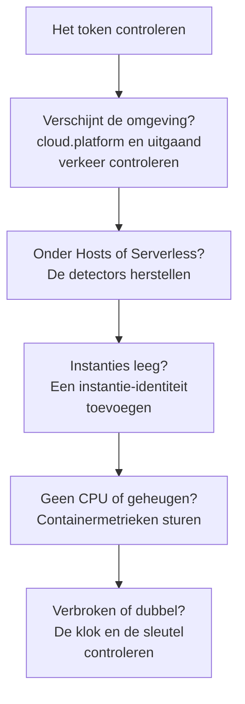

# Cloud-probleemoplossing

Zoek uit waarom een cloud-omgeving ontbreekt, op de verkeerde plek is gearchiveerd, leeg is of dubbel voorkomt. De secties staan in de volgorde waarin deze dingen misgaan, en elke sectie sluit één laag uit, dus werk van boven naar beneden. De storingen die bij één platform horen, staan aan het eind van de pagina van dat platform: [AWS ECS / Fargate](/docs/telemetry/cloud-aws-ecs), [Google Cloud Run](/docs/telemetry/cloud-gcp-cloud-run), [Azure Container Apps](/docs/telemetry/cloud-azure-container-apps) en [Andere cloudplatforms](/docs/telemetry/cloud-other-platforms).



## Controleer eerst het token

Het is de goedkoopste controle, en niets hieronder werkt zonder:

```bash
curl -i https://oneuptime.com/otlp/v1/validate \
  -H "x-oneuptime-token: YOUR_TELEMETRY_INGESTION_TOKEN"
```

| Antwoord | Wat het betekent |
| ------------------------- | -------------------------------------------------------------------------------------------------------------------------- |
| `200`, `"valid": true` | Het token is geaccepteerd. Het `keyType` moet `Server` zijn: een sleutel van het type `Browser` wordt geweigerd vanuit een collector of een backendservice. |
| `401`, `"valid": false` | Het token ontbreekt, is onbekend, ingetrokken, uitgeschakeld of verlopen, en de `message` van het antwoord zegt welke van deze. Maak een nieuwe sleutel aan onder **Projectinstellingen → Telemetrie & APM → Ingestiesleutels** en rol die opnieuw uit. |

Als je OneUptime zelf host, gebruik dan `https://YOUR-ONEUPTIME-HOST/otlp/v1/validate`. Voer de controle als het kan uit binnen de taak, instantie of replica (ECS Exec, `az containerapp exec`): dat bewijst dat de workload zelf OneUptime kan bereiken, niet alleen je laptop.

## De omgeving verschijnt niet

Niets onder **Cloud → All Environments** een minuut na de eerste aanvraag. Controleer deze drie punten, in deze volgorde.

**`cloud.platform` ontbreekt, of is geen beheerde waarde.** OneUptime archiveert telemetrie alleen onder Cloud-omgevingen als de resource een van deze waarden draagt: `aws_ecs`, `aws_elastic_beanstalk`, `aws_app_runner`, `gcp_cloud_run`, `gcp_app_engine`, `azure_container_apps`, `azure_container_instances` of `azure_app_service`. De gebruikelijke oorzaken:

- De resource-detector staat uit in de SDK (`OTEL_NODE_RESOURCE_DETECTORS`, `OTEL_EXPERIMENTAL_RESOURCE_DETECTORS`, `-Dotel.resource.providers.<cloud>.enabled=true`).
- De pipeline van de collector slaat de processor `resourcedetection` over.
- Op een platform zonder detector bevat `OTEL_RESOURCE_ATTRIBUTES` een typefout.

De Azure-detectors voor Node.js en .NET schrijven `azure.container_apps`, `azure.app_service` en `azure.functions`; OneUptime herschrijft ze naar de waarden met een underscore, dus ze tellen mee. Om te zien wat je telemetrie draagt, open je de service onder **Services**, open je een van zijn traces vanaf het tabblad **Traces**, en lees je de resource-attributen. Staat `cloud.platform` er niet bij, dan is dat het hele probleem.

**Het token klopt niet.** De tokencontrole antwoordde `401`. De collector logt het als `Permanent error: ... 401`. Een SDK logt het één keer en stopt met opnieuw proberen, wat correct OTLP-gedrag is en makkelijk over het hoofd wordt gezien.

**Uitgaand verkeer is geblokkeerd.** De collector logt `connection refused`, `context deadline exceeded`, `i/o timeout` of een DNS-fout:

- **ECS en Fargate:** een privé-subnet heeft een NAT-gateway of `assignPublicIp=ENABLED` nodig, en de security group moet uitgaand verkeer op TCP 443 toestaan.
- **Cloud Run:** **VPC egress: All traffic** heeft Cloud NAT nodig.
- **Container Apps:** een door de gebruiker gedefinieerde route naar een firewall moet de OneUptime-host toestaan.
- **Overal:** een zelf gehoste OneUptime achter een privé-DNS-naam moet oplosbaar zijn vanuit het netwerk van de workload.

## Hij verschijnt in plaats daarvan onder Hosts

De resource draagt het platform van een virtuele machine (`aws_ec2`, `gcp_compute_engine` of `azure_vm`), dus OneUptime archiveert hem onder **Hosts**: juist voor een virtuele machine, fout voor beheerde compute. De detector van een virtuele machine won van de beheerde: `detectors: [ec2, elastic_beanstalk]` in een collector, waar de eerste detector die `cloud.platform` instelt wint, of een SDK waarvan de volgorde de EC2-detector voortrekt. Zet `elastic_beanstalk` eerst, of stel `cloud.platform` zelf in `OTEL_RESOURCE_ATTRIBUTES` in en houd alleen de detector `env`.

## Hij verschijnt alleen onder Serverless functies

De resource draagt `faas.name` maar geen beheerde `cloud.platform`. Cloud Run en App Engine stellen beide in als de GCP-detector draait. Stel je `faas.name` met de hand in, of laat een collector de resource-attributen vallen die de detector van de SDK heeft ingesteld, dan is alleen aan de serverless kant voldaan. Zet de detector aan, of stel `cloud.platform=gcp_cloud_run` (of `gcp_app_engine`), `cloud.account.id` en `cloud.region` zelf in.

> [!NOTE]
> Op Cloud Run en App Engine hoort een service op beide plekken te verschijnen: de omgeving groepeert het project en de regio, en **Serverless functies** toont de afzonderlijke service.

## Instanties is leeg

De omgeving is er, maar het tabblad **Instanties** toont niets: de telemetrie draagt geen instantie-identiteit. OneUptime geeft een instantie een naam vanuit het eerste van deze resource-attributen dat het vindt:

1. `aws.ecs.task.id`
2. `aws.ecs.task.arn` (ingekort tot het taak-ID)
3. `faas.instance`
4. `azure.container_app.instance.id`
5. `service.instance.id`
6. `container.id`
7. `host.id`
8. `host.name`

De eigen identiteit van het platform komt vóór `service.instance.id`, zodat een ID dat de SDK voor elk proces verzint (de Node.js-SDK doet dat standaard) een taak niet kan scheiden van de CPU en het geheugen van zijn sidecar. Wat op elk platform de identiteit instelt:

| Platform | Wat de identiteit instelt |
| ----------------------------------------- | ------------------------------------------------------------------------------------------------------------------------------------------------ |
| ECS | De detector `ecs` stelt de taak-ARN in |
| Cloud Run, App Engine | De detector `gcp` stelt `faas.instance` in |
| Container Apps | De detector `azurecontainerapps` van de Collector stelt het replica-ID in; of stel `service.instance.id` in vanuit `CONTAINER_APP_REPLICA_NAME`, of draai de hostdetector |
| App Runner, Container Instances | De `host.name` van de hostdetector |
| App Service, Elastic Beanstalk | De detector van het platform stelt `service.instance.id` in; verwijder die op Beanstalk zodat `host.id` elke instantie een naam geeft |

Een instantie verschijnt binnen een minuut na het eerste signaal dat het attribuut draagt.

## CPU en geheugen zijn leeg

De instanties staan in de lijst, maar de tegels **CPU** en **Geheugen** van het overzicht, en de kolommen CPU en geheugen van **Instanties**, zijn leeg. Die komen uit metrieken, niet uit traces: datapunten van `container.cpu.utilization` en `container.memory.usage` (of `container.memory.usage.total`) waarvan de resource dezelfde instantie-identiteit draagt als de traces, en `cloud.platform`.

- **Op ECS** levert de receiver `awsecscontainermetrics` in een sidecar-collector ze als `ecs.task.cpu.utilized` en `ecs.task.memory.utilized`. Houd hem in de pipeline `metrics`, en houd ook `resourcedetection` in die pipeline, anders komen de metrieken zonder `cloud.platform` binnen en worden ze elders gearchiveerd.
- **Op Cloud Run, Container Apps en de andere platforms** toont het platform het containergebruik niet aan een sidecar. De tegels blijven leeg, tenzij je die metrieken zelf stuurt: lees in plaats daarvan de tegels voor aanvragen.
- **Met SDK direct** stuurt niets containermetrieken, dus lege tegels zijn normaal.

## De omgeving toont Verbinding verbroken

Een omgeving toont **Verbinding verbroken** als er 15 minuten geen telemetrie voor is binnengekomen, en de volgende span, log of metriek brengt haar terug. Tijd waarin OneUptime zelf plat lag of een achterstand inhaalde, telt niet mee. Terwijl telemetrie binnenkomt, kan het tijdstip van laatst gezien tot vijf minuten achterlopen, en daarom is de drempel 15.

- **Een drukke omgeving toont Verbinding verbroken:** de exporter is gestopt. Zoek in de logs van de collector naar de fouten `401` en de fouten met uitgaand verkeer hierboven.
- **Een stagingomgeving die 's nachts naar nul schaalt** toont Verbinding verbroken tot de eerste aanvraag in de ochtend, en dat klopt.

Instanties volgen twee klokken:

- **Stale:** het tabblad **Instanties** markeert een taak, instantie of replica als **Stale** als die de laatste 15 minuten niet heeft gerapporteerd, en het overzicht telt alleen de andere als live.
- **Verwijderd:** een opruimtaak verwijdert instantierijen die `CLOUD_INSTANCE_STALE_MINUTES` niet zijn gezien (standaard 15, minstens 10), gemeten vanaf de laatste telemetrie van de omgeving zelf, zodat een storing van de collector die klok bevriest in plaats van de laatst bekende takenlijst te wissen. Serverless functies gebruiken `SERVERLESS_INSTANCE_STALE_MINUTES`. Een hogere drempel bewaart rijen langer; hij verandert niet wanneer ze **Stale** worden.

## Twee omgevingen waar er één zou moeten zijn

De omgevingssleutel is `cloud.platform|cloud.account.id|cloud.region`, teken voor teken vergeleken. Als sommige workloads `cloud.account.id` instellen en andere niet, de ene `eastus` schrijft en de andere `East US`, of de ene collector de detector `ecs` draait en de andere niet, krijg je `aws_ecs|123456789012|us-east-1` en `aws_ecs||us-east-1` naast elkaar.

Open het **Overzicht** van elke omgeving: de **Omgevingssleutel** laat zien welk deel verschilt. Herstel de workload waarbij de waarde ontbreekt. De omgeving met het lege deel ontvangt geen telemetrie meer, en je kunt haar archiveren.

## Een met de hand gemaakte omgeving komt nooit overeen

De ingestie koppelt een omgeving alleen op haar sleutel, en de sleutel moet precies `platform|account|region` zijn, zoals `aws_ecs|123456789012|us-east-1`: dezelfde platformwaarde, hetzelfde account-ID en dezelfde regio als de telemetrie draagt. Het aanmaakformulier (**Cloud-resource aanmaken** onder **Cloud → All Environments**) bouwt de sleutel uit de velden **Cloud-platform**, **Cloud-account-ID** en **Cloud-regio**, dus die drie moeten teken voor teken met de telemetrie overeenkomen. Doen ze dat niet, dan maakt de ingestie een tweede omgeving aan met de sleutel die ze heeft bepaald, en blijft de jouwe leeg. Archiveer de met de hand gemaakte omgeving en laat de ingestie de juiste aanmaken, of maak haar opnieuw aan met de gecorrigeerde waarden.

## Nog steeds problemen

Verzamel het volgende voordat je om hulp vraagt:

- De resource-attributen van één echte span of logregel van de workload. De exporter `debug` van de collector drukt ze af, of open een trace van de service onder **Services**.
- Het antwoord op de controle `/otlp/v1/validate`, uitgevoerd binnen de workload.
- De laatste 50 regels van het log van de collector, of het diagnoselog van de SDK met `OTEL_LOG_LEVEL=debug`.
- De **Omgevingssleutel** van elke omgeving die wel verscheen.

Neem daarna contact op met support@oneuptime.com, of open een issue op [GitHub](https://github.com/OneUptime/oneuptime).

## Volgende stappen

:::cards
- [Cloud-omgevingen](/docs/telemetry/cloud-environments): Hoe omgevingen en instanties worden herkend.
- [AWS ECS / Fargate](/docs/telemetry/cloud-aws-ecs): De ECS-opzet, met een volledige taakdefinitie.
- [OpenTelemetry](/docs/telemetry/open-telemetry): Endpoints, limieten en wat elk antwoord betekent.
:::
