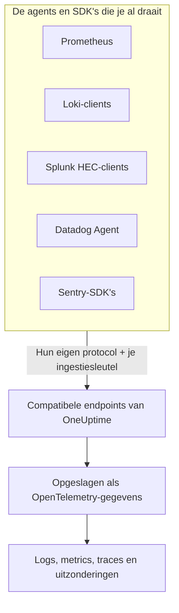

# Prometheus, Loki, Splunk, Datadog & Sentry

Draai je al Prometheus, een Loki-client, een Splunk-forwarder, de Datadog Agent of een Sentry-SDK? Laat die gewoon staan. OneUptime neemt aan wat elk van deze tools stuurt, op de paden die de tool al gebruikt, en slaat het op als OpenTelemetry-gegevens. OneUptime uitproberen vraagt alleen een andere URL en sleutel, geen nieuwe instrumentatie, en je drop-filters, scrub-regels, logboekpipelines, gegevensbewaring en ingestiebudgetten gelden voor deze gegevens net als voor alle andere.

:::cards
- [Prometheus remote write](#prometheus-remote-write): Metrics uit Prometheus, Grafana Alloy of elke andere afzender van remote write.
- [Loki](#loki): Logs uit Promtail, Grafana Alloy, Fluent Bit of Vector.
- [Splunk HTTP Event Collector](#splunk-http-event-collector): Logs en metric-events van elke HEC-client.
- [Datadog Agent](#datadog-agent): Metrics en logs van de Datadog Agent.
- [Sentry-SDK's](#sentry-sdks): Fouten, transacties en logs van elke Sentry-SDK.
:::

## Hoe het werkt



Elk endpoint antwoordt zoals de bijbehorende tool dat verwacht — een `204` voor Prometheus en Loki, de `{"text": "Success", "code": 0}` van HEC, de `202` van Datadog, het event-ID van Sentry — zodat de tool succes en mislukking meldt zoals hij dat altijd deed. Daarna worden de gegevens precies zo verwerkt als gegevens van een OpenTelemetry-SDK.

## Voordat je begint

- **Een OneUptime-project**: in OneUptime Cloud wordt telemetrie per opgenomen GB gefactureerd, en een project op het Free-abonnement heeft een betaalmethode nodig voordat het telemetrie kan sturen.
- **Telemetrie-ingestiesleutel**: maak een **Server**-sleutel onder **Producten → Projectinstellingen → Telemetrie & APM → Ingestiesleutels** en kopieer de **Geheime sleutel**. Elke tool stuurt de sleutel mee op de plek waar hij normaal zijn eigen inloggegevens meestuurt. De Sentry-DSN van een browserapp krijgt in plaats daarvan een **Browser**-sleutel, met de origins van je site erop.
- **Je host**: de voorbeelden gebruiken `oneuptime.com`. Host je OneUptime zelf, gebruik dan je eigen host.

> [!TIP]
> Op het tabblad Installatiegids van Logboeken, Metrieken, Traces en Uitzonderingen staan deze tools tussen de manieren om te versturen, met je host en een sleutel naar keuze al ingevuld.

## Endpoints

| Tool | Waar je hem op richt | Waar de sleutel komt |
| --- | --- | --- |
| Prometheus remote write | `https://oneuptime.com/telemetry/prometheus/api/v1/write` | Een bearer-token, of basic auth met de sleutel als wachtwoord. |
| Loki | `https://oneuptime.com/telemetry/loki/api/v1/push` | Basic auth met de sleutel als wachtwoord, of een bearer-token. |
| Splunk HTTP Event Collector | `https://oneuptime.com/telemetry/services/collector` | Het HEC-token: `Authorization: Splunk <key>`. |
| Datadog Agent | `https://oneuptime.com/telemetry/datadog` | De API-sleutel: `DD-API-KEY`. |
| Sentry-SDK's | De DSN `https://<key>@oneuptime.com/telemetry/sentry/1` | De publieke sleutel van de DSN. |

Elk endpoint neemt de sleutel ook aan in een header `x-oneuptime-token`, en een header `x-oneuptime-service-name` noemt de service waartoe alles hoort wat de tool stuurt. Een sleutel kan worden geschreven als zijn 32 hexadecimale cijfers zonder koppeltekens; in de Sentry-DSN en de API-sleutel van Datadog moet hij zo worden geschreven.

## Prometheus remote write

Voeg OneUptime toe als remote write-doel. Prometheus blijft scrapen zoals nu en stuurt van elke sample een kopie:

```yaml title="prometheus.yml"
remote_write:
  - url: https://oneuptime.com/telemetry/prometheus/api/v1/write
    authorization:
      credentials: YOUR_TELEMETRY_KEY
```

Met Grafana Alloy voeg je een component `prometheus.remote_write` toe en stuur je je scrapes daarheen door:

```text title="config.alloy"
prometheus.remote_write "oneuptime" {
  endpoint {
    url          = "https://oneuptime.com/telemetry/prometheus/api/v1/write"
    bearer_token = "YOUR_TELEMETRY_KEY"
  }
}
```

Remote write 1.0 en 2.0 worden allebei aangenomen, met snappy gecomprimeerd, zoals elke afzender ze stuurt.

### Wat een reeks wordt

- **Naam en labels blijven.** `http_requests_total{job="checkout", code="500"}` is de metric `http_requests_total` met de attributen `job` en `code`, dus een query die je uit Grafana overneemt, vindt hem.
- **De job is de service.** Elke `job` wordt een service, en elke `instance` de service-instantie daarvan, zoals de Prometheus-regels van OpenTelemetry ze toewijzen.
- **Typen blijven behouden.** Tellers, en de buckets en tellingen van een histogram, zijn cumulatieve sommen, zodat hun snelheden correct in grafieken verschijnen. Een type komt uit de metadata die de afzender meestuurt; zonder die metadata is een naam die op `_total` eindigt een teller, en een `_bucket` met een label `le` een histogrambucket.
- **Native histogrammen** worden exponentiële histogrammen, en native histogrammen met eigen buckets worden gewone histogrammen.
- **Niet bewaard:** staleness-markeringen en andere samples met NaN of oneindig als waarde, de `_created`-reeksen van tellers, en exemplars.

## Loki

OneUptime neemt de push-API van Loki aan op het eigen pad van Loki, in JSON of als de met snappy gecomprimeerde protobuf die Promtail en Grafana Alloy sturen. Voeg OneUptime toe als client:

```yaml title="promtail.yaml"
clients:
  - url: https://oneuptime.com/telemetry/loki/api/v1/push
    bearer_token: YOUR_TELEMETRY_KEY
```

De `loki`-output van Fluent Bit krijgt de host en het pad apart:

```text title="fluent-bit.conf"
[OUTPUT]
    Name         loki
    Match        *
    Host         oneuptime.com
    Port         443
    Tls          On
    Uri          /telemetry/loki/api/v1/push
    Http_User    oneuptime
    Http_Passwd  YOUR_TELEMETRY_KEY
    Labels       job=fluent-bit
```

### Wat een stream wordt

- **Elk item is een log**, met een eigen tijdstempel tot op de nanoseconde en zijn regel als inhoud.
- **Labels en gestructureerde metadata zijn attributen**, onder de namen die ze in Loki hebben.
- **De service** komt uit de eerste van `service_name`, `service`, `app`, `application`, `name`, `app_kubernetes_io_name`, `container`, `container_name`, `component`, `workload` en `job` die een stream heeft, zoals Loki die ook vindt. Een label `host` of `hostname` noemt de host.
- **Het niveau** komt uit een label of metadata `level`, `detected_level` of `severity`, of anders uit een logfmt-`level=` of het veld `level` van een JSON-regel.
- **Tracecontext:** een `trace_id` en `span_id` in de gestructureerde metadata koppelen de log aan zijn trace.

## Splunk HTTP Event Collector

Gebruik OneUptime als HTTP Event Collector, met je ingestiesleutel als HEC-token. De Docker-loggingdriver van Splunk voegt het pad zelf toe, dus die krijgt alleen de host:

```bash
docker run \
  --log-driver=splunk \
  --log-opt splunk-url=https://oneuptime.com \
  --log-opt splunk-token=YOUR_TELEMETRY_KEY \
  --log-opt splunk-format=json \
  your-image
```

Elke andere HEC-client post naar `/services/collector/event` of `/services/collector/raw`. Eén event sturen gaat zo:

```bash
curl https://oneuptime.com/telemetry/services/collector/event \
  -H "Authorization: Splunk YOUR_TELEMETRY_KEY" \
  -d '{"event": "Payment failed for order 42", "sourcetype": "app", "fields": {"service": "checkout"}}'
```

Een `200` met `{"text": "Success", "code": 0}` betekent dat het event is aangenomen. Het endpoint antwoordt ook met de eigen codes van HEC — `No data` (5), `Invalid data format` (6) met het nummer van het event dat niet geldig was, en `Event field is required` (12) — en beantwoordt `GET /services/collector/health` zonder token.

### Wat een event wordt

- **Een log**, met de `time` van het event als tijdstempel. Is het event een string, dan is dat de inhoud; is het een object, dan is `message`, `msg`, `log`, `line` of `text` de inhoud en zijn de andere velden attributen.
- **De metadata blijft:** `host` is de host, en `source`, `sourcetype` en `index` worden bewaard als `com.splunk.source`, `com.splunk.sourcetype` en `com.splunk.index`. `host`, `source`, `sourcetype` en `index` in de querystring vullen aan wat een event weglaat.
- **De velden zijn attributen.** Een veld `service.name` noemt de service, en het veld `service` van een log doet dat ook.
- **Metric-events** (`"event": "metric"`, met `metric_name` en `_value`, of velden `metric_name:<name>`) worden als metrics opgeslagen, nooit als logs.
- **Niet aangeboden:** indexer acknowledgement. Een client die erom vraagt, krijgt geen `ackId`.

## Datadog Agent

Richt de metrics en logs van de Agent op OneUptime, met je ingestiesleutel als API-sleutel:

```yaml title="datadog.yaml"
api_key: YOUR_TELEMETRY_KEY_WITHOUT_HYPHENS
dd_url: https://oneuptime.com/telemetry/datadog
logs_enabled: true
logs_config:
  use_http: true
  logs_dd_url: oneuptime.com:443
apm_config:
  enabled: false
process_config:
  process_collection:
    enabled: false
```

De Agent zet zijn eigen paden achter `dd_url`, en stuurt logs naar `/api/v2/logs` op de host en poort die `logs_dd_url` noemt. OneUptime beantwoordt die paden op de root alleen voor een request met een header `DD-API-KEY`. Herstart de Agent na de wijziging; `datadog-agent status` toont de API-sleutel als geldig wanneer OneUptime hem aanneemt.

### Wat de gegevens van de Agent worden

- **Metrics** houden hun naam. Gauges blijven gauges, counts worden sommen, en rates worden gauges van hun waarde per seconde.
- **Distributions** worden summaries met hun aantal, som, minimum en maximum.
- **Service checks** worden een metric met de naam van de check, met als waarde de status van de check: 0 OK, 1 waarschuwing, 2 kritiek, 3 onbekend.
- **Logs** houden hun bericht, status, host en service, en de rest van hun velden als attributen.
- **Tags zijn attributen**, en de tags `service`, `env` en `version` noemen de service, de omgeving en de versie daarvan.
- **Nog niet gelezen:** APM-traces, processen, containers, netwerkgegevens en profielen. Laat ze uit staan in `datadog.yaml`, zoals hierboven.

HTTP API-clients van Datadog — een logbibliotheek die naar `/api/v2/logs` post, een script dat series post — kunnen met de header `DD-API-KEY` naar hetzelfde endpoint sturen.

## Sentry-SDK's

Vervang de DSN waar je Sentry instelt. De rest van je Sentry-code blijft zoals hij is:

```javascript
Sentry.init({
  dsn: "https://YOUR_TELEMETRY_KEY_WITHOUT_HYPHENS@oneuptime.com/telemetry/sentry/1",
  release: "checkout@1.4.2",
  environment: "production",
});
```

```python
sentry_sdk.init(
    dsn="https://YOUR_TELEMETRY_KEY_WITHOUT_HYPHENS@oneuptime.com/telemetry/sentry/1",
    release="checkout@1.4.2",
    environment="production",
)
```

De `1` aan het eind van de DSN is verplicht voor de SDK's van Sentry en wordt niet gelezen. De DSN van een browserapp is openbaar, dus gebruik daar een **Browser**-ingestiesleutel, met de origins van je site erop.

### Wat een envelop wordt

- **Fouten** verschijnen in Uitzonderingen, met hun stacktraces en de uitzonderingen die ze veroorzaakten, gegroepeerd zoals elke andere uitzondering. Elke fout is een span in zijn trace, onder de span die actief was.
- **Transacties** en hun spans verschijnen in Traces.
- **Sentry-logs** en berichten die met `capture_message` zijn vastgelegd, verschijnen in Logboeken.
- **De service** is een tag `service`, of anders de naam van de release vóór de `@`: `checkout@1.4.2` is `checkout`. De release is de versie van de service, en de omgeving blijft bewaard.
- **Niet bewaard:** sessies, replays, bijlagen, profielen en check-ins. De SDK stuurt ze nog steeds; OneUptime neemt ze aan en gooit ze weg.

## Limieten en ingestiebudgetten

- **Requestgrootte**: de ingress van OneUptime neemt onder `/telemetry` requests tot 4 MB aan, en de inhoud van elk request mag gedecomprimeerd hoogstens 64 MB zijn.
- **Ingestiebudgetten**: Prometheus remote write en Loki worden aan het budget voor metrics of logs getoetst voordat hun inhoud wordt gelezen, en worden met `403` geweigerd als dat op is. Een HEC-batch, een Datadog-payload of een Sentry-envelop kan meerdere signalen bevatten, dus elk signaal wordt bij het opslaan tegen zijn eigen budget geteld, en weggegooid als dat budget op is.

## Problemen oplossen

### Elk request wordt geweigerd met 401

De sleutel kwam niet aan waar het endpoint hem zoekt, of het is geen sleutel van dit project. Vergelijk de instelling voor inloggegevens van de tool met de tabel [Endpoints](#endpoints), en controleer of de sleutel niet is uitgeschakeld of verlopen.

### Een Sentry-SDK zegt dat de DSN ongeldig is

De SDK's van Sentry weigeren een DSN waarvan de sleutel koppeltekens bevat. Schrijf de sleutel als zijn 32 hexadecimale cijfers, zonder de koppeltekens.

### Datadog-metrics komen binnen, maar logs niet

Controleer of `logs_config.use_http` `true` is en of `logs_config.logs_dd_url` een host en poort is, geen URL. De Agent stuurt logs via TCP als `use_http` niet is ingesteld.

### Prometheus meldt 415

De afzender vroeg om een remote write-protocol dat OneUptime niet leest. Stuur remote write 1.0 of 2.0.
