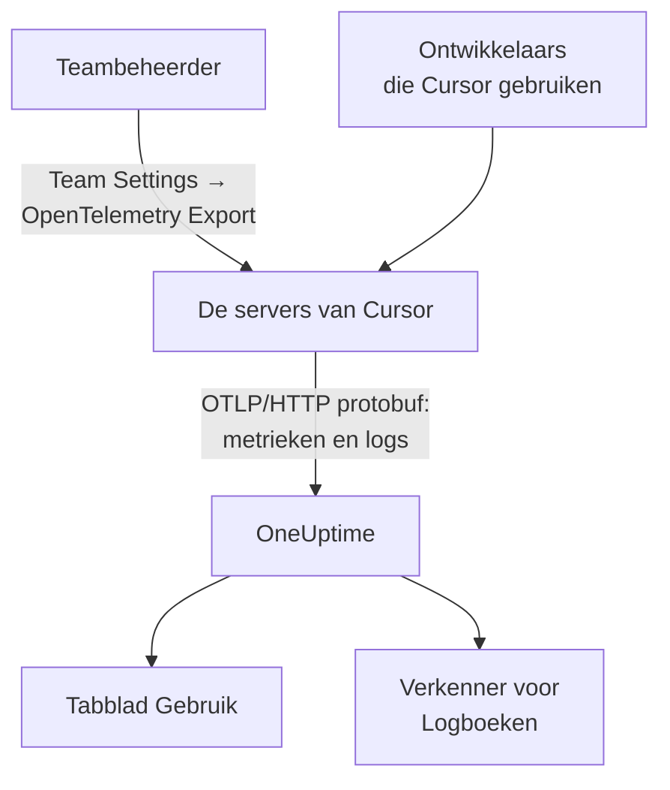

# Cursor

Cursor exporteert de telemetrie van zijn team vanaf de eigen servers van Cursor. Een teambeheerder voegt OneUptime één keer toe als bestemming, in het dashboard van Cursor, en de tokens, geschatte kosten en toolaanroepen van het hele team komen binnen: niets te installeren of in te stellen op de machines van ontwikkelaars.

:::cards
- [Instellen](#instellen): Maak een sleutel in OneUptime en een bestemming in Cursor.
- [Wat je krijgt](#wat-je-krijgt-en-wat-niet): Metrieken en logs; geen traces.
- [Wie wat uitgaf](#toewijzing-aan-medewerkers): Personen komen binnen als gebruikers-id's van Cursor.
- [Problemen oplossen](#problemen-oplossen): Wat je controleert als er niets binnenkomt.
:::

## Hoe het werkt



## Voordat je begint

- **Het Enterprise-abonnement van Cursor.** Het scherm OpenTelemetry Export bestaat niet in andere abonnementen.
- **Een endpoint dat Cursor vanaf internet kan bereiken.** Cursor maakt verbinding met jou, vanaf een vaste set adressen. OneUptime Cloud heeft verder niets nodig; een zelf gehoste OneUptime achter een firewall moet de uitgaande adressen toestaan die Cursor op zijn pagina [OpenTelemetry Export](https://cursor.com/docs/enterprise/opentelemetry-export) vermeldt.

## Instellen

:::steps
### Maak een ingestiesleutel aan

Open in OneUptime **Projectinstellingen → Telemetrie & APM → Ingestiesleutels**, klik op **Inname-sleutel aanmaken** en kopieer de sleutel. Je OTLP-basis-URL is `https://oneuptime.com/otlp`, of `https://YOUR-ONEUPTIME-HOST/otlp` als je OneUptime zelf host.

### Maak de bestemming aan in Cursor

Open in het webdashboard van Cursor, als teambeheerder, **Team Settings → OpenTelemetry Export** en maak een bestemming aan:

| Veld | Waarde |
| --- | --- |
| Endpoint (base URL) | `https://oneuptime.com/otlp` |
| Header name | `x-oneuptime-token` |
| Header value | `YOUR_INGESTION_TOKEN` |

Vul de basis-URL in zonder `/v1`: Cursor voegt zelf `/v1/metrics` en `/v1/logs` toe, en `https://oneuptime.com/otlp/v1` zou naar `/otlp/v1/v1/metrics` sturen, waar niets binnenkomt.

### Test en schakel in

Klik op **Test connection** om de URL en de header te controleren, en daarna op **Enable**. De export start binnen ongeveer een minuut; latere wijzigingen aan de header duren ongeveer 30 seconden.

### Controleer of de gegevens binnenkomen

Gebruik Cursor een minuut of twee, open daarna **Logboeken** in OneUptime en filter op de servicenaam `cursor`: `cursor.api.request`-records met tokenaantallen betekenen dat de sleutel en de URL kloppen.
:::

Cursor spreekt OTLP over HTTP alleen met binaire protobuf (geen gRPC, geen JSON), wat OneUptime accepteert zoals het is. Het slaat de header versleuteld op, en stuurt naar één bestemming per team: om naar OneUptime en ergens anders te sturen, zet je er een collector voor.

## Wat je krijgt, en wat niet

| Signaal | Van Cursor |
| --- | --- |
| Metrieken: tokens, geschatte kosten, toolaanroepen | Ja, als delta's |
| Logevents: aanvragen, fouten, correcties, skills, hooks, plugins, cloudagents | Ja |
| Tekst van prompts en antwoorden | Alleen als je de familie `conversation_content` aanzet |
| Traces | Nee |
| Alles van voordat je de bestemming inschakelde | Nee |

In OneUptime verschijnt Cursor dus op het tabblad **Gebruik** van **Producten → AI / LLM**, uit `cursor.token.usage` en `cursor.cost.usage`, maar nooit onder **Aanroepen** of **Gesprekken**, die uit traces worden opgebouwd. Het detail per aanvraag is het event `cursor.api.request` in de verkenner van **Logboeken**.

### Families

Elk signaal, en elke familie van telemetrie, heeft een eigen schakelaar in de instellingen van Cursor:

| Familie | Omvat |
| --- | --- |
| `model_usage` | `cursor.token.usage`, `cursor.cost.usage`, en de events `cursor.api.request`, `cursor.api.error` en `cursor.api.correction` |
| `tool_calls` | `cursor.tool.calls` |
| `skills_hooks_plugins` | Events van skills, hooks en plugins |
| `cloud_agents` | `cursor.cloud_agent.*`-events |
| `grok_bot_agent_actions` | `cursor.grok_bot.*`-events; vereist Action Recording |
| `conversation_content` | Berichttekst en de invoer en uitvoer van MCP-tools; standaard uit |

Elke familie behalve `conversation_content` staat bij de start aan. Families die Cursor later toevoegt, staan ook aan, tenzij je `auto_enable_new_families` uitzet.

## Metrieken en events

Alle drie de metrieken zijn deltasommen:

| Metriek | Eenheid | Attributen |
| --- | --- | --- |
| `cursor.token.usage` | `{token}` | `cursor.token.type`: `input`, `output`, `cache_read`, `cache_creation`; `cursor.model.name`; `cursor.api.status`: `success`, `errored`, `aborted`; `cursor.api.billable` |
| `cursor.cost.usage` | `USD` | `cursor.model.name` |
| `cursor.tool.calls` | `{call}` | `cursor.tool.kind`: `builtin`, `mcp`; `cursor.tool.name`; `cursor.tool.status`: `success`, `failure`, `aborted`; `cursor.mcp.server.name` |

De datapunten dragen geen gespreks- of aanvraag-id, dus kosten per sessie staan niet in de metrieken. `cursor.model.name` is het gevraagde model, met gerouteerde keuzes samengevoegd: een uitsplitsing per model heeft een rij met de naam `Auto` die niet kan worden verdeeld over de modellen waarnaar Cursor hem routeerde.

Het logevent dat je het meest gebruikt, is `cursor.api.request`: één per aanvraag, met de aantallen invoer-, uitvoer- en cachetokens, het model en of de aanvraag is gefactureerd. `cursor.api.error` legt een mislukte aanvraag vast (zonder de foutmelding), en `cursor.api.correction` komt later binnen om te melden dat een aanvraag toch niet is gefactureerd. De [formaatreferentie](https://cursor.com/docs/enterprise/opentelemetry-export/wire) van Cursor noemt elk event en attribuut.

Elk record draagt deze resource-attributen:

| Attribuut | Wat het is |
| --- | --- |
| `service.name` | Altijd `cursor`: filter de verkenners van **Logboeken** en **Metrieken** erop |
| `cursor.team.id` | Je team, een geheel getal; altijd aanwezig |
| `cursor.user.id` | De persoon, een geheel getal binnen het team; optioneel |
| `cursor.surface` | Waar de activiteit vandaan kwam, zoals `desktop`, `cli`, `cloud_agent` of `bugbot` |
| `cursor.entrypoint` | Hoe het begon, zoals `desktop`, `cli`, `web`, `api` of `github_pr` |

## Toewijzing aan medewerkers

**Cursor noemt een persoon bij `cursor.user.id`, een geheel getal dat alleen Cursor in een naam kan omzetten, en laat het bij cloudagents vaak weg.** OneUptime leest het als de medewerker, en `cursor.team.id` als het team, dus het tabblad **Gebruik** rangschikt personen en teams zonder instellingen, maar personen verschijnen als gehele getallen.

- Beide komen binnen als resource-attributen (`resource.cursor.user.id`, `resource.cursor.team.id`), die OneUptime leest.
- Cursor kan ook `cursor.user.email` sturen, maar OneUptime leest dat nog niet, dus de e-mailkolom van de medewerker blijft leeg voor Cursor.
- `gen_ai.user`, `llm.user` en de eindgebruikers-id's van LiteLLM worden nooit als de medewerker gelezen: ze noemen je klanten, niet je personeel. Zie [Toewijzing aan medewerkers en teams](/docs/telemetry/ai-coding-assistants#toewijzing-aan-medewerkers-en-teams).

### Waar Cursor op het tabblad Gebruik verschijnt

Cursor stuurt metrieken en geen GenAI-spans, en de metrieken vullen alleen spans aan: **als hetzelfde project GenAI-spans met kosten ontvangt, verschijnen de uitgaven van Cursor niet.** Stuur Cursor naar een eigen project. Zie [Spans eerst, metrieken vullen aan](/docs/telemetry/ai-llm-observability#spans-eerst-metrieken-vullen-aan).

| Uitsplitsing | Voor Cursor |
| --- | --- |
| **Medewerker** | Ja, op `cursor.user.id` |
| **Team** | Ja, op `cursor.team.id` |
| **Model** | Ja, op `cursor.model.name` |
| **Provider** | Nee: Cursor zegt nooit welke provider een aanroep afhandelde |
| **Applicatie / Service** | Nee: de metrieken van Cursor horen bij geen enkele OneUptime-service |

Een Cursor-rij draagt alleen kosten: de cellen voor aanroepen en tokens tonen `—`, omdat `cursor.cost.usage` geen details per aanroep heeft. `cursor.token.usage` voedt nog steeds de tokentotalen boven de tabel (de types `input` en `output`; cachetokens blijven buiten beschouwing), en je kunt het in een dashboard zetten per `cursor.token.type`.

:::details Een gebruikers-id van Cursor omzetten in een persoon
Namen en gefactureerde bedragen staan in de Admin API van Cursor, die OneUptime niet aanroept: roep hem zelf aan als je hem nodig hebt. Hij is alleen voor Enterprise, op `https://api.cursor.com`, en neemt een beheerders-API-sleutel als gebruikersnaam met een leeg wachtwoord:

```bash
curl -u YOUR_API_KEY: https://api.cursor.com/teams/members
```

`GET /teams/members` geeft het e-mailadres en de naam van elk lid. `POST /teams/filtered-usage-events` geeft het gefactureerde gebruik per event; tel de `chargedCents` op voor de uitgaven. De `conversationId` ervan komt overeen met `cursor.conversation.id` op de logevents van Cursor, wat een persoon en een gefactureerd bedrag koppelt aan een sessie die je al ziet, als beide kanten hem dragen. Cursor documenteert niet dat het gehele getal `cursor.user.id` en de gebruikers-id's van de Admin API dezelfde zijn, dus controleer dat in je eigen team voordat je iemand op basis daarvan factureert.
:::

## Hoe Cursor aflevert

Deze regels veranderen wat je in grafieken ziet, dus ken ze voordat je een gat meldt:

- **Metrieken worden hoogstens één keer gestuurd.** Een mislukte export wordt niet opnieuw geprobeerd, dus een kort gat na een fout is te verwachten: roep niemand op voor gaten in de metrieken van Cursor.
- **Logs worden minstens één keer gestuurd**, ontdubbeld op `cursor.event.id`, en ongeveer 7 dagen lang automatisch opnieuw geprobeerd.
- **Er is geen volgorde.** Een `cursor.api.correction` komt binnen na de aanvraag die hij corrigeert: sorteer op de tijdstempel van het record, nooit op het moment van binnenkomst.
- **Er wordt niets aangevuld.** Niets van voordat je de bestemming inschakelde komt binnen, en een bestemming die kapot blijft, verliest wat Cursor niet kon sturen.
- **Een bestemming uitschakelen of verwijderen laat gegevens onderweg vallen.** Om de ingestiesleutel te wijzigen, bewerk je de header van de bestemming in plaats van haar te verwijderen en opnieuw aan te maken.

## Kosten zijn een schatting, geen factuur

Cursor documenteert `cursor.cost.usage` als een schatting naar beste kunnen. Het scheidt inbegrepen gebruik niet van gebruik dat op aanvraag wordt gefactureerd; met je eigen modelsleutels weerspiegelt het alleen het tokentarief van Cursor, niet de factuur van je provider; en een latere `cursor.api.correction` kan gebruik terugnemen dat al was geteld. Lees het als een trend. Voor een getal dat met de factuur overeenkomt, tel je de `chargedCents` uit de Admin API van Cursor op.

## Problemen oplossen

:::details Er komt niets binnen
Voer **Test connection** opnieuw uit in Cursor. Controleer of de basis-URL niet eindigt op `/v1`, of de headernaam `x-oneuptime-token` is en de waarde precies de sleutel, en of de familie `model_usage` aanstaat. De export start ongeveer een minuut nadat je de bestemming inschakelt.
:::

:::details Er komt niets binnen bij een zelf gehoste OneUptime
Cursor maakt verbinding vanaf zijn eigen servers: je OTLP-endpoint moet bereikbaar zijn vanaf internet, onder een openbare DNS-naam, en de uitgaande adressen van Cursor door je firewall toelaten.
:::

:::details Logs komen binnen, maar het tabblad Gebruik toont geen uitgaven van Cursor
Het project ontvangt ook GenAI-spans met kosten, dus de metrieken van Cursor worden niet gelezen. Stuur Cursor naar een eigen project, met een eigen ingestiesleutel.
:::

:::details Personen verschijnen als getallen
Dat is `cursor.user.id`: het enige persoons-id dat OneUptime vandaag uit Cursor leest. Koppel het aan namen met de Admin API van Cursor.
:::

## Volgende stappen

:::cards
- [AI-codeerassistenten](/docs/telemetry/ai-coding-assistants): Hoe uitgaven over elke codeerassistent worden toegewezen.
- [AI-gateways](/docs/telemetry/ai-gateways): Volledige traces en prompts voor de modelaanroepen die je eigen apps doen.
- [Metrics-monitor](/docs/monitor/metrics-monitor): Waarschuw op `cursor.cost.usage`, `cursor.token.usage` of `cursor.tool.calls`.
:::
