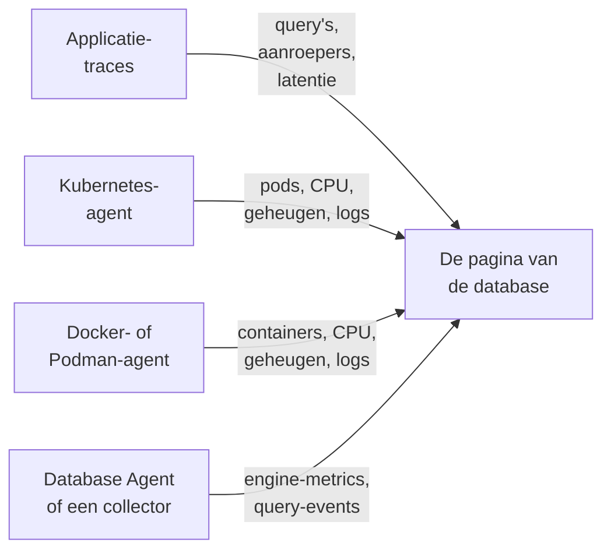

# Databases

**Databases** geeft elke databaseserver die je project draait of aanspreekt een eigen pagina: wie hem aanroept en hoe snel, waar hij draait, de eigen gezondheidsmetrics van de engine, zijn logs en traces, de incidenten, waarschuwingen en gepland onderhoud die eraan gekoppeld zijn, en de waarschuwingsmonitors die voor zijn engine worden aanbevolen. Databases hebben labels, eigenaren, label- en eigenaarsregels, bewaring per database en archivering, net als elke andere resource. Open ze via **Producten → Bronnen → Databases**.

:::cards
- [De Database Agent](#de-database-agent): Engine-metrics voor PostgreSQL, MySQL, SQL Server, Oracle, Redis, MongoDB, Elasticsearch en Memcached.
- [Hoe databases worden gedetecteerd](#hoe-databases-worden-gedetecteerd): Uit traces, Kubernetes, Docker, Podman en collectors.
- [Waarschuwingen voor een database](#waarschuwingen-voor-een-database): Aanbevolen monitors en monitors die je zelf bouwt.
- [Problemen oplossen](#problemen-oplossen): Een diagnosescript, en de gebruikelijke problemen.
:::

## Hoe het werkt

De meeste databases verschijnen vanzelf. OneUptime stelt elke database samen uit maximaal vier bronnen, en elke bron draagt iets anders bij:

| Bron | Wat de bron van je nodig heeft | Wat de bron aan de pagina van de database toevoegt |
| --- | --- | --- |
| **Applicatietraces** | Geïnstrumenteerde applicaties (OpenTelemetry) | Query's van applicaties: aanroepfrequentie, fouten, latentie en de services die de database aanroepen |
| **Kubernetes** | De [Kubernetes-agent van OneUptime](/docs/telemetry/kubernetes-agent) | Waar hij draait: pods, CPU en geheugen, en de logs van de pods |
| **Docker / Podman** | De [Docker-agent](/docs/telemetry/docker-host) of de [Podman-agent](/docs/telemetry/podman-host) | Waar hij draait: de containers, hun CPU en geheugen, en hun logs |
| **Database Agent** (een OpenTelemetry Collector) | De [Database Agent](#de-database-agent) of je eigen collector | **Engine metrics**: verbindingen, doorvoer, cachehitratio, locks, replicatievertraging, geheugen, voor zover de engine ze heeft (zie [Wat er wordt verzameld](#wat-er-wordt-verzameld)), plus optionele querysamples, topquery's en het logbestand van de engine |



Engine-metrics komen altijd van een collector die met de database zelf praat (of, bij een beheerde clouddatabase, met de monitoring-API van de provider). Traces en containerinventarissen vertellen OneUptime dat een database bestaat en hoe hij wordt gebruikt, maar niet hoe het er vanbinnen voor staat: de status **Engine metrics** van elke database laat zien of dat deel verbonden is.

Je kunt een database ook met de hand toevoegen: **Databases → Database aanmaken** met de engine, het adres en de poort. Voor een gezondheidscontrole vanaf een probe die helemaal geen agent nodig heeft, zie de [Databasegezondheid-monitor](/docs/monitor/database-health-monitor).

## Ondersteunde databases

OneUptime kent de engines hieronder bij naam: het normaliseert wat instrumentaties in `db.system.name` (of het oudere `db.system`) zetten naar de waarde in de tweede kolom, toont de naam van de engine, gebruikt de standaardpoort ervan als een span of adres er geen heeft, herkent de containerimages en Helm-charts ervan en weet waar de engine-metrics vandaan komen. Een engine die niet in de lijst staat, werkt toch overal waar een database aan zijn adres wordt herkend: hij verschijnt alleen onder de ruwe naam die je spans melden en wordt nooit alleen uit traces aangemaakt.

Een **familie** is de engine waarlangs je een fork of een protocolcompatibele engine bereikt: clientbibliotheken kunnen MariaDB niet van MySQL onderscheiden en Valkey niet van Redis, dus een span zegt `mysql` of `redis` terwijl een containerimage, een Helm-chart of de Database Agent de fork noemt. Beide komen op dezelfde database terecht, en de database toont de specifiekere engine zodra zijn containerimage, of een bron die minstens zo sterk is als die achter zijn huidige engine, die noemt (zie [Welke engine een database toont](#welke-engine-een-database-toont)).

**Aangemaakt uit traces** geeft aan of clientspans alleen al een database van die engine aanmaken (zie [Uit applicatietraces](#uit-applicatietraces)): een beheerde dienst die je via de gedeelde API-host van de provider bereikt en een engine die binnen het proces van je applicatie draait, doen dat nooit. **Engine metrics** geeft aan waar de eigen gezondheidsmetrics van de engine vandaan komen: een configuratie van de Database Agent, een collector-contrib-receiver die je aan je eigen collector toevoegt, het eigen Prometheus-endpoint van de engine (`:port/path`, gescrapet met de `prometheus`-receiver van de collector), de monitoring-API van de cloudprovider, of niets ingebouwds. Het tabblad **Documentatie** van elke database maakt daar een kant-en-klare collectorconfiguratie voor die database van.

| Engine | `db.system.name` | Standaardpoort | Familie | Aangemaakt uit traces | Engine metrics |
| --- | --- | --- | --- | --- | --- |
| Actian Ingres | `actian.ingres` | — | — | Ja | Niets ingebouwd |
| Actian Zen (Pervasive PSQL) | `pervasive` | 1583 | — | Ja | Niets ingebouwd |
| Aerospike | `aerospike` | 3000 | — | Ja | receiver `aerospike` |
| Amazon DocumentDB | `aws.documentdb` | 27017 | MongoDB | Ja | receiver `awsfirehose` (cloudmonitoring) |
| Amazon DynamoDB | `aws.dynamodb` | 443 | — | Nee (cloud-API) | receiver `awsfirehose` (cloudmonitoring) |
| Amazon Neptune | `aws.neptune` | 8182 | — | Ja | receiver `awsfirehose` (cloudmonitoring) |
| Amazon Redshift | `aws.redshift` | 5439 | PostgreSQL | Ja | receiver `awsfirehose` (cloudmonitoring) |
| Apache Derby | `derby` | 1527 | — | Nee (in-process) | Geen (in-process) |
| Apache Doris | `doris` | 9030 | MySQL | Ja | Prometheus, `:8030/metrics` |
| Apache Druid | `druid` | 8888 | — | Ja | Niets ingebouwd |
| Apache Geode | `geode` | 10334 | — | Ja | Niets ingebouwd |
| Apache HBase | `hbase` | — | — | Ja | Niets ingebouwd |
| Apache Hive | `hive` | 10000 | — | Ja | Niets ingebouwd |
| Apache Ignite | `ignite` | 10800 | — | Ja | Niets ingebouwd |
| Apache Impala | `impala` | 21050 | — | Ja | Niets ingebouwd |
| Apache Pinot | `pinot` | 8099 | — | Ja | Niets ingebouwd |
| Apache Solr | `solr` | 8983 | — | Ja | Niets ingebouwd |
| ArangoDB | `arangodb` | 8529 | — | Ja | Prometheus, `:8529/_admin/metrics/v2` |
| Azure Cosmos DB | `azure.cosmosdb` | 443 | — | Nee (cloud-API) | receiver `azure_monitor` (cloudmonitoring) |
| Cassandra | `cassandra` | 9042 | — | Ja | Niets ingebouwd |
| Chroma | `chroma` | 8000 | — | Ja | Niets ingebouwd |
| Claris FileMaker | `filemaker` | 2399 | — | Ja | Niets ingebouwd |
| ClickHouse | `clickhouse` | 9000 | — | Ja | Prometheus, `:9363/metrics` |
| Cloud Bigtable | `gcp.bigtable` | 443 | — | Nee (cloud-API) | receiver `googlecloudmonitoring` (cloudmonitoring) |
| Cloud Firestore | `gcp.firestore` | 443 | — | Nee (cloud-API) | receiver `googlecloudmonitoring` (cloudmonitoring) |
| Cloud Spanner | `gcp.spanner` | 443 | — | Nee (cloud-API) | receiver `google_cloud_spanner` |
| CockroachDB | `cockroachdb` | 26257 | PostgreSQL | Ja | Prometheus, `:8080/_status/vars` |
| Couchbase | `couchbase` | 11210 | — | Ja | Prometheus, `:8091/metrics` |
| CouchDB | `couchdb` | 5984 | — | Ja | receiver `couchdb` |
| Databricks | `databricks` | 443 | — | Ja | Niets ingebouwd |
| Dragonfly | `dragonfly` | 6379 | Redis | Ja | Database Agent (receiver `redis`) |
| DuckDB | `duckdb` | — | — | Nee (in-process) | Geen (in-process) |
| Elasticsearch | `elasticsearch` | 9200 | — | Ja | Database Agent (receiver `elasticsearch`) |
| etcd | `etcd` | 2379 | — | Ja | Prometheus, `:2379/metrics` |
| FerretDB | `ferretdb` | 27017 | MongoDB | Ja | Prometheus, `:8088/debug/metrics` |
| Firebird | `firebirdsql` | 3050 | — | Ja | Niets ingebouwd |
| FoundationDB | `foundationdb` | 4500 | — | Ja | Niets ingebouwd |
| Google BigQuery | `bigquery` | 443 | — | Nee (cloud-API) | receiver `googlecloudmonitoring` (cloudmonitoring) |
| Greenplum | `greenplum` | 5432 | PostgreSQL | Ja | Niets ingebouwd |
| H2 | `h2database` | 9092 | — | Nee (in-process) | Geen (in-process) |
| Hazelcast | `hazelcast` | 5701 | — | Ja | Niets ingebouwd |
| HyperSQL | `hsqldb` | 9001 | — | Nee (in-process) | Geen (in-process) |
| IBM Db2 | `ibm.db2` | 50000 | — | Ja | Niets ingebouwd |
| IBM Informix | `ibm.informix` | 9088 | — | Ja | Niets ingebouwd |
| IBM Netezza | `ibm.netezza` | 5480 | — | Ja | Niets ingebouwd |
| InfluxDB | `influxdb` | 8086 | — | Ja | Prometheus, `:8086/metrics` |
| InstantDB | `instantdb` | — | — | Nee (in-process) | Geen (in-process) |
| InterBase | `interbase` | 3050 | Firebird | Ja | Niets ingebouwd |
| InterSystems IRIS / Caché | `intersystems.cache` | 1972 | — | Ja | Prometheus, `:52773/api/monitor/metrics` |
| KeyDB | `keydb` | 6379 | Redis | Ja | Database Agent (receiver `redis`) |
| MariaDB | `mariadb` | 3306 | MySQL | Ja | Database Agent (receiver `mysql`) |
| Meilisearch | `meilisearch` | 7700 | — | Ja | Prometheus, `:7700/metrics` |
| Memcached | `memcached` | 11211 | — | Ja | Database Agent (receiver `memcached`) |
| Milvus | `milvus` | 19530 | — | Ja | Prometheus, `:9091/metrics` |
| MongoDB | `mongodb` | 27017 | — | Ja | Database Agent (receiver `mongodb`) |
| MySQL | `mysql` | 3306 | — | Ja | Database Agent (receiver `mysql`) |
| Neo4j | `neo4j` | 7687 | — | Ja | Prometheus, `:2004/metrics` |
| OceanBase | `oceanbase` | 2881 | MySQL | Ja | Niets ingebouwd |
| OpenSearch | `opensearch` | 9200 | Elasticsearch | Ja | Database Agent (receiver `elasticsearch`) |
| Oracle | `oracle.db` | 1521 | — | Ja | Database Agent (receiver `oracledb`) |
| Pinecone | `pinecone` | 443 | — | Nee (cloud-API) | Niets ingebouwd |
| PostgreSQL | `postgresql` | 5432 | — | Ja | Database Agent (receiver `postgresql`) |
| Presto | `presto` | 8080 | — | Ja | Niets ingebouwd |
| Progress OpenEdge | `progress` | — | — | Ja | Niets ingebouwd |
| Qdrant | `qdrant` | 6333 | — | Ja | Prometheus, `:6333/metrics` |
| QuestDB | `questdb` | 8812 | PostgreSQL | Ja | Prometheus, `:9003/metrics` |
| RavenDB | `ravendb` | 8080 | — | Ja | Niets ingebouwd |
| Redis | `redis` | 6379 | — | Ja | Database Agent (receiver `redis`) |
| Riak KV | `riak` | 8087 | — | Ja | receiver `riak` |
| SAP ASE (Sybase) | `sybase` | 5000 | — | Ja | Niets ingebouwd |
| SAP HANA | `sap.hana` | 30015 | — | Ja | receiver `saphana` |
| SAP MaxDB | `sap.maxdb` | 7210 | — | Ja | Niets ingebouwd |
| ScyllaDB | `scylladb` | 9042 | Cassandra | Ja | Prometheus, `:9180/metrics` |
| SingleStore | `singlestore` | 3306 | MySQL | Ja | Prometheus, `:9104/metrics` |
| Snowflake | `snowflake` | 443 | — | Ja | receiver `snowflake` |
| Software AG Adabas | `softwareag.adabas` | — | — | Ja | Niets ingebouwd |
| SQL Server | `microsoft.sql_server` | 1433 | — | Ja | Database Agent (receiver `sqlserver`) |
| SQLite | `sqlite` | — | — | Nee (in-process) | Geen (in-process) |
| StarRocks | `starrocks` | 9030 | MySQL | Ja | Prometheus, `:8030/metrics` |
| SurrealDB | `surrealdb` | 8000 | — | Ja | Niets ingebouwd |
| Teradata | `teradata` | 1025 | — | Ja | Niets ingebouwd |
| TiDB | `tidb` | 4000 | MySQL | Ja | Prometheus, `:10080/metrics` |
| Trino | `trino` | 8080 | — | Ja | Prometheus, `:8080/metrics` |
| Typesense | `typesense` | 8108 | — | Ja | Niets ingebouwd |
| Valkey | `valkey` | 6379 | Redis | Ja | Database Agent (receiver `redis`) |
| Vertica | `vertica` | 5433 | — | Ja | Niets ingebouwd |
| Vitess | `vitess` | 3306 | MySQL | Ja | Prometheus, `:15000/metrics` |
| Weaviate | `weaviate` | 8080 | — | Ja | Prometheus, `:2112/metrics` |
| YugabyteDB | `yugabytedb` | 5433 | PostgreSQL | Ja | Prometheus, `:9000/prometheus-metrics` |

Ook de gangbare andere spellingen worden geaccepteerd: `postgres` en `pg`, `mssql` en `sqlserver`, `oracle`, `mongo`, `scylla`, `dragonflydb`, `memsql`, en elke oude `db.system`-waarde die OpenTelemetry heeft gebruikt (`db2`, `hanadb`, `cosmosdb`, `dynamodb`, `spanner`, `redshift`, `informix`, `maxdb`, `cache`, `h2`, `firebird`, `edb`, `cloudscape`, …). Een beheerde dienst die het protocol van een engine spreekt (Amazon RDS en Aurora, Azure Database, Cloud SQL, AlloyDB, Neon, Supabase, PlanetScale, ElastiCache, Memorystore, MongoDB Atlas) is die engine.

## Hoe databases worden gedetecteerd

Elke database onthoudt de bron die hem heeft aangemaakt (de kolom **Discovered from**), en het eerste item in zijn **Feed** zegt wat hem heeft gevonden: de Kubernetes-workload en zijn cluster, de Docker- of Podman-container (of Compose- of Swarm-service) en zijn host, het endpoint dat applicaties aanriepen, of de Database Agent (met zijn versie) of de collector die hem meldde. Latere bronnen vullen dezelfde database aan in plaats van een nieuwe aan te maken, zolang ze hetzelfde endpoint beschrijven (zie [Endpoints](#endpoints-en-de-regel-van-één-eigenaar)).

### Uit applicatietraces

Elke 10 minuten vat OneUptime de CLIENT-spans samen die je applicaties in de afgelopen 15 minuten hebben verstuurd en die `db.system.name` (of het oudere `db.system`) dragen. De server komt uit `server.address` (of het oudere `net.peer.name`, daarna `network.peer.address` / `net.sock.peer.addr`) en de poort uit `server.port` (of `net.peer.port`, `network.peer.port`, `net.sock.peer.port`); als de span geen poort heeft, wordt de standaardpoort van de engine aangenomen. Enginenamen worden genormaliseerd (zie [Ondersteunde databases](#ondersteunde-databases)), dus `postgres`, `pg` en `postgresql` zijn één engine, net als `mssql` en `microsoft.sql_server`; `mariadb` en `mysql` zijn twee engines van één familie.

Een database wordt alleen uit traces **aangemaakt** als aan al deze voorwaarden is voldaan; al het andere telt nog steeds mee voor een database die al bestaat, maar maakt er nooit een aan:

- het adres noemt één server binnen het hele project: een DNS-naam, geen letterlijk IP en geen naam die alleen op één machine of binnen één netwerk resolvet, tenzij het Kubernetes-cluster van de aanroeper die kwalificeert (zie [Endpoints](#endpoints-en-de-regel-van-één-eigenaar));
- de poort is er een waarop een server luistert. Besturingssystemen geven het clientuiteinde van een verbinding een poort vanaf 32768 (het standaard kortstondige bereik van Linux begint daar; Windows en macOS gebruiken 49152–65535), dus een poort vanaf 32768 maakt nooit een database aan, tenzij het de eigen standaardpoort van de engine is (50000 van IBM Db2). eBPF-instrumentatie, ook die van de Kubernetes-agent, kan halverwege aansluiten op een langlopende verbinding en de twee uiteinden ervan verwisselen. De span noemt dan de eigen poort van de client als server, en zonder deze regel zou elke verbinding een eigen database worden;
- de engine is er een die OneUptime kent, met een eigen adres: de kolom **Aangemaakt uit traces** in [Ondersteunde databases](#ondersteunde-databases). Cloud-API's waarvan alle klanten de host delen (DynamoDB, BigQuery, Spanner, Firestore, Bigtable, Cosmos DB, Pinecone), engines die binnen je applicatie draaien (SQLite, DuckDB, H2, HyperSQL, Derby) en engines die OneUptime niet kent, worden nooit uit traces aangemaakt; voeg ze met de hand toe;
- het endpoint kreeg minstens 10 query's in het venster van 15 minuten dat een run bekijkt, zodat een eenmalig script geen database aanmaakt. De spans voor verbindingsbeheer van een clientbibliotheek (`pg.connect` en `pg-pool.connect` van node-postgres, `redis-connect`, `connect`, …) zijn geen query's: ze tellen niet hier en niet in de **Query's** van een database;
- het project zit onder zijn [budget voor automatisch aanmaken](#het-budget-voor-automatisch-aanmaken).

Elke CLIENT-span van een database wordt bij de ingestie ook gemarkeerd met zijn endpoint, dus zodra een database een endpoint bezit, tonen de sectie **Query's van applicaties** en het tabblad **Traces** elke aanroep ervan, ook aanroepen van vóór het aanmaken van de database. `db.client.*`-metrics (bijvoorbeeld `db.client.operation.duration`) die een `server.address` dragen, worden op dezelfde manier gemarkeerd.

**Clusters en hostlijsten.** Een verbindingsreeks met meerdere hosts (`m1:27017,m2:27017,m3:27017`) is één database, in welke volgorde een client ze ook opsomt. Leden van MongoDB Atlas (`cluster0-shard-00-01.ab1cd.mongodb.net`) worden één database met de naam van hun cluster (`cluster0.ab1cd.mongodb.net`), en elk gezien lid wordt een van de endpoints ervan. Drivers die elk lid van een Cassandra-ring, een Redis Cluster, een Elasticsearch-cluster of ElastiCache-nodes afzonderlijk melden, leveren nog steeds één database per lid op: niets in die hostnamen zegt bij welk cluster ze horen. Houd er één en [voeg](#endpoints-en-de-regel-van-één-eigenaar) de andere ermee samen.

### Uit Kubernetes

Elke 5 minuten bekijkt OneUptime de pods van elk verbonden Kubernetes-cluster en herkent het databaseworkloads:

1. **Eerst labels van operators en charts**: CloudNativePG, Zalando (Spilo), Crunchy PGO, Bitnami-charts, ECK, Altinity ClickHouse, cass-operator, Percona, de Oracle MySQL-operator en de Vitess-operator (de `vtgate`-pods daarvan zijn de database; `vttablet`, `vtctld`, `vtorc` en `vtbackup` zijn er onderdelen van, geen leden). Eén operatorcluster wordt één database. De eigen vtgate-Service van het Vitess-cluster heeft een gehashte naam, dus voeg die toe op het tabblad **Endpoints** van de database als applicaties erlangs verbinden.
2. **Anders containerimages**, op exacte imagenaam: de officiële images, die van Bitnami (inclusief de verhuisde repositories `bitnamilegacy` en `bitnamisecure`) en die van Red Hat / OpenShift van elke engine in [Ondersteunde databases](#ondersteunde-databases) die er een uitbrengt (`postgres`, `bitnami/postgresql`, `rhel9/postgresql-16`, `mysql`, `mariadb`, `mssql/server`, `gvenzl/oracle-free`, `redis`, `valkey/valkey`, `mongo`, `cockroachdb/cockroach`, `pingcap/tidb`, `clickhouse/clickhouse-server`, `qdrant/qdrant`, …). Een fork wordt als zichzelf herkend: een `mariadb`-image is MariaDB, een `valkey/valkey`-image is Valkey. Exporters, operators, beheerinterfaces, connection poolers (pgbouncer, pgpool, ProxySQL, HAProxy, Cloud SQL Proxy) en back-uptools zijn geen databases. Een pod die ook een applicatiecontainer draait, geldt evenmin als database (een app met een database-sidecar blijft de app), al mag een StatefulSet waarvan de databasecontainer de standaardpoort van de engine declareert één extra container bevatten die OneUptime niet herkent (bijvoorbeeld een logshipper).

Een databaseimage maakt van een pod nog geen databaseserver, maar alleen positief bewijs maakt er iets anders van. Een container waarvan het programma een client- of dumptool is (`psql`, `redis-cli`, `mongosh`, `pg_dump`, `mysql`), een keep-alive (`sleep infinity`, `tail -f /dev/null`) of een interactieve shell (of waarvan het `sh -c`-script niets anders draait dan zulke tools, shell-builtins en eenvoudige hulpprogramma's als `echo` en `cp`) is een client- of debugrun, geen database; hetzelfde geldt voor een Redis- of Valkey-Sentinel (`redis-sentinel`, `redis-server --sentinel`). Dat geldt ook achter een launcher: `env` (met de `NAME=value`-instellingen), `nohup`, `setsid`, `tini`, `dumb-init` en het `docker-entrypoint.sh` van een image worden doorzien tot het programma dat ze starten, net als `exec`, `env` en `nohup` binnen een script; `env PGPASSWORD=… psql` en `tini -- redis-cli` zijn dus clientruns, terwijl `tini -- docker-entrypoint.sh postgres` de server is, en `docker-entrypoint.sh -c max_connections=200` ook, de eigen server van de image gestart met een vlag. Een script dat daarna nog iets anders start (`sleep 5 && exec redis-server`, `bash -ecx 'exec cockroach start …'`), een scriptbestand (`sh /start.sh`), een wrapper die vóór het programma eigen argumenten neemt (`gosu postgres …`, `timeout 30 …`) of een script dat te lang is om te lezen, telt als mogelijke server. Afgeronde pods, batchjobs en eenmalige `kubectl run`-pods die geen poort declareren, zijn evenmin databases.

Een database verschijnt zodra een van zijn pods ongeveer 10 minuten Ready is (als alleen een sidecar verhindert dat de pod Ready wordt, telt in plaats daarvan een databasecontainer die gereed is). Een pod in een crashlus wordt bij elke herstart opnieuw Ready en wordt dus nooit een database, net zomin als een CI-job of een pod die na een minuut crashte. Eenmaal aangemaakt, wordt een database bij elke run bijgewerkt.

Pods worden gegroepeerd per StatefulSet, Deployment of operatorcluster, dus een StatefulSet met drie leden is één database met drie leden. **Instanties** op de pagina telt de pods waarvan de databasecontainer draait: niet een die wacht in `CrashLoopBackOff` of `ImagePullBackOff`, en niet een die beëindigd is, ook al kan Kubernetes zo'n pod nog als Running melden; een workload die naar nul is geschaald, toont 0 en houdt zijn pagina tot [automatisch archiveren](#levenscyclus-archivering-en-bewaring) hem opruimt. De weg terug werkt ook: de StatefulSet- of Deployment-pagina van de workload en de pagina van elk van zijn pods noemen de database die hij draait, met een link **Open database**, ook bij een StatefulSet of Deployment met een andere naam dan zijn database (`shop-redis-master` van Bitnami voor `shop-redis`, `cluster1-pxc` van Percona voor `cluster1`), terwijl een pooler- of back-upworkload die een operator als deel van een cluster labelt, aangeeft dat hij deel uitmaakt van het cluster van die database.

De Kubernetes-agent meldt geen Service-objecten, dus de Service-namen van een database komen uit de conventies die charts en operators volgen: de naam van de eigenaar-StatefulSet of -Deployment, de headless Service van de StatefulSet (en elk lid erachter, `<pod>.<headless-service>`), en de proxy- en pooler-Services van de operators: HAProxy en ProxySQL van Percona XtraDB Cluster, de router en HAProxy van Percona Server for MySQL, mongos van Percona Server for MongoDB, pgBouncer van Crunchy en de poolers van Zalando en CloudNativePG. Elk daarvan wordt een endpoint dat door het cluster gekwalificeerd is (`postgres.prod.svc.cluster.local:5432@my-cluster`), zodat dezelfde naam in twee clusters twee databases blijft. Zolang het project precies één cluster heeft, wordt ook het ongekwalificeerde `postgres.prod.svc.cluster.local:5432` toegevoegd, en dat wordt ongeveer 2 uur nadat een tweede cluster verschijnt weer vrijgegeven. Voeg een Service met een andere naam toe op het tabblad **Endpoints** van de database.

Applicaties waarvan de telemetrie via de Kubernetes-agent loopt, dragen hun namespace en cluster, dus hun aanroepen worden gelezen zoals de resolver van hun pod ze leest: `postgres` (uit dezelfde namespace), `postgres.prod` (de Service `postgres` in namespace `prod`), `postgres.prod.svc` en de volledige naam worden allemaal aan de database gekoppeld, net als `mongo-0.mongo-headless`, een StatefulSet-lid in de eigen namespace van de aanroeper.

OneUptime leest podmetadata, labels, images, gedeclareerde poorten en wat de opdrachtregel van een container uitvoert (de naam van het programma, de vlaggen van een shell en welke bekende client-, keep-alive- en shellopdrachten het script uitvoert; elke andere opdracht wordt alleen als onbekend genoteerd), nooit omgevingsvariabelen, argumentwaarden, scripttekst of geheimen.

### Uit Docker en Podman

Elke 5 minuten worden de containers van elke verbonden Docker- of Podman-host op dezelfde manier op image ingedeeld en daarna gegroepeerd en gefilterd op hun namen en hun Compose-, Swarm- en Testcontainers-labels, nooit op de opdracht die ze uitvoeren (zie hieronder). Containers van één Compose-service (volgens de Compose-labels voor project en service) of één Swarm-service zijn één database met meerdere leden, en de workload ervan is die service (`Compose service/<project>-<service>`, `Swarm service/<service>`). Elke andere container is een eigen database onder zijn exacte naam (`Container/<name>`), zodat `redis-6379` en `redis-6380` er twee blijven. Testcontainers, eenmalige `docker compose run`-runs, containers die de kubelet op een Docker-node draait (Kubernetes-detectie vindt die als pods) en containers die korter dan 10 minuten draaien, worden nooit databases. De leeftijd van een container is zijn uptime, dus een container die al zo lang draait, wordt bij de eerste run na de installatie van de agent een database. **Instanties** telt de draaiende containers, en de pagina van elke container linkt terug naar zijn database (**Open database**). Een host die twee keer onder dezelfde naam is geregistreerd, wordt één keer gelezen, via de registratie die het laatst is gezien.

De agent stuurt die labels mee met de metrics van elke container zodra zijn `otel-collector-config.yaml` ze kopieert (`container_labels_to_metric_labels`). Een oudere Docker- of Podman-agent doet dat niet: werk hem bij, anders is elke container een eigen database, Testcontainers-runs en eenmalige runs inbegrepen.

Anders dan in Kubernetes wordt de opdrachtregel van een container nooit gelezen (de agents sturen die niet, omdat er geheimen in kunnen staan), dus een langlopende client- of debugcontainer van een databaseimage (`sleep infinity`, een `psql`- of `redis-cli`-lus) wordt een database zodra hij 10 minuten heeft gedraaid. Archiveer hem om hem af te wijzen: een database die een persoon heeft gearchiveerd, blijft gearchiveerd. Laat je hem staan, dan wordt hij 7 dagen nadat de container stopt [automatisch gearchiveerd](#levenscyclus-archivering-en-bewaring).

Containernamen resolven alleen binnen één Docker-netwerk, dus deze databases krijgen **geen** endpoints automatisch; hun pagina toont de eigen metrics en logs van de containers. Om de query's die je applicaties versturen te koppelen, voeg je het adres dat ze gebruiken toe op het tabblad [Endpoints](#endpoints-en-de-regel-van-één-eigenaar).

Voor engine-metrics installeer je de [Database Agent](#de-database-agent) vanaf het eigen tabblad **Documentatie** van de database: de installatieopdracht en de `.env` bevatten `DATABASE_SERVER_ID`, al ingevuld, zodat de gegevens van de agent bij deze database terechtkomen. Een agent die zonder die waarde is geïnstalleerd, wordt in plaats daarvan gekoppeld via zijn `DATABASE_SERVER_ADDRESS`, dat een containerdatabase niet bezit: een DNS-naam registreert de server als tweede database (een pagina met de containers, een andere met de engine-metrics; zie [Twee databases voor één server](#twee-databases-voor-één-server)), en een privé-IP of een containernaam koppelt aan niets.

### Uit de Database Agent of je eigen collector

Wanneer engine-metrics of logs binnenkomen van een databasereceiver van een collector, koppelt OneUptime ze op het moment van ingestie aan een database: direct op id als de gegevens `oneuptime.database.server.id` dragen (de `DATABASE_SERVER_ID` van de agent), anders op het endpoint dat de gegevens noemen (`server.address` / `server.port`):

- gegevens die op id zijn gekoppeld, komen bij die database terecht en verschijnen op de pagina's ervan (en alleen daar), welk adres ze ook melden: een privé-IP, een clusterlokale naam, een adres dat een andere database bezit, of helemaal geen. Een gemeld adres dat binnen het hele project één server noemt en nog bij geen database hoort, wordt als endpoint aan de database toegevoegd, zodat applicatietraces naar dat adres er ook terechtkomen;
- anders koppelt een endpoint dat een database al bezit de gegevens aan die database, wat hem ook heeft aangemaakt;
- anders wordt een database **aangemaakt**, maar alleen uit een naam die binnen het hele project één server betekent (een DNS-naam, een openbaar IP, of een clusterlokale, `.internal`- of `.local`-naam die de gegevens kwalificeren met hun Kubernetes-cluster, `k8s.cluster.name`, dat de Database Agent nooit zet) en alleen voor een engine die vanzelf mag worden aangemaakt (de kolom **Aangemaakt uit traces** in [Ondersteunde databases](#ondersteunde-databases): nooit een gedeelde cloud-API, een in-process engine of een onbekende). Privé- en link-local-IP's, namen met één label (`db`) en ongekwalificeerde clusterlokale (`postgres.prod.svc.cluster.local`), `.internal`- of `.local`-namen kunnen in elk netwerk een andere server betekenen; het IP van een pod verandert bij elke herstart; en een naam met één label die de eigen namespace van de collector heeft aangevuld, kan een Service of de eigen pod van de collector zijn. Gegevens die een daarvan noemen, komen alleen terecht bij een database die hem al als endpoint heeft: de in Kubernetes gedetecteerde workload, voor zijn Service-namen. Maak die database met de hand aan (**Databases → Database aanmaken**, hetzelfde adres en dezelfde poort) of koppel de agent eraan met `DATABASE_SERVER_ID`. In een project met een Kubernetes-cluster wordt een clusterlokale Service-naam zonder zijn cluster geweigerd: maak de database aan als `postgres.prod.svc.cluster.local:5432@my-cluster` en voeg daarna het ongekwalificeerde `postgres.prod.svc.cluster.local:5432` (wat de agent meldt) toe op zijn tabblad **Endpoints**;
- een receiverbatch die helemaal geen server noemt, wordt genegeerd (zie [Je eigen OpenTelemetry Collector gebruiken](#je-eigen-opentelemetry-collector-gebruiken)).

Databases die een collector aanmaakt, tellen net als elke andere gedetecteerde database mee voor het [budget voor automatisch aanmaken](#het-budget-voor-automatisch-aanmaken); een database die je met de hand hebt aangemaakt en met `DATABASE_SERVER_ID` hebt gekoppeld, heeft nooit een aanmaakactie nodig. Zie [De Database Agent](#de-database-agent).

### Welke engine een database toont

Als bronnen het oneens zijn over de engine van een database, wint het sterkste bewijs: een engine die een persoon heeft ingesteld, dan een collector of de Database Agent (de engine die over zichzelf rapporteert), dan een containerimage of Helm-chart, dan clientspans; een PostgreSQL-driver meldt `postgresql` ook als hij met CockroachDB praat. Een bron verplaatst een database alleen naar een andere enginefamilie als zijn bewijs sterker is dan wat de huidige engine noemde, en een engine die een persoon heeft ingesteld, wordt nooit door detectie gewijzigd. Binnen een familie verfijnt een fork de engine als de bron die hem noemt minstens zo sterk is als die welke de huidige engine noemde, of als het een containerimage is: een span zegt `redis`, de image zegt `valkey`, en de database toont Valkey, zelfs waar de `redis`-receiver van een collector `redis` zei, omdat die de twee niet kan onderscheiden. Applicatietraces alleen verfijnen nooit een engine die een image of een collector heeft bepaald: een client noemt het protocol dat hij spreekt, en MariaDB Connector/J meldt `mariadb` tegenover een MySQL-server. Een collector noemt de fork als hij die in `db.system.name` zet (de Database Agent doet dat, vanuit `DATABASE_SYSTEM`), of als de `db.system.version` van de batch hem noemt: een versiereeks met de naam van de fork (`8.0.11-TiDB-v7.5.1`), of een hoofdversie die alleen de fork heeft uitgebracht; MySQL heeft geen 10.x of 11.x, dus `mysql` met `11.4.13`, het kale nummer dat de `mysql`-receiver voor MariaDB 11.4 meldt, is MariaDB (zie [Je eigen OpenTelemetry Collector gebruiken](#je-eigen-opentelemetry-collector-gebruiken)). Een fork wordt alleen teruggedraaid door een containerimage die de engine van zijn familie noemt, en alleen als niets meer dan applicatietraces de fork noemde; een collector of trace die de familie noemt, draait er nooit een terug. Een Kubernetes-workload waarvan de image overgaat naar een fork van dezelfde familie (`redis` naar `valkey`), blijft dezelfde database.

### Het budget voor automatisch aanmaken

Traces, Kubernetes, Docker, Podman en collectors maken alleen zelf databases aan zolang het project minder dan 500 actieve, niet-gearchiveerde gedetecteerde databases heeft (`DATABASE_SERVER_AUTO_CREATE_BUDGET`, zie [Afstemming voor self-hosting](#afstemming-voor-self-hosting)). Databases die je met de hand aanmaakt, tellen nooit mee en worden nooit geblokkeerd; gearchiveerde databases tellen niet mee, dus [automatisch archiveren](#levenscyclus-archivering-en-bewaring) maakt budget vrij; en databases die al bestaan, worden gewoon verder gekoppeld en bijgewerkt. Zodra het budget is bereikt, maken collectorgegevens voor een nieuw endpoint niets aan (ze komen alleen bij bestaande databases terecht), en OneUptime logt hoogstens eens per 10 minuten per project een waarschuwing.

## De Database Agent

De OneUptime Database Agent is een vooraf geconfigureerde OpenTelemetry Collector voor **PostgreSQL**, **MySQL / MariaDB**, **SQL Server**, **Oracle**, **Redis / Valkey / KeyDB / Dragonfly**, **MongoDB**, **Elasticsearch / OpenSearch** en **Memcached**. Hij bestaat alleen uit configuratie: een standaard `otel/opentelemetry-collector-contrib`-container die de native receiver van de collector voor je engine draait, met een configuratie die elke batch van de identiteit van de database voorziet en via OTLP naar OneUptime stuurt. Op de databaseserver wordt niets geïnstalleerd. Dezelfde `docker-compose.yml` draait naast de collector ook de [database-AI-agent](#ai-agent), voor OneUptime AI. Voor de andere engines in [Ondersteunde databases](#ondersteunde-databases), zie [Je eigen OpenTelemetry Collector gebruiken](#je-eigen-opentelemetry-collector-gebruiken); het tabblad **Documentatie** van elke database bevat de configuratie.

**Eén agent monitort één databaseserver.** De identiteit wordt op alles gezet wat de agent verstuurt, dus draai één agent (één installatiemap) per server, en één per replica als je replica's op hun eigen pagina's wilt.

De agent staat in de [map DatabaseAgent](https://github.com/OneUptime/oneuptime/tree/master/agents/DatabaseAgent): `docker-compose.yml`, één collectorconfiguratie per receiver (`configs/postgresql.yaml`, `configs/mysql.yaml`, `configs/sqlserver.yaml`, `configs/oracledb.yaml`, `configs/redis.yaml`, `configs/mongodb.yaml`, `configs/elasticsearch.yaml`, `configs/memcached.yaml`), `install.sh`, `troubleshoot.sh` en een systemd-unit. Een fork of drop-invervanger draait de configuratie van zijn familie en meldt zijn eigen naam: `DATABASE_SYSTEM=mariadb` draait `configs/mysql.yaml`, en de database verschijnt als MariaDB.

### Voordat je begint

- Docker Engine 20.10 of nieuwer met de Docker Compose v2-plug-in, op een machine die de poort van de database bereikt (of een Kubernetes-cluster: zie [Kubernetes](#kubernetes)).
- Een login op de database die de monitoringgebruiker kan aanmaken en die de statistiekrechten hieronder kan toekennen.
- Een ingestiesleutel. Maak er een aan onder **Projectinstellingen → Telemetrie & APM → Ingestiesleutels** en kopieer de waarde.

:::steps
### Een monitoringgebruiker aanmaken

Geef de agent een eigen login met leestoegang tot de statistieken van de engine: nooit een beheerder en nooit de login van een applicatie. Als je al een monitoringgebruiker hebt aangemaakt voor de [Databasegezondheid-monitor](/docs/monitor/database-health-monitor#een-monitoringgebruiker-maken), dekken de rechten daarvan voor PostgreSQL, MySQL en SQL Server ook de agent.

:::tabs
@tab PostgreSQL
```sql
CREATE USER oneuptime_monitor WITH PASSWORD 'a-strong-password';
GRANT pg_monitor TO oneuptime_monitor;
```

`pg_monitor` is een ingebouwde rol (PostgreSQL 10 en nieuwer) die leestoegang geeft tot de statistiek- en monitoringviews en geen toegang tot je tabellen. Hij is niet optioneel: zonder hem faalt `pg_stat_activity` niet, maar geeft het alleen de eigen sessie van de agent terug, dus het aantal verbindingen staat op `1` bij een server die in werkelijkheid vol is. De receiver verbindt met elke database om statistieken per database te lezen, dus de gebruiker heeft ook `CONNECT` op elke database nodig (`PUBLIC` heeft dat standaard). De PostgreSQL-receiver start niet zonder wachtwoord.

Topquery's (`DATABASE_QUERY_EVENTS=true`) lezen ook `pg_stat_statements`: laad het met `shared_preload_libraries = 'pg_stat_statements'` (een herstart) en maak het aan in elke gemonitorde database:

```sql
CREATE EXTENSION IF NOT EXISTS pg_stat_statements;
```

Uitvoeringsplannen bij topquery's hebben `SELECT` nodig op de tabellen die de query's raken, wat `pg_monitor` niet toekent; ken het per schema toe (`GRANT SELECT ON ALL TABLES IN SCHEMA app TO oneuptime_monitor`) als je plannen wilt. Zonder dat recht komen topquery's toch binnen, met lege plannen, en logt de collector voor elke query `failed to explain`; het diagnosescript meldt dat als waarschuwing, niet als ontbrekend recht.

Op een beheerde dienst waar `pg_monitor` niet beschikbaar is, dekt `pg_read_all_stats` dezelfde views. De agent slaat de interne databases van Amazon RDS, Azure, Cloud SQL en AlloyDB die geen klantlogin kan openen al over.
@tab MySQL / MariaDB
```sql
CREATE USER 'oneuptime_monitor'@'%' IDENTIFIED BY 'a-strong-password';
GRANT PROCESS, REPLICATION CLIENT ON *.* TO 'oneuptime_monitor'@'%';
GRANT SELECT ON performance_schema.* TO 'oneuptime_monitor'@'%';
```

`PROCESS` en `REPLICATION CLIENT` dekken de globale statustellers, de InnoDB-status en de replicastatus; `performance_schema` (standaard aan sinds MySQL 5.6) wordt gelezen voor querysamples en topquery's. MariaDB 10.5.9 en nieuwer heeft de replicastatus in een eigen privilege gezet, dus voer daar ook `GRANT SLAVE MONITOR ON *.* TO 'oneuptime_monitor'@'%';` uit. Stel voor een MariaDB-server `DATABASE_SYSTEM=mariadb` in: dezelfde configuratie monitort hem, en de database verschijnt als MariaDB. Dat is de betrouwbare manier. Een agent die als `mysql` is geïnstalleerd tegen MariaDB 10 of nieuwer, komt daar ook terecht, via het versienummer (`11.4.13`; MySQL heeft nooit een 10.x of 11.x uitgebracht), maar een MariaDB 5.5 blijft MySQL.
@tab SQL Server
```sql
CREATE LOGIN oneuptime_monitor WITH PASSWORD = 'a-strong-password';
GRANT VIEW SERVER STATE TO oneuptime_monitor;
GRANT VIEW ANY DEFINITION TO oneuptime_monitor;
```

`VIEW SERVER STATE` (op SQL Server 2022 en nieuwer volstaat `VIEW SERVER PERFORMANCE STATE`) leest de dynamische beheerviews waar elke metric vandaan komt, en geeft geen toegang tot je gegevens. De receiver zet de login zonder aanhalingstekens in een verbindingsreeks, dus de gebruikersnaam en het wachtwoord mogen geen puntkomma (`;`) of dubbel aanhalingsteken (`"`) bevatten en niet met een spatie beginnen of eindigen; `install.sh` weigert ze. De driver onderhandelt de versleuteling zelf met de server, dus de TLS-variabelen gelden niet.

Richt `DATABASE_ENDPOINT` voor een benoemde instance (`sql1.corp\INST01`) op de eigen TCP-poort van de instance, nooit op 1433 van de standaardinstance, want daarmee bereik je in plaats daarvan de standaardinstance. SQL Server Configuration Manager toont hem (het TCP/IP-protocol van de instance, IPAll), of voer `SELECT local_tcp_port FROM sys.dm_exec_connections WHERE session_id = @@SPID;` uit op de instance. `install.sh` weigert `host\instance` en vraagt om `host:port`.
@tab Oracle
```sql
-- In the pluggable database the agent connects to, e.g. ALTER SESSION SET CONTAINER = FREEPDB1;
CREATE USER oneuptime_monitor IDENTIFIED BY "a-strong-password";
GRANT CREATE SESSION TO oneuptime_monitor;
GRANT SELECT_CATALOG_ROLE TO oneuptime_monitor;
```

`SELECT_CATALOG_ROLE` leest de `V$`- en `DBA_`-views waar de metrics, querysamples en topquery's vandaan komen, en geeft geen toegang tot je tabellen. `DATABASE_ORACLE_SERVICE` noemt de service waarmee de agent verbindt (`FREEPDB1`, `ORCLPDB1`, …).
@tab Redis / Valkey / KeyDB / Dragonfly
```text
ACL SETUSER oneuptime_monitor on >a-strong-password -@all +info +ping
```

De receiver voert alleen `INFO` uit. Maak de gebruiker blijvend met `ACL SAVE` (of een `user`-regel in `redis.conf` / je ACL-bestand). Op een server die alleen met `requirepass` is beveiligd, laat je `DATABASE_USERNAME` leeg en stel je `DATABASE_PASSWORD` in; op een server zonder authenticatie laat je beide leeg. Stel voor die servers `DATABASE_SYSTEM` in op `valkey`, `keydb` of `dragonfly`. De receiver leest de versie uit `redis_version` van `INFO`, die Valkey op `7.2.4` houdt (de Redis-versie waarvan het is afgesplitst) en die Dragonfly op de Redis-versie zet die het emuleert. OneUptime negeert die voor hen, dus een Valkey- of Dragonfly-database toont de versie van zijn containerimage als Kubernetes, Docker of Podman hem draait, en met alleen de agent geen.
@tab MongoDB
```js
db.getSiblingDB("admin").createUser({
  user: "oneuptime_monitor",
  pwd: "a-strong-password",
  roles: [{ role: "clusterMonitor", db: "admin" }],
});
```

`clusterMonitor` dekt alle metrics. Uitvoeringsplannen bij topquery's hebben daarnaast `{ role: "read", db: "<database>" }` nodig voor elke gemonitorde database; zonder dat komen topquery's toch binnen, met lege plannen. De agent verbindt met precies één lid (`direct_connection`), dus draai één agent per lid van de replica set.
@tab Elasticsearch / OpenSearch
```text
POST /_security/role/oneuptime_monitor
{ "cluster": ["monitor"], "indices": [{ "names": ["*"], "privileges": ["monitor"] }] }

POST /_security/user/oneuptime_monitor
{ "password": "a-strong-password", "roles": ["oneuptime_monitor"] }
```

De `monitor`-rechten lezen node-, cluster- en indexstatistieken en geen documenten. Ken op OpenSearch met de securityplug-in in plaats daarvan de clustermachtiging `cluster_monitor` en de indexmachtiging `indices_monitor` op `*` toe; laat op een cluster zonder security `DATABASE_USERNAME` en `DATABASE_PASSWORD` leeg. Eén agent monitort het hele cluster via één endpoint, een URL (`http://search.internal:9200`, of `https://` voor TLS). Stel voor een OpenSearch-cluster `DATABASE_SYSTEM=opensearch` in.
@tab Memcached
Memcached heeft geen gebruikers: de receiver voert `stats` uit via het tekstprotocol, dus laat `DATABASE_USERNAME` en `DATABASE_PASSWORD` leeg. Een server die met SASL-authenticatie (`-S`) is gestart, kan op deze manier niet worden gemonitord.
:::

### De agent installeren en starten

:::tabs
@tab install.sh
Download het installatiescript en voer het uit op de machine die de agent gaat hosten:

```bash
curl -sSL https://raw.githubusercontent.com/OneUptime/oneuptime/master/agents/DatabaseAgent/install.sh -o install.sh
bash install.sh
```

Het script vraagt om je OneUptime-URL en ingestiesleutel, de engine, het endpoint om mee te verbinden en de monitoringgegevens (het wachtwoord wordt gelezen zonder het te tonen) en, voor een engine die de [AI-agent](#ai-agent) ondersteunt, of die fixes mag toepassen en zo ja, om een eigen login daarvoor. Het downloadt `docker-compose.yml` en de bijbehorende `configs/<receiver>.yaml` (opgeslagen als `otel-collector-config.yaml`) naar `/opt/oneuptime-database-agent`, schrijft een `.env`-bestand met de rechten `0600` en start de agent. Als het endpoint alleen op deze machine iets betekent (`localhost`, `host.docker.internal`), vraagt het ook om de hostnaam die je applicaties gebruiken, omdat die naam de identiteit van de database is; als die naam alleen binnen één netwerk resolvet (een privé- of link-local-IP, een naam met één label, een clusterlokale, `.internal`- of `.local`-naam), vraagt het om het id van de database in OneUptime (`DATABASE_SERVER_ID`), omdat zo'n naam er nooit vanzelf een aanmaakt.

Elke vraag kun je beantwoorden met een geëxporteerde variabele met dezelfde naam, en `INSTALL_DIR` kiest de map: bijvoorbeeld `INSTALL_DIR=/opt/oneuptime-database-agent-orders bash install.sh` voor een tweede database. Het script opnieuw uitvoeren hergebruikt elke waarde in je bestaande `.env` (zie [Bijwerken en verwijderen](#bijwerken-en-verwijderen)).

Elk teken is toegestaan in het wachtwoord, behalve de paar tekens die de verbindingsreeks van SQL Server niet kan dragen (zie het tabblad SQL Server van [Een monitoringgebruiker aanmaken](#een-monitoringgebruiker-aanmaken)). De collector expandeert `$` in de waarden die hij leest nog een keer (`$$` wordt `$` en `${NAME}` wordt een andere variabele), dus het script schrijft elke `$` in `DATABASE_USERNAME` en `DATABASE_PASSWORD` verdubbeld, naast het quoten van de waarden voor Docker Compose.
@tab Docker Compose
Download `docker-compose.yml` en de configuratie voor je engine uit de [map DatabaseAgent](https://github.com/OneUptime/oneuptime/tree/master/agents/DatabaseAgent) naar één map, en sla de configuratie op als `otel-collector-config.yaml`:

```bash
curl -fsSL https://raw.githubusercontent.com/OneUptime/oneuptime/master/agents/DatabaseAgent/docker-compose.yml -o docker-compose.yml
curl -fsSL https://raw.githubusercontent.com/OneUptime/oneuptime/master/agents/DatabaseAgent/configs/postgresql.yaml -o otel-collector-config.yaml
```

Maak er een `.env`-bestand naast (`chmod 600 .env`; het bevat een wachtwoord):

```bash
# DATABASE_USERNAME and DATABASE_PASSWORD are escaped for the collector: every $ is written as $$.
ONEUPTIME_URL=YOUR_ONEUPTIME_URL
ONEUPTIME_TELEMETRY_INGESTION_KEY=YOUR_TELEMETRY_INGESTION_KEY
DATABASE_SYSTEM=postgresql
DATABASE_ENDPOINT=db.example.com:5432
DATABASE_ENDPOINT_HOST=db.example.com
DATABASE_ENDPOINT_PORT=5432
DATABASE_ORACLE_SERVICE=
DATABASE_SERVER_ADDRESS=db.example.com
DATABASE_SERVER_PORT=5432
DATABASE_USERNAME=oneuptime_monitor
DATABASE_PASSWORD='a-strong-password'
DATABASE_TLS_INSECURE=true
DATABASE_TLS_INSECURE_SKIP_VERIFY=false
DATABASE_COLLECTION_INTERVAL=30s
DATABASE_QUERY_EVENTS=false
DATABASE_SERVER_ID=
```

Zet het wachtwoord tussen enkele aanhalingstekens en schrijf elke `$` erin als `$$`. De eerste regel zegt dat, in de woorden van de `.env` die `install.sh` schrijft, en `install.sh` leest het bestand op dezelfde manier als je het opnieuw op deze map uitvoert (`INSTALL_DIR`). Start hem:

```bash
docker compose up -d
```
:::

### De database vinden in OneUptime

Na de eerste verzameling verschijnt de database onder **Databases** of, als OneUptime hem al uit traces of containers op hetzelfde adres had gedetecteerd, springt zijn status **Engine metrics** op Verbonden. Voor een privé-IP of een naam die alleen binnen je netwerk resolvet (`db.prod.internal`, een clusterlokale naam), maak je eerst de database aan of stel je `DATABASE_SERVER_ID` in (zie [Uit de Database Agent of je eigen collector](#uit-de-database-agent-of-je-eigen-collector)).
:::

### Omgevingsvariabelen

| Variabele | Vereist | Beschrijving |
| --- | --- | --- |
| `ONEUPTIME_URL` | Ja | De URL van je OneUptime-instantie (bijvoorbeeld `https://oneuptime.com` of je self-hosted host) |
| `ONEUPTIME_TELEMETRY_INGESTION_KEY` | Ja | De ingestiesleutel uit **Projectinstellingen → Telemetrie & APM → Ingestiesleutels** |
| `DATABASE_SYSTEM` | Ja | De engine, gezet als `db.system.name`: `postgresql`, `mysql`, `mariadb`, `redis`, `valkey`, `keydb`, `dragonfly`, `mongodb`, `microsoft.sql_server`, `oracle.db`, `elasticsearch`, `opensearch` of `memcached`. `install.sh` accepteert de gangbare spellingen en downloadt de bijbehorende configuratie |
| `DATABASE_ENDPOINT` | Ja | `host:port` waarmee de agent verbindt. Gebruik `host.docker.internal:<port>` als de agent op de databasemachine draait (zie [Problemen oplossen](#problemen-oplossen) als dat wordt geweigerd). Voor Elasticsearch / OpenSearch een URL: `http://host:9200`, of `https://` voor TLS |
| `DATABASE_ENDPOINT_HOST` | SQL Server | De host van `DATABASE_ENDPOINT` apart: de SQL Server-receiver neemt host en poort apart. `install.sh` schrijft hem |
| `DATABASE_ENDPOINT_PORT` | SQL Server | De poort van `DATABASE_ENDPOINT` apart. `install.sh` schrijft hem |
| `DATABASE_ORACLE_SERVICE` | Oracle | De Oracle-service om mee te verbinden, bijvoorbeeld `FREEPDB1` of `ORCLPDB1` |
| `DATABASE_SERVER_ADDRESS` | Ja | De identiteit van de database, gezet als `server.address`: de hostnaam die je **applicaties** gebruiken om hem te bereiken. Nooit `localhost`; OneUptime negeert adressen die alleen op één machine iets betekenen. Een naam die alleen binnen één netwerk resolvet (een privé-IP, een naam met één label, een clusterlokale, `.internal`- of `.local`-naam) komt alleen terecht bij een database die hem al als endpoint heeft. Houd hem stabiel; wijzigen registreert een tweede database |
| `DATABASE_SERVER_PORT` | Ja | De poort die je applicaties gebruiken, gezet als `server.port` |
| `DATABASE_USERNAME` | PostgreSQL, MySQL, SQL Server, Oracle | De monitoringgebruiker. Optioneel voor Redis-, MongoDB- en Elasticsearch-servers zonder authenticatie; niet gebruikt voor Memcached |
| `DATABASE_PASSWORD` | PostgreSQL, SQL Server, Oracle | Het wachtwoord daarvan. Zet het in `.env` tussen enkele aanhalingstekens en schrijf elke `$` als `$$` (`install.sh` doet beide voor je) |
| `DATABASE_TLS_INSECURE` | Nee | `true` (standaard) verbindt zonder TLS; `false` zet TLS aan |
| `DATABASE_TLS_INSECURE_SKIP_VERIFY` | Nee | `true` accepteert een certificaat dat de collectorimage niet vertrouwt (zelfondertekend, privé-CA). Standaard `false` |
| `DATABASE_COLLECTION_INTERVAL` | Nee | Hoe vaak de statistieken van de engine worden gelezen. Standaard `30s` |
| `DATABASE_QUERY_EVENTS` | Nee | `true` verstuurt querysamples en topquery's als logs (PostgreSQL, MySQL, MongoDB, SQL Server en Oracle). Ze bevatten querytekst. Standaard `false` |
| `DATABASE_SERVER_ID` | Nee | Het id van een database die OneUptime al toont (het tabblad **Documentatie** ervan bevat het, al ingevuld). De gegevens komen dan rechtstreeks bij die database terecht en verschijnen op de pagina's ervan, welk adres ze ook melden (of geen): de manier voor Kubernetes en voor privé-IP's. Het moet een database zijn in het project waartoe de ingestiesleutel behoort |

### Wat er wordt verzameld

| Engine | Receiver | Ook ingeschakeld door de agent (upstream uit) | Query-events |
| --- | --- | --- | --- |
| PostgreSQL | `postgresql`: verbindingen ten opzichte van `max_connections`, commits en rollbacks, blokreads, database- en tabelgroottes, rijbewerkingen, replicatievertraging in bytes, WAL-leeftijd, checkpoints, vacuums | `postgresql.blks_hit` / `postgresql.blks_read` (cachehitratio), `postgresql.deadlocks`, `postgresql.temp_files`, `postgresql.tup_*` (rijdoorvoer), `postgresql.database.locks`, `postgresql.wal.delay` (replicatievertraging in tijd) | querysamples (`pg_stat_activity`), topquery's (`pg_stat_statements`) |
| MySQL / MariaDB | `mysql`: threads en verbindingen, gebruik en reads van de buffer pool, rij- en tabellocks, handlers, rijbewerkingen (alleen MySQL), uptime | `mysql.query.count`, `mysql.query.slow.count`, `mysql.commands`, `mysql.connection.count`, `mysql.connection.errors`, `mysql.max_used_connections`, `mysql.replica.time_behind_source`, `mysql.client.network.io` | querysamples, topquery's (`performance_schema`) |
| SQL Server | `sqlserver`: gebruikersverbindingen, batchverzoeken, compilaties, buffercache-hitratio, page life expectancy, lockwachttijden | `sqlserver.deadlock.rate`, `sqlserver.processes.blocked`, `sqlserver.memory.grants.pending.count`, `sqlserver.cpu.utilization`, `sqlserver.database.io`, `sqlserver.database.latency`, `sqlserver.availability_group.database_replica.secondary_lag` | querysamples, topquery's (dynamische beheerviews) |
| Oracle | `oracledb`: sessies, uitvoeringen, commits en rollbacks, parses, logische en fysieke reads, CPU-tijd, PGA, tablespacegroottes (een verbinding met een pluggable database meldt geen aantal processen en geen sessie- of proceslimieten) | `oracledb.db.time`, `oracledb.tablespace.utilization`, `oracledb.sga.usage`, `oracledb.sga.limit` | querysamples, topquery's (`V$SESSION`, `V$SQL`) |
| Redis / Valkey / KeyDB / Dragonfly | `redis`: clients, opdrachten per seconde, keyspace-hits en -misses, geheugen, evictions, verlopen sleutels, replicatieoffset, uptime | `redis.maxmemory`, `redis.role`, `redis.replication.replica_offset`, `redis.cmd.latency` | — |
| MongoDB | `mongodb`: verbindingen, bewerkingen en hun duur, cachebewerkingen, geheugen, data-, opslag- en indexgroottes, cursors, sessies | `mongodb.uptime`, `mongodb.operation.latency.time`, `mongodb.page_faults`, `mongodb.lock.deadlock.count`, `mongodb.active.reads`, `mongodb.active.writes` | querysamples (`$currentOp`), topquery's (profiler of `getLog`) |
| Elasticsearch / OpenSearch | `elasticsearch`: clustergezondheid, shards en wachtende taken, documenten per node, bewerkingen en hun duur, threadpools, caches, schijf, JVM-heap en GC, groottes en bewerkingen per index | `jvm.memory.heap.utilization`, `elasticsearch.process.cpu.usage`, `elasticsearch.node.operations.current` | — |
| Memcached | `memcached`: verbindingen, opdrachten, hits en misses, evictions, items, bytes, netwerk, threads, CPU (allemaal standaard aan) | — | — |

De feature gate `postgresqlreceiver.preciselagmetrics` van de PostgreSQL-receiver, standaard aan, registreert de replicatievertraging in tijd als `postgresql.wal.delay` in plaats van `postgresql.wal.lag`, en die metric staat upstream uit; daarom zet de agent hem aan. Elke configuratie noemt in een commentaar nog meer optionele metrics; zet die op dezelfde manier aan. De sectie **Engine metrics** van het overzicht van een database toont een geselecteerde set voor elke engine in deze tabel (voor Elasticsearch / OpenSearch clustergezondheid, nodes, niet-toegewezen shards, wachtende taken, JVM-heap, vrije schijfruimte, zoekopdrachten en indexering; voor Memcached verbindingen, geheugen, items, get-hits en -misses, opdrachten en evictions), en het tabblad **Metrieken** heeft alles. Daar toont een metric die het overzicht weergeeft de waarde van het overzicht (de reeksen op dezelfde manier gecombineerd, een teller als snelheid per seconde) met een bijschrift dat zegt hoe (_total of series_, _per second, all series_); elke andere rij toont het gemiddelde van zijn reeksen, en dat doet ook elke rij zolang je de lijst op een attribuut filtert. MariaDB meldt `mysql.buffer_pool.limit` als het aantal pagina's van de buffer pool in plaats van de bytes die de receiver declareert, dus bij een MariaDB-database lezen die rij en de grafiek ervan in pagina's. MariaDB heeft geen `Innodb_rows_*`-statustellers, dus de receiver stuurt er geen `mysql.row_operations` voor en een MariaDB-overzicht heeft geen grafiek **Row operations**; **Handler operations** toont de rijreads en -writes ervan.

De **Versie** van de database komt van de receiver, waar die er een meldt: `db.system.version` (MySQL / MariaDB, MongoDB), `redis.version` (Redis, KeyDB), `oracle.db.version` (Oracle) en `elasticsearch.node.version` (Elasticsearch / OpenSearch). De receivers voor PostgreSQL, SQL Server en Memcached melden er geen, dus met alleen de agent tonen die databases geen versie; een database die ook in Kubernetes, Docker of Podman draait, toont die van zijn containerimage.

Querysamples en topquery's komen binnen op het tabblad **Logboeken** van de database, met de querytekst als bericht. De receivers sturen ze met een lege body en de query in `db.query.text`; de processor `transform/query_event_body` van de configuratie kopieert hem naar de body, behoudt het attribuut en geeft een event zonder querytekst zijn eventnaam (`db.server.query_sample`, `db.server.top_query`).

Elke batch draagt `db.system.name` (uit `DATABASE_SYSTEM`), `server.address`, `server.port`, `oneuptime.database.agent` en `oneuptime.agent.version`, plus `oneuptime.database.server.id` als `DATABASE_SERVER_ID` is ingesteld. De configuratie verwijdert `service.name` zodat de gegevens nooit een fantoom-Service kunnen registreren, de configuraties voor SQL Server en Oracle zetten de `host.name` van hun receivers uit (de naam van de databasemachine), en geen enkele configuratie heeft een `resourcedetection`-processor, zodat er nooit een machine de plaats inneemt van de identiteit van de database.

### Optioneel: het logbestand van de database versturen

De configuraties voor PostgreSQL, MySQL, Redis en MongoDB hebben een uitgecommentarieerde `filelog`-receiver. Haal het commentaar weg, voeg hem toe aan de `logs`-pipeline en koppel de logmap van de engine aan `/var/log/database` in `docker-compose.yml` (bijvoorbeeld `- /var/log/postgresql:/var/log/database:ro`). De collector draait als niet-rootgebruiker, dus de bestanden moeten voor hem leesbaar zijn. De processor `resource` zet dezelfde identiteit, zodat de regels op het tabblad **Logboeken** van de database terechtkomen.

### Als systemd-service draaien

```bash
sudo cp /opt/oneuptime-database-agent/systemd/oneuptime-database-agent.service /etc/systemd/system/
sudo systemctl daemon-reload
sudo systemctl enable --now oneuptime-database-agent
```

De unit gaat uit van `/opt/oneuptime-database-agent` (de standaard van het installatiescript). Kopieer hem voor een tweede database onder een nieuwe naam en wijzig `WorkingDirectory`.

### Bijwerken en verwijderen

Voer `install.sh` opnieuw uit: het hergebruikt elke waarde in je bestaande `.env`, vervangt `docker-compose.yml`, `otel-collector-config.yaml` en de systemd-unit door de huidige versies en maakt de container van de agent opnieuw aan zodat de nieuwe configuratie van kracht wordt. Een bestand dat je had bewerkt (`network_mode: host`, een `filelog`-receiver en de mount ervan, extra metrics) wordt naast het nieuwe bewaard als `<file>.bak.<timestamp>`, en het script somt het aan het eind op zodat je de wijziging opnieuw kunt toepassen. Pas elke wijziging aan `.env` of `otel-collector-config.yaml` toe met `docker compose up -d --force-recreate`: de collector leest zijn configuratie alleen bij het starten, en een gewone `docker compose up -d` laat de draaiende container met rust als alleen het configuratiebestand is gewijzigd. Het script legt in `.agent-files.sha256` vast wat het heeft geïnstalleerd, zodat een bestand dat niemand heeft bewerkt zonder kopie wordt vervangen, hoeveel de nieuwe versie ook is veranderd; in een map zonder die registratie (een map die je met de hand hebt ingericht) wordt elk bestand dat afwijkt van de nieuwe versie bewaard, omdat er wijzigingen in kunnen staan. Om de agent te verwijderen: `cd /opt/oneuptime-database-agent && docker compose down`, en verwijder daarna de monitoringgebruiker (en de eigen login van de AI-agent, als je die hebt aangemaakt).

De agent meldt de collectorversie die zijn bestanden vastleggen als zijn **Agent version**. Als die ouder is dan de versie die deze OneUptime-release vastlegt, verschijnt er een waarschuwingsteken naast op de **Overzicht** van de database. Selecteer het om te zien hoe je bijwerkt: met het installatiescript, met Docker Compose of, voor een database in Kubernetes, met de Deployment uit de installatiehandleiding.

## AI-agent

De `docker-compose.yml` van de Database Agent draait ook de **Database-AI-agent**, de service `oneuptime-database-ai-agent` (image `oneuptime/resource-ai-agent:release`). Terwijl OneUptime AI een incident of waarschuwing voor deze database onderzoekt, vraagt het de agent om diagnoses (`db sessions --limit 20`, `db long-queries --min-seconds 30`, `db locks`, `db replication`, `db settings work_mem`) en past het, alleen als je dat toestaat, een fix toe: één lopende query annuleren of één sessie beëindigen. `db` is geen SQL: elke opdracht is één bewerking uit een vaste catalogus die de agent uitvoert via de eigen driver van de engine, in een alleen-lezen sessie met een tijdslimiet op elke instructie. OneUptime AI schrijft nooit SQL, een Redis-opdracht of MongoDB-shellcode, en querytekst komt terug met elke letterlijke waarde vervangen door `?`.

- **AI-onderzoeken staan standaard aan.** Zodra de agent verbindt, onderzoekt OneUptime AI er de incidenten en waarschuwingen voor deze database mee, en toont de **Overzicht** van de database de status van de agent. Om te stoppen, stel je `ONEUPTIME_AI_INVESTIGATION=false` in waar de agent draait (**Wijzigen** onder **Wat AI mag doen** op de pagina van de AI-agent laat zien hoe), of laat je de agent weg.
- Hij ondersteunt PostgreSQL, MySQL (en MariaDB en Percona Server), Redis (en Valkey, KeyDB en Dragonfly) en MongoDB. Voor SQL Server, Oracle, Elasticsearch / OpenSearch en Memcached voert hij niets uit en zegt hij dat op de pagina **AI → AI-agent** van de database.
- Hij registreert zich als de database die de collector meldt (`DATABASE_SERVER_ID`, of `DATABASE_SYSTEM`, `DATABASE_SERVER_ADDRESS` en `DATABASE_SERVER_PORT`) en verbindt met `DATABASE_ENDPOINT` via de monitoringlogin van de collector uit dezelfde `.env`. **De login is de harde grens**: de monitoringlogin kan lezen en verder niets.
- Hij is **alleen-lezen** tenzij je `ONEUPTIME_AI_ALLOW_WRITES=true` instelt. Fixes hebben een eigen login van de AI-agent nodig die andere sessies mag signaleren (`pg_signal_backend` op PostgreSQL, het privilege `CONNECTION_ADMIN` op MySQL 8, `+client|kill` voor een Redis-ACL-gebruiker, de actie `killop` op MongoDB), ingesteld als `ONEUPTIME_AI_DATABASE_USERNAME` / `ONEUPTIME_AI_DATABASE_PASSWORD` in dezelfde `.env`, zodat die van de collector alleen-lezen blijft (de README van de agent bevat de rechten, en [Inloggegevens en minimale rechten](/docs/ai/infrastructure-ai-agents#inloggegevens-en-minimale-rechten) die van de andere resources). Hij beëindigt nooit zijn eigen sessie. `ONEUPTIME_AI_FIXES` in dezelfde `.env` bepaalt hoe fixes worden uitgevoerd (`ask-for-approval`, waarbij een persoon elke fix goedkeurt, `automatic` of `bypass-approval`), en de pagina van de AI-agent toont het als alleen-lezen ([Wat AI mag doen, ingesteld door de agent](/docs/ai/infrastructure-ai-agents#wat-ai-mag-doen-ingesteld-door-de-agent)).
- Hij draait als UID 1000 zonder capabilities. Verwijder de service `oneuptime-database-ai-agent` uit `docker-compose.yml` als je OneUptime AI niet gebruikt.

Zijn eigen variabelen, in dezelfde `.env` (het compose-bestand geeft ze alleen aan de AI-agent door; voer na een wijziging `docker compose up -d` uit):

| Variabele | Standaard | Beschrijving |
| --- | --- | --- |
| `ONEUPTIME_AI_INVESTIGATION` | `true` | `false` voorkomt dat OneUptime AI tijdens een onderzoek zelfs de alleen-lezen diagnoses uitvoert |
| `ONEUPTIME_AI_FIXES` | `ask-for-approval` met `ONEUPTIME_AI_ALLOW_WRITES=true`, anders `off` | Hoe fixes worden uitgevoerd: `off`, `ask-for-approval`, `automatic` of `bypass-approval`. Elke modus behalve `off` heeft ook `ONEUPTIME_AI_ALLOW_WRITES=true` nodig. De pagina van de AI-agent van de database toont beide als alleen-lezen |
| `ONEUPTIME_AI_ALLOW_WRITES` | `false` | `true` laat hem fixes toepassen; elke andere waarde houdt hem alleen-lezen |
| `ONEUPTIME_AI_WRITE_TARGETS` | elke sessie | Kommagescheiden `session:<id>`-globs die een fix mag raken |
| `ONEUPTIME_AI_PROTECTED_TARGETS` | — | Kommagescheiden `session:<id>`-globs die een fix nooit raakt |
| `ONEUPTIME_AI_DATABASE_USERNAME` | de monitoringlogin | Een eigen login van de AI-agent, gebruikt in plaats van `DATABASE_USERNAME` / `DATABASE_PASSWORD` als een van deze twee is ingesteld. Geschreven zoals hij is: anders dan bij de login van de collector worden zijn `$` niet verdubbeld |
| `ONEUPTIME_AI_DATABASE_PASSWORD` | — | Het wachtwoord van die login; zet het tussen enkele aanhalingstekens |
| `ONEUPTIME_AI_DATABASE_NAME` | `postgres` / `admin` | PostgreSQL: de database waarmee de agent verbindt. MongoDB: de authenticatiedatabase van de login |
| `ONEUPTIME_AI_DATABASE_CA_FILE` | — | Een PEM-CA-bundel, gekoppeld in de container (zie de uitgecommentarieerde `volumes` van `oneuptime-database-ai-agent`), waartegen het certificaat van de server wordt geverifieerd als `DATABASE_TLS_INSECURE=false` |
| `ONEUPTIME_AI_AGENT_RESOURCE_NAME` | de identiteit van de collector | Registreert de AI-agent als een andere database dan die van de collector: het id ervan in OneUptime, of `<engine>\|<address>:<port>`. Laat het leeg |
| `LOG_LEVEL` | `info` | Het logniveau van de AI-agent: `debug`, `info`, `warn` of `error` |

Wat hij mag uitvoeren, hoe fixes werken en hoe je problemen oplost: [Infrastructure AI Agents](/docs/ai/infrastructure-ai-agents#databaseservers).

## Kubernetes

Databases die draaien in een cluster met de Kubernetes-agent van OneUptime worden met hun pods, resourcegebruik en logs [automatisch gedetecteerd](#uit-kubernetes). Engine-metrics hebben de Database Agent ernaast nodig: draai hem als een kleine Deployment in de namespace van de database, op id gekoppeld aan de gedetecteerde database.

Het tabblad **Documentatie** in de app van een gedetecteerde database rendert dit manifest al ingevuld voor die database: namespace, engine, adres en id. Met de hand:

:::steps
### De configuratie en de geheimen in de namespace zetten

Zet de configuratie voor je engine in een ConfigMap en de geheimen in een Secret (schrijf elke `$` in het wachtwoord als `$$`; de collector expandeert hem):

```bash
curl -fsSL https://raw.githubusercontent.com/OneUptime/oneuptime/master/agents/DatabaseAgent/configs/postgresql.yaml -o config.yaml
kubectl -n prod create configmap oneuptime-database-agent --from-file=config.yaml=config.yaml
kubectl -n prod create secret generic oneuptime-database-agent \
  --from-literal=ONEUPTIME_TELEMETRY_INGESTION_KEY='YOUR_TELEMETRY_INGESTION_KEY' \
  --from-literal=DATABASE_PASSWORD='a-strong-password'
```

### De Deployment toepassen

```yaml
apiVersion: apps/v1
kind: Deployment
metadata:
  name: oneuptime-database-agent
  namespace: prod
spec:
  replicas: 1
  selector:
    matchLabels:
      app.kubernetes.io/name: oneuptime-database-agent
  template:
    metadata:
      labels:
        app.kubernetes.io/name: oneuptime-database-agent
    spec:
      containers:
        - name: otel-collector
          image: otel/opentelemetry-collector-contrib:0.161.0
          env:
            - name: ONEUPTIME_URL
              value: "YOUR_ONEUPTIME_URL"
            - name: ONEUPTIME_TELEMETRY_INGESTION_KEY
              valueFrom:
                secretKeyRef:
                  name: oneuptime-database-agent
                  key: ONEUPTIME_TELEMETRY_INGESTION_KEY
            - name: DATABASE_SYSTEM
              value: "postgresql"
            - name: DATABASE_ENDPOINT
              value: "postgres.prod.svc.cluster.local:5432"
            - name: DATABASE_ENDPOINT_HOST
              value: "postgres.prod.svc.cluster.local"
            - name: DATABASE_ENDPOINT_PORT
              value: "5432"
            - name: DATABASE_ORACLE_SERVICE
              value: ""
            - name: DATABASE_SERVER_ADDRESS
              value: "postgres.prod.svc.cluster.local"
            - name: DATABASE_SERVER_PORT
              value: "5432"
            - name: DATABASE_USERNAME
              value: "oneuptime_monitor"
            - name: DATABASE_PASSWORD
              valueFrom:
                secretKeyRef:
                  name: oneuptime-database-agent
                  key: DATABASE_PASSWORD
            - name: DATABASE_TLS_INSECURE
              value: "true"
            - name: DATABASE_TLS_INSECURE_SKIP_VERIFY
              value: "false"
            - name: DATABASE_COLLECTION_INTERVAL
              value: "30s"
            - name: DATABASE_QUERY_EVENTS
              value: "false"
            - name: DATABASE_SERVER_ID
              value: "YOUR_DATABASE_ID"
          volumeMounts:
            - name: config
              mountPath: /etc/otelcol-contrib
              readOnly: true
          resources:
            requests:
              cpu: 50m
              memory: 64Mi
            limits:
              memory: 320Mi
      volumes:
        - name: config
          configMap:
            name: oneuptime-database-agent
```
:::

Twee waarden koppelen de metrics aan de database die OneUptime al heeft gedetecteerd:

- `DATABASE_SERVER_ID`: het id van de database, van het tabblad **Documentatie** ervan. Een clusterlokale naam is alleen binnen één cluster uniek en maakt dus nooit vanzelf een database aan; het id koppelt de gegevens rechtstreeks aan de gedetecteerde database, en ze verschijnen op de pagina's van die database, ook als het project meerdere clusters heeft. Zonder het id komen de gegevens alleen terecht bij een database die het gewone `<service>.<namespace>.svc.cluster.local:<port>` al als endpoint heeft, wat OneUptime automatisch alleen toevoegt zolang het project precies één cluster heeft.
- `DATABASE_SERVER_ADDRESS`: de volledige naam van de Service, `<service>.<namespace>.svc.cluster.local`, met `DATABASE_ENDPOINT` naar dezelfde Service. Voor metrics per lid draai je één agent per lid, met beide ingesteld op de headless-naam van die pod (`<pod>.<headless-service>.<namespace>.svc.cluster.local`) en dezelfde `DATABASE_SERVER_ID`: de reeksen van de leden blijven dan gescheiden door `server.address`.

De agent zet nooit `k8s.cluster.name`. OneUptime leest dat attribuut als de heartbeat van de Kubernetes-agent zelf, dus de Database Agent zou het cluster verbonden laten lijken, of bij een typefout een nieuw cluster registreren.

De collectorimage koppelt de ConfigMap op het pad dat zijn standaardopdracht al leest, dus er zijn geen `args` nodig. Hij wordt zelf niet als database gedetecteerd: collectors worden als infrastructuur herkend.

## Je eigen OpenTelemetry Collector gebruiken

Als je al collectors draait, voeg je de receiver aan een daarvan toe in plaats van de agent te draaien. OneUptime herkent gegevens van de collector-contrib-receivers `postgresql`, `mysql`, `sqlserver`, `oracledb`, `redis`, `mongodb`, `mongodbatlas`, `elasticsearch`, `memcached`, `couchdb`, `riak`, `saphana`, `snowflake`, `aerospike` en `googlecloudspanner` (actuele collectors configureren die voor Atlas en Spanner als `mongodb_atlas` en `google_cloud_spanner`), en van elke resource die zowel `db.system.name` (of het oudere `db.system`) als `server.address` draagt (bijvoorbeeld een Prometheus-scrape van het eigen metrics-endpoint van de engine dat je zelf markeert). Het tabblad **Documentatie** van elke database rendert de volledige collectorconfiguratie voor de engine ervan: receiver of Prometheus-scrape, identiteitsmarkering, exporter en pipeline. Drie regels:

1. **Elke batch moet de server noemen.** OneUptime leest `server.address` / `server.port`, daarna een `host:port` in `service.instance.id`, daarna `mysql.instance.endpoint`, daarna `mongodb_atlas.host.name` / `mongodb_atlas.process.port` en daarna `saphana.host` (met de standaardpoort van SAP HANA, 30015); waarden die niets identificeren (`unknown`, een container-id, de eigen naam van de pod) gelden als ontbrekend. Receivers die geen van deze melden (Redis tenzij `resource_attributes.server.address` en `server.port` zijn ingeschakeld, Memcached, Elasticsearch, CouchDB, Snowflake, Riak, Aerospike en Cloud Spanner) worden genegeerd tot je `server.address` en `server.port` zet met een `resource`-processor, zoals de agentconfiguraties doen (of `oneuptime.database.server.id` zet). Batches van de `saphana`-receiver worden gekoppeld via de eigen hostnaam van HANA; zet `server.address` en `server.port` (of het id) toch als die hostnaam een naam met één label is (die alleen terechtkomt bij een database die hem al heeft en er nooit een aanmaakt) of niet het adres is dat je applicaties gebruiken. Eén receiverinstantie per pipeline, anders voegt de markering ze samen. Een receiver die op een fork is gericht, meldt zijn familie: met de standaardinstellingen zegt de `mysql`-receiver `mysql` voor MariaDB en TiDB, en de `redis`-receiver `redis` voor Valkey. De `mysql`-receiver noemt MariaDB zelf zodra zijn `resource_attributes.db.system.name` is ingeschakeld (standaard staat het uit): dan meldt hij `mariadb`. Een `db.system.version` met de eigen versiereeks van de server verfijnt de engine ook als die MariaDB, TiDB, Vitess of OceanBase noemt (`8.0.11-TiDB-v7.5.1` is TiDB). De `mysql`-receiver meldt daar alleen het nummer (`11.4.13`, nooit `11.4.13-MariaDB`); dat noemt MariaDB 10 en nieuwer nog steeds, omdat MySQL nooit een 10.x of 11.x heeft uitgebracht, maar niet een MariaDB 5.5, en ook niet TiDB, Vitess of OceanBase, waarvan de nummers die van MySQL zijn. `db.system.name` markeren met de naam van de fork is de betrouwbare manier om hem als zichzelf te zien; de Database Agent doet dat, vanuit `DATABASE_SYSTEM`.
2. **Houd `service.name` uit de resource.** Gegevens met een `service.name` worden eerst naar die Service geleid. De Prometheus-receiver zet hem altijd (op de jobnaam), dus verwijder hem, en ook `service.instance.id`, het scrapedoel, in de `resource`-processor.
3. **Noem de server die je applicaties gebruiken.** Een loopback-endpoint (`localhost:5432`) noemt geen server. OneUptime valt alleen terug op de `host.name` van de collectormachine voor een collector die direct op een VM of bare-metalhost draait (de `system`-detector van `resourcedetection` meldt `os.type`, en niets markeert hem als container, pod of serverless taak); overal anders wordt de batch genegeerd. `server.address` markeren met de naam die applicaties gebruiken is hoe dan ook betrouwbaarder, en dat is wat engine-metrics aan applicatietraces koppelt. Geef databasereceivers een eigen pipeline, zoals de agentconfiguraties doen: de gegevens van de receiver horen hoe dan ook bij zijn database (zie [De metrics komen op een host terecht](#de-metrics-komen-op-een-host-terecht-of-er-verschijnt-een-nieuwe-service)), maar een `resource`-processor die de identiteit van een database zet, zet die op elke resource in zijn pipeline, hostmetrics inbegrepen.

Om een receiver te koppelen aan een database die OneUptime al toont, wat het adres ervan ook is, markeer je ook `oneuptime.database.server.id` met het id van die database (het tabblad **Documentatie** ervan bevat het). Waarden die de collector uit de omgeving leest, worden nog een keer geëxpandeerd, dus schrijf elke `$` in een wachtwoord als `$$`.

Als je de query-events van een receiver inschakelt (`db.server.query_sample`, `db.server.top_query`), kopieer dan de querytekst naar de logbody zoals de agentconfiguraties doen: de receivers laten de body leeg, en het tabblad **Logboeken** zou `{}` tonen als bericht van elk event:

```yaml
processors:
  transform/query_event_body:
    error_mode: ignore
    log_statements:
      - set(log.body, log.attributes["db.query.text"]) where (log.body == nil or log.body == "") and log.attributes["db.query.text"] != nil and log.attributes["db.query.text"] != ""
      - set(log.body, log.event_name) where (log.body == nil or log.body == "") and log.event_name != ""
```

Voeg hem toe aan de `logs`-pipeline, vóór `batch`.

## Endpoints en de regel van één eigenaar

Een endpoint is een `host:port` waarop een database antwoordt. Het tabblad **Endpoints** van een database somt ze op: het primaire (het endpoint waaruit de database is aangemaakt, dat niet kan worden verwijderd) en eventuele aliassen. Alles wat een endpoint noemt (een span, een `db.client.*`-metric, een receiverbatch, een monitor voor databasegezondheid of SQL-query's) wordt toegeschreven aan de database die het bezit, dus endpoints zijn wat traces, Kubernetes, engine-metrics en waarschuwingen tot één pagina verbindt.

- **Eén eigenaar.** Een endpoint hoort binnen een project bij hoogstens één database. Een alias toevoegen die een andere database al bezit, wordt geweigerd, met de naam van die database als je die kunt zien.
- **Een alias toevoegen of verwijderen is een bewerking.** Daarvoor heb je toestemming nodig om die database te bewerken (een bewerkingsrecht dat tot labels of eigenaren is beperkt, dekt alleen de databases die het bereikt), en het primaire endpoint kan nooit worden verwijderd. Elke alias die zo is toegevoegd of verwijderd, komt in de **Feed** van de database, met het endpoint en wie het wijzigde; de eigen endpointwijzigingen van de detectie niet.
- **Twee databases samenvoegen die één server zijn.** Noteer de endpoints van de database die je niet houdt, verwijder hem en voeg die endpoints meteen als aliassen toe aan de andere. Verwijderen geeft elk endpoint van de verwijderde database vrij, ook het primaire; archiveren niet: een gearchiveerde database houdt zijn endpoints. Zodra de aliassen zijn toegevoegd, komt alles wat ze noemt terecht op de database die je hebt gehouden, dus de verwijderde komt niet terug.
- **Canonieke vormen.** Endpoints worden in kleine letters opgeslagen met een poort (de standaardpoort van de engine als er geen is opgegeven), IPv6 tussen vierkante haken. Kubernetes-namen worden uitgebreid tot `<service>.<namespace>.svc.cluster.local`, en namen die alleen binnen één netwerk resolven, krijgen het cluster als achtervoegsel (`postgres.prod.svc.cluster.local:5432@my-cluster`) wanneer het cluster bekend is. Een verbindingsreeks met meerdere hosts is één endpoint, in welke volgorde hij ze ook opsomt.
- **Benoemde SQL Server-instances.** Twee benoemde instances op één host zijn twee databases. Een adres dat een instance noemt en geen poort (`sql1.corp\INST01`, of de `db.mssql.instance_name` van een span, of het instancedeel van een `db.namespace` in de vorm `instance|database`) wordt het endpoint `sql1.corp\inst01`, zonder poort. Een bekende poort identificeert de instance al, dus `sql1.corp:14330` heeft geen instancenaam nodig, en `MSSQLSERVER`, de standaardinstance, is helemaal geen instance. Als sommige applicaties een instance noemen en andere de poort ervan, voeg je de twee databases samen zoals hierboven.
- **Namen die alleen lokaal gelden, identificeren nooit een database.** `localhost`, `127.0.0.1`, `::1`, `host.docker.internal`, `host.containers.internal`, elke andere `*.docker.internal`-naam en de `host.<tool>.internal`-namen van minikube, k3d, Lima, OrbStack en Rancher Desktop wijzen voor elke aanroeper ergens anders heen, meestal naar een sidecarproxy zoals de Cloud SQL Auth Proxy of pgbouncer op localhost. Aanroepen ervan worden aan geen enkele database toegeschreven, en ze kunnen niet als aliassen worden toegevoegd.
- **Namen die alleen binnen één netwerk resolven** (een naam met één label zoals `postgres`, een clusterlokale naam, een `.internal`-, `.local`-, `.home.arpa`- of `.localdomain`-naam, een privé-IP zoals `10/8`, `172.16/12`, `192.168/16`, `100.64/10` of `fc00::/7`) worden gekwalificeerd met het cluster van de aanroeper als die in Kubernetes draait. Zonder cluster (een aanroep vanaf een VM, een laptop, een serverless functie of de Database Agent) worden ze op spans en receivergegevens vastgelegd, maar maken ze nooit een database aan: ze komen alleen terecht bij een database die precies dat endpoint al heeft, een die je met dat adres hebt aangemaakt of een waaraan je het als alias hebt toegevoegd omdat de naam echt uniek is in je project. Link-local-adressen (`169.254/16`, `fe80::/10`) maken nooit een database aan, ook niet vanaf een pod: elke netwerkverbinding heeft zijn eigen.
- **Aanroepen vanuit Kubernetes dragen hun cluster.** Een applicatie waarvan de telemetrie via de Kubernetes-agent loopt, meldt haar namespace en cluster, dus haar aanroepen worden gelezen zoals de resolver van haar pod ze leest (`postgres` als de Service in haar eigen namespace, `postgres.prod` als de Service `postgres` in namespace `prod`), en namen die alleen binnen het cluster resolven, worden vastgelegd met het cluster erbij. Een tweedelige naam die vanaf een VM wordt aangeroepen, is een gewone DNS-naam.
- **Het cluster zelf opgeven.** Als je een endpoint intypt (het adres van een database die je aanmaakt, of een alias op het tabblad Endpoints ervan), schrijf dan voor een naam die alleen binnen één cluster of netwerk resolvet het cluster na een `@`: `postgres.prod.svc.cluster.local:5432@my-cluster` of `postgres.prod:5432@my-cluster`, met de clusternaam waarmee je Kubernetes-agent is geïnstalleerd; anders passen aanroepen vanuit dat cluster er niet op. Bij een database die in Kubernetes is gedetecteerd, krijgt een naam die zonder cluster is ingetypt het cluster van de database. De toevoeging wordt geweigerd bij een naam die overal hetzelfde resolvet (`db.example.com@prod`), een naam met één label heeft eerst zijn namespace nodig (`postgres.prod@prod`, niet `postgres@prod`), en `user@host` (`admin@10.0.0.5:5432`) wordt geweigerd: de databasegebruiker hoort niet in een endpoint.
- **Engine-onafhankelijk.** Endpoints dragen geen engine, dus protocolcompatibele engines komen samen: een CockroachDB- of YugabyteDB-cluster dat applicaties met een PostgreSQL-driver bereiken, een MariaDB-server die ze met een MySQL-driver bereiken, of een OpenSearch-cluster dat clients als Elasticsearch melden, komt toch op zijn database terecht, die de specifieke engine toont zodra een image, een chart of de agent die noemt.
- **Gedetecteerde endpoints verhuizen.** De kolom **Added by** zegt of een persoon of de detectie een endpoint heeft toegevoegd. De detectie beheert haar eigen endpoints: een Kubernetes-Service-naam wordt ongeveer 2 uur nadat de workload hem niet meer produceert vrijgegeven (een hernoemde Service, of de ongekwalificeerde vorm zodra het project een tweede cluster heeft), en als een workload wordt vervangen (een Deployment die een StatefulSet is geworden, een image die als een andere engine wordt herkend), verhuizen de endpoints van de oude database naar de nieuwe zodra de oude workload een uur niet is gezien. Ze verhuizen ook weg van een onaangeroerd duplicaat dat applicatietraces aanmaakten voordat de workload werd gedetecteerd, een duplicaat dat in de afgelopen 30 dagen niemand heeft hernoemd, beschreven, gelabeld, aan een eigenaar heeft toegewezen, aan een incident, waarschuwing of gepland onderhoud heeft gekoppeld, waaraan niemand een endpoint heeft toegevoegd, de bewaring heeft gewijzigd of dat niemand uit het archief heeft hersteld. Endpoints die een persoon heeft toegevoegd, worden nooit verplaatst of vrijgegeven. **Last Matched** wordt hoogstens één keer per uur bijgewerkt; voor een Kubernetes-Service-naam is het het moment waarop de workload hem het laatst produceerde.

De standaardnaam van een database is de engine en zijn endpoint (`PostgreSQL db.example.com:5432`) of, voor een database die uit zijn containers is gedetecteerd, de engine en zijn workload: `<namespace>/<workload>` in Kubernetes (`PostgreSQL data/postgres`), en op Docker of Podman de naam van de container, zijn Compose-service (`<project>-<service>`) of zijn Swarm-service. Je kunt hem vrij hernoemen; de naam is niet de identiteit. Die standaard maakt label- en eigenaarsregels op naam eenvoudig: een naampatroon `^PostgreSQL` treft elke PostgreSQL-database, en `^MariaDB` elke MariaDB-database.

## Waarschuwingen voor een database

De tabbladen **Waarschuwingen** en **Incidenten** van een database tonen wat de monitors die hem noemen hebben geopend. Zolang de database in een lopend venster voor gepland onderhoud zit, openen die monitors geen nieuwe incidenten of waarschuwingen, tenzij ze ook een resource noemen die buiten het venster valt. Hun status wordt nog steeds bijgewerkt, en wat ze vóór het venster openden, wordt nog steeds opgelost. Databases kunnen ook met de hand aan incidenten, waarschuwingen en gepland onderhoud worden gekoppeld, net als elke andere resource: als je er een aanmaakt vanaf het eigen tabblad **Incidenten**, **Waarschuwingen** of **Geplande onderhoud** van de database, is de database al geselecteerd.

### Aanbevolen monitors

Het tabblad **Aanbevelingen** van de database biedt kant-en-klare metric-monitors voor zijn engine (verbindingen dicht bij hun limiet, replicatievertraging, geheugen- en cachedruk, geblokkeerde sessies, volle tablespaces, clustergezondheid, herstarts en een controle **Engine Metrics Stopped** die afgaat als de metrics van de engine niet meer binnenkomen) voor deze engines: PostgreSQL, MySQL, MariaDB, SQL Server, Oracle, Redis, Valkey, KeyDB, Dragonfly, Memcached, MongoDB, CouchDB, Elasticsearch en OpenSearch. Ze lezen de metrics die de receiver van de engine in de collector meldt, dus ze worden aangeboden zodra een van die metrics in de afgelopen 30 dagen is binnengekomen met de `oneuptime.database.server.id` van de database (de logs ervan, een andere receiver, zoals de `mongodbatlas`-receiver van een MongoDB Atlas-cluster, of een exporter tellen niet, en tot dan legt het tabblad uit waarom het leeg is), en elk ervan filtert op de `oneuptime.database.server.id` van de database. De badge naast het tabblad telt de monitors die nog niet zijn aangemaakt.

De documentatie van een receiver somt op wat hij kan melden, niet wat er uit elke opstelling binnenkomt, dus de monitors voor SQL Server en Oracle lezen alleen metrics die zijn waargenomen vanuit de eigen configuraties van de Database Agent. Daarom heeft SQL Server geen monitor voor het transactielog of de lockwachttijd (alleen Windows-prestatiemeteritems melden ze, en de agent verbindt direct) en Oracle geen voor zijn sessie- of proceslimiet (een verbinding met een pluggable database meldt ze niet).

### Monitors die je zelf bouwt

Een monitor die je zelf bouwt, koppelt zijn waarschuwingen en incidenten aan een database als hij de database noemt:

- **Op id.** Een **Metrieken**-monitor over een engine-metric, of een **Logboeken**-monitor over de query-events en het logbestand ervan, die filtert op `oneuptime.database.server.id`, het id op het tabblad **Documentatie** van de database. Om veel databases met één monitor te bewaken, groepeer je de query in plaats daarvan op `oneuptime.database.server.id`: elke reeks wordt dan aan haar eigen database gekoppeld en alleen door het geplande onderhoud van die database gedempt.
- **Op endpoint.** Monitors voor **Database Health** en **SQL Query** worden gekoppeld aan de database waarvan de endpoints de host en poort bevatten waarmee ze verbinden (voor een benoemde SQL Server-instance `host\instance`, de host en instance ervan: de driver negeert de poort bij een benoemde instance en vraagt SQL Browser om die van de instance), en hetzelfde doen metric- en **Traces**-monitors die op `server.address` filteren, met `server.port` of anders de standaardpoort van de engine die een filter op `db.system.name` of een receivermetric (`postgresql.backends`) noemt. Een traces-monitor op de mislukte aanroepen naar `orders-db.example.com` hoort bij die database. Het adres wordt gelezen zoals dat van een span, dus een filter op `k8s.namespace.name` of `k8s.cluster.name` naast een clusterlokale naam vult die aan en kwalificeert hem; een probe draagt geen cluster, dus hij past alleen op een naam die binnen één cluster resolvet zolang de database die ook ongekwalificeerd heeft (een project met één Kubernetes-cluster).

De snelste manier om er een te bouwen, is vanuit de grafiek zelf: een grafiek die je vanaf het tabblad **Metrieken** van de database opent, heeft **Monitor maken**, dat een nieuwe metric-monitor over die metric opent (met de aggregatie, de attribuutfilters en het tijdsbereik van de grafiek), gefilterd op de `oneuptime.database.server.id` van de database, zodat hij vanaf het begin bij de database hoort. Een geselecteerde gauge die de grafiek over reeksen heen optelt (verbindingen per database, één agent per lid van de replica set) wordt een monitor die voor elke reeks waarschuwt (een monitor kan reeksen niet optellen), en een gauge waarvan de grafiek het maximum of minimum van zijn reeksen toont, wordt gelezen met Max of Min; een regel onder de knop zegt dat. De knop is uitgeschakeld, en zegt waarom, voor een cumulatieve teller (de grafiek toont de snelheid ervan, en een monitor heeft geen snelheid) en voor een metric die het id van de database niet draagt: `db.client.*`-metrics van de applicaties die hem aanroepen, of de CPU en het geheugen van de pods en containers waarin hij draait. Bouw die in plaats daarvan vanuit de metrics-explorer.

Groeperen op `server.address` koppelt niets: groepeer op `oneuptime.database.server.id`. Grafieken leggen de incidenten en waarschuwingen van een database eroverheen als ze gefilterd zijn op `oneuptime.database.server.id`, nooit op `oneuptime.database.server.name`, dat een weergavenaam is die uit de gegevens is gevormd en niet de eigen naam van de database.

### Waarop je waarschuwt

Gauges met een drempel (verbindingen ten opzichte van hun limiet, geheugen, replicatievertraging, cachehitratio, geblokkeerde sessies) of een verhouding van twee gauges uit dezelfde scrape. Een cumulatieve teller (trage query's, deadlocks, geweigerde verbindingen, evictions) groeit alleen maar en monitors hebben geen snelheidsfunctie, dus een drempel op de ruwe waarde gaat één keer af en herstelt nooit; het tabblad **Metrieken** toont hem nog steeds als snelheid. Om erop te waarschuwen, zet je hem in de collector om in delta's met een `cumulativetodelta`-processor: elk punt is dan de toename sinds het vorige, en een som over het venster van de monitor legt er de drempel op. Voeg in de `otel-collector-config.yaml` van de agent de processor toe en zet hem in de `metrics`-pipeline vóór `batch`:

```yaml
processors:
  cumulativetodelta/alerting:
    include:
      metrics:
        - postgresql.deadlocks
        - postgresql.rollbacks
      match_type: strict

service:
  pipelines:
    metrics:
      processors: [memory_limiter, resource, transform/optional_identity, cumulativetodelta/alerting, batch]
```

Noem alleen de tellers waarop je waarschuwt: vanaf dan tonen de grafieken van de database die metrics per interval. Een update vervangt de configuratie en bewaart je bewerkte kopie ernaast (zie [Bijwerken en verwijderen](#bijwerken-en-verwijderen)), dus pas de wijziging daarna opnieuw toe.

De `sqlserver.*.rate`-metrics van SQL Server (batchverzoeken, compilaties, lockwachttijden, deadlocks) zijn vermomde tellers: via de directe verbinding van de agent dragen ze het totaal van de teller sinds de start van de server in plaats van een snelheid per seconde (alleen Windows-prestatiemeteritems melden de snelheid), en `cumulativetodelta` laat ze met rust omdat de receiver ze als gauges meldt. Waarschuw in plaats daarvan op de momentwaarden van SQL Server: geblokkeerde sessies, openstaande geheugentoekenningen, page life expectancy, buffercache-hitratio.

Voor een probe die een database helemaal zonder agent controleert, zie de [Databasegezondheid-monitor](/docs/monitor/database-health-monitor).

## Levenscyclus, archivering en bewaring

- **Laatst gezien** wordt door elke bron bijgewerkt, en het label in de kop van een database leest het: _Recent gezien_ zolang een bron de database in de afgelopen 30 minuten heeft gezien, daarna _Niet recent gezien_, en _Nooit gezien_ voordat een bron hem heeft gezien. Het zegt niets over engine-metrics, die een eigen status hebben.
- **Engine metrics** toont _Verbonden_ zolang er collectorgegevens blijven binnenkomen, _Verbinding verbroken_ zodra een collector die gegevens stuurde 15 minuten stopt, en _Niet verbonden_ als nog nooit een Database Agent of collector iets heeft gemeld. De 15 minuten zijn een minimum: OneUptime legt de heartbeat van een collector maar ongeveer om de 5 minuten vast zolang er gegevens stromen, dus het wacht nog 7 minuten extra, gerekend vanaf de laatst vastgelegde heartbeat, en controleert elke 5 minuten; een collector die stopt, toont tussen 15 en ongeveer 27 minuten na zijn laatste datapunt _Verbinding verbroken_. Het filter **Engine metrics** van de lijst biedt alle drie.
- **Archiveren om af te wijzen.** Een gedetecteerde database verwijderen haalt hem alleen weg tot een bron hem weer ziet: de volgende span of pod brengt hem terug als nieuwe database. Om er definitief een af te wijzen, **archiveer** je hem: een gearchiveerde database houdt zijn endpoints, dus alles wat erop past, blijft aan de gearchiveerde database gekoppeld in plaats van een nieuwe aan te maken.
- **Databases die voor de poort van een client zijn aangemaakt.** Een database die applicatietraces hebben aangemaakt voor een poort vanaf 32768 (anders dan de standaardpoort van de engine), wordt verwijderd, niet gearchiveerd, als niemand erin heeft geïnvesteerd, hem heeft hernoemd, beschreven, gearchiveerd of hersteld. De detectie maakt die niet meer aan (zie [Eén database per verbinding](#eén-database-per-verbinding-elk-op-een-andere-hoge-poort)), en een verwijderde komt niet terug.
- **Automatisch archiveren.** Een gedetecteerde database die geen enkele bron 7 dagen heeft gezien, wordt automatisch gearchiveerd, tenzij iemand erin heeft geïnvesteerd: labels of eigenaren die een persoon heeft toegevoegd, een incident, waarschuwing of gepland onderhoud, een endpoint dat een persoon heeft toegevoegd, of een bewaarinstelling. Labels en eigenaren die label- of eigenaarsregels, of `oneuptime.label.*`-attributen, vanzelf hebben gekoppeld, tellen niet (anders zou een algemene regel elke database voor altijd houden) tot een persoon ze op de database opslaat. Databases van een Kubernetes-cluster of een Docker- of Podman-host die zelf stil is gevallen, worden niet gearchiveerd zolang die stil is: een database telt alleen als ongezien als hij al ruim vóór zijn cluster of host niet meer werd gezien.
- **Herstellen.** Een automatisch gearchiveerde database wordt automatisch hersteld zodra een bron hem weer ziet, behalve de database van een Kubernetes-, Docker- of Podman-workload, die alleen zijn workload of een collector terugbrengt: applicatietraces die zijn Service nog noemen, herstellen hem niet en tellen niet als waarneming (zijn **Laatst gezien** verandert niet). Databases die je hebt aangemaakt, en databases die een persoon heeft gearchiveerd, worden nooit door de detectie gearchiveerd of hersteld. Een database die een persoon herstelt, blijft 30 dagen hersteld (of het archiefvenster, als dat langer is), ook als niets hem ziet; vanaf de volgende waarneming geldt de 7-dagenregel weer.
- **Bewaring.** De bewaarinstelling op het tabblad **Instellingen** van een database geldt voor telemetrie die een collector of de agent van de database zelf verzamelt: engine-metrics, query-events en het logbestand ervan, inclusief de gegevens van een databasereceiver die een collector deelt met host- of Kubernetes-metrics. Zonder instelling geldt de standaard van het project. Applicatietraces volgen de bewaring van de service die ze verstuurde, en containerlogs en -metrics die van hun cluster of host.

## Afstemming voor self-hosting

Self-hosted installaties kunnen de detectie afstemmen met deze omgevingsvariabelen op de OneUptime-app:

| Variabele | Standaard | Wat hij regelt |
| --- | --- | --- |
| `DATABASE_SERVER_MIN_CALLS` | `10` | Query's die een endpoint nodig heeft binnen het venster van 15 minuten dat elke run van 10 minuten bekijkt, voordat traces er een database voor aanmaken (verbindingsspans zoals `pg.connect` tellen niet) |
| `DATABASE_SERVER_AUTO_CREATE_BUDGET` | `500` | Actieve, niet-gearchiveerde gedetecteerde databases die een project kan hebben voordat traces, Kubernetes, Docker, Podman en collectors stoppen met nieuwe aanmaken. Alleen met de hand aangemaakte databases zijn uitgezonderd; `0` zet automatisch aanmaken uit |
| `DATABASE_SERVER_AUTO_ARCHIVE_DAYS` | `7` | Dagen zonder waarneming voordat een onaangeroerde gedetecteerde database wordt gearchiveerd (minimaal 1) |
| `DATABASE_SERVER_COLLECTOR_STALE_MINUTES` | `15` | Minuten stilte van de collector voordat Engine metrics Verbinding verbroken toont (minimaal 10): minstens zo lang na de laatste gegevens, en tot ongeveer 12 minuten langer (zie [Levenscyclus](#levenscyclus-archivering-en-bewaring)) |

## Problemen oplossen

### Eerst het diagnosescript uitvoeren

```bash
curl -sSL https://raw.githubusercontent.com/OneUptime/oneuptime/master/agents/DatabaseAgent/troubleshoot.sh -o troubleshoot.sh
bash troubleshoot.sh    # add -d <dir> if you installed outside /opt/oneuptime-database-agent
```

Het controleert de container, de identiteit in `.env`, de TCP-bereikbaarheid van de database vanuit het eigen netwerk van de agent, login-, rechten- en TLS-fouten in het collectorlog (en noemt elke andere receiverfout die het daar vindt) en de ingestiesleutel. De sleutelcontrole is belangrijk: de OTLP-endpoints van OneUptime weigeren een verkeerde sleutel met `401` (`422` voor een uitgeschakelde sleutel of een browsersleutel), en de collector gooit elke batch weg die hij niet kan afleveren en logt per batch één regel `Exporting failed` die je tussen de uitvoer van de receiver makkelijk mist. Het script roept `GET <url>/otlp/v1/validate` aan, dat direct `200` of `401` antwoordt. Het voert zijn probes uit vanaf een vastgepinde curl-image en geeft de sleutel via stdin door, nooit op een opdrachtregel.

### De agent draait, maar er verschijnt geen database

- `DATABASE_SERVER_ADDRESS` is `localhost`, `127.0.0.1` of `host.docker.internal`: adressen die alleen lokaal gelden, worden genegeerd. Gebruik de naam die je applicaties gebruiken.
- Het is een privé-IP, een naam met één label of een clusterlokale naam (`*.svc.cluster.local`): zulke namen maken nooit vanzelf een database aan. Maak de database met de hand aan met dat adres en die poort, of stel `DATABASE_SERVER_ID` in. Maak in een project met een Kubernetes-cluster een clusterlokale Service-naam aan met zijn cluster (`postgres.prod.svc.cluster.local:5432@my-cluster`), omdat de ongekwalificeerde naam daar wordt geweigerd, en voeg daarna de ongekwalificeerde naam die de agent meldt toe op het tabblad **Endpoints** van de database.
- `DATABASE_SERVER_ID` is niet het id van een database in het project waartoe de ingestiesleutel behoort.
- De ingestiesleutel is onjuist: voer het diagnosescript uit.
- Je eigen collector stuurt receiverbatches zonder `server.address`: **receiverbatches die hun server niet noemen, worden genegeerd**. Schakel `resource_attributes.server.address` / `server.port` in (Redis) of markeer beide met een `resource`-processor (Memcached, Elasticsearch, CouchDB, Snowflake, Riak, Aerospike, Cloud Spanner). Een resource die je zelf markeert, heeft `db.system.name` (of het oudere `db.system`) naast `server.address` nodig.
- De batches van je eigen collector noemen een server alleen met een naam met één label (bijvoorbeeld de eigen hostnaam van SAP HANA), die nooit een database aanmaakt. Markeer `server.address` / `server.port` met de naam die applicaties gebruiken, of `oneuptime.database.server.id`.

### De collector kan geen verbinding maken met de database

In de container van de agent is `localhost` de container zelf. Gebruik `host.docker.internal:<port>` (het compose-bestand koppelt het ook op Linux aan de machine) met een database die ook op het adres van de Docker-bridge luistert, of haal het commentaar weg bij `network_mode: host` in `docker-compose.yml` en gebruik `localhost:<port>`. Controleer voor servers op afstand DNS, firewalls en de eigen toegestane lijst van de server (`pg_hba.conf`, `bind-address`, `bind`, `net.bindIp`).

### Login-, rechten- of TLS-fouten in het collectorlog

- `password authentication failed`, `Access denied for user`, `Login failed for user`, `ORA-01017`, `WRONGPASS`, `Authentication failed`: controleer de inloggegevens. De collector expandeert `$` daarin nog een keer, dus elke `$` moet als `$$` worden geschreven in `.env` of in een Kubernetes-Secret (`install.sh` doet dat). Zet een wachtwoord met `#`, spaties of aanhalingstekens in `.env` tussen aanhalingstekens. Op SQL Server faalt een login met `;` of `"`, of met spaties eromheen, altijd: de verbindingsreeks ervan kan ze niet dragen (zie het tabblad SQL Server van [Een monitoringgebruiker aanmaken](#een-monitoringgebruiker-aanmaken)).
- Verbindingen altijd `1`, `permission denied`, `Access denied; you need … privilege(s)` (MySQL- / MariaDB-fout 1227: `PROCESS`, of `SLAVE MONITOR` op MariaDB 10.5.9 en nieuwer), `NOPERM`, `not authorized`, `VIEW SERVER STATE`, `ORA-00942`: de monitoringgebruiker mist zijn recht; zie [Een monitoringgebruiker aanmaken](#een-monitoringgebruiker-aanmaken).
- `ORA-12514` of `ORA-12505`: de Oracle-listener antwoordt (dus de verbindingscontrole slaagt), maar kent de service die `DATABASE_ORACLE_SERVICE` noemt niet; `lsnrctl services` op de databasehost somt de services op die hij wel kent.
- `ORA-28000` of `ORA-28001`: de Oracle-monitoringgebruiker is vergrendeld of zijn wachtwoord is verlopen.
- `failed to explain` bij PostgreSQL-topquery's is geen ontbrekend recht: uitvoeringsplannen hebben `SELECT` op je tabellen nodig, wat `pg_monitor` bewust niet geeft. Metrics en topquery's worden niet beïnvloed; alleen de plannen blijven leeg.
- `SSL is not enabled on the server`: stel `DATABASE_TLS_INSECURE=true` in. Een server die TLS vereist: `DATABASE_TLS_INSECURE=false`, plus `DATABASE_TLS_INSECURE_SKIP_VERIFY=true` voor een certificaat dat de image niet vertrouwt. Voor Elasticsearch / OpenSearch beslist de `http://` of `https://` van `DATABASE_ENDPOINT`.
- Fouten met `pg_stat_statements`: maak de extensie aan, of stel `DATABASE_QUERY_EVENTS=false` in.
- Bij elke andere receiverfout toont het diagnosescript de meest voorkomende, zoals de databasedriver hem formuleerde (met het wachtwoord weggelakt).

### De metrics komen op een host terecht, of er verschijnt een nieuwe Service

OneUptime schrijft een batch alleen toe aan een database als de batch de server van de database noemt of de `oneuptime.database.server.id` ervan draagt. Een batch die dat niet doet, wordt toegeschreven op basis van zijn andere attributen: aan de host van de collector als `resourcedetection` `host.name` heeft toegevoegd, of aan een Service als hij `service.name` draagt, wat zelfs boven de identiteit van een database gaat. Markeer `server.address` / `server.port` (zie [Je eigen OpenTelemetry Collector gebruiken](#je-eigen-opentelemetry-collector-gebruiken)) en verwijder `service.name` in de `resource`-processor.

De gegevens van een databasereceiver horen bij de database, ook als de receiver een collector (en een pipeline) deelt met host- of Kubernetes-metrics: elke receiver levert zijn eigen resource op, dus een PostgreSQL-receiver die aan een pipeline voor hostmetrics of van de Kubernetes-agent is toegevoegd, wordt aan zijn database toegeschreven, niet aan de host of het cluster, en hij registreert geen inventarishost en houdt er ook geen in leven met een heartbeat. Alleen een enkele resource die zelf ook `system.*`- of `process.*`-metrics draagt, blijft een host. Collectors die zo zijn ingericht voordat de database bestond, sturen die gegevens nu naar de database (automatisch aangemaakt als het adres het toelaat), dus:

- geldt voor die gegevens de bewaring van de database (stel die in op het tabblad **Instellingen** van de database) en, zolang je er geen instelt, de standaard van het project, niet die van de host of het cluster;
- dragen hun rijen `oneuptime.database.server.id` in plaats van `oneuptime.host.id`: een monitor of dashboard dat zulke metrics op `oneuptime.host.id` groepeerde, moet in plaats daarvan op `oneuptime.database.server.id` filteren of groeperen.

### Twee databases voor één server

De bronnen hebben hem verschillend genoemd: op de ene plek een IP en op een andere een DNS-naam, twee DNS-namen, een SQL Server-instance die op de ene plek met zijn instance en op een andere met zijn poort is genoemd, of een clusterlid dat een driver afzonderlijk meldde (Cassandra, Redis Cluster, Elasticsearch, ElastiCache). Verwijder de database die je niet houdt en voeg zijn endpoints als aliassen toe aan de andere (zie [Endpoints](#endpoints-en-de-regel-van-één-eigenaar)). De agent met `DATABASE_SERVER_ID` op de database richten voorkomt het probleem voor engine-metrics, vooral bij een database die uit zijn Docker- of Podman-containers is gedetecteerd en geen endpoint heeft waarop het adres van de agent kan passen: installeer de agent vanaf het tabblad **Documentatie** van die database, waar het id al is ingevuld.

### Eén database per verbinding, elk op een andere hoge poort

Veel databases met één host en verschillende poorten vanaf 32768, zoals `Redis my-worker.default.svc.cluster.local:46600`, `…:46482` en `…:60538`, allemaal gevonden door **Applicatietraces**, zijn geen databases. Het zijn de eigen clientuiteinden van elke verbinding. eBPF-instrumentatie die halverwege op de verbindingen aansloot, verwisselde de twee uiteinden, zodat elke span de aanroepende workload en zijn kortstondige poort als server noemde. De detectie maakt voor zo'n poort geen database meer aan (zie [Uit applicatietraces](#uit-applicatietraces)). Eerder aangemaakte exemplaren worden binnen 5 minuten verwijderd, tenzij iemand er een heeft hernoemd, beschreven, gelabeld, aan een eigenaar heeft toegewezen, gearchiveerd of hersteld, hem aan een incident, waarschuwing of gepland onderhoud heeft gekoppeld, er een endpoint aan heeft toegevoegd of de bewaring heeft gewijzigd. Verwijder die zelf.

### Een database die mijn applicaties gebruiken, is niet aangemaakt

Hij viel waarschijnlijk buiten de [aanmaakregel](#uit-applicatietraces): een IP-adres, een naam die alleen lokaal geldt of één label heeft, een naam die alleen binnen één netwerk resolvet (een `.internal`- of `.local`-naam, een clusterlokale naam) en van buiten Kubernetes wordt aangeroepen, een poort vanaf 32768 die niet de standaardpoort van de engine is (bijvoorbeeld een willekeurig gepubliceerde Docker-poort), minder dan 10 query's in de afgelopen 15 minuten (verbindingsspans zoals `pg.connect` en `pg-pool.connect` tellen niet), een engine die nooit uit traces wordt aangemaakt (een gedeelde cloud-API, een in-process engine of een engine die OneUptime niet kent), of het [budget voor automatisch aanmaken](#het-budget-voor-automatisch-aanmaken) van het project. Maak hem met de hand aan met het adres dat je applicaties gebruiken: zijn sectie **Query's van applicaties** vult zich met de spans die al zijn opgeslagen.

### Een Kubernetes-database is niet gedetecteerd

Het cluster moet verbonden zijn (met de Kubernetes-agent actief), en een van de pods van de database moet ongeveer 10 minuten Ready zijn geweest; een pod in `CrashLoopBackOff` wordt bij elke herstart opnieuw Ready. Een pod die ook een applicatiecontainer draait, een client- of debugrun van een databaseimage (direct, via `sh -c`, of achter `env`, `nohup`, `tini`, `dumb-init` of `docker-entrypoint.sh`), een `kubectl run`-pod die geen poort declareert, een image die OneUptime niet herkent of een connection pooler is geen database. Maak hem met de hand aan en voeg zijn Service-namen als endpoints toe met het cluster erbij (`postgres.prod.svc.cluster.local:5432@my-cluster`), zodat aanroepen van applicaties in het cluster passen.

### De sectie Query's van applicaties is leeg

De spans missen `db.system.name` / `db.system` of `server.address`, of ze gebruiken een adres dat geen van de endpoints van de database is: vergelijk het tabblad **Endpoints** met de `server.address` van een span in de explorer **Traces** en voeg de ontbrekende alias toe.

### Engine metrics toont Verbinding verbroken of Niet verbonden

_Niet verbonden_: voor deze database heeft nog nooit een Database Agent of collector iets gemeld; installeer de agent vanaf het tabblad **Documentatie** ervan. _Verbinding verbroken_: er heeft er wel een gemeld, maar die heeft al minstens 15 minuten niets gestuurd (zie [Levenscyclus](#levenscyclus-archivering-en-bewaring)); voer het [diagnosescript](#eerst-het-diagnosescript-uitvoeren) uit waar die draait. Aanbevolen monitors verschijnen op het tabblad **Aanbevelingen** zodra de eigen metrics van de engine-receiver zijn binnengekomen.

### De waarschuwingen van een monitor verschijnen niet bij de database

De monitor noemt de database niet. Filter of groepeer een metric- of logmonitor op `oneuptime.database.server.id`, of controleer of de host en poort die een monitor voor databasegezondheid, SQL-query's, metrics of traces noemt een van de endpoints van de database is, precies zoals het tabblad **Endpoints** hem opsomt (zie [Monitors die je zelf bouwt](#monitors-die-je-zelf-bouwt)).

## Volgende stappen

:::cards
- [Metrics-monitor](/docs/monitor/metrics-monitor): Waarschuw op de engine-metrics van een database, gefilterd op de `oneuptime.database.server.id` ervan.
- [Databasegezondheid-monitor](/docs/monitor/database-health-monitor): Controleer PostgreSQL, MySQL of SQL Server vanaf een probe, zonder agent.
- [OpenTelemetry](/docs/telemetry/open-telemetry): Instrumenteer je applicaties, zodat hun databaseaanroepen **Query's van applicaties** vullen.
- [Infrastructure AI Agents](/docs/ai/infrastructure-ai-agents): Wat de database-AI-agent mag uitvoeren en hoe fixes werken.
:::
