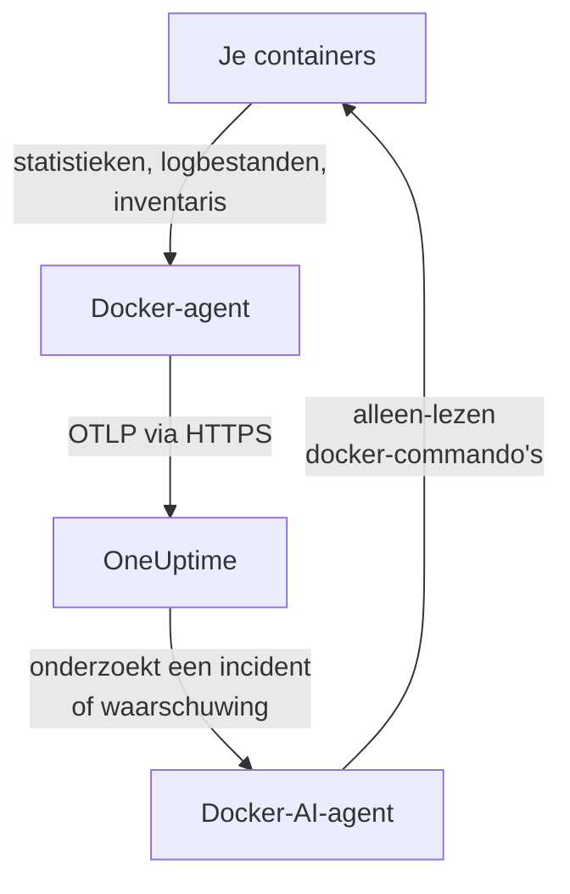

# Docker-agent

De OneUptime Docker-agent is één container die je op een Docker-host draait. Hij leest de statistieken en logbestanden van elke container op de host en stuurt ze naar OneUptime, waar de host verschijnt met zijn containers, metrics en logs. Met een tweede container, de Docker-AI-agent, kan OneUptime AI de host onderzoeken. [Docker-monitors](/docs/monitor/docker-monitor) waarschuwen op basis van wat de agent stuurt.

:::cards
- [De agent installeren](#de-agent-installeren): Twee containers, met `docker run` of Docker Compose.
- [Wat de agent verzamelt](#wat-de-agent-verzamelt): Metrics, logs en een inventaris van elke container.
- [Containerlogs hebben json-file nodig](#containerlogs-hebben-de-logdriver-json-file-nodig): Controleer en wijzig de logdriver van een container.
- [Problemen oplossen](#problemen-oplossen): Herstartlussen, ontbrekende metrics, ontbrekende logs.
:::

## Hoe het werkt

De agent is een OpenTelemetry Collector met de configuratie van OneUptime ingebouwd. Via de Docker-socket leest hij elke 30 seconden de statistieken van elke container en toont hij elke 5 minuten elke container, image, netwerk en volume. Hij volgt de logbestanden van de containers en stuurt alles via OTLP naar je OneUptime-URL, met de ingestiesleutel die je hem geeft.



De host registreert zich met zijn eerste gegevens, onder de naam die je hem geeft in `DOCKER_HOST_NAME`. De AI-agent is optioneel: laat hem weg en de collector werkt precies hetzelfde.

## Voordat je begint

- Docker Engine 20.10 of later, en roottoegang op de host: de agent leest `/var/run/docker.sock`.
- Docker Compose v2 (het commando `docker compose`), als je met Docker Compose installeert.
- Een ingestiesleutel. Maak er een aan onder **Projectinstellingen → Telemetrie & APM → Ingestiesleutels** en kopieer de waarde.
- Uitgaand HTTPS van de host naar je OneUptime-URL.
- Voor containerlogs: containers die de logdriver `json-file` van Docker gebruiken, de standaard van Docker. Zie [Containerlogs hebben de logdriver json-file nodig](#containerlogs-hebben-de-logdriver-json-file-nodig).

## De agent installeren

:::steps
### De agent starten

Vervang `YOUR_ONEUPTIME_URL` door je OneUptime-URL, `YOUR_TELEMETRY_INGESTION_TOKEN` door de ingestiesleutel en `my-docker-host` door een naam voor deze host, zoals `prod-docker-01`. Onder die naam verschijnt de host in OneUptime, dus houd hem stabiel: een nieuwe naam registreert een nieuwe host.

:::tabs
@tab Docker CLI
```bash
docker run -d \
  --name oneuptime-docker-agent \
  --user 0:0 \
  --restart unless-stopped \
  -v /var/run/docker.sock:/var/run/docker.sock:ro \
  -v /var/lib/docker/containers:/var/lib/docker/containers:ro \
  -e ONEUPTIME_URL="YOUR_ONEUPTIME_URL" \
  -e ONEUPTIME_SERVICE_TOKEN="YOUR_TELEMETRY_INGESTION_TOKEN" \
  -e DOCKER_HOST_NAME="my-docker-host" \
  oneuptime/docker-agent:release
```

Start daarna de [AI-agent](#ai-agent) ernaast, met dezelfde waarden. **AI-onderzoeken staan standaard aan**: terwijl OneUptime AI een incident of waarschuwing op deze host onderzoekt, voert die via de AI-agent alleen-lezen `docker`-commando's uit, en verandert niets tenzij je correcties toestaat. Sla dit commando over om zonder AI-onderzoeken te installeren.

```bash
docker run -d \
  --name oneuptime-docker-ai-agent \
  --user 0:0 \
  --restart unless-stopped \
  --read-only --tmpfs /tmp \
  -v /var/run/docker.sock:/var/run/docker.sock:ro \
  -e ONEUPTIME_URL="YOUR_ONEUPTIME_URL" \
  -e ONEUPTIME_SERVICE_TOKEN="YOUR_TELEMETRY_INGESTION_TOKEN" \
  -e ONEUPTIME_AI_AGENT_RESOURCE_TYPE=docker \
  -e DOCKER_HOST_NAME="my-docker-host" \
  oneuptime/resource-ai-agent:release
```
@tab Docker Compose
Sla dit op als `docker-compose.yml` in een map op de host. De tweede service is de [AI-agent](#ai-agent): laat die weg om de collector zonder AI-onderzoeken te draaien.

```yaml title="docker-compose.yml"
services:
  oneuptime-docker-agent:
    image: oneuptime/docker-agent:release
    container_name: oneuptime-docker-agent
    user: "0:0"
    restart: unless-stopped
    volumes:
      - /var/run/docker.sock:/var/run/docker.sock:ro
      - /var/lib/docker/containers:/var/lib/docker/containers:ro
    environment:
      - ONEUPTIME_URL=YOUR_ONEUPTIME_URL
      - ONEUPTIME_SERVICE_TOKEN=YOUR_TELEMETRY_INGESTION_TOKEN
      - DOCKER_HOST_NAME=my-docker-host
    logging:
      driver: json-file
      options:
        max-size: "10m"
        max-file: "3"
  oneuptime-docker-ai-agent:
    image: oneuptime/resource-ai-agent:release
    container_name: oneuptime-docker-ai-agent
    user: "0:0"
    restart: unless-stopped
    read_only: true
    tmpfs:
      - /tmp
    volumes:
      - /var/run/docker.sock:/var/run/docker.sock:ro
    environment:
      - ONEUPTIME_URL=YOUR_ONEUPTIME_URL
      - ONEUPTIME_SERVICE_TOKEN=YOUR_TELEMETRY_INGESTION_TOKEN
      - ONEUPTIME_AI_AGENT_RESOURCE_TYPE=docker
      - DOCKER_HOST_NAME=my-docker-host
```

Start hem in die map:

```bash
docker compose up -d
```
:::

### Controleren of de agent draait

```bash
docker ps --filter name=oneuptime-docker-agent
docker logs -f oneuptime-docker-agent
```

De logs horen deze regel te tonen zodra de collector is gestart:

```text
Everything is ready. Begin running and processing data.
```

### De host vinden in OneUptime

Open **Producten → Infrastructuur → Docker → Alle hosts**. De host verschijnt binnen ongeveer een minuut onder zijn `DOCKER_HOST_NAME`, met zijn containers, metrics en logs. De AI-agent wordt als verbonden weergegeven op de pagina **AI-agent** van de host, en onderaan zijn **Overzicht**.
:::

## Omgevingsvariabelen

| Variabele | Vereist | Beschrijving |
| --- | --- | --- |
| `ONEUPTIME_URL` | Ja | Je OneUptime-URL, zoals `https://oneuptime.com` of je zelf-gehoste instantie. Gebruik `http://` en de poort als de instantie alleen HTTP spreekt. |
| `ONEUPTIME_SERVICE_TOKEN` | Ja | De ingestiesleutel uit **Projectinstellingen → Telemetrie & APM → Ingestiesleutels**. |
| `DOCKER_HOST_NAME` | Nee | De naam van de host in OneUptime. Standaard `docker-host`, dus geef elke host een eigen naam. |
| `DOCKER_API_VERSION` | Nee | De Docker Engine API-versie die de agent spreekt. Standaard `1.44`. Verlaag hem bij een oudere daemon, of stel een lege waarde in om hem met de daemon te laten onderhandelen (zie [Problemen oplossen](#problemen-oplossen)). |

Om een waarde te wijzigen, verwijder je de agent en voer je zijn commando opnieuw uit (Docker CLI), of bewerk je `docker-compose.yml` en voer je `docker compose up -d` uit (Docker Compose).

## Wat de agent verzamelt

| Gegevens | Wat het is |
| --- | --- |
| Containermetrics | CPU (gebruik, percentage, throttling), geheugen (gebruik, limiet, percentage), netwerk- en blok-I/O, uptime, herstarts en aantal processen, per container, elke 30 seconden. |
| Containerlogs | De stdout en stderr van elke container, uit zijn `json-file`-logbestand. |
| Inventaris | Elke container in elke status, en elke image, elk netwerk en elk volume, elke 5 minuten. |

De metrics en logs van elke container worden opgeslagen onder een service die naar de container is genoemd. Elke logregel krijgt een severity op basis van het niveau dat hij noemt, zoals `[ERROR]`, `level=warn` of `{"level":"info"}`; een regel die er geen noemt, krijgt die van zijn stream: stderr is `ERROR`, stdout is `INFO`. Regels die beginnen met witruimte of een sluitend haakje worden aan de vorige regel toegevoegd, dus een stacktrace komt binnen als één record. De eigen logs van de agent worden weggelaten.

[Docker-monitor](/docs/monitor/docker-monitor#verzamelde-metrieken) toont elke metric en wat die betekent.

## Containerlogs hebben de logdriver json-file nodig

De agent volgt `/var/lib/docker/containers/*/*-json.log`, de bestanden die de logdriver `json-file` van Docker schrijft. Een container die een andere driver gebruikt, laat geen bestand achter om te lezen: `local` schrijft binaire bestanden, en `journald`, `syslog`, `fluentd` en `gelf` sturen de logs ergens anders heen. Zijn metrics komen nog steeds binnen; zijn logs niet.

Controleer de logdriver van een container en de standaard van de daemon:

```bash
docker inspect <container> --format '{{.HostConfig.LogConfig.Type}}'
docker info --format '{{.LoggingDriver}}'
```

Zet een Compose-service over op `json-file`, met rotatie:

```yaml
services:
  my-app:
    image: my-app:latest
    logging:
      driver: "json-file"
      options:
        max-size: "100m"
        max-file: "5"
```

Of maak hem de standaard voor elke container die daarna wordt aangemaakt, in `/etc/docker/daemon.json`:

```json title="/etc/docker/daemon.json"
{
  "log-driver": "json-file",
  "log-opts": {
    "max-size": "100m",
    "max-file": "5"
  }
}
```

Herstart daarna Docker en maak de containers opnieuw aan. Een container houdt de logdriver waarmee hij is aangemaakt, dus herstarten is niet genoeg.

## De agent upgraden

Is de agent ouder dan je OneUptime, dan verschijnt er een waarschuwingsteken naast **Agentversie** in het **Overzicht** van de host. Selecteer het om deze commando's te zien.

:::tabs
@tab Docker CLI
```bash
docker pull oneuptime/docker-agent:release
docker pull oneuptime/resource-ai-agent:release
docker rm -f oneuptime-docker-agent oneuptime-docker-ai-agent
```

Voer daarna beide `docker run`-commando's uit [De agent starten](#de-agent-starten) opnieuw uit.
@tab Docker Compose
```bash
docker compose pull
docker compose up -d
```
:::

De tag `release` wijst altijd naar de nieuwste release. Gebruik `oneuptime/docker-agent:<version>` om een versie vast te zetten, zoals `oneuptime/docker-agent:10.0.31`. Dezelfde image staat in de GitHub Container Registry als `ghcr.io/oneuptime/docker-agent:release`.

## De agent verwijderen

:::tabs
@tab Docker CLI
```bash
docker rm -f oneuptime-docker-agent
docker rm -f oneuptime-docker-ai-agent
```
@tab Docker Compose
```bash
docker compose down
```
:::

De host blijft in OneUptime staan met de gegevens die hij heeft gestuurd. Heb je hem niet meer nodig, verwijder hem dan met **Host verwijderen** in zijn menu.

## AI-agent

De commando's en het Compose-bestand hierboven, het `install.sh` van de Docker-agent en de `docker-compose.yml` in zijn [DockerAgent-map](https://github.com/OneUptime/oneuptime/tree/master/agents/DockerAgent) draaien allemaal de **Docker-AI-agent**: een tweede container, `oneuptime-docker-ai-agent` (image `oneuptime/resource-ai-agent:release`), die de alleen-lezen `docker`-commando's uitvoert waarom OneUptime AI vraagt terwijl die een incident of waarschuwing op deze host onderzoekt — `docker ps -a`, `docker logs --tail 200 web`, `docker container inspect web`, `docker stats --no-stream` — en, alleen als je het toestaat, correcties toepast zoals het herstarten van een bepaalde container. Hij leest dezelfde `ONEUPTIME_URL`, `ONEUPTIME_SERVICE_TOKEN` en `DOCKER_HOST_NAME` als de collector, dus hij bedient precies deze host, en hij verschijnt op de pagina **AI-agent** van de host in OneUptime.

- **AI-onderzoeken staan standaard aan.** Zodra de agent verbinding maakt, onderzoekt OneUptime AI er incidenten en waarschuwingen op deze host mee, en het **Overzicht** van de host toont de status van de agent. Om te stoppen, stel je `ONEUPTIME_AI_INVESTIGATION=false` in waar de agent draait (**Wijzigen** onder **Wat AI mag doen** op de pagina van de AI-agent laat zien hoe), of laat je de agent weg.
- Hij is alleen-lezen, tenzij je hem start met `ONEUPTIME_AI_ALLOW_WRITES=true`; `ONEUPTIME_AI_WRITE_TARGETS` (bijvoorbeeld `web-*,api-*`) beperkt welke containers een correctie mag aanraken. Start hem ook met `ONEUPTIME_AI_FIXES` om te bepalen hoe correcties verlopen — `ask-for-approval` (iemand keurt elke correctie goed), `automatic` of `bypass-approval` — en de pagina van de AI-agent toont het alleen-lezen ([Wat AI mag doen, ingesteld door de agent](/docs/ai/infrastructure-ai-agents#what-ai-may-do-set-by-the-agent)).
- Hij draait als root met de Docker-socket gemount, omdat de socket van root is — en wie de socket kan gebruiken, is root op deze host, `:ro` of niet. Het commandobeleid van de agent is de grens: hij voert nooit `exec`, `run`, `rm` of `prune` uit, en wijzigt nooit zichzelf, de collector of iets in `ONEUPTIME_AI_PROTECTED_TARGETS` (globs voor containernamen). Omgevingswaarden in de uitvoer van `docker inspect` worden gemaskeerd voordat er iets de host verlaat.
- `install.sh --no-ai-agent` laat hem weg; `docker rm -f oneuptime-docker-ai-agent` verwijdert hem. Upgrade hem zoals de collector: `docker pull oneuptime/resource-ai-agent:release`, verwijder hem en start hem opnieuw.

Wat hij mag uitvoeren, hoe correcties werken en hoe je problemen oplost: [Infrastructure AI Agents](/docs/ai/infrastructure-ai-agents#docker-and-podman-hosts).

## Problemen oplossen

:::details De agent herstart met "client version is too new"
De logs van de agent tonen:

```text
Error: cannot start pipelines: failed to start "docker_stats" receiver:
Error response from daemon: client version 1.44 is too new.
Maximum supported API version is 1.41
```

Een daemon weigert een client die nieuwer is dan zijn eigen maximum, dus de receiver start nooit en de collector stopt mee. Zoek het maximum van de daemon op:

```bash
docker version --format '{{ .Server.APIVersion }}'
```

Voeg daarna `-e DOCKER_API_VERSION=1.41` (of de waarde die je kreeg) toe aan `docker run`, of stel `DOCKER_API_VERSION` in Compose in. Nieuwere daemons bedienen nog steeds oudere API-versies, dus de instelling blijft na een upgrade geldig.

Liever het nummer niet opzoeken? Stel `DOCKER_API_VERSION` in op de lege string. De agent onderhandelt de versie dan met de daemon (één `HEAD /_ping`, daarna het eigen maximum van de daemon), wat met zowel oude als nieuwe daemons werkt:

```bash
docker run -d ... -e DOCKER_API_VERSION= ...
```
:::

:::details Toegang geweigerd tot de Docker-socket
De agent moet als root draaien om `/var/run/docker.sock` te lezen. Controleer of `--user 0:0` in je `docker run`-commando staat, of `user: "0:0"` in Compose.
:::

:::details De host wordt als verbroken weergegeven
1. Controleer of de agent draait: `docker ps --filter name=oneuptime-docker-agent`
2. Zoek naar fouten in zijn logs: `docker logs oneuptime-docker-agent 2>&1 | grep -i error`
3. Controleer `ONEUPTIME_URL` en `ONEUPTIME_SERVICE_TOKEN`: de sleutel moet een geldige ingestiesleutel zijn die niet is uitgeschakeld.
4. Controleer of de host je OneUptime-URL via het netwerk kan bereiken.
:::

:::details Er verschijnen geen metrics
1. Controleer of de Docker-socket in de agent is gemount. Zijn image heeft geen shell, dus kijk vanuit een wegwerpcontainer die zijn mounts deelt: `docker run --rm --volumes-from oneuptime-docker-agent alpine:3.19 ls -la /var/run/docker.sock`
2. Zoek naar exportfouten in zijn logs: `docker logs oneuptime-docker-agent 2>&1 | tail -100`
3. Controleer of de ingestiesleutel geldig is en niet is verlopen.
:::

:::details Metrics komen binnen, maar geen containerlogs
Je containers gebruiken waarschijnlijk een andere logdriver dan `json-file`. Controleer welke bestanden de agent bewaakt, en welke driver een container gebruikt:

```bash
docker logs oneuptime-docker-agent 2>&1 | grep -E "Started watching file|no files match"
docker inspect <container> --format '{{.HostConfig.LogConfig.Type}}'
```

Meldt de agent `no files match the configured criteria`, zet de containers dan over op `json-file` en maak ze opnieuw aan, zoals [Containerlogs hebben de logdriver json-file nodig](#containerlogs-hebben-de-logdriver-json-file-nodig) laat zien.
:::

:::details De logs staan bij een andere host, of de host heet docker-host
De naam van de host komt uit `DOCKER_HOST_NAME`. Een agent die zonder deze variabele is gestart, meldt `docker-host`, dus elke host die zo is ingericht, lijkt dezelfde; wijzig je de naam later, dan registreert OneUptime een tweede host, die dan de nieuwe gegevens bevat. Stel `DOCKER_HOST_NAME` op elke host in op een eigen naam, en maak de agent opnieuw aan. Om de naam te controleren die de agent meldt:

```bash
docker inspect oneuptime-docker-agent --format '{{range .Config.Env}}{{println .}}{{end}}' | grep DOCKER_HOST_NAME
```
:::

## Volgende stappen

:::cards
- [Docker-monitor](/docs/monitor/docker-monitor): Waarschuw op CPU, geheugen en herstarts van containers.
- [Databases](/docs/telemetry/databases): Databasecontainers op de host worden gevonden en krijgen eigen pagina's.
- [Kubernetes-agent](/docs/telemetry/kubernetes-agent): Monitor in plaats daarvan een Kubernetes-cluster.
- [OpenTelemetry-collector op de host](/docs/telemetry/host-otel-collector): Monitor de machine zelf: CPU, schijven, processen en logs.
:::
