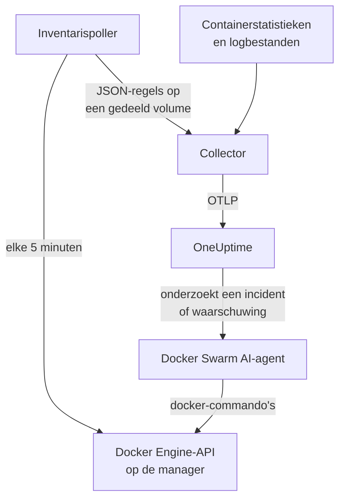

# Docker Swarm-agent

De OneUptime Docker Swarm-agent bewaakt een Docker Swarm-cluster: de nodes, services, taken, stacks, overlaynetwerken, secrets, configs en volumes, plus de metrics en logs van elke container. Je draait hem met Docker Compose op een managernode van de swarm, en het cluster verschijnt in OneUptime met al deze onderdelen. [Docker Swarm-monitors](/docs/monitor/docker-swarm-monitor) waarschuwen op wat er binnenkomt.

:::cards
- [De agent installeren](#de-agent-installeren): Het installatiescript of Docker Compose, op een managernode.
- [Wat de agent verzamelt](#wat-de-agent-verzamelt): De inventaris, de clustertellingen, en containermetrics en -logs.
- [AI-agent](#ai-agent): Laat OneUptime AI de swarm lezen terwijl het onderzoekt.
- [Problemen oplossen](#problemen-oplossen): Een diagnosescript, en de gebruikelijke problemen.
:::

## Hoe het werkt

De agent bestaat uit drie containers, allemaal gedefinieerd in één `docker-compose.yml`:

1. **Collector**: een OpenTelemetry Collector die `docker_stats` leest voor de metrics van elke container, de logbestanden van de containers volgt en het bestand met de inventarissnapshot volgt. Hij stempelt alles met de naam van je cluster (`docker.swarm.cluster.name`) en stuurt het via OTLP naar OneUptime.
2. **Inventarispoller**: een kleine sidecar met `curl` en `jq` die elke 5 minuten de API van de swarmmanager doorloopt (`/nodes`, `/services`, `/tasks`, `/networks`, `/secrets`, `/configs`, `/volumes`) en de stacks afleidt uit het servicelabel `com.docker.stack.namespace`. Hij schrijft één JSON-regel per object, die de collector doorstuurt.
3. **AI-agent**: `oneuptime-docker-swarm-ai-agent`, die de `docker`-commando's uitvoert waar OneUptime AI om vraagt terwijl het een incident of waarschuwing op dit cluster onderzoekt. Hij is alleen-lezen, tenzij je fixes toestaat (zie [AI-agent](#ai-agent)).



Het cluster registreert zich met zijn eerste gegevens, onder de clusternaam die je configureert.

## Voordat je begint

- Een **manager**node van de swarm om de agent op te draaien: de inventarispoller en de AI-agent roepen API-endpoints aan die alleen managers beantwoorden.
- Docker Engine 20.10 of nieuwer met de Docker Compose v2-plugin.
- Een ingestiesleutel. Maak er een aan onder **Projectinstellingen → Telemetrie & APM → Ingestiesleutels** en kopieer de waarde.
- Uitgaand HTTPS van de node naar je OneUptime-URL.

### Waar je de agent draait

Draai hem op een managernode. De collector meldt de containers van de node waarop hij draait; draai voor de containermetrics van alle nodes dus de collector op elke node, allemaal met dezelfde `DOCKER_SWARM_CLUSTER_NAME`. De inventarispoller en de AI-agent hoeven maar op één manager te draaien. `install.sh` laat de AI-agent weg op een node die geen manager is (en verwijdert er een die het daar eerder installeerde). Een AI-agent die toch op een worker start, registreert zich nooit voor het cluster: hij wacht tot zijn node een manager is en kan de AI-agent van de manager dus niet verdringen. Rol je de agent uit als swarmstack in plaats van met Compose? Houd de inventarispoller en de AI-agent op managers met de constraint `node.role == manager`.

## De agent installeren

:::steps
### De agent installeren en starten

:::tabs
@tab install.sh
Download het installatiescript en voer het uit op een managernode:

```bash
curl -sSL https://raw.githubusercontent.com/OneUptime/oneuptime/master/agents/DockerSwarmAgent/install.sh -o install.sh
sh install.sh
```

Het script vraagt om je OneUptime-URL, de ingestiesleutel en een naam voor het cluster. Het installeert naar `/opt/oneuptime-docker-swarm-agent`, schrijft een `.env`-bestand dat alleen de eigenaar kan lezen en start alle drie de containers. Voeg `--no-ai-agent` toe om de AI-agent weg te laten.
@tab Docker Compose
Download `docker-compose.yml`, `otel-collector-config.yaml` en `inventory-snapshot.sh` uit de [DockerSwarmAgent-map](https://github.com/OneUptime/oneuptime/tree/master/agents/DockerSwarmAgent) naar een nieuwe map op een managernode:

```bash
curl -fsSL https://raw.githubusercontent.com/OneUptime/oneuptime/master/agents/DockerSwarmAgent/docker-compose.yml -o docker-compose.yml
curl -fsSL https://raw.githubusercontent.com/OneUptime/oneuptime/master/agents/DockerSwarmAgent/otel-collector-config.yaml -o otel-collector-config.yaml
curl -fsSL https://raw.githubusercontent.com/OneUptime/oneuptime/master/agents/DockerSwarmAgent/inventory-snapshot.sh -o inventory-snapshot.sh
chmod +x inventory-snapshot.sh
```

Maak er een `.env`-bestand naast. Het bevat de ingestiesleutel, dus houd het privé met `chmod 600 .env`:

```bash title=".env"
ONEUPTIME_URL=https://oneuptime.com
ONEUPTIME_SERVICE_TOKEN=your-telemetry-ingestion-key
DOCKER_SWARM_CLUSTER_NAME=my-swarm
```

Start de agent:

```bash
docker compose up -d
```
:::

### Controleren of de agent draait

```bash
docker compose ps
docker compose logs --tail 50 oneuptime-docker-swarm-agent oneuptime-docker-swarm-inventory
```

`docker compose ps` toont drie containers: de collector (`oneuptime-docker-swarm-agent`), de inventarispoller (`oneuptime-docker-swarm-inventory`) en de AI-agent (`oneuptime-docker-swarm-ai-agent`).

### Het cluster vinden in OneUptime

Open **Producten → Infrastructuur → Docker Swarm → Alle clusters**. Het cluster verschijnt binnen een paar minuten, en de pagina's **Knooppunten**, **Services**, **Taken**, **Stacks**, **Netwerken**, **Geheimen**, **Configs** en **Volumes** vullen zich na de eerste inventarissnapshot, binnen 5 minuten.
:::

## Omgevingsvariabelen

Het installatiescript schrijft de eerste drie naar `/opt/oneuptime-docker-swarm-agent/.env`; een Docker Compose-installatie leest ze uit de `.env` naast `docker-compose.yml`. Voeg daar een ervan toe of wijzig hem, en voer daarna `docker compose up -d` uit in die map.

| Variabele | Vereist | Beschrijving |
| --- | --- | --- |
| `ONEUPTIME_URL` | Ja | Je OneUptime-URL, zoals `https://oneuptime.com` of je zelf-gehoste instantie. Gebruik `http://` en de poort als de instantie alleen HTTP spreekt. |
| `ONEUPTIME_SERVICE_TOKEN` | Ja | De ingestiesleutel uit **Projectinstellingen → Telemetrie & APM → Ingestiesleutels**. |
| `DOCKER_SWARM_CLUSTER_NAME` | Ja | De naam van het cluster in OneUptime, en de sleutel waarop de gegevens van elke node samenkomen: op alles gestempeld als het resource-attribuut `docker.swarm.cluster.name`. Houd hem stabiel: een latere wijziging registreert een tweede cluster. Standaard `docker-swarm`. |
| `DOCKER_INVENTORY_INTERVAL_SECONDS` | Nee | Hoe vaak de inventarispoller een snapshot maakt, in seconden. Standaard `300`. |
| `DOCKER_API_VERSION` | Nee | De versie van de Docker Engine-API die de collector en de inventarispoller spreken. Standaard `1.44`; leeg onderhandelt hem met de daemon (zie [Problemen oplossen](#problemen-oplossen)). De AI-agent onderhandelt hem, tenzij je er een instelt. |

De eigen instellingen van de AI-agent staan onder [AI-agent](#ai-agent).

## Wat de agent verzamelt

| Signaal | Bron | Waar het verschijnt |
| --- | --- | --- |
| De nodes, services, taken, stacks, netwerken, secrets, configs en volumes | De inventarispoller, uit de API van de swarmmanager | De lijsten en detailpagina's van het cluster |
| Clustertellingen (nodes gereed, taken actief, services, stacks, …) | Dezelfde snapshot | De kaarten van het overzicht en de badges van het zijmenu |
| CPU, geheugen, aantal processen en uptime van containers | De receiver `docker_stats` | De pagina **Metrieken** |
| stdout- en stderr-logs van containers | De receiver `filelog` | De pagina **Logboeken** |

### Hoe hij verschilt van de Docker-agent

De [Docker-agent](/docs/telemetry/docker-host) modelleert één host en stempelt `host.name` en `container.runtime=docker`. De Docker Swarm-agent stempelt bewust alleen `docker.swarm.cluster.name`: OneUptime zet de gegevens dan onder het swarmcluster, in plaats van elke node als eigen host te registreren.

## Het cluster labelen met projectlabels

Een resource-attribuut dat begint met `oneuptime.label.` wordt een projectlabel op het cluster: `oneuptime.label.<dimension>=<value>` is het label `<dimension>:<value>`. Voeg de attributen toe aan de processor `resource` in `otel-collector-config.yaml`, naast `docker.swarm.cluster.name`:

```yaml
processors:
  resource:
    attributes:
      # ...existing attributes...
      - key: oneuptime.label.team
        value: platform
        action: upsert
      - key: oneuptime.label.env
        value: production
        action: upsert
```

De collector leest zijn configuratie alleen bij het starten: voer `docker compose restart oneuptime-docker-swarm-agent` uit. Het cluster toont dan de labels `team:platform` en `env:production`. Labels worden zonder onderscheid tussen hoofd- en kleine letters vergeleken, dus een bestaand label `Production` wordt hergebruikt in plaats van gedupliceerd, en de agent verwijdert nooit een label dat iemand in OneUptime heeft toegevoegd.

## Draaien als systemd-service

Installeer de systemd-unit van de agent om hem met de node te starten en hem te herstarten als hij faalt. De unit gaat ervan uit dat de agent in `/opt/oneuptime-docker-swarm-agent` staat, waar het installatiescript hem neerzet:

```bash
sudo curl -fsSL https://raw.githubusercontent.com/OneUptime/oneuptime/master/agents/DockerSwarmAgent/systemd/oneuptime-docker-swarm-agent.service -o /etc/systemd/system/oneuptime-docker-swarm-agent.service
sudo systemctl daemon-reload
sudo systemctl enable --now oneuptime-docker-swarm-agent
```

## De agent upgraden

De agent meldt de collectorversie die hij draait. Is die ouder dan de versie die deze OneUptime-release vastzet, dan verschijnt er een waarschuwingsteken naast de versie van de agent op de pagina **Overzicht** van het cluster. Selecteer het om deze commando's te zien.

Voer het installatiescript opnieuw uit op de managernode en beantwoord de vragen met dezelfde URL, sleutel en clusternaam. Het downloadt de nieuwste bestanden, pullt de images en herstart de agent:

```bash
curl -sSL https://raw.githubusercontent.com/OneUptime/oneuptime/master/agents/DockerSwarmAgent/install.sh -o install.sh
sh install.sh
```

Het script schrijft `.env` opnieuw op basis van je antwoorden. Het bewaart alleen de doellijsten van de AI-agent en wat AI mag doen (`ONEUPTIME_AI_INVESTIGATION`, `ONEUPTIME_AI_FIXES`): voeg elke variabele die je zelf had ingesteld opnieuw toe, zoals `DOCKER_API_VERSION`. AI-fixes aangezet? Voer het uit als `ONEUPTIME_AI_ALLOW_WRITES=true sh install.sh` om ze aan te laten. De AI-agent weggelaten? Geef opnieuw `--no-ai-agent` mee.

Download met Docker Compose de drie bestanden opnieuw in de map van de agent (en voer eventuele wijzigingen aan `docker-compose.yml` opnieuw door), pull dan en herstart:

```bash
docker compose pull
docker compose up -d
```

De collectorversie ligt vast in de bestanden, dus alleen pullen brengt de agent niet verder.

## De agent verwijderen

```bash
cd /opt/oneuptime-docker-swarm-agent
docker compose down
```

## AI-agent

De `docker-compose.yml` van de swarm (en `install.sh`) draait ook de **Docker Swarm-AI-agent**: een derde container, `oneuptime-docker-swarm-ai-agent` (image `oneuptime/resource-ai-agent:release`), die de alleen-lezen `docker`-commando's uitvoert waar OneUptime AI om vraagt terwijl het een incident of waarschuwing op dit cluster onderzoekt — `docker node ls`, `docker service ps web --no-trunc`, `docker service logs --tail 200 web` — en, alleen als je dat toestaat, fixes toepast zoals een rolling restart van een benoemde service. Hij leest dezelfde `ONEUPTIME_URL`, `ONEUPTIME_SERVICE_TOKEN` en `DOCKER_SWARM_CLUSTER_NAME` als de collector, bedient dus precies dit cluster, en verschijnt in OneUptime op de pagina **AI → AI-agent** van het cluster.

- **AI-onderzoeken staan standaard aan.** Zodra de agent verbinding maakt, onderzoekt OneUptime AI er incidenten en waarschuwingen op dit cluster mee, en het **Overzicht** van het cluster toont de status van de agent. Om te stoppen, stel je `ONEUPTIME_AI_INVESTIGATION=false` in waar de agent draait (**Wijzigen** onder **Wat AI mag doen** op de pagina van de AI-agent laat zien hoe), of laat je de agent weg.
- Net als de inventarispoller **moet hij op een managernode draaien**: commando's voor nodes, services en taken bestaan alleen op managers. Op een worker voert hij niets uit en registreert hij zich niet voor het cluster tot de node een manager is (zijn `/status` zegt waarom). Draai er één per cluster.
- Hij is **alleen-lezen**, tenzij je `ONEUPTIME_AI_ALLOW_WRITES=true` in `.env` instelt en `docker compose up -d` uitvoert (of `install.sh` ermee uitvoert; het installatiescript schrijft `ONEUPTIME_AI_ALLOW_WRITES`, `ONEUPTIME_AI_INVESTIGATION`, `ONEUPTIME_AI_FIXES`, `ONEUPTIME_AI_WRITE_TARGETS` en `ONEUPTIME_AI_PROTECTED_TARGETS` uit zijn omgeving naar `.env`, en een nieuwe run bewaart voor de laatste vier wat `.env` al heeft, tenzij je die variabele meegeeft, ook leeg); `ONEUPTIME_AI_WRITE_TARGETS` (globs van service- en nodenamen, bijvoorbeeld `web_*,api_*`) beperkt wat een fix mag aanraken. `ONEUPTIME_AI_FIXES` in dezelfde `.env` bepaalt hoe fixes verlopen — `ask-for-approval` (een persoon keurt elke fix goed), `automatic` of `bypass-approval` — en de pagina van de AI-agent toont dit alleen-lezen ([Wat AI mag doen, ingesteld door de agent](/docs/ai/infrastructure-ai-agents#what-ai-may-do-set-by-the-agent)). Een node leegmaken (drain) vraagt altijd de goedkeuring van een persoon, ongeacht de modus.
- Hij draait als root met de Docker-socket gekoppeld, omdat de socket van root is — en op een manager beheerst wie de socket kan gebruiken de hele swarm, met of zonder `:ro`. Het commandobeleid van de agent is de grens: hij maakt of verwijdert nooit services of stacks, raakt nooit secrets of configs aan, en wijzigt nooit zichzelf, de collector, de inventarispoller of iets in `ONEUPTIME_AI_PROTECTED_TARGETS` (globs van service- en nodenamen).
- `install.sh --no-ai-agent` laat hem weg; je kunt ook de service `oneuptime-docker-swarm-ai-agent` uit `docker-compose.yml` verwijderen.

Wat hij mag uitvoeren, hoe fixes werken en hoe je hem probleemoplost: [Infrastructure AI Agents](/docs/ai/infrastructure-ai-agents#docker-swarm-clusters).

## Problemen oplossen

:::details Voer eerst het diagnosescript uit
De agent wordt geleverd met een script, [`troubleshoot.sh`](https://github.com/OneUptime/oneuptime/blob/master/agents/DockerSwarmAgent/troubleshoot.sh), dat de hele keten controleert: de containers, of de inventarispoller op een manager staat (`docker node ls`), het snapshotbestand, de clusternaam die op alles is gestempeld, de vorm van het token, de eigen metrics van de collector, en of OneUptime de ingestiesleutel accepteert. Die laatste controle is het belangrijkst. OneUptime weigert een onjuiste sleutel met `401` (`422` voor een uitgeschakelde sleutel of een browsersleutel), en de collector logt dat als één regel `Exporting failed` per batch, die makkelijk over het hoofd wordt gezien. Het script vraagt `GET <url>/otlp/v1/validate` op voor een direct `200` (geldig) of `401` (ongeldig). Voer het uit op de managernode:

```bash
curl -sSL https://raw.githubusercontent.com/OneUptime/oneuptime/master/agents/DockerSwarmAgent/troubleshoot.sh -o troubleshoot.sh
bash troubleshoot.sh    # add -d <dir> if you installed outside /opt/oneuptime-docker-swarm-agent
```
:::

:::details Het cluster verschijnt nooit
Voer eerst het diagnosescript uit. Lees anders de logs van de collector (`docker compose logs oneuptime-docker-swarm-agent`), controleer of `ONEUPTIME_SERVICE_TOKEN` en `ONEUPTIME_URL` in `.env` kloppen en of de node je OneUptime-URL kan bereiken.
:::

:::details Er verschijnt geen inventaris
Controleer of de inventarispoller op een manager draait: `docker node ls` moet daar slagen. Zoek daarna naar regels `failed to emit ...` in zijn logs: `docker compose logs oneuptime-docker-swarm-inventory`.
:::

:::details Het cluster springt naar verbroken
Een cluster krijgt de status verbroken zodra OneUptime er 15 minuten niets van heeft ontvangen; OneUptime controleert elke 5 minuten, en tijd waarin het zelf geen gegevens ontving, telt niet mee. Zorg dat de collectorcontainer blijft draaien: `docker compose ps` toont hem.
:::

:::details De collector stopt met "client version is too new"
De logs van de collector tonen:

```text
Error: cannot start pipelines: failed to start "docker_stats" receiver:
Error response from daemon: client version 1.44 is too new.
Maximum supported API version is 1.41
```

De hoogste API-versie van de daemon ligt onder de standaard `1.44` (Docker Engine 20.10 stopt bij `1.41`), dus de receiver `docker_stats` kan niet starten en de container herstart in een lus. Zoek de hoogste versie van de daemon op:

```bash
docker version --format '{{ .Server.APIVersion }}'
```

Stel `DOCKER_API_VERSION` in `.env` in op die waarde en voer `docker compose up -d` uit op elke node waarop de agent draait. Nieuwere daemons bedienen nog steeds oudere API-versies, dus de instelling blijft werken nadat je Docker hebt bijgewerkt. Of stel `DOCKER_API_VERSION=` (leeg) in, zodat de collector de versie met de daemon onderhandelt in plaats van er een vast te zetten.
:::

:::details Het cluster verschijnt onder de verkeerde naam
De naam van het cluster komt uit `DOCKER_SWARM_CLUSTER_NAME`. Wijzig hem in `.env` en voer `docker compose up -d` uit: een nieuwe naam registreert een nieuw cluster in plaats van het oude te hernoemen.
:::

## Volgende stappen

:::cards
- [Docker Swarm-monitor](/docs/monitor/docker-swarm-monitor): Waarschuw op nodes, services, taken en containers.
- [Infrastructure AI Agents](/docs/ai/infrastructure-ai-agents): Wat de Docker Swarm AI-agent mag uitvoeren en hoe fixes werken.
- [Docker-agent](/docs/telemetry/docker-host): Bewaak in plaats daarvan één Docker-host.
:::
