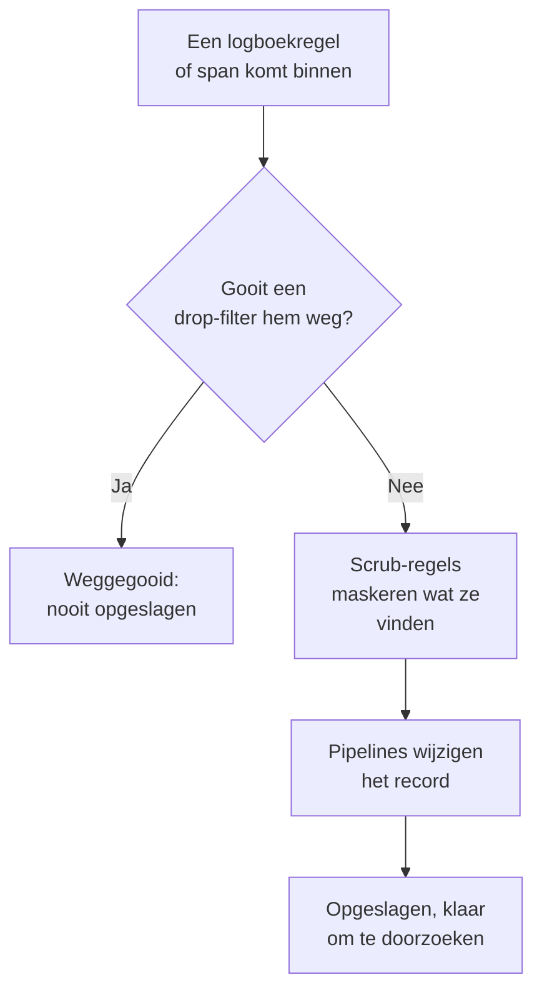

# Drop-filters en scrub-regels

Drop-filters en scrub-regels werken op uw logboeken en spans terwijl ze binnenkomen, voordat er iets wordt opgeslagen. Een drop-filter gooit de records weg die u nooit nodig hebt, of houdt er alleen een steekproef van. Een scrub-regel maskeert persoonsgegevens en geheimen, zoals e-mailadressen, kaartnummers en wachtwoorden, zodat ze uw opslag nooit bereiken.

:::cards
- [Waar ze draaien](#waar-ze-draaien): Vóór de pipelines, vóór de opslag.
- [Records weggooien of bemonsteren](#records-weggooien-of-bemonsteren): Records selecteren, en ze dan weggooien of een deel houden.
- [Wat een filter zou wegnemen](#wat-een-filter-zou-wegnemen): Wat de records leest, voordat u het opslaat.
- [Gevoelige gegevens opschonen](#gevoelige-gegevens-opschonen): Wegstrepen, maskeren of hashen wat een patroon vindt.
- [Controleren wat een filter weggooide](#controleren-wat-een-filter-weggooide): Tellingen op elk filter.
:::

## Waar ze draaien

Logboeken hebben de hunne onder **Logboeken → Instellingen**, en spans onder **Traces → Instellingen**. Als er een record binnenkomt, voert OneUptime ze in deze volgorde uit:



- **Ze werken alleen op nieuwe records.** Een regel die u aanmaakt of wijzigt, geldt voor records die ongeveer een minuut later binnenkomen. Records die al zijn opgeslagen, veranderen niet.
- **Een weggegooid record is weg.** Geen zoekopdracht, grafiek, monitor of opnameregel ziet het ooit, en er wordt geen uitzondering van gemaakt. Op OneUptime Cloud wordt het ook niet gefactureerd.
- **Elke lijst draait op volgorde.** Sleep de rijen van een lijst om de volgorde te wijzigen. Alleen ingeschakelde filters en regels draaien.

Drop-filters en scrub-regels voor logboeken gelden net zo goed voor logboeken uit OpenTelemetry, Syslog, Fluent Bit en Fluentd. [Logboekpipelines](/docs/telemetry/log-pipelines) legt de stap daarna uit.

## Voordat u begint

- **Logboeken of spans die binnenkomen.** Zie [OpenTelemetry](/docs/telemetry/open-telemetry).
- **Een rol die telemetrie-instellingen wijzigt.** Projecteigenaar of Projectbeheerder, of een aangepaste rol met de machtiging voor wat u wijzigt, zoals Create Log Drop Filter of Create Trace Scrub Rule. De Telemetry-rollen kunnen filters en regels zien, maar niet wijzigen.

## Records weggooien of bemonsteren

:::steps
### Drop-filters openen

Ga naar **Logboeken → Instellingen → Drop-filters**, of naar **Traces → Instellingen → Drop-filters** voor spans.

### De records selecteren

Klik op **Logboek Drop Filter aanmaken**, of op **Tracedropfilter aanmaken** voor spans. Geef het filter bij **Overeenkomst** een **Naam**, en bouw dan zijn **Filterquery**: een veld, een operator en een waarde voor elke voorwaarde, en of **Alle voorwaarden** of **Een van de voorwaarden** moet overeenkomen. Klik op **Volgende**.

### De actie kiezen

Houd bij **Actie** de keuze **Verwijderen** om elk overeenkomend record weg te gooien, of kies **Voorbeeld** en vul het **Voorbeeldpercentage** in dat u wilt houden, van 1 tot 99. Maak daarna het filter aan.
:::

Het filter begint binnen een minuut met weggooien. Om het op te slaan zonder al iets weg te gooien, zet u **Ingeschakeld** uit onder **Geavanceerd** voordat u het aanmaakt.

> [!WARNING]
> Een weggegooid record kan niet worden teruggehaald. Houd de query van een filter smal, en let op zijn telling **Verworpen** nadat u het hebt aangemaakt.

Een filter kan deze velden testen, en elk attribuut met **Custom Attribute...**:

| Records | Velden |
| --- | --- |
| Logboeken | **Ernst**, **Logtekst**, **Service-ID** |
| Spans | **Span-naam**, **Span-soort**, **Status**, **Statusbericht**, **Service-ID**, **Heeft uitzondering**, **Is root-span** |

| Operator | Komt overeen met |
| --- | --- |
| **is gelijk aan** | De exacte waarde, met haar hoofdletters en kleine letters: `Debug` komt overeen, `DEBUG` niet. |
| **is niet gelijk aan** | Alles behalve de exacte waarde. |
| **bevat** | De waarde ergens in het veld, ongeacht hoofdletters. Een `%` in de waarde is een jokerteken. |
| **is een van** | Een van een lijst exacte waarden, gescheiden door komma's. |

**Preview query** toont de query die de voorwaarden vormen. Deze gooit de debugregels van een health check weg:

```text
severityText = 'Debug' AND body LIKE 'healthcheck'
```

Bemonstering beslist per record: bij een **Voorbeeldpercentage** van 10 wordt ongeveer één op de tien overeenkomende records bewaard. Filters draaien in de volgorde van de lijst, en het eerste dat een record weggooit, beslist; een record dat een steekproef houdt, gaat door naar het volgende filter.

## Wat een filter zou wegnemen

Een weggegooid record is weg voor alles wat het leest. Daarom zegt het formulier van een drop-filter terwijl u het schrijft wat het zou wegnemen, een moment nadat u stopt met typen: onder de **Filterquery** bij **Overeenkomst**, en onder de actie bij **Actie**. Eén regel noemt het belangrijkste effect, en **Details tonen** noemt de rest:

- **Hoeveel het selecteert.** Hoeveel van de records die de afgelopen dag zijn opgeslagen overeenkomen: wat het filter uit uw opslag en van uw rekening houdt. Er wordt geteld op wat werd opgeslagen, nadat scrub-regels en pipelines het hebben gewijzigd, en alleen over de services waarvan u de records kunt lezen. Een telling die langer dan 10 seconden duurt, wordt gestopt, en het formulier zegt dat.
- **Wat Beveiligingsgebeurtenissen zou verliezen.** Waar [Beveiligingsgebeurtenissen](/docs/telemetry/security-events) uw logboeken leest met de kaart **Uw logboeken**, of uw spans, zegt het formulier hoeveel van de overeenkomende records het heeft gelezen: de aanmeldingen, aanvallen en firewallrecords die het in gebeurtenissen omzet. Een filter met **Voorbeeld** noemt ook de regels die bij een aantal afgaan, en wat er met die regels gebeurt als het filter alleen zijn deel houdt: bij 10% heeft een regel die afgaat bij 10 mislukte aanmeldingen in vijf minuten er ongeveer 100 nodig, dus gaat hij veel minder vaak af, of nooit.
- **Wat verder dezelfde records leest.** De monitors, SLO's, dashboards met hun widgets, opnameregels en opgeslagen weergaven waarvan de query's een record kunnen bevatten dat het filter wegneemt. Een query leest ze wanneer hij hetzelfde soort record leest, van een service waaruit het filter kan wegnemen, en niets wat hij op een exacte waarde vastlegt, het filter uitsluit: een filter op logboeken van **Debug** laat een monitor van fouten met rust, en een filter op één service laat het SLO van een andere service met rust. Alles wat het formulier niet kan uitsluiten, zoals een zoekopdracht in de logtekst, telt als lezen. Elk is een link, en wat u niet kunt openen, wordt geteld, maar nooit genoemd.

Wanneer iets leest wat een filter wegneemt, vraagt OneUptime u om een bevestiging als u het filter aanmaakt, het inschakelt of de query of actie wijzigt van een filter dat aan staat. Het filter wordt hoe dan ook opgeslagen: de vraag is er zodat u weet wat u beslist. Een filter dat niets leest, wordt zonder vraag opgeslagen.

Via de API wordt niets gevraagd, want een script of Terraform heeft niemand die kan antwoorden. Een filter dat via de API wordt aangemaakt of gewijzigd, wordt opgeslagen, en als het wegneemt wat anderen lezen, draagt het antwoord een header `X-OneUptime-Write-Warning` die dat in aantallen zegt, en die de Terraform-provider als waarschuwing toont. Om eerst te vragen, stuurt u `filterQuery`, `action` en `samplePercentage` van het filter naar `POST /api/telemetry/logs/drop-filter-impact`, of naar `/api/telemetry/traces/drop-filter-impact` voor spans: het antwoord bevat alles wat het formulier toont.

De OpenStack-filters die OneUptime aan een project toevoegt, houden elke logregel die Beveiligingsgebeurtenissen leest, zolang ze zijn zoals OneUptime ze maakte. Wijzig er een, en het gooit weg wat het selecteert, zoals een filter van uzelf.

## Gevoelige gegevens opschonen

:::steps
### Scrub-regels openen

Ga naar **Logboeken → Instellingen → Scrub-regels**, of naar **Traces → Instellingen → Scrub-regels** voor spans.

### Kiezen wat er gevonden moet worden

Klik op **Logboek Scrub Regel aanmaken**, of op **Trace Scrub Regel aanmaken** voor spans, en kies een **Patroontype**. De regel krijgt de naam ervan, zoals **E-mailadressen opschonen**, totdat u zelf een naam typt. Vul voor **Aangepaste reguliere expressie** ook het **Aangepast regex-patroon** in.

### Kiezen hoe er wordt opgeschoond

Kies onder **Geavanceerd** de **Opschoonactie** en de **Te wissen velden**, of laat ze zoals ze zijn: een nieuwe regel vervangt elke overeenkomst door `[REDACTED]`, waar die ook in het record staat. Maak daarna de regel aan.
:::

| Patroontype | Wat het vindt |
| --- | --- |
| **E-mailadres** | E-mailadressen, zoals `jane@example.com` |
| **Creditcardnummer** | Zestien cijfers in groepen van vier, zoals `4111 1111 1111 1111` |
| **SSN (burgerservicenummer)** | Amerikaanse socialezekerheidsnummers, zoals `123-45-6789` |
| **Telefoonnummer** | Noord-Amerikaanse telefoonnummers, zoals `555-123-4567` |
| **IP-adres** | Openbare IPv4- en IPv6-adressen, zoals `203.0.113.7` of `2001:db8::1`, maar geen privé-, loopback- of link-local-adressen |
| **Gevoelige attribuutsleutels** | De hele waarde van elk attribuut waarvan de sleutel er geheim uitziet, zoals `password`, `token`, `api_key`, `authorization` of `cookie` |
| **Aangepaste reguliere expressie** | Uw eigen reguliere expressie, geschreven zonder slashes of vlaggen, en hoofdlettergevoelig vergeleken |

| Opschoonactie | Wat een overeenkomst wordt |
| --- | --- |
| **Redigeren** | `[REDACTED]`, de standaard |
| **Masker** | Grotendeels verborgen: een e-mailadres houdt zijn eerste letter en het einde van zijn domein, een kaart-, telefoon- of socialezekerheidsnummer zijn laatste vier cijfers, en een aangepaste overeenkomst of een geheime waarde haar eerste en laatste teken. Een IP-adres wordt volledig verborgen. |
| **Hash** | Een token dat uniek is voor uw project, elke keer hetzelfde voor dezelfde waarde, zodat herhalingen nog te tellen zijn, maar niemand de waarde kan achterhalen |

Een **E-mailadres**-regel slaat deze logtekst bijvoorbeeld op:

```text
Payment failed for jane@example.com
```

als een van deze, afhankelijk van zijn **Opschoonactie**:

```text
Redact: Payment failed for [REDACTED]
Mask:   Payment failed for j***@***.com
Hash:   Payment failed for [HASHED:5e29db14e508e09a]
```

**Te wissen velden** is **Beide (Inhoud & Attributen)** voor een regel voor logboeken, tenzij u **Alleen inhoud** of **Alleen attributen** kiest, en **Alles (Naam, Attributen & Gebeurtenissen)** voor een regel voor spans, tenzij u **Alleen span-naam**, **Alleen attributen** of **Alleen gebeurtenisattributen** kiest. De attributen van de links van een span worden opgeschoond met de eigen attributen van de span, en **Alles (Naam, Attributen & Gebeurtenissen)** schoont ook het statusbericht van een span en de namen van zijn gebeurtenissen op. Een **Gevoelige attribuutsleutels**-regel leest sleutels en schoont dus altijd de waarden eronder op: in attributen en in de JSON-inhoud van een logboekregel.

- **Een regel kan voor één service gelden.** Kies onder **Geavanceerd** de service bij **Alleen voor één service**: de regel schoont de records van die service op, en die van andere services blijven zoals ze zijn. Leeg gelaten schoont ze de records van elke service op. De kolom **Bereik** van de lijst zegt welke.
- **Het formulier zegt wat een regel voor anderen zou veranderen.** Voordat je een regel maakt, en als je er een inschakelt, somt OneUptime op wat de waarden leest die ze zou verbergen: monitors, dashboards, opgeslagen weergaven, opnameregels en SLO's, elk als link, en wat [Beveiligingsgebeurtenissen](/docs/telemetry/security-events) zouden verliezen. Een monitor die filtert op een verborgen waarde, vindt die niet meer. De regel wordt hoe dan ook opgeslagen.
- **Een IP-adresregel verbergt de adressen die persoonsgegevens zijn.** Dat zijn openbare IPv4- en IPv6-adressen, hoe ze ook geschreven zijn: verkort, zoals `2001:db8::1`, tussen vierkante haken met een poort, zoals `[2001:db8::1]:443`, dat zijn haken en poort houdt, met een zone, zoals `2001:db8::2%eth0`, dat zijn zone houdt, of een IPv4-adres geschreven als IPv6, zoals `::ffff:203.0.113.7`, dat helemaal wordt verborgen. Privé-, loopback- en link-local-adressen blijven staan, zoals `10.0.0.12`, `127.0.0.1` en `fe80::1`, net als het metadata-adres van de cloud, `169.254.169.254`, in de URL van een verzoek, waar [Beveiligingsgebeurtenissen](/docs/telemetry/security-events) zoekt naar vervalste verzoeken vanaf de server. Om ook interne adressen te verbergen, voegt u er een regel met **Aangepaste reguliere expressie** voor toe, zoals `\b(?:\d{1,3}\.){3}\d{1,3}\b` voor elk IPv4-adres.
- **Een hash-token is van uw project.** Het wordt gemaakt met een sleutel van uw project, afgeleid van de `ENCRYPTION_SECRET` van de installatie, dus dezelfde waarde heeft in een ander project een ander token, en niemand die een token leest kan de waarde achterhalen of een gok hashen om te vergelijken. Een IP-adres heeft één token, hoe het ook geschreven is: `::ffff:203.0.113.7` en `203.0.113.7` delen er een. Records die zijn opgeslagen voordat tokens een sleutel hadden, bevatten tokens van 8 tekens, zoals `[HASHED:8c87b489]`, die verschillen van de huidige van 16 tekens: zoek naar beide totdat die records het einde van hun bewaartermijn bereiken. Het wijzigen van `ENCRYPTION_SECRET` wijzigt elk token, en op een zelfgehoste installatie zijn de tokens maar zo geheim als die waarde.
- **Beveiligingsgebeurtenissen kan een gehasht IP-adres toch noemen.** Wanneer [Beveiligingsgebeurtenissen](/docs/telemetry/security-events) uw logs of traces leest, bewaart een IP-adresregel die hasht ook elk adres dat hij verbergt naast zijn token, in een opslag die alleen de scans van Beveiligingsgebeurtenissen lezen: geen pagina, zoekopdracht, export, API of AI-tool kan die lezen. Zo noemt een aanval vanaf een adres dat uw logs alleen als token tonen toch het adres, en zegt de zaak ervan welk adres u moet blokkeren. Elk adres wordt bewaard tot 30 dagen nadat het voor het laatst is gezien. Een regel die het adres wist of maskeert, bewaart niets, en dan zegt Beveiligingsgebeurtenissen dat een scrub-regel het adres verborg, zoals bij een token ouder dan 30 dagen of gemaakt voordat tokens een sleutel hadden.
- **Ook lijsten en geneste waarden worden gelezen.** Een regel leest elke tekst in een lijst, een lijst van lijsten of een sleutel-waardelijst, zoals de waarden van een HTTP-header, en behoudt de vorm van de waarde: getallen en waar of onwaar blijven zoals ze zijn. Een **Gevoelige attribuutsleutels**-regel leest ook de sleutels binnen een waarde, zodat ook het `password` in een sleutel-waardelijst wordt verborgen. De inhoud van een logboekregel die als map of als lijst wordt verzonden, wordt opgeslagen als de JSON-tekst ervan, en een **Gevoelige attribuutsleutels**-regel leest de sleutels erin, zoals in inhoud die als JSON is geschreven. Een patroonregel houdt zulke inhoud JSON, en ook een attribuut dat als JSON is geschreven, zoals de berichten van een AI-aanroep: hij leest de tekst zoals uw toepassing die schreef, een escape zoals `\n` gelezen als het regeleinde waarvoor die staat, en vervangt wat hij vindt alleen binnen de teksten en getallen ervan.
- **Ook JSON in een tekst wordt gelezen.** Een tekst die zelf JSON is, zoals een attribuut `http.request.body` met `{"password":"hunter2"}`, of de `log`-regel van een Fluentd-record in de inhoud van een logboekregel, wordt als JSON gelezen, tot 4 niveaus JSON in elkaar, en dieper als tekst. Een **Gevoelige attribuutsleutels**-regel verbergt de waarden onder de sleutels erin die geheim lijken, en verder niets: de getallen, spaties en andere teksten blijven zoals uw toepassing ze schreef. Een tekst die alleen op JSON lijkt, zoals `{token}`, blijft zoals hij is.
- **Een waarde die te groot is om item voor item te lezen, wordt als tekst gelezen.** Een waarde die meer dan 32 niveaus diep genest is, of een waarde die een record boven de 10.000 waarden in zijn lijsten en maps zou brengen, wordt gelezen en opgeslagen als de JSON-tekst ervan. Een patroonregel schoont op wat hij in die tekst vindt, en een **Gevoelige attribuutsleutels**-regel verbergt de hele waarde wanneer er een woord als `password` of `token` in voorkomt. In de inhoud van een logboekregel, en in JSON in een tekst, wordt alleen het deel voorbij deze grenzen als tekst gelezen: de rest wordt nog steeds sleutel voor sleutel gelezen.
- **Uitzonderingen komen uit het opgeschoonde record.** Een uitzondering die in een logboekregel wordt gevonden, wordt na het opschonen gemaakt, en de regels die span-gebeurtenissen opschonen, schonen ook de uitzonderingen op die daarop zijn vastgelegd. Elke uitzondering wordt nog steeds gegroepeerd op wat ze vóór het opschonen zei, dus een nieuwe regel maakt van een uitzondering die u al hebt nooit een nieuwe en zet **Nieuwe uitzondering** er niet opnieuw voor in gang. Verbergt een regel een deel van waarop een nieuwe uitzondering wordt gegroepeerd, dan wordt haar vingerafdruk gemaakt met een sleutel van uw project, net als een hash-token, zodat niemand kan achterhalen wat verborgen is.
- **De ruwe kopieën van een syslogregel verbergen wat de regels in de delen ervan verborgen.** Syslog bewaart de gestructureerde gegevens van een syslogregel volgens RFC 5424 zoals ze aankwamen in `syslog.structured.raw`, en syslog die via HTTP is verstuurd bewaart de hele syslogregel in `syslog.raw`. Elke kopie wordt opnieuw samengesteld uit wat de regels overlieten van de velden van de header, elke parameter van de gestructureerde gegevens en het bericht, en de regels lezen haar daarna zoals ze elk attribuut lezen. Zo is een wachtwoord dat een **Gevoelige attribuutsleutels**-regel verbergt in `syslog.structured.auth_1.password`, of een adres dat een **Alleen inhoud**-regel verbergt in het bericht, ook in de kopieën verborgen, geschreven zoals RFC 5424 een waarde schrijft: `password="[REDACTED\]"`. Een syslogregel waarin de regels niets veranderen, houdt zijn kopieën zoals hij aankwam.
- **De sessie-ID van een record blijft behouden.** Een **Gevoelige attribuutsleutels**-regel verbergt een inlogsessie, zoals een `session_id`, een `sessionid` of een cookie, maar behoudt `session.id` wanneer die de sessie bevat waartoe de logboekregel of de span behoort: de willekeurige ID waaronder [Session Replay](/docs/telemetry/session-replay) het record opslaat, en die het record hoe dan ook als zijn sessie behoudt. De gespreks-ID van een AI-aanroep blijft op dezelfde manier behouden. Stuur het geheim van een inlogsessie niet als `session.id`.
- **Ook Session Replays worden opgeschoond.** Scrub-regels voor logboeken die voor elke service gelden, draaien ook over Session Replay-opnamen, bovenop het maskeren dat de recorder in de browser doet.
- **Regels draaien in de volgorde van de lijst.** Elke regel ziet wat de regels ervoor overlieten.
- **Een aangepast patroon kost tijd naar verhouding van het record.** Het behoudt de syntaxis en de antwoorden van JavaScript, lookaheads en lookbehinds inbegrepen, hoe het ook geschreven is. Een terugverwijzing, zoals `\1`, kan zo niet worden uitgevoerd: een regel daarmee wordt bij het opslaan geweigerd, net als een patroon dat te groot is om uit te voeren. Als het vinden van elke overeenkomst een lange waarde steeds opnieuw zou moeten lezen, schoont de regel de hele waarde op. De drop-filters, scrub-regels en pipelines van een project delen ook een werktegoed voor elke batch die het verstuurt, naar verhouding van de grootte van de batch en genoeg om tientallen aangepaste patronen elke waarde te laten lezen. Als hun patronen meer nodig hebben, schoont een aangepaste scrub-regel de hele waarde op, en een filter dat geen antwoord kan krijgen, geldt niet voor het record.

## Controleren wat een filter weggooide

De lijst **Drop-filters** toont van elk filter de telling **Verworpen** en wanneer het voor het laatst iets weggooide, **Last Dropped**. **Nothing dropped yet** betekent dat het nog nooit overeenkwam. De eigen pagina van een filter toont hetzelfde onder **Activiteit**, bijgewerkt binnen een minuut na het weggooien. Zijn kaart **Filtervoorwaarden** toont wat het selecteert, en daar kunt u de voorwaarden wijzigen.

## Problemen oplossen

:::details Een drop-filter gooit niets weg
**is gelijk aan**, **is niet gelijk aan** en **is een van** vergelijken exacte tekst, hoofdletters en kleine letters inbegrepen. Ernstniveaus zijn `Information` en `Warning`, niet `INFO` of `WARN`. Controleer of het filter is ingeschakeld, en wacht een minuut na een wijziging.
:::

:::details Logboeken die ik verwachtte, ontbreken
Bekijk de telling **Verworpen** en het tijdstip van **Last Dropped** van elk drop-filter. Zet **Ingeschakeld** uit op het filter dat u verdenkt, en de volgende logboeken komen weer binnen.
:::

:::details Een aangepaste scrub-regel zegt Schoont niets op
Het patroon is leeg, geen geldige reguliere expressie of kan niet worden uitgevoerd, bijvoorbeeld omdat het een terugverwijzing zoals `\1` bevat, dus de regel schoont niets op. Bewerk de regel en geef hem een patroon dat met minstens één teken overeenkomt.
:::

:::details Oude records tonen nog de gegevens die een nieuwe regel opschoont
Scrub-regels werken terwijl records binnenkomen. Records die vóór de regel zijn opgeslagen, houden wat ze hadden totdat hun bewaartermijn afloopt. Zie [Gegevensbewaring](/docs/telemetry/data-retention).
:::

## Volgende stappen

:::cards
- [Logboekpipelines](/docs/telemetry/log-pipelines): Ontleed en verrijk de logboeken die u houdt.
- [Logboekverkenner](/docs/telemetry/logs-explorer): Doorzoek wat is opgeslagen.
- [Traceverkenner](/docs/telemetry/traces-explorer): Volg de spans die u houdt.
- [Gegevensbewaring](/docs/telemetry/data-retention): Bepaal hoe lang ze worden bewaard.
:::
