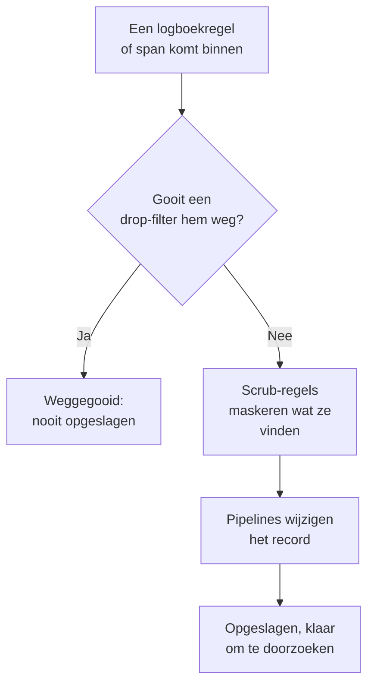

# Drop-filters en scrub-regels

Drop-filters en scrub-regels werken op uw logboeken en spans terwijl ze binnenkomen, voordat er iets wordt opgeslagen. Een drop-filter gooit de records weg die u nooit nodig hebt, of houdt er alleen een steekproef van. Een scrub-regel maskeert persoonsgegevens en geheimen, zoals e-mailadressen, kaartnummers en wachtwoorden, zodat ze uw opslag nooit bereiken.

:::cards
- [Waar ze draaien](#waar-ze-draaien): Vóór de pipelines, vóór de opslag.
- [Records weggooien of bemonsteren](#records-weggooien-of-bemonsteren): Records selecteren, en ze dan weggooien of een deel houden.
- [Wat een filter zou wegnemen](#wat-een-filter-zou-wegnemen): Wat de records leest, voordat u het opslaat.
- [Gevoelige gegevens opschonen](#gevoelige-gegevens-opschonen): Wegstrepen, maskeren of hashen wat een patroon vindt.
- [Controleren wat een filter weggooide](#controleren-wat-een-filter-weggooide): Tellingen op elk filter.
:::

## Waar ze draaien

Logboeken hebben de hunne onder **Logboeken → Instellingen**, en spans onder **Traces → Instellingen**. Als er een record binnenkomt, voert OneUptime ze in deze volgorde uit:



- **Ze werken alleen op nieuwe records.** Een regel die u aanmaakt of wijzigt, geldt voor records die ongeveer een minuut later binnenkomen. Records die al zijn opgeslagen, veranderen niet.
- **Een weggegooid record is weg.** Geen zoekopdracht, grafiek, monitor of opnameregel ziet het ooit, en er wordt geen uitzondering van gemaakt. Op OneUptime Cloud wordt het ook niet gefactureerd.
- **Elke lijst draait op volgorde.** Sleep de rijen van een lijst om de volgorde te wijzigen. Alleen ingeschakelde filters en regels draaien.

Drop-filters en scrub-regels voor logboeken gelden net zo goed voor logboeken uit OpenTelemetry, Syslog, Fluent Bit en Fluentd. [Logboekpipelines](/docs/telemetry/log-pipelines) legt de stap daarna uit.

## Voordat u begint

- **Logboeken of spans die binnenkomen.** Zie [OpenTelemetry](/docs/telemetry/open-telemetry).
- **Een rol die telemetrie-instellingen wijzigt.** Projecteigenaar of Projectbeheerder, of een aangepaste rol met de machtiging voor wat u wijzigt, zoals Create Log Drop Filter of Create Trace Scrub Rule. De Telemetry-rollen kunnen filters en regels zien, maar niet wijzigen.

## Records weggooien of bemonsteren

:::steps
### Drop-filters openen

Ga naar **Logboeken → Instellingen → Drop-filters**, of naar **Traces → Instellingen → Drop-filters** voor spans.

### De records selecteren

Klik op **Logboek Drop Filter aanmaken**, of op **Tracedropfilter aanmaken** voor spans. Geef het filter bij **Overeenkomst** een **Naam**, en bouw dan zijn **Filterquery**: een veld, een operator en een waarde voor elke voorwaarde, en of **Alle voorwaarden** of **Een van de voorwaarden** moet overeenkomen. Klik op **Volgende**.

### De actie kiezen

Houd bij **Actie** de keuze **Verwijderen** om elk overeenkomend record weg te gooien, of kies **Voorbeeld** en vul het **Voorbeeldpercentage** in dat u wilt houden, van 1 tot 99. Maak daarna het filter aan.
:::

Het filter begint binnen een minuut met weggooien. Om het op te slaan zonder al iets weg te gooien, zet u **Ingeschakeld** uit onder **Geavanceerd** voordat u het aanmaakt.

> [!WARNING]
> Een weggegooid record kan niet worden teruggehaald. Houd de query van een filter smal, en let op zijn telling **Verworpen** nadat u het hebt aangemaakt.

Een filter kan deze velden testen, en elk attribuut met **Custom Attribute...**:

| Records | Velden |
| --- | --- |
| Logboeken | **Ernst**, **Logtekst**, **Service-ID** |
| Spans | **Span-naam**, **Span-soort**, **Status**, **Statusbericht**, **Service-ID**, **Heeft uitzondering**, **Is root-span** |

| Operator | Komt overeen met |
| --- | --- |
| **is gelijk aan** | De exacte waarde, met haar hoofdletters en kleine letters: `Debug` komt overeen, `DEBUG` niet. |
| **is niet gelijk aan** | Alles behalve de exacte waarde. |
| **bevat** | De waarde ergens in het veld, ongeacht hoofdletters. Een `%` in de waarde is een jokerteken. |
| **is een van** | Een van een lijst exacte waarden, gescheiden door komma's. |

**Preview query** toont de query die de voorwaarden vormen. Deze gooit de debugregels van een health check weg:

```text
severityText = 'Debug' AND body LIKE 'healthcheck'
```

Bemonstering beslist per record: bij een **Voorbeeldpercentage** van 10 wordt ongeveer één op de tien overeenkomende records bewaard. Filters draaien in de volgorde van de lijst, en het eerste dat een record weggooit, beslist; een record dat een steekproef houdt, gaat door naar het volgende filter.

## Wat een filter zou wegnemen

Een weggegooid record is weg voor alles wat het leest. Daarom zegt het formulier van een drop-filter terwijl u het schrijft wat het zou wegnemen, een moment nadat u stopt met typen: onder de **Filterquery** bij **Overeenkomst**, en onder de actie bij **Actie**. Eén regel noemt het belangrijkste effect, en **Details tonen** noemt de rest:

- **Hoeveel het selecteert.** Hoeveel van de records die de afgelopen dag zijn opgeslagen overeenkomen: wat het filter uit uw opslag en van uw rekening houdt. Er wordt geteld op wat werd opgeslagen, nadat scrub-regels en pipelines het hebben gewijzigd, en alleen over de services waarvan u de records kunt lezen. Een telling die langer dan 10 seconden duurt, wordt gestopt, en het formulier zegt dat.
- **Wat Beveiligingsgebeurtenissen zou verliezen.** Waar [Beveiligingsgebeurtenissen](/docs/telemetry/security-events) uw logboeken leest met de kaart **Uw logboeken**, of uw spans, zegt het formulier hoeveel van de overeenkomende records het heeft gelezen: de aanmeldingen, aanvallen en firewallrecords die het in gebeurtenissen omzet. Een filter met **Voorbeeld** noemt ook de regels die bij een aantal afgaan, en wat er met die regels gebeurt als het filter alleen zijn deel houdt: bij 10% heeft een regel die afgaat bij 10 mislukte aanmeldingen in vijf minuten er ongeveer 100 nodig, dus gaat hij veel minder vaak af, of nooit.
- **Wat verder dezelfde records leest.** De monitors, SLO's, dashboards met hun widgets, opnameregels en opgeslagen weergaven waarvan de query's een record kunnen bevatten dat het filter wegneemt. Een query leest ze wanneer hij hetzelfde soort record leest, van een service waaruit het filter kan wegnemen, en niets wat hij op een exacte waarde vastlegt, het filter uitsluit: een filter op logboeken van **Debug** laat een monitor van fouten met rust, en een filter op één service laat het SLO van een andere service met rust. Alles wat het formulier niet kan uitsluiten, zoals een zoekopdracht in de logtekst, telt als lezen. Elk is een link, en wat u niet kunt openen, wordt geteld, maar nooit genoemd.

Wanneer iets leest wat een filter wegneemt, vraagt OneUptime u om een bevestiging als u het filter aanmaakt, het inschakelt of de query of actie wijzigt van een filter dat aan staat. U kunt het filter toch opslaan: de vraag is er zodat u weet wat u beslist. Een filter dat niets leest, wordt zonder vraag opgeslagen.

Via de API wordt niets gevraagd, want een script of Terraform heeft niemand die kan antwoorden. Een filter dat via de API wordt aangemaakt of gewijzigd, wordt opgeslagen, en als het wegneemt wat anderen lezen, draagt het antwoord een header `X-OneUptime-Write-Warning` die dat in aantallen zegt, en die de Terraform-provider als waarschuwing toont. Om eerst te vragen, stuurt u `filterQuery`, `action` en `samplePercentage` van het filter naar `POST /api/telemetry/logs/drop-filter-impact`, of naar `/api/telemetry/traces/drop-filter-impact` voor spans: het antwoord bevat alles wat het formulier toont.

De OpenStack-filters die OneUptime aan een project toevoegt, houden elke logregel die Beveiligingsgebeurtenissen leest, zolang ze zijn zoals OneUptime ze maakte. Wijzig er een, en het gooit weg wat het selecteert, zoals een filter van uzelf.

## Gevoelige gegevens opschonen

:::steps
### Scrub-regels openen

Ga naar **Logboeken → Instellingen → Scrub-regels**, of naar **Traces → Instellingen → Scrub-regels** voor spans.

### Kiezen wat er gevonden moet worden

Klik op **Logboek Scrub Regel aanmaken**, of op **Trace Scrub Regel aanmaken** voor spans, en kies een **Patroontype**. De regel krijgt de naam ervan, zoals **E-mailadressen opschonen**, totdat u zelf een naam typt. Vul voor **Aangepaste reguliere expressie** ook het **Aangepast regex-patroon** in, en voor **Benoemde attributen** de **Te verbergen attributen**, één per regel.

### Kiezen hoe er wordt opgeschoond

Kies onder **Meer velden** de **Opschoonactie** en de **Te wissen velden**, of laat ze zoals ze zijn: een nieuwe regel vervangt elke overeenkomst door `[REDACTED]`, waar die ook in het record staat. Maak daarna de regel aan.
:::

| Patroontype | Wat het vindt |
| --- | --- |
| **E-mailadres** | E-mailadressen, zoals `jane@example.com`, ook in een ander schrift, zoals `张伟@example.com`, in een procentgecodeerde URL, en op volle breedte getypt, zoals `ｊａｎｅ＠ｅｘａｍｐｌｅ．ｃｏｍ` |
| **Creditcardnummer** | Kaartnummers, zoals `4111 1111 1111 1111` of een American Express-nummer, ook in de cijfers van een ander schrift, zoals `４１１１ １１１１ １１１１ １１１１`, helemaal op volle breedte getypt, zoals `４１１１－１１１１－１１１１－１１１１`, met een ander streepje tussen hun groepen, zoals `4111–1111–1111–1111`, in een URL met een procentgecodeerde spatie of een plusteken tussen hun groepen, en willekeurige zestien cijfers in groepen van vier |
| **SSN (burgerservicenummer)** | Amerikaanse socialezekerheidsnummers, zoals `123-45-6789`, ook gescheiden door punten, spaties of een ander streepje, in een URL, in de cijfers van een ander schrift, zoals `１２３-４５-６７８９`, en helemaal op volle breedte getypt, en negen cijfers op een rij naast een woord dat ze benoemt of alleen onder een sleutel die ze benoemt, zoals `customer.ssn` |
| **Telefoonnummer** | Telefoonnummers, zoals `555-123-4567` of `+44 20 7946 0958`, internationale in de groepen waarin mensen ze schrijven, ook gescheiden door een ander streepje, in een procentgecodeerde URL, zoals een formulier die schrijft, in de cijfers van een ander schrift en helemaal op volle breedte getypt, zoals `＋８１ ３－１２３４－５６７８`, en een nationaal nummer naast een woord dat het benoemt of alleen onder een sleutel die het benoemt, zoals `user.phone`, maar geen decimaal getal, tijdzoneverschuiving of versie |
| **IP-adres** | Openbare IPv4- en IPv6-adressen, zoals `203.0.113.7`, `2001:db8::1` of `2001::1`, ook direct na de dubbele punt van een sleutel en in een procentgecodeerde URL, maar geen privé-, loopback- of link-local-adressen |
| **Postcode** | Britse en Canadese postcodes, zoals `SW1A 2AA` of `K1A 0B1`, en een Amerikaanse ZIP-code naast een woord zoals zip of postal, of alleen onder een sleutel die hem benoemt, zoals `address.zip` |
| **Coördinaten** | Paren van breedte- en lengtegraad, zoals `51.50722, -0.12750`, en één losse coördinaat naast een woord zoals lat of lng, of alleen onder een sleutel die hem benoemt, zoals `location.lat` |
| **Gevoelige attribuutsleutels** | De hele waarde van elk attribuut waarvan de sleutel er geheim uitziet, zoals `password`, `token`, `api_key`, `authorization` of `cookie` |
| **Benoemde attributen** | De hele waarde van de attributen die u noemt, wat die ook bevat, zoals de naam van een persoon onder `customer_name`. Een sleutel noemt ook de attributen die eronder genest zijn: `user` verbergt `user.email` |
| **Aangepaste reguliere expressie** | Uw eigen reguliere expressie, geschreven zonder slashes of vlaggen, en hoofdlettergevoelig vergeleken, ook in een procentgecodeerde URL, zoals een formulier die schrijft, in de cijfers van een ander schrift en helemaal op volle breedte getypt, letters inbegrepen |

| Opschoonactie | Wat een overeenkomst wordt |
| --- | --- |
| **Redigeren** | `[REDACTED]`, de standaard |
| **Masker** | Grotendeels verborgen: een e-mailadres houdt zijn eerste letter en het einde van zijn domein, een kaart-, telefoon- of socialezekerheidsnummer zijn laatste vier cijfers, en een aangepaste overeenkomst, een postcode, een coördinaat of een geheime waarde het eerste en laatste teken. Een IP-adres wordt volledig verborgen. |
| **Hash** | Een token dat uniek is voor uw project, elke keer hetzelfde voor dezelfde waarde, zodat herhalingen nog te tellen zijn, maar niemand de waarde kan achterhalen |

Een **E-mailadres**-regel slaat deze logtekst bijvoorbeeld op:

```text
Payment failed for jane@example.com
```

als een van deze, afhankelijk van zijn **Opschoonactie**:

```text
Redact: Payment failed for [REDACTED]
Mask:   Payment failed for j***@***.com
Hash:   Payment failed for [HASHED:5e29db14e508e09a]
```

**Te wissen velden** is **Beide (Inhoud & Attributen)** voor een regel voor logboeken, tenzij u **Alleen inhoud** of **Alleen attributen** kiest, en **Alles (Naam, Attributen & Gebeurtenissen)** voor een regel voor spans, tenzij u **Alleen span-naam**, **Alleen attributen** of **Alleen gebeurtenisattributen** kiest. De attributen van de links van een span worden opgeschoond met de eigen attributen van de span, en **Alles (Naam, Attributen & Gebeurtenissen)** schoont ook het statusbericht van een span en de namen van zijn gebeurtenissen op. Een **Gevoelige attribuutsleutels**-regel leest sleutels en schoont dus altijd de waarden eronder op: in attributen en in de JSON-inhoud van een logboekregel.

- **Een regel kan voor één service gelden.** Kies onder **Meer velden** de service bij **Alleen voor één service**: de regel schoont de records van die service op, en die van andere services blijven zoals ze zijn. Leeg gelaten schoont ze de records van elke service op. De kolom **Bereik** van de lijst zegt welke.
- **Een regel kan de attributen noemen die hij leest.** Een regel **Benoemde attributen** verbergt de attributen die hij noemt. Elk ander patroon, behalve **Gevoelige attribuutsleutels**, leest alleen de attributen die onder **Meer velden** in **Alleen in deze attributen** staan, één per regel, of elk attribuut als dat veld leeg is: de logbody, of de naam en het statusbericht van een span, wordt nog steeds gelezen zoals **Te wissen velden** zegt. Een regel die Gegevensbeveiliging voor een bevinding maakt, leest alleen het attribuut waarin de gegevens zijn gevonden, en zijn formulier toont het daar, zodat u er een ander aan kunt toevoegen, zoals `db.password_old`, of het veld kunt leegmaken. De lijst noemt ze onder het **Patroontype** van de regel: de attributen die een regel helemaal verbergt, of de enige die zijn patroon leest.
- **De lijst zegt wat elke regel heeft gewijzigd.** **Gewijzigde waarden** telt de waarden die elke regel de afgelopen 7 dagen heeft verborgen, en **Per service** opent van welke services en versies ze kwamen. Een versie die niet meer verstuurt wat een regel verbergt, wijzigt niets meer, en zo is een lek dat in de code is opgelost hier te zien.
- **Een regel die Gegevensbeveiliging heeft bewezen, zegt dat.** Een regel die voor een bevinding is gemaakt, werd uitgevoerd op de records waarin de gegevens werden gezien voordat hij werd opgeslagen, en toont **Bewezen** zolang het nog de regel is die werd bewezen (zie [Gevoelige gegevens in telemetrie](/docs/data-security/telemetry#bewezen-op-de-records-waarin-het-werd-gezien)). Wijzig wat hij vindt, de attributen die hij leest, hoe hij opschoont, wat hij opschoont of zijn service, en **Bewezen** verdwijnt. Dezelfde attributen in een andere volgorde of met andere hoofdletters houden het.
- **Het formulier zegt wat een regel voor anderen zou veranderen.** Voordat je een regel maakt, en als je er een inschakelt, somt OneUptime op wat de waarden leest die ze zou verbergen: monitors, dashboards, opgeslagen weergaven, opnameregels en SLO's, elk als link, en wat [Beveiligingsgebeurtenissen](/docs/telemetry/security-events) zouden verliezen. Een monitor die filtert op een verborgen waarde, vindt die niet meer. De regel wordt hoe dan ook opgeslagen.
- **Een IP-adresregel verbergt de adressen die persoonsgegevens zijn.** Dat zijn openbare IPv4- en IPv6-adressen, hoe ze ook geschreven zijn: verkort, zoals `2001:db8::1`, of tot één groep aan elke kant van `::`, zoals `2001::1`, tussen vierkante haken met een poort, zoals `[2001:db8::1]:443`, dat zijn haken en poort houdt, met een zone, zoals `2001:db8::2%eth0`, dat zijn zone houdt, of een IPv4-adres geschreven als IPv6, zoals `::ffff:203.0.113.7`, dat helemaal wordt verborgen. Een adres direct na de dubbele punt van een sleutel, zoals logregels in logfmt of syslog het schrijven, zoals `peer ip:2001:db8::1` of `remote:2001:db8::1`, wordt op zichzelf verborgen, en de sleutel houdt al zijn letters. Een adres met één groep aan elke kant van `::` is een adres als de eerste groep uit vier hexadecimale cijfers bestaat en met 2 of 3 begint, zoals bij een openbaar adres, dus tekst zoals `10::30` of `ab::cd` blijft staan. Een adres dat procentgecodeerd in een URL staat, zoals `2001%3Adb8%3A%3A1` in `/geo?ip=2001%3Adb8%3A%3A1`, wordt gedecodeerd gelezen en verborgen zoals het geschreven is, met de escapes erbij, en de rest van de URL blijft staan. Privé-, loopback- en link-local-adressen blijven staan, zoals `10.0.0.12`, `127.0.0.1` en `fe80::1`, net als het metadata-adres van de cloud, `169.254.169.254`, in de URL van een verzoek, waar [Beveiligingsgebeurtenissen](/docs/telemetry/security-events) zoekt naar vervalste verzoeken vanaf de server. Om ook interne adressen te verbergen, voegt u er een regel met **Aangepaste reguliere expressie** voor toe, zoals `\b(?:\d{1,3}\.){3}\d{1,3}\b` voor elk IPv4-adres. Tenzij de regel ze hasht, noemt Beveiligingsgebeurtenissen dan geen adres voor de aanvallen die het vindt in de logs of traces die de regel opschoont: zie [Verborgen door een opschoonregel](/docs/telemetry/security-events#verborgen-door-een-opschoonregel).
- **Een e-mailadresregel verbergt wat Gegevensbeveiliging een e-mailadres noemt.** Naast wat zijn eigen patroon vindt, verbergt de regel een adres in elk schrift, zoals `张伟@example.com`, `josé@example.com` of `user@例え.jp`, en een adres dat procentgecodeerd in een URL staat, zoals `jane%40example.com` in `/signup?email=jane%40example.com`, ook met de UTF-8-bytes van zijn letters, zoals `jos%C3%A9%40example.com`, dat gedecodeerd wordt gelezen en verborgen zoals het geschreven is, terwijl de rest van de URL blijft staan. Ook verbergt de regel een adres dat op volle breedte is getypt, zoals een invoermethode in de modus volle breedte er een typt, zoals `ｊａｎｅ＠ｅｘａｍｐｌｅ．ｃｏｍ`, of met alleen zijn `＠` op volle breedte. **Masker** leest zo'n adres gedecodeerd en in ASCII, zodat het, zoals elk e-mailadres, zijn eerste letter en het einde van zijn domein houdt.
- **Een creditcardnummerregel verbergt wat Gegevensbeveiliging een kaartnummer noemt.** Naast willekeurige zestien cijfers in groepen van vier verbergt de regel elke kaart die Gegevensbeveiliging vindt, zoals een American Express-nummer in groepen van vier, zes en vijf, en een kaart in de cijfers van een ander schrift: cijfers op volle breedte, zoals Japanse tekst een kaart schrijft, zoals `４１１１ １１１１ １１１１ １１１１`, Arabisch-Indische en Perzische cijfers, de cijfers van de andere schriften, of een kaart die in twee schriften is getypt. De regel verbergt ook een kaart in een URL, met de groepen gescheiden door een procentgecodeerde spatie of door het plusteken dat een formulier voor een spatie schrijft, zoals `4111%201111%201111%201111` of `4111+1111+1111+1111` in `/pay?card=4111+1111+1111+1111`, en de rest van de URL blijft behouden. Ook verbergt de regel een kaart die helemaal op volle breedte is getypt, met de groepen gescheiden door koppeltekens op volle breedte of ideografische spaties, zoals `４１１１－１１１１－１１１１－１１１１`, of door een ander streepje, dat als koppelteken tussen twee cijfers wordt gelezen: het lengteteken `ー` dat Japanse tekst voor een koppelteken typt, een typografisch koppelteken, een cijferstreep, een halve kastlijn of een minteken, zoals `4111–1111–1111–1111`. **Masker** houdt de laatste vier cijfers, geschreven als ASCII-cijfers.
- **Een telefoonnummer- of SSN-regel verbergt wat Gegevensbeveiliging zo'n nummer noemt.** Naast wat zijn eigen patroon vindt, verbergt een regel met **Telefoonnummer** elk telefoonnummer dat Gegevensbeveiliging vindt, en een regel met **SSN (burgerservicenummer)** elk Amerikaans Social Security-nummer, elk ook helemaal op volle breedte getypt, zoals Japanse en Chinese tekst een nummer schrijft, ook met zijn plusteken, koppeltekens, haakjes, punten en ideografische spaties, zoals `＋８１ ３－１２３４－５６７８` of `５３６－２２－８７３１`. Elke regel verbergt ook een nummer dat Gegevensbeveiliging alleen naast een woord dat het benoemt zo'n nummer noemt: een nationaal telefoonnummer van 9 tot 12 cijfers met een woord zoals tel, phone, mobile of fax direct ervoor of erna, zoals `tel 02012345678`, in één reeks of in de groepen waarin zijn land het schrijft, zoals `tel 03-1234-5678`, en negen cijfers op een rij in de buurt van een woord zoals SSN of social security number, zoals `SSN 536221234`. Het woord moet zo dicht bij het nummer staan als Gegevensbeveiliging zoekt: `order 02012345678` en `ref 536221234` blijven staan. Call, cell en contact benoemen een nummer alleen in een zinsdeel zoals call me on, cell number of contact number, of vóór een nummer met zijn nationale prefix, zoals `call 02031234567`, zodat een grootte of een id na een van die woorden op zichzelf, zoals `cell 104857600 bytes`, blijft staan. De sleutel van een attribuut is dat woord wanneer zijn naam het nummer benoemt, zoals Gegevensbeveiliging de naam van een veld leest: een nationaal nummer alleen onder `user.phone` en negen cijfers onder `customer.ssn` worden verborgen, als tekst of als getal verzonden, en net zo een hele waarde in de vorm van een telefoonnummer onder zo'n sleutel, zoals `020 1234 5678`. Een lijst of een map wordt gelezen als de JSON-tekst waarin hij is opgeslagen, zodat een nummer naast een sleutel of een woord erin wordt verborgen, zoals `[{"system": "phone", "value": "02012345678"}]`, en net zo een nummer dat als getal is verzonden, zoals `[{"system": "phone", "value": 2012345678}]`, dat dan wordt vervangen door de tekst van de regel. Een nummer onder een sleutel die niets benoemt, zoals `order.id`, blijft staan, tenzij het eigen patroon van de regel het vindt, zoals het willekeurige tien cijfers vindt. Elke regel verbergt ook een nummer waarvan de groepen gescheiden zijn door een ander streepje, dat alleen tussen twee cijfers als koppelteken wordt gelezen: het lengteteken dat Japanse tekst voor een koppelteken typt, zoals `＋８１ ３ー１２３４ー５６７８`, of een typografisch koppelteken, een halve kastlijn of een minteken, zoals `536–22–8731`. Een woord dat een nummer benoemt, telt ook op volle breedte getypt, zoals `ＴＥＬ`. **Masker** houdt de laatste vier cijfers, geschreven als ASCII-cijfers.
- **Een postcode- of coördinatenregel verbergt wat Gegevensbeveiliging zo noemt.** Naast Britse en Canadese postcodes en coördinatenparen verbergt een regel met **Postcode** een Amerikaanse ZIP-code, vijf cijfers of ZIP+4, die Gegevensbeveiliging alleen vindt naast een woord zoals zip, zip code of postal, zoals `zip 94107`, of alleen onder een sleutel die hem benoemt, zoals `address.zip`, en een regel met **Coördinaten** één losse coördinaat naast een woord zoals lat, lng of longitude, zoals `lat 37.77493`, of alleen onder zo'n sleutel, zoals `location.lat`, elk als tekst of als getal verzonden. Een lijst of een map wordt gelezen als zijn JSON-tekst, zodat ook `{"zip": 94107}` en een paar dat als twee getallen is verzonden, zoals `[51.50722, -0.12750]`, worden verborgen. Vijf cijfers of een decimaal getal zonder zo'n woord ernaast en onder een sleutel die niets benoemt, zoals `order 94107` of `price.total`, blijven staan. Een postcode die in een formulier of op volle breedte is getypt, zoals `postcode=SW1A+2AA` of `ＳＷ１Ａ ２ＡＡ`, wordt verborgen zoals hij geschreven is.
- **Een regel met een aangepaste reguliere expressie leest een waarde zoals Gegevensbeveiliging haar leest.** Hij leest de tekst zoals die geschreven is, dan met de procent-escapes gelezen, ook de UTF-8-bytes van een teken, dan zoals een formulier de querystring van een URL schrijft, met een plusteken voor elke spatie, dan met de cijfers van elk schrift gelezen als ASCII-cijfers, dan met het plusteken, de koppeltekens, haakjes, punten en slashes op volle breedte en de ideografische spaties van een nummer, en de andere streepjes tussen twee cijfers, gelezen als ASCII-tekens, dan met elke letter, elk cijfer en elk teken op volle breedte gelezen als zijn ASCII-teken, en verbergt wat hij in een ervan vindt zoals het geschreven is, met de escapes erbij: `\+44 \d{2} \d{4} \d{4}` verbergt `%2B44%2020%207946%200958` en `%2B44+20+7946+0958` in een URL, `+٤٤ ٢٠ ٧٩٤٦ ٠٩٥٨` in Arabisch-Indische cijfers en `＋４４ ２０ ７９４６ ０９５８` helemaal op volle breedte getypt. De regels met **Aangepaste reguliere expressie** die **Opschonen** voor andere gegevenstypen maakt, zoals een GitHub-token of een IBAN, lezen een waarde op dezelfde manieren, zodat een IBAN die in een formulier is getypt, zoals `DE44+5001+0517+5407+3249+31`, of in letters op volle breedte, zoals `ＤＥ４４　５００１　０５１７　５４０７　３２４９　３１`, helemaal wordt verborgen. **Masker** houdt het eerste en laatste teken van een overeenkomst zoals het die leest. Ook een lijst of een map wordt gelezen als de JSON-tekst waarin hij is opgeslagen, zoals Gegevensbeveiliging hem leest, en wat het patroon daar vindt, wordt verborgen in de teksten en getallen van de waarde, nooit in haar sleutels: het patroon dat **Opschonen** maakt voor een beveiligingscode van een kaart verbergt de `123` van `{"cvv": "123"}`.
- **Een hash-token is van uw project.** Het wordt gemaakt met een sleutel van uw project, afgeleid van de `ENCRYPTION_SECRET` van de installatie, dus dezelfde waarde heeft in een ander project een ander token, en niemand die een token leest kan de waarde achterhalen of een gok hashen om te vergelijken. Een IP-adres heeft één token, hoe het ook geschreven is: `::ffff:203.0.113.7` en `203.0.113.7` delen er een, net als `2001%3Adb8%3A%3A1` en `2001:db8::1`. Dat geldt ook voor een e-mailadres dat procentgecodeerd is en zoals het geschreven is, zoals `jane%40example.com` en `jane@example.com`, of `jos%C3%A9%40example.com` en `josé@example.com`, voor een kaart in de cijfers van een ander schrift en in ASCII-cijfers, voor een kaart in een URL en gewoon geschreven, zoals `4111+1111+1111+1111` en `4111 1111 1111 1111`, voor een nummer dat helemaal op volle breedte en in ASCII is getypt, zoals `＋８１ ３－１２３４－５６７８` en `+81 3-1234-5678`, voor een nummer dat gescheiden is door een ander streepje en door koppeltekens, zoals `536–22–8731` en `536-22-8731`, voor een e-mailadres dat op volle breedte en in ASCII is getypt, zoals `ｊａｎｅ＠ｅｘａｍｐｌｅ．ｃｏｍ` en `jane@example.com`, en voor wat een regel met **Aangepaste reguliere expressie** vindt, naar wat hij leest. Records die zijn opgeslagen voordat tokens een sleutel hadden, bevatten tokens van 8 tekens, zoals `[HASHED:8c87b489]`, die verschillen van de huidige van 16 tekens: zoek naar beide totdat die records het einde van hun bewaartermijn bereiken. Het wijzigen van `ENCRYPTION_SECRET` wijzigt elk token, en op een zelfgehoste installatie zijn de tokens maar zo geheim als die waarde.
- **Een IP-adresregel die weglakt of maskeert, zegt wat dat Beveiligingsgebeurtenissen kost.** Waar [Beveiligingsgebeurtenissen](/docs/telemetry/security-events) uw logs of traces leest, zegt zo'n regel in zijn rij dat hij ook adressen voor Beveiligingsgebeurtenissen verbergt, zodat die u niet kan vertellen welk adres u moet blokkeren, met **In plaats daarvan hashen**, dat de regel naar **Hash** overzet: mensen zien een token in plaats van het adres, en Beveiligingsgebeurtenissen ziet het adres nog steeds. Het formulier van de regel zegt hetzelfde onder de acties van de regel, en **Opschonen** hasht daar een IP-adres vanaf het begin.
- **Beveiligingsgebeurtenissen kan een gehasht IP-adres toch noemen.** Wanneer [Beveiligingsgebeurtenissen](/docs/telemetry/security-events) uw logs of traces leest, bewaart een IP-adresregel die hasht ook elk adres dat hij verbergt naast zijn token, in een opslag die alleen de scans van Beveiligingsgebeurtenissen lezen: geen pagina, zoekopdracht, export, API of AI-tool kan die lezen. Zo noemt een aanval vanaf een adres dat uw logs alleen als token tonen toch het adres, en zegt de zaak ervan welk adres u moet blokkeren. Elk adres wordt bewaard tot 30 dagen nadat het voor het laatst is gezien. Een regel die het adres wist of maskeert, bewaart niets, en dan zegt Beveiligingsgebeurtenissen dat een scrub-regel het adres verborg, zoals bij een token ouder dan 30 dagen of gemaakt voordat tokens een sleutel hadden.
- **Beveiligingsgebeurtenissen kan een gehashte gebruiker toch noemen.** Waar [Beveiligingsgebeurtenissen](/docs/telemetry/security-events) een gebruiker leest in uw logs of traces, zoals de `enduser.id` van een verzoek, de gebruiker van een AI-aanroep of de principal van een cloud-auditlog, bewaart een regel die die gebruiker hasht ook de gebruiker naast zijn token, in een opslag die alleen de scans van Beveiligingsgebeurtenissen lezen: geen pagina, zoekopdracht, export, API of AI-tool kan die lezen. Zo noemt een zaak over een account dat uw logs alleen als token tonen toch het account, en kan een playbook erop handelen. Elke gebruiker wordt bewaard tot 30 dagen nadat die voor het laatst is gezien. Een waarde die gehasht wordt waar Beveiligingsgebeurtenissen geen gebruiker leest, zoals een e-mailadres in een foutmelding, wordt nooit bewaard, en een regel die wist of maskeert, bewaart niets. Om één persoon er voorgoed uit te halen, dient u een wisverzoek in: zie [Een persoon wissen](/docs/telemetry/security-events#een-persoon-wissen).
- **Ook lijsten en geneste waarden worden gelezen.** Een regel leest elke tekst in een lijst, een lijst van lijsten of een sleutel-waardelijst, zoals de waarden van een HTTP-header, en behoudt de vorm van de waarde: getallen en waar of onwaar blijven zoals ze zijn, behalve een getal waarin een patroonregel zijn gegevenstype vindt, zoals een telefoonnummer dat als getal is verzonden naast de sleutel die het benoemt, dat dan wordt vervangen door de tekst van de regel. Een **Gevoelige attribuutsleutels**-regel leest ook de sleutels binnen een waarde, zodat ook het `password` in een sleutel-waardelijst wordt verborgen. De inhoud van een logboekregel die als map of als lijst wordt verzonden, wordt opgeslagen als de JSON-tekst ervan, en een **Gevoelige attribuutsleutels**-regel leest de sleutels erin, zoals in inhoud die als JSON is geschreven. Een patroonregel houdt zulke inhoud JSON, en ook een attribuut dat als JSON is geschreven, zoals de berichten van een AI-aanroep: hij leest de tekst zoals uw toepassing die schreef, een escape zoals `\n` gelezen als het regeleinde waarvoor die staat, en vervangt wat hij vindt alleen binnen de teksten en getallen ervan.
- **Ook JSON in een tekst wordt gelezen.** Een tekst die zelf JSON is, zoals een attribuut `http.request.body` met `{"password":"hunter2"}`, of de `log`-regel van een Fluentd-record in de inhoud van een logboekregel, wordt als JSON gelezen, tot 4 niveaus JSON in elkaar, en dieper als tekst. Een **Gevoelige attribuutsleutels**-regel verbergt de waarden onder de sleutels erin die geheim lijken, en verder niets: de getallen, spaties en andere teksten blijven zoals uw toepassing ze schreef. Een tekst die alleen op JSON lijkt, zoals `{token}`, blijft zoals hij is.
- **Een waarde die te groot is om item voor item te lezen, wordt als tekst gelezen.** Een waarde die meer dan 32 niveaus diep genest is, of een waarde die een record boven de 10.000 waarden in zijn lijsten en maps zou brengen, wordt gelezen en opgeslagen als de JSON-tekst ervan. Een patroonregel schoont op wat hij in die tekst vindt, en een **Gevoelige attribuutsleutels**-regel verbergt de hele waarde wanneer er een woord als `password` of `token` in voorkomt. In de inhoud van een logboekregel, en in JSON in een tekst, wordt alleen het deel voorbij deze grenzen als tekst gelezen: de rest wordt nog steeds sleutel voor sleutel gelezen.
- **Uitzonderingen komen uit het opgeschoonde record.** Een uitzondering die in een logboekregel wordt gevonden, wordt na het opschonen gemaakt, en de regels die span-gebeurtenissen opschonen, schonen ook de uitzonderingen op die daarop zijn vastgelegd. Elke uitzondering wordt nog steeds gegroepeerd op wat ze vóór het opschonen zei, dus een nieuwe regel maakt van een uitzondering die u al hebt nooit een nieuwe en zet **Nieuwe uitzondering** er niet opnieuw voor in gang. Verbergt een regel een deel van waarop een nieuwe uitzondering wordt gegroepeerd, dan wordt haar vingerafdruk gemaakt met een sleutel van uw project, net als een hash-token, zodat niemand kan achterhalen wat verborgen is. Een uitzondering die vóór de regel is ontstaan, gaat bij het volgende voorval dat de regel verandert over naar zo'n vingerafdruk; haar eerder vastgelegde voorvallen houden de oude tot hun bewaartermijn afloopt.
- **De ruwe kopieën van een syslogregel verbergen wat de regels in de delen ervan verborgen.** Syslog bewaart de gestructureerde gegevens van een syslogregel volgens RFC 5424 zoals ze aankwamen in `syslog.structured.raw`, en syslog die via HTTP is verstuurd bewaart de hele syslogregel in `syslog.raw`. Elke kopie wordt opnieuw samengesteld uit wat de regels overlieten van de velden van de header, elke parameter van de gestructureerde gegevens en het bericht, en de regels lezen haar daarna zoals ze elk attribuut lezen. Zo is een wachtwoord dat een **Gevoelige attribuutsleutels**-regel verbergt in `syslog.structured.auth_1.password`, of een adres dat een **Alleen inhoud**-regel verbergt in het bericht, ook in de kopieën verborgen, geschreven zoals RFC 5424 een waarde schrijft: `password="[REDACTED\]"`. Een syslogregel waarin de regels niets veranderen, houdt zijn kopieën zoals hij aankwam.
- **De sessie-ID van een record blijft behouden.** Een **Gevoelige attribuutsleutels**-regel verbergt een inlogsessie, zoals een `session_id`, een `sessionid` of een cookie, maar behoudt `session.id` wanneer die de sessie bevat waartoe de logboekregel of de span behoort: de willekeurige ID waaronder [Session Replay](/docs/telemetry/session-replay) het record opslaat, en die het record hoe dan ook als zijn sessie behoudt. De gespreks-ID van een AI-aanroep blijft op dezelfde manier behouden. Stuur het geheim van een inlogsessie niet als `session.id`.
- **Ook Session Replays worden opgeschoond.** Scrub-regels voor logboeken die voor elke service gelden, draaien ook over Session Replay-opnamen, bovenop het maskeren dat de recorder in de browser doet. De waarde van een formulierveld, en wat erin wordt getypt, wordt gelezen onder de naam, de id, de autocomplete-waarde en het type van het veld, zoals de waarde van een logboekregel onder zijn sleutel: een regel met **Telefoonnummer** verbergt een nationaal nummer dat in `<input name="phone">` wordt getypt, en een **Gevoelige attribuutsleutels**-regel de hele waarde van een wachtwoordveld. Een getal dat een pagina in een aangepaste gebeurtenis verzendt onder een sleutel die het type ervan benoemt, zoals `{"phone": 2012345678}`, wordt ook verborgen.
- **Regels draaien in de volgorde van de lijst.** Elke regel ziet wat de regels ervoor overlieten.
- **Een aangepast patroon kost tijd naar verhouding van het record.** Het behoudt de syntaxis en de antwoorden van JavaScript, lookaheads en lookbehinds inbegrepen, hoe het ook geschreven is. Een terugverwijzing, zoals `\1`, kan zo niet worden uitgevoerd: een regel daarmee wordt bij het opslaan geweigerd, net als een patroon dat te groot is om uit te voeren. Als het vinden van elke overeenkomst een lange waarde steeds opnieuw zou moeten lezen, schoont de regel de hele waarde op. De drop-filters, scrub-regels en pipelines van een project delen ook een werktegoed voor elke batch die het verstuurt, naar verhouding van de grootte van de batch en genoeg om tientallen aangepaste patronen elke waarde te laten lezen. Als hun patronen meer nodig hebben, schoont een aangepaste scrub-regel de hele waarde op, en een filter dat geen antwoord kan krijgen, geldt niet voor het record.

## Controleren wat een filter weggooide

De lijst **Drop-filters** toont van elk filter de telling **Verworpen** en wanneer het voor het laatst iets weggooide, **Last Dropped**. **Nothing dropped yet** betekent dat het nog nooit overeenkwam. De eigen pagina van een filter toont hetzelfde onder **Activiteit**, bijgewerkt binnen een minuut na het weggooien. Zijn kaart **Filtervoorwaarden** toont wat het selecteert, en daar kunt u de voorwaarden wijzigen.

## Problemen oplossen

:::details Een drop-filter gooit niets weg
**is gelijk aan**, **is niet gelijk aan** en **is een van** vergelijken exacte tekst, hoofdletters en kleine letters inbegrepen. Ernstniveaus zijn `Information` en `Warning`, niet `INFO` of `WARN`. Controleer of het filter is ingeschakeld, en wacht een minuut na een wijziging.
:::

:::details Logboeken die ik verwachtte, ontbreken
Bekijk de telling **Verworpen** en het tijdstip van **Last Dropped** van elk drop-filter. Zet **Ingeschakeld** uit op het filter dat u verdenkt, en de volgende logboeken komen weer binnen.
:::

:::details Een aangepaste scrub-regel zegt Schoont niets op
Het patroon is leeg, geen geldige reguliere expressie of kan niet worden uitgevoerd, bijvoorbeeld omdat het een terugverwijzing zoals `\1` bevat, dus de regel schoont niets op. Bewerk de regel en geef hem een patroon dat met minstens één teken overeenkomt.
:::

:::details Oude records tonen nog de gegevens die een nieuwe regel opschoont
Scrub-regels werken terwijl records binnenkomen. Records die vóór de regel zijn opgeslagen, houden wat ze hadden totdat hun bewaartermijn afloopt. Zie [Gegevensbewaring](/docs/telemetry/data-retention).
:::

## Volgende stappen

:::cards
- [Logboekpipelines](/docs/telemetry/log-pipelines): Ontleed en verrijk de logboeken die u houdt.
- [Logboekverkenner](/docs/telemetry/logs-explorer): Doorzoek wat is opgeslagen.
- [Traceverkenner](/docs/telemetry/traces-explorer): Volg de spans die u houdt.
- [Gegevensbewaring](/docs/telemetry/data-retention): Bepaal hoe lang ze worden bewaard.
:::
