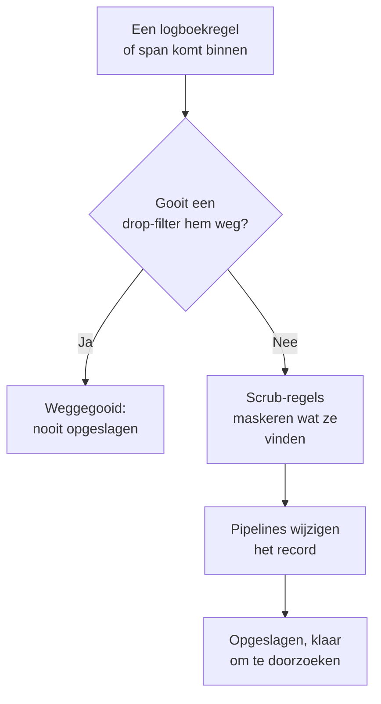

# Drop-filters en scrub-regels

Drop-filters en scrub-regels werken op uw logboeken en spans terwijl ze binnenkomen, voordat er iets wordt opgeslagen. Een drop-filter gooit de records weg die u nooit nodig hebt, of houdt er alleen een steekproef van. Een scrub-regel maskeert persoonsgegevens en geheimen, zoals e-mailadressen, kaartnummers en wachtwoorden, zodat ze uw opslag nooit bereiken.

:::cards
- [Waar ze draaien](#waar-ze-draaien): Vóór de pipelines, vóór de opslag.
- [Records weggooien of bemonsteren](#records-weggooien-of-bemonsteren): Records selecteren, en ze dan weggooien of een deel houden.
- [Gevoelige gegevens opschonen](#gevoelige-gegevens-opschonen): Wegstrepen, maskeren of hashen wat een patroon vindt.
- [Controleren wat een filter weggooide](#controleren-wat-een-filter-weggooide): Tellingen op elk filter.
:::

## Waar ze draaien

Logboeken hebben de hunne onder **Logboeken → Instellingen**, en spans onder **Traces → Instellingen**. Als er een record binnenkomt, voert OneUptime ze in deze volgorde uit:



- **Ze werken alleen op nieuwe records.** Een regel die u aanmaakt of wijzigt, geldt voor records die ongeveer een minuut later binnenkomen. Records die al zijn opgeslagen, veranderen niet.
- **Een weggegooid record is weg.** Geen zoekopdracht, grafiek, monitor of opnameregel ziet het ooit, en er wordt geen uitzondering van gemaakt. Op OneUptime Cloud wordt het ook niet gefactureerd.
- **Elke lijst draait op volgorde.** Sleep de rijen van een lijst om de volgorde te wijzigen. Alleen ingeschakelde filters en regels draaien.

Drop-filters en scrub-regels voor logboeken gelden net zo goed voor logboeken uit OpenTelemetry, Syslog, Fluent Bit en Fluentd. [Logboekpipelines](/docs/telemetry/log-pipelines) legt de stap daarna uit.

## Voordat u begint

- **Logboeken of spans die binnenkomen.** Zie [OpenTelemetry](/docs/telemetry/open-telemetry).
- **Een rol die telemetrie-instellingen wijzigt.** Project Owner of Project Admin, of een aangepaste rol met de machtiging voor wat u wijzigt, zoals Create Log Drop Filter of Create Trace Scrub Rule. De Telemetry-rollen kunnen filters en regels zien, maar niet wijzigen.

## Records weggooien of bemonsteren

:::steps
### Drop-filters openen

Ga naar **Logboeken → Instellingen → Drop-filters**, of naar **Traces → Instellingen → Drop-filters** voor spans.

### De records selecteren

Klik op **Logboek Drop Filter aanmaken**, of op **Tracedropfilter aanmaken** voor spans. Geef het filter bij **Overeenkomst** een **Naam**, en bouw dan zijn **Filterquery**: een veld, een operator en een waarde voor elke voorwaarde, en of **Alle voorwaarden** of **Een van de voorwaarden** moet overeenkomen. Klik op **Volgende**.

### De actie kiezen

Houd bij **Actie** de keuze **Verwijderen** om elk overeenkomend record weg te gooien, of kies **Voorbeeld** en vul het **Voorbeeldpercentage** in dat u wilt houden, van 1 tot 99. Maak daarna het filter aan.
:::

Het filter begint binnen een minuut met weggooien. Om het op te slaan zonder al iets weg te gooien, zet u **Ingeschakeld** uit onder **Geavanceerd** voordat u het aanmaakt.

> [!WARNING]
> Een weggegooid record kan niet worden teruggehaald. Houd de query van een filter smal, en let op zijn telling **Dropped** nadat u het hebt aangemaakt.

Een filter kan deze velden testen, en elk attribuut met **Custom Attribute...**:

| Records | Velden |
| --- | --- |
| Logboeken | **Ernst**, **Logtekst**, **Service-ID** |
| Spans | **Span-naam**, **Span-soort**, **Status**, **Statusbericht**, **Service-ID**, **Heeft uitzondering**, **Is root-span** |

| Operator | Komt overeen met |
| --- | --- |
| **is gelijk aan** | De exacte waarde, met haar hoofdletters en kleine letters: `Debug` komt overeen, `DEBUG` niet. |
| **is niet gelijk aan** | Alles behalve de exacte waarde. |
| **bevat** | De waarde ergens in het veld, ongeacht hoofdletters. Een `%` in de waarde is een jokerteken. |
| **is een van** | Een van een lijst exacte waarden, gescheiden door komma's. |

**Preview query** toont de query die de voorwaarden vormen. Deze gooit de debugregels van een health check weg:

```text
severityText = 'Debug' AND body LIKE 'healthcheck'
```

Bemonstering beslist per record: bij een **Voorbeeldpercentage** van 10 wordt ongeveer één op de tien overeenkomende records bewaard. Filters draaien in de volgorde van de lijst, en het eerste dat een record weggooit, beslist; een record dat een steekproef houdt, gaat door naar het volgende filter.

## Gevoelige gegevens opschonen

:::steps
### Scrub-regels openen

Ga naar **Logboeken → Instellingen → Scrub-regels**, of naar **Traces → Instellingen → Scrub-regels** voor spans.

### Kiezen wat er gevonden moet worden

Klik op **Logboek Scrub Regel aanmaken**, of op **Trace Scrub Regel aanmaken** voor spans, en kies een **Patroontype**. De regel krijgt de naam ervan, zoals **E-mailadressen opschonen**, totdat u zelf een naam typt. Vul voor **Aangepaste reguliere expressie** ook het **Aangepast regex-patroon** in.

### Kiezen hoe er wordt opgeschoond

Kies onder **Geavanceerd** de **Opschoonactie** en de **Te wissen velden**, of laat ze zoals ze zijn: een nieuwe regel vervangt elke overeenkomst door `[REDACTED]`, waar die ook in het record staat. Maak daarna de regel aan.
:::

| Patroontype | Wat het vindt |
| --- | --- |
| **E-mailadres** | E-mailadressen, zoals `jane@example.com` |
| **Creditcardnummer** | Zestien cijfers in groepen van vier, zoals `4111 1111 1111 1111` |
| **SSN (burgerservicenummer)** | Amerikaanse socialezekerheidsnummers, zoals `123-45-6789` |
| **Telefoonnummer** | Noord-Amerikaanse telefoonnummers, zoals `555-123-4567` |
| **IP-adres** | IPv4-adressen, zoals `192.168.1.1` |
| **Sensitive Attribute Keys** | De hele waarde van elk attribuut waarvan de sleutel er geheim uitziet, zoals `password`, `token`, `api_key`, `authorization` of `cookie` |
| **Aangepaste reguliere expressie** | Uw eigen reguliere expressie, geschreven zonder slashes of vlaggen, en hoofdlettergevoelig vergeleken |

| Opschoonactie | Wat een overeenkomst wordt |
| --- | --- |
| **Redigeren** | `[REDACTED]`, de standaard |
| **Masker** | Grotendeels verborgen: een e-mailadres houdt zijn eerste letter en het einde van zijn domein, een kaart-, telefoon- of socialezekerheidsnummer zijn laatste vier cijfers, en een aangepaste overeenkomst of een geheime waarde haar eerste en laatste teken. Een IP-adres wordt volledig verborgen. |
| **Hash** | Een korte hash ervan, elke keer dezelfde voor dezelfde waarde, zodat herhalingen nog te tellen zijn |

Een **E-mailadres**-regel slaat deze logtekst bijvoorbeeld op:

```text
Payment failed for jane@example.com
```

als een van deze, afhankelijk van zijn **Opschoonactie**:

```text
Redact: Payment failed for [REDACTED]
Mask:   Payment failed for j***@***.com
Hash:   Payment failed for [HASHED:8c87b489]
```

**Te wissen velden** is **Beide (Inhoud & Attributen)** voor een regel voor logboeken, tenzij u **Alleen inhoud** of **Alleen attributen** kiest, en **Alles (Naam, Attributen & Gebeurtenissen)** voor een regel voor spans, tenzij u **Alleen span-naam**, **Alleen attributen** of **Alleen gebeurtenisattributen** kiest. Een **Sensitive Attribute Keys**-regel schoont altijd attribuutwaarden op, omdat ze attribuutsleutels leest.

- **Uitzonderingen komen uit het opgeschoonde record.** Een uitzondering die in een logboekregel wordt gevonden, wordt na het opschonen gemaakt, en de regels die span-gebeurtenissen opschonen, schonen ook de uitzonderingen op die daarop zijn vastgelegd.
- **Ook Session Replays worden opgeschoond.** Scrub-regels voor logboeken draaien ook over Session Replay-opnamen, bovenop het maskeren dat de recorder in de browser doet.
- **Regels draaien in de volgorde van de lijst.** Elke regel ziet wat de regels ervoor overlieten.

## Controleren wat een filter weggooide

De lijst **Drop-filters** toont van elk filter de telling **Dropped** en wanneer het voor het laatst iets weggooide, **Last Dropped**. **Nothing dropped yet** betekent dat het nog nooit overeenkwam. De eigen pagina van een filter toont hetzelfde onder **Activiteit**, bijgewerkt binnen een minuut na het weggooien. Zijn kaart **Filtervoorwaarden** toont wat het selecteert, en daar kunt u de voorwaarden wijzigen.

## Problemen oplossen

:::details Een drop-filter gooit niets weg
**is gelijk aan**, **is niet gelijk aan** en **is een van** vergelijken exacte tekst, hoofdletters en kleine letters inbegrepen. Ernstniveaus zijn `Information` en `Warning`, niet `INFO` of `WARN`. Controleer of het filter is ingeschakeld, en wacht een minuut na een wijziging.
:::

:::details Logboeken die ik verwachtte, ontbreken
Bekijk de telling **Dropped** en het tijdstip van **Last Dropped** van elk drop-filter. Zet **Ingeschakeld** uit op het filter dat u verdenkt, en de volgende logboeken komen weer binnen.
:::

:::details Een aangepaste scrub-regel zegt Schoont niets op
Het patroon is leeg of geen geldige reguliere expressie, dus de regel schoont niets op. Bewerk de regel en geef hem een patroon dat met minstens één teken overeenkomt.
:::

:::details Oude records tonen nog de gegevens die een nieuwe regel opschoont
Scrub-regels werken terwijl records binnenkomen. Records die vóór de regel zijn opgeslagen, houden wat ze hadden totdat hun bewaartermijn afloopt. Zie [Gegevensbewaring](/docs/telemetry/data-retention).
:::

## Volgende stappen

:::cards
- [Logboekpipelines](/docs/telemetry/log-pipelines): Ontleed en verrijk de logboeken die u houdt.
- [Logboekverkenner](/docs/telemetry/logs-explorer): Doorzoek wat is opgeslagen.
- [Traceverkenner](/docs/telemetry/traces-explorer): Volg de spans die u houdt.
- [Gegevensbewaring](/docs/telemetry/data-retention): Bepaal hoe lang ze worden bewaard.
:::
