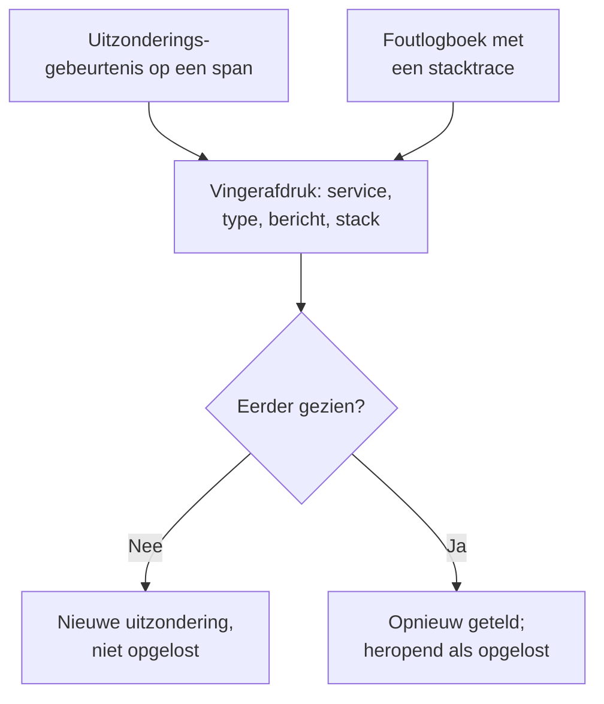

# Uitzonderingen volgen

Uitzonderingen volgen verzamelt de fouten die uw code gooit en groepeert elk voorval van dezelfde fout tot één uitzondering, met de stacktrace, het verloop en de verzoeken waarin ze optrad. Werk ze af als een takenlijst: verhelpen, oplossen of de ruis archiveren, en laat AI een pull request openen voor de uitzonderingen die het kan verhelpen.

:::cards
- [Waar uitzonderingen vandaan komen](#waar-uitzonderingen-vandaan-komen): Spans en logboeken die uw services al sturen.
- [De lijst beoordelen](#de-lijst-beoordelen): Onopgelost eerst, ruis verborgen.
- [De pagina van een uitzondering](#de-pagina-van-een-uitzondering): Stacktrace, voorvallen en context.
- [Verhelpen met AI](#verhelpen-met-ai): Een pull request met de oplossing, of een regressietest.
- [Nieuwe en stijgende uitzonderingen vinden en oplossen met AI](#nieuwe-en-stijgende-uitzonderingen-vinden-en-oplossen-met-ai): Pull requests voor de uitzonderingen die OneUptime vindt.
:::

## Waar uitzonderingen vandaan komen

U stuurt uitzonderingen niet apart. OneUptime vindt ze in de telemetrie die uw services al sturen:

- een uitzonderingsgebeurtenis op een span, wat `recordException()` van OpenTelemetry schrijft;
- een logboek met de attributen `exception.type`, `exception.message` of `exception.stacktrace`;
- een logboek met ernst Error of Fatal waarvan het bericht een stacktrace bevat, als het logboek niet binnen een span is geschreven (de span meldt ze dan al).

Elk voorval wordt met de eerdere voorvallen van dezelfde fout gegroepeerd tot één uitzondering:

- **Eén uitzondering per service en fout.** De vingerafdruk wordt gemaakt uit de service, het uitzonderingstype, het bericht en de stacktrace. Waarden die per aanroep veranderen, gaan er eerst uit: UUID's en andere ID's, tijdstempels, IP- en e-mailadressen, en getallen van zeven cijfers of meer. Zo zijn `Order id=1042 not found` en `Order id=2077 not found` één uitzondering.
- **Een nieuw voorval heropent een opgeloste uitzondering.** Gebeurt ze opnieuw nadat u haar oploste, dan hield de oplossing geen stand.
- **Een gearchiveerde uitzondering blijft gearchiveerd.** Haar nieuwe voorvallen worden nog geteld, maar sturen geen meldingen meer.

> [!TIP]
> Om een verwachte fout buiten Uitzonderingen volgen te houden, zoals ongeldige invoer die uw service weigerde, zet u het attribuut `error.class` op `user-error` of `expected-denial` op de uitzonderingsgebeurtenis van de span. OneUptime legt er dan geen uitzondering voor vast.

## Voordat u begint

- **Binnenkomende spans of logboeken.** Instrumenteer uw services met [OpenTelemetry](/docs/telemetry/open-telemetry). Het tabblad **Installatiegids** toont de code voor uw taal.
- **Een rol die telemetrie mag lezen.** Project Owner, Project Admin, Project Member, Viewer, Telemetry Admin, Telemetry Member of Telemetry Viewer, of een aangepaste rol met de machtiging Read Telemetry Service Exception. Oplossen en archiveren vraagt Project Owner of Project Admin, of de machtiging Edit Telemetry Service Exception.

## De lijst beoordelen

:::steps
### Uitzonderingen openen

Ga naar **Producten → Observability → Uitzonderingen**. De badge op het tabblad **Uitzonderingen** telt de onopgeloste problemen, en de lijst opent op de uitzonderingen onder **Niet opgelost**.

### Een status kiezen

Wissel tussen **Niet opgelost**, **Opgelost**, **Gearchiveerd** en **Alle**. De grafiek boven de lijst toont hoeveel voorvallen in de loop van de tijd **Niet-afgehandeld** en hoeveel **Afgehandeld** waren.

### Kiezen wat als probleem telt

**Problemen**, de standaard, verbergt gebruikersfouten en verwachte weigeringen, zodat de lijst toont wat een oplossing nodig heeft. **User errors** toont alleen die, en **Alle** toont elke uitzondering.

### Zoeken en filteren

Typ een zoekopdracht zoals `type:TypeError env:production`, zie [Zoeksyntaxis](/docs/telemetry/search-syntax#uitzonderingen), of klik op een waarde in de zijbalk **Filters**: een service, een host of andere bron, een **Uitzonderingstype**, een **Omgeving** of een **Error Class**.

### Een uitzondering openen

Klik op een rij om de pagina van de uitzondering te openen.
:::

## De pagina van een uitzondering

Het zijmenu van de pagina groepeert wat u met een uitzondering doet:

| Pagina | Wat die toont |
| --- | --- |
| **Overzicht** | Het bericht, de service, hoe vaak ze optrad en wanneer ze voor het eerst en het laatst gezien werd, haar verloop in de tijd, en haar laatste voorval: de release, de omgeving, de span, de trace en de gebruikerssessie. |
| **Stack trace** | De frames van de stack. Voor browsercode de oorspronkelijke bestanden en regels, zodra u [Source maps](/docs/telemetry/source-maps) voor de release uploadt. |
| **Occurrences** | Elk voorval, met de tijd, het bericht en de trace waarin het optrad. |
| **Context** | De attributen van het laatste voorval, de sessie-opname als die er is, en de stappen die ertoe leidden. |
| **Logboeken** | De logboeken die rond het laatste voorval zijn geschreven. |
| **AI Assistance** | AI-taken die de uitzondering verhelpen of testen. |
| **Instellingen** | De uitzondering oplossen of archiveren. Staat onder **Manage**, dat eerst ingeklapt is. |

## Oplossen, heropenen en archiveren

De knoppen bovenaan de pagina van de uitzondering, en haar pagina **Instellingen**, wijzigen de status:

| Actie | Wanneer u die gebruikt | Wat er daarna gebeurt |
| --- | --- | --- |
| **Oplossen** | U hebt de oplossing uitgerold. | Ze verlaat de lijst **Niet opgelost**. Een nieuw voorval heropent haar. |
| **Reopen** | De oplossing werkte niet. | Ze is weer niet opgelost. |
| **Archiveren** | Het is ruis die u niet wilt verhelpen. | Ze verlaat de lijst. Nieuwe voorvallen worden geteld maar sturen geen meldingen meer. |
| **Uit archief halen** | U wilt er weer van horen. | Ze staat weer in de lijst waar ze thuishoort. |

**Instellingen** toont wie de uitzondering het laatst heeft opgelost of gearchiveerd, en wanneer. De knoppen daar heten **Markeren als opgelost** of **Markeren als onopgelost**, en **Archiveren** of **Uit archief halen**.

## Foutklassen

Elke uitzondering heeft een foutklasse, die zegt wiens probleem het is. OneUptime AI stelt die in wanneer het een inzicht over de uitzondering beoordeelt, zoals een nieuwe of sterk toenemende uitzondering: zie [AI SRE](/docs/ai/ai-sre#inzichten-proactieve-detectie). Een uitzondering die het niet heeft beoordeeld, blijft `unknown`.

| Klasse | Wat die betekent | In **Problemen** |
| --- | --- | --- |
| `code-fault` | Een fout in de code. De enige klasse die AI uit zichzelf verhelpt. | Ja |
| `infrastructure` | Een time-out, een verbroken verbinding of uitgeputte middelen. | Ja |
| `unknown` | Nog niet ingedeeld. | Ja |
| `user-error` | Het gevolg van ongeldige invoer van een gebruiker. | Nee |
| `expected-denial` | Een controle die haar werk doet, zoals een geweigerde aanmelding. | Nee |

Met **Verwachte uitzonderingen archiveren** aan, in de instellingen van AI-inzichten, worden uitzonderingen die de beoordeling als verwachte weigeringen herkent voor u gearchiveerd.

## Verhelpen met AI

De pagina **AI Assistance** biedt drie taken. Elke taak loopt als AI-taak die een pull request opent in uw coderepository:

| Taak | Wat de pull request doet |
| --- | --- |
| **Fix this exception with AI** | Verhelpt de oorzaak. Start de taak met **Oplossen met AI**. |
| **Generate Regression Test** | Voegt een test toe die faalt totdat de bug is verholpen. |
| **Foutafhandeling verbeteren** | Voor verwachte fouten: controleert invoer eerder, houdt gebruikersgegevens uit berichten en markeert de fout als afgehandeld. |

AI heeft eerst drie dingen nodig: een LLM-provider, een gekoppelde repository (op GitHub, GitLab, Forgejo of Gitea, of op elke Git-server), en een AI-agent die online is om de taak uit te voeren. De pagina controleert elk van de drie en linkt naar wat ontbreekt. De taken pauzeren zolang de uitzondering opgelost of gearchiveerd is. Zie [Code](/docs/ai/ai-agent).

## Nieuwe en stijgende uitzonderingen vinden en oplossen met AI

Elke 15 minuten doorzoekt OneUptime uw uitzonderingen op nieuwe, op uitzonderingen die plotseling veel vaker optreden en op services waarvan de uitzonderingen geen stacktrace hebben, en legt wat het vindt vast als AI-inzichten, met het bewijs. Daarna onderzoekt OneUptime AI elk ervan en opent een pull request voor elk inzicht dat het kan oplossen. Er wordt nooit iets samengevoegd: uw team beoordeelt elke pull request.

| Bevinding | Wanneer OneUptime die vastlegt | De pull request |
| --- | --- | --- |
| **New Exception** | Een uitzondering die in de afgelopen 24 uur voor het eerst is gezien en al 3 keer of vaker is opgetreden. | Verhelpt de uitzondering, of handelt haar beter af. |
| **Exception Spike** | Een uitzondering die in het afgelopen uur 10 keer of vaker is opgetreden, met 5 keer of meer haar uurtempo van de 24 uur daarvoor. | Verhelpt de uitzondering, of handelt haar beter af. |
| **Ontbrekende stack trace** | De uitzonderingen die een service de afgelopen dag vastlegde, hebben geen stacktrace en zijn samen 20 keer of vaker opgetreden. | Laat de service bij elke uitzondering een stacktrace vastleggen. |

De pull request van een nieuwe of stijgende uitzondering is de eigen AI-taak van de uitzondering, die haar pagina **AI Assistance** start, en hij wacht tot OneUptime AI de bevinding heeft onderzocht. Vindt het de schuldige code (`code-fault`), dan verhelpt de pull request die, zoals **Fix this exception with AI** doet. Vindt het een verwachte fout (`user-error` of `expected-denial`), dan handelt de pull request de fout beter af, zoals **Foutafhandeling verbeteren** doet. Elk ander oordeel opent zelf geen pull request. Met **Verwachte uitzonderingen archiveren** aan wordt een verwachte weigering in plaats daarvan gearchiveerd en krijgt die geen pull request.

OneUptime AI opent er alleen zelf een voor een uitzondering die in uw eigen code is opgeworpen: een uitzondering waarvan de stacktrace een frame van uw code bevat, en niet alleen frames van bibliotheken of de runtime. Een pull request die iemand zonder samenvoegen sloot, pauzeert de automatische voor die uitzondering. Iedereen kan er nog steeds elk ervan vragen met **Oplossen met AI** op de bevinding.

### Inschakelen

**Uitzonderingen → AI → Instellingen** bevat de schakelaar **Nieuwe en stijgende uitzonderingen vinden en oplossen**, die voor nieuwe projecten aan staat. Zolang die uit staat, horen nieuwe en stijgende uitzonderingen zoals voorheen bij de AI-inzichten: zie [AI SRE](/docs/ai/ai-sre#inzichten-proactieve-detectie). Staat **AI inschakelen** uit, dan worden ze nog gevonden, maar doet OneUptime AI er niets mee. Om pull requests te openen heeft OneUptime AI een repository nodig die in [Code](/docs/ai/ai-agent) is gekoppeld: de pagina zegt eerst wat ontbreekt. De code van elke repository wordt gewijzigd op de Runner die de repository in Code kiest.

OneUptime AI opent zelf maximaal 5 pull requests per dag (UTC), één per bevinding, en nooit meer dan de limiet van een repository voor open AI-pull requests.

### AI-regels

Zonder regel onderzoekt OneUptime AI elke uitzondering die het vindt meteen en opent een pull request voor elke uitzondering die het kan oplossen. De **AI-regels** onder **Meer instellingen** beperken dat, in drie stappen:

| Stap | Wat die beslist |
| --- | --- |
| **Overeenkomst** | Welke services: de gekozen services, die met bepaalde labels of die waarvan de naam bij een patroon past. |
| **Onderzoeken** | **Meteen**, of **Alleen als het na een wachttijd nog gevonden wordt**: een uitzondering die tijdens de wachttijd verdwijnt, wordt niet onderzocht. |
| **Herstel** | **Niet herstellen**, **Eerst om goedkeuring vragen** of **Herstellen zonder te vragen**. Eerst vragen laat de pull request aan een persoon over: de bevinding biedt **Oplossen met AI** aan. |

Onder **Meer velden** kiest een regel de coderepositories, de MCP-servers en de LLM-provider die OneUptime AI ervoor mag gebruiken. Is er niets gekozen, dan mag het ze allemaal gebruiken, en de standaard-LLM-provider van het project.

### Zien wat het deed

- **Uitzonderingen → AI → Inzichten** toont wat OneUptime vond, elke bevinding met haar bewijs, de frames van uw code in haar stacktrace inbegrepen. **View Exception Group** opent de uitzondering, en bij de ontbrekende stacktraces van een service opent **Openen in Uitzonderingen** haar niet-opgeloste uitzonderingen van de afgelopen dag.
- **Uitzonderingen → AI → Logboeken** toont elk onderzoek en elke pull request, nieuwste eerst, met hoe elk ervoor staat en wat elk onderzoek vond.
- De pull request zegt waarom hij werd geopend, met een link naar zijn bevinding. Die van een nieuwe of stijgende uitzondering linkt ook naar de uitzondering en staat op haar pagina **AI Assistance**. In Code noemt zijn taak de uitzondering die ze verhelpt, of de bevinding waar ze vandaan kwam.

## Inzichten in uitzonderingen

Het tabblad **Inzichten** telt uw uitzonderingen onder **Niet opgelost**, **Opgelost** en **Gearchiveerd** en uw oplospercentage, en toont de vaakst voorkomende uitzonderingen, de services die ze treffen en de uitzonderingen die het laatst gezien zijn.

## Problemen oplossen

:::details Een uitzondering die ik net gooide, staat niet in de lijst
Controleer eerst de weergave: **Problemen** verbergt gebruikersfouten en verwachte weigeringen, kies dus **Alle**. Vergroot daarna het tijdsbereik en controleer of de uitzondering op een span is vastgelegd, of in een logboek met een stacktrace.
:::

:::details Eén fout verschijnt als meerdere uitzonderingen
De vingerafdruk bevat het bericht en de stacktrace. Verschillen die, bijvoorbeeld als een bericht een kort getal of een naam bevat die bij elke aanroep verandert, dan is elke variant een eigen uitzondering.
:::

:::details Een opgeloste uitzondering komt steeds terug
Een nieuw voorval heropent een opgeloste uitzondering met opzet: de fout treedt nog steeds op. Controleer of de oplossing de release heeft bereikt die haar meldt, of archiveer de uitzondering als u er niet meer van wilt horen.
:::

## Volgende stappen

:::cards
- [Uitzonderingen-monitor](/docs/monitor/exceptions-monitor): Een melding krijgen als uitzonderingen sterk toenemen.
- [Source maps](/docs/telemetry/source-maps): Leesbare stacktraces voor browsercode.
- [Code](/docs/ai/ai-agent): Hoe AI code verbetert en pull requests opent.
- [Traceverkenner](/docs/telemetry/traces-explorer): Het verzoek zien waarin een uitzondering optrad.
:::
