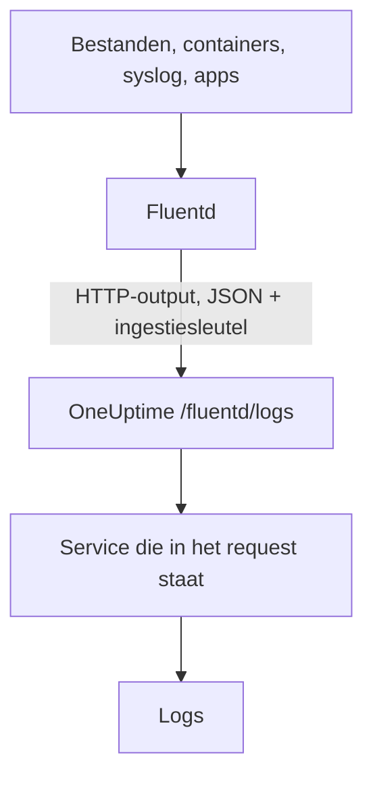

# Fluentd

[Fluentd](https://www.fluentd.org/) verzamelt logs uit bestanden, containers, syslog, applicaties en [vele andere bronnen](https://www.fluentd.org/datasources). De ingebouwde [HTTP-output](https://docs.fluentd.org/output/http) stuurt ze naar het Fluentd-endpoint van OneUptime, waar ze doorzoekbaar worden onder **Producten → Logboeken**.

:::cards
- [Fluentd configureren](#fluentd-configureren): Een HTTP-output toevoegen die naar OneUptime wijst.
- [Hoe records worden gelezen](#hoe-records-worden-gelezen): Welke velden het bericht, het niveau en de attributen worden.
- [Zelf gehoste OneUptime](#zelf-gehoste-oneuptime): Fluentd op je eigen instantie richten.
:::

## Hoe het werkt



Fluentd stuurt records in batches als JSON, met je ingestiesleutel in de header `x-oneuptime-token` en de servicenaam in `x-oneuptime-service-name`. OneUptime maakt van elk record een log van die service, en maakt de service aan zodra hij voor het eerst stuurt.

## Voordat je begint

- **Fluentd installeren**: zie de [installatiehandleiding](https://docs.fluentd.org/installation).
- **Een OneUptime-project.** In OneUptime Cloud wordt telemetrie per opgenomen GB gefactureerd (zie de [prijzen](https://oneuptime.com/pricing)), en een project op het Free-abonnement heeft een betaalmethode nodig voordat het telemetrie kan sturen.
- **Een telemetrie-ingestiesleutel.** Heb je er nog geen:

:::steps
### De ingestiesleutels openen

Ga naar **Producten → Projectinstellingen**, open **Telemetrie & APM** in het zijmenu en kies **Ingestiesleutels**.


### Een sleutel maken

Klik op **Ingestiesleutel aanmaken**. In het dialoogvenster is de naam van de sleutel al ingevuld en **Server** gekozen, het soort sleutel waarmee een applicatie of een collector stuurt. Klik dus op **Ingestiesleutel aanmaken** om hem te maken, of geef hem eerst een andere naam.

### Het geheim kopiëren

De nieuwe sleutel opent op een eigen pagina. Kopieer de **Geheime sleutel**: dat is het `YOUR_SERVICE_TOKEN` in de configuratie hieronder.


:::

## Fluentd configureren

Het configuratiebestand van Fluentd is meestal `/etc/fluent/fluentd.conf`, of `/etc/td-agent/td-agent.conf` bij het oudere td-agent-pakket.

:::steps
### Een HTTP-output toevoegen

Voeg een `<match>`-sectie toe die records naar OneUptime stuurt. Vervang `YOUR_SERVICE_TOKEN` door je ingestiesleutel en `YOUR_SERVICE_NAME` door de naam waaronder de logs moeten verschijnen (welke naam je maar wilt):

```text title="fluentd.conf"
# Send the time Fluentd gave each event: the HTTP output sends only the record
<filter **>
  @type record_transformer
  enable_ruby true
  <record>
    fluentd_time ${time.utc.strftime("%Y-%m-%dT%H:%M:%S.%NZ")}
  </record>
</filter>

# Match all patterns
<match **>
  @type http

  endpoint https://oneuptime.com/fluentd/logs
  open_timeout 2

  headers {"x-oneuptime-token":"YOUR_SERVICE_TOKEN", "x-oneuptime-service-name":"YOUR_SERVICE_NAME"}

  content_type application/json
  json_array true

  # Send a batch again when OneUptime is busy (429) or restarting (502, 503, 504)
  retryable_response_codes 429,502,503,504

  <format>
    @type json
  </format>
  <buffer>
    # Keep the batches on disk until OneUptime takes them: a restart of Fluentd loses none
    @type file
    path /var/log/fluent/buffer/oneuptime
    total_limit_size 512m
    flush_interval 10s
    chunk_limit_size 900k
    # Try again at least every 30 seconds, for up to 72 hours
    retry_max_interval 30s
    retry_timeout 72h
  </buffer>
</match>

# Keep Fluentd's own logs out of OneUptime
<label @FLUENT_LOG>
  <match **>
    @type null
  </match>
</label>
```

`json_array true` stuurt elke chunk van de buffer als één JSON-array, en `flush_interval 10s` stuurt de buffer elke 10 seconden. `chunk_limit_size 900k` houdt elk request onder 1 MB, het meeste dat OneUptime op dit endpoint aanneemt.

De standaard van Fluentd werkt ook: zonder `content_type` en `json_array true` stuurt Fluentd JSON gescheiden door regeleinden, één record per regel, en OneUptime leest elke regel als het record dat het is, met `compress gzip` of zonder.

`@type file` bewaart de batches die nog verstuurd moeten worden in de map die `path` noemt, zodat een herstart van Fluentd er geen verliest; een buffer in het geheugen, de standaard van Fluentd, verliest wat hij vasthoudt. De gebruiker van Fluentd moet in die map kunnen schrijven: `/var/log/fluent` is die van fluent-package, `/var/log/td-agent` die van td-agent en `/fluentd/log` die van de image `fluent/fluentd`. `total_limit_size 512m` bewaart daar hooguit 512 MB; is hij vol, dan neemt Fluentd geen records meer aan tot er een batch is verstuurd.

`retryable_response_codes 429,502,503,504` stuurt een batch opnieuw als OneUptime het druk heeft (`429`) of herstart (`502`, `503`, `504`); zonder deze instelling gooit Fluentd een batch weg bij elk antwoord behalve `503`. `retry_max_interval 30s` wacht hoogstens 30 seconden tussen pogingen, en `retry_timeout 72h` gooit een batch weg die na 72 uur nog steeds niet verstuurd kan worden. Het filter `record_transformer` voegt de tijd toe die Fluentd elk record gaf, als `fluentd_time`: de HTTP-output stuurt alleen het record, en OneUptime leest de tijd van een log daaruit.

### Fluentd herstarten

Herstart de Fluentd-service, zodat hij de nieuwe output laadt.

### Controleren of logs binnenkomen

Enkele seconden na de volgende flush verschijnen de logs onder **Producten → Logboeken**. De service staat onder **Producten → Services**; bestond hij nog niet, dan maakt OneUptime hem aan.
:::

## Volledig voorbeeld

Deze configuratie ontvangt records via het forward-protocol van Fluentd op poort `24224`, alleen van deze host, en stuurt ze allemaal naar OneUptime:

```text title="fluentd.conf"
####
## Source descriptions:
##

## built-in TCP input
## @see https://docs.fluentd.org/input/forward
<source>
  @type forward
  port 24224
  # This host alone: see "Take records from other hosts" to open it
  bind 127.0.0.1
</source>

# Send the time Fluentd gave each event: the HTTP output sends only the record
<filter **>
  @type record_transformer
  enable_ruby true
  <record>
    fluentd_time ${time.utc.strftime("%Y-%m-%dT%H:%M:%S.%NZ")}
  </record>
</filter>

<match **>
  @type http

  endpoint https://oneuptime.com/fluentd/logs
  open_timeout 2

  headers {"x-oneuptime-token":"YOUR_SERVICE_TOKEN", "x-oneuptime-service-name":"YOUR_SERVICE_NAME"}

  content_type application/json
  json_array true

  # Send a batch again when OneUptime is busy (429) or restarting (502, 503, 504)
  retryable_response_codes 429,502,503,504

  <format>
    @type json
  </format>
  <buffer>
    # Keep the batches on disk until OneUptime takes them: a restart of Fluentd loses none
    @type file
    path /var/log/fluent/buffer/oneuptime
    total_limit_size 512m
    flush_interval 10s
    chunk_limit_size 900k
    # Try again at least every 30 seconds, for up to 72 hours
    retry_max_interval 30s
    retry_timeout 72h
  </buffer>
</match>

# Keep Fluentd's own logs out of OneUptime
<label @FLUENT_LOG>
  <match **>
    @type null
  </match>
</label>
```

`bind 127.0.0.1` neemt alleen records van deze host aan, zoals die van de logdriver `fluentd` van Docker, die naar `localhost:24224` stuurt. Wil je verschillende bronnen als verschillende services sturen, gebruik dan één `<match>`-sectie per tag, elk met een eigen `x-oneuptime-service-name` en een eigen buffer-`path`: met twee buffers op één pad start Fluentd niet.

## Records van andere hosts ontvangen

Met `bind 0.0.0.0` en zonder sectie `<security>` kan iedereen die poort `24224` bereikt logs naar OneUptime sturen onder je ingestiesleutel. Om records van Fluentd of Fluent Bit op andere hosts te ontvangen, luister je op elk adres, vraag je elke afzender om een gedeelde sleutel en gebruik je TLS. Vervang de sectie `<source>` van het volledige voorbeeld door:

```text title="fluentd.conf on this host"
<source>
  @type forward
  port 24224
  bind 0.0.0.0
  <transport tls>
    cert_path /etc/fluent/certs/fluentd.crt
    private_key_path /etc/fluent/certs/fluentd.key
  </transport>
  <security>
    self_hostname fluentd.example.com
    shared_key YOUR_SHARED_KEY
  </security>
</source>
```

`cert_path` en `private_key_path` zijn een certificaat voor de naam van deze host, hier `fluentd.example.com`, en de sleutel ervan, die de gebruiker van Fluentd moet kunnen lezen. Fluentd waarschuwt als de sleutel geen wachtwoordzin heeft; `private_key_passphrase` stelt er een in. Vervang `YOUR_SHARED_KEY` door een lang willekeurig geheim, zoals een uit `openssl rand -base64 32`, en geef elke afzender hetzelfde:

```text title="fluentd.conf on each sender"
<match **>
  @type forward
  transport tls
  # The certificate of the authority that signed this host's; not needed for a public one
  tls_cert_path /etc/fluent/certs/ca.crt
  <security>
    self_hostname app-1.example.com
    shared_key YOUR_SHARED_KEY
  </security>
  <server>
    host fluentd.example.com
    port 24224
  </server>
  <buffer>
    @type file
    path /var/log/fluent/buffer/forward
  </buffer>
</match>

# Keep Fluentd's own logs out of OneUptime
<label @FLUENT_LOG>
  <match **>
    @type null
  </match>
</label>
```

De `forward`-output van Fluent Bit neemt dezelfde instellingen: `Shared_Key`, `Self_Hostname`, `tls On` en `tls.ca_file`.

Een afzender zonder de sleutel, of zonder TLS, wordt geweigerd. De sleutel zelf gaat nooit over het netwerk: elke kant bewijst dat hij hem heeft. Zonder TLS kan iedereen op het netwerk tussen de hosts de records lezen. Open poort `24224` in de firewall van de host alleen voor de hosts die sturen. Draait Fluentd vanuit het Docker Compose-bestand van de logs-handleiding, publiceer de poort daar dan ook op elk adres, `"24224:24224"`, en koppel de map van het certificaat in de container.

## Hoe records worden gelezen

OneUptime leest deze velden uit elk record:

| Logveld | Gelezen uit het eerste aanwezige veld van | Opmerkingen |
| --- | --- | --- |
| Inhoud | `message`, `log`, `msg`, `body`, `text` | De logregel. Een record zonder een van deze velden wordt in zijn geheel opgeslagen, als JSON. |
| Niveau | `level`, `severity`, `loglevel`, `log_level`, `priority`, `severityText`, `severity_text` | Namen zoals `trace`, `debug`, `info`, `notice`, `warn`, `error`, `critical` en `fatal`, in hoofd- of kleine letters. Elke andere waarde wordt opgeslagen als `Unspecified`. |
| Trace-ID | `trace_id`, `traceId`, `traceid` | Koppelt de log aan zijn trace. |
| Span-ID | `span_id`, `spanId`, `spanid` | Koppelt de log aan zijn span. |
| Service | de header `x-oneuptime-service-name` | `Fluentd` als de header niet is ingesteld. |
| Tijd | `time`, `timestamp`, `@timestamp`, `ts`, `fluentd_time` | Een ISO 8601-tijd, zoals `2026-11-14T08:00:00.123Z`, of seconden, milliseconden, microseconden of nanoseconden sinds de epoch; een tijd zonder tijdzone is UTC. Een tijd vóór 2000, of meer dan een dag vooruit, wordt niet gelezen. Het veld waaruit de tijd wordt gelezen, wordt niet als attribuut bewaard. Een record zonder tijd wordt opgeslagen op het moment waarop OneUptime het ontvangt. |

Elk ander veld wordt een attribuut met de naam `fluentd.` gevolgd door de naam van het veld, waarop je kunt zoeken en filteren: een veld `container_name` is `@fluentd.container_name` in de logboekexplorer. Een genest object wordt met punten platgemaakt, zoals `fluentd.kubernetes.pod_name`, en een lijst wordt als JSON opgeslagen.

Fluentd-logs gaan door je [logboekpipelines](/docs/telemetry/log-pipelines), dropfilters en maskeerregels, net als elke andere log.

## Zelf gehoste OneUptime

Vervang `https://oneuptime.com` in `endpoint` door de URL van je OneUptime-instantie: `http(s)://YOUR_ONEUPTIME_HOST/fluentd/logs`.

## Problemen oplossen

:::details Fluentd logt `401` van de HTTP-output
De ingestiesleutel ontbreekt, is onbekend of verlopen. Controleer de waarde van `x-oneuptime-token` in `headers`.
:::

:::details Fluentd logt `402` of `422`
`402`: in OneUptime Cloud zit het project op het Free-abonnement en heeft het geen betaalmethode. Voeg er een toe onder **Projectinstellingen → Facturering en facturen → Facturering**. `422`: de sleutel is uitgeschakeld, of het is een browsersleutel. Zet **Ingeschakeld** weer aan in de instellingen van de sleutel, of maak een **Server**-sleutel.
:::

:::details Fluentd logt `413`
Het request is groter dan 1 MB, het meeste dat OneUptime op dit endpoint aanneemt. Zet `chunk_limit_size 900k` in de sectie `<buffer>`, zoals in de configuratie hierboven.
:::

:::details Fluentd logt `429`, `502`, `503` of `504`
OneUptime heeft het druk of herstart. Met `retryable_response_codes 429,502,503,504` in de sectie `<match>`, zoals in de configuratie hierboven, houdt Fluentd de batch vast en stuurt hem opnieuw; zonder deze instelling gooit Fluentd de batch weg. Met `@type file` in de sectie `<buffer>` houdt Fluentd de batch ook vast als het herstart.
:::

:::details Logs tonen het moment waarop OneUptime ze ontving, niet hun eigen tijd
OneUptime leest de tijd van een log uit zijn record, en de HTTP-output van Fluentd stuurt alleen het record. Een sectie `<parse>` haalt het veld `time` uit het record, als tijd van de gebeurtenis: voeg er `time_key fluentd_time` aan toe, zodat hij van geen enkel record de tijd leest en `time` laat zoals het is. Voeg ook het filter `record_transformer` uit de configuratie hierboven toe: dat voegt de tijd toe die Fluentd elk record gaf, als `fluentd_time`.
:::

:::details Een JSON-regel waarvan `time` `null`, `true`, een lijst of een object is, komt nooit aan
De `json`-parser van Fluentd leest het veld `time` van een regel als tijd van de gebeurtenis, en gooit zonder waarschuwing een regel weg waarvan `time` geen tekst en geen getal is. Voeg `time_key fluentd_time` toe aan zijn sectie `<parse>`, zoals hierboven: Fluentd laat `time` dan in het record zoals het is. Met het filter `record_transformer` hierboven slaat OneUptime de log op op het moment dat Fluentd hem las, `fluentd_time`; zonder dat filter op het moment dat OneUptime hem ontvangt.
:::

:::details Logs komen binnen onder de service `Fluentd`
De header `x-oneuptime-service-name` ontbreekt. Voeg hem toe aan `headers` in elke `<match>`-sectie.
:::

:::details De inhoud van de log toont het hele record als JSON
OneUptime neemt de inhoud uit het eerste aanwezige veld van `message`, `log`, `msg`, `body` of `text`, en slaat het hele record op als het geen van die velden heeft. Hernoem het veld met je logregel naar een daarvan, bijvoorbeeld met het filter `record_transformer` van Fluentd.
:::

Heb je vragen of hulp nodig bij de configuratie, mail ons dan op support@oneuptime.com.

## Volgende stappen

:::cards
- [Logboekpipelines](/docs/telemetry/log-pipelines): De logs die Fluentd stuurt parsen en verrijken.
- [Zoeksyntaxis](/docs/telemetry/search-syntax): De logs vinden in de logboekexplorer.
- [Fluent Bit](/docs/telemetry/fluentbit): Een lichtere agent die via OpenTelemetry stuurt.
- [Logs-monitor](/docs/monitor/logs-monitor): Waarschuwen wanneer overeenkomende logs verschijnen.
:::
