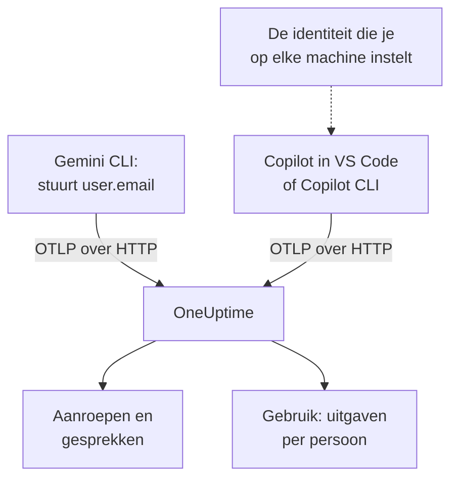

# Gemini CLI en GitHub Copilot

Gemini CLI en GitHub Copilot exporteren allebei zelf OpenTelemetry: richt ze op OneUptime, en hun modelaanroepen, tokens, kosten en toolaanroepen komen binnen in [AI / LLM](/docs/telemetry/ai-llm-observability), naast de AI-aanroepen van je eigen apps. Ze verschillen in wat het zwaarst weegt voor doorbelasting: Gemini CLI noemt bij elk record de persoon, en Copilot noemt niemand, dus noem je elke ontwikkelaar zelf.

:::cards
- [Gemini CLI](#gemini-cli-instellen): Zet telemetrie aan, met traces, en stuur die rechtstreeks naar OneUptime.
- [GitHub Copilot](#github-copilot-instellen): Exporteer vanuit VS Code of Copilot CLI.
- [Noem elke ontwikkelaar](#noem-elke-ontwikkelaar): De identiteit die Copilot weglaat.
- [Probleemoplossing](#probleemoplossing): Wat je controleert als er niets binnenkomt.
:::

## Hoe het werkt



| | Gemini CLI | GitHub Copilot |
| --- | --- | --- |
| Stuurt | Traces, metrics en logs | Traces, metrics en events, alleen vanuit zijn agentomgevingen |
| Noemt de persoon | `user.email`, als iemand is aangemeld | Niemand: jij stelt `enduser.id` en `user.email` in |
| Prompttekst | Verstuurd, tenzij je `logPrompts` uitzet | Niet verstuurd, tenzij je `captureContent` aanzet |
| Stuurt standaard naar | `http://localhost:4317`, over gRPC | `http://localhost:4318`, over HTTP |

## Voordat je begint

- Een ingestiesleutel: open **Projectinstellingen → Telemetrie & APM → Ingestiesleutels** en klik op **Inname-sleutel aanmaken**.
- Je OTLP-basis-URL: `https://oneuptime.com/otlp`, of `https://YOUR-ONEUPTIME-HOST/otlp` als je OneUptime zelf host.
- De sleutel reist mee in de header `x-oneuptime-token` van elk exportverzoek.

## Gemini CLI instellen

Gemini CLI stuurt traces, metrics en log-events, en zet `user.email` op elk record als iemand is aangemeld. OneUptime leest `user.email` als de medewerker, dus de uitgaven van elke persoon verschijnen zonder koppeltabel en zonder instellingen per machine.

:::steps
### Zet telemetrie aan

Voeg een blok `telemetry` toe aan het gebruikersinstellingenbestand van elke machine, of aan `.gemini/settings.json` in een repository:

```json title="~/.gemini/settings.json"
{
  "telemetry": {
    "enabled": true,
    "target": "local",
    "otlpEndpoint": "https://oneuptime.com/otlp",
    "otlpProtocol": "http",
    "otlpHeaders": {
      "x-oneuptime-token": "YOUR_INGESTION_TOKEN"
    },
    "traces": true,
    "logPrompts": false
  }
}
```

### Start een nieuwe sessie

Gemini CLI leest zijn instellingen bij het opstarten, dus start hem opnieuw en voer een prompt uit.

### Controleer of er gegevens binnenkomen

Open **Producten → AI / LLM → Aanroepen**: de aanroepen staan er onder de service `gemini-cli`, met het model en de tokens.
:::

Drie instellingen in dat blok wegen zwaarder dan de rest:

- `otlpProtocol: "http"`. Gemini CLI gebruikt gRPC, tenzij je iets anders opgeeft. Over HTTP voegt hij `/v1/traces`, `/v1/metrics` en `/v1/logs` zelf aan de basis-URL toe. OneUptime accepteert ook gRPC op poort 443 (zie [OTLP over gRPC](/docs/telemetry/open-telemetry#otlp-via-grpc)), maar HTTP is eenvoudiger.
- `traces: true`. Dit staat standaard uit, en zonder deze instelling dragen de spans van Gemini CLI geen model en geen tokentellingen, dus kan er niets worden geprijsd. Gemini CLI stuurt ook geen kostenmetric: zet traces aan om te zien wat zijn aanroepen kosten.
- `logPrompts: false`. Lees de waarschuwing hieronder.

> [!WARNING]
> `logPrompts` is standaard `true`, dus wie telemetrie aanzet, verstuurt de tekst die je engineers typen: vaak broncode, klantgegevens en geplakte inloggegevens. Zet het op `false` in dezelfde wijziging die telemetrie aanzet. Wil je prompts om te debuggen, besluit dat dan bewust, en maskeer wat nodig is met opschoonregels onder **Traces → Instellingen**.

### Instellingen voor een vloot

Elke instelling heeft een omgevingsvariabele, en de variabelen gaan voor de `.gemini/settings.json` van een repository, wat ze de plek maakt voor een vlootbeleid dat via MDM wordt uitgerold:

```bash
export GEMINI_TELEMETRY_ENABLED=true
export GEMINI_TELEMETRY_TARGET=local
export GEMINI_TELEMETRY_OTLP_ENDPOINT="https://oneuptime.com/otlp"
export GEMINI_TELEMETRY_OTLP_PROTOCOL=http
export GEMINI_TELEMETRY_OTLP_HEADERS="x-oneuptime-token=YOUR_INGESTION_TOKEN"
export GEMINI_TELEMETRY_TRACES_ENABLED=true
export GEMINI_TELEMETRY_LOG_PROMPTS=false
```

| Instelling | Variabele | Standaard | Wat het doet |
| --- | --- | --- | --- |
| `enabled` | `GEMINI_TELEMETRY_ENABLED` | `false` | Zet telemetrie aan |
| `target` | `GEMINI_TELEMETRY_TARGET` | `local` | `local` stuurt naar het endpoint dat je instelt; `gcp` stuurt naar Google Cloud |
| `otlpEndpoint` | `GEMINI_TELEMETRY_OTLP_ENDPOINT` | `http://localhost:4317` | Waar de telemetrie naartoe gaat |
| `otlpProtocol` | `GEMINI_TELEMETRY_OTLP_PROTOCOL` | `grpc` | `grpc` of `http` |
| `otlpHeaders` | `GEMINI_TELEMETRY_OTLP_HEADERS` | Geen | Headers bij elke export: een object in het bestand, `key=value`-paren of JSON in de variabele |
| `traces` | `GEMINI_TELEMETRY_TRACES_ENABLED` | `false` | Zet het model, de tokens en de inhoud op spans |
| `logPrompts` | `GEMINI_TELEMETRY_LOG_PROMPTS` | `true` | Zet prompttekst in log-events |
| `outfile` | `GEMINI_TELEMETRY_OUTFILE` | Geen | Schrijft telemetrie in plaats daarvan naar een bestand, om te zien wat er verstuurd zou worden |

Opdrachtregelvlaggen gaan voor de variabelen `GEMINI_TELEMETRY_*`, die voor de standaardvariabelen `OTEL_EXPORTER_OTLP_*` gaan, die weer voor `settings.json` gaan. Gemini CLI leest ook `OTEL_EXPORTER_OTLP_HEADERS`, dus een header die je al voor andere tools instelde, bereikt hem ook.

:::details Stuur in plaats daarvan via een OpenTelemetry Collector
Een collector op elke machine, of één per team, kan telemetrie bundelen, opnieuw proberen en doorsturen voordat die OneUptime bereikt. Laat Gemini CLI op zijn standaardinstellingen, die gRPC naar `http://localhost:4317` sturen, en laat de collector de sleutel toevoegen:

```yaml title="otel-collector-config.yaml"
receivers:
  otlp:
    protocols:
      grpc:
        endpoint: 0.0.0.0:4317
      http:
        endpoint: 0.0.0.0:4318

exporters:
  otlphttp:
    endpoint: "https://oneuptime.com/otlp"
    headers:
      "x-oneuptime-token": "YOUR_INGESTION_TOKEN"

service:
  pipelines:
    traces:
      receivers: [otlp]
      exporters: [otlphttp]
    metrics:
      receivers: [otlp]
      exporters: [otlphttp]
    logs:
      receivers: [otlp]
      exporters: [otlphttp]
```

Zie [OpenTelemetry](/docs/telemetry/open-telemetry) voor het draaien van een collector.
:::

### Wat Gemini CLI stuurt

| Metric | Wat hij bevat |
| --- | --- |
| `gen_ai.client.token.usage` | Invoer- en uitvoertokens: de reeks die OneUptime telt |
| `gemini_cli.token.usage` | Dezelfde tokens onder de eigen naam van Gemini CLI, plus zijn tokens `thought`, `cache` en `tool`; niet geteld, zodat tokens nooit dubbel worden geteld |
| `gen_ai.client.operation.duration` | Hoe lang elke modelaanroep duurde |
| `gemini_cli.api.request.count` | Modelaanroepen |
| `gemini_cli.tool.call.count` | Toolaanroepen |
| `gemini_cli.session.count` | Gestarte sessies |
| `gemini_cli.lines.changed` | Regels die de agent wijzigde |

Zijn log-events omvatten `gemini_cli.user_prompt`, `gemini_cli.api_request`, `gemini_cli.api_response`, `gemini_cli.api_error`, `gemini_cli.tool_call` en `gemini_cli.file_operation`. Elk record draagt `session.id`, `installation.id`, `active_approval_mode` en, als iemand is aangemeld, `user.email`. OneUptime leest `session.id` als gespreks-ID, dus een hele sessie van Gemini CLI verschijnt als één gesprek onder **Gesprekken**, hoeveel traces die ook kostte.

De metrics zijn gewone OpenTelemetry-metrics: zet er een in een grafiek op een dashboard, of waarschuw erop met een [Metrics-monitor](/docs/monitor/metrics-monitor).

## GitHub Copilot instellen

GitHub documenteert OpenTelemetry alleen voor de agentomgevingen van Copilot:

| Omgeving | Stuurt OpenTelemetry |
| --- | --- |
| Copilot Chat en de agentmodus in VS Code | Ja |
| Copilot CLI | Ja |
| Copilot SDK | Ja |
| Agentworkflows in JetBrains-IDE's | Ja, ingesteld in de instellingen van de Copilot-plug-in |
| Inline-aanvullingen, Copilot op github.com, codereview door Copilot | Niet gedocumenteerd |

Een team dat vooral inline-aanvullingen gebruikt, lijkt in OneUptime dus inactief, hoe de export ook is ingesteld.

:::tabs
@tab VS Code
```json title="settings.json"
{
  "github.copilot.chat.otel.enabled": true,
  "github.copilot.chat.otel.exporterType": "otlp-http",
  "github.copilot.chat.otel.otlpEndpoint": "https://oneuptime.com/otlp",
  "github.copilot.chat.otel.captureContent": false
}
```
@tab Copilot CLI
```bash
export COPILOT_OTEL_ENABLED=true
export OTEL_EXPORTER_OTLP_ENDPOINT="https://oneuptime.com/otlp"
export OTEL_EXPORTER_OTLP_HEADERS="x-oneuptime-token=YOUR_INGESTION_TOKEN"
```
@tab Beheerde instellingen
```json
{
  "telemetry": {
    "enabled": true,
    "endpoint": "https://oneuptime.com/otlp",
    "protocol": "http/protobuf",
    "serviceName": "github-copilot",
    "captureContent": false,
    "lockCaptureContent": true,
    "headers": {
      "x-oneuptime-token": "YOUR_INGESTION_TOKEN"
    }
  }
}
```
:::

- De instellingen van VS Code hebben geen sleutel voor headers: stel `OTEL_EXPORTER_OTLP_HEADERS` in de omgeving in waaruit VS Code start, net als voor Copilot CLI. Omgevingsvariabelen gaan voor de instellingen van VS Code.
- Beheerde instellingen, door een organisatie naar VS Code en Copilot CLI uitgerold, dragen de sleutel in `headers` en gaan voor wat elke ontwikkelaar instelt. `lockCaptureContent` houdt het vastleggen van prompts voor iedereen uit. `protocol` is daar het berichtformaat, `http/protobuf` of `http/json`.
- `captureContent` staat standaard uit, dus prompts en antwoorden worden niet verstuurd, tenzij je het aanzet.

## Noem elke ontwikkelaar

Copilot stuurt geen identiteit die OneUptime kan gebruiken. Zijn instelling `captureIdentity` voegt `user.name` toe, en Copilot CLI kan `enduser.pseudo.id` toevoegen, maar OneUptime leest geen van beide als de medewerker. Zonder identiteit komen alle uitgaven van Copilot in één rij **Niet toegewezen** op het tabblad **Gebruik** terecht.

Stel de identiteit op elke machine in, in de omgeving waaruit VS Code en Copilot CLI starten: een shellprofiel, of een script dat je MDM uitvoert.

```bash
export OTEL_RESOURCE_ATTRIBUTES="enduser.id=alice@example.com,user.email=alice@example.com,team.id=platform,cost_center=eng-tools"
```

| Attribuut | OneUptime leest het als |
| --- | --- |
| `enduser.id` | De ID van de medewerker |
| `user.email` | Het e-mailadres van de medewerker: de naam die het tabblad **Gebruik** toont |
| `team.id`, `team`, `cost_center`, `department` | Het team of de kostenplaats |

Dit zijn resource-attributen, dus ze komen binnen als `resource.enduser.id`, `resource.user.email` enzovoort: OneUptime leest elke identiteits- en teamsleutel met of zonder het voorvoegsel `resource.`. Gemini CLI stuurt `user.email` al; geef hem `OTEL_RESOURCE_ATTRIBUTES` alleen voor het team.

- Stel de identiteit in vóór de eerste aanroep: aanroepen die zonder identiteit binnenkwamen, kunnen achteraf niet worden toegewezen.
- Laat `resourceAttributes` weg uit de beheerde instellingen van Copilot: die gaan voor `OTEL_RESOURCE_ATTRIBUTES`, en zouden de identiteit vervangen die je op elke machine instelde.
- Gebruik geen `gen_ai.user` of `llm.user`. In een app die klanten bedient, noemen die de klant, dus OneUptime leest ze nooit als de medewerker.

## Hoe de gegevens van Copilot eruitzien

Copilot volgt de OpenTelemetry-GenAI-conventies, dus zijn aanroepen verschijnen in **Aanroepen**, **Gesprekken** en **Gebruik** zoals de aanroepen van je eigen apps.

| Span | Eén per |
| --- | --- |
| `invoke_agent` | Agentbeurt |
| `chat` | Modelaanroep |
| `execute_tool` | Toolaanroep |
| `execute_hook` | Hookuitvoering |

Zijn spans dragen het model, `gen_ai.usage.input_tokens`, `gen_ai.usage.output_tokens` en `gen_ai.conversation.id`, dus een hele agentbeurt verschijnt als één gesprek. Beide omgevingen sturen ook de metrics `gen_ai.client.token.usage` en `gen_ai.client.operation.duration`, en events op het OTLP-logsignaal: houd een pipeline `logs` aan in elke collector die je ertussen zet.

OneUptime prijst elke aanroep op basis van zijn model en tokens, tegen de tarieven onder **Prijzen**. Dat is wat de tokens tegen catalogusprijs zouden kosten, niet wat GitHub je factureert: Copilot betaal je per licentie en per premiumverzoek.

Licenties, licentieactiviteit en de facturering van premiumverzoeken zitten helemaal niet in OpenTelemetry: ze staan in de REST-API van GitHub, die OneUptime niet leest. Haal licentie- en factuurcijfers uit GitHub.

## Probleemoplossing

:::details Er komt niets binnen van Gemini CLI
De gebruikelijke oorzaak is dat `otlpProtocol` op de standaardwaarde `grpc` staat terwijl het endpoint de HTTP-URL is. Zet `otlpProtocol` op `http`, en controleer of `otlpEndpoint` de basis-URL is die eindigt op `/otlp`, en of de header `x-oneuptime-token` is ingesteld. Stel even `outfile` in om te zien wat Gemini CLI zou sturen.
:::

:::details De aanroepen van Gemini CLI komen binnen zonder model, tokens of kosten
`traces` staat uit. Zet het aan: zonder deze instelling dragen de spans van Gemini CLI geen model en geen tokentellingen, en stuurt hij geen kostenmetric.
:::

:::details De uitgaven van Copilot verschijnen als Niet toegewezen
De identiteit bereikte de exporter niet. Controleer of `OTEL_RESOURCE_ATTRIBUTES` is ingesteld in de omgeving waaruit VS Code of Copilot CLI startte, en of de beheerde instellingen van Copilot geen `resourceAttributes` instellen, wat de identiteit zou vervangen.
:::

:::details Copilot stuurt helemaal niets
Controleer of de mensen die je verwacht een agentomgeving gebruiken en geen inline-aanvullingen, en of `OTEL_EXPORTER_OTLP_HEADERS` de sleutel bevat: de eigen instellingen van VS Code kunnen dat niet.
:::

:::details De sleutel wordt geweigerd
OneUptime antwoordt `401` op een ontbrekende, onbekende of verlopen sleutel, en `422` op een uitgeschakelde sleutel of een browsersleutel. Gebruik een serversleutel, verstuurd in `x-oneuptime-token`.
:::

## Volgende stappen

:::cards
- [AI-codeerassistenten](/docs/telemetry/ai-coding-assistants): Wie welke tool gebruikt, en wat elke persoon en elk team uitgeeft.
- [AI- / LLM-observability](/docs/telemetry/ai-llm-observability): De attributen die OneUptime leest, hoe kosten worden berekend, en dagbudgetten.
- [AI-gateways](/docs/telemetry/ai-gateways): Tools zonder eigen export, via een gateway.
:::
