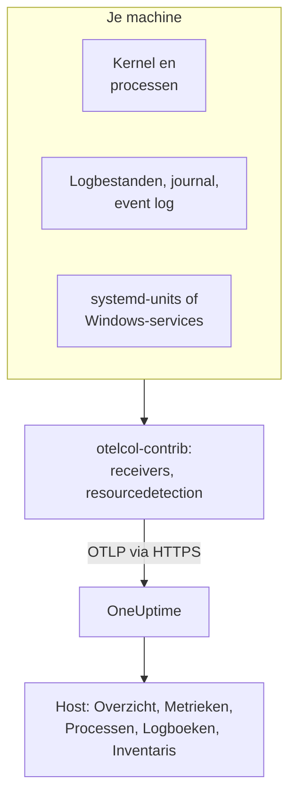

# OpenTelemetry-collector op de host

Draai de OpenTelemetry Collector op een Linux-, macOS- of Windows-machine om de metrics, processen, logs en servicestatussen ervan naar OneUptime te sturen. De machine verschijnt onder **Producten → Infrastructuur → Hosts** met eigen pagina's, zonder OneUptime-agent om te installeren: de collector is de upstream-release `otelcol-contrib`. [Host-monitors](/docs/monitor/host-monitor) waarschuwen op basis van wat hij stuurt.

:::cards
- [De collector installeren](#de-collector-installeren): Drie stappen op Linux, macOS of Windows.
- [Kiezen wat je verzamelt](#kiezen-wat-je-verzamelt): Metrics, bestandslogs, de journal, eventlogs en servicestatussen.
- [Inventarisattributen](#inventarisattributen-ip-mac-serienummer-merk-model-firmware): IP, MAC, serienummer, merk, model en firmware voor je CMDB.
- [Minder versturen](#het-volume-van-verzamelde-gegevens-verminderen): Minder logregels, grovere intervallen, minder series.
:::

## Hoe het werkt

De collector leest de machine via zijn receivers, stempelt elk record met de identiteit van de machine en stuurt het via OTLP met je ingestiesleutel naar OneUptime. OneUptime registreert de host op basis van de eerste metrics en vult de pagina's ervan naarmate de gegevens binnenkomen.



| Wat je op de host ziet | Waar het vandaan komt |
| --- | --- |
| **Overzicht** en **Metrieken** | De receiver `hostmetrics`: CPU, geheugen, schijven, bestandssystemen, netwerk, belasting, paging. |
| **Processen** | De scraper `process` van `hostmetrics`: één set series per proces. |
| **Logboeken** | De receivers `filelog`, `journald` en `windowseventlog`. |
| **Systemd Units** (Linux) | De receiver `systemd`. |
| **Services** (Windows) | De receiver `windows_service`. |
| Het inventarisitem | De processor `resourcedetection`, plus de [attributen die je stempelt](#inventarisattributen-ip-mac-serienummer-merk-model-firmware). |
| **Agentversie** | `oneuptime.agent.version` in de processor `resource`. |

Een host wordt geregistreerd zodra een batch met `host.name` ook `hostmetrics`- of `process`-metrics of een `os.type`-attribuut bevat. De processor `resourcedetection` stelt ze allemaal in, daarom zet elke configuratie hem vooraan. `host.id` of `host.arch` alleen registreren geen host, en telemetrie met een Kubernetes-identiteit (`k8s.cluster.name`, `k8s.node.name`, `k8s.pod.name`) wordt in plaats daarvan onder het cluster ervan opgeslagen: monitor Kubernetes-nodes met de [Kubernetes-agent](/docs/telemetry/kubernetes-agent).

## Voordat je begint

- Een ingestiesleutel. Maak er een aan onder **Projectinstellingen → Telemetrie & APM → Ingestiesleutels** en kopieer de waarde. De collector stuurt hem als header `x-oneuptime-token`.
- Beheerdersrechten op de machine: `sudo` op Linux en macOS, een PowerShell-prompt met verhoogde rechten op Windows.
- Uitgaand HTTPS van de machine naar je OneUptime-URL.
- De contrib-distributie van de collector, `otelcol-contrib`. De core-build `otelcol` mist de receivers en processors die deze configuraties gebruiken. De receiver `systemd` (Linux) werkt vanaf v0.143.0 en de receiver `windows_service` (Windows) vanaf v0.155.0; de commando's hieronder installeren v0.161.0, de release die OneUptime vastzet.

## De collector installeren

:::steps
### De configuratie opslaan

Sla dit op als `config.yaml` in de map waaruit je de installatiecommando's uitvoert, en vervang `YOUR_TELEMETRY_INGESTION_TOKEN` door je ingestiesleutel (en het endpoint door je eigen URL als je zelf host).

:::tabs
@tab Linux
```yaml title="config.yaml"
receivers:
  hostmetrics:
    collection_interval: 30s
    scrapers:
      cpu:
        metrics:
          system.cpu.utilization:
            enabled: true
          system.cpu.logical.count:
            enabled: true
      memory:
        metrics:
          system.memory.utilization:
            enabled: true
      disk:
      filesystem:
        metrics:
          system.filesystem.utilization:
            enabled: true
      load:
      network:
      paging:
      processes:
      process:
        mute_process_name_error: true
        mute_process_exe_error: true
        mute_process_io_error: true
        metrics:
          process.cpu.utilization:
            enabled: true
          process.memory.utilization:
            enabled: true

  # The systemd journal: every unit's logs, info and above.
  journald:
    directory: /var/log/journal
    priority: info

  # Powers the Systemd Units tab (otelcol-contrib v0.143.0+).
  systemd:
    collection_interval: 30s
    units: ["*.service"]
    metrics:
      systemd.service.cpu.time:
        enabled: false

processors:
  # Stamps host.name, host.id and os.type: this is how OneUptime attaches
  # telemetry to the host. Without it the host's pages stay empty.
  resourcedetection:
    detectors: [system, env]
    system:
      hostname_sources: [os]
      resource_attributes:
        host.name:
          enabled: true
        host.id:
          enabled: true
        host.arch:
          enabled: true
        host.ip:
          enabled: true
        host.mac:
          enabled: true
        os.type:
          enabled: true
        os.description:
          enabled: true
        os.version:
          enabled: true
  # The collector release this config is for: the host's Agent Version.
  resource:
    attributes:
      - key: oneuptime.agent.version
        value: "0.161.0"
        action: upsert
  batch:

exporters:
  otlphttp/oneuptime:
    endpoint: https://oneuptime.com/otlp
    headers:
      x-oneuptime-token: YOUR_TELEMETRY_INGESTION_TOKEN

service:
  pipelines:
    metrics:
      receivers: [hostmetrics, systemd]
      processors: [resourcedetection, resource, batch]
      exporters: [otlphttp/oneuptime]
    logs:
      receivers: [journald]
      processors: [resourcedetection, resource, batch]
      exporters: [otlphttp/oneuptime]
```
@tab macOS
```yaml title="config.yaml"
receivers:
  hostmetrics:
    collection_interval: 30s
    scrapers:
      cpu:
        metrics:
          system.cpu.utilization:
            enabled: true
          system.cpu.logical.count:
            enabled: true
      memory:
        metrics:
          system.memory.utilization:
            enabled: true
      disk:
      filesystem:
        metrics:
          system.filesystem.utilization:
            enabled: true
      load:
      network:
      paging:
      processes:
      process:
        mute_process_name_error: true
        mute_process_exe_error: true
        mute_process_io_error: true
        metrics:
          process.cpu.utilization:
            enabled: true
          process.memory.utilization:
            enabled: true

  filelog/system:
    include:
      - /var/log/install.log
      - /var/log/wifi.log
    start_at: end

processors:
  # Stamps host.name, host.id and os.type: this is how OneUptime attaches
  # telemetry to the host. Without it the host's pages stay empty.
  resourcedetection:
    detectors: [system, env]
    system:
      hostname_sources: [os]
      resource_attributes:
        host.name:
          enabled: true
        host.id:
          enabled: true
        host.arch:
          enabled: true
        host.ip:
          enabled: true
        host.mac:
          enabled: true
        os.type:
          enabled: true
        os.description:
          enabled: true
        os.version:
          enabled: true
  # The collector release this config is for: the host's Agent Version.
  resource:
    attributes:
      - key: oneuptime.agent.version
        value: "0.161.0"
        action: upsert
  batch:

exporters:
  otlphttp/oneuptime:
    endpoint: https://oneuptime.com/otlp
    headers:
      x-oneuptime-token: YOUR_TELEMETRY_INGESTION_TOKEN

service:
  pipelines:
    metrics:
      receivers: [hostmetrics]
      processors: [resourcedetection, resource, batch]
      exporters: [otlphttp/oneuptime]
    logs:
      receivers: [filelog/system]
      processors: [resourcedetection, resource, batch]
      exporters: [otlphttp/oneuptime]
```
@tab Windows
```yaml title="config.yaml"
receivers:
  hostmetrics:
    collection_interval: 30s
    scrapers:
      cpu:
        metrics:
          system.cpu.utilization:
            enabled: true
          system.cpu.logical.count:
            enabled: true
      memory:
        metrics:
          system.memory.utilization:
            enabled: true
      disk:
      filesystem:
        metrics:
          system.filesystem.utilization:
            enabled: true
      load:
      network:
      paging:
      processes:
      process:
        mute_process_name_error: true
        mute_process_exe_error: true
        mute_process_io_error: true
        metrics:
          process.cpu.utilization:
            enabled: true
          process.memory.utilization:
            enabled: true

  windowseventlog/system:
    channel: System
    start_at: end

  windowseventlog/application:
    channel: Application
    start_at: end

  windowseventlog/security:
    channel: Security
    start_at: end

  # Powers the Services tab (otelcol-contrib v0.155.0+).
  windows_service:
    collection_interval: 30s

processors:
  # Stamps host.name, host.id and os.type: this is how OneUptime attaches
  # telemetry to the host. Without it the host's pages stay empty.
  resourcedetection:
    detectors: [system, env]
    system:
      hostname_sources: [os]
      resource_attributes:
        host.name:
          enabled: true
        host.id:
          enabled: true
        host.arch:
          enabled: true
        host.ip:
          enabled: true
        host.mac:
          enabled: true
        os.type:
          enabled: true
        os.description:
          enabled: true
        os.version:
          enabled: true
  # The collector release this config is for: the host's Agent Version.
  resource:
    attributes:
      - key: oneuptime.agent.version
        value: "0.161.0"
        action: upsert
  batch:

exporters:
  otlphttp/oneuptime:
    endpoint: https://oneuptime.com/otlp
    headers:
      x-oneuptime-token: YOUR_TELEMETRY_INGESTION_TOKEN

service:
  pipelines:
    metrics:
      receivers: [hostmetrics, windows_service]
      processors: [resourcedetection, resource, batch]
      exporters: [otlphttp/oneuptime]
    logs:
      receivers:
        - windowseventlog/system
        - windowseventlog/application
        - windowseventlog/security
      processors: [resourcedetection, resource, batch]
      exporters: [otlphttp/oneuptime]
```
:::

Elke configuratie is de configuratie die het dashboard schrijft onder **Producten → Infrastructuur → Hosts → Documentatie**, met een logs-pipeline erbij: de processors zijn `resourcedetection`, `resource` en `batch`, en de exporter is `otlphttp/oneuptime`. Er wordt geen `service.name` ingesteld, dus de telemetrie van de host hoort bij de host zelf, opgeslagen als `host/<hostname>`. Voeg alleen een `service.name` toe aan de processor `resource` als je wilt dat de telemetrie in plaats daarvan onder een telemetrieservice met die naam wordt opgeslagen.

### De collector installeren en starten

:::tabs
@tab Linux
Op Debian of Ubuntu:

```bash
VERSION=0.161.0                      # the release OneUptime pins
ARCH=$(dpkg --print-architecture)   # amd64 or arm64

curl -fL -o /tmp/otelcol-contrib.deb \
  "https://github.com/open-telemetry/opentelemetry-collector-releases/releases/download/v${VERSION}/otelcol-contrib_${VERSION}_linux_${ARCH}.deb"
sudo dpkg -i /tmp/otelcol-contrib.deb
```

Op RHEL, CentOS, Fedora of Amazon Linux:

```bash
VERSION=0.161.0
ARCH=$(uname -m | sed 's/x86_64/amd64/;s/aarch64/arm64/')

curl -fL -o /tmp/otelcol-contrib.rpm \
  "https://github.com/open-telemetry/opentelemetry-collector-releases/releases/download/v${VERSION}/otelcol-contrib_${VERSION}_linux_${ARCH}.rpm"
sudo rpm -Uvh /tmp/otelcol-contrib.rpm
```

Het pakket installeert `/usr/bin/otelcol-contrib` en een systemd-unit en start die met een standaardconfiguratie. Zet de jouwe op zijn plek, geef de gebruiker van de collector leestoegang tot de journal en herstart hem:

```bash
sudo install -m 0644 config.yaml /etc/otelcol-contrib/config.yaml
sudo usermod -aG systemd-journal otelcol-contrib
sudo systemctl enable otelcol-contrib
sudo systemctl restart otelcol-contrib
sudo systemctl status otelcol-contrib
```

De meegeleverde unit draait de collector als de onbevoegde gebruiker `otelcol-contrib`. Met de groep `systemd-journal` kan hij de journal lezen; om bestanden in `/var/log` te volgen (leesbaar voor de groep `adm` op Debian en Ubuntu), voeg je ook die groep toe. Geef de scraper `process` de capability `CAP_SYS_PTRACE` zodat hij de processen van andere gebruikers ziet.
@tab macOS
```bash
VERSION=0.161.0
ARCH=$(uname -m | sed 's/x86_64/amd64/')   # arm64 on Apple silicon, amd64 on Intel

curl -fL -o /tmp/otelcol-contrib.tar.gz \
  "https://github.com/open-telemetry/opentelemetry-collector-releases/releases/download/v${VERSION}/otelcol-contrib_${VERSION}_darwin_${ARCH}.tar.gz"

sudo mkdir -p /usr/local/otelcol-contrib /usr/local/bin /etc/otelcol-contrib
sudo tar -xzf /tmp/otelcol-contrib.tar.gz -C /usr/local/otelcol-contrib
sudo ln -sf /usr/local/otelcol-contrib/otelcol-contrib /usr/local/bin/otelcol-contrib
sudo install -m 0644 config.yaml /etc/otelcol-contrib/config.yaml
```

Maak `/Library/LaunchDaemons/com.oneuptime.otelcol-contrib.plist` aan, zodat launchd de collector met de Mac start en hem herstart als hij stopt:

```xml title="/Library/LaunchDaemons/com.oneuptime.otelcol-contrib.plist"
<?xml version="1.0" encoding="UTF-8"?>
<!DOCTYPE plist PUBLIC "-//Apple//DTD PLIST 1.0//EN" "http://www.apple.com/DTDs/PropertyList-1.0.dtd">
<plist version="1.0">
<dict>
  <key>Label</key><string>com.oneuptime.otelcol-contrib</string>
  <key>ProgramArguments</key>
  <array>
    <string>/usr/local/bin/otelcol-contrib</string>
    <string>--config=/etc/otelcol-contrib/config.yaml</string>
  </array>
  <key>RunAtLoad</key><true/>
  <key>KeepAlive</key><true/>
  <key>StandardOutPath</key><string>/var/log/otelcol-contrib.out.log</string>
  <key>StandardErrorPath</key><string>/var/log/otelcol-contrib.err.log</string>
</dict>
</plist>
```

Laad hem:

```bash
sudo launchctl load -w /Library/LaunchDaemons/com.oneuptime.otelcol-contrib.plist
sudo launchctl list | grep otelcol-contrib
```

Gebruik deze tarball, niet Homebrew: de Homebrew-formule is de core-build, die met deze configuratie weigert te starten.
@tab Windows
Voer dit blok in zijn geheel uit vanuit een PowerShell-prompt met verhoogde rechten, in de map met `config.yaml`: elke regel hangt af van de variabelen erboven.

```powershell
$VERSION = "0.161.0"                          # the release OneUptime pins; v0.155.0+ has the Services tab
$ARCH    = "amd64"                            # use "arm64" on ARM hosts
$dest    = "C:\Program Files\otelcol-contrib"
$tar     = "$env:TEMP\otelcol-contrib.tar.gz"

# Note the "-contrib" in the asset name; otelcol_... is the wrong archive.
$url = "https://github.com/open-telemetry/opentelemetry-collector-releases/releases/download/v$VERSION/otelcol-contrib_${VERSION}_windows_${ARCH}.tar.gz"

New-Item -ItemType Directory -Force -Path $dest | Out-Null
Invoke-WebRequest -Uri $url -OutFile $tar
tar -xf $tar -C $dest                          # tar.exe ships with Windows 10 1803+ / Server 2019+
Get-ChildItem $dest                            # expect otelcol-contrib.exe, not otelcol.exe
Copy-Item config.yaml "$dest\config.yaml" -Force

# --% hands the rest of the line to sc.exe unchanged, so its quoting
# survives PowerShell — keep the command on one line.
sc.exe --% create "otelcol-contrib" binPath= "\"C:\Program Files\otelcol-contrib\otelcol-contrib.exe\" --config=\"C:\Program Files\otelcol-contrib\config.yaml\"" start= auto DisplayName= "OpenTelemetry Collector (OneUptime)"
sc.exe description "otelcol-contrib" "Collects host telemetry and forwards it to OneUptime over OTLP."
sc.exe start "otelcol-contrib"
sc.exe query "otelcol-contrib"
```

De service draait als `LocalSystem`, dat het eventlog `Security` en elke Windows-service kan lezen. Op Windows emuleert de scraper `load` alleen een load average op basis van de teller *Processor Queue Length*, beginnend bij 0.

De naam van het asset moet beginnen met `otelcol-contrib_`. Het core-archief `otelcol_<version>_windows_amd64.tar.gz` pakt `otelcol.exe` uit, dat geen receiver `windowseventlog` of `windows_service` heeft; het hernoemen naar `otelcol-contrib.exe` voegt die niet toe. Liever een installatieprogramma? Dezelfde [releasepagina](https://github.com/open-telemetry/opentelemetry-collector-releases/releases) heeft een ondertekende `otelcol-contrib_<version>_windows_x64.msi`, die de service voor je registreert: wijs hem naar deze `config.yaml` en houd de service op `LocalSystem`.
:::

### Controleren of de host verschijnt

Open **Producten → Infrastructuur → Hosts → Alle hosts**. De host verschijnt onder zijn hostnaam zodra de eerste metrics binnenkomen, meestal binnen 30 seconden, en de pagina's **Overzicht**, **Metrieken**, **Processen** en **Logboeken** vullen zich. Zo niet, lees dan de logs van de collector zelf:

:::tabs
@tab Linux
```bash
sudo journalctl -u otelcol-contrib -f
```
@tab macOS
```bash
tail -f /var/log/otelcol-contrib.err.log
```
@tab Windows
```powershell
Get-WinEvent -LogName Application -MaxEvents 20 | Where-Object ProviderName -eq "otelcol-contrib"
```
:::
:::

Voer `logger "hello from oneuptime"` (Linux, macOS) of `eventcreate /T INFORMATION /ID 999 /L APPLICATION /SO OneUptimeTest /D "hello from oneuptime"` (Windows, met verhoogde rechten) uit om een testlogregel te maken, en kijk daarna op de pagina **Logboeken** van de host.

## Kiezen wat je verzamelt

Elke configuratie heeft dezelfde vorm: receivers voor wat er gelezen wordt, de processors `resourcedetection`, `resource` en `batch`, en de exporter `otlphttp/oneuptime`. Voeg de receivers hieronder toe aan `receivers:` en aan hun pipeline, en herstart daarna de collector (`sudo systemctl restart otelcol-contrib`, `launchctl unload` en `load` op een Mac, `Restart-Service otelcol-contrib` op Windows). Voeg elk fragment samen met de secties die je configuratie al heeft: een tweede sleutel `processors:` of `service:` vervangt de eerste.

### Hostmetrics

`hostmetrics` werkt op elk besturingssysteem. Het leest CPU, geheugen, schijven, bestandssystemen, netwerk, belasting, paging en processen uit de kernel, elke `collection_interval`. De metrics `*.utilization` en `system.cpu.logical.count` staan in de receiver standaard uit, en de grafieken van de host en de Host-waarschuwingssjablonen lezen ze, dus houd ze ingeschakeld zoals de configuraties hierboven doen. De scraper `process` voedt de pagina **Processen**; hij is ook de grootste bron van series (zie [Minder versturen](#het-volume-van-verzamelde-gegevens-verminderen)).

Op Linux leest de collector `/proc` en `/sys`. Een collector in een container moet die van de host mounten en `HOST_PROC` en `HOST_SYS` instellen (zie [In een Docker-container](#in-een-docker-container)); een native installatie heeft niets nodig.

### Bestandslogs

Volg elk logbestand op schijf met een `filelog`-receiver en voeg die toe aan de `logs`-pipeline:

```yaml
receivers:
  filelog/app:
    include:
      - /var/log/myapp/*.log
    start_at: end
    multiline:
      # A new entry starts with a timestamp; continuation lines (the
      # "at ...", "File ...", "Caused by: ..." frames) are folded into it.
      line_start_pattern: '^\d{4}-\d{2}-\d{2}[ T]\d{2}:\d{2}:\d{2}'
```

`start_at: end` leest alleen nieuwe regels; gebruik `beginning` om de bestanden bij de eerste run vanaf het begin te lezen. De collector onthoudt zijn positie in elk bestand, dus na een herstart gaat hij correct verder.

OneUptime zoekt in fout- en fatale logregels naar stacktraces en groepeert ze in **Uitzonderingen**, onder de host. Daarvoor moet een stacktrace over meerdere regels (Java, Python, .NET, Ruby) als één record binnenkomen, en dat doet `multiline`; zonder dat is elk frame een eigen log. Als je applicatie zelf de OpenTelemetry-attributen `exception.type`, `exception.message` en `exception.stacktrace` kan schrijven, is dat nog betrouwbaarder.

Op een systemd-host herhalen `/var/log/syslog` en `/var/log/messages` wat de journal al bevat, dus lees het een of het ander.

### systemd-journal

Op een systemd-host leest de receiver `journald` de logs van elke unit op één plek, met hun gestructureerde velden. De Linux-configuratie hierboven leest ze allemaal vanaf `info`; beperk hem tot een paar units:

```yaml
receivers:
  journald:
    directory: /var/log/journal
    units:
      # Drop this list to ingest everything; restrict it to limit volume.
      - ssh.service
      - cron.service
      - nginx.service
    priority: info
```

De receiver voert `journalctl` uit, dat elke systemd-host heeft, en de gebruiker van de collector moet in de groep `systemd-journal` zitten.

### Linux-services (systemd-units, metrics)

De pagina **Systemd Units** van de host toont elke unit en zijn status, afkomstig van de [`systemdreceiver`](https://github.com/open-telemetry/opentelemetry-collector-contrib/tree/main/receiver/systemdreceiver) (configuratietype `systemd`), de Linux-tegenhanger van de pagina **Services** op Windows. De Linux-configuratie hierboven schakelt hem in:

```yaml
receivers:
  systemd:
    collection_interval: 30s
    # The service manager to read: "system" (default) or "user".
    scope: system
    # Which units to scrape, as systemctl unit patterns. The default is
    # every service; widen it to include timers, sockets or mounts, or
    # narrow it to cut volume on hosts with hundreds of units:
    units: ["*.service"]
    # units: [nginx.service, postgresql.service, "*.timer"]
    metrics:
      # Per-service CPU time is on by default and doubles this receiver's
      # datapoint count. The Systemd Units tab does not use it, so turn it
      # off unless you chart it. On v0.142.0 the key is
      # systemd.unit.cpu.time — naming a metric the running build does not
      # have stops the collector at startup.
      systemd.service.cpu.time:
        enabled: false

service:
  pipelines:
    metrics:
      receivers: [hostmetrics, systemd]
      processors: [resourcedetection, resource, batch]
```

De receiver kwam voor het eerst uit in `otelcol-contrib` v0.142.0, en v0.143.0 is de eerste release die het draaien waard is. Op alles wat ouder is, mislukt het toevoegen van `systemd` bij het opstarten met `'receivers' unknown type: "systemd"`; alleen v0.142.0 noemt zijn CPU-metric `systemd.unit.cpu.time` en zoekt op elke unit naar cgroup-statistieken, wat voor elke unit die geen `.service` is een scrapefout logt.

Hij geeft `systemd.unit.state` uit als statusset: bij elke scrape krijgt elke unit één datapunt per mogelijke status (`active`, `reloading`, `inactive`, `failed`, `activating`, `deactivating`, `maintenance`, `refreshing`), `1` voor de status waarin hij zich bevindt en `0` voor de rest. De unitnaam is het resource-attribuut `systemd.unit.name` en de status het datapuntattribuut `systemd.unit.active_state`. Omdat de unitnaam een resource-attribuut is, moet `resourcedetection` in de metrics-pipeline blijven: die stempelt `host.name` op de resource van elke unit, en zonder dat worden de samples nooit aan een host gekoppeld.

Hij leest de unitstatus via de systeem-D-Bus, met de alleen-lezen-aanroepen die `systemctl list-units` doet en die systemd zonder rechten toestaat. De meegeleverde service, die als de gebruiker `otelcol-contrib` draait en niet als root, heeft dus geen extra rechten nodig. Hij heeft wel de bus nodig: een collector in een container heeft geen `/run/dbus/system_bus_socket` tenzij je die van de host mount, dus gebruik een native installatie. De receiver is alpha en alleen voor Linux.

> [!WARNING]
> De statusset kost acht datapunten per unit per scrape, en `systemd.service.cpu.time`, standaard ingeschakeld, voegt er nog twee toe (`user` en `system`): 10 datapunten per unit per scrape. Een host die 300 units elke 30 seconden volgt, stuurt alleen vanuit deze receiver ongeveer 6.000 datapunten per minuut, of ongeveer 4.800 met de CPU-metric uit. Beperk `units:` tot de services waarop je waarschuwt, of verhoog `collection_interval`, voordat je hem op een hele vloot inschakelt.

### Apple Unified Log

macOS schrijft zijn systeemlogs naar de Apple Unified Log, te lezen met `log show` en `log stream`, in plaats van naar `/var/log/system.log`. Om die te verzamelen, stream je hem met een klein script naar een bestand, `/usr/local/otelcol-contrib/log-stream.sh`:

```bash title="/usr/local/otelcol-contrib/log-stream.sh"
#!/bin/bash
exec /usr/bin/log stream --style ndjson --level info \
  --predicate 'subsystem != "com.apple.cfnetwork"' \
  >> /var/log/apple-unified.log
```

Maak het uitvoerbaar en draai het onder launchd (of `nohup` voor een snelle test), en wijs daarna een `filelog`-receiver naar het bestand:

```yaml
receivers:
  filelog/apple-unified:
    include:
      - /var/log/apple-unified.log
    start_at: end
    operators:
      - type: json_parser
        timestamp:
          parse_from: attributes.timestamp
          layout: "%Y-%m-%d %H:%M:%S.%f%j"
```

Veel Mac-vloten redden het prima met hostmetrics en een paar bestandslogs, zonder de unified log.

### Windows-eventlogs

De Windows-configuratie hierboven abonneert zich op de kanalen `System`, `Application` en `Security`. Om het kanaal `Security`, met veel volume, te beperken tot een paar event-ID's:

```yaml
windowseventlog/security:
  channel: Security
  start_at: end
  query: "*[System[(EventID=4625 or EventID=4740)]]"
```

Om een ander kanaal te lezen (alles onder *Event Viewer → Applications and Services Logs*), gebruik je de exacte naam ervan:

```yaml
windowseventlog/iis:
  channel: Microsoft-IIS-Logging/Logs
  start_at: end
```

### Windows-services (metrics)

De pagina **Services** van de host toont elke Windows-service met zijn status en opstarttype, afkomstig van de [`windowsservicereceiver`](https://github.com/open-telemetry/opentelemetry-collector-contrib/tree/main/receiver/windowsservicereceiver) (configuratietype `windows_service`). Hij zit in `otelcol-contrib` vanaf v0.155.0: in eerdere releases mislukt het toevoegen van `windows_service` bij het opstarten met `'receivers' unknown type: "windows_service"`. De Windows-configuratie hierboven schakelt hem in:

```yaml
receivers:
  windows_service:
    collection_interval: 30s
    # Collect every service by default. To cut volume — and avoid the
    # "access denied" noise from services the collector can't open —
    # list just the ones you care about:
    # include_services: [Spooler, W3SVC, MSSQLSERVER]
    # Or collect everything except a few:
    # exclude_services: [TrustedInstaller]

service:
  pipelines:
    metrics:
      receivers: [hostmetrics, windows_service]
```

Hij geeft per service één gauge `windows.service.status` uit, de status van de Win32-service (`4` is actief, `1` is gestopt), met de attributen `name` en `startup_mode`. De collector leest elke service als `LocalSystem` en slaat de services over die hij niet kan openen. De receiver is alpha en alleen voor Windows; als een scrapefout of een `access denied` op één service de andere beïnvloedt, beperk hem dan met `include_services`.

`include_services` kan de set alleen verkleinen. Als je services opsomt en ze toch allemaal ziet, heeft de bewerkte configuratie de draaiende collector niet bereikt: herstart de service, controleer of `include_services` een gevulde lijst is op dezelfde inspringing als `collection_interval`, en geef de pagina **Services** een paar minuten, tot de services die vóór de wijziging werden gemeld uit het lopende venster verdwijnen. De namen zijn de exacte, hoofdlettergevoelige sleutelnamen van de services (`Spooler`, `W3SVC`), die `Get-Service | Select-Object Name` toont.

### Labels

Elk resource-attribuut dat begint met `oneuptime.label.` wordt een projectlabel op de host: `oneuptime.label.<dimension>=<value>` is het label `<dimension>:<value>`. Voeg er een processor voor toe en noem die in de pipelines:

```yaml
processors:
  resource/oneuptime-labels:
    attributes:
      - key: oneuptime.label.team
        value: payments
        action: upsert
      - key: oneuptime.label.env
        value: production
        action: upsert

service:
  pipelines:
    metrics:
      processors: [resourcedetection, resource, resource/oneuptime-labels, batch]
```

Labels worden hoofdletterongevoelig vergeleken, dus een bestaand label `Production` wordt hergebruikt in plaats van gedupliceerd, en labels die in OneUptime zijn toegevoegd, worden nooit door de collector verwijderd.

### Inventarisattributen (IP, MAC, serienummer, merk, model, firmware)

Elke host krijgt ook een inventarisitem: het record dat een CMDB-export leest. De details ervan worden rechtstreeks gevuld vanuit de resource-attributen op de telemetrie die je stuurt, dus wat binnenkomt, is wat een CMDB-synchronisatie kan ophalen.

| Wat je wilt | Attribuut | Waar het vandaan komt |
| --- | --- | --- |
| IP-adressen | `host.ip` | `resourcedetection`, kommagescheiden als de machine er meerdere heeft |
| MAC-adressen | `host.mac` | `resourcedetection`, één per actieve interface, kommagescheiden |
| Architectuur | `host.arch` | `resourcedetection` |
| Machine-ID | `host.id` | `resourcedetection`: de machine-GUID op Windows, `/etc/machine-id` op Linux |
| Besturingssysteem | `os.type`, `os.description`, `os.version` | `resourcedetection` |
| Serienummer | `host.serial_number` | Door jou gestempeld, vanuit WMI of DMI |
| Merk | `device.manufacturer` | Door jou gestempeld, vanuit WMI of DMI |
| Model | `device.model.name` | Door jou gestempeld, vanuit WMI of DMI |
| Firmwareversie (BIOS of UEFI) | `device.firmware.version` | Door jou gestempeld, vanuit WMI of DMI |

De configuraties hierboven schakelen elk gedetecteerd attribuut in: in de system-detector staan standaard alleen `host.name` en `os.type` aan, daarom sommen ze de rest op onder `resource_attributes`. Als je een eigen configuratie bouwt, houd dan dat `resourcedetection`-blok: zonder dat is er geen `host.name`, dus helemaal geen host en geen inventarisitem.

#### Serienummer, merk, model en firmwareversie hebben geen detector

Ze staan in de firmware van de machine, die de collector niet leest. Op Linux is dat geen instelling die je kunt wijzigen: de meegeleverde collector draait als de onbevoegde gebruiker `otelcol-contrib`, en `/sys/class/dmi/id/product_serial` is alleen leesbaar voor root. Lees ze dus één keer uit, wanneer de machine wordt ingericht, en stempel ze op de resource met een eigen processor:

```yaml
processors:
  resource/oneuptime-hardware:
    attributes:
      - key: host.serial_number
        value: "7XYZ123"
        action: upsert
      - key: device.manufacturer
        value: "Dell Inc."
        action: upsert
      - key: device.model.name
        value: "OptiPlex 7090"
        action: upsert
      - key: device.firmware.version
        value: "1.21.0"
        action: upsert

service:
  pipelines:
    metrics:
      processors: [resourcedetection, resource, resource/oneuptime-hardware, batch]
```

Voeg `resource/oneuptime-hardware` toe aan de processorlijst die je al hebt, in plaats van deze regel eroverheen te plakken: haal je `resource` weg, dan verliest de host zijn **Agentversie**. Houd `resourcedetection` hoe dan ook vooraan: die koppelt de batch aan de host.

`host.manufacturer`, `host.model.name`, `host.firmware.version` en `host.bios.version` worden geaccepteerd als alternatieve spellingen en opgeslagen onder de sleutels `device.*` hierboven, dus een configuratie die op de ene of de andere manier is geschreven, komt op één plek terecht; als beide aanwezig zijn, wint de waarde `device.*`. Het serienummer gaat de andere kant op: `device.serial_number` wordt geaccepteerd en opgeslagen als `host.serial_number`.

> [!NOTE]
> Op een resource zonder hostidentiteit betekent `device.manufacturer` "mobiele app": het is een van de attributen die een batch markeren als mobiele Real User Monitoring. De resource van een host bevat altijd `host.name` of `host.id`, dus een collectorconfiguratie zoals die hierboven wordt nooit voor een telefoon aangezien, maar hergebruik hetzelfde blok niet in de SDK-configuratie van een mobiele app.

#### De waarden uitlezen

Op Windows, vanuit een PowerShell-prompt met verhoogde rechten. Het drukt het YAML-blok af voor de machine waarop je het uitvoert:

```powershell
$bios = Get-CimInstance -ClassName Win32_BIOS
$cs   = Get-CimInstance -ClassName Win32_ComputerSystem

# Quote for YAML: trim, escape any embedded quote, wrap in single quotes.
# The cast to string first is what keeps this working on machines whose
# firmware leaves a field empty — .Trim() on $null throws.
function Format-YamlValue($value) {
  "'" + ("$value".Trim() -replace "'", "''") + "'"
}

@"
  resource/oneuptime-hardware:
    attributes:
      - key: host.serial_number
        value: $(Format-YamlValue $bios.SerialNumber)
        action: upsert
      - key: device.manufacturer
        value: $(Format-YamlValue $cs.Manufacturer)
        action: upsert
      - key: device.model.name
        value: $(Format-YamlValue $cs.Model)
        action: upsert
      - key: device.firmware.version
        value: $(Format-YamlValue $bios.SMBIOSBIOSVersion)
        action: upsert
"@
```

Het drukt één processorvermelding af, al ingesprongen: voeg die toe binnen het `processors:`-blok dat je hebt, niet als een tweede sleutel `processors:`. Gebruik `Get-CimInstance`, niet het verouderde `Get-WmiObject`, dat PowerShell 7 en later niet meer hebben. Een veld dat de firmware leeg laat, wordt afgedrukt als `''`: laat dat attribuut weg in plaats van een lege waarde te sturen. Virtuele machines hebben vaak helemaal geen serienummer.

Op Linux, als root:

```bash
cat /sys/class/dmi/id/product_serial   # host.serial_number
cat /sys/class/dmi/id/sys_vendor       # device.manufacturer
cat /sys/class/dmi/id/product_name     # device.model.name
cat /sys/class/dmi/id/bios_version     # device.firmware.version
```

`bios_version` is de enige van de vier die elke gebruiker kan lezen. Op machines zonder `/sys/class/dmi` geven `dmidecode -s system-serial-number`, `-s system-manufacturer`, `-s system-product-name` en `-s bios-version` dezelfde waarden. Virtuele machines melden hier hun hypervisor (`QEMU`, `VMware, Inc.`, `Amazon EC2`), en dat is meestal wat je in een CMDB wilt.

Op een Mac:

```bash
ioreg -l | awk -F'"' '/IOPlatformSerialNumber/{print $4}'   # host.serial_number
sysctl -n hw.model                                          # device.model.name
system_profiler SPHardwareDataType | awk -F': ' '/System Firmware Version/{print $2}'   # device.firmware.version
```

De fabrikant is `Apple Inc.` `hw.model` geeft de modelidentificatie, zoals `Mac14,7` of `MacBookPro18,3`, niet de marketingnaam, die de Mac niet meldt: koppel de identificatie in je CMDB als je die nodig hebt. Zet hem toch in `device.model.name`: `device.model.identifier` markeert een batch als mobiele app, wat hij verder ook bevat, dus een Mac die daarmee is gestempeld, wordt als telefoon opgeslagen en van zijn host losgekoppeld.

#### In plaats daarvan omgevingsvariabelen gebruiken

De detector `env` staat aan, dus `OTEL_RESOURCE_ATTRIBUTES` werkt in plaats van de processor:

```text
OTEL_RESOURCE_ATTRIBUTES=host.serial_number=7XYZ123,device.manufacturer=Dell%20Inc.,device.model.name=OptiPlex%207090
```

Codeer elke waarde met percent-encoding. De variabele wordt gelezen als een W3C Baggage-lijst van `key=value`, waarin `,` en `=` vermeldingen scheiden en spaties niet overdraagbaar zijn tussen collectorversies; aanhalingstekens helpen niet, en `device.manufacturer="Dell Inc."` kan binnenkomen met de aanhalingstekens in de waarde. Op Windows codeert `[System.Uri]::EscapeDataString($value)` een waarde.

Stel hem in op de service van de collector zelf, nooit voor de hele machine:

- **Linux:** `sudo systemctl edit otelcol-contrib`, daarna een sectie `[Service]` met `Environment="OTEL_RESOURCE_ATTRIBUTES=…"`.
- **Windows:** de waarde `Environment` (type `REG_MULTI_SZ`) onder `HKLM\SYSTEM\CurrentControlSet\Services\otelcol-contrib`. `sc.exe create` kan geen omgevingsvariabelen voor services instellen, en `setx` stelt een variabele in die de draaiende service nooit opnieuw leest.

> [!WARNING]
> Stel hem niet voor de hele machine in (`setx /M`, `/etc/environment`). Elk OpenTelemetry-SDK-proces op de machine erft `OTEL_RESOURCE_ATTRIBUTES`, dus je applicaties zouden de `device.manufacturer` van de machine als hun eigen melden, en een applicatieresource met `device.manufacturer` en zonder `host.name` of `host.id` wordt gelezen als een mobiele app, waardoor hij van zijn service wordt losgekoppeld.

De processor is makkelijker goed te krijgen: hij is per definitie beperkt tot de collector, en de waarden veranderen voor een machine nooit. Geef er de voorkeur aan, tenzij je al omgevingsbestanden uit sjablonen genereert.

#### Een MAC-adres is geen gestempelde waarde

`host.mac` komt van de detector `system`, net als `host.ip`: één adres per actieve netwerkinterface, loopback uitgezonderd, in de IEEE-vorm die OpenTelemetry voorschrijft (`AC-DE-48-23-45-67`). Een machine met Docker of Hyper-V meldt ook zijn virtuele switches, daarom is de waarde een lijst. Een interface die de placeholder met alleen nullen meldt (`00-00-00-00-00-00`), wordt weggelaten.

Niets op de machine meldt een firmwareversie die als upgrade beschikbaar is, dus OneUptime registreert de geïnstalleerde versie.

#### Controleren of het werkte

Open het item van de host onder **Producten → Inventaris** en bekijk de kaart **Assetgegevens**. Waarden verschijnen binnen een paar minuten na de volgende batch; een detail dat de collector niet heeft gemeld, wordt als onbekend getoond, met een link terug naar deze sectie. Omdat ze gestempeld zijn en niet gedetecteerd, werken ze zichzelf niet bij: stempel ze opnieuw na een moederbordwissel, een firmware-update of een herinstallatie.

## Andere manieren om de collector te draaien

### In een Docker-container

Draai de collector in een container die de processen en bestandssystemen van de host ziet, vanuit de map met `config.yaml`:

```bash
docker run -d \
  --name otel-collector \
  --restart unless-stopped \
  --network host \
  --pid host \
  -v $(pwd)/config.yaml:/etc/otelcol-contrib/config.yaml:ro \
  --volume /:/hostfs:ro,rslave \
  -e HOST_PROC=/hostfs/proc \
  -e HOST_SYS=/hostfs/sys \
  -e HOST_ETC=/hostfs/etc \
  -e HOST_VAR=/hostfs/var \
  -e HOST_RUN=/hostfs/run \
  -e HOST_DEV=/hostfs/dev \
  otel/opentelemetry-collector-contrib:0.161.0 \
  --config /etc/otelcol-contrib/config.yaml
```

`--network host`, `--pid host`, de mount `/hostfs` en de variabelen `HOST_*` laten `hostmetrics` en `process` de kernel van de host lezen in plaats van die van de container. Gebruik alleen de metrics-pipeline van de configuratie: de image heeft geen `journalctl`, en de receiver `systemd` heeft de D-Bus van de host nodig.

### Vanuit de release-tarball

Waar pakketten geen optie zijn, pak je de statische binary uit en geef je hem een eigen systemd-unit:

```bash
VERSION=0.161.0
ARCH=$(uname -m | sed 's/x86_64/amd64/;s/aarch64/arm64/')

curl -fL -o /tmp/otelcol.tar.gz \
  "https://github.com/open-telemetry/opentelemetry-collector-releases/releases/download/v${VERSION}/otelcol-contrib_${VERSION}_linux_${ARCH}.tar.gz"
sudo mkdir -p /opt/otelcol-contrib
sudo tar -xzf /tmp/otelcol.tar.gz -C /opt/otelcol-contrib
sudo install -m 0644 config.yaml /opt/otelcol-contrib/config.yaml
```

```ini title="/etc/systemd/system/otelcol-contrib.service"
[Unit]
Description=OpenTelemetry Collector
After=network.target

[Service]
ExecStart=/opt/otelcol-contrib/otelcol-contrib --config /opt/otelcol-contrib/config.yaml
Restart=on-failure
RestartSec=5s
User=root

[Install]
WantedBy=multi-user.target
```

```bash
sudo systemctl daemon-reload
sudo systemctl enable --now otelcol-contrib
```

Met `User=root` kan deze unit elk logbestand en elk proces lezen; de pakketinstallatie hierboven is het onbevoegde alternatief.

### Op Kubernetes-nodes

Kubernetes-nodes zijn geen hosts in OneUptime: hun telemetrie draagt een Kubernetes-identiteit en wordt onder het cluster opgeslagen. Installeer de [Kubernetes-agent](/docs/telemetry/kubernetes-agent): elke node verschijnt op de pagina **Knooppunten** van zijn cluster, naast zijn pods.

## De collector upgraden

Elke configuratie op deze pagina stempelt de collectorrelease waarvoor hij bedoeld is als `oneuptime.agent.version`, in zijn `resource`-processor. OneUptime toont die als de **Agentversie** in het **Overzicht** van de host, met een waarschuwingsteken ernaast wanneer OneUptime een nieuwere release vastzet. Selecteer het teken om te zien hoe je upgradet op de manier waarop je installeerde.

Om handmatig te upgraden, installeer je de nieuwe release op dezelfde manier als deze, met de nieuwe `VERSION` (op Debian en Ubuntu houdt `sudo dpkg -i --force-confold` je configuratie zonder te vragen), stel je `oneuptime.agent.version` in `config.yaml` in op dezelfde versie en herstart je de collector. Een collector waarvan de configuratie geen versie stempelt, toont er geen, en nooit een teken.

## Het volume van verzamelde gegevens verminderen

De configuratie is van jou, dus niets verlaat de machine tenzij een receiver die jij hebt toegevoegd het leest. Als een host meer stuurt dan je wilt (wat zich toont als meer ingestie en, op OneUptime Cloud, meer kosten), snoei dan hier. De twee grootste hefbomen zijn welke logs je leest en hoe vaak je metrics scrapet; een `filter`-processor doet de rest. Wijzig één hefboom tegelijk en herstart de collector na elke bewerking.

### Waar het volume vandaan komt

| Signaal | Grootste oorzaak | Verlaag het met |
| --- | --- | --- |
| Logs | Elke regel uit elk bestand, elke journal-unit of elk eventkanaal | Minder receivers, een smallere `units:` of `query:`, een `filter` op severity |
| Hostmetrics | Hoe vaak je scrapet, maal het aantal series | Een langere `collection_interval`, minder scrapers |
| Metric-kardinaliteit | Metrics per proces: één set series per proces | De scraper `process` weglaten of beperken |
| systemd-units | 10 datapunten per unit per scrape (statusset en CPU) | Een smallere `units:`, de CPU-metric uit, een langere `collection_interval` |

### Lees alleen de logs die je nodig hebt

Logs zijn bijna altijd het grootste deel, en de collector leest alleen wat je opsomt, dus som minder op:

- Wijs `filelog` naar specifieke bestanden, niet naar brede globs: `/var/log/myapp/error.log` in plaats van `/var/log/**`.
- Beperk `journald` tot de units die ertoe doen en verhoog `priority` om `info` en `debug` te laten vallen voordat ze de machine verlaten:

```yaml
receivers:
  journald:
    directory: /var/log/journal
    units:
      - ssh.service
      - nginx.service
    priority: warning # info and debug are dropped before export
```

- Beperk het eventkanaal `Security`, met veel volume, tot de event-ID's die je controleert met een `query:` (zoals in [Windows-eventlogs](#windows-eventlogs)), of laat het kanaal vallen.

### Scrape metrics minder vaak

Het volume van `hostmetrics` schaalt met `collection_interval`: als een resolutie van 30 seconden meer is dan je nodig hebt, halveert 60 seconden de datapunten.

```yaml
receivers:
  hostmetrics:
    collection_interval: 60s
```

### Beperk de scraper per proces

De scraper `process` geeft een set series uit voor elk draaiend proces, dus op een drukke machine is hij de grootste bron van series. Laat hem weg als je de pagina **Processen** niet nodig hebt, of beperk hem tot de processen die ertoe doen (houd hoe dan ook `processes`, een handvol procestellingen):

```yaml
receivers:
  hostmetrics:
    collection_interval: 60s
    scrapers:
      cpu:
      memory:
      disk:
      filesystem:
      network:
      load:
      paging:
      processes: # aggregate counts only — cheap
      process:
        mute_process_name_error: true
        mute_process_exe_error: true
        mute_process_io_error: true
        include:
          names: [nginx, postgres, node]
          match_type: strict
```

Dit snoeit de receiver terug tot zijn standaardmetrics: zet de `metrics:`-blokken van de configuraties hierboven terug onder `cpu`, `memory`, `filesystem` en `process` als je de grafieken van de host en de Host-waarschuwingssjablonen gebruikt.

### Beperk de systemd-units

De receiver `systemd` stuurt bij elke scrape een datapunt per status per unit, acht per unit, plus twee voor `systemd.service.cpu.time`, standaard ingeschakeld, dus zijn volume hangt af van hoeveel units `units:` matcht. De standaard `["*.service"]` omvat de tientallen eenmalige units die nooit van status veranderen. Som de units op waarop je waarschuwt en zet de CPU-metric uit, tenzij je die in een grafiek toont:

```yaml
receivers:
  systemd:
    collection_interval: 60s
    units: [nginx.service, postgresql.service, ssh.service]
    metrics:
      # On otelcol-contrib v0.142.0 this key is systemd.unit.cpu.time.
      systemd.service.cpu.time:
        enabled: false
```

Samen brengen deze een host met 300 units van ongeveer 6.000 datapunten per minuut naar ruim onder de 100. Units die van de lijst verdwijnen, verlaten de pagina **Systemd Units** een paar minuten later, zodra hun laatste samples uit het lopende venster zijn verdwenen.

### Laat records vallen met een filter-processor

Als je een receiver wilt maar niet al zijn uitvoer, voeg dan een [`filter`](https://github.com/open-telemetry/opentelemetry-collector-contrib/tree/main/processor/filterprocessor)-processor toe. Die evalueert een [OTTL](https://github.com/open-telemetry/opentelemetry-collector-contrib/blob/main/pkg/ottl/README.md)-voorwaarde en laat elk record dat matcht vallen, voordat er iets wordt verstuurd.

Laat logs onder een bepaalde severity vallen:

```yaml
processors:
  filter/drop-low-severity:
    error_mode: ignore
    logs:
      log_record:
        # Drop anything less severe than WARN (info, debug, trace).
        # The UNSPECIFIED guard is required — see the warning below.
        - "severity_number != SEVERITY_NUMBER_UNSPECIFIED and severity_number < SEVERITY_NUMBER_WARN"
```

> [!WARNING]
> Houd de `UNSPECIFIED`-beveiliging. `SEVERITY_NUMBER_UNSPECIFIED` is `0` en `SEVERITY_NUMBER_WARN` is `13`, dus een kale `severity_number < SEVERITY_NUMBER_WARN` is waar voor elk record waarvan de severity nooit is geparst. Een gewone `filelog`-receiver parst geen severity uit de regel, dus zonder de beveiliging verwijdert de voorwaarde ongemerkt elke regel die hij leest, zonder enige fout. Met de beveiliging blijven ongeparste records behouden en komen ze binnen met severity `Unspecified`, wat je vertelt dat je een severity-parser nodig hebt.

Om bestandslogs goed op severity te filteren, parse je die eerst met een [`severity_parser`](https://github.com/open-telemetry/opentelemetry-collector-contrib/blob/main/pkg/stanza/docs/operators/severity_parser.md)-operator op de receiver:

```yaml
receivers:
  filelog/app:
    include:
      - /var/log/myapp/*.log
    start_at: end
    operators:
      # Pull a level out of lines like "2026-01-01 ERROR something broke".
      - type: regex_parser
        regex: '(?i)(?P<level>TRACE|DEBUG|INFO|WARN(?:ING)?|ERROR|FATAL)'
        parse_from: body
        # Lines with no recognisable level fall through unparsed rather
        # than being discarded, and are then kept by the guard above.
        on_error: send
      - type: severity_parser
        parse_from: attributes.level
        preset: default
        mapping:
          warn: warning
          error: err
          fatal: panic
```

Op een systemd-host heeft de journal hier niets van nodig: `priority:` van `journald` filtert op niveau in `journalctl` zelf.

Laat metrics vallen die je niet in grafieken toont, op exacte naam of op patroon:

```yaml
processors:
  filter/drop-metrics:
    error_mode: ignore
    metrics:
      metric:
        # Exact metric name.
        - 'name == "system.paging.faults"'
        # Or a whole family. IsMatch is RE2 and UNANCHORED, so anchor it
        # yourself with ^ when you mean "starts with".
        - 'IsMatch(name, "^system\\.paging\\.")'
```

Om alleen een vaste set metrics te sturen, draai je de voorwaarde om: `filter` laat vallen wat matcht, dus `not (...)` laat alles vallen wat je niet hebt genoemd. Houd de voorwaarde op één regel:

```yaml
processors:
  filter/allowlist:
    error_mode: ignore
    metrics:
      metric:
        - 'not (name == "system.cpu.utilization" or name == "system.memory.utilization" or name == "system.filesystem.utilization")'
```

Een allowlist is een grove hamer: alles wat je vergeet te noemen, is weg, samen met de monitors die erop zijn gebouwd. Laat liever de paar metrics vallen die je niet wilt, of laat de scraper weg die ze maakt: een metric die nooit wordt verzameld, kost niets om te filteren.

Voeg daarna de processor toe aan zijn pipeline, vóór `batch`:

```yaml
service:
  pipelines:
    metrics:
      receivers: [hostmetrics]
      processors: [filter/drop-metrics, resourcedetection, resource, batch]
      exporters: [otlphttp/oneuptime]
    logs:
      receivers: [journald]
      processors: [filter/drop-low-severity, resourcedetection, resource, batch]
      exporters: [otlphttp/oneuptime]
```

Een pipeline die een processor of exporter noemt die de configuratie niet definieert, stopt de collector bij het opstarten. Houd `resourcedetection`, die de telemetrie aan de host koppelt, en `resource`, die de versie van de collector meldt. `filter` is een contrib-processor, dus de core-build weigert deze configuratie.

### Een slank startpunt

Een host met alleen metrics, een grof interval en geen series per proces is de kleinste nuttige voetafdruk:

```yaml title="config.yaml"
receivers:
  hostmetrics:
    collection_interval: 60s
    scrapers:
      cpu:
        metrics:
          system.cpu.utilization:
            enabled: true
          system.cpu.logical.count:
            enabled: true
      memory:
        metrics:
          system.memory.utilization:
            enabled: true
      disk:
      filesystem:
        metrics:
          system.filesystem.utilization:
            enabled: true
      load:
      network:
      paging:
      processes:

processors:
  # Stamps host.name, host.id and os.type: this is how OneUptime attaches
  # telemetry to the host. Without it the host's pages stay empty.
  resourcedetection:
    detectors: [system, env]
    system:
      hostname_sources: [os]
      resource_attributes:
        host.name:
          enabled: true
        host.id:
          enabled: true
        host.arch:
          enabled: true
        host.ip:
          enabled: true
        host.mac:
          enabled: true
        os.type:
          enabled: true
        os.description:
          enabled: true
        os.version:
          enabled: true
  # The collector release this config is for: the host's Agent Version.
  resource:
    attributes:
      - key: oneuptime.agent.version
        value: "0.161.0"
        action: upsert
  batch:

exporters:
  otlphttp/oneuptime:
    endpoint: https://oneuptime.com/otlp
    headers:
      x-oneuptime-token: YOUR_TELEMETRY_INGESTION_TOKEN

service:
  pipelines:
    metrics:
      receivers: [hostmetrics]
      processors: [resourcedetection, resource, batch]
      exporters: [otlphttp/oneuptime]
```

Voeg weer een `logs`-pipeline toe, met een smalle `filelog`- of `journald`-receiver, wanneer je die nodig hebt.

> [!CAUTION]
> Let op wat je wegsnoeit. Een logmonitor heeft zijn logs nodig, dus het wegfilteren van een severity of een kanaal legt de monitors die ernaar kijken het zwijgen op, en de Host-waarschuwingssjablonen hebben de metrics `*.utilization` nodig. Snoei de gegevens waarop je niet handelt, niet de gegevens waarnaar een monitor kijkt, en controleer de daling onder **Projectinstellingen → Gebruiksgeschiedenis** een dag of twee later (gebruik wordt per dag geteld) voordat je aan de volgende hefboom trekt.

## Zelf-gehoste OneUptime en proxy's

Wijs op een zelf-gehoste OneUptime de exporter naar je eigen instantie; gebruik `http://` en de poort als die alleen HTTP spreekt:

```yaml
exporters:
  otlphttp/oneuptime:
    endpoint: https://your-oneuptime-host.example.com/otlp
    headers:
      x-oneuptime-token: YOUR_TELEMETRY_INGESTION_TOKEN
```

Achter een proxy gebruikt de collector de standaardvariabelen `HTTPS_PROXY`, `HTTP_PROXY` en `NO_PROXY`. Stel ze in op zijn service:

- **Linux:** een drop-in, `/etc/systemd/system/otelcol-contrib.service.d/proxy.conf`, met een sectie `[Service]` en `Environment="HTTPS_PROXY=http://proxy.example.com:3128"`; voer daarna `sudo systemctl daemon-reload` uit en herstart de collector.
- **macOS:** een `EnvironmentVariables`-dictionary in de plist.
- **Windows:** de waarde `Environment` onder `HKLM\SYSTEM\CurrentControlSet\Services\otelcol-contrib`.

## AI-agent

De collector stuurt wat een host meldt; met de **Host-AI-agent** kan OneUptime AI de host zelf bevragen terwijl die een incident of waarschuwing daar onderzoekt. Hij voert alleen-lezen-commando's uit — `systemctl status nginx --no-pager -n 50`, `journalctl -u nginx -n 200 --no-pager`, `df -h`, `free -m`, `ps aux --sort=-%cpu`, `ss -tulpn` — en past, alleen als je het toestaat, correcties toe zoals het herstarten van een bepaalde systemd-unit. Het is een Linux-container (image `oneuptime/resource-ai-agent:release`) met een eigen installatieprogramma, dat Docker (de systeemengine, niet rootless Docker) en de Docker Compose-plugin nodig heeft:

```bash
curl -fsSL https://raw.githubusercontent.com/OneUptime/oneuptime/master/agents/HostAIAgent/install.sh -o install.sh
sudo bash install.sh
```

- **AI-onderzoeken staan standaard aan.** Zodra de agent verbinding maakt, onderzoekt OneUptime AI er incidenten en waarschuwingen op deze host mee, en het **Overzicht** van de host toont de status van de agent. Om te stoppen, stel je `ONEUPTIME_AI_INVESTIGATION=false` in waar de agent draait (**Wijzigen** onder **Wat AI mag doen** op de pagina van de AI-agent laat zien hoe), of verwijder je de agent.
- Hij registreert zich onder `HOST_NAME`; laat dit leeg om de eigen hostnaam van de host te gebruiken, die deze collector als `host.name` meldt tenzij je een andere naam instelt. De twee moeten overeenkomen, zodat de agent de host bedient die deze collector heeft aangemaakt. Hij verschijnt op de pagina **AI-agent** van de host in OneUptime.
- Hij draait de eigen programma's van de host door met `nsenter` de namespaces van de host binnen te gaan, dus hij draait geprivilegieerd, als root, met `pid: host`: hij is root op de host. Het commandobeleid van de agent is de grens: alleen-lezen-commando's tenzij je `ONEUPTIME_AI_ALLOW_WRITES=true` instelt, nooit een shell, `sudo` of een programma buiten zijn lijst, en nooit zichzelf, de unit van deze collector of iets in `ONEUPTIME_AI_PROTECTED_TARGETS`.
- Met `ONEUPTIME_AI_ALLOW_WRITES=true` beperkt `ONEUPTIME_AI_WRITE_TARGETS` (volledige unitnamen zoals `nginx.service,app-*`) welke units een correctie mag aanraken. `ONEUPTIME_AI_FIXES` bepaalt hoe correcties verlopen — `ask-for-approval` (iemand keurt elke correctie goed), `automatic` of `bypass-approval` — en de pagina van de AI-agent toont het alleen-lezen; het installatieprogramma schrijft beide vanuit zijn omgeving naar de `.env` van de agent ([Wat AI mag doen, ingesteld door de agent](/docs/ai/infrastructure-ai-agents#what-ai-may-do-set-by-the-agent)).

Wat hij mag uitvoeren, hoe correcties werken en hoe je problemen oplost: [Infrastructure AI Agents](/docs/ai/infrastructure-ai-agents#hosts).

## Problemen oplossen

:::details Er verschijnt geen host in OneUptime
1. Lees de logs van de collector op exportfouten (zie [Controleren of de host verschijnt](#controleren-of-de-host-verschijnt)). Voeg `service.telemetry.logs.level: debug` toe aan de configuratie voor meer details.
2. Een HTTP `401` betekent dat de ingestiesleutel ontbreekt, onjuist is of verlopen is; `422` betekent dat hij is uitgeschakeld, of een browsersleutel is, die geen hosttelemetrie kan sturen. Maak een sleutel aan onder **Projectinstellingen → Telemetrie & APM → Ingestiesleutels** en werk `x-oneuptime-token` bij.
3. Controleer of de machine OneUptime kan bereiken: `curl -v https://oneuptime.com/otlp` (of je zelf-gehoste URL) vanaf dezelfde machine.
4. Houd `resourcedetection` in de metrics-pipeline: die stelt `host.name` in, en daaraan herkent OneUptime de host.
:::

:::details De collector kan de journal of een logbestand niet lezen
De meegeleverde collector draait als de onbevoegde gebruiker `otelcol-contrib`. Voeg hem toe aan de groep die de logs kan lezen en herstart hem daarna: `sudo usermod -aG systemd-journal otelcol-contrib` voor de journal, en de groep `adm` voor het grootste deel van `/var/log` op Debian en Ubuntu. Voor `journald` moet `journalctl` in het `PATH` van de collector staan en moet `/var/log/journal` bestaan (`sudo systemd-tmpfiles --create --prefix /var/log/journal` maakt die aan).
:::

:::details De Windows-service mislukt met Error 2: The system cannot find the file specified
De Service Control Manager kan het programma waarmee de service is geregistreerd niet vinden. Voer `sc.exe qc "otelcol-contrib"` uit en vergelijk `BINARY_PATH_NAME` met wat er in `C:\Program Files\otelcol-contrib` staat. Bijna altijd is het core-archief `otelcol_<version>_windows_amd64.tar.gz` gedownload: dat pakt `otelcol.exe` uit, terwijl de service `otelcol-contrib.exe` noemt, dat alleen het archief `otelcol-contrib_<version>_...` heeft. Download het contrib-asset opnieuw; hernoem `otelcol.exe` niet, want dat geeft in plaats daarvan de `1064` hieronder. De andere oorzaak is een `binPath=` zonder aanhalingstekens: een pad door `C:\Program Files` splitst bij de spatie, tenzij het precies tussen aanhalingstekens staat zoals de installatiestap laat zien.
:::

:::details De Windows-service mislukt met Error 1064
De servicebeheerder heeft het programma gestart, maar de collector is tijdens het opstarten gestopt. Een hernoemde `otelcol.exe` doet dit: de core-build heeft geen receiver `windowseventlog` of `windows_service`, dus hij weigert de configuratie. Hetzelfde geldt voor een `--config`-pad zonder aanhalingstekens, dat bij de spatie in `Program Files` splitst. Controleer wat je hebt:

- `otelcol-contrib.exe --version` hoort `otelcol-contrib version ...` af te drukken; `otelcol version ...` is de core-build, hernoemd.
- `otelcol-contrib.exe components` hoort `windowseventlog` en `windows_service` onder de receivers te tonen (niet `hostmetrics`, die de core-build ook heeft).
- Draai hem op de voorgrond om de echte fout te zien: `& "C:\Program Files\otelcol-contrib\otelcol-contrib.exe" --config="C:\Program Files\otelcol-contrib\config.yaml"`.
- *Event Viewer → Windows Logs → Application*, bron `otelcol-contrib`, registreert de opstartfout die de servicebeheerder heeft ingeslikt.
:::

:::details Het Security-eventlog geeft toegang geweigerd
De service heeft de rechten niet. Draai hem als `LocalSystem` (de standaard van `sc.exe create`), of geef zijn account het gebruikersrecht *Manage auditing and security log*.
:::

:::details De systemd-receiver meldt een D-Bus-fout, of de pagina Systemd Units is leeg
- De collector kan de systeembus niet bereiken: controleer of `/run/dbus/system_bus_socket` bestaat en of de gebruiker van de collector hem kan openen; `systemctl list-units`, uitgevoerd als die gebruiker, is de snelste controle. Root is niet nodig. Een collector in een container ziet geen bus tenzij je de socket van de host mount.
- De pagina is leeg terwijl de receiver draait: houd `resourcedetection` in dezelfde metrics-pipeline. De receiver koppelt alleen `systemd.unit.name` aan de resource van elke unit, dus zonder `resourcedetection` is er geen `host.name` en worden de samples nooit aan een host gekoppeld.
- Een scrapefout per unit, of een collector die weigert te starten vanwege een onbekende metric, is een versieverschil: v0.142.0 leest op elke unit cgroup-statistieken en noemt zijn CPU-metric `systemd.unit.cpu.time`; v0.143.0 en later lezen alleen services en noemen hem `systemd.service.cpu.time`. Draai v0.143.0 of later en gebruik in elke `metrics:`-override de sleutel die jouw build heeft.
:::

:::details De CPU- en geheugengrafieken of de Host-waarschuwingssjablonen tonen geen gegevens
Ze lezen `system.cpu.utilization`, `system.memory.utilization` en `system.filesystem.utilization`, die `hostmetrics` uit laat tenzij je ze inschakelt. Kopieer de `metrics:`-blokken onder `cpu`, `memory` en `filesystem` uit de configuraties hierboven naar de jouwe, en herstart de collector.
:::

:::details Te veel gegevens, of een hoge rekening
Zie [Het volume van verzamelde gegevens verminderen](#het-volume-van-verzamelde-gegevens-verminderen): beperk de receivers (Windows-kanalen, systemd-units, logbestanden), scrape minder vaak, beperk de scraper per proces, of laat records vallen met een `filter`-processor voordat ze worden verstuurd.
:::

## Volgende stappen

:::cards
- [Host-monitor](/docs/monitor/host-monitor): Waarschuw op CPU, geheugen, schijf en processen.
- [Logs-monitor](/docs/monitor/logs-monitor): Waarschuw op logpatronen, zoals mislukte aanmeldingen binnen een venster van 5 minuten.
- [Exporteren naar een CMDB](/docs/inventory/cmdb-sync): Stuur de inventarisattributen door naar je CMDB.
- [Server- / VM-monitor](/docs/monitor/server-monitor): Bewaak ook de bereikbaarheid van een server van buitenaf.
:::
