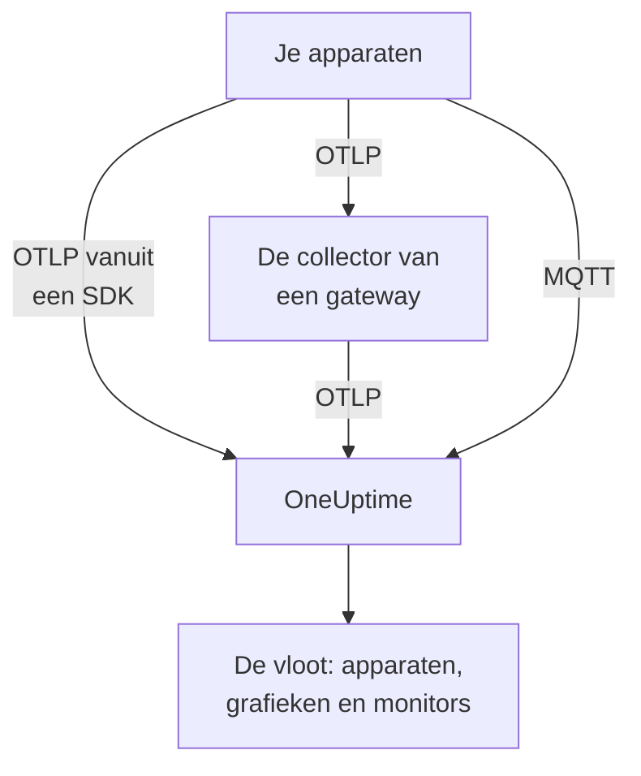

# IoT-apparaten

OneUptime monitort vloten van IoT-apparaten — sensoren, gateways, controllers en edge-boxen — op basis van een kleine set `iot_*`-metrics die ze sturen. Het groepeert de apparaten in vloten, houdt een inventaris bij van de apparaten van elke vloot en toont hun batterij, signaal, temperatuur, CPU, geheugen en beschikbaarheid in grafieken. Er is geen OneUptime-agent om op een apparaat te installeren: apparaten sturen standaard OpenTelemetry, of publiceren naar het MQTT-endpoint van OneUptime. [IoT-apparaatmonitors](/docs/monitor/iot-device-monitor) waarschuwen op basis van wat ze sturen.

:::cards
- [Kiezen hoe je verstuurt](#kiezen-hoe-je-verstuurt): Een OpenTelemetry-SDK, een gatewaycollector of MQTT.
- [Metrics verzenden via MQTT](#metrics-verzenden-via-mqtt): Topics, inloggegevens per apparaat en Last Will.
- [Metric-conventies](#metric-conventies): De `iot_*`-namen waarvoor OneUptime grafieken toont en waarop het waarschuwt.
- [Problemen oplossen](#problemen-oplossen): Ontbrekende vloten, ontbrekende apparaten, onterechte offline-meldingen.
:::

## Hoe het werkt

Elke meting hoort bij een vloot en een apparaat. OneUptime maakt de vloot aan bij de eerste meting, voegt elk nieuw apparaat toe aan de inventaris van de vloot en werkt de laatste waarden van het apparaat daarna bij elke meting bij. Metingen die via OpenTelemetry en via MQTT worden verstuurd, voeden dezelfde vloten, inventaris, grafieken en monitors.



## Hoe OneUptime IoT modelleert

- **Vloot**: een groep apparaten, zoals `building-a-sensors` of `field-gateways`. Hij komt uit het resource-attribuut `iot.fleet.name` en verschijnt in OneUptime als de telemetrieservice `iot/<fleet>`. Stel ook `service.name=iot/<fleet>` in, zodat logs en metrics onder dezelfde service samenkomen.
- **Apparaat**: één apparaat in een vloot, benoemd door het attribuut `device.id` op elk datapunt. De inventaris van de vloot is gesleuteld op `device.id`.

| Attribuut | Ingesteld op | Vereist | Beschrijving |
| --- | --- | --- | --- |
| `iot.fleet.name` | Resource | Ja | De vloot waartoe het apparaat behoort. Die wordt de OneUptime-service `iot/<fleet>`. |
| `device.id` | Elk datapunt | Ja | Een stabiele ID voor het apparaat, uniek binnen zijn vloot. |
| `iot.device.kind` | Elk datapunt | Nee | De apparaatklasse, zoals `Device`, `Sensor` of `Gateway`. Standaard `Device`. |
| `iot.device.type` | Elk datapunt | Nee | Een fijner type of model om monitors op te filteren, zoals `temp-sensor`. |
| `iot.device.firmware` | Elk datapunt | Nee | De firmwareversie die het apparaat meldt. |

Via MQTT stelt het topic de vloot en het apparaat voor je in.

## Kiezen hoe je verstuurt

| Manier | Gebruik als | Nodig |
| --- | --- | --- |
| [OpenTelemetry-SDK](#metrics-verzenden-via-de-opentelemetry-sdk) | Het apparaat draait een OpenTelemetry-SDK en bereikt OneUptime zelf. | Een ingestiesleutel op het apparaat. |
| [OpenTelemetry Collector](#metrics-verzenden-via-een-opentelemetry-collector) | Veel apparaten rapporteren via een gateway. | Een gateway die de collector draait. |
| [MQTT](#metrics-verzenden-via-mqtt) | Het apparaat spreekt al MQTT, of moet zich offline melden zodra het wegvalt. | Elke MQTT-client die via WebSocket verbinding maakt. |

## Voordat je begint

- Een ingestiesleutel. Maak er een aan onder **Projectinstellingen → Telemetrie & APM → Ingestiesleutels** en kopieer de waarde. Apparaten sturen hem als header `x-oneuptime-token`, of als MQTT-wachtwoord.
- Netwerktoegang van het apparaat of de gateway naar je OneUptime-URL.
- Een vlootnaam voor elke groep apparaten, en een stabiele ID voor elk apparaat.

## Metrics verzenden via de OpenTelemetry-SDK

:::steps
### De SDK naar OneUptime wijzen

Stel de standaard omgevingsvariabelen van OpenTelemetry in op het apparaat. Vervang de sleutel, de vlootnaam en de apparaat-ID door de jouwe:

```bash
export OTEL_EXPORTER_OTLP_ENDPOINT=https://oneuptime.com/otlp
export OTEL_EXPORTER_OTLP_PROTOCOL=http/protobuf
export OTEL_EXPORTER_OTLP_HEADERS=x-oneuptime-token=YOUR_TELEMETRY_INGESTION_TOKEN
export OTEL_RESOURCE_ATTRIBUTES=iot.fleet.name=building-a-sensors,device.id=sensor-001,service.name=iot/building-a-sensors
```

Houd `iot.fleet.name` stabiel: een wijziging registreert een nieuwe vloot.

### Metingen vastleggen als IoT-metrics

Geef elke meting uit als metric met een van de [conventionele namen](#metric-conventies), en geef elk datapunt een attribuut `device.id`:

| Metric | Waarde | Datapuntattribuut |
| --- | --- | --- |
| `iot_device_up` | `1` | `device.id=sensor-001` |
| `iot_battery_percent` | `87` | `device.id=sensor-001` |
| `iot_temperature_celsius` | `21.5` | `device.id=sensor-001` |

De inventaris is gesleuteld op de `device.id` van het datapunt, niet op die van de resource, dus stel hem in op elke meting en ook in `OTEL_RESOURCE_ATTRIBUTES`.
:::

[Controleer daarna of de vloot verschijnt](#controleren-of-de-vloot-verschijnt).

## Metrics verzenden via een OpenTelemetry Collector

Als veel apparaten via een gateway rapporteren, draai je een OpenTelemetry Collector op de gateway. Die ontvangt OTLP van je apparaten, stempelt de vloot op elke meting en stuurt de metingen door naar OneUptime.

:::steps
### De configuratie van de gateway opslaan

Sla dit op als `config.yaml` op de gateway:

```yaml title="config.yaml"
receivers:
  otlp:
    protocols:
      grpc:
        endpoint: 0.0.0.0:4317
      http:
        endpoint: 0.0.0.0:4318

processors:
  batch:
    send_batch_size: 512
    timeout: 5s
  resource:
    attributes:
      - key: iot.fleet.name
        value: field-gateways
        action: upsert
      - key: service.name
        value: iot/field-gateways
        action: upsert

exporters:
  otlphttp:
    endpoint: "https://oneuptime.com/otlp"
    headers:
      "x-oneuptime-token": "YOUR_TELEMETRY_INGESTION_TOKEN"

service:
  pipelines:
    metrics:
      receivers: [otlp]
      processors: [resource, batch]
      exporters: [otlphttp]
```

- `otlp` ontvangt van je apparaten via gRPC (`4317`) en HTTP (`4318`). Ontvang metingen op elke andere manier die de collector ondersteunt (een MQTT-bridge, bestandslogs) en stuur ze door dezelfde pipeline.
- `resource` stempelt elke meting met de vloot. Stel per gateway `iot.fleet.name` in, en de bijbehorende `service.name=iot/<fleet>`, zodat de apparaten van elke gateway in hun vloot terechtkomen.
- Houd `device.id`, en eventueel `iot.device.kind`, `iot.device.type` en `iot.device.firmware`, op elk datapunt, zodat OneUptime de apparaten in de vloot uit elkaar kan houden.
- `otlphttp` stuurt via HTTPS met de ingestiesleutel naar OneUptime. Zowel de standaard protobuf-codering als `encoding: json` wordt geaccepteerd.

### De collector op de gateway draaien

:::tabs
@tab Docker
Draai hem vanuit de map met `config.yaml`:

```bash
docker run -d \
  --name otel-collector \
  --restart unless-stopped \
  -p 4317:4317 \
  -p 4318:4318 \
  -v $(pwd)/config.yaml:/etc/otelcol-contrib/config.yaml:ro \
  otel/opentelemetry-collector-contrib:0.161.0 \
  --config /etc/otelcol-contrib/config.yaml
```
@tab otelcol-contrib
Heeft de gateway al `otelcol-contrib`, wijs hem dan naar het bestand:

```bash
otelcol-contrib --config config.yaml
```
:::

Apparaten sturen daarna OTLP naar de gateway, bijvoorbeeld met `OTEL_EXPORTER_OTLP_ENDPOINT=http://<gateway-host>:4318` in de SDK van elk apparaat.
:::

[Controleer daarna of de vloot verschijnt](#controleren-of-de-vloot-verschijnt).

## Metrics verzenden via MQTT

OneUptime heeft een eigen MQTT-endpoint, dus apparaten die MQTT spreken, publiceren metingen er rechtstreeks naartoe, zonder SDK, collector of bridge. Wat via MQTT binnenkomt, gaat door dezelfde pipeline als OTLP: vloten worden aangemaakt, de inventaris wordt bijgewerkt, en elke IoT-monitor en elk waarschuwingssjabloon werkt hetzelfde.

### Endpoints

| Transport | Adres | Opmerkingen |
| --- | --- | --- |
| MQTT via WebSocket | `wss://<your-host>/mqtt` | Werkt in elke deployment, via de normale HTTPS-poort. |
| MQTT via TCP | `<app-host>:1883` | Alleen zelf-gehost, en intern in het cluster- of Compose-netwerk tot je hem beschikbaar stelt. De poort is `MQTT_INGEST_PORT`. |

### Authenticatie

- **Met de ingestiesleutel**: stuur hem als MQTT-wachtwoord. De gebruikersnaam wordt genegeerd; heeft je client alleen een veld voor de gebruikersnaam, zet de sleutel daar dan in. Dit past bij een gateway die voor veel apparaten publiceert.
- **Met inloggegevens per apparaat**: aanbevolen voor apparaten die rechtstreeks verbinding maken. Open de pagina **Device Registry** van de vloot en registreer het apparaat, met de **Device ID** die het als `device.id` gebruikt. De **MQTT Username** van het apparaat is zijn gebruikersnaam en zijn **MQTT Password (Secret)** zijn wachtwoord.

De inloggegevens van een apparaat kunnen alleen publiceren onder de eigen topics `oneuptime/<fleet>/<device>/`. Je kunt één apparaat intrekken zonder de rest van de vloot aan te raken: zet de schakelaar **Ingeschakeld** uit, of verwijder het apparaat, en een verbonden apparaat wordt binnen ongeveer een minuut afgesloten. Een geregistreerd apparaat dat stil valt, blijft als offline in de inventaris staan, en het waarschuwingssjabloon Device Offline gaat ervoor af, ook als het zonder Last Will uitvalt.

OneUptime weigert onjuiste inloggegevens bij CONNECT met returncode 4 (onjuiste gebruikersnaam of wachtwoord), dus een verkeerd geconfigureerd apparaat faalt zichtbaar. Browsersleutels worden via MQTT geweigerd.

### Topics en payloads

Publiceer onder het vaste voorvoegsel `oneuptime/`. De segmenten voor vloot en apparaat mogen geen `/`, `+` of `#` bevatten, mogen niet met `$` beginnen en zijn hoogstens 100 tekens lang.

| Topic | Payload |
| --- | --- |
| `oneuptime/<fleet>/<device>/telemetry` | Een JSON-object met metingen: `{"metrics":{"iot_temperature_celsius":21.5}}`, of een plat object waarvan de numerieke velden de metrics zijn. |
| `oneuptime/<fleet>/<device>/metrics/<metricName>` | Eén waarde: een kaal getal (`23.4`) of `{"value":23.4}`. |
| `oneuptime/<fleet>/<device>/status` | `online` of `offline` (ook `1` of `0`, `true` of `false`, `up` of `down`). Dit stelt `iot_device_up` in. |

Een telemetriepayload kan ook `"attributes"` bevatten, een map met strings die op elk datapunt wordt gestempeld (gebruik die voor `iot.device.kind`, `iot.device.type`, `iot.device.firmware` of je eigen labels), en `"timestamp"`, in ISO 8601 of in Unix-seconden of -milliseconden. Beide zijn optioneel: zonder `timestamp` wordt het tijdstip gebruikt waarop OneUptime de meting ontvangt.

### Offline-detectie met Last Will

Registreer een MQTT Last Will op `oneuptime/<fleet>/<device>/status` met de payload `offline`. Als het apparaat uitvalt of van het netwerk verdwijnt, publiceert OneUptime er `iot_device_up = 0` voor op het moment dat zijn sessie eindigt, waardoor het meegeleverde waarschuwingssjabloon Device Offline afgaat en het apparaat in de inventaris als down wordt gemarkeerd, zonder polling. Publiceer na het verbinden `online` op hetzelfde topic, zodat het apparaat weer als up wordt weergegeven.

### Voorbeelden

:::tabs
@tab mosquitto_pub
Via ruwe TCP, op een zelf-gehoste instantie:

```bash
mosquitto_pub -h YOUR-ONEUPTIME-APP-HOST -p 1883 \
  -u oneuptime -P "YOUR_TELEMETRY_INGESTION_TOKEN" \
  -t "oneuptime/building-a-sensors/sensor-001/telemetry" \
  -m '{"metrics":{"iot_device_up":1,"iot_battery_percent":87,"iot_temperature_celsius":21.5},"attributes":{"iot.device.type":"temp-sensor","iot.device.firmware":"1.4.2"}}'
```
@tab Node.js
Met het pakket `mqtt`, via WebSocket, tegen oneuptime.com of een willekeurige zelf-gehoste instantie:

```javascript
const mqtt = require("mqtt");

const client = mqtt.connect("wss://oneuptime.com/mqtt", {
  username: "oneuptime", // ignored — the token below is what authenticates
  password: "YOUR_TELEMETRY_INGESTION_TOKEN",
  will: {
    topic: "oneuptime/building-a-sensors/sensor-001/status",
    payload: "offline",
  },
});

client.on("connect", () => {
  client.publish("oneuptime/building-a-sensors/sensor-001/status", "online");
  setInterval(() => {
    client.publish(
      "oneuptime/building-a-sensors/sensor-001/telemetry",
      JSON.stringify({
        metrics: {
          iot_device_up: 1,
          iot_battery_percent: readBattery(),
          iot_temperature_celsius: readTemperature(),
        },
      }),
    );
  }, 60 * 1000);
});
```
@tab Python
Met `paho-mqtt`, via WebSocket:

```python
import json
import paho.mqtt.client as mqtt

client = mqtt.Client(transport="websockets")
client.username_pw_set("oneuptime", "YOUR_TELEMETRY_INGESTION_TOKEN")
client.tls_set()
client.will_set("oneuptime/building-a-sensors/sensor-001/status", "offline")
client.ws_set_options(path="/mqtt")
client.connect("oneuptime.com", 443)

client.publish("oneuptime/building-a-sensors/sensor-001/status", "online")
client.publish(
    "oneuptime/building-a-sensors/sensor-001/telemetry",
    json.dumps({"metrics": {"iot_device_up": 1, "iot_temperature_celsius": 21.5}}),
)
```
:::

### Limieten en aflevering

- Het endpoint neemt alleen metingen aan: abonnementen worden geweigerd (een SUBACK-fout), en retained messages worden niet bewaard.
- Ingestie is at-least-once. Gebruik QoS 1 om OneUptime elke publicatie te laten bevestigen; een herhaalde verzending met QoS 1 of 2 na een verloren bevestiging kan dubbele datapunten opleveren.
- Een publicatie van meer dan 128 KB, of met meer dan 100 metrics, wordt weggelaten, en een pakket dat meer aangeeft, sluit de verbinding.
- Een publicatie buiten deze topics, of met een onjuist gevormde payload, wordt geaccepteerd en weggelaten, omdat MQTT 3.1.1 geen fout per bericht kent. OneUptime logt een waarschuwing met de reden (`MQTT: dropped publish to …`).
- Houd op het WebSocket-endpoint de MQTT-keepalive onder 5 minuten. De ingress sluit een WebSocket die 300 seconden inactief is, waardoor de Last Will en een onterechte waarschuwing Device Offline afgaan. De standaardwaarden van clientbibliotheken (60 seconden voor `mqtt` en `paho-mqtt`) zijn prima, en het TCP-endpoint heeft zo'n limiet niet.

## Metric-conventies

OneUptime herkent deze `iot_*`-metricnamen. Stuur alleen de namen die voor je apparaat zinvol zijn: ontbrekende namen worden niet in grafieken getoond. Elk datapunt draagt de `device.id` van het apparaat (via MQTT noemt het topic het apparaat).

| Metricnaam | Betekenis |
| --- | --- |
| `iot_device_up` | Beschikbaarheid: `1` is up en bereikbaar, `0` is down. De IoT Device-monitor leest deze. |
| `iot_device_info` | Alleen identiteit. Deze draagt `device.id`, de klasse, het type en de firmware, zodat een apparaat in de inventaris verschijnt voordat het metingen meldt. |
| `iot_battery_percent` | Batterijlading, `0` tot `100` (%). |
| `iot_signal_strength_dbm` | Draadloze signaalsterkte in dBm, zoals wifi-, LoRa- of mobiele RSSI. |
| `iot_temperature_celsius` | Apparaat- of sensortemperatuur in °C. |
| `iot_cpu_usage_ratio` | CPU-gebruik als verhouding van `0` tot `1`. OneUptime slaat het op en toont het als percentage. |
| `iot_memory_usage_bytes` | Gebruikt geheugen, in bytes. |
| `iot_memory_size_bytes` | Totaal geheugen op het apparaat, in bytes. |
| `iot_uptime_seconds` | Seconden sinds het apparaat voor het laatst opstartte. |

## Controleren of de vloot verschijnt

1. Controleer of het apparaat, de collector van de gateway of de MQTT-client zonder fouten verstuurt: zoek in de logs naar exportfouten en HTTP-antwoorden `401` of `422`, of naar een verbinding die met returncode 4 is geweigerd.
2. Open **Producten → Infrastructuur → IoT → All Fleets**. De vloot verschijnt binnen ongeveer een minuut na de eerste metingen als `iot/<fleet>`.
3. Open de pagina **Devices** van de vloot. Elk apparaat waarvoor je hebt verstuurd, hoort te staan met zijn laatste batterij, signaal, temperatuur, CPU, geheugen en up- of down-status.
4. Open de pagina **Metrieken** van de vloot om een van de `iot_*`-series in een grafiek te tonen.

## Zelf-gehoste OneUptime

Wijs het endpoint naar je eigen instantie:

```bash
export OTEL_EXPORTER_OTLP_ENDPOINT=https://your-oneuptime-host.example.com/otlp
```

Of, in een collector:

```yaml
exporters:
  otlphttp:
    endpoint: https://your-oneuptime-host.example.com/otlp
    headers:
      "x-oneuptime-token": "YOUR_TELEMETRY_INGESTION_TOKEN"
```

Maak voor MQTT verbinding met `wss://your-oneuptime-host.example.com/mqtt`, of stel de ruwe MQTT-TCP-poort van de app-service beschikbaar (`MQTT_INGEST_PORT`, standaard `1883`) voor apparaten die geen WebSocket kunnen gebruiken. Stel `MQTT_INGEST_ENABLED=false` in op de app-service om beide MQTT-listeners uit te zetten. Spreekt de instantie alleen HTTP, gebruik dan `http://` (en `ws://` voor MQTT) en de poort.

## Problemen oplossen

:::details De vloot verschijnt niet
1. Controleer of `iot.fleet.name` een resource-attribuut is (geen datapuntlabel) en of `service.name` gelijk is aan `iot/<fleet>`.
2. Controleer of het endpoint `https://oneuptime.com/otlp` is (of je zelf-gehoste `…/otlp`) en of de header `x-oneuptime-token` een geldige ingestiesleutel bevat.
3. Controleer via MQTT of het topic precies `oneuptime/<fleet>/<device>/…` volgt: het vlootsegment van het topic maakt de vloot aan.
:::

:::details Er ontbreken apparaten in de inventaris
1. Geef elk datapunt een label `device.id`: apparaten zijn daarop gesleuteld. Via MQTT is het het apparaatsegment van het topic.
2. Stuur voor een apparaat dat nog geen metingen heeft gemeld `iot_device_info` (of via MQTT een `status`-bericht), zodat het in de inventaris verschijnt.
3. Houd de waarden van `device.id` stabiel: een wisselende ID maakt dubbele apparaten aan.
:::

:::details HTTP 401 of 422 van de exporter
`401` betekent dat de ingestiesleutel ontbreekt, onjuist of verlopen is; `422` betekent dat hij is uitgeschakeld, of een browsersleutel is, die geen apparaattelemetrie kan sturen. Maak een nieuwe aan onder **Projectinstellingen → Telemetrie & APM → Ingestiesleutels** en werk de header `x-oneuptime-token` bij.
:::

:::details De MQTT-verbinding wordt geweigerd met "bad username or password"
OneUptime weigert onjuiste inloggegevens bij CONNECT met returncode 4. Controleer of het wachtwoord een geldige ingestiesleutel is die niet is uitgeschakeld of verlopen, of, voor een geregistreerd apparaat, het secret van de inloggegevens met de **MQTT Username** ervan als gebruikersnaam. Browsersleutels worden via MQTT geweigerd.
:::

:::details Apparaten springen op offline terwijl ze draaien
Op het WebSocket-endpoint sluit de ingress een verbinding die 300 seconden inactief is, waardoor de Last Will en een onterechte waarschuwing Device Offline afgaan. Houd de MQTT-keepalive onder 5 minuten: de standaardwaarden van clientbibliotheken van 60 seconden zijn prima.
:::

:::details Metingen verschijnen niet in de grafieken van de vloot
1. Gebruik de exacte `iot_*`-namen uit [Metric-conventies](#metric-conventies): andere namen worden opgeslagen als generieke metrics en vullen de IoT-grafieken niet.
2. Stuur `iot_cpu_usage_ratio` als verhouding van `0` tot `1`; OneUptime toont het als percentage.
3. Reken op maximaal een minuut voordat de eerste datapunten verschijnen nadat een apparaat begint te rapporteren.
:::

## Volgende stappen

:::cards
- [IoT-apparaat-monitor](/docs/monitor/iot-device-monitor): Waarschuw wanneer een apparaat offline gaat, de batterij bijna leeg is of het oververhit raakt.
- [OpenTelemetry](/docs/telemetry/open-telemetry): Hoe OneUptime OTLP aanneemt van elke SDK of collector.
- [OpenTelemetry-collector op de host](/docs/telemetry/host-otel-collector): Monitor een Linux-, macOS- of Windows-gateway zelf.
:::
