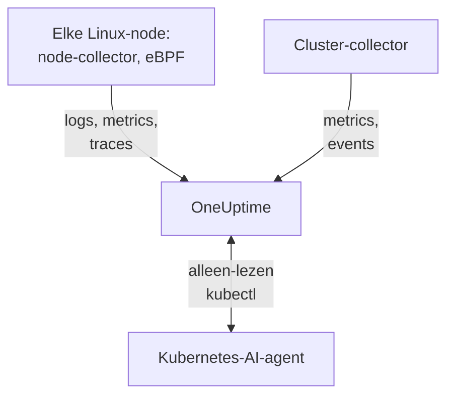

# Kubernetes-agent

De OneUptime Kubernetes-agent is een Helm-chart die de metrics, events en podlogs van je cluster verzamelt en, met eBPF, de traces, requestmetrics, servicegraaf en netwerkflows van elke pod, zonder codewijzigingen en zonder SDK's. Hij draait ook de [Kubernetes-AI-agent](#kubernetes-ai-agent), waarmee OneUptime AI alleen-lezen `kubectl` uitvoert terwijl die een incident of waarschuwing onderzoekt. Eén `helm install` zet hem neer; [Kubernetes-monitors](/docs/monitor/kubernetes-monitor) waarschuwen op basis van wat hij stuurt.

:::cards
- [De agent installeren](#de-agent-installeren): Vier stappen met Helm.
- [Configuratieopties](#configuratieopties): Filters, sampling, controlevlak, service mesh, kosten en labels.
- [Kubernetes-AI-agent](#kubernetes-ai-agent): Alleen-lezen `kubectl` voor OneUptime AI, en correcties als je die toestaat.
- [Minder versturen](#het-volume-van-verzamelde-gegevens-verminderen): De hefbomen, op volgorde van effect.
:::

## Hoe het werkt

De chart draait een paar workloads in een eigen namespace. Elke workload stuurt wat hij verzamelt via OTLP naar je OneUptime-URL, met de ingestiesleutel die je hem geeft, en het cluster registreert zich onder de naam die je opgeeft in `clusterName`.



| Workload | Soort | Wat hij doet | Draait |
| --- | --- | --- | --- |
| Clustercollector | Deployment | Clustermetrics, Kubernetes-events en de specificaties van pods, nodes en workloads, uit de Kubernetes-API. | Altijd |
| Nodecollector | DaemonSet | Podlogs uit `/var/log/pods`, kubelet- en cAdvisor-metrics en de OS-metrics van de node. | Overal behalve op EKS Fargate |
| eBPF-instrumentatie (OBI) | DaemonSet | HTTP-, gRPC-, SQL- en Redis-traces en requestmetrics van elke pod, en de servicemap. | Standaard, behalve op GKE Autopilot en EKS Fargate |
| Kubernetes-AI-agent | Deployment | Alleen-lezen `kubectl` voor OneUptime AI terwijl die een incident of waarschuwing onderzoekt. | Standaard |
| Logtailer | Deployment | Podlogs via de Kubernetes-API, waar de nodecollector ze niet kan lezen. | Met de presets `gke-autopilot` en `eks-fargate` |
| Kostenengine en poller | Deployments | Uitgaven per namespace, workload en pod. | Met `cost.enabled=true` |

Elke agentimage is alleen voor Linux, dus elke workload is vastgezet op Linux-nodes.

## Voordat je begint

- Een Kubernetes-cluster met v1.23 of later, en `kubectl` geconfigureerd om het te bereiken.
- Helm 3. Upgrades gebruiken `--reset-then-reuse-values`, waarvoor Helm 3.14 of later nodig is.
- Een ingestiesleutel. Maak er een aan onder **Projectinstellingen → Telemetrie & APM → Ingestiesleutels**. De agent stuurt hem als header `x-oneuptime-token`, dus een project-API-sleutel werkt hier niet.
- Een naam voor het cluster, uniek in je project en stabiel, zoals `prod-us-east-1`: onder die naam verschijnt het cluster in OneUptime.
- Uitgaand HTTPS van het cluster naar je OneUptime-URL.

## De agent installeren

:::steps
### De Helm-repository toevoegen

```bash
helm repo add oneuptime https://helm-chart.oneuptime.com
helm repo update
```

### De chart installeren

Vervang `YOUR_ONEUPTIME_URL`, `YOUR_ONEUPTIME_API_KEY` (de ingestiesleutel) en de clusternaam door je eigen waarden, en kies het tabblad voor je platform (zie [Een preset kiezen](#een-preset-kiezen)).

:::tabs
@tab Standard
Zelfbeheerde clusters, EKS on EC2, GKE Standard, AKS, minikube, kind en k3s:

```bash
helm install kubernetes-agent oneuptime/kubernetes-agent \
  --namespace oneuptime-agent \
  --create-namespace \
  --set oneuptime.url="YOUR_ONEUPTIME_URL" \
  --set oneuptime.apiKey="YOUR_ONEUPTIME_API_KEY" \
  --set clusterName="my-cluster" \
  --set aiAgent.enabled=true
```
@tab GKE Autopilot
```bash
helm install kubernetes-agent oneuptime/kubernetes-agent \
  --namespace oneuptime-agent \
  --create-namespace \
  --set oneuptime.url="YOUR_ONEUPTIME_URL" \
  --set oneuptime.apiKey="YOUR_ONEUPTIME_API_KEY" \
  --set clusterName="my-cluster" \
  --set aiAgent.enabled=true \
  --set preset=gke-autopilot
```
@tab EKS Fargate
```bash
helm install kubernetes-agent oneuptime/kubernetes-agent \
  --namespace oneuptime-agent \
  --create-namespace \
  --set oneuptime.url="YOUR_ONEUPTIME_URL" \
  --set oneuptime.apiKey="YOUR_ONEUPTIME_API_KEY" \
  --set clusterName="my-cluster" \
  --set aiAgent.enabled=true \
  --set preset=eks-fargate
```
:::

**AI-onderzoeken staan standaard aan.** `aiAgent.enabled=true` draait de [Kubernetes-AI-agent](#kubernetes-ai-agent) naast de collector: als er op dit cluster een incident of waarschuwing ontstaat, onderzoekt OneUptime AI die met alleen-lezen `kubectl` (`get`, `describe`, `logs`, `events`, `top`) en verandert niets. Correcties blijven uit tot je ze toestaat. Gebruik in plaats daarvan `--set aiAgent.enabled=false` om zonder te installeren.

### Controleren of de pods draaien

```bash
kubectl get pods -n oneuptime-agent
```

Elke pod hoort binnen een minuut of twee `Running` te bereiken:

:::tabs
@tab Standard
De clustercollector, de AI-agent en op elke node een nodecollector en een eBPF-pod:

```text
NAME                                          READY   STATUS    RESTARTS   AGE
kubernetes-agent-xxxxxxxxxx-xxxxx             1/1     Running   0          1m
kubernetes-agent-ai-agent-xxxxxxxxxx-xxxxx    1/1     Running   0          1m
kubernetes-agent-ebpf-xxxxx                   1/1     Running   0          1m
kubernetes-agent-logs-xxxxx                   1/1     Running   0          1m
```
@tab GKE Autopilot
De nodecollector draait nog steeds en leest kubelet- en cAdvisor-metrics zonder `hostPath`, en een logtailer-Deployment leest podlogs via de Kubernetes-API:

```text
NAME                                          READY   STATUS    RESTARTS   AGE
kubernetes-agent-xxxxxxxxxx-xxxxx             1/1     Running   0          1m
kubernetes-agent-ai-agent-xxxxxxxxxx-xxxxx    1/1     Running   0          1m
kubernetes-agent-logs-yyyyyyyyyy-yyyyy        1/1     Running   0          1m
kubernetes-agent-logs-xxxxx                   1/1     Running   0          1m
```
@tab EKS Fargate
Drie Deployments en geen DaemonSet: Fargate geeft elke pod een eigen micro-VM en plant nooit DaemonSets in, dus nodemetrics zijn daar niet beschikbaar:

```text
NAME                                          READY   STATUS    RESTARTS   AGE
kubernetes-agent-xxxxxxxxxx-xxxxx             1/1     Running   0          1m
kubernetes-agent-ai-agent-xxxxxxxxxx-xxxxx    1/1     Running   0          1m
kubernetes-agent-logs-yyyyyyyyyy-yyyyy        1/1     Running   0          1m
```
:::

### Het cluster vinden in OneUptime

Open **Producten → Infrastructuur → Kubernetes → Alle clusters**. Het cluster verschijnt binnen een paar minuten onder zijn `clusterName`, en de nodes, pods en workloads ervan vullen zich. De Kubernetes-AI-agent wordt als verbonden weergegeven op de pagina **Agent** van het cluster, onder **AI**.
:::

## Een preset kiezen

`preset` kiest de standaardwaarden die op je platform werken: of podlogs via `hostPath` van de node worden gelezen of via de Kubernetes-API, en welke workloads geprivilegieerd mogen draaien.

| `preset` | Gebruiken voor | Podlogs | Nodemetrics |
| --- | --- | --- | --- |
| `standard` (standaard) | Zelfbeheerde clusters, **EKS on EC2**, **GKE Standard**, **AKS**, minikube, kind, k3s | De nodecollector leest `/var/log/pods` via `hostPath` (laagste overhead) | Kubelet, cAdvisor en de OS-metrics van de node |
| `gke-autopilot` | **GKE Autopilot** | De logtailer leest ze via de Kubernetes-API (geen `hostPath`, geen hosttoegang) | Kubelet en cAdvisor, zonder `hostPath` |
| `eks-fargate` | **EKS Fargate** | De logtailer leest ze via de Kubernetes-API (geen `hostPath`, geen hosttoegang) | Geen: Fargate draait geen DaemonSets |

Twijfel je, begin dan met `standard`. Mislukt de installatie met een Pod Security-fout die `hostPath` noemt, installeer dan opnieuw met `preset=gke-autopilot` (of `eks-fargate` op Fargate). GKE Autopilot en EKS Fargate weigeren ook geprivilegieerde pods, die eBPF en de profiler nodig hebben, dus die twee presets laten beide weg.

## Wat er wordt verzameld

| Categorie | Gegevens |
| --- | --- |
| Nodemetrics | Gebruik van CPU, geheugen, bestandssysteem en netwerk |
| Podmetrics | CPU, geheugen, netwerk en herstarts |
| Containermetrics | CPU en geheugen per container |
| Clustermetrics | Nodecondities, toewijsbare resources, aantal pods |
| Kubernetes-events | Waarschuwingen, fouten en scheduling-events |
| Podlogs | De stdout en stderr van elke container (via `hostPath` op standaardclusters, via de Kubernetes-API op Autopilot en Fargate) |
| Applicatietraces (eBPF, standaard aan) | HTTP-, gRPC-, SQL- en Redis-spans van elke pod, zonder SDK of codewijzigingen |
| HTTP RED-metrics (eBPF) | `http.server.request.duration`, en de groottes van request- en responsebody's, per service |
| Servicegraaf (eBPF) | Randen met requestrate, latentie en fouten tussen aanroeper en aangeroepene, die de servicemap tekenen |
| Netwerkflowmetrics (eBPF) | TCP- en UDP-tellers voor bytes en pakketten van pod naar pod, met Kubernetes-metadata |
| TCP-statistieken (eBPF) | Tellers voor round-trip-tijd, mislukte verbindingen en retransmissies per node |
| Workloadkosten (opt-in, `cost.enabled=true`) | Uitgaven per namespace, workload en pod, met inactiviteit en efficiëntie, en de uurkosten van nodes en volumes: zie [Kubernetes-kostenobservability](/docs/telemetry/kubernetes-cost) |

## Configuratieopties

Elke optie hieronder is een Helm-waarde. Stel hem in bij de installatie, of op een geïnstalleerde agent met `helm upgrade ... --reset-then-reuse-values --set <value>`.

### Namespacefiltering

`namespaceFilters.rules` past namespacepatronen toe op vier scopes, elk afzonderlijk:

| Scope | Waar hij filtert | Wat hij beïnvloedt |
| --- | --- | --- |
| `podLogs` | Bij de hostPath-filelog-receiver of de API-logtailer | Alleen stdout en stderr van pods; Kubernetes-events en auditlogs worden niet beïnvloed |
| `ebpfDiscovery` | Bij de procesdetectie van OBI | Zowel eBPF-traces als eBPF-metrics van overeenkomende workloads |
| `metrics` | In de collector, nadat de Kubernetes-metadata is toegevoegd | Metricseries met een namespace; node- en clusterseries zonder namespace blijven behouden |
| `traces` | In de collector, nadat de Kubernetes-metadata is toegevoegd | Zowel eBPF-spans als spans die applicaties via OTLP pushen |

Een patroon matcht de volledige namespacenaam en mag `*` bevatten (`team-*`). Heeft een scope een `include`-regel, dan blijven voor die scope alleen overeenkomende namespaces behouden, en `exclude`-regels winnen altijd. De standaardregel sluit `kube-system` alleen uit van `podLogs` en `ebpfDiscovery`.

Om podlogs en eBPF-detectie te beperken tot een paar namespaces:

```bash
helm install kubernetes-agent oneuptime/kubernetes-agent \
  --namespace oneuptime-agent \
  --create-namespace \
  --set oneuptime.url="YOUR_ONEUPTIME_URL" \
  --set oneuptime.apiKey="YOUR_ONEUPTIME_API_KEY" \
  --set clusterName="my-cluster" \
  --set-json 'namespaceFilters.rules=[{"action":"include","namespaces":["default","production","staging"],"scopes":["podLogs","ebpfDiscovery"]}]'
```

Om de logs van een luidruchtige namespace te stoppen en de eBPF-traces, servicemap en metrics ervan te behouden, beperk je de uitsluiting tot `podLogs`:

```bash
  --set-json 'namespaceFilters.rules=[{"action":"exclude","namespaces":["kube-system"],"scopes":["podLogs","ebpfDiscovery"]},{"action":"exclude","namespaces":["noisy-*"],"scopes":["podLogs"]}]'
```

Regels voor `podLogs` en `ebpfDiscovery` filteren bij de bron: uitgesloten logbestanden worden nooit geopend, en uitgesloten workloads worden nooit geïnstrumenteerd. Regels voor `metrics` en `traces` werken later, in de collector, nadat de namespace aan de gegevens is gekoppeld.

#### Metrics en traces filteren op namespace

Voeg die scopes toe aan een regel om ook metrics of spans met een namespace te filteren:

```bash
  --set-json 'namespaceFilters.rules=[{"action":"exclude","namespaces":["kube-system","noisy-*"],"scopes":["podLogs","ebpfDiscovery","metrics","traces"]}]'
```

> [!NOTE]
> Metrics op node- en clusterniveau blijven altijd behouden. Een namespace hoort bij een pod, niet bij een node, dus series zoals node-CPU, nodegeheugen en bestandssysteemgebruik hebben niets om op te matchen en worden nooit weggelaten: een regel met scope `metrics` snoeit series per pod zonder een node die slecht gaat te verbergen.

Kubernetes-events kunnen bij de agent niet op namespace worden gefilterd: ze komen binnen van de receiver `k8sobjects` zonder attribuut `k8s.namespace.name` (de namespace zit in de body van het event), dus een filter heeft niets om op te matchen. Laat ze in plaats daarvan in OneUptime vallen, met **Logboeken → Instellingen → Drop-filters**.

### Filteren op log-severity

`filters.logs.minSeverity` laat podlogrecords onder een bepaalde severity vallen, bij de agent, voordat er iets wordt verstuurd:

```bash
  --set filters.logs.minSeverity=WARN
```

Hij accepteert `TRACE`, `DEBUG`, `INFO`, `WARN`, `ERROR` en `FATAL`. `WARN` behoudt WARN, ERROR en FATAL en laat INFO, DEBUG en TRACE vallen; de standaard (`""`) behoudt alles. Hij geldt in beide logmodi (via de collector in de modus `daemonset`, in de logtailer in de modus `api`), dus een preset zet hem nooit achter je rug om uit.

Container-runtimes registreren geen severity, dus de agent leest die uit de logtekst zelf (`[ERROR]`, `WARN:`, `"level":"info"`, …). Wat er gebeurt met een regel zonder herkenbaar niveau, hangt af van de logmodus, omdat de twee modi verschillende dingen weten:

| Modus | Een regel zonder niveau | Waarom |
| --- | --- | --- |
| `daemonset` | `stderr` telt als ERROR (behouden), `stdout` als INFO (weggelaten door een WARN-drempel) | De container-runtime registreert uit welke stream elke regel kwam. |
| `api` | Altijd behouden | De Kubernetes-API `pods/log` voegt stdout en stderr samen tot één stream zonder markering per regel, dus in plaats van te gokken behoudt de agent de regel. |

De modus `api` laat dus bewust strikt minder vallen dan de modus `daemonset`: een Python-traceback of een `npm ERR!` bevat geen severity-sleutelwoord, en die ongemerkt verwijderen is precies de fout waartegen een drempel je moet beschermen. In de hybride modus (`logs.windowsPods.enabled`) gelden beide rijen, per OS van de node: Linux-pods volgen `daemonset`, Windows-pods `api`.

Gebeurtenissen over meerdere regels worden in beide modi vóór het filteren weer samengevoegd, dus een Java-stacktrace wordt beoordeeld op zijn eerste regel en als geheel behouden of weggelaten.

> [!IMPORTANT]
> Kubernetes-events en resourcespecificaties worden hier nooit door gefilterd. Ze komen uit de Kubernetes-API zonder eigen severity, dus een drempel zou de hele feed verwijderen, inclusief de waarschuwingen `FailedScheduling`, `BackOff` en `OOMKilling` die je het hardst nodig hebt. Het zijn er weinig en ze zijn waardevol, dus de agent stuurt ze altijd; gebruik **Logboeken → Instellingen → Drop-filters** in OneUptime om ze uit te dunnen.

### Metrics op naam opnemen of uitsluiten

`filters.metrics` bepaalt welke metrics het cluster verlaten, over alle receivers heen.

Laat een paar luidruchtige metrics vallen (een denylist, meestal wat je wilt):

```bash
  --set-json 'filters.metrics.exclude=["k8s.volume.available","k8s.volume.capacity"]'
```

Stuur alleen een vaste set (een allowlist: al het andere wordt weggelaten):

```bash
  --set-json 'filters.metrics.include=["k8s.pod.cpu.utilization","k8s.pod.memory.usage"]'
```

Match op patroon in plaats van op exacte naam:

```bash
  --set filters.metrics.matchType=regexp \
  --set-json 'filters.metrics.exclude=["^container_network_"]'
```

| Sleutel | Betekenis |
| --- | --- |
| `filters.metrics.exclude` | Metricnamen om weg te laten. Wordt na `include` toegepast, dus een uitsluiting wint altijd. |
| `filters.metrics.include` | Als deze niet leeg is, worden alleen deze metrics verstuurd. |
| `filters.metrics.matchType` | `strict` (de exacte naam, de standaard) of `regexp` (RE2, niet verankerd). |

- `regexp` is niet verankerd: `system.cpu` matcht ook `system.cpu.time`. Veranker hem (`^system\.cpu$`) als je precies één metric bedoelt.
- RE2 kent geen lookahead, dus `^(?!container_)` compileert niet. Druk "alles behalve" uit met `include`, niet met een negatief patroon.
- `include` geldt voor alle receivers tegelijk. Een allowlist die een metric vergeet, verwijdert ongemerkt de monitors die erop zijn gebouwd, dus geef de voorkeur aan `exclude`, tenzij je een gesloten set wilt.
- Gebruik `--set-json` (of een values-bestand) voor lijsten: een gewone `--set` vervangt een lijst in plaats van eraan toe te voegen.

> [!WARNING]
> Test een patroon voordat je het uitrolt. De collector compileert patronen bij het opstarten, dus een ongeldig patroon gedraagt zich niet ongemerkt verkeerd: de collector weigert te starten en komt in een crash-loop, waarbij de logs van die collector samen met zijn metrics wegvallen. Helm kan RE2 niet compileren, dus `helm upgrade` accepteert een fout patroon zonder klagen.

### Trace-sampling

De filters hierboven verwijderen een categorie telemetrie: een namespace, een severity, een metricnaam. Sampling behoudt elke categorie en dunt in plaats daarvan de populatie uit. Stel `sampling.traces.percentage` in op het aandeel traces dat je wilt behouden:

```bash
helm upgrade kubernetes-agent oneuptime/kubernetes-agent \
  --namespace oneuptime-agent --reset-then-reuse-values \
  --set sampling.traces.percentage=10
```

Dat behoudt één trace op de tien en laat de andere negen bij de agent vallen, voordat ze je cluster verlaten.

- **Je krijgt hele traces, geen fragmenten.** De beslissing is een hash van de trace-ID, geen muntworp per span, dus alle spans van een trace worden samen behouden of weggelaten, en de traces die overblijven, zijn van begin tot eind te lezen.
- **Je op metrics gebaseerde monitors veranderen niet.** OBI berekent de eBPF RED-metrics (requestrate, foutpercentage, duur) uit elk request, en die gaan door de metrics-pipeline, waar de sampler niet in zit. Bij 10% krijg je een tiende van de traces en exacte rate, fouten en latentie.
- **Je op spans gebaseerde monitors wel.** Alles wat OneUptime uit de spans zelf telt, daalt mee met de rate: zie de waarschuwing hieronder.

| Sleutel | Betekenis |
| --- | --- |
| `sampling.traces.percentage` | Het percentage traces om te behouden, 0 tot 100. Standaard `100` (alles behouden). |
| `sampling.traces.hashSeed` | De seed van de trace-ID-hash. Standaard `22`. |

- `0` behoudt helemaal geen traces. Het is een rate, geen uitschakelaar: het verwijdert elke trace terwijl de eBPF-DaemonSet blijft draaien en je geld kost. Gebruik voor geen traces `ebpf.enabled=false`; voor geen traces maar wel de RED-metrics en de servicemap laat je eBPF aan en stel je bewust `0` in.
- Het geldt alleen als `ebpf.enabled` aan staat: anders is er geen traces-pipeline en doet de waarde niets.
- Het samplet alleen traces. Er is bewust geen `sampling.logs` of `sampling.metrics`: zie de opmerking hieronder.
- Breuken hebben `--set-json` nodig, en ze hebben een ondergrens. `--set sampling.traces.percentage=0.5` mislukt omdat Helm `0.5` als string leest: gebruik `--set-json 'sampling.traces.percentage=0.5'` of een values-bestand. Onder ongeveer `0.0061` wordt de rate naar nul afgerond en gedraagt hij zich precies als `0`, zonder fout; `0.01` (één op tienduizend) is de kleinste waarde die doet wat hij zegt.
- Meerdere clusters werken standaard. Twee agents behouden dezelfde trace alleen als ze het eens zijn over zowel `hashSeed` als `percentage`, en beide hebben overal dezelfde standaardwaarden, dus een trace die twee clusters doorkruist, blijft heel. Wijzig `hashSeed` alleen om twee samplingniveaus onafhankelijk te maken: met dezelfde seed behoudt een lagere rate een deelverzameling van de traces van de hogere rate.
- Podlogs worden nooit gesampled, dus met `ebpf.logToTraceCorrelation: true` draagt elk logrecord nog steeds een trace-ID terwijl alleen het behouden deel van die traces bestaat. Ongeveer (100 − `percentage`)% van de logrecords verwijst dan naar een trace die er niet is; van een trace naar zijn logs gaan, wordt niet beïnvloed.

> [!WARNING]
> Stel je op spans gebaseerde monitors bij als je dit instelt. Sampling vermindert de spans die OneUptime bereiken, dus alles wat ze telt, telt minder: een monitor **Traces** op `Span Count` en een monitor **Uitzonderingen** op `Exception Count` zien ongeveer `percentage`% van het volume van gisteren. Een drempel die op ongesampled verkeer is afgesteld, wordt ongemerkt niet meer overschreden: de monitor geeft geen fout, hij wordt gewoon stil. Deel die drempels door dezelfde factor; de rate geldt voor het hele cluster, dus geen enkele service kan worden uitgezonderd. Foutgroepering verslechtert meer dan lineair: een veelvoorkomende uitzondering verschijnt nog steeds, maar een zeldzaam incident verdwijnt eerder helemaal dan dat het een tiende zo vaak verschijnt.

> [!NOTE]
> Waarom er geen log- of metric-sampling is: de sampler van de collector kan metrics helemaal niet samplen. Logs kan hij wel samplen, maar hij haalt zijn willekeur uit de trace-ID, die podlogs niet hebben, dus elk logrecord zou dezelfde hash krijgen, en een lograte zou afhankelijk van de seed alles behouden of alles verwijderen. In plaats van een instelling aan te bieden die ongemerkt je logs verwijdert, biedt de chart er geen. Dun logs uit met [Filteren op log-severity](#filteren-op-log-severity) en [Namespacefiltering](#namespacefiltering), die precies zeggen wat ze verwijderen.

### Logverzameling uitschakelen

Als je geen podlogs nodig hebt:

```bash
helm install kubernetes-agent oneuptime/kubernetes-agent \
  --namespace oneuptime-agent \
  --create-namespace \
  --set oneuptime.url="YOUR_ONEUPTIME_URL" \
  --set oneuptime.apiKey="YOUR_ONEUPTIME_API_KEY" \
  --set clusterName="my-cluster" \
  --set logs.enabled=false
```

Je metrics worden niet beïnvloed: de nodecollector blijft draaien voor kubelet-, cAdvisor- en hostmetrics en stopt alleen met het lezen van podlogs. Op logs gebaseerde waarschuwingen stoppen, en verder niets.

### Een bepaalde logverzamelmodus afdwingen

`logs.mode` overschrijft de keuze van de preset en wint daar altijd van:

- `logs.mode=daemonset`: de hostPath-DaemonSet (laagste overhead; heeft `hostPath` nodig).
- `logs.mode=api`: de Deployment van de Kubernetes-API-logtailer (werkt op elk cluster).
- `logs.mode=disabled`: geen podlogs.

De modus bepaalt alleen waar podlogs vandaan komen: nodemetrics worden hoe dan ook verzameld, dus `api` en `disabled` behouden je kubelet-, cAdvisor- en hostmetrics. De uitzondering is het platform: EKS Fargate kan helemaal geen DaemonSets inplannen, dus het heeft geen nodecollector en geen node-, pod- of containermetrics. GKE Autopilot draait de nodecollector maar blokkeert `hostPath`, dus het verzamelt kubelet- en cAdvisor-metrics zonder die van `hostmetrics` (schijf-I/O, inodes, NIC-fouten), die `/proc` en `/sys` van de host lezen.

Op clusters met Windows-nodepools dekt de modus `daemonset` alleen de Linux-nodes, omdat elke agentimage alleen voor Linux is. Voeg `--set logs.windowsPods.enabled=true` toe om de API-logtailer ernaast te draaien, alleen voor de pods op Windows-nodes: Linux-pods houden het lokale volgen van bestanden op de node, en de twee sturen nooit twee keer dezelfde regel. Daarvoor is een `kubernetes-log-tailer`-image nodig die minstens zo nieuw is als de chart: een oudere image negeert de beperking en stuurt Linux-logs twee keer.

### Controlevlakmonitoring inschakelen

De pagina **Controlevlak** van het cluster toont grafieken voor etcd, de API-server, de scheduler en de controller manager. De agent scrapet alle vier als `controlPlane.enabled` op `true` staat:

```bash
helm upgrade kubernetes-agent oneuptime/kubernetes-agent \
  --namespace oneuptime-agent \
  --reset-then-reuse-values \
  --set controlPlane.enabled=true
```

Elk onderdeel wordt gescrapet op de adressen in zijn eigen lijst: `controlPlane.etcd.endpoints`, `controlPlane.apiServer.endpoints`, `controlPlane.scheduler.endpoints` en `controlPlane.controllerManager.endpoints`. De scrape draait in de pod van de agent, die geen hostnetwerk heeft, dus de standaardwaarden (`https://localhost:<port>/metrics`) wijzen naar die pod zelf: stel elke lijst in op een adres dat de pod kan bereiken. Binnen elk cluster antwoordt de API-server op `https://kubernetes.default.svc:443/metrics`:

```bash
helm upgrade kubernetes-agent oneuptime/kubernetes-agent \
  --namespace oneuptime-agent \
  --reset-then-reuse-values \
  --set controlPlane.enabled=true \
  --set "controlPlane.apiServer.endpoints={https://kubernetes.default.svc:443/metrics}"
```

`controlPlane.enabled` schakelt alle vier de scrapes tegelijk in. Waar een onderdeel niet op zijn endpoints bereikbaar is (etcd, de scheduler en de controller manager op een beheerd cluster, of op hun `localhost`-standaardwaarden), mislukt zijn scrape bij elk interval: de collector logt een scrapefout en meldt het doel als down, en verder verandert er niets.

De agent scrapet alleen via HTTPS, met het token van het serviceaccount en zonder clientcertificaat. Dus:

- **etcd** heeft een HTTPS-metricsadres nodig dat geen clientcertificaat vraagt. De gebruikelijke metricspoorten van etcd zijn onbereikbaar: gewone HTTP op `2381` (de `--listen-metrics-urls` van kubeadm) wordt als HTTPS gescrapet en mislukt, en `2379` vereist clientcertificaten.
- **De scheduler** (`10259`) en **de controller manager** (`10257`) bedienen HTTPS en accepteren het token, maar kubeadm bindt ze op de controlevlaknodes aan `127.0.0.1`: ze hebben een `--bind-address` nodig dat de pod van de agent kan bereiken.

Beheerde Kubernetes-diensten (EKS, GKE, AKS) stellen etcd, de scheduler en de controller manager niet beschikbaar, dus die tabbladen blijven daar leeg. Tot de metrics van een tabblad binnenkomen, toont de pagina **Controlevlak** in plaats van de grafieken wat je moet instellen, met het commando om te kopiëren.

### CoreDNS-metrics inschakelen

Het tabblad **CoreDNS** van de pagina **Controlevlak** toont grafieken voor DNS-query's, latentie, de cache en forwarding. Het verzamelen daarvan staat standaard uit:

```bash
helm upgrade kubernetes-agent oneuptime/kubernetes-agent \
  --namespace oneuptime-agent \
  --reset-then-reuse-values \
  --set coreDns.enabled=true
```

De agent scrapet poort `9153` van de pods met het label `k8s-app=kube-dns` in `kube-system`, zoals CoreDNS draait op kubeadm-clusters, EKS en AKS. Draait de jouwe ergens anders, stel dan ook `coreDns.namespace`, `coreDns.service` (het label `k8s-app`) en `coreDns.port` in. GKE draait kube-dns (dnsmasq) of Cloud DNS in plaats van CoreDNS, dus daar blijft het tabblad leeg.

### Service-mesh-metrics inschakelen

De pagina **Service Mesh** van het cluster toont grafieken voor Istio en Linkerd. De agent scrapet één mesh, die `serviceMesh.provider` noemt (`istio` of `linkerd`):

```bash
helm upgrade kubernetes-agent oneuptime/kubernetes-agent \
  --namespace oneuptime-agent \
  --reset-then-reuse-values \
  --set serviceMesh.enabled=true \
  --set serviceMesh.provider=istio
```

Voor Istio leest hij de Envoy-statistieken van elke `istio-proxy`-sidecar (poort `15090`); voor Linkerd de beheerpoort van elke `linkerd-proxy`. Het controlevlak van geen van beide meshes wordt gescrapet: istiod (de kaart **Pilot**) en de onderdelen identity, destination en proxy-injector van Linkerd (de kaart **Controlevlak**) bedienen hun metrics op eigen beheerpoorten, dus die kaarten zeggen dat in plaats van grafieken te tonen.

### Metrics die de agent niet verzamelt

Sommige grafieken tonen metrics waarvoor de agent geen scrape heeft: **kube-proxy** op de pagina **Controlevlak**; **Cilium** (met Hubble) op de pagina **Service Mesh**; en op de tabbladen Istio en Linkerd de eigen controlevlakken van de meshes (**istiod** en de onderdelen identity, destination en proxy-injector van Linkerd). Ze vullen zich zodra die metrics OneUptime langs een andere weg bereiken, bijvoorbeeld vanuit je eigen [OpenTelemetry Collector](/docs/telemetry/open-telemetry) die ze scrapet, met het resource-attribuut `k8s.cluster.name` ingesteld op de naam van het cluster (de `clusterName` van de agent). Clusters die zonder kube-proxy draaien, hebben helemaal geen kube-proxy-metrics.

### Kostenobservability inschakelen

Zie op de pagina **Costs** van het cluster wat elke namespace, workload en pod kost, met inactieve capaciteit en hoeveel van elk request wordt gebruikt:

```bash
helm upgrade kubernetes-agent oneuptime/kubernetes-agent \
  --namespace oneuptime-agent \
  --reset-then-reuse-values \
  --set cost.enabled=true
```

Dat alleen is al een volledige installatie: de chart levert de opensource-engine [OpenCost](https://opencost.io) mee (met de kleine Prometheus die hij nodig heeft) en prijst je nodes en volumes op basis van de openbare catalogusprijzen van je cloudprovider, zonder inloggegevens. Er komen twee kleine pods bij, en de eerste kosten verschijnen na het eerste afgesloten uur. Draai je al Kubecost of OpenCost? Voeg in plaats daarvan `--set cost.engine.url=<its service URL>` toe, dan wordt er niets meegeleverd. On-premises clusters kunnen een tarievenkaart instellen met `cost.opencost.customPricing`. De volledige handleiding, met on-premises prijzen en probleemoplossing, is [Kubernetes-kostenobservability](/docs/telemetry/kubernetes-cost).

### Automatisch taggen met projectlabels

Elk resource-attribuut dat begint met `oneuptime.label.` wordt een projectlabel, gekoppeld aan het cluster en aan de services en hosts die deze agent meldt: `oneuptime.label.<dimension>=<value>` is het label `<dimension>:<value>`. Geef labels bij de installatie mee met `--set oneuptime.labels.<key>=<value>`:

```bash
helm install kubernetes-agent oneuptime/kubernetes-agent \
  --namespace oneuptime-agent \
  --create-namespace \
  --set oneuptime.url="YOUR_ONEUPTIME_URL" \
  --set oneuptime.apiKey="YOUR_ONEUPTIME_API_KEY" \
  --set clusterName="prod" \
  --set oneuptime.labels.team=payments \
  --set oneuptime.labels.env=production \
  --set oneuptime.labels.region=us-east-1
```

Of bewaar ze in een values-bestand:

```yaml title="values.yaml"
oneuptime:
  url: YOUR_ONEUPTIME_URL
  apiKey: YOUR_ONEUPTIME_API_KEY
  labels:
    team: payments
    env: production
    region: us-east-1
clusterName: prod
```

Labels worden hoofdletterongevoelig vergeleken, dus een bestaand label `Production` dat je met de hand hebt aangemaakt, wordt hergebruikt in plaats van gedupliceerd, en labels die in OneUptime zijn toegevoegd, worden nooit door de agent verwijderd.

## Applicatietraces en HTTP-metrics via eBPF (standaard aan)

De chart draait op elke node een DaemonSet met [OpenTelemetry eBPF Instrumentation (OBI)](https://opentelemetry.io/docs/zero-code/obi/). Die laadt eBPF-programma's in de kernel en vangt het HTTP- en HTTPS-, gRPC-, SQL- en Redis-verkeer op van elke ondersteunde runtime (Go, .NET, Java, Node.js, Python, Ruby, Rust), zonder SDK en zonder sidecar. De traces en requestmetrics gaan daarna via de collector in het cluster naar OneUptime.

Hij heeft Linux-kernel 5.8 of later met BTF nodig (standaard op Debian 11+, Ubuntu 20.10+, Fedora 34+, RHEL en Stream 9+), en zijn DaemonSet draait geprivilegieerd, omdat het laden van eBPF-programma's dat vereist.

### Hoe eBPF-traces eruitzien

eBPF ziet netwerkaanroepen, niet je code, dus een trace wordt opgebouwd uit de requests die een service afhandelt en de aanroepen die hij daarbij doet:

- **Een request en zijn aanroepen vormen één trace.** Het request naar een service is de root-span, met de naam `<METHOD> <route>`, en de HTTP-, gRPC-, SQL- en Redis-aanroepen die de service tijdens het afhandelen doet, zijn de kinderen ervan. (Voor Node.js leunt dit op de Node.js-agent van OBI, die de chart inschakelt met `ebpf.nodejs.enabled`.) Aanroepen die gelijktijdige requests over één gedeelde verbinding sturen, typisch voor Redis-clients, zijn niet altijd uit elkaar te houden, dus sommige ervan komen niet in de trace van hun request terecht.
- **Een aanroep naar een service op een andere node start een nieuwe trace**, tenzij iets de tracecontext meeneemt: een OpenTelemetry-SDK, of de optionele contextpropagatie die hieronder wordt beschreven. Als beide kanten op dezelfde node draaien, ziet OBI ze allebei en koppelt hij ze zelf.
- **Werk dat door geen request is gestart, staat op zichzelf.** Een queueworker die Redis pollt, of een cronjob, heeft geen request waar zijn aanroepen bij kunnen horen.
- **Databaseservers staan meestal op zichzelf.** Wire-protocollen van databases dragen geen tracecontext, dus tenzij de aanroeper op dezelfde node draait, is de span die OBI in een databaseserver voor elk commando vastlegt een trace van één span.

Die losse databaseaanroepen komen binnen als traces van één span, genoemd naar een kaal commando (`set`, `evalsha`, `SELECT`), en op een druk cluster kunnen ze het grootste deel zijn van wat OBI vastlegt. Standaard laat de agent ze vallen voordat ze het cluster verlaten: de eigen span van een databaseserver, die altijd die van de aanroeper dupliceert (`ebpf.dropDatabaseServerSpans=true`), en een aanroep van een applicatie die bij geen enkele trace hoort (`ebpf.dropUnlinkedDatabaseCalls=true`). De databaseaanroepen van een applicatie binnen de trace van een request blijven behouden, spans die je applicaties vanuit hun eigen SDK's sturen worden nooit aangeraakt, en de databasemetrics tellen nog steeds elk commando.

Eén afweging: OneUptime ontdekt databases, en tekent ze op de servicemap, op basis van databaseclient-spans. Een database waar alleen achtergrondwerk mee praat (de queue van een worker, het warehouse van een cronjob) wordt dan niet meer via traces ontdekt en verschijnt op de servicemap als een extern endpoint. De metrics ervan worden niet beïnvloed. Stel `ebpf.dropUnlinkedDatabaseCalls=false` in om die spans te behouden.

De HTTP- en gRPC-aanroepen van achtergrondwerk (een worker die ClickHouse via HTTP bevraagt, een controller die zijn Kubernetes-lease vernieuwt) komen ook binnen als traces van één span (`POST /`, `PUT /apis/*/...`). Stel `ebpf.dropUnlinkedClientCalls=true` in om die ook te laten vallen, samen met aanroepen die OBI niet in de trace van hun request kon plaatsen en die er hetzelfde uitzien; database-, messaging- en GenAI-aanroepen (MCP inbegrepen) laat hij nooit vallen. Hij staat standaard uit omdat hij gegevens kost: als de aangeroepen service op dezelfde node draait, koppelt OBI het request dat die afhandelde onder de aanroep, dus de aanroep is de root van die trace, en hem laten vallen laat de trace zonder root achter. Met `ebpf.contextPropagation` aan gebeurt dat op elke node, en ook bij een service met een eigen OpenTelemetry-SDK. De servicemap leest deze aanroepen ook: een afhankelijkheid die alleen achtergrondwerk aanroept, wordt dan alleen getekend op basis van de servicegraafmetrics van OBI, en een rand die ook binnen requests voorkomt, telt alleen die aanroepen. Het overzicht van een service telt zijn spans, dus een worker of probe waarvan de spans grotendeels zulke aanroepen zijn, toont veel minder requests, met een foutpercentage en p95-latentie over de overgebleven spans. De clientrequestmetrics van OBI tellen nog steeds elke aanroep.

Upgrade op een zelf-gehoste OneUptime de server vóór de agent: de eBPF-tracer die deze chart draait (OBI v0.14) benoemt aangeroepen services en meldt de eigen spans van message brokers op een manier die oudere OneUptime-servers niet lezen.

Namen komen uit het verkeer. HTTP-spans gebruiken het routesjabloon van de app als OBI dat kan lezen, en anders een patroon op basis van de URL waarin ID-achtige segmenten door `*` zijn vervangen; stel `ebpf.routes.patterns` in om ze zelf te benoemen. OBI leest de routesjablonen van apps in Go (net/http, Gorilla mux, Gin), Java (Spring, JAX-RS), Node.js (Express, Fastify, Koa, NestJS, Next.js), Python (Django, FastAPI, Flask), Ruby (Rails), .NET (attribuutroutes van ASP.NET Core) en PHP (Symfony, Laravel, Slim). Namen op applicatieniveau zoals `OrderService.charge` bestaan alleen in code en hebben een OpenTelemetry-SDK nodig.

Als een app al traces exporteert met een OpenTelemetry-SDK, merkt OBI dat op en stopt hij met het sturen van eBPF-traces voor die app, zodat hij niet dubbel wordt getraced (`ebpf.excludeOtelInstrumentedServices=true`, de standaard van OBI). Stel hem in op `false` als die SDK naar een ander project rapporteert en je in dit project ook eBPF-traces voor de app wilt.

### eBPF-auto-instrumentatie uitschakelen

Zet eBPF uit wanneer:

- Je installeert op **GKE Autopilot** of **EKS Fargate**: die platforms weigeren geprivilegieerde pods, dus `preset=gke-autopilot` en `preset=eks-fargate` laten eBPF al voor je weg, en de profiler daarmee ook.
- De nodes een kernel ouder dan 5.8 draaien zonder BTF-backports.
- Je al traces vanuit OpenTelemetry-SDK's in elke app stuurt en ook de eBPF-metrics niet wilt. (Alleen voor de traces hoeft het niet: OBI stopt met eBPF-traces voor een app waarvan hij ziet dat die zijn eigen traces exporteert, zoals hierboven.)

```bash
helm install kubernetes-agent oneuptime/kubernetes-agent \
  --namespace oneuptime-agent \
  --create-namespace \
  --set oneuptime.url="YOUR_ONEUPTIME_URL" \
  --set oneuptime.apiKey="YOUR_ONEUPTIME_API_KEY" \
  --set clusterName="my-cluster" \
  --set ebpf.enabled=false
```

### Afzonderlijke signaalfamilies aan- of uitzetten

Ze staan standaard allemaal aan, op één na. Zet er een uit met `--set ebpf.features.<name>=false`:

| `ebpf.features.*` | Standaard | Wat hij toevoegt |
| --- | --- | --- |
| `httpMetrics` | aan | HTTP- en gRPC-RED-metrics (requestrate, latentie, fouten) per service |
| `spanMetrics` | aan | Aantal span-aanroepen en duur (`traces.span.metrics.*`) |
| `serviceGraph` | aan | Randmetrics tussen aanroeper en aangeroepene, die de servicemap tekenen |
| `networkMetrics` | aan | TCP- en UDP-flowtellers van pod naar pod |
| `networkInterZoneMetrics` | uit | De variant van de netwerkmetrics tussen zones (verdubbelt hun kardinaliteit) |
| `tcpStats` | aan | Tellers voor TCP-round-trip-tijd, mislukte verbindingen en retransmissies per node |

Propagatie van tracecontext tussen services, waarbij OBI een W3C-`traceparent` injecteert zodat een request van pod A naar pod B als één trace verschijnt zonder SDK, staat standaard uit. Schakel hem in met `--set ebpf.contextPropagation=true`. Hij heeft geen andere kernel nodig dan wat de rest van de agent nodig heeft, en geen enkele kernelversie maakt hem werkingsloos.

Hij staat uit omdat het injecteren van de header betekent dat verkeer dat al onderweg is, wordt herschreven: HTTP-requests in platte tekst worden ter plekke in de kernel verbreed, terwijl TLS en ruwe TCP een TCP-optie krijgen die vanuit een Traffic Control-hook wordt toegevoegd. Als de byteboekhouding van de verbinding niet exact wordt gecorrigeerd, raakt de stream uit de pas; het gemelde symptoom zijn overdrachten via een L7-proxy zoals nginx die halverwege de body blijven hangen zodra het antwoord ongeveer 64KB overschrijdt, terwijl kleine requests blijven werken. Sluit dit niet uit op basis van de leeftijd van de kernel: onder kernel 5.17 valt OBI terug op programma's met begrensde scans en herschrijft hij het verkeer op dezelfde manier. Traces, RED-metrics en de servicemap zijn er niet van afhankelijk; om over services heen te koppelen, propageert een OpenTelemetry-SDK `traceparent` in userspace, zonder herschrijven in de kernel, en dat is de veiligere keuze.

## Kubernetes-AI-agent

Als er op dit cluster een incident of waarschuwing ontstaat, onderzoekt OneUptime AI die. De **Kubernetes-AI-agent** van de chart geeft haar een terminal: hij voert alleen-lezen `kubectl` uit zoals een dienstdoende engineer zou doen (de falende pod beschrijven, zijn events lezen, de logs van de crashende container volgen, de nodecapaciteit controleren) en vermeldt elk commando op de incidentpagina.

De agent staat **standaard aan** en is **alleen-lezen**: een kleine Deployment (`kubernetes-agent-ai-agent`, podlabel `component=ai-agent`, image `oneuptime/kubernetes-ai-agent`) waarvan het ServiceAccount alleen mag lezen. Hij registreert zich met dezelfde `oneuptime.apiKey` en `clusterName` die de collector gebruikt, dus er is niets in te stellen in het dashboard: de pagina **AI-agent** van het cluster (Kubernetes → cluster → AI → Agent) toont hem binnen een minuut als verbonden, en **Verbinding testen**, in het menu **⋯** naast die status, voert `kubectl version` en `kubectl auth can-i --list` via hem uit. Alles wat AI ermee heeft gedaan, staat op de pagina **AI-logboeken** van het cluster (AI → Logboeken), en wat er over het cluster te weten valt — de problemen die steeds terugkomen en waarom, de node of workload achter de meeste ervan, wat AI heeft opgelost — op de pagina **AI Insights** (AI → Insights). De agent wordt geleverd met een vastgezette kubectl (v1.36.4). Het is geen Runner en hij verschijnt nooit onder Runbooks → Runners: OneUptime geeft hem nooit inloggegevens, voert er nooit runbooks op uit, en hij wordt nooit geaccepteerd als commando-Runner van een regel voor automatisch herstel.

Werk bij een agent die is geïnstalleerd voordat de AI-agent bestond eerst je chartindex bij en upgrade daarna (upgrade op een zelf-gehoste OneUptime eerst OneUptime — zie [De agent upgraden](#de-agent-upgraden)):

```bash
helm repo update
helm upgrade kubernetes-agent oneuptime/kubernetes-agent \
  --namespace oneuptime-agent --reset-then-reuse-values \
  --set aiAgent.enabled=true
```

Gebruik de releasenaam en namespace waarmee je de agent hebt geïnstalleerd, als die afwijken (`helm list -A | grep kubernetes-agent` toont ze). Zonder `helm repo update` kan Helm de chart vinden waarmee je hebt geïnstalleerd, die `aiAgent` niet kent en mislukt met `Additional property aiAgent is not allowed`. Gepubliceerde chartversies volgen de OneUptime-versie, dus als `helm show values oneuptime/kubernetes-agent | grep aiAgent` niets afdrukt, is je index nog oud. Geef `--set aiAgent.enabled=false` mee om de chart zonder de AI-agent te draaien.

### Wat AI mag doen

Wat OneUptime AI op het cluster mag doen, wordt in de chart ingesteld met twee waarden, en de AI-agentpagina van het cluster toont ze onder **Wat AI mag doen** zonder ze daar te kunnen wijzigen:

- `aiAgent.investigation` — `true`: AI voert alleen-lezen `kubectl` uit terwijl die een incident of waarschuwing op het cluster onderzoekt. `false`: AI onderzoekt nog steeds, met de gegevens die OneUptime al heeft.
- `aiAgent.fixes` — `off`, `ask-for-approval`, `automatic` of `bypass-approval` (hieronder). Elk niveau behalve `off` geeft de AI-agent schrijftoegang; `off` geeft geen, en de agent weigert dan zelf elke schrijfactie.

De AI-agent meldt beide aan OneUptime, dat ze op het cluster toepast en een wijziging die ergens anders is gedaan weigert — op de AI-agentpagina, via de API of via Terraform. **Wijzigen** op die pagina toont het commando voor de optie die je kiest. Beide zijn niet ingesteld in `values.yaml`: een release die geen van beide instelt, laat de agent zijn standaardwaarden gebruiken (onderzoek aan, correcties uit), en OneUptime past die alleen toe op een cluster waarvan niemand de instellingen op de AI-agentpagina heeft gekozen — instellingen die daar wel zijn gekozen, blijven zoals ze zijn, en de pagina laat zien hoe je ze naar de chart verplaatst.

### AI laten oplossen wat hij vindt

Correcties staan uit tot je ze inschakelt met `aiAgent.fixes` — een aparte, optionele stap die de AI-agent ook schrijftoegang geeft. De aanbevolen vorm verleent die alleen in de namespaces waar AI mag corrigeren, met nodebewerkingen uit:

```bash
helm repo update
helm upgrade kubernetes-agent oneuptime/kubernetes-agent \
  --namespace oneuptime-agent --reset-then-reuse-values \
  --set aiAgent.enabled=true \
  --set aiAgent.investigation=true \
  --set aiAgent.fixes=ask-for-approval \
  --set "aiAgent.remediation.namespaces={web,api}" \
  --set aiAgent.remediation.nodeOperations=false
```

Of voor het hele cluster:

```bash
helm repo update
helm upgrade kubernetes-agent oneuptime/kubernetes-agent \
  --namespace oneuptime-agent --reset-then-reuse-values \
  --set aiAgent.enabled=true \
  --set aiAgent.investigation=true \
  --set aiAgent.fixes=ask-for-approval \
  --set-json 'aiAgent.remediation.namespaces=[]'
```

Elke namespace die je opsomt, moet al bestaan: de chart maakt in elke namespace één RoleBinding aan en maakt nooit een namespace aan, dus een ontbrekende laat de hele upgrade mislukken — ook die van de collector — met `namespaces "api" not found`. Maak hem eerst aan of haal hem van de lijst, en haal een namespace van de lijst voordat je hem verwijdert. Laat je de vlag weg bij een upgrade, dan blijft de opgeslagen lijst behouden; `--set-json 'aiAgent.remediation.namespaces=[]'` (Helm 3.10+) gaat terug naar het hele cluster — niet `={}`, dat Helm leest als één lege naam. `--set aiAgent.remediation.namespaces=null` reset een opgeslagen lijst niet onder `--reuse-values`: Helm houdt de opgeslagen lijst. `aiAgent.remediation.nodeOperations=false` houdt correcties weg van nodes; stel hem in op `true` om AI nodes te laten cordonen, uncordonen, drainen en taints te laten zetten.

`aiAgent.fixes` kiest hoe correcties verlopen; om ze weer uit te zetten, upgrade je met `--set aiAgent.fixes=off`, waarmee ook de schrijftoegang wordt ingetrokken:

- **ask-for-approval** — OneUptime AI stelt het exacte `kubectl`-plan op en iemand keurt het met één klik goed op het incident;
- **automatic** — veilige wijzigingen worden vanzelf uitgevoerd; een riskantere wijziging nooit. Als de ronde alleen riskantere correcties kon vinden, eindigt hij met precies die voor te stellen voor goedkeuring met één klik; als hij ook een veilige correctie heeft uitgevoerd, wordt de riskantere alleen voorgesteld als de verificatie laat zien dat de veilige correctie het signaal niet heeft hersteld (de vervolgronde, die het vraagt);
- **bypass-approval** — AI vraagt niets: elke wijziging die het beleid toestaat, wordt vanzelf uitgevoerd, vervolgrondes inbegrepen, behalve dat een ronde het vraagt als de circuit breaker per uur afgaat, als een andere onbewaakte OneUptime AI-ronde hetzelfde cluster nog wijzigt of verifieert, of als hij volgt op een correctie waarvan de rollback niet is voltooid.

Welke modus ook, een schrijfactie in kube-system, kube-public of kube-node-lease heeft altijd een mens nodig, en dat geldt ook voor een `drain`, een `taint` en een `patch` van een node (een drain zet pods uit in elke namespace, ook die van de agent zelf, en een `NoExecute`-taint ook, of `kubectl taint` of een node-`patch` hem nu zet); een custom resource wordt beoordeeld op zijn namespace, ook een die heet als een ingebouwde soort; en de AI-agent wijzigt nooit iets in zijn eigen namespace, buiten `aiAgent.remediation.namespaces` of op een node met `aiAgent.remediation.nodeOperations=false`. OneUptime leest die scope uit wat de AI-agent meldt en weigert zo'n correctie wanneer die wordt voorgesteld of goedgekeurd, niet alleen in de agent. In beide onbewaakte modi stelt een ronde zijn plan ter goedkeuring voor in plaats van het uit te voeren wanneer de circuit breaker per uur afgaat of een andere onbewaakte ronde het cluster al vasthoudt. Zie [AI SRE — Clustertoegang](/docs/ai/ai-sre) voor wat elke modus mag uitvoeren en wat het commandobeleid botweg weigert.

**Waar de schrijftoegang op neerkomt.** Patch/update op workloads, pods en CronJobs, en create op Jobs, in een namespace staat gelijk aan elke image draaien als elk ServiceAccount in die namespace en de Secrets ervan lezen — een podsjabloon kan elke image, elk ServiceAccount en elk Secret-volume noemen. De RBAC van de chart begrenst dus *waar* de AI-agent mag schrijven, niet wat een schrijfactie mag doen: het commandobeleid weigert beveiligingspatches van podsjablonen, patches die de podspecificatie of een hele `containers`-lijst vervangen, `set serviceaccount`, `create … --image`, `expose --overrides` (dat een Job of elk ander soort object kan aanmaken in plaats van een Service) en patchbody's die geen JSON zijn. Het weigert `set image` of een patch van een imageveld niet: dat is een riskantere wijziging — de nieuwe image draait als het eigen ServiceAccount van de workload, met de Secrets ervan — die een mens goedkeurt, tenzij het cluster goedkeuringen overslaat of zijn allowlist het commando noemt. Met lege `aiAgent.remediation.namespaces` wordt de schrijfrol voor het hele cluster gebonden, en RBAC kan die niet buiten kube-system, kube-public, kube-node-lease of de eigen namespace van de agent houden; daar bewaken het beleid en de AI-agent de grens. Som namespaces op en de chart bindt hem alleen daarin, en een schrijfactie ergens anders wordt geweigerd wanneer die wordt voorgesteld of goedgekeurd, en nogmaals door de AI-agent.

### Waarden van de AI-agent

`aiAgent.remediation.*` en `aiAgent.extraEnv` zijn niet ingesteld in `values.yaml`, dus een waarde die onder de oude sleutel `aiAccess` is opgeslagen, blijft gelden tot je ze instelt (zie [De agent upgraden](#de-agent-upgraden)). De standaardwaarden die de tabel voor ze geeft, gelden alleen als noch de sleutel `aiAgent` noch de sleutel `aiAccess` is ingesteld. `aiAgent.investigation` en `aiAgent.fixes` zijn ook niet ingesteld, dus AI-instellingen die op de AI-agentpagina van een cluster zijn gekozen, blijven gelden tot je er een van instelt.

| Waarde | Standaard | Wat hij doet |
| --- | --- | --- |
| `aiAgent.enabled` | `true` | Draai de Kubernetes-AI-agent met alleen-lezen RBAC (voor het hele cluster). `false` verwijdert hem. |
| `aiAgent.investigation` | niet ingesteld (`true`) | Of OneUptime AI alleen-lezen `kubectl` uitvoert tijdens het onderzoek. De AI-agentpagina van het cluster toont het alleen-lezen. |
| `aiAgent.fixes` | niet ingesteld (`off`) | `off`, `ask-for-approval`, `automatic` of `bypass-approval`. Elk niveau behalve `off` verleent de schrijfwerkwoorden hieronder. De AI-agentpagina van het cluster toont het alleen-lezen. |
| `aiAgent.remediation.enabled` | `false` | Vervangen door `aiAgent.fixes`, en alleen gelezen zolang die niet is ingesteld. Verleent ook de schrijfwerkwoorden die de correcties van OneUptime AI gebruiken: patch/update op Deployments, StatefulSets, DaemonSets, ReplicaSets (en hun scale-subresource), Jobs, CronJobs, Pods en HPA's; create op Jobs en HPA's; delete alleen op Pods en Jobs. Hij verleent nooit Secrets, `exec`, `attach`, `port-forward`, CRD's of RBAC-schrijfrechten, dus een wijziging aan elke andere soort — een Deployment verwijderen, een Service of ConfigMap labelen — mislukt met `Forbidden`, zelfs als die is goedgekeurd. |
| `aiAgent.remediation.namespaces` | `[]` | Bind de schrijfrol alleen in deze namespaces, met één RoleBinding per namespace; een schrijfactie elders wordt geweigerd wanneer die wordt voorgesteld of goedgekeurd, en door de AI-agent. Elke namespace moet al bestaan, anders mislukt de upgrade. Leeg bindt hem voor het hele cluster; `--set-json 'aiAgent.remediation.namespaces=[]'` reset een opgeslagen lijst (`--set aiAgent.remediation.namespaces=null` reset een opgeslagen lijst niet onder `--reuse-values`). De eigen namespace van de agent kan niet worden opgegeven. |
| `aiAgent.remediation.nodeOperations` | `true` | Verleent met `remediation.enabled` ook cordon/uncordon/taint (patch op nodes) en drain (pod-evictions), voor het hele cluster. Stel `false` in om correcties weg te houden van nodes: geen node-RBAC, nodebewerkingen worden geweigerd wanneer ze worden voorgesteld of goedgekeurd, en de AI-agent weigert ze (`ONEUPTIME_KUBECTL_ALLOW_NODE_OPERATIONS=false`). |
| `aiAgent.image.repository` | `oneuptime/kubernetes-ai-agent` | De image van de agent. Wijs hem naar je mirror als nodes niet van Docker Hub kunnen pullen. |
| `aiAgent.image.tag` | `release` | `release` beweegt mee met elke OneUptime-release; zet een versie vast om hem te houden. |
| `aiAgent.image.pullPolicy` | `Always` voor `release`, `IfNotPresent` voor een vastgezette tag | Laat hem leeg voor die standaard, zodat de gecachte agent van een node nooit een upgrade overleeft. |
| `aiAgent.imagePullSecrets` | `[]` | Pull-secrets voor een privéregistry of mirror, als `[{name: <secret>}]`. |
| `aiAgent.resources` | Requests `50m` / `64Mi`, limits `500m` / `256Mi` | De agent is inactief tussen commando's. |
| `aiAgent.extraEnv` | `[]` | Extra `EnvVar`-objecten voor de container van de agent — bijv. `HTTPS_PROXY` / `NO_PROXY` achter een egress-proxy, die de agent respecteert. Namen die de chart zelf instelt (zoals `ONEUPTIME_KUBECTL_ALLOW_WRITES`, `ONEUPTIME_KUBECTL_WRITE_NAMESPACES`, `ONEUPTIME_KUBECTL_ALLOW_NODE_OPERATIONS` of `ONEUPTIME_KUBERNETES_CLUSTER_NAME`) laten de render mislukken in plaats van de waarde van de chart ongemerkt te vervangen. |

### Als de AI-agent geen verbinding maakt

Zegt de AI-agentpagina na een paar minuten nog steeds dat de agent niet verbonden is, lees dan zijn log:

```bash
kubectl logs -n oneuptime-agent -l component=ai-agent --tail=100
```

- **"This OneUptime server does not have the Kubernetes AI agent API"** — de chart is nieuwer dan je OneUptime-server. Upgrade OneUptime, of installeer de chartversie die bij je server past (`--version <your OneUptime version>`). De agent probeert het elke 5 minuten opnieuw.
- **Een weigering die zichzelf oplost** — een eerdere agentpod die zich nog meldt (een pod die zonder nette afsluiting is vervangen), of de oude Runner in het cluster die tijdens een upgrade nog aan het afsluiten is. De agent probeert het opnieuw na de wachttijd die de server noemt.
- **Een weigering die jou nodig heeft** — een lege of te lange `clusterName`, of een project dat zijn limiet aan AI-agents heeft bereikt; het log noemt wat je moet wijzigen. Maakt een agent nooit verbinding en zegt zijn log `Another Kubernetes AI agent for cluster "<name>" is online`, dan delen twee installaties één `clusterName` (de AI-agentpagina waarschuwt daar ook voor): de agent die al verbonden is, houdt hem zolang hij draait, dus geef elk cluster een eigen `clusterName` of verwijder de extra release. Een ingestiesleutel met een **Pinned Service Name** kan de agent niet registreren — geef de chart een sleutel zonder.

**Agent resetten**, in het menu **⋯** naast de status van de agent op de AI-agentpagina, laat de server de sleutel van de agent vergeten zodra je bevestigt (een Project Owner, een Project Admin of **Edit Auto Remediation Rule** mag dat doen); de pod maakt binnen een paar minuten vanzelf opnieuw verbinding. De gereedheid van de agent hangt niet af van OneUptime, dus een verkeerd geconfigureerde AI-agent laat `helm upgrade --wait` nooit mislukken — alleen een pod die zijn image niet kan pullen.

## De agent upgraden

Is de agent ouder dan je OneUptime, dan verschijnt er een waarschuwingsteken naast **Agentversie** in de **Clusterdetails** van het cluster. Selecteer het om dit commando te zien.

```bash
helm repo update
helm upgrade kubernetes-agent oneuptime/kubernetes-agent \
  --namespace oneuptime-agent \
  --reset-then-reuse-values
```

`--reset-then-reuse-values` (Helm 3.14+) behoudt de waarden die je hebt ingesteld (preset, clusternaam, filters) en neemt elke andere waarde over uit de nieuwe chart; geef nieuwe `--set`-overrides er bovenop mee. Upgrade op Helm 3.13 of ouder in plaats daarvan met de waarden die je hebt ingesteld:

```bash
helm repo update
helm get values kubernetes-agent --namespace oneuptime-agent -o yaml > values.yaml && \
  helm upgrade kubernetes-agent oneuptime/kubernetes-agent \
  --namespace oneuptime-agent -f values.yaml
```

Gebruik geen `--reuse-values`: dat behoudt ook de standaardwaarden van de chart waarvandaan je upgradet, dus de standaardwaarden van een nieuwere chart (waaronder de eBPF-image) gaan nooit gelden. Als een release op de standaardwaarden van een oudere chart draait, eindigen de notities die Helm na de installatie of upgrade afdrukt met een waarschuwing en het commando dat het oplost.

Mislukt de upgrade met `namespaces "<name>" not found`, dan noemt `aiAgent.remediation.namespaces` (of het oudere `aiAccess.remediation.namespaces`) een namespace die niet (meer) bestaat: de chart zet een RoleBinding in elke genoemde namespace en maakt er nooit een aan. Maak de namespace aan, of upgrade met de lijst zonder die namespace (`--set "aiAgent.remediation.namespaces={web}"`), of met `--set-json 'aiAgent.remediation.namespaces=[]'` om terug te gaan naar de binding voor het hele cluster. `--set aiAgent.remediation.namespaces=null` reset een opgeslagen lijst niet onder `--reuse-values` en mislukt dus met dezelfde fout.

> **eBPF-spanmetrics hebben nieuwe namen.** `ebpf.features.spanMetrics` stuurt nu `traces.span.metrics.calls` en `traces.span.metrics.duration` (seconden) in plaats van `traces_spanmetrics_calls_total` en `traces_spanmetrics_latency`: dezelfde series, onder de namen die OBI behoudt (de oude heeft hij verouderd verklaard). Een dashboard, grafiek of metricmonitor op een oude naam krijgt na de upgrade geen nieuwe gegevens meer, zonder fout — zet hem over op de nieuwe naam, en werk elke `filters.metrics`-vermelding bij die een oude naam noemt.

### Upgraden naar de Kubernetes-AI-agent

De chart draait nu standaard de [Kubernetes-AI-agent](#kubernetes-ai-agent). Die vervangt de Runner in het cluster (`component=ai-runner`) die `aiAccess.enabled=true` in eerdere versies installeerde. Voordat je upgradet:

- **Zelf-gehoste OneUptime: upgrade eerst de OneUptime-server.** De AI-agent heeft een API nodig die oudere servers niet hebben. Tegen zo'n server logt hij "This OneUptime server does not have the Kubernetes AI agent API" en probeert hij het elke 5 minuten opnieuw — en de upgrade heeft de oude Runner in het cluster al verwijderd, dus OneUptime AI heeft geen kubectl-toegang tot de server is geüpgraded. Kun je de server nog niet upgraden, installeer dan de chartversie die erbij past (`--version <your OneUptime version>`).
- **De upgrade voegt een pod toe die `docker.io/oneuptime/kubernetes-ai-agent` pullt.** Pullen je nodes via een mirror of een image-allowlist, en upgrade je met `--wait` of `--atomic`, met Terraform of met Flux (die beide standaard wachten), mirror dan eerst de image en stel `aiAgent.image.repository` in (en `aiAgent.imagePullSecrets` voor een privéregistry) — of geef `--set aiAgent.enabled=false` mee. Anders wordt de pod nooit gereed, loopt de upgrade in een time-out en rolt `--atomic` de hele release terug, de collector inbegrepen.

Je `aiAccess`-instellingen worden overgenomen:

- Schrijftoegang (`aiAccess.enabled` met `aiAccess.remediation.enabled`), `aiAccess.remediation.namespaces`, `aiAccess.remediation.nodeOperations` en `aiAccess.extraEnv` blijven gelden tot je de overeenkomende waarde `aiAgent.*` instelt, die altijd wint. Trek de schrijftoegang in met `--set aiAgent.fixes=off`, ga terug naar het hele cluster met `--set-json 'aiAgent.remediation.namespaces=[]'` en wis een opgeslagen proxy-instelling met `--set-json 'aiAgent.extraEnv=[]'`.
- `aiAccess.enabled=false` zet de AI-agent niet uit; `--set aiAgent.enabled=false` wel.
- `aiAccess.image` en `aiAccess.resources` worden niet overgenomen: de AI-agent is een andere image, met eigen `aiAgent.image` en `aiAgent.resources`.
- In OneUptime houdt elk cluster zijn AI-instellingen, met twee wijzigingen die bij de serverupgrade worden doorgevoerd: een cluster waarvan iemand de Runner had ontkoppeld of verwijderd (de Runner in het cluster of een andere), begint met **Onderzoeken met kubectl** en correcties uit (zet ze weer aan op de AI-agentpagina ervan), en **Automatisch** of **Goedkeuring overslaan** op een cluster waarvan het project **Enable AI Command Execution** nooit heeft ingeschakeld, wordt **Om goedkeuring vragen** — die schakelaar hield zulke correcties vroeger tegen, en correcties via de AI-agent hebben hem niet meer nodig.

Gebruik om terug te gaan `helm rollback kubernetes-agent <revision> --namespace oneuptime-agent` (`helm history` toont de revisies), niet `helm upgrade --version <older version>`: het schema van een oudere chart weigert de `aiAgent`-waarden die op de release zijn opgeslagen. Binnen een week na de upgrade brengt de rollback de Runner in het cluster terug, en die maakt vanzelf weer verbinding zodra de AI-agent is gestopt. Daarna kan OneUptime de oude Runner hebben verwijderd (de **Feed** van het cluster zegt wanneer). De teruggerolde Runner maakt dan wel verbinding, maar wordt niet gebruikt tot je hem met de API of Terraform opnieuw aan het cluster koppelt (de **AI Access Runner** van het cluster; een Project Owner, een Project Admin of **Edit Auto Remediation Rule** mag dat doen), of tot je de chart opnieuw upgradet.

De Kubernetes-AI-agent heeft niets te maken met de AI Agent die in OneUptime 12 is uitgefaseerd.

## De agent verwijderen

```bash
helm uninstall kubernetes-agent --namespace oneuptime-agent
kubectl delete namespace oneuptime-agent
```

Het cluster blijft in OneUptime staan met de gegevens die het heeft gestuurd, weergegeven als verbroken. Heb je het niet meer nodig, verwijder het dan met **Cluster verwijderen** in het menu ervan.

## Het volume van verzamelde gegevens verminderen

Standaard is de agent afgestemd op dekking: hij stuurt metrics, podlogs en eBPF-traces van het hele cluster, zodat elk dashboard en elke monitor vanaf dag één werkt. Op een groot of druk cluster kan dat meer zijn dan je nodig hebt, wat zich toont als meer ingestie (en, op OneUptime Cloud, meer kosten). Niets hiervan is verplicht, maar als een cluster meer stuurt dan je wilt, zijn dit de instellingen om te wijzigen, ruwweg op volgorde van effect. Elk is een Helm-waarde: pas hem toe met `--set` op `helm upgrade --reset-then-reuse-values`, en draai hem op dezelfde manier terug.

### Waar het volume vandaan komt

| Signaal | Grootste oorzaak | Verlaag het met |
| --- | --- | --- |
| Podlogs | Elke regel uit elke container, clusterbreed | `namespaceFilters`, `filters.logs.minSeverity`, `logs.enabled`, `logs.mode` |
| eBPF-traces en spanmetrics | Eén trace per request van elk geïnstrumenteerd proces | `sampling.traces.percentage`, `ebpf.enabled`, `ebpf.features.*`, `ebpf.autoTargetExe`, `ebpf.excludeExePaths` |
| Metricdatapunten | Hoe vaak de agent scrapet, maal de pods en containers | `collectionInterval`, `hostMetrics.collectionInterval`, `cadvisor.scrapeInterval` |
| Metric-kardinaliteit | Het aantal verschillende series (per container, per PVC, …) | `filters.metrics.exclude`, `namespaceFilters.rules` met de scope `metrics`, `cadvisor.metricsAllowlist`, `kubeletstats.volumeMetrics` |
| Optionele extra's | Profiling, auditlogs, het controlevlak, metrics tussen zones | Ze uit laten, zoals ze standaard staan |

Er zijn drie manieren om het volume te verlagen, en het is goed om te weten welke je gebruikt:

- **Bij de receiver**: de gegevens worden nooit verzameld. `namespaceFilters` op podlogs, `cadvisor.metricsAllowlist`, een langere `collectionInterval`. Het kost niets om te draaien en bespaart tegelijk CPU, egress en ingestie, dus geef er de voorkeur aan als het jouw geval dekt.
- **Bij de filter-processor**: de gegevens worden verzameld en daarna weggelaten voordat ze worden verstuurd. `filters.logs.minSeverity`, `filters.metrics.*` en `namespaceFilters.rules` met de scopes `metrics` of `traces`. Iets meer CPU in de collector, maar het werkt over receivers heen en kan uitdrukken wat een receiver niet kan.
- **Bij de sampler**: de gegevens worden verzameld, en daarna wordt een representatief deel behouden. `sampling.traces.percentage`. De andere twee verwijderen een hele categorie telemetrie; sampling behoudt elke categorie en dunt die uit, dus wat overblijft, is nog steeds volledig en representatief.

Alle drie zijn onomkeerbaar: wat je laat vallen, bereikt OneUptime nooit, en alle drie kunnen een monitor stil maken. De eerste twee maken een monitor stil door weg te halen waar hij naar kijkt. Sampling is nauwer: de eBPF RED-metrics worden vóór de sampler berekend, dus metricmonitors blijven exact, maar monitors die spans tellen (**Traces** op `Span Count`, **Uitzonderingen** op `Exception Count`) zien naar verhouding minder en hebben bijgestelde drempels nodig. Om later te beslissen, laat je gegevens in plaats daarvan in OneUptime vallen (**Logboeken → Instellingen → Drop-filters**, **Metrieken → Instellingen → Pipelineregels**): dat kost nog steeds egress, maar je wijzigt het zonder opnieuw te deployen.

### Eerst podlogs verminderen

Containerlogs zijn bijna altijd het grootste deel van de ingestie: één record per regel, uit elke container in het cluster.

- Wil je alleen logs uit een paar namespaces? Gebruik een include-regel voor `podLogs`. De matching gebeurt bij de bron, dus gefilterde namespaces worden nooit gelezen, en eBPF-telemetrie wordt niet beïnvloed:

```bash
helm upgrade kubernetes-agent oneuptime/kubernetes-agent \
  --namespace oneuptime-agent --reset-then-reuse-values \
  --set-json 'namespaceFilters.rules=[{"action":"include","namespaces":["default","production"],"scopes":["podLogs"]}]'
```

- Om elke namespace te behouden behalve een familie luidruchtige namespaces, gebruik je een exclude-regel met `"namespaces":["noisy-*"]` en `"scopes":["podLogs"]`.
- Gaat het je alleen om waarschuwingen en fouten? `filters.logs.minSeverity` laat de rest bij de agent vallen. Op een spraakzaam cluster is dit vaak de grootste losse besparing, omdat INFO en DEBUG het grootste deel zijn van wat applicaties schrijven (zie [Filteren op log-severity](#filteren-op-log-severity) voor hoe de severity wordt gelezen):

```bash
helm upgrade kubernetes-agent oneuptime/kubernetes-agent \
  --namespace oneuptime-agent --reset-then-reuse-values \
  --set filters.logs.minSeverity=WARN
```

- Heb je helemaal geen podlogs in OneUptime nodig? Zet ze uit:

```bash
helm upgrade kubernetes-agent oneuptime/kubernetes-agent \
  --namespace oneuptime-agent --reset-then-reuse-values \
  --set logs.enabled=false
```

Dit stopt alleen podlogs. Node-, pod- en containermetrics blijven stromen, en de monitors die erop zijn gebouwd (OOM-kills, CPU-throttling, weinig PVC-schijfruimte) blijven werken: de nodecollector blijft, hij stopt alleen met het lezen van `/var/log/pods`. Hetzelfde geldt voor `logs.mode: api` en `logs.mode: disabled`.

### eBPF-auto-instrumentatie inperken

eBPF geeft je traces, RED-metrics, de servicemap en netwerkflowmetrics zonder codewijzigingen, maar het is ook de op een na grootste gegevensbron: één span per request, en meerdere metricfamilies per service.

- Stuur je al traces vanuit OpenTelemetry-SDK's, of wil je geen automatische traces? Zet eBPF uit:

```bash
helm upgrade kubernetes-agent oneuptime/kubernetes-agent \
  --namespace oneuptime-agent --reset-then-reuse-values \
  --set ebpf.enabled=false
```

- Behoud de traces en laat de zware metricfamilies vallen. De [tabel met signaalfamilies](#afzonderlijke-signaalfamilies-aan-of-uitzetten) noemt elke vlag `ebpf.features.*`; de netwerk- en spanmetrics zijn de grootste, en als je die uitzet, blijven traces, HTTP RED-metrics en de servicemap behouden:

```bash
helm upgrade kubernetes-agent oneuptime/kubernetes-agent \
  --namespace oneuptime-agent --reset-then-reuse-values \
  --set ebpf.features.networkMetrics=false \
  --set ebpf.features.tcpStats=false \
  --set ebpf.features.spanMetrics=false
```

- Laat `ebpf.features.networkInterZoneMetrics` uit, de standaard: hij verdubbelt de netwerkflowseries.
- Instrumenteer alleen de runtimes die ertoe doen. Standaard koppelt OBI zich aan elk proces dat hij herkent (`ebpf.autoTargetExe: "*"`); beperk dat, of voeg binaries toe aan de overslaglijst (`ebpf.excludeExePaths` in de values van de chart), om de services en traces die de agent produceert te verminderen. `--set` splitst op komma's, dus escape de komma tussen de twee patronen:

```bash
helm upgrade kubernetes-agent oneuptime/kubernetes-agent \
  --namespace oneuptime-agent --reset-then-reuse-values \
  --set 'ebpf.autoTargetExe=*/python\,*/java'
```

### Minder vaak scrapen

Het metricvolume is evenredig aan hoe vaak de agent scrapet. Een interval verdubbelen halveert ongeveer de datapunten van die metric, met dezelfde dekking en een grovere resolutie. Als een resolutie van 30 seconden meer is dan je nodig hebt, zijn 60 of 120 seconden een grote, veilige besparing:

```bash
helm upgrade kubernetes-agent oneuptime/kubernetes-agent \
  --namespace oneuptime-agent --reset-then-reuse-values \
  --set collectionInterval=60s \
  --set hostMetrics.collectionInterval=60s \
  --set cadvisor.scrapeInterval=60s
```

- `collectionInterval` (standaard `30s`) stuurt de node-, pod- en containermetrics (`kubeletstats`) en de clusterstatusmetrics (`k8s_cluster`) aan: het grootste deel van het metricvolume.
- `hostMetrics.collectionInterval` en `cadvisor.scrapeInterval` dekken de OS-metrics van de nodes en de tellers voor throttling en OOM.
- `resourceSpecs.interval` (standaard `300s`) bepaalt hoe vaak volledige resourcespecificaties (labels, annotaties, status) worden gelezen: verhoog hem als specificatiewijzigingen niet snel zichtbaar hoeven te worden.
- De optionele scrapers hebben hun eigen: `kubeStateMetrics.scrapeInterval`, `serviceMesh.*.scrapeInterval`, `coreDns.scrapeInterval`, `csi.scrapeInterval`.

### Metric-kardinaliteit begrensd houden

Kardinaliteit, het aantal verschillende series, telt even zwaar als frequentie, omdat elke serie afzonderlijk wordt opgeslagen en gefactureerd.

- cAdvisor heeft bewust een allowlist. De cAdvisor-receiver (standaard aan) kan honderden metrics uitgeven; de chart stuurt alleen de paar door die monitors gebruiken (`cadvisor.metricsAllowlist`). Houd de lijst kort: elke vermelding wordt per container behouden, dus één metric meer vermenigvuldigt zich met het aantal containers in het cluster. kube-state-metrics staat standaard uit; zet je het aan (`kubeStateMetrics.enabled=true`), dan werkt zijn `kubeStateMetrics.metricsAllowlist` op dezelfde manier.
- Volumemetrics per PVC (`kubeletstats.volumeMetrics.enabled`, standaard aan) geven één serie per PVC per pod: prima voor de meeste clusters, veel op stateful workloads (Kafka, databases) met duizenden PVC's. Zet ze daar uit als je de schijfruimte van PVC's niet bewaakt, met `--set kubeletstats.volumeMetrics.enabled=false`.
- Verzadigingsmetrics (`kubeletstats.utilizationMetrics.enabled`, standaard aan) voegen 8 afgeleide families "% van request of limit" toe. Ze kosten geen extra scrape, maar gebruik je de monitors voor CPU en geheugen ten opzichte van de limit niet, laat ze dan vallen met `--set kubeletstats.utilizationMetrics.enabled=false`.
- Laat metrics op naam vallen met `filters.metrics.exclude`, dat over alle receivers heen werkt, voor alles wat de allowlists van de receivers niet kunnen uitdrukken (zie [Metrics op naam opnemen of uitsluiten](#metrics-op-naam-opnemen-of-uitsluiten)):

```bash
helm upgrade kubernetes-agent oneuptime/kubernetes-agent \
  --namespace oneuptime-agent --reset-then-reuse-values \
  --set filters.metrics.matchType=regexp \
  --set-json 'filters.metrics.exclude=["^container_network_"]'
```

- Laat de metrics van een hele namespace vallen met een exclude-regel met scope `metrics`. Series per pod en per container worden gefilterd, en node- en clusterseries zonder namespace blijven altijd behouden:

```bash
helm upgrade kubernetes-agent oneuptime/kubernetes-agent \
  --namespace oneuptime-agent --reset-then-reuse-values \
  --set-json 'namespaceFilters.rules=[{"action":"exclude","namespaces":["noisy-*"],"scopes":["metrics"]}]'
```

### De zware optionele functies uit laten

Deze staan standaard uit omdat ze belasting toevoegen. Zet er een alleen aan als je gebruikt wat hij biedt, en weer uit als je hem alleen uitprobeerde:

| Waarde | Voegt toe |
| --- | --- |
| `profiling.enabled` | Een DaemonSet voor continue CPU-profiling, zwaarder dan eBPF-traces |
| `auditLogs.enabled` | Elk request aan de Kubernetes-API als logrecord (veel volume) |
| `controlPlane.enabled` | Metrics van etcd, de API-server, de scheduler en de controller manager |
| `kubeStateMetrics.enabled` | Metrics voor CrashLoop, ImagePull en scheduling-redenen (voegt een kube-state-metrics-Deployment en een scrape toe) |
| `ebpf.features.networkInterZoneMetrics` | Verdubbelt de netwerkflowseries |
| `serviceMesh.enabled` / `csi.enabled` / `coreDns.enabled` | Meer Prometheus-scrapejobs |
| `cost.enabled` | Workloadkosten (levert OpenCost en een kleine Prometheus mee; kostenrijen per uur en een strak begrensde metricscrape; bescheiden ingestie, twee pods meer) |

### Traces samplen in plaats van ze te laten vallen

Elke instelling hierboven koopt volume door iets op te geven: een namespace die je niet meer bewaakt, een severity die je niet meer behoudt, een metricfamilie die je niet meer verzamelt. Sampling is de uitzondering, en op een druk cluster is het vaak de grootste besparing voor het kleinste verlies:

```bash
helm upgrade kubernetes-agent oneuptime/kubernetes-agent \
  --namespace oneuptime-agent --reset-then-reuse-values \
  --set sampling.traces.percentage=10
```

Dat is 90% minder tracevolume, en de traces die je behoudt zijn compleet, terwijl je RED-metrics exact blijven. Wat je opgeeft, zijn vooral voorbeeldtraces: als een monitor afgaat, heb je er een tiende zoveel om te openen. Op een cluster met duizenden identieke requests per seconde is dat meestal een goede ruil; op een rustig cluster niet, omdat je misschien geen voorbeeld hebt van het zeldzame request dat misging. Controleer eerst de monitors die spans tellen (zie [Trace-sampling](#trace-sampling)), en zet liever eBPF-functies uit als je helemaal wilt stoppen met het instrumenteren van iets.

### Een slank startpunt

Om minder te sturen terwijl elke monitor blijft werken, behoudt dit profiel de volledige metricdekking en vermindert het de twee dingen die het volume aandrijven, logregels en eBPF-spans:

```yaml title="lean-values.yaml"
# lean-values.yaml
oneuptime:
  url: YOUR_ONEUPTIME_URL
  apiKey: YOUR_ONEUPTIME_API_KEY
clusterName: my-cluster

# Halve the metric data points. Coarser resolution, same coverage.
collectionInterval: 60s
hostMetrics:
  collectionInterval: 60s
cadvisor:
  scrapeInterval: 60s

# Keep pod logs, but only ship the ones worth alerting on. (Metrics do
# not depend on this — the node collector runs either way.)
logs:
  enabled: true
  mode: daemonset

filters:
  logs:
    minSeverity: WARN # drop INFO / DEBUG / TRACE at the agent

namespaceFilters:
  rules:
    - action: exclude
      namespaces: [kube-system]
      scopes: [podLogs, ebpfDiscovery]
    - action: exclude
      namespaces: [noisy-*]
      scopes: [podLogs]

ebpf:
  enabled: true
  features:
    networkMetrics: false # the heaviest eBPF families
    tcpStats: false
    spanMetrics: false
```

```bash
helm upgrade --install kubernetes-agent oneuptime/kubernetes-agent \
  --namespace oneuptime-agent --create-namespace \
  -f lean-values.yaml
```

Scherp verder aan als dat nodig is: verhoog `minSeverity` naar `ERROR`, voeg `metrics` toe aan de scopes van een namespaceregel, of stel `ebpf.enabled=false` in als je al traces vanuit OpenTelemetry-SDK's stuurt.

> [!CAUTION]
> Let op wat je wegsnoeit. Sommige monitors hangen af van bepaalde signalen: `cadvisor` uitzetten verwijdert de monitors voor OOM-kills en CPU-throttling, `kubeletstats.volumeMetrics` uitzetten verwijdert de monitor voor weinig PVC-schijfruimte, en logs uitzetten verwijdert op logs gebaseerde waarschuwingen. `sampling.traces.percentage` verwijdert geen monitor, maar schaalt de op spans gebaseerde monitors omlaag (**Traces** op `Span Count`, **Uitzonderingen** op `Exception Count`), dus stel hun drempels bij. Snoei de signalen waarop je niet handelt, niet de signalen waar een monitor naar kijkt.

### Het effect meten

Telemetriegebruik wordt per dag geteld, dus bekijk de trend onder **Projectinstellingen → Gebruiksgeschiedenis** over een dag of twee: hij verandert niet op het moment dat je een wijziging toepast. Wijzig één instelling tegelijk (logs uit, dan het interval omhoog, dan eBPF ingeperkt), zodat je kunt zien wat elke instelling deed, in plaats van alles tegelijk terug te schroeven en een monitor kwijt te raken waarop je rekende.

## Problemen oplossen

Begin met het diagnosescript. Het controleert de gezondheid van de pods, decodeert en valideert de ingestiesleutel, controleert of het cluster OneUptime kan bereiken en vraagt OneUptime of het je sleutel accepteert, en drukt daarna één oordeel af met de meest waarschijnlijke oorzaak:

```bash
curl -fsSL https://raw.githubusercontent.com/OneUptime/oneuptime/master/HelmChart/Public/kubernetes-agent/troubleshoot.sh \
  | bash -s -- -n oneuptime-agent
```

Het leest alleen de status van het cluster en voert een paar probes uit; het wijzigt niets. Voor de nauwkeurigste egresstest installeer je eerst met `--set debug.enabled=true`: dat voegt een kleine sidecar met netwerktools toe aan de pods van de agent, zodat het script de eigen uitgaande route van de collector test.

:::details De installatie mislukt met "hostPath volumes are not allowed" of een Pod Security-fout
Je cluster weigert `hostPath`, zoals GKE Autopilot en EKS Fargate doen. Schakel over op de preset in API-modus. Die laat ook eBPF en de profiler weg, die geprivilegieerde pods nodig hebben die deze platforms weigeren:

```bash
helm repo update
helm upgrade kubernetes-agent oneuptime/kubernetes-agent \
  --namespace oneuptime-agent \
  --reset-then-reuse-values \
  --set preset=gke-autopilot   # or eks-fargate
```
:::

:::details Het cluster wordt als verbroken weergegeven
De verbindingsstatus van een cluster volgt de telemetrie die binnenkomt: als er ongeveer 15 minuten lang geen gegevens binnenkomen, wordt het cluster als verbroken weergegeven. Dus "verbroken" en "geen metrics" hebben bijna altijd dezelfde oorzaak: OneUptime accepteert de telemetrie van de agent niet.

De meest voorkomende reden, vooral na een herinstallatie, is een onjuiste of ingetrokken ingestiesleutel. OneUptime weigert zo'n sleutel: de OTLP-endpoints antwoorden met HTTP `401` voor een ontbrekende, onbekende of verlopen sleutel en `422` voor een uitgeschakelde sleutel of een browsersleutel. Geen van beide wordt opnieuw geprobeerd, dus de collector laat elke batch vallen en logt per batch één fout `Exporting failed. Dropping data.`, terwijl de pods Running en Ready blijven, waardoor de regel makkelijk over het hoofd wordt gezien.

1. Controleer of de pods van de agent draaien: `kubectl get pods -n oneuptime-agent`
2. Controleer de logs van de metricscollector: `kubectl logs -n oneuptime-agent -l component=metrics-collector -c otel-collector` (een regel `Exporting failed` met `HTTP Status Code 401` of `422` betekent dat de sleutel is geweigerd)
3. Vraag OneUptime of je sleutel wordt geaccepteerd (`200` is geldig, `401` is onbekend of ingetrokken):

```bash
curl -i -H "x-oneuptime-token: <YOUR_API_KEY>" https://oneuptime.com/otlp/v1/validate
```

4. Antwoordt het `401`, dan is de sleutel in je release onjuist of ingetrokken. Kopieer een actieve sleutel uit **Projectinstellingen → Telemetrie & APM → Ingestiesleutels** en rol hem uit:

```bash
helm upgrade kubernetes-agent oneuptime/kubernetes-agent \
  --namespace oneuptime-agent --reset-then-reuse-values \
  --set oneuptime.apiKey=<LIVE_KEY>
```

5. Controleer of `oneuptime.url` klopt en of het cluster hem via het netwerk kan bereiken.
6. Heb je `clusterName` bij een herinstallatie gewijzigd, dan verschijnt de agent als een nieuw cluster en blijft het oude verbroken: dat is verwacht, het oude is verouderd.
:::

:::details Er verschijnen geen metrics
1. Sluit eerst een geweigerde ingestiesleutel uit: dat is de meest voorkomende oorzaak, en die is vanaf de kant van de agent moeilijk te zien. Zie *Het cluster wordt als verbroken weergegeven* hierboven, of voer het diagnosescript uit.
2. Controleer of de **Clusternaam (clusterName)** van het cluster overeenkomt met de `clusterName` die je hebt meegegeven. Die staat op de pagina **Instellingen** van het cluster, in **Clusterdetails**; om hem te corrigeren, kies je **Details bewerken** en open je **Meer velden**.
3. Controleer de RBAC-rechten: `kubectl get clusterrolebinding | grep kubernetes-agent`
4. Zoek in de logs van de collector naar exportfouten.
:::

:::details Er verschijnen geen podlogs (API-modus)
1. Controleer of de logtailer-pod Ready is: `kubectl get pods -n oneuptime-agent -l component=log-collector`
2. Controleer zijn `/healthz`: de logtailer antwoordt op poort `13133` met zijn aantal actieve streams en zijn laatste exportfout.
3. Lees zijn logs: `kubectl logs -n oneuptime-agent deployment/kubernetes-agent-logs`
4. Op een heel groot cluster kan één replica een bottleneck zijn: verdeel de namespaces over meerdere releases met include-regels met scope `podLogs` in `namespaceFilters.rules`.
:::

:::details De eBPF-pods zitten in een herstartlus of starten niet
Lees hun logs:

```bash
kubectl logs -n oneuptime-agent -l component=ebpf-instrument --tail=200
```

- **De kernel is te oud of heeft geen BTF.** OBI heeft Linux 5.8 of later met BTF nodig; voer `uname -r` uit op een node. Kun je niet upgraden, zet eBPF dan uit met `--set ebpf.enabled=false`.
- **Geprivilegieerde pods worden geweigerd.** Op GKE Autopilot en EKS Fargate laten hun presets eBPF al weg; zet eBPF uit op andere afgeschermde clusters.
- **`debugfs` of `tracefs` is niet gemount op de host.** De familie `tcpStats` hangt zich aan kerneltracepoints die die nodig hebben. De chart mount beide via `hostPath`; hebben je hosts ze niet, zet dan alleen die familie uit met `--set ebpf.features.tcpStats=false`.
:::

:::details Er verschijnen geen applicatietraces
1. Controleer of de eBPF-DaemonSet gezond is: `kubectl get pods -n oneuptime-agent -l component=ebpf-instrument`
2. Zet de traceprinter van OBI aan om te controleren of hij verkeer vastlegt: `--set ebpf.printTraces=true --set ebpf.logLevel=debug`, en lees daarna `kubectl logs -n oneuptime-agent -l component=ebpf-instrument --tail=200`.
3. Drukt OBI spans af die het dashboard niet toont, dan zit het probleem in de export van de collector naar OneUptime: lees de logs van de metricscollector.
:::

## Volgende stappen

:::cards
- [Kubernetes-monitor](/docs/monitor/kubernetes-monitor): Waarschuw bij crashloops, OOM-kills, CPU-throttling en volle schijven.
- [Kubernetes-kostenobservability](/docs/telemetry/kubernetes-cost): Zie wat elke workload kost, en welke requests kleiner kunnen.
- [Databases](/docs/telemetry/databases): Databaseworkloads in het cluster worden gevonden en krijgen eigen pagina's.
- [OpenTelemetry-collector op de host](/docs/telemetry/host-otel-collector): Monitor Linux-, macOS- en Windows-machines buiten Kubernetes.
:::
