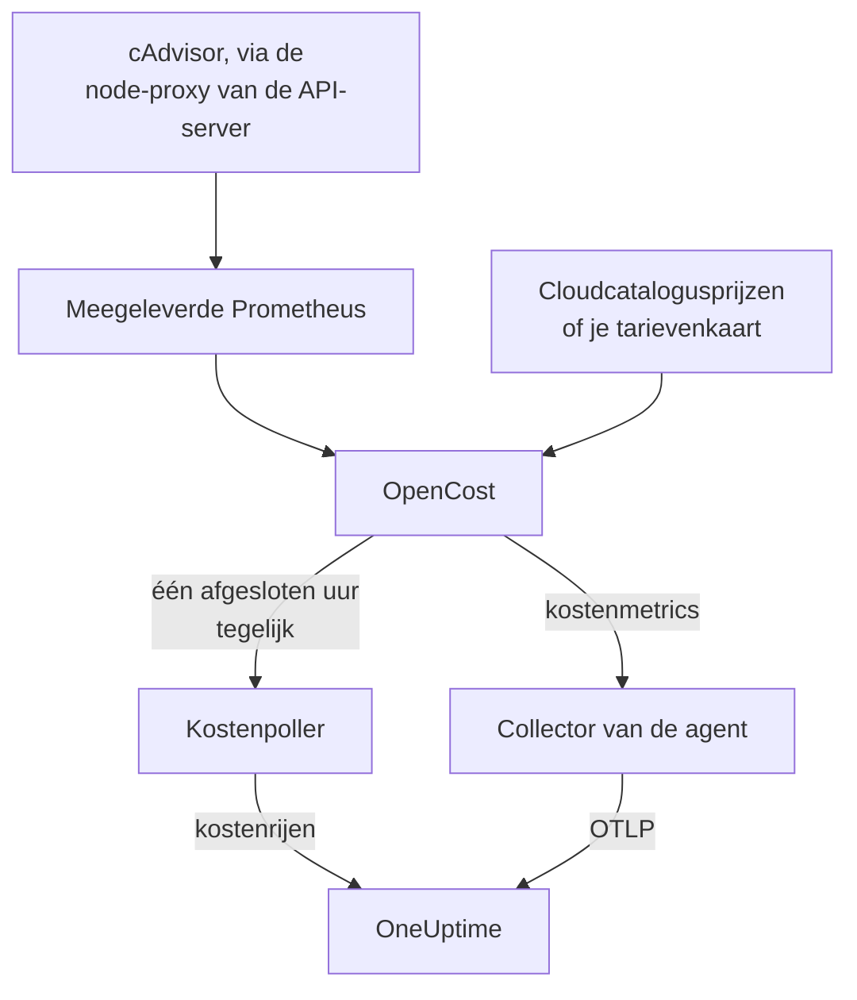

# Kubernetes-kostenobservability

Zie wat elke Kubernetes-workload kost — uitgaven per namespace, workload en pod, inactieve capaciteit en hoeveel van elk request wordt gebruikt — naast de metrics, logs en traces die de [Kubernetes-agent](/docs/telemetry/kubernetes-agent) al verzamelt. Eén Helm-waarde zet het aan, zonder cloudinloggegevens, en de pagina **Costs** van het cluster vertelt je daarna welke requests kleiner kunnen.

:::cards
- [Inschakelen](#kostenobservability-inschakelen): Eén `helm upgrade`.
- [Je eigen engine gebruiken](#draai-je-al-kubecost-of-opencost): Wijs de agent naar Kubecost of OpenCost.
- [Right-sizing](#right-sizing): Aanbevelingen voor requests, en hoe ze tot stand komen.
- [Problemen oplossen](#problemen-oplossen): Lege pagina's, ontbrekende aanbevelingen.
:::

## Hoe het werkt

Met `cost.enabled=true` draait de chart vier dingen naast de agent:



1. **OpenCost**, de opensource-kostenengine (Apache-2.0, CNCF; het [cost-model](https://github.com/kubecost/cost-model) waarop ook Kubecost draait). Hij bewaakt het cluster, prijst je nodes, volumes en load balancers en berekent wat elke workload kost.
2. **Een kleine Prometheus**, die OpenCost nodig heeft voor de gebruiks- en prijsgeschiedenis. Hij draait één replica, bewaart 7 dagen geschiedenis en scrapet precies twee doelen: cAdvisor via de node-proxy van de API-server, en OpenCost zelf (dat zijn eigen metrics voor resource-requests uitgeeft, dus kube-state-metrics is er niet bij betrokken). Hij wordt nooit buiten het cluster beschikbaar gesteld, en zijn gegevens verlaten het cluster nooit.
3. **De kostenpoller** (`cost.agent`). Eén keer per afgesloten uur leest hij de Allocation API van OpenCost en stuurt hij per workload één kostenrij naar OneUptime: CPU, geheugen, GPU, volumes, netwerk, load balancers en inactiviteit, met efficiëntie. Elk uur wordt één keer verstuurd; de server slaat een uur over dat hij al heeft, dus een herstart kan uitgaven niet dubbel tellen.
4. **Een scrape van kostenmetrics** (`cost.metrics`). De collector van de agent scrapet de kostenmetrics van OpenCost en stuurt ze mee met de rest van de metrics van het cluster.

OpenCost prijst nodes op basis van de openbare catalogusprijzen van je cloudprovider (AWS, Google Cloud, Azure), zonder inloggegevens. Clusters zonder cloudcatalogusprijs stellen in plaats daarvan een [tarievenkaart](#prijzen-voor-on-premises-en-bare-metal) in.

## Kostenobservability inschakelen

:::steps
### De agent upgraden met cost.enabled

```bash
helm upgrade kubernetes-agent oneuptime/kubernetes-agent \
  --namespace oneuptime-agent \
  --reset-then-reuse-values \
  --set cost.enabled=true
```

Dat is een volledige installatie: twee kleine extra pods, OpenCost en zijn Prometheus. Heb je de agent onder een andere releasenaam of namespace geïnstalleerd, gebruik dan de jouwe (`helm list -A | grep kubernetes-agent` toont ze).

### Wachten op het eerste afgesloten uur

De eerste kosten verschijnen nadat het eerste volledige uur is afgesloten, en OpenCost heeft na het opstarten een paar minuten nodig om zijn eerste uur te prijzen.

### De kostenpagina's openen

- **Producten → Infrastructuur → Kubernetes → Costs** toont de uitgaven van alle clusters in het project.
- Op een cluster toont **Costs** het verloop van de uitgaven, **Spend by Namespace** met de verdeling over CPU, geheugen en opslag, **Spend by Workload**, inactieve uitgaven, efficiëntie en de kaart **Right-Sizing**.
:::

De kostenmetrics (`node_total_hourly_cost`, `pv_hourly_cost` en de rest) zijn gewone metrics: ze staan in de metricverkenner, op aangepaste dashboards en in metricmonitors. Voor een kant-en-klaar dashboard ga je naar **Producten → Dashboards**, selecteer je **Dashboard aanmaken** en kies je **Kubernetes Cost Dashboard**: het verloop van de uurkosten van nodes, eenheidskosten voor CPU en geheugen, en uitgaven aan volumes en load balancers.

## Draai je al Kubecost of OpenCost?

Wijs de agent in plaats daarvan naar je eigen engine, dan wordt er niets meegeleverd:

```bash
helm upgrade kubernetes-agent oneuptime/kubernetes-agent \
  --namespace oneuptime-agent \
  --reset-then-reuse-values \
  --set cost.enabled=true \
  --set cost.engine.url=http://kubecost-cost-analyzer.kubecost.svc.cluster.local:9090
```

| Engine | Gebruikelijke service-URL |
| --- | --- |
| OpenCost | `http://opencost.opencost.svc.cluster.local:9003` |
| Kubecost | `http://kubecost-cost-analyzer.kubecost.svc.cluster.local:9090` |

Het pad van de Allocation API wordt vanzelf gevonden (`/model/allocation` voor Kubecost, `/allocation/compute` of `/allocation` voor OpenCost). Stel `cost.engine.allocationPath` alleen in bij een ongebruikelijke installatie. Stel voor geheugenaanbevelingen ook `cost.engine.prometheusUrl` in (zie [De gegevens erachter](#de-gegevens-erachter)).

## Prijzen voor on-premises en bare metal

Clusters waarvan de nodes geen openbare cloudcatalogusprijs hebben, kunnen een tarievenkaart instellen. OpenCost prijst dan elke resource op basis van deze bedragen, allemaal in USD per resource-uur:

```yaml title="values.yaml"
cost:
  enabled: true
  opencost:
    customPricing:
      enabled: true
      cpuPerCoreHour: "0.031611"       # ~$23 per core-month
      ramPerGiBHour: "0.004237"        # ~$3 per GiB-month
      storagePerGBHour: "0.00005479452" # ~$0.04 per GB-month
      gpuPerHour: "0.95"
```

## Instellingen die het weten waard zijn

Allemaal optioneel; de `values.yaml` van de chart bevat de volledige lijst:

```yaml title="values.yaml"
cost:
  agent:
    windowSeconds: 3600   # allocation window length (hourly = native)
    includeIdle: true     # ship the engine's __idle__ allocation
    currency: USD         # currency code shown in the UI (informational)
  prometheus:
    retention: 7d         # bundled TSDB history; right-sizing reads peaks back over days
    persistence:
      enabled: false      # set true for a small PVC; emptyDir otherwise
  metrics:
    enabled: true         # cost metrics for dashboards / Metric Explorer
    scrapeInterval: 60s
```

## Right-sizing

De kaart **Right-Sizing** op de pagina **Costs** van een cluster beveelt een CPU- en een geheugen-request aan voor elke container waarvan hij genoeg geschiedenis heeft, gerangschikt op hoeveel elke wijziging per maand bespaart.

Een aanbeveling is de waargenomen vraag plus 25% marge, afgerond op een waarde die je in een manifest kunt plakken (10m CPU, 16Mi geheugen):

- CPU wordt gedimensioneerd op basis van het 95e percentiel van het gemiddelde gebruik per uur: hoog genoeg om echte belasting te dekken, laag genoeg dat één piek het request niet een maand lang opblaast.
- Geheugen wordt gedimensioneerd op basis van de piek van de working set, nooit op een gemiddelde (zie [De gegevens erachter](#de-gegevens-erachter)).

Requests worden aanbevolen; limits niet. Een request is wat de scheduler reserveert en waarop de rekening wordt gebaseerd, dus het is het getal dat de kosten beweegt. Een limit is een beslissing over of een container die zich misdraagt moet worden geknepen of beëindigd, en die beslissing kunnen gebruiksgegevens niet voor je nemen.

Elke container wordt vergeleken met zijn huidige request:

| Oordeel | Wat het betekent |
| --- | --- |
| Overgeprovisioneerd | Hij reserveert duidelijk meer dan hij gebruikt. Hier komen de besparingen vandaan. |
| Ondergeprovisioneerd | Hij reserveert minder dan hij gebruikt, dus hij wordt geknepen of loopt risico op een OOM-kill. Dit oplossen kost geld, en de kaart toont dat als een stijging. |
| Geen request ingesteld | Er valt niets te verkleinen, maar de scheduler kan de container niet veilig plaatsen, en hij wordt onder druk als eerste uitgezet. |

Een container binnen 15% van zijn aanbeveling telt als goed gedimensioneerd en wordt weggelaten: niemand zou een manifest moeten bewerken om 3% van een request af te halen.

Twee waarborgen houden het advies eerlijk. Een workload heeft minstens 24 uur aan kostenvensters nodig voordat hij überhaupt wordt gedimensioneerd, omdat een venster van vier uur een nachtelijke batchjob in rust kan treffen en kan adviseren hem tot niets te verkleinen. En besparingen worden doorgerekend op basis van de lengte van het venster waar je naar kijkt, niet op basis van het aantal rijen, dus de besparing van een Deployment wordt niet vermenigvuldigd met zijn aantal replica's. De schatting gaat ervan uit dat de uitgaven meeschalen met wat de engine heeft toegewezen, namelijk `max(request, usage)`; voor een overgeprovisioneerde container is dat het request, dus het besparingsbedrag is exact.

### De gegevens erachter

Naast de uitgaven verzamelt de poller wat een aanbeveling nodig heeft: de CPU- en geheugen-requests, limits en het gebruik van elke container.

Geheugen heeft nog een bron nodig. De Allocation API meldt alleen een gemiddelde per venster, en een uurgemiddelde verbergt de piek die een container met een OOM-kill neerhaalt, dus geheugen daarop dimensioneren zou gevaarlijk zijn. De poller leest in plaats daarvan de geheugenpiek van elke container uit Prometheus, gekoppeld op `(namespace, pod, container)`:

- Met de meegeleverde engine (de standaard) gebruikt hij de eigen Prometheus van de chart. Niets om in te stellen.
- Met je eigen engine (`cost.engine.url`) wijs je `cost.engine.prometheusUrl` naar een Prometheus die cAdvisor scrapet, en stel je `cost.engine.prometheusCadvisorJob` in als de scrapejob daarvan niet `kubernetes-nodes-cadvisor` heet.
- Zonder Prometheus werken CPU-aanbevelingen nog steeds, op basis van de opgeslagen uurgemiddelden, en geheugenaanbevelingen worden weggelaten in plaats van geraden.

Een storing van Prometheus stopt het verzamelen van uitgaven nooit: pieken zijn een extraatje, en een uur wordt zonder ze verstuurd. CPU gebruikt bewust geen Prometheus: een te groot CPU-request knijpt alleen, waar een te klein geheugen-request een container beëindigt, dus de uurgemiddelden zijn veilig voor CPU, en de CPU-rate van elke container over een heel cluster opvragen is zwaar genoeg om een kleine Prometheus omver te halen.

## Waarschuwen op kosten

De kostenmetrics zijn gewone metrics, dus een [metricmonitor](/docs/monitor/metrics-monitor) kan erop waarschuwen zoals op al het andere: bijvoorbeeld wanneer het gemiddelde van `node_total_hourly_cost` boven een budget stijgt, of wanneer `pv_hourly_cost` verschijnt voor een volumeklasse die in een cluster niet zou moeten bestaan.

## Gegevensmodel en bewaartermijn

Kostenrijen worden opgeslagen in ClickHouse, één per cluster, venster, namespace, controller, pod en container. Ze volgen de telemetriebewaartermijn van het cluster: de `retainTelemetryDataForDays` van het cluster, of de gegevensbewaartermijn van het project als die niet is ingesteld. Inactieve en niet-toegewezen capaciteit worden opgeslagen als gewone rijen onder de namespaces `__idle__` en `__unallocated__`, zodat ze groeperen en filteren zoals workloaduitgaven.

## Problemen oplossen

:::details De kostenpagina's zijn leeg
Lees de logs van de kostenpoller: `kubectl logs -n oneuptime-agent deploy/kubernetes-agent-cost`. (De deployment heet `<release>-kubernetes-agent-cost` als de releasenaam geen `kubernetes-agent` bevat; `kubectl get deploy -n oneuptime-agent` toont ze.) `HTTP 401` betekent dat OneUptime de ingestiesleutel heeft geweigerd. `did not answer any known allocation path` betekent dat de engine nog niet draait (de meegeleverde OpenCost heeft een paar minuten nodig om zijn eerste uren te prijzen) of dat `cost.engine.url` onjuist is.
:::

:::details De meegeleverde OpenCost is niet gereed
Lees zijn logs: `kubectl logs -n oneuptime-agent deploy/kubernetes-agent-opencost`. Die vermelden welke cloudprovider hij heeft gedetecteerd en of zijn prijsgegevens zijn geladen.
:::

:::details Het OpenCost-log meldt mkdir /var/configs: permission denied
Een oudere chart draaide OpenCost zonder beschrijfbare configuratiemap, dus `Error downloading default pricing data` liet zijn Allocation API niet antwoorden en de poller stilvallen, terwijl de pod `Running` bleef, `/healthz` groen bleef en de kostenmetrics van de nodes gewoon werden gepubliceerd. Huidige charts lossen dit op: voer `helm repo update` uit en upgrade daarna met `--reset-then-reuse-values`. Kostenrijen verschijnen bij de volgende poll.
:::

:::details Het Kubernetes Cost Dashboard toont geen gegevens
Het sjabloon leest de gescrapete kostenmetrics: controleer of `cost.metrics.enabled` op `true` staat.
:::

:::details De kaart Right-Sizing is leeg
Ofwel is het tijdsbereik korter dan de 24 uur die een aanbeveling nodig heeft (verbreed het), ofwel zit elke container al binnen 15% van zijn aanbevolen request, wat de kaart dan meldt.
:::

:::details Geheugenaanbevelingen tonen -, maar CPU-aanbevelingen werken
Er heeft geen geheugenpiek OneUptime bereikt, dus het geheugen is niet gedimensioneerd in plaats van op basis van een gemiddelde geraden. Stel met je eigen engine `cost.engine.prometheusUrl` in. De kaart meldt om hoeveel containers het gaat.
:::

:::details De cijfers wijken af van de eigen interface van de engine
OneUptime neemt de afstemmingscorrecties van de engine op in elk kostenonderdeel en stuurt hele, afgesloten uren: de uitgaven van het huidige uur verschijnen nadat het is afgesloten.
:::

:::details De meegeleverde Prometheus is opnieuw gestart
Met de standaardopslag `emptyDir` verliest een herstart een paar uur gebruiksgeschiedenis, dus de kosten van die uren kunnen lager uitvallen. Stel `cost.prometheus.persistence.enabled=true` in als dat voor je uitmaakt.
:::

## Volgende stappen

:::cards
- [Kubernetes-agent](/docs/telemetry/kubernetes-agent): Installeer de agent, en al het andere dat hij verzamelt.
- [Metrics-monitor](/docs/monitor/metrics-monitor): Waarschuw wanneer de uitgaven een budget overschrijden.
- [Kubernetes-monitor](/docs/monitor/kubernetes-monitor): Waarschuw ook op de gezondheid van het cluster.
:::
