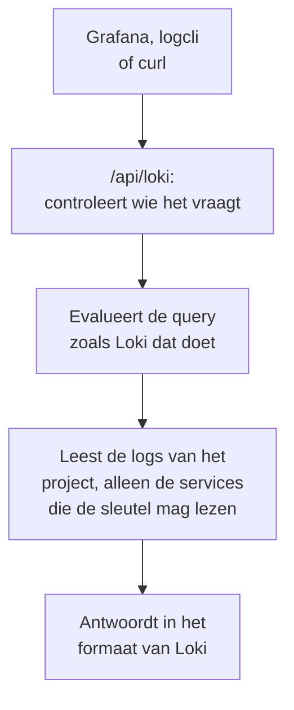

# Logs opvragen met LogQL

LogQL is de querytaal van Grafana Loki. OneUptime beantwoordt de query-API van Loki over de logs van uw project, zodat de Loki-gegevensbron van Grafana, logcli of elke Loki-client ze leest, en de dashboards en opgeslagen query's die u voor Loki schreef blijven werken.

:::cards
- [Grafana koppelen](#grafana-koppelen): OneUptime toevoegen als Loki-gegevensbron.
- [Hoe logs hun labels krijgen](#hoe-logs-hun-labels-krijgen): Wat een streamselector vindt.
- [Wat LogQL ondersteunt](#wat-logql-ondersteunt): Logquery's, parsers en metriekquery's.
- [Limieten](#limieten): Wat een query mag lezen, en hoe vaak.
:::

## Hoe het werkt

Grafana vraagt OneUptime zoals het Loki vraagt. OneUptime controleert of de API-sleutel de logs van het project mag lezen, leest alleen de services die hij mag lezen en evalueert de query zoals Loki dat doet.



## Voordat u begint

- **Binnenkomende logs.** Stuur ze met [OpenTelemetry](/docs/telemetry/open-telemetry), of vanuit Promtail, Grafana Alloy, Fluent Bit of Vector via [de push-API van Loki](/docs/telemetry/compatible-endpoints).
- **Een API-sleutel van het project die logs leest**, met de rol Projecteigenaar, Projectbeheerder, Projectlid, Kijker, Telemetriebeheerder, Telemetrielid of Telemetriekijker, of de machtiging Read Logs. Een sleutel die tot bepaalde services is beperkt, leest alleen hun logs. Zie [Een API-sleutel aanmaken](/docs/api-reference/api-reference#een-api-sleutel-aanmaken). In OneUptime Cloud hebben API-sleutels het abonnement **Growth** nodig.
- **Geen ingestiesleutel.** Een ingestiesleutel stuurt telemetrie en leest niets, dus Grafana kan er niet mee inloggen.

## Grafana koppelen

:::steps
### Een API-sleutel aanmaken

Open in OneUptime **Projectinstellingen → Geavanceerd → API-sleutels** en klik op **API-sleutel aanmaken**. Geef de sleutel een rol die telemetrie mag lezen, of de machtiging Read Logs.

### Een Loki-gegevensbron toevoegen

Open in Grafana **Connections → Data sources → Add data source** en kies **Loki**.

### De URL invullen

Stel **URL** in op uw OneUptime-adres, gevolgd door `/api/loki`. In OneUptime Cloud is dat `https://oneuptime.com/api/loki`.

### De API-sleutel meesturen

Voeg onder **HTTP headers** de header `Authorization` toe, met als waarde `Bearer` gevolgd door een spatie en uw API-sleutel. Basic-authenticatie werkt ook: een willekeurige gebruikersnaam, met de API-sleutel als wachtwoord.

### Opslaan en testen

Klik op **Save & test**. Grafana voert een query uit en meldt dat de gegevensbron werkt.
:::

Explore, het logvolume boven de regels, de labelbrowsers en dashboards lezen OneUptime daarna zoals ze Loki lezen. logcli en elke andere Loki-client werken op dezelfde manier. Met curl:

```bash title="Query OneUptime's Loki API"
curl -G -H "Authorization: Bearer $ONEUPTIME_API_KEY" \
  "https://oneuptime.com/api/loki/loki/api/v1/query_range" \
  --data-urlencode 'query={service_name="checkout"} |= "error"'
```

## Hoe logs hun labels krijgen

Een streamselector vindt de attributen van een log, genoemd zoals Loki 3 OpenTelemetry-logs noemt:

| In OneUptime | In LogQL |
| --- | --- |
| Een resource-attribuut `service.name` | Het label `service_name` |
| Een resource-attribuut `k8s.pod.name` | Het label `k8s_pod_name` |
| Een attribuut `http.method` | Het label `http_method` |
| Een label dat een Loki-client stuurde, zoals `job` | Het label `job` |
| De ernst van de log | Het label `detected_level`: `trace`, `debug`, `info`, `warn`, `error`, `fatal` of `unknown` |

- **Elk attribuut is een label.** Een logquery antwoordt met één stream per labelset, dus logs met verschillende attributen zijn verschillende streams, zoals Loki 3 antwoordt voor logs met gestructureerde metadata.
- **Het eigen attribuut van een log gaat voor** als zijn resource er een met dezelfde naam heeft.
- **Een selector noemt een waarde**, zoals Loki vraagt: minstens één matcher waaraan een log zonder het label niet voldoet, zoals `{service_name="checkout"}` of `{service_name=~"check.+"}`.

Een paar query's om mee te beginnen:

```text title="LogQL"
# The checkout service's lines that say error
{service_name="checkout"} |= "error"

# Requests slower than 250ms, read from JSON lines
{service_name="checkout"} | json | duration > 250ms

# Error logs per second, by service
sum by (service_name) (rate({detected_level="error"} [5m]))
```

## Wat LogQL ondersteunt

- **Logquery's**: streamselectors met `=`, `!=`, `=~` en `!~`; regelfilters `|=`, `!=`, `|~` en `!~`, met `or`; de parsers `json` en `logfmt`; labelfilters op tekst, getallen, duren en groottes, met `and`, `or` en `__error__`; `line_format` met `{{.label}}`; `drop`, `keep` en `decolorize`.
- **Metriekquery's**: `count_over_time`, `rate`, `bytes_over_time`, `bytes_rate` en `absent_over_time`; over een label dat met `unwrap` is genomen (met `duration()` of `bytes()`), `rate`, `sum_over_time`, `avg_over_time`, `min_over_time`, `max_over_time`, `first_over_time`, `last_over_time`, `stddev_over_time`, `stdvar_over_time` en `quantile_over_time`; en `offset`.
- **Daaromheen**: `sum`, `avg`, `min`, `max`, `count`, `stddev`, `stdvar`, `topk` en `bottomk`, met `by` of `without`; rekenkunde, vergelijkingen (met `bool`), `and`, `or` en `unless`, met `on`, `ignoring`, `group_left` en `group_right`; `sort`, `sort_desc`, `label_replace` en `vector()`.

De parsers `pattern`, `regexp` en `unpack`, `label_format`, `json` met benoemde velden, `ip()`-filters en `line_format`-sjablonen die verder gaan dan `{{.label}}` zijn nog niet beschikbaar. Een query die er een gebruikt, wordt geweigerd met een melding die het noemt.

## De API

De API beantwoordt de routes van de HTTP-API van Loki, met `GET` of `POST`, onder `/api/loki`:

| Route | Wat ze beantwoordt |
| --- | --- |
| `/loki/api/v1/query_range` | De regels van een logquery van `start` tot `end`, of een metriekquery bij elke `step`. |
| `/loki/api/v1/query` | Een metriekquery op één moment (`time`, standaard nu). |
| `/loki/api/v1/labels` | Labelnamen, van de logs die `query` selecteert of van alle logs. |
| `/loki/api/v1/label/<name>/values` | De waarden van één label. |
| `/loki/api/v1/series` | De labelsets van de logs die `match[]` selecteert. |

Tijden zijn nanoseconden sinds 1970, Unix-seconden of RFC 3339, en een bereik is het uur vóór `end`, tenzij het iets anders zegt. Een logquery antwoordt met `limit` regels, standaard 100, de nieuwste eerst, behalve met `direction=forward`. Antwoorden zijn in het formaat van Loki, en fouten zijn platte tekst, zoals Loki ze schrijft. `/loki/api/v1/status/buildinfo` antwoordt als een Loki 3-server.

## Limieten

Elke query is begrensd, zodat een dashboard met veel panelen OneUptime niet kan overbelasten:

| Limiet | Waarde |
| --- | --- |
| Regels waarmee een logquery antwoordt | 5.000 |
| Logs die een logquery leest, als filters na zijn parsers er een paar laten vallen | 20.000 |
| Logs die een metriekquery zelf leest, als ClickHouse ze niet kan tellen | 100.000 |
| Reeksen waarmee een metriekquery antwoordt | 500 |
| Punten in één reeks van een bereikquery | 11.000 |
| Logs die één leesactie teruggeeft | 64 MB |
| Tijd die een leesactie mag duren | 30 seconden |
| Query's die een project per minuut mag sturen | 1.200 |

Een metriekquery waarvan de pijplijn alleen uit regelfilters bestaat, zoals `sum(count_over_time({service_name="checkout"} |= "error" [5m]))`, wordt geteld waar de logs staan, en leest dus helemaal geen regels.

## Problemen oplossen

:::details Grafana meldt dat de gegevensbron niet werkt
Controleer of de URL eindigt op `/api/loki`, en of de header `Authorization` `Bearer`, een spatie en de API-sleutel bevat. Een ingestiesleutel, of een API-sleutel zonder rol die logs mag lezen, wordt geweigerd: geef de sleutel zo'n rol in **Projectinstellingen → Geavanceerd → API-sleutels**.
:::

:::details "queries require at least one regexp or equality matcher that does not have an empty-compatible value"
De selector vindt logs zonder een waarde te noemen, zoals `{service_name=~".*"}`. Voeg een matcher toe die er een noemt, zoals `{service_name="checkout"}`.
:::

:::details "This project sent more queries this minute than OneUptime answers."
De dashboards en clients van het project stuurden deze minuut meer dan 1.200 query's naar de API. De panelen laden de volgende minuut weer; vernieuw dashboards minder vaak om eronder te blijven.
:::

## Volgende stappen

:::cards
- [Logboekverkenner](/docs/telemetry/logs-explorer): Logs doorzoeken en filteren zonder een query te schrijven.
- [PromQL](/docs/telemetry/promql): Metrieken opvragen met PromQL, ook vanuit de Prometheus-gegevensbron van Grafana.
- [Logs-monitor](/docs/monitor/logs-monitor): Waarschuwen bij logvolume en -inhoud.
:::
