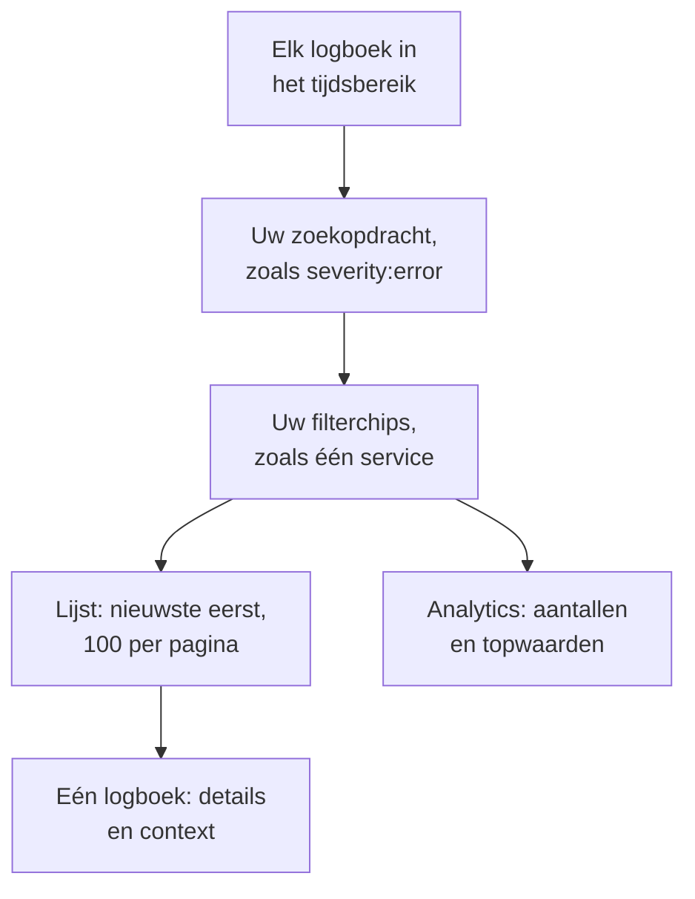

# Logboekverkenner

In de logboekverkenner doorzoekt en leest u de logboeken die uw services, hosts en agents naar OneUptime sturen. Breng miljoenen regels terug tot de paar die ertoe doen, volg nieuwe regels terwijl ze binnenkomen, zet ze in grafieken en bewaar de weergaven waar uw team steeds naar terugkeert.

:::cards
- [Een logregel vinden](#een-logregel-vinden): Een tijdsbereik, een zoekopdracht en een paar filters.
- [Een logboek lezen](#een-logboek-lezen): De attributen, de trace en de regels eromheen.
- [Logboeken live volgen](#logboeken-live-volgen): Nieuwe regels elke 10 seconden.
- [Een weergave opslaan](#een-weergave-opslaan): Een zoekopdracht, de filters en de kolommen voor iedereen bewaren.
- [Inzichten in logboeken](#inzichten-in-logboeken): Belangrijkste fouten, ernstniveaus en wie wat logt.
- [Fout-, ontbrekende en luidruchtige logs vinden en oplossen met AI](#fout-ontbrekende-en-luidruchtige-logs-vinden-en-oplossen-met-ai): Pull requests die fouten oplossen, loggen wat niet gelogd wordt en luidruchtige regels stiller maken.
:::

## Hoe de verkenner uw logboeken beperkt

Alles op het tabblad **Kijker** werkt met één verzameling logboeken: die in het tijdsbereik die passen bij uw zoekopdracht en bij elke filterchip. Wijzig er één, en de lijst, de volumegrafiek en de aantallen in de zijbalk veranderen samen mee.

De verkenner heeft vijf tabbladen:

| Tabblad | Waarvoor het dient |
| --- | --- |
| **Kijker** | Logboeken zoeken, filteren en lezen. Opent op het afgelopen uur, nieuwste eerst, 100 logboeken per pagina. |
| **Inzichten** | Wat uw services in een tijdsbereik gelogd hebben, en wat er misging. |
| **AI** | De foutlogs, de ontbrekende logging en de luidruchtige logs die OneUptime in uw logs vindt, en wat OneUptime AI eraan deed. Zie [Fout-, ontbrekende en luidruchtige logs vinden en oplossen met AI](#fout-ontbrekende-en-luidruchtige-logs-vinden-en-oplossen-met-ai). |
| **Installatiegids** | Hoe u logboeken verstuurt met OpenTelemetry, Fluent Bit of Fluentd, met een van uw [ingestiesleutels](/docs/telemetry/ingestion-keys). |
| **Instellingen** | Wat er met logboeken gebeurt als ze binnenkomen: **Pipelines**, **Drop-filters**, **Scrub-regels** en **Opnameregels**. |

## Voordat u begint

- **Binnenkomende logboeken.** Stuur ze met [OpenTelemetry](/docs/telemetry/open-telemetry), [Fluent Bit](/docs/telemetry/fluentbit), [Fluentd](/docs/telemetry/fluentd) of [Syslog](/docs/telemetry/syslog). Het tabblad **Installatiegids** toont de configuratie voor uw taal of collector.
- **Een rol die telemetrie mag lezen.** Project Owner, Project Admin, Project Member, Viewer, Telemetry Admin, Telemetry Member of Telemetry Viewer, of een aangepaste rol met de machtiging Read Telemetry Service Log. Het bereik ervan bepaalt van wie u de logboeken ziet: zie [Telemetrie](/docs/permissions/index#telemetrie).

## Een logregel vinden

:::steps
### De Kijker openen

Ga naar **Producten → Observability → Logboeken**. De **Kijker** toont de logboeken van het afgelopen uur, nieuwste eerst, met **Tijd**, **Service**, **Ernst** en **Bericht**.

### Het tijdsbereik kiezen

Kies een bereik in de tijdkiezer, of sleep over de volumegrafiek boven de lijst om in te zoomen op een piek. Dubbelklik op de grafiek om weer uit te zoomen. Zie [Inzoomen op een tijdsbereik](/docs/telemetry/charts-and-time-ranges).

### Zoeken

Typ een zoekopdracht in het zoekvak en druk op Enter, bijvoorbeeld `severity:error service:checkout timeout`. Losse woorden doorzoeken het bericht, en `@key:value` doorzoekt een attribuut. Zie [Zoeksyntaxis](/docs/telemetry/search-syntax#logboeken).

### Beperken met filters

Klik op een waarde in de zijbalk **Filters** om die als chip toe te voegen: een ernstniveau, een service, of een host, cluster of andere bron die logboeken stuurde. Elke waarde laat zien hoeveel logboeken hem dragen. Tik op een telefoon op **Filters** om de zijbalk te openen.

### Een logboek openen

Klik op een rij. De details openen naast de lijst.
:::

Uw zoekopdracht, uw chips en het tijdsbereik staan in het adres van de pagina, dus een vernieuwing, een bladwijzer of een gedeelde link opent dezelfde logboeken.

## Een logboek lezen

Het detailpaneel heeft twee tabbladen:

| Tabblad | Wat het toont |
| --- | --- |
| **Details** | De **Logtekst**, de **Trace-ID**, **Span-ID** en **Sessie** als het logboek die heeft, en de **Attributen**, als lijst of als JSON. |
| **Context** | Het logboek tussen zijn buren. **Nearby (service + time)** toont de vijf regels ervoor en erna van dezelfde service, en **This trace** toont tot 100 logboeken van de trace. |

- Klik op de trace-ID om het hele verzoek te openen in de [Traceverkenner](/docs/telemetry/traces-explorer).
- Wijs een attribuut aan en klik op het filterpictogram om op die waarde te zoeken, of kopieer hem. U kunt alle attributen tegelijk als JSON kopiëren.
- **This trace** verschijnt alleen bij een logboek dat binnen een trace is geschreven.

## Logboeken live volgen

Klik op **Live** boven de lijst. De verkenner springt naar de eerste pagina, gesorteerd van nieuw naar oud, en kijkt elke 10 seconden of er nieuwe logboeken zijn, zodat regels verschijnen terwijl uw services ze schrijven.

De livemodus zet zichzelf uit als u de zoekopdracht, een filter of het tijdsbereik wijzigt, of naar een andere resultatenpagina gaat: hij toont alleen de nieuwste logboeken. Klik opnieuw op **Live** om verder te gaan.

## Kolommen kiezen en exporteren

- **Kolommen** kiest wat de lijst toont. **Tijd**, **Service**, **Ernst** en **Bericht** staan vooraan; voeg **Trace-ID**, **Span-ID** of een willekeurig attribuut toe, verplaats kolommen omhoog en omlaag, of ga terug naar de standaard met **Opnieuw instellen**.
- **Export** downloadt de logboeken van de pagina die u bekijkt. **Exporteren als CSV** schrijft de kolommen die u toont; **Exporteren als JSON** schrijft elk veld van elk logboek, met al zijn attributen.
- Wijs de koprij aan en sleep de lijn aan het eind van een kolomnaam om de kolom breder of smaller te maken, of dubbelklik op de lijn om de kolom aan de inhoud aan te passen. De lijst onthoudt uw breedtes in deze browser; **Kolombreedtes terugzetten**, aan het eind van de koprij, geeft elke kolom zijn eigen breedte terug.

## Een weergave opslaan

Een opgeslagen weergave bewaart een zoekopdracht, de filterchips, het tijdsbereik, de kolommen, de sortering en de paginagrootte onder een naam.

:::steps
### De weergave inrichten

Zoek, filter en kies de kolommen die u wilt bewaren.

### Opslaan

Open **Opgeslagen weergaven** en klik op **+ Huidige weergave opslaan**. Vul een **Naam** in, vink **Instellen als standaard** aan als deze weergave moet openen wanneer iemand de logboeken opent, en klik op **Weergave opslaan**.

### Gebruiken

Kies de weergave in **Opgeslagen weergaven** om hem toe te passen, en **Weergave wissen** om terug te gaan naar het afgelopen uur zonder filters. Wijs een weergave in de lijst aan om te **Bewerken** of te **Verwijderen**, of, zolang hij is toegepast, om hem met uw wijzigingen te **Bijwerken**.
:::

Opgeslagen weergaven horen bij het project, dus iedereen erin ziet dezelfde lijst. Een doorlopend bereik zoals het afgelopen uur blijft doorlopend: de weergave toont het uur voordat u hem opent, niet het uur waarin u hem opsloeg. Zolang het project geen standaardweergave heeft, wordt de volgende opgeslagen weergave de standaard, en een project heeft telkens maar één standaard.

## Uw logboeken in grafieken zetten

Zet de lijst op **Analytics** om logboeken te tellen in plaats van te lezen. Kies een tijdreeks, een toplijst of een tabel; tel elk logboek, of de unieke waarden van één veld; en groepeer op ernst, service, trace, span of een willekeurig attribuut, en daarna op een tweede veld. Een toplijst of een tabel toont de bovenste 5, 10, 25 of 50 groepen.

Klik op **Lijst** om terug te gaan naar de regels zelf.

## Bijbehorende traces en metrieken openen

De knoppen **Traces** en **Metrieken** naast **Opgeslagen weergaven** openen de [Traceverkenner](/docs/telemetry/traces-explorer) of de [Metriekverkenner](/docs/telemetry/metrics-explorer) voor hetzelfde tijdvenster, met zoveel van uw filtering als die verkenner kan gebruiken. Wijs een knop aan om te zien wat hij niet kan meenemen.

## Inzichten in logboeken

Het tabblad **Inzichten** toont wat uw services in een tijdsbereik gelogd hebben, en wat er misging. Beperk het tot bepaalde services, hosts of clusters met de keuzelijst naast de tijdkiezer.

| Paneel | Wat het toont |
| --- | --- |
| Overzichtskaarten | **Totaal aantal logboeken**, **Fouten**, **Distinct errors** en **Reporting sources**. |
| **Severity distribution** | Hoe de logboeken over de ernstniveaus verdeeld zijn. |
| **Top errors** | De afzonderlijke berichten die met ernst Error of Fatal zijn gelogd, de meest voorkomende eerst. |
| **Sources reporting logs** | Het volume en het foutsignaal van elke service, host of andere bron. |

Selecteer een topfout om te zien wat er rond die fout gebeurde: wanneer hij optrad, wat de voorvallen gemeen hebben, waar hij optreedt, de traces die hem dragen en de nieuwste regels. **Open matching logs** opent ze in de **Kijker**, en **Explain with AI** opent [AI vragen](/docs/ai/ask-ai) met de fout en het bewijs als prompt die u kunt aanpassen.

## Fout-, ontbrekende en luidruchtige logs vinden en oplossen met AI

Elk uur doorzoekt OneUptime de logs van het afgelopen uur van elke service op fouten die ze steeds opnieuw logt, storingen die ze niet logt en regels die haar logs overspoelen, en legt wat het vindt vast als AI-inzichten, met het bewijs. Daarna onderzoekt OneUptime AI elk ervan en opent een pull request die het oplost. Er wordt nooit iets samengevoegd: uw team beoordeelt elke pull request.

OneUptime legt drie soorten bevindingen vast:

| Bevinding | Wanneer OneUptime die vastlegt | De pull request |
| --- | --- | --- |
| **Foutlog** | Een service logde in het uur één bericht 20 keer of vaker op Error of Fatal, een bericht met eigen woorden en zonder uitzondering. Een bericht dat met een uitzondering, of met een stacktrace erin, wordt gelogd, wordt in plaats daarvan gevolgd in [Uitzonderingen volgen](/docs/telemetry/exceptions). | Lost op waarom de fout wordt gelogd, of logt hem op het niveau dat hij verdient. |
| **Ontbrekende logging** | Minstens 20 spans van een bewerking zijn in het uur mislukt, 5% of meer ervan, terwijl minstens 100 logs van de service een trace-ID dragen, en geen van de 20 meest recente mislukte verzoeken van de bewerking heeft een logregel geschreven. Of een service stuurde in het uur 500 of meer logs en 100 of meer spans, en minder dan 1% van haar logs draagt een trace-ID. | Logt de storing waar die gebeurt, of laat de logs van de service de trace-ID dragen. |
| **Luidruchtige log** | Eén bericht dat onder Error wordt gelogd, is in het uur 25% of meer van de regels van een service, zo'n 10.000 regels of meer. | Logt de regel minder: op Debug, eenmaal per batch, of helemaal niet. |

Een bevinding bewaart een bericht als zijn patroon: de delen die van regel tot regel veranderen, zoals getallen en ID's, worden gemaskeerd. De pull request wordt gevraagd met dat patroon, nooit met een regel zoals die werd gelogd, en OneUptime AI krijgt de opdracht nooit geheimen of persoonsgegevens te loggen, en geen logregels naar de pull request te kopiëren.

OneUptime AI opent de pull request voor een foutlog pas zelf als het de schuldige code vindt. Een fout die van elders komt, zoals een afhankelijkheid die plat ligt, krijgt geen pull request, tenzij iemand er een vraagt met **Oplossen met AI**.

### Inschakelen

**Logboeken → AI → Instellingen** bevat de schakelaar **Fout-, ontbrekende en luidruchtige logs vinden en oplossen**, die voor nieuwe projecten aan staat. Staat **AI inschakelen** uit, dan worden fout-, ontbrekende en luidruchtige logs nog gevonden, maar doet OneUptime AI er niets mee. Om pull requests te openen heeft OneUptime AI een repository nodig die in [Code](/docs/ai/ai-agent) is gekoppeld: de pagina zegt eerst wat ontbreekt. De code van elke repository wordt gewijzigd op de Runner die de repository in Code kiest.

OneUptime AI opent zelf maximaal 5 pull requests per dag (UTC), voor alle telemetrie die het oplost samen, één per bevinding, en nooit meer dan de limiet van een repository voor open AI-pull requests.

### AI-regels

Zonder regel onderzoekt OneUptime AI elk probleem dat het in uw logs vindt meteen en opent een pull request voor elk probleem dat het kan oplossen. De **AI-regels** onder **Meer instellingen** beperken dat, in drie stappen:

| Stap | Wat die beslist |
| --- | --- |
| **Overeenkomst** | Welke services: de gekozen services, die met bepaalde labels of die waarvan de naam bij een patroon past. |
| **Onderzoeken** | **Meteen**, of **Alleen als het na een wachttijd nog gevonden wordt**: een probleem dat tijdens de wachttijd verdwijnt, wordt niet onderzocht. |
| **Herstel** | **Niet herstellen**, **Eerst om goedkeuring vragen** of **Herstellen zonder te vragen**. Eerst vragen laat de pull request aan een persoon over: de bevinding biedt **Oplossen met AI** aan. |

Onder **Meer velden** kiest een regel de coderepositories, de MCP-servers en de LLM-provider die OneUptime AI ervoor mag gebruiken. Is er niets gekozen, dan mag het ze allemaal gebruiken, en de standaard-LLM-provider van het project.

### Zien wat het deed

- **Logboeken → AI → Inzichten** toont wat OneUptime vond, elke bevinding met haar bewijs en **Openen in Logboeken**, dat de regels waar het om gaat, uit het uur waarin ze werd gevonden, in de **Kijker** opent. Een storing die geen logregel schrijft, heeft geen regels om te openen: **Openen in Traces** opent in plaats daarvan haar mislukte spans. Bij een foutlog stelt **Monitor maken** een logmonitor in die de regels van het bericht telt.
- **Logboeken → AI → Activiteit** toont elk onderzoek en elke pull request, nieuwste eerst, met hoe elk ervoor staat. Een afgerond onderzoek zegt ook wat OneUptime AI vond, zoals de oorzaak van een fout buiten de code, en daarom kreeg die foutlog niet vanzelf een pull request.
- In Code zegt de taak dat OneUptime haar startte, met een link naar haar bevinding, en de pull request zegt waarom hij werd geopend.

## Wat er met logboeken gebeurt als ze binnenkomen

Het tabblad **Instellingen** bevat de regels die OneUptime op elk logboek toepast voordat het wordt opgeslagen. Ze werken op de logboeken die daarna binnenkomen, niet op opgeslagen logboeken. Hoe lang elk logboek wordt bewaard, wordt ook bij aankomst bepaald: zie [Gegevensbewaring](/docs/telemetry/data-retention).

| Regel | Wat hij doet |
| --- | --- |
| **Drop-filters** | Logboeken weggooien die u niet wilt bewaren, of er alleen een steekproef van bewaren. Zie [Records weggooien of bemonsteren](/docs/telemetry/drop-filters-and-scrub-rules#records-weggooien-of-bemonsteren). |
| **Scrub-regels** | Gevoelige gegevens maskeren, zoals e-mailadressen en kaartnummers. Zie [Gevoelige gegevens opschonen](/docs/telemetry/drop-filters-and-scrub-rules#gevoelige-gegevens-opschonen). |
| **Pipelines** | Velden uit het bericht halen, de ernst corrigeren, attributen hernoemen. Zie [Logboekpipelines](/docs/telemetry/log-pipelines). |
| **Opnameregels** | Overeenkomende logboeken omzetten in metrieken. Zie [Opnameregels voor logboeken](/docs/telemetry/log-recording-rules). |

## Sneltoetsen

Druk in de Kijker op `?` om ze te zien.

| Toets | Wat hij doet |
| --- | --- |
| `j` / `k` | Naar het volgende of vorige logboek gaan. |
| Enter | Het geselecteerde logboek openen of sluiten. |
| Esc | Het detailpaneel sluiten. |
| `/` | Naar het zoekvak springen. |
| ⌘ + Enter of Ctrl + Enter | De zoekopdracht toepassen. |
| `?` | De sneltoetsen tonen of verbergen. |

## Problemen oplossen

:::details Er verschijnen geen logboeken
Vergroot eerst het tijdsbereik: de Kijker opent op het afgelopen uur. Is de lijst daarna nog leeg, vergelijk dan uw configuratie met de **Installatiegids** en controleer of het bereik van uw rol de service dekt die de logboeken stuurt.
:::

:::details De zoekopdracht meldt dat de tijd op was
Een zoekopdracht die langer dan 45 seconden duurt, wordt gestopt. Kies een korter tijdsbereik, of voeg een exacte waarde toe zoals een service, zodat OneUptime zijn index kan gebruiken. Zie [Zoeksyntaxis](/docs/telemetry/search-syntax#goed-om-te-weten).
:::

:::details Live schakelt zichzelf steeds uit
De livemodus volgt alleen de nieuwste logboeken, dus een andere zoekopdracht, filter, tijdsbereik of pagina zet hem uit. Klik opnieuw op **Live** zodra uw filters staan.
:::

## Volgende stappen

:::cards
- [Zoeksyntaxis](/docs/telemetry/search-syntax): Elk filter dat het zoekvak begrijpt.
- [Logs-monitor](/docs/monitor/logs-monitor): Een melding krijgen als de logboeken verschijnen waar u naar zoekt.
- [Logboekpipelines](/docs/telemetry/log-pipelines): Delen van een logregel omzetten in filterbare attributen.
- [Traceverkenner](/docs/telemetry/traces-explorer): Het verzoek van een logboek door uw services volgen.
:::
