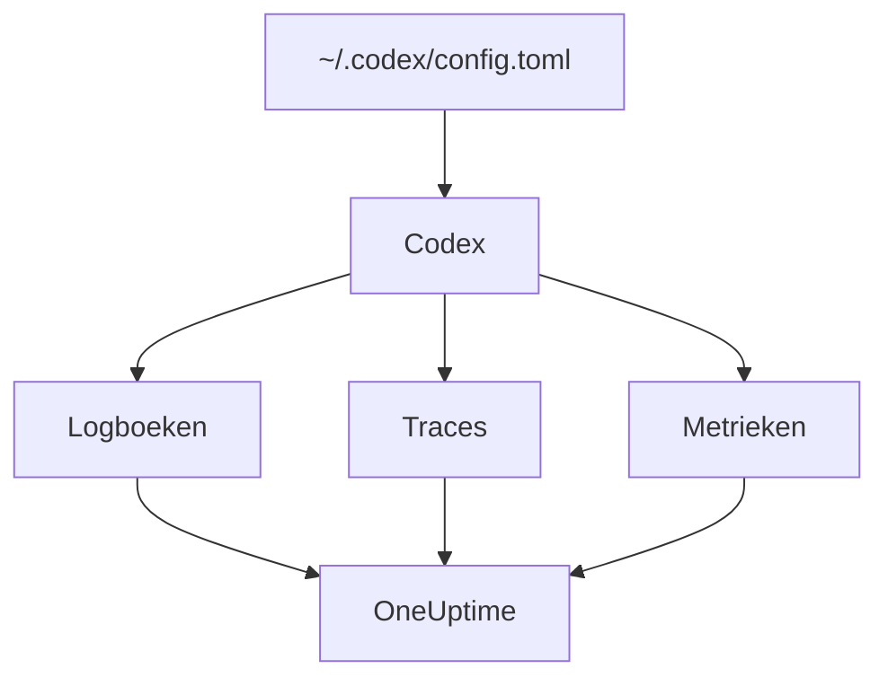

# OpenAI Codex

De Codex CLI heeft drie ingebouwde OpenTelemetry-exporters, één voor logs, één voor traces en één voor metrieken. Richt ze in `~/.codex/config.toml` op OneUptime en elke beurt van Codex komt binnen met zijn tokens en kosten, zonder wrapper of proxy ertussen.

:::cards
- [Codex configureren](#codex-configureren): Eén `[otel]`-blok, met een volledige URL per signaal.
- [Gebruik aan een persoon toewijzen](#gebruik-van-codex-aan-een-persoon-toewijzen): Codex noemt niemand op spans of metrieken, dus dat doe jij.
- [Tokens en kosten](#tokens-en-kosten): Welk signaal OneUptime leest, en wat dat laat zien.
- [Problemen oplossen](#problemen-oplossen): Wat je controleert als er niets binnenkomt.
:::

## Hoe het werkt

Elke exporter stuurt één signaal naar zijn eigen URL. Traces en logs staan uit tot je ze configureert; metrieken niet.



> [!WARNING]
> Codex stuurt zijn metrieken naar OpenAI, tenzij je dit verandert. In een release-build staat `metrics_exporter` standaard op `statsig`, dat ze naar `https://ab.chatgpt.com/otlp/v1/metrics` stuurt. `metrics_exporter` instellen op een OTLP-exporter, zoals hieronder, of op `none` stopt dat. `[analytics]` met `enabled = false` stopt de Statsig-standaard ook, maar laat een OTLP-metriekexporter die je hebt ingesteld werken.

## Voordat je begint

1. Maak een telemetrie-ingestiesleutel aan onder **Projectinstellingen → Telemetrie & APM → Ingestiesleutels**.
2. Je OTLP-endpoint is `https://oneuptime.com/otlp`, of `https://YOUR-ONEUPTIME-HOST/otlp` als je OneUptime zelf host.
3. Elke export stuurt de sleutel mee in de header `x-oneuptime-token`.

## Codex configureren

:::steps
### Voeg het otel-blok toe

Zet dit in `~/.codex/config.toml`. Het zet alle drie de signalen aan, en vervangt meteen de Statsig-standaard:

```toml title="~/.codex/config.toml"
[otel]
environment = "prod"
log_user_prompt = false

[otel.exporter.otlp-http]
endpoint = "https://oneuptime.com/otlp/v1/logs"
protocol = "binary"
headers = { "x-oneuptime-token" = "YOUR_INGESTION_TOKEN" }

[otel.trace_exporter.otlp-http]
endpoint = "https://oneuptime.com/otlp/v1/traces"
protocol = "binary"
headers = { "x-oneuptime-token" = "YOUR_INGESTION_TOKEN" }

[otel.metrics_exporter.otlp-http]
endpoint = "https://oneuptime.com/otlp/v1/metrics"
protocol = "binary"
headers = { "x-oneuptime-token" = "YOUR_INGESTION_TOKEN" }

[otel.span_attributes]
"user.id" = "dev@example.com"
"user.email" = "dev@example.com"
"team" = "platform"
```

### Geef elke exporter zijn volledige URL

Codex gebruikt elk `endpoint` precies zoals het er staat: het voegt geen `/v1/logs`, `/v1/traces` of `/v1/metrics` toe zoals de meeste SDK's doen. Drie exporters die op de kale `https://oneuptime.com/otlp` staan, sturen nergens iets heen, zonder foutmelding.

### Voer een beurt uit

Start een interactieve `codex`-sessie, vraag iets kleins en laat de beurt afronden. Open daarna **Logboeken** in OneUptime: de events van Codex, zoals `codex.conversation_starts`, `codex.api_request` en `codex.turn_cost`, verschijnen daar.
:::

> [!IMPORTANT]
> Codex negeert sleutels die het niet kent onder `[otel]`, zonder waarschuwing. De sleutels zijn in snake_case (`trace_exporter`, `metrics_exporter`, `span_attributes`), maar de exporternamen en TLS-velden zijn in kebab-case (`otlp-http`, `ca-certificate`). Een `trace-exporter` zet traces uit zonder enige foutmelding.

## Configuratiesleutels

| Sleutel | Standaard | Wat hij doet |
| --- | --- | --- |
| `environment` | `"dev"` | Stelt het resource-attribuut `env` in |
| `log_user_prompt` | `false` | Stuurt de prompttekst mee op `codex.user_prompt`; anders staat er `[REDACTED]` |
| `log_agent_responses` | `false` | Stuurt de definitieve antwoorden van de agent naar de logexporter |
| `exporter` | `none` | De logexporter |
| `trace_exporter` | `none` | De traces-exporter |
| `metrics_exporter` | `statsig` | De metriekexporter: stel hem in |
| `span_attributes` | — | Attributen die aan elke geëxporteerde span worden toegevoegd |
| `tracestate` | — | W3C-`tracestate`-leden |
| `tool_result` | `{ max_bytes = 2048 }` | Hoeveel van het resultaat van een tool een logrecord bewaart, in UTF-8-bytes |

Een exporter is `none`, `statsig`, `otlp-http` of `otlp-grpc`. `otlp-http` neemt `endpoint`, `headers`, `protocol` (`"binary"` of `"json"`, die OneUptime allebei accepteert) en `tls` (`ca-certificate`, `client-certificate`, `client-private-key`); `otlp-grpc` neemt hetzelfde zonder `protocol`.

## Gebruik van Codex aan een persoon toewijzen

Codex noemt de ontwikkelaar maar op één plek:

- **Logrecords** dragen `user.account_id` en `user.email`.
- **Spans** niet: Codex houdt beide bewust buiten zijn traces.
- **Metrieken** ook niet: ze dragen `auth_mode`, `session_source`, `originator`, `service_name`, `model` en `app.version`, en geen persoon.

OneUptime leest personen uit spans en uit datapunten van metrieken, nooit uit logrecords. Zet de identiteit dus zelf op elke span, in `[otel.span_attributes]`:

```toml title="~/.codex/config.toml"
[otel.span_attributes]
"user.id" = "dev@example.com"
"user.email" = "dev@example.com"
"team" = "platform"
"cost_center" = "eng-123"
```

`user.id` is de sleutel waaraan OneUptime de voorkeur geeft, en `user.email` vult de e-mailkolom. Codex heeft geen resource-attributen, dus stel de teamsleutels (`team.id`, `team`, `cost_center`, `department`) ook hier in. Dit blok staat in het eigen configuratiebestand van elke ontwikkelaar: lever het per ontwikkelaar uit, via je dotfiles of een MDM-profiel. Eén gedeeld bestand met één identiteit zou de uitgaven van iedereen aan één persoon toerekenen.

## Tokens en kosten

| Signaal | Wat Codex stuurt | Wat OneUptime ermee doet |
| --- | --- | --- |
| Traces | `gen_ai.usage.input_tokens`, `gen_ai.usage.output_tokens` en de cachetokens, maar geen model | Telt de tokens per persoon; kan ze niet prijzen |
| Metrieken | `codex.turn.token_usage` per `token_type`, en `codex.turn.cost_microusd`, in miljoenste delen van een USD | Rekent de kosten om naar USD; leest de metrieken alleen waar spans niets melden |
| Logs | `codex.turn_cost`, met `usage.estimated_usd` en de persoon | Slaat het op in de verkenner van **Logboeken**; niet gekoppeld aan uitgaven |

Met de configuratie hierboven geeft dat dit op het tabblad **Gebruik**:

- De tokens komen uit de spans, per persoon, en `codex.turn.token_usage` wordt er niet bij opgeteld: de twee worden nooit opgeteld ([waarom](/docs/telemetry/ai-llm-observability#spans-eerst-metrieken-vullen-aan)).
- De spans van Codex noemen geen model, dus OneUptime kan ze niet prijzen, en hun kosten zijn 0. De kostentotalen nemen de kosten van Codex dan uit `codex.turn.cost_microusd`, voor je omgerekend naar USD.
- De tabellen **Medewerker**, **Team** en **Model** tonen de rijen van de spans: tokens per persoon, maar geen kosten per persoon.
- Zonder traces vullen de metrieken die tabellen in plaats daarvan, alleen met kosten, allemaal onder **Niet toegewezen**, omdat de metrieken van Codex niemand noemen.

De nauwkeurigste kosten per beurt, met de persoon erbij, staan in het logrecord `codex.turn_cost`. OneUptime koppelt logrecords nog niet aan uitgaven, maar laat de logexporter aanstaan: de geschiedenis is er wanneer dat wel gebeurt.

## Codex in CI en als MCP-server

`codex`, `codex exec` en `codex mcp-server` bouwen hun telemetrie allemaal uit hetzelfde `[otel]`-blok, met alle drie de exporters. Runs van `codex exec` dragen de `originator` `codex_exec`, en `codex mcp-server` exporteert als `codex_mcp_server`, zodat je runs in CI en via MCP aan die waarden van interactieve sessies kunt onderscheiden.

## Privacy

`log_user_prompt` en `log_agent_responses` staan standaard op `false`: laat ze uit. Het event `codex.user_prompt` komt nog steeds binnen, met de prompt vervangen door `[REDACTED]`, zodat je de beurt, de tokens en de kosten houdt zonder de prompttekst. De persoon (`user.email`, `user.account_id`) staat op de logrecords, wat deze schakelaars ook zeggen.

Zet je inhoud aan voor een onderzoek, dan maskeren of laten de **Scrub-regels** en **Drop-filters** van de traces, onder **Traces → Instellingen**, het vallen voordat het wordt opgeslagen.

## De OpenAI-API gebruiken in plaats van Codex

Het platform-API van OpenAI stuurt zelf geen OpenTelemetry: elke span komt uit het instrumenteren van je eigen client. Drie instrumentaties werken met OneUptime:

- **OpenTelemetry**: `opentelemetry-instrumentation-genai-openai` voor Python, dat `opentelemetry-instrumentation-openai-v2` vervangt. `OTEL_INSTRUMENTATION_GENAI_CAPTURE_MESSAGE_CONTENT` bepaalt of berichten worden vastgelegd.
- **OpenLLMetry** (Traceloop): `opentelemetry-instrumentation-openai`.
- **OpenInference** (Arize): `openinference-instrumentation-openai`.

Richt elk ervan op OneUptime zoals [AI- / LLM-observability](/docs/telemetry/ai-llm-observability) laat zien. Geen ervan weet wie je medewerker is: stel `user.id` zelf in.

De **OpenAI Agents SDK** stuurt traces naar het eigen endpoint van OpenAI, niet via OTLP. Overbrug hem met `opentelemetry-instrumentation-openai-agents-v2` of `openinference-instrumentation-openai-agents`, die de spans van de SDK aan een OTLP-exporter doorgeven.

## Problemen oplossen

:::details Er komt niets binnen
Controleer eerst de drie `endpoint`-waarden: elk moet eindigen op `/v1/logs`, `/v1/traces` of `/v1/metrics`. Controleer daarna de header `x-oneuptime-token`: OneUptime weigert een verkeerde sleutel.
:::

:::details Traces komen nooit binnen, logs wel
Zoek naar een verkeerd gespelde sleutel onder `[otel]`: Codex negeert die stilzwijgend. `trace-exporter` in plaats van `trace_exporter` is de gebruikelijke.
:::

:::details De kosten van Codex staan in de totalen, maar elke persoon toont $0
Dat is zo bedoeld: de spans van Codex dragen tokens maar geen model, dus ze kunnen niet worden geprijsd, en de kostenmetriek noemt niemand. Zie [Tokens en kosten](#tokens-en-kosten).
:::

:::details De uitgaven van iedereen staan onder één persoon
Dezelfde identiteit in `[otel.span_attributes]` staat op elke machine. Geef elke ontwikkelaar een eigen identiteit.
:::

## Volgende stappen

:::cards
- [AI-codeerassistenten](/docs/telemetry/ai-coding-assistants): Hoe uitgaven over elke codeerassistent worden toegewezen.
- [AI- / LLM-observability](/docs/telemetry/ai-llm-observability): Gesprekken, waarschuwingen, kosten en budgetten voor je eigen AI-aanroepen.
- [AI-gateways](/docs/telemetry/ai-gateways): Eén gateway die elke modelaanroep traceert en prijst.
:::
