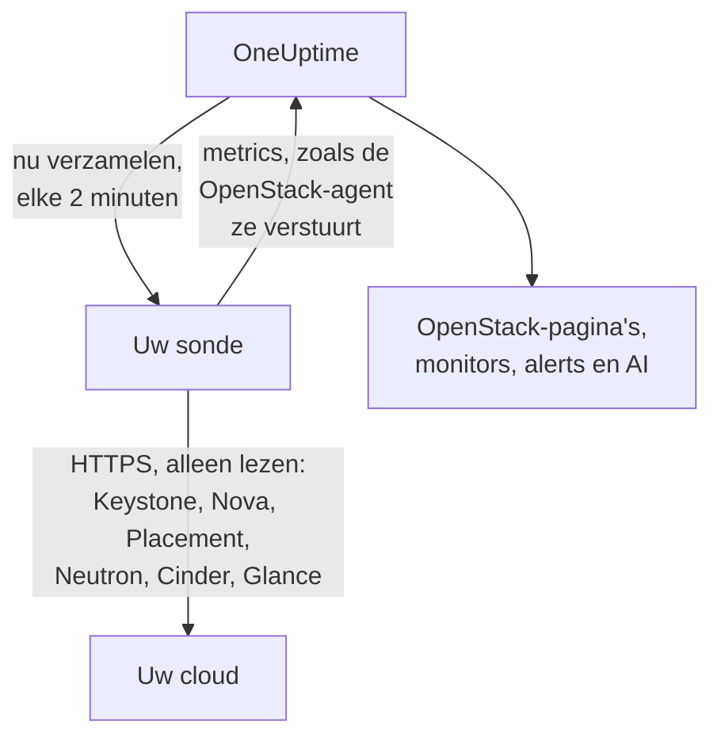

# OpenStack zonder agent

Monitor een OpenStack-cloud zonder iets te installeren: voer in OneUptime het adres van Keystone en een application credential in, kies de sonde die de cloud kan bereiken, en de sonde verzamelt dezelfde gegevens als de [OpenStack-agent](/docs/telemetry/openstack). Er is geen agent om te installeren, te upgraden of draaiend te houden, en er is geen eigen machine nodig.

> [!IMPORTANT]
> Een sonde spreekt alleen HTTPS met een cloud. Een credential of het bijbehorende token wordt nooit over gewoon HTTP verstuurd, en DevStack en Kolla-Ansible bieden hun API's standaard aan via gewoon HTTP. Zet voor zo'n cloud TLS aan voor de API's, of gebruik de [OpenStack-agent](/docs/telemetry/openstack), die ernaast draait. De verbindingstest meldt het wanneer hij een gewoon HTTP-adres tegenkomt.

:::cards
- [Voordat u begint](#voordat-u-begint): Een sonde die de API's bereikt, en een credential.
- [Een cloud verbinden](#een-cloud-verbinden): Het adres, een credential, een test en een naam.
- [Probleemoplossing](#probleemoplossing): Wat elke melding betekent en wat het verhelpt.
:::

## Hoe het werkt



Elke twee minuten leest de sonde elke service van elke regio die u hebt gekozen en stuurt wat hij vond naar OneUptime. Het komt precies zo binnen als bij de OpenStack-agent, dus elke OpenStack-pagina, elke [OpenStack-monitor](/docs/monitor/openstack-monitor) en elk alertsjabloon leest het op dezelfde manier.

Elke service wordt afzonderlijk gelezen en tegelijk met de andere. Een Neutron die faalt of blijft hangen kost de reeksen van Neutron, en de gegevens van Nova komen gewoon binnen, met één kanttekening die Nova zelf maakt: Nova vraagt Neutron naar elke instantie die het opsomt. Zolang Neutron uitvalt, houdt een sonde dus de instanties aan die hij het laatst las en vraagt hij alleen wat er veranderd is. Als een instantie is veranderd, of de sonde net is gestart, kan Nova ook die lijst niet beantwoorden: Nova wordt als falend weergegeven, de overige reeksen komen nog binnen, en elke instantie blijft op zijn pagina staan zoals hij het laatst was totdat Neutron terug is.

Heat, Magnum, Manila, Trove, Gnocchi, Designate, Swift en Barbican worden gelezen waar de catalogus van Keystone ze noemt. Een cloud die geen van deze draait, kost er niets voor, hoort er niets over van de verbindingstest en [toont er geen spoor van](/docs/telemetry/openstack#heat-en-magnum).

Op een cloud waarvan de catalogus Octavia bevat, leest een sonde de load balancers, pools, listeners en amphorae met telkens één lijstaanroep, daarna van elke pool de members en de verkeerstellers van elke load balancer en listener die `ACTIVE` is, telkens met één verzoek. Een cloud met 3 load balancers, 1 pool en 1 listener kost 9 verzoeken per verzameling; een echte DevStack die we opnamen kostte precies dat. Per verzameling worden van hooguit 25 pools de members en hooguit 50 tellers gelezen, de langst ongelezen eerst, en de overige geven weer wat ze bij de vorige keer zeiden. De tellers van Octavia zijn cumulatief, dus een sonde bewaart van elke teller de laatste meting en zet het verschil per seconde tussen twee metingen in een grafiek: een grafiek begint bij de tweede verzameling, en een teller die daalt (een herbouwde listener) tekent niets voor dat interval. De OVN-provider meldt voor elke teller 0, wat een vlakke lijn is en geen storing.

Amphorae vereisen voor elke leesactie de adminregel van Octavia. Een credential onder admin ziet de load balancers, pools, listeners en members van zijn eigen project en zijn eigen tellers, maar geen amphorae: de pagina Load Balancers meldt dat, en er volgt geen waarschuwing. De monitoringrol ziet op een project zonder load balancers er geen. `load-balancer_global_observer` werd alles geweigerd op `stable/2026.1`, de release waarop dit is opgenomen.

Een gestopte Octavia-API is voor een sonde `up 0`, wat de exporter van de agent niet kan melden.

## Sonde of agent?

| | Een sonde (deze pagina) | De OpenStack-agent |
|---|---|---|
| Wat u draait | Een sonde die u al draait, of een nieuwe | De agent, op een eigen machine |
| Waar de credential wordt bewaard | Versleuteld in OneUptime, alleen naar de sonde gestuurd | In het bestand `clouds.yaml` van de agent |
| Wat bereikt moet worden | Keystone en de API van elke service, via HTTPS | Keystone en de API van elke service |
| API's op gewoon HTTP | Niet verzameld: een token wordt nooit onversleuteld verstuurd | Verzameld |
| Grootste cloud | Getest met [200.000 instanties](/docs/telemetry/openstack-very-large-clouds) tegen een gesimuleerde cloud, niet een echte, in maximaal tien uploads van 48 MiB | Niet op schaal getest: [de scrape loopt ruim daarvoor al uit de tijd](/docs/telemetry/openstack-very-large-clouds#via-de-agent) |
| Servicelogboeken en de AI-agent | Niet inbegrepen | Inbegrepen |
| Waar de cloud op draait: RabbitMQ, MariaDB, Memcached, HAProxy, OVN, libvirt | Niet inbegrepen: een sonde leest de API's van de cloud | Inbegrepen, met de doelen bij naam genoemd |
| Het echte cpu-, geheugen- en schijfgebruik van elke instantie, uit libvirt of Ceilometer | Niet inbegrepen | Inbegrepen, met de exporters bij naam genoemd |
| Aanmeldingen bij Keystone | Eén per levensduur van een token, meestal een uur | Eén per scrape |
| Een gewone `reader` op één project | De instanties, volumes en netwerken van dat project | De volumes en netwerken van dat project, en geen instanties |

Beide sturen dezelfde reeksen, dus de pagina's en monitors werken met beide. Een sonde stuurt ook wat alleen een eigen client kan lezen: de adressen, taakstatus en foutmelding van een instantie, de image waarmee hij is opgestart, of een operator een Nova-service geforceerd heeft uitgezet, welke netwerken een DHCP-agent bedient, welke pool een volume bevat, wanneer een instantie, volume of image het laatst is veranderd, en de status van elke volume-snapshot en elke back-up. Cinder vertelt alleen aan een credential die het als admin behandelt, welke pool een volume bevat. Op een cloud die [Heat of Magnum](/docs/telemetry/openstack#heat-en-magnum) draait, stuurt hij ook waarom een stack of een cluster faalde, welke instanties en volumes bij een stack horen, het project, de sjabloon en de Kubernetes-versie van elk cluster, en of elke engine van Heat en elke conductor van Magnum actief is.

Kies de agent voor servicelogboeken, voor de AI-agent, voor waar de cloud op draait en het echte gebruik van elke instantie, voor een cloud waarvan de API's alleen gewoon HTTP spreken, zoals DevStack en Kolla-Ansible standaard doen, of voor een cloud die zo groot is dat hij [uit zijn databases gelezen](/docs/telemetry/openstack-very-large-clouds#het-databasepad) moet worden. Kies een sonde voor al het andere: er is niets te installeren, en hij leest meer van wat Nova en Cinder vertellen. [Zeer grote OpenStack-clouds](/docs/telemetry/openstack-very-large-clouds) vertelt wat beide kosten, op elke omvang.

U kunt een cloud op elk moment van de een naar de ander overzetten op de pagina **Instellingen**.

## Voordat u begint

- **Een sonde die Keystone en de API van elke service via HTTPS kan bereiken.** Dit is meestal een [aangepaste sonde](/docs/probe/custom-probe) in het netwerk van de cloud. De catalogus van Keystone noemt waar elke service antwoordt, en de sonde verbindt met die adressen, dus elk adres moet vanaf de sonde bereikbaar zijn en elk moet HTTPS zijn. Op OneUptime Cloud ontvangen de gedeelde sondes nooit een OpenStack-credential, dus voeg een eigen sonde toe. Op een zelf gehoste instantie kunnen ook de eigen sondes van de instantie verzamelen.
- **Een credential.** Een application credential is het best, omdat het tot lezen beperkt kan worden en kan verlopen. Een gebruikersnaam en wachtwoord werken ook, en kunnen alles wat hun account kan.

OpenStack heeft geen globale alleen-lezenrol, dus hoeveel de sonde ziet hangt af van de credential:

| Niveau | Wat het nodig heeft | Wat de sonde leest |
|---|---|---|
| Volledige weergave | Een application credential op een account met `admin` op een eigen project, door toegangsregels beperkt tot lezen | Alles, behalve de gebruikers en groepen van Keystone, die de regels met opzet weglaten |
| Alleen infrastructuur | De rollen `oneuptime_monitoring` en `reader` op een eigen project dat niets bevat en een quotum van nul heeft, en de beleidsbestanden die de OpenStack-agent meelevert | Hypervisors, de services van Nova, de agents van Neutron, adrespools, Placement, de projectlijst en de instanties van elk project. Volumes, netwerken en routers alleen waar de rol is toegewezen. Niet de status van `cinder-volume` en `cinder-scheduler` of opslagpools: de eigen code van Cinder vraagt om een admin |
| Projectweergave | Een gewone `reader` op één project | De instanties, volumes en netwerken van dat project, en geen infrastructuur |

De verbindingstest meldt op welk van deze niveaus een credential uitkomt, en waarschuwt wanneer het eigen project dingen bevat: waar Cinder `enforce_new_defaults` uit heeft, wat de eigen standaard is, kan elke rol op een project de volumes van dat project aanmaken, `reader` inbegrepen.

> [!IMPORTANT]
> Een application credential die door toegangsregels is beperkt, wordt met een `401` geweigerd door elke service waarvan `keystonemiddleware` geen `service_type` heeft ingesteld. De verbindingstest meldt dit per leesactie. Stel het in de configuratie van elke service in en herstart de service daarna. [De credential aanmaken](/docs/telemetry/openstack#de-referentie-aanmaken) bevat de regels, de beleidsbestanden en de instellingen voor elke service, en [wat elk niveau leest](/docs/telemetry/openstack#wat-elk-niveau-leest) is wat echte clouds antwoordden.

## Een cloud verbinden

:::steps
### Uw clouds openen
Open in OneUptime **OpenStack → Alle clouds** en klik op **Cloud verbinden**.

### Het adres en de credential invoeren
Voer de `auth_url` uit uw bestand `clouds.yaml` of `openrc` in, zoals `https://keystone.example.com:5000/v3`, en de ID en het secret van de application credential. Kies de sonde die de cloud bereikt.

### De verbinding testen
Klik op **Verbinding testen**. De sonde meldt zich aan, probeert elke leesactie die een verzameling in elke regio doet, en meldt zich weer af. Hij meldt welke regio's de catalogus noemt, wat de credential kan lezen, wat wordt geweigerd, welke pagina's zonder dat blijven, en de regel die het opent. Een mislukte leesactie stopt de test niet.

### Het certificaat van de cloud vertrouwen
Een cloud met een eigen certificeringsinstantie presenteert een certificaat dat de sonde niet vertrouwt. De test toont dan het certificaat en de host die het presenteerde. Vergelijk de vingerafdruk met die van de API zelf en klik dan op **Dit certificaat vertrouwen**. Een cloud met een host per service kan een certificaat per service hebben, en u kunt er maximaal 32 vertrouwen.

### De regio's kiezen en verbinden
Kies de regio's die gelezen moeten worden, geef de cloud een naam en klik op **Cloud verbinden**. De pagina van de cloud wordt geopend.
:::

Het **Overzicht** van de cloud toont een kaart **Gegevensverzameling**. Die staat op **Bezig met controleren** tot de eerste verzameling, die binnen een minuut begint, daarna op **Wordt verzameld**, en de pagina's vullen zich. Als sommige services zijn gelezen en een andere niet, meldt de kaart welke. Als er 15 minuten lang geen sonde voor de cloud komt, omdat hij offline of te oud is, staat er **Wordt niet verzameld** en wordt dat gemeld, wat de laatste verzameling ook vond.

De kaart **Gegevensverzameling** op de pagina **Instellingen** van de cloud bevat waarmee u hem hebt verbonden:


## Een cloud verbinden via de API of Terraform

De verbindingsinstellingen van een cloud zijn gewone velden van de [OpenStack Cloud-resource](/reference/open-stack-cloud) in de API, op `/api/openstack-cloud`, dus een cloud kan zonder dashboard worden verbonden. Met Terraform is dat `oneuptime_openstack_cloud`:

```hcl
resource "oneuptime_openstack_cloud" "prod_eu" {
  name                      = "prod-eu"
  collection_method         = "Probe"
  auth_url                  = "https://keystone.example.com:5000/v3"
  credential_kind           = "applicationCredential"
  application_credential_id = var.openstack_application_credential_id
  credential_secret         = var.openstack_application_credential_secret
  collection_probe_id       = oneuptime_probe.eu_west.id
  collection_regions        = jsonencode(["RegionOne"])

  # A cloud with its own certificate authority: the fingerprints it presents.
  trusted_certificate_fingerprints = jsonencode(["AB:CD:EF:..."])
}
```

Zet voor een gebruikersnaam en wachtwoord `credential_kind` op `password`, met `keystone_username`, `project_name` en, wanneer ze niet `Default` zijn, `user_domain_name` en `project_domain_name`. `endpoint_interface`, `collection_interval_in_minutes` en `collection_options` zijn wat het formulier onder **Meer velden** onderbrengt. Alleen `name` is verplicht, omdat een cloud die de agent verstuurt geen van deze heeft.

`credential_secret` is alleen te schrijven, dus geen enkele leesactie geeft het terug en Terraform houdt het uit plannen en outputs. [De regels voor een opgeslagen credential](#de-opgeslagen-credential) gelden hier ook: voor het wijzigen van het adres, de sonde of de vertrouwde certificaten is het secret nodig in hetzelfde verzoek. Wat de sonde meldt, zoals `collection_status`, `collection_error` en `presented_certificate`, kan worden gelezen en niet worden ingesteld.

## Wat het uw cloud kost

Monitoring mag nooit de oorzaak zijn dat een cloud uitvalt, dus een verzameling is van nature voorzichtig:

- **Eén aanmelding, bewaard.** Het token wordt gebruikt tot vijf minuten voordat het verloopt. Een aanmelding is wat een Keystone in nood het minst kan missen.
- **Lijsten in pagina's.** Elke lijst wordt per duizend rijen gelezen, met `limit` en `marker`.
- **Instanties op wat er veranderde.** Tussen volledige leesacties, elk half uur, vraagt de sonde Nova alleen wat er sinds de vorige leesactie is veranderd, met `changes-since`.
- **De inventarissen van een hypervisor eenmalig.** Placement verhoogt de generatie van een provider telkens als ze veranderen, wat één lijstaanroep van allemaal meldt, dus ze worden alleen dan opnieuw gelezen.
- **Een vaste belasting.** Wat één aanroep per ding is, gaat bij meer dan 2.000 per verzameling in beurten, en bij meer dan 250 projecten voor limieten. Wat dit keer niet is gelezen, wordt verstuurd zoals het laatst gelezen was, zodat geen reeks een gat heeft, en de belasting stopt met groeien met de cloud.
- **Alleen de velden die hij leest.** De lijsten van Neutron noemen hun velden, en voor beveiligingsgroepen worden alleen de ID's gevraagd.
- **Nooit opgestapeld.** Een verzameling die langer duurt dan zijn interval wordt overgeslagen, niet naast de volgende uitgevoerd.
- **Een tijdsbudget.** Een verzameling heeft negen tiende van zijn interval, en maximaal tien minuten. Wat tegen die tijd is gelezen, wordt verstuurd, en de service die zonder tijd kwam te zitten, meldt dat.
- **Terugtrekken.** Als de sonde met een `429` of `Retry-After` wordt gevraagd te wachten, wacht hij. Een service die `429`, `503` of helemaal niets antwoordt, wordt een minuut met rust gelaten, dan twee, dan vier, tot een half uur, en zijn reeksen blijven melden dat hij down is terwijl hij wacht.
- **Vertragen.** Een antwoord dat drie keer trager is dan die service gewoonlijk antwoordt, en minstens een seconde, of vijf seconden wat gebruikelijk ook is, houdt het volgende verzoek aan die service even lang tegen. De kaart **Gegevensverzameling** meldt wanneer dat gebeurde.
- **Een geweigerde credential wacht het langst.** Een herhaling ervan is wat een account vergrendelt, dus er wordt vijf minuten gewacht, dan tien, tot een uur. Een credential die u hebt gecorrigeerd wordt direct geprobeerd.

- **Minder van een grote cloud.** Boven 5.000 instanties houdt een cloud tellingen en zijn onderdelen bij, en geen reeks per instantie of per volume, tenzij u onder **Echt gebruik per instantie** op de pagina **Instellingen** anders kiest. Wat er veranderde, wat u hebt gekozen te bewaren en wat een alert bewaakt, gaat nog steeds bij elke verzameling mee. De rest gaat in beurten, en de kaart **Gegevensverzameling** meldt hoe lang een beurt duurt.

Bij elke verzameling kost een regio met de standaardinstellingen 7 aanroepen naar Nova, 7 naar Neutron en 5 naar Cinder, één aanroep naar Placement en twee extra per hypervisor, tot 4 extra om Placement te vragen [hoeveel van elke flavor passen](/docs/telemetry/openstack#capaciteit), en ongeveer elke vijf minuten 5 naar Keystone en 1 naar Glance. De inventaris van een hypervisor wordt eenmaal gelezen en alleen opnieuw als Placement meldt dat hij is veranderd. Een lijst van meer dan duizend rijen kost een aanroep per duizend. Elke instantie die veranderde kost één aanroep extra naar Nova, om te lezen wat ze doormaakte, en er worden er per verzameling maximaal 25 gelezen: een rustige cloud doet er geen. Op ML2/OVS kost Neutron één aanroep extra per router, om te vragen welke L3-agents hem bevatten, en elke tien minuten een aanroep per DHCP-agent, maximaal 20, om te vragen welke netwerken hij bedient. Een cloud met meer DHCP-agents gaat ze in beurten langs, een cloud boven de omvang van de samenvatting laat dit weg, en een trage Neutron wordt er helemaal niet naar gevraagd. Een cloud op OVN heeft er geen om naar te vragen. [Zeer grote OpenStack-clouds](/docs/telemetry/openstack-very-large-clouds#de-belasting-van-uw-controlevlak) toont wat dat per omvang aan verzoeken per minuut neerkomt.

Een cloud die Manila draait, betaalt ongeveer elke vijf minuten 2 aanroepen ernaar, een die Trove draait 1, Gnocchi 1 en Barbican 3. Designate kost er 2, en één meer voor elke zone die niet `ACTIVE` is, maximaal 50 per verzameling. Swift kost er 1 voor het eigen project van de credential, en met `ResellerAdmin` één meer voor elk ander project, maximaal 200 per verzameling. Een cloud die Heat of Magnum draait, betaalt ongeveer elke vijf minuten 2 aanroepen naar Heat en 3 naar Magnum. Geen van beide lijsten zegt alles: die van Magnum zegt niet van wie een cluster is of waarom het faalde, en die van Heat zegt niet wat een stack bezit. Daarom leest de sonde een cluster of een stack ook afzonderlijk wanneer zijn status is verschoven, maximaal 25 van elk per verzameling. Een cloud met meer vult dit in de volgende verzamelingen aan, en wat stilstaat wordt nooit twee keer gelezen.

Drie dingen staan uit tenzij u ze aanzet, onder **Wat het leest buiten de standaardinstellingen** in de kaart **Gegevensverzameling** op de pagina **Instellingen** van de cloud, of onder **Meer velden** terwijl u hem verbindt, omdat elk uw cloud meer kost:

| Optie | Wat u krijgt | Wat het kost |
|---|---|---|
| Poorten | Eén reeks per poort, en hoeveel er geen adres hebben of een load balancer die down is | Eén lijst met pagina's per netwerk of project dat u noemt, of van alle poorten als u er geen noemt. Een lijst van poorten zonder filter kan Neutron op een grote cloud verzadigen |
| Projectlimieten | Quota en limieten per project | Vier aanroepen per project, maximaal 250 projecten per verzameling |
| De opslagservers van Swift | Of elk antwoordt, zijn replicatie en of ze allemaal dezelfde rings hebben, waarbij u de `/recon`-poort van elke server noemt als `host:port`. Alleen een cloud die Swift draait biedt dit aan, op de pagina **Instellingen** zodra de eerste verzameling Swift heeft gelezen | 5 aanroepen per server bij elke verzameling. Er gaat geen credential naartoe |

## Certificaten

De sonde slaat certificaatverificatie nooit over. Elke verbinding voltooit een volledige TLS-handshake, en vervolgens:

- als er geen certificaat wordt vertrouwd, moet het certificaat van een API afkomstig zijn van een instantie die de machine van de sonde vertrouwt, voor het adres waarop hij antwoordt;
- als er certificaten worden vertrouwd, moet een API er precies een van presenteren, geïdentificeerd door hun SHA-256-vingerafdrukken. Niets anders wordt geaccepteerd, zelfs geen publiek vertrouwd certificaat.

Voer dit uit op de machine van de sonde om een vingerafdruk te controleren:

```bash
openssl s_client -connect keystone.example.com:5000 </dev/null | openssl x509 -noout -fingerprint -sha256
```

Wanneer een certificaat wordt vernieuwd, stopt het verzamelen met **Het certificaat van de API is gewijzigd** en wordt het nieuwe certificaat getoond. Er wordt niets verstuurd totdat u het vertrouwt, op de pagina **Overzicht** of **Instellingen** van de cloud.

## De opgeslagen credential

Het secret is versleuteld en alleen te schrijven: niemand kan het teruglezen, en de API geeft het nooit terug. Het wordt alleen verstuurd naar de sonde die de cloud verzamelt, die het in het geheugen bewaart.

Een opgeslagen credential wordt alleen verstuurd naar het adres, via de sonde en naar de certificaten waarvoor hij is ingevoerd. Bij het wijzigen van het adres, de sonde of de vertrouwde certificaten wordt opnieuw om het secret gevraagd, zodat niemand die de cloud kan bewerken het ergens anders naartoe kan sturen. Het certificaat vertrouwen dat de sonde op het opgeslagen adres vond behoudt het, en minder certificaten vertrouwen ook.

De catalogus valt onder dezelfde regels als het adres dat u typte, want een token gaat overal heen waar hij naar verwijst. De sonde verbindt niet met een loopback-, link-local- of cloudmetadata-adres, of de catalogus het nu noemt of een hostnaam ernaar wordt omgezet, en hij verbindt met de adressen die hij controleerde, niet met wat DNS een moment later zegt. Hij volgt geen redirects.

## Wisselen tussen de agent en een sonde

Open de pagina **Instellingen** van de cloud. De kaart **Gegevensverzameling** biedt **Verzamelen met een sonde** voor een cloud die de agent verstuurt, en **De OpenStack-agent gebruiken** voor een die een sonde verzamelt. Overschakelen naar de agent vergeet de opgeslagen credential.

> [!WARNING]
> Stop de OpenStack-agent zodra de eerste verzameling van de sonde slaagt. Zolang beide draaien, komt elke metric dubbel binnen.

Boven [5.000 instanties](/docs/telemetry/openstack-very-large-clouds#samenvattingsmodus) kent de eerste verzameling van een sonde de hele cloud en stuurt hij een deel ervan, zodat de lijsten van een nieuwe cloud zich tijdens de eerste cyclus vullen, en de kaart **Gegevensverzameling** meldt wanneer ze er allemaal zijn.

## Bare metal

Op een cloud waarvan de catalogus Ironic bevat, leest een sonde de nodes ervan en vraagt hij elk veld bij naam, zodat het `driver_info` van een node nooit in een verzameling wordt gelezen. Hij voegt toe wat de exporter van de agent niet heeft: het stuurprogramma van een node, zijn conductor, zijn fout en waarom hij faalde. Ironic kan `last_error` binnen ongeveer een minuut leegmaken, dus een pagina bewaart de laatste die een verzameling zag, en meldt wanneer.

Een sonde leest eerst de catalogus, zodat hij kan melden dat de API van Ironic down is, wat de exporter van de agent niet kan. Een cloud zonder Ironic krijgt er niets over gevraagd.

Ironic toont een project alleen de nodes die het bezit, en weigert het de lijst van conductors. Volgens het standaardbeleid van Ironic leest alleen een credential met systeembereik die, en de credential van een sonde kan geen systeembereik hebben, omdat hij daarmee ook de lijsten van Nova leest. Tenzij het beleid van de cloud zijn rol dus `baremetal:node:list_all` en `baremetal:conductor:get` geeft, ziet een sonde de nodes die zijn project bezit en geen conductors, en de pagina's melden dat. [Bare metal](/docs/telemetry/openstack#bare-metal) bevat de rest.

## Referentie

| Instelling | Standaard | Opmerkingen |
|---|---|---|
| Verzamelen elke | 2 minuten | Van 1 tot 60 minuten. Verzamel een grote cloud minder vaak om hem te ontzien. Keystone en Glance worden ongeveer elke vijf minuten gelezen, hoe vaak de rest ook. |
| Endpoint-interface | public | Welke van de URL's uit de catalogus wordt gebruikt: public, internal of admin. |
| Gelijktijdige verzamelingen | 4 per sonde | Een verzameling die trager is dan zijn interval wordt overgeslagen, nooit opgestapeld. |
| Grootste upload | 48 MiB | Een verzameling gaat in zoveel uploads als nodig, maximaal tien. Boven [5.000 instanties](/docs/telemetry/openstack-very-large-clouds#samenvattingsmodus) gaat wat niet is veranderd in beurten. |
| Verzoeken aan elke service | Eén tegelijk | De aanroepen per provider van Placement gaan vier tegelijk. |
| Wachten op één antwoord | 60 seconden | In totaal drie keer geprobeerd bij een `429` of een serverfout. |
| Verbindingstest | 90 seconden om te starten | Een test die geen sonde op tijd oppikt, of die langer dan 3 minuten loopt, wordt als mislukt beantwoord. Vijf kunnen er tegelijk wachten of lopen in een project. |

## Probleemoplossing

:::details Het certificaat van de API wordt niet vertrouwd
De cloud presenteert een certificaat van een eigen certificeringsinstantie. Vergelijk de getoonde vingerafdruk met het certificaat van de API en klik dan op **Dit certificaat vertrouwen**.
:::

:::details Het certificaat van de API is gewijzigd
Het certificaat is vernieuwd, of iemand zit ertussen. Er wordt niets verstuurd totdat u het nieuwe vertrouwt. Controleer de vingerafdruk en vertrouw het dan.
:::

:::details De auth-URL is niet geldig
Voer het adres van Keystone in via HTTPS, zoals `https://keystone.example.com:5000/v3`. Een adres op gewoon HTTP wordt geweigerd voordat er iets wordt verstuurd. Zet voor een cloud waarvan de API's alleen gewoon HTTP spreken TLS aan, of gebruik de [OpenStack-agent](/docs/telemetry/openstack).
:::

:::details De catalogus noemt een endpoint op gewoon HTTP
Het token van een credential wordt nooit onversleuteld verstuurd. Zet TLS aan voor die API, kies een andere endpoint-interface, of gebruik voor deze cloud de [OpenStack-agent](/docs/telemetry/openstack). De verbindingstest mislukt totdat elke API die hij leest op HTTPS staat. Bij een verzameling blijft alleen de service met dat endpoint achter: de andere worden gewoon gelezen.
:::

:::details Keystone weigerde de credential
De ID, het secret of het wachtwoord is onjuist, het is verlopen of verwijderd, of het account verloor zijn rol op het project. Maak een nieuwe aan en voer die in met **Verbinding bewerken** op de pagina **Instellingen** van de cloud.
:::

:::details Het account heeft geen rol op dat project
Een gebruikersnaam en wachtwoord logden in, maar niet op dat project. Controleer de projectnaam en beide domeinen. Een application credential voorkomt dit: het krijgt bij het aanmaken al een bereik.
:::

:::details De credential kan niet lezen wat monitoring nodig heeft
De test somt elke geweigerde leesactie op, wat zonder blijft, en de regel die het opent. Een `401` op een credential met toegangsregels betekent dat ze dat pad niet noemen, of dat `keystonemiddleware` van die service geen `service_type` heeft en niet is herstart.
:::

:::details De sonde krijgt geen antwoord van de cloud
Het netwerk van de sonde kan die API niet bereiken. Sta het toe in de firewall, of kies een sonde in het netwerk van de cloud. Het adres van elke service is eigen: de melding noemt degene die niet antwoordde.
:::

:::details Er antwoordt niets op die poort
Controleer het adres en de poort. Keystone luistert meestal op 5000, of op 443 achter een pad zoals `/identity`.
:::

:::details De beveiligde verbinding is mislukt
Het adres wijst waarschijnlijk naar een poort die geen HTTPS spreekt. Controleer het. Als de API's van de cloud alleen gewoon HTTP spreken, zet TLS dan aan, of gebruik de OpenStack-agent.
:::

:::details OneUptime verbindt niet met dit adres
Het adres, of iets wat de catalogus noemt, is of wordt omgezet naar een loopback-, link-local- of cloudmetadata-adres. Gebruik het adres waarop de API in uw netwerk antwoordt.
:::

:::details Dit adres is niet Keystone
Voer het Identity-endpoint uit uw bestand `clouds.yaml` of `openrc` in: de `auth_url`.
:::

:::details Een regio staat niet in de catalogus
Kies uit de regio's die de catalogus noemt. De verbindingstest somt ze op.
:::

:::details Keystone faalt
Keystone antwoordde met een serverfout. De sonde wacht langer tussen aanmeldingen totdat het herstelt, en zonder aanmelding kan niets anders worden gelezen. Controleer de service van Keystone en de database erachter.
:::

:::details Een service is gestopt of te druk om te antwoorden
Hij bleef `429` of een serverfout antwoorden, dus de sonde wacht langer tussen verzamelingen totdat hij herstelt. Controleer of hij draait en daarna zijn belasting. Minder vaak verzamelen helpt bij een drukke service.
:::

:::details Het verzamelen duurde te lang
De cloud antwoordde te langzaam voor dit interval. Verzamel minder vaak, of controleer zijn belasting.
:::

:::details De sonde heeft dit niet opgepikt
De sonde is offline, of draait een OneUptime-versie die ouder is dan het verzamelen van OpenStack. Controleer op de pagina **Sondes** of hij verbonden is, en werk hem bij. De kaart van een cloud meldt dit ook zodra een verzameling 15 minuten achterloopt, hoe de laatste verzameling ook ging, en gaat vanzelf terug wanneer de sonde dat doet.
:::

:::details Deze cloud is te groot om vanaf een sonde te verzamelen
De metrics zijn meer dan een verzameling mag versturen, en deze cloud is ingesteld om de reeksen van elke instantie te bewaren. Laat hem tellingen bewaren, onder **Echt gebruik per instantie** op de pagina **Instellingen**, of gebruik de [OpenStack-agent](/docs/telemetry/openstack). [Samenvattingsmodus](/docs/telemetry/openstack-very-large-clouds#samenvattingsmodus) zegt wat dat inlevert.
:::

## Volgende stappen

:::cards
- [OpenStack-monitor](/docs/monitor/openstack-monitor): Alert op services, hypervisors, instanties, netwerken en volumes.
- [Aangepaste sonde](/docs/probe/custom-probe): Draai een sonde in het netwerk van de cloud.
- [OpenStack-agent](/docs/telemetry/openstack): Verzamel een cloud in plaats daarvan met de agent.
:::
