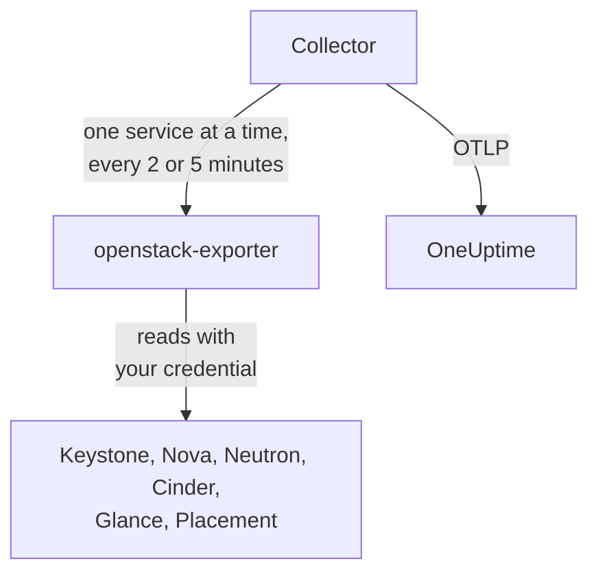

# OpenStack-agent

De OneUptime OpenStack-agent bewaakt een OpenStack-cloud: de services en agents, hypervisors, instanties, netwerken, routers, volumes, opslagpools, images en projecten, in elke regio. Hij leest de API's van de cloud met een referentie die u zelf kiest en stuurt wat hij vindt naar OneUptime, waar de cloud verschijnt met zijn regio's, hypervisors en projecten. [OpenStack-monitors](/docs/monitor/openstack-monitor) waarschuwen over wat binnenkomt, en een [probe](/docs/telemetry/openstack-agentless) kan een cloud verzamelen zonder dat er iets geïnstalleerd hoeft te worden.

:::cards
- [Probe of agent?](/docs/telemetry/openstack-agentless#sonde-of-agent): Welke u kiest, voor een cloud die met beide kan.
- [Kies hoeveel hij ziet](#kies-hoeveel-de-agent-ziet): OpenStack kent geen algemene alleen-lezenrol, dus zijn er drie niveaus.
- [De agent installeren](#de-agent-installeren): Een referentie, daarna het installatiescript, Docker Compose of helemaal geen Docker.
- [Wat het uw cloud kost](#wat-het-uw-cloud-kost): Wat elke instelling leest en hoe u die wijzigt.
- [Capaciteit](#capaciteit): Hoeveel er nog van elke flavor passen en over hoeveel dagen elk ding vol is.
- [Uitgaven](#uitgaven): Wie wat gebruikt, wat dat kost tegen uw prijzen of zoals CloudKitty het heeft gewaardeerd, en wat er teruggewonnen kan worden.
- [Statuspagina's en projecten berichten](#statuspaginas-en-projecten-berichten): Een pagina per regio in één stap, en alleen de projecten berichten die een storing raakt.
- [Servicelogboeken](#servicelogboeken): Geparseerd, met een verzoek gevolgd over services heen.
- [Levenscyclusgebeurtenissen](#levenscyclusgebeurtenissen): Instantieacties in de feed en op grafieken, uit notificaties of via een probe.
- [Wie deed wat](#wie-deed-wat): Auditsporen in Security Events.
- [Een verzoek traceren](#verzoeken-traceren-door-het-controlevlak): Eén ondertekend verzoek, gevolgd over het controlevlak.
- [Van buitenaf controleren](#de-cloud-van-buitenaf-controleren): Of iemand daadwerkelijk een instantie kan starten, vanaf een probe buiten de cloud.
- [Zonder internet](#zonder-internet): De vier images van de agent en hoe u ze naar een eigen registry kopieert.
- [Per implementatietool](/docs/telemetry/openstack-deployment-tools): Kolla-Ansible, OpenStack-Ansible, OpenStack-Helm, Atmosphere, Sunbeam, Red Hat en Mirantis.
- [Probleemoplossing](#probleemoplossing): Een diagnostisch script en de gebruikelijke problemen.
:::

## Hoe het werkt

De agent bestaat uit twee vastgepinde upstream-programma's en hun configuratie, op één machine: [openstack-exporter](https://github.com/openstack-exporter/openstack-exporter) leest de API's van de cloud en zet ze om in `openstack_*`-reeksen, en een OpenTelemetry Collector vraagt hem om één OpenStack-service tegelijk, voorziet elke reeks van de cloud en regio waar die vandaan komt en stuurt ze naar OneUptime. Er draait niets op uw controllers of compute-nodes, tenzij u het optionele [logboekprofiel](#servicelogboeken) toevoegt, dat hun logboeken leest.



De cloud registreert zichzelf met zijn eerste gegevens, onder de naam die de agent op elke metriek zet als `openstack.cloud.name`. Eén agent bewaakt één cloud: één Keystone, met één regio of meerdere.

## Voordat u begint

- Docker Engine 20.10 of nieuwer met de Docker Compose v2-plugin, of, om zonder Docker te draaien, een Linux-machine (x86_64 of arm64) met systemd 235 of nieuwer, glibc 2.34 of nieuwer (RHEL 9, Ubuntu 22.04, Debian 12) en root.
- Een route van die machine naar Keystone en naar het publieke endpoint van elke service.
- De `openstack`-opdrachtregel, als iemand die de onderstaande referentie kan aanmaken.
- Een ingestiesleutel. Maak er een aan onder **Projectinstellingen → Telemetrie & APM → Ingestiesleutels** en kopieer de waarde.
- Uitgaand HTTPS van die machine naar uw OneUptime-URL.

### Waar u de agent draait

Draai de agent buiten de cloud die hij bewaakt: een kleine VM op aparte hardware, een beheerhost, een andere cloud. Een agent binnen een cloud die is uitgevallen valt er samen mee stil, en stilte lijkt op een gezonde cloud die niet meer rapporteert.

## Kies hoeveel de agent ziet

OpenStack kent geen algemene alleen-lezenrol, en dat is het lastigste aan het bewaken ervan:

- `reader` is overal beperkt tot een project, behalve in Keystone en Ironic.
- Hypervisors, services, agents, pools en Placement vereisen standaard admin.
- Een beleidsoverschrijving kan geen lijsten over alle projecten in Neutron of Cinder openen, want die beperken ze in hun eigen code met de admin-context.
- Cinders services en opslagpools beantwoorden alles behalve een admin met een `403`, vanuit Cinders eigen code, nadat het beleid al is gepasseerd. Geen overschrijving opent die ook.
- Neutron en Cinder beantwoorden een gewone reader met een `200` en alleen het eigen project van die reader. Het lijkt gelukt, maar dat is het niet.
- Waar Cinder `enforce_new_defaults` uit heeft, wat Cinders eigen standaard is, kan elke rol op een project de volumes van dat project aanmaken, ook `reader` en `oneuptime_monitoring`. Op Epoxy, Flamingo en Gazpacho maakten een gewone reader en de rol op een echt project allebei een volume aan (`202`). Op Hibiscus werden beide geweigerd (`403`), omdat DevStack `enforce_new_defaults` alleen daar aanzet. Een alleen-lezenrol op een echt project is niet alleen-lezen.

Er zijn dus drie niveaus, en elk kost iets. Begin met het eerste als u kunt.

| Niveau | Wat het nodig heeft | Wat het ziet | Wat ontbreekt |
| --- | --- | --- | --- |
| **1. Volledig zicht** | Een application credential op een account met `admin` op een eigen project, door toegangsregels beperkt tot lezen, met `service_type` ingesteld op elke service | Elke lezing die de agent doet, en de status van `cinder-volume` en `cinder-scheduler` en de opslagpools, die alleen dit niveau ziet | Keystones gebruikers en groepen, met opzet. Het kan niet schrijven: elke schrijfactie werd beantwoord met `401` |
| **2. Alleen infrastructuur** | De rollen `oneuptime_monitoring` en `reader` op een eigen project dat niets bevat en nul quota heeft, en de beleidsoverschrijvingen die de agent meelevert | Alle projecten, domeinen, services en endpoints van Keystone, heel Nova inclusief de servers van elk project, heel Placement, en de agents en IP-beschikbaarheid van Neutron | Neutrons netwerken, subnetten, routers, floating IP's en poorten, en Cinders volumes en snapshots, zijn alleen die van het eigen project, dus op een leeg project alleen de gedeelde en externe. Geen status van `cinder-volume` of `cinder-scheduler` en geen opslagpools. Het kan niet schrijven: elke schrijfactie werd beantwoord met `403`, of `409` en `413` vanwege quota |
| **3. Projectzicht** | Gewone `reader` op een echt project, voor een team dat zijn eigen deel van een door een ander beheerde cloud bewaakt | De volumes, netwerken en routers van dat project, uit Cinder en Neutron | Alle infrastructuur: geen hypervisors, services, agents, pools of capaciteit. Via de agent ook geen instanties, omdat de lezing van alle projecten door de exporter wordt geweigerd. En op veel clouds kan `reader` daar schrijven |

De sjablonen **Block Storage Service Down**, **Storage Pool Warning** en **Storage Pool Critical** vereisen niveau 1. **Compute Service Down**, **Network Agent Down** en de Placement- en hypervisorsjablonen vereisen niveau 1 of 2, en op niveau 3 leest niets een instantie.

### Wat elk niveau leest

Dit is wat vijf echte clouds antwoordden, op Epoxy, Flamingo, Gazpacho (OVN en OVS) en Hibiscus. Elke cel is opgesteld uit die opnamen.

| Lezing | Niveau 1: Volledig zicht | Niveau 2: Alleen infrastructuur | Niveau 3: Projectzicht |
| --- | --- | --- | --- |
| Keystone: projecten | alle | alle | geweigerd |
| Keystone: domeinen | alle | alle | geweigerd |
| Keystone: regio's | alle | wat iedereen ziet | wat iedereen ziet |
| Keystone: services | alle | alle | geweigerd |
| Keystone: endpoints | alle | alle | geweigerd |
| Nova: servers, alle projecten | alle | alle | geweigerd |
| Nova: services | alle | alle | geweigerd |
| Nova: hypervisors | alle | alle | geweigerd |
| Nova: aggregates | alle | alle | geweigerd |
| Nova: beschikbaarheidszones, detail | alle | alle | geweigerd |
| Nova: flavors | alle | wat iedereen ziet | wat iedereen ziet |
| Nova: gebruik per project | alle | alle | geweigerd |
| Placement: resource providers | alle | alle | geweigerd |
| Neutron: agents | alle | alle | niets |
| Neutron: netwerken | alle | alleen eigen project | alleen eigen project |
| Neutron: subnetten | alle | alleen eigen project | alleen eigen project |
| Neutron: routers | alle | alleen eigen project | alleen eigen project |
| Neutron: floating IP's | alle | alleen eigen project | alleen eigen project |
| Neutron: IP-beschikbaarheid | alle | alle | niets |
| Neutron: beveiligingsgroepen | alle | 409, verwacht | alleen eigen project |
| Neutron: poorten | alle | alleen eigen project | alleen eigen project |
| Neutron: quota's | alle | geweigerd | geweigerd |
| Cinder: volumes, alle projecten | alle | alleen eigen project | alleen eigen project |
| Cinder: services | alle | geweigerd | geweigerd |
| Cinder: pools | alle | geweigerd | geweigerd |
| Cinder: snapshots, alle projecten | alle | alleen eigen project | alleen eigen project |
| Cinder: back-ups, alle projecten | alle | geen vastgelegd | geen vastgelegd |
| Cinder: volumetypen | alle | wat iedereen ziet | wat iedereen ziet |
| Glance: images | alle | wat iedereen ziet | wat iedereen ziet |

- **alle**: dezelfde rijen die een admin zag.
- **alleen eigen project**: de rijen van dat project, en alles wat gedeeld of extern is. Op een project dat niets bevat zijn dat alleen de gedeelde en externe.
- **geweigerd**: een `401` of een `403`.
- **wat iedereen ziet**: elke referentie zag elke rij, op clouds die alleen publieke flavors, volumetypen en images bevatten. Een privé-exemplaar in een ander project vereist niveau 1.
- **niets**: een `200` zonder rijen, op een project dat ook netwerken heeft. Het lijkt gelukt, maar dat is het niet.
- **geen vastgelegd**: een `200` zonder rijen waar een admin er ook geen zag, dus er was niets om aan af te lezen.
- **409, verwacht**: Neutron probeert de standaardbeveiligingsgroep van het project aan te maken wanneer hij ze opsomt, en nul quota staat dat niet toe, dus hij antwoordt `409 Quota exceeded`. Dat is onschadelijk en er valt niets te herstellen.

Octavia, Ironic, Heat, Magnum, Manila, Designate, Barbican, Swift, Trove en Gnocchi staan hier niet omdat die clouds ze niet draaien. Het [diagnostische script](#probleemoplossing) vraagt ze ook, waar een cloud ze heeft, en het leest elk pad met uw echte referentie en zegt wat die referentie kan zien.

Wat de exporter van de agent met elk kreeg, in reeksen per service. De aantallen volgen wat een cloud bevat op het moment van vragen, dus vergelijk ze onderling en niet met die van u:

| Exporterservice | Admin | Niveau 1: Volledig zicht | Niveau 2: Alleen infrastructuur | Niveau 3: Projectzicht |
| --- | --- | --- | --- | --- |
| identity | 14 | 13 | 13 | 4 |
| compute | 33 | 33 | 33 | 15 |
| placement | 25 | 25 | 25 | 1 |
| network | 36 tot 40 | 36 tot 40 | 24 tot 26 | 14 |
| volume | 33 | 33 tot 41 | 23 | 29 tot 37 |
| image | 4 | 4 | 4 | 4 |

## De agent installeren

Elke OneUptime serveert het installatiescript en de bestanden van de agent voor zijn eigen release: de onderstaande opdrachten downloaden ze van `https://oneuptime.com`, dus vervang dat bij een zelf gehoste OneUptime door uw URL. Het installatiescript wordt eerst als `install.sh` opgeslagen, zodat u het kunt lezen voordat u het uitvoert.

:::steps
### De referentie aanmaken

Kies het niveau dat u hebt gekozen. Elk maakt een application credential aan, dat een `id` en een `secret` toont: het secret wordt maar één keer getoond. Geef het een vervaldatum en nooit `--unrestricted`, want daarmee kan het meer referenties aanmaken.

:::tabs
@tab Level 1: Full view
Maak als admin een project en een account voor de agent aan:

```bash
openstack project create --domain default oneuptime-monitoring
openstack user create --domain default --password-prompt oneuptime-monitoring
openstack role add --project oneuptime-monitoring --user oneuptime-monitoring admin
```

Maak daarna, ingelogd als dat account op dat project, de referentie aan. De regels zijn de exacte `GET`-paden die de agent gebruikt, afgestemd op uw cloud:

```bash
curl -fsSLO https://oneuptime.com/install/openstack-agent/access/application-credential-access-rules.json
curl -fsSLO https://oneuptime.com/install/openstack-agent/access/access-rules-for-cloud.py
openstack catalog list -f json | python3 access-rules-for-cloud.py \
  application-credential-access-rules.json > access-rules-for-this-cloud.json
openstack application credential create oneuptime-agent \
  --role admin \
  --access-rules "$(cat access-rules-for-this-cloud.json)" \
  --expiration 2027-11-01T00:00:00
```

Een toegangsregel wordt vergeleken met het pad dat de service ziet. Een service achter een padvoorvoegsel, zoals `https://cloud.example/compute/v2.1`, ziet `/compute/v2.1/servers` en weigert de meegeleverde regel voor `/v2.1/servers` met een `401`. `access-rules-for-cloud.py` voegt elke regel opnieuw toe onder het voorvoegsel van zijn service, gelezen uit uw catalogus.

Twee van de lezingen van de exporter vragen om regels die met de hand makkelijk worden gemist. Hij leest als eerste de root van Octavia, en achter Apache ziet een service die als `/load-balancer//`, met twee schuine strepen. Bij weigering antwoordt de exporter met een lege `200`, waardoor de cloud lijkt alsof hij geen Octavia draait. En hij somt het account van Swift op met een afsluitende schuine streep, die `/v1/*` niet dekt. Bij weigering staat `openstack_object_store_up` op `0`. De afgestemde regels bevatten beide. De regels van een referentie kunnen niet worden gewijzigd, dus als de uwe met een oudere kopie ervan is gemaakt, maak dan een nieuwe aan.

Toegangsregels vereisen ook dat `service_type` voor keystonemiddleware op elke service is ingesteld, en een herstart van die service. Zonder weigert de service de referentie met een `401`:

```ini title="nova.conf"
[keystone_authtoken]
service_type = compute
```

| Configuratiebestand | `service_type` |
| --- | --- |
| `nova.conf` | `compute` |
| `neutron.conf` | `network` |
| `cinder.conf` | `block-storage`. De regels bevatten ook `volume` en `volumev3`, voor een Cinder die zo is geconfigureerd |
| `glance-api.conf` | `image` |
| `placement.conf` | `placement` |
| `octavia.conf` | `load-balancer` |
| `ironic.conf` | `baremetal` |
| `heat.conf` | `orchestration` |
| `magnum.conf` | `container-infra` |
| `manila.conf` | `sharev2`. De regels bevatten ook `shared-file-system`, voor een Manila die zo is geconfigureerd |
| `designate.conf` | `dns` |
| `barbican.conf` | `key-manager` |
| `trove.conf` | `database` |
| `gnocchi.conf` | `metric` |
| `cloudkitty.conf` | `rating` |
| `proxy-server.conf`, onder `[filter:authtoken]` | `object-store`, en `include_service_catalog = True` ernaast. keystonemiddleware controleert de regels tegen de catalogus van het token, dus met `False`, wat DevStack instelt, antwoordt Swift de referentie met `500` |

Alleen de services die uw cloud draait hebben een regel nodig.

Op de services die een cloud misschien niet draait, verschilt wat elk niveau op echte clouds kreeg op vier punten van de bovenstaande tabellen:

- **Ironic** beantwoordt de referentie van een project, ook die van een admin, met alleen de nodes die dat project bezit, en weigert de conductors. Alleen systeemscope leest elke node en de conductors, en de referentie van de agent zit op een project. Om er een node mee te lezen, maakt u het bijbehorende project de eigenaar: `openstack baremetal node set --owner`.
- **Swift** somt de containers van het eigen project van de referentie op, en geen andere. Het account van een ander project antwoordt `403`, tenzij de referentie `ResellerAdmin` heeft.
- **Barbican** beantwoordt een referentie alleen over haar eigen project, en weigert een gewone reader. OneUptime leest geen secret.
- **Gnocchi** laat elke rol op een project een metriek aanmaken, dus op een cloud die het draait kunnen niveau 2 en niveau 3 daar schrijven.

Keystone heeft niets nodig. Met de afgestemde regels, `service_type` ingesteld en de API's herstart, werd elke lezing beantwoord met `200` en elke schrijfactie met `401`, op elke release die we vastleggen. De exporter krijgt wat een admin krijgt, behalve Keystones gebruikers en groepen, met opzet. Dat geldt ook voor de services die een cloud misschien niet draait: vastgelegd op DevStack kreeg niveau 1 van elke service die de exporter leest dezelfde reeksen als de referentie van een admin, en elke schrijfactie werd beantwoord met `401`.

Als u die wijziging niet wilt doorvoeren, maak dan dezelfde referentie zonder `--access-rules`: een gewoon admin application credential. Het werkt en het kan schrijven, dus het diagnostische script labelt het als zodanig.
@tab Level 2: Infrastructure only
Maak als admin de rol, een project dat niets bevat en nul quota heeft, en een account aan:

```bash
openstack role create oneuptime_monitoring
openstack project create --domain default --description "OneUptime monitoring: holds nothing" oneuptime-monitoring
openstack quota set --instances 0 --cores 0 --ram 0 --key-pairs 0 oneuptime-monitoring
openstack quota set --volumes 0 --gigabytes 0 --snapshots 0 --backups 0 --backup-gigabytes 0 oneuptime-monitoring
openstack quota set --networks 0 --subnets 0 --ports 0 --routers 0 --floating-ips 0 --secgroups 0 --secgroup-rules 0 oneuptime-monitoring
openstack user create --domain default --password-prompt oneuptime-monitoring
openstack role add --project oneuptime-monitoring --user oneuptime-monitoring oneuptime_monitoring
openstack role add --project oneuptime-monitoring --user oneuptime-monitoring reader
```

Het project bevat met opzet niets en heeft nul quota. Waar Cinder `enforce_new_defaults` uit heeft, kan elke rol op een project de volumes van dat project aanmaken. Zonder iets om aan te raken en zonder quota om iets mee te maken is er niets om te schrijven: op elke release die we vastleggen werd elke schrijfactie beantwoord met `403`, of `409` en `413` vanwege quota.

Download de beleidsoverschrijvingen en voeg elk bestand, op elke controller, samen met het bestand dat `[oslo_policy] policy_file` in de configuratie van die service aanwijst (`nova.conf`, `neutron.conf` enzovoort). Dat is `/etc/nova/policy.yaml`, enzovoort, tenzij uw implementatie iets anders zegt: DevStack zegt `policy.json`. Elke regel behoudt de standaard van de service en voegt de rol toe, en oslo.policy merkt een gewijzigd bestand zelf op, dus een herstart is niet nodig.

```bash
curl -fsSLO https://oneuptime.com/install/openstack-agent/access/policy/nova.yaml
curl -fsSLO https://oneuptime.com/install/openstack-agent/access/policy/neutron.yaml
curl -fsSLO https://oneuptime.com/install/openstack-agent/access/policy/keystone.yaml
curl -fsSLO https://oneuptime.com/install/openstack-agent/access/policy/placement.yaml
```

Voor Cinder is er geen bestand. Zijn `os-services` en `scheduler-stats/get_pools` beantwoorden de rol met `403 User does not have admin privileges`, op alle vijf de releases die we vastleggen. Dat komt doordat Cinders eigen code een admin-context vereist, nadat het beleid al is gepasseerd, dus geen overschrijving kan ze openen.

**Om de overschrijvingen weer weg te halen, maakt u het bestand leeg (`{}`) en verwijdert u het nooit.** Op Flamingo (2025.2) en Epoxy (2025.1) geeft oslo.policy bij elke controle een fout zodra een beleidsbestand dat het heeft gelezen verdwenen is, waardoor die service elk verzoek laat mislukken. Als die service Keystone is, valideert die geen tokens meer en antwoordt de hele cloud `503`. Als het al is gebeurd, herstart dan de service.

Maak daarna, ingelogd als dat account op dat project, de referentie aan:

```bash
openstack application credential create oneuptime-agent --expiration 2027-11-01T00:00:00
```

De rol op een echt project zetten om de volumes en routers ervan te zien laat het account daar ook schrijven, op een cloud waar Cinder `enforce_new_defaults` uit heeft. Het diagnostische script waarschuwt wanneer het project van de referentie iets bevat.
@tab Level 3: Project view
Geef een account de gewone rol `reader` op het project en maak daarna, ingelogd als dat account op dat project, de referentie aan:

```bash
openstack role add --project my-team --user my-monitoring-account reader
openstack application credential create oneuptime-agent --expiration 2027-11-01T00:00:00
```

De agent ziet de rijen van dat project uit Cinder en Neutron en geen infrastructuur. Drie dingen om te weten voordat u dit kiest:

- **Via de agent toont het helemaal geen instanties.** De exporter vraagt Nova om de servers van alle projecten, Nova weigert een gewone reader, en die lezing mislukt als geheel. Alleen een OneUptime-probe, die zonder deze agent verzamelt, kan de instanties van één project opsommen.
- **Het kan misschien schrijven.** Op een cloud waar Cinder `enforce_new_defaults` uit heeft, kan gewone `reader` ook volumes in zijn project aanmaken. Op Epoxy, Flamingo en Gazpacho lukte dat (`202`), en op Hibiscus werd het geweigerd (`403`), omdat DevStack `enforce_new_defaults` alleen daar aanzet. Cinders eigen standaard is uit.
- **Placement lijkt niet te antwoorden.** Elke aanroep die het doet wordt geweigerd, en de exporter meldt dat zoals hij een gestopte Placement meldt: `openstack_placement_up 0`, op alle vijf de releases die we vastleggen. De pagina's kunnen dat onderscheiden aan de hand van wat er verder voor deze referentie gesloten is, en zeggen het. Het sjabloon [Placement API Down](/docs/monitor/openstack-monitor#kant-en-klare-waarschuwingssjablonen) kan dat niet, dus laat dat sjabloon op dit niveau weg.
:::

### De agent installeren en starten

:::tabs
@tab install.sh
Download het installatiescript en voer het uit op de machine die de agent gaat hosten:

```bash
curl -fsSL https://oneuptime.com/install/openstack-agent -o install.sh
bash install.sh
```

Het script vraagt om uw OneUptime-URL, de ingestiesleutel, een vaste naam voor de cloud, de Keystone-auth-URL, de regionamen, de application credential (een gebruikersnaam en wachtwoord als u daar nee op zegt) en een privé-CA-bestand als de cloud een eigen certificeringsinstantie heeft. Niets geheims wordt getoond of komt op een opdrachtregel. Het controleert de referentie bij Keystone voordat het iets schrijft of start, installeert in `/opt/oneuptime-openstack-agent`, of in `oneuptime-openstack-agent` in uw thuismap als u geen rechten op `/opt` hebt (het heeft alleen de groep `docker` nodig), schrijft `.env` en `clouds.yaml` met modus `0600` en start de agent met Docker Compose. Elk antwoord werkt ook als omgevingsvariabele, en als u het script opnieuw uitvoert, hergebruikt het die in plaats van opnieuw te vragen, en zo [werkt u de agent bij](#de-agent-bijwerken).
@tab Docker Compose
Download `docker-compose.yml` en `otel-collector-config.yaml` van uw OneUptime naar een nieuwe map:

```bash
mkdir oneuptime-openstack-agent && cd oneuptime-openstack-agent
curl -fsSLO https://oneuptime.com/install/openstack-agent/docker-compose.yml
curl -fsSLO https://oneuptime.com/install/openstack-agent/otel-collector-config.yaml
```

Maak ernaast een `clouds.yaml` met één vermelding per regio, **vernoemd naar de regio**, omdat de reeksen van de exporter niet zeggen uit welke regio ze komen en de collector de naam van de vermelding erop zet als `openstack.region.name`:

```yaml title="clouds.yaml"
clouds:
  RegionOne:
    region_name: RegionOne
    identity_api_version: 3
    auth_type: v3applicationcredential
    auth:
      auth_url: https://keystone.example.com:5000/v3
      application_credential_id: your-credential-id
      application_credential_secret: your-credential-secret
```

Maak dan een `.env`-bestand:

```bash title=".env"
ONEUPTIME_URL=YOUR_ONEUPTIME_URL
ONEUPTIME_TELEMETRY_INGESTION_KEY=YOUR_TELEMETRY_INGESTION_TOKEN
OPENSTACK_CLOUD_NAME=my-cloud
OPENSTACK_EXPORTER_CLOUDS=[RegionOne,RegionTwo]
COMPOSE_PROFILES=openstack-exporter,openstack-ai-agent
```

`OPENSTACK_EXPORTER_CLOUDS` noemt elke regio, tussen vierkante haken, en `COMPOSE_PROFILES` start de meegeleverde exporter en de [AI-agent](#ai-agent). Beide bestanden bevatten geheimen. De exporter draait als uid 65532 en moet het enige account zijn dat `clouds.yaml` kan lezen. Start de agent:

```bash
chmod 600 .env
sudo chown 65532:65532 clouds.yaml
sudo chmod 600 clouds.yaml
docker compose up -d
```
@tab Without Docker
Op Linux (x86_64 of arm64) met systemd 235 of nieuwer en glibc 2.34 of nieuwer draait het installatiescript de upstream-releases van dezelfde twee programma's als systemd-services. RHEL 8 en verwanten hebben een oudere glibc, waarop de release van de exporter niet kan draaien: het script zegt dat en wijzigt niets, gebruik dus Docker daar.

```bash
curl -fsSL https://oneuptime.com/install/openstack-agent -o install.sh
sudo bash install.sh --without-docker
```

Dezelfde vragen, dezelfde controle bij Keystone en dezelfde bestanden. Elk releasearchief wordt vergeleken met een in `install.sh` vastgepinde sha256, en een download die niet overeenkomt stopt de installatie voordat er iets verandert. De collector draait als een wegwerpgebruiker zonder privileges die de OpenStack-referentie nooit ziet, en de exporter als de systeemgebruiker `oneuptime-openstack`, het enige account dat `clouds.yaml` kan lezen, en luistert alleen op `127.0.0.1:9180`.

Draai één agent per cloud: voer bij een overstap van een Docker-installatie eerst `docker compose down` uit, anders komt elke metriek dubbel binnen.
:::

Draait u al openstack-exporter met `--multi-cloud`? Wijs de agent ernaar en de meegeleverde start nooit: `OPENSTACK_EXPORTER_ADDRESS=10.0.0.5:9180 bash install.sh`, of laat `COMPOSE_PROFILES` weg uit `.env` en stel daar `OPENSTACK_EXPORTER_ADDRESS` in. Zijn `clouds.yaml` heeft een vermelding nodig die naar elke regio is vernoemd, en hij moet uitzetten wat de meegeleverde uitzet: zie [Wat het uw cloud kost](#wat-het-uw-cloud-kost). Gebruik een adres dat de container van de agent kan bereiken: `localhost` is de container zelf.

De exporter van Kolla-Ansible draait zonder `--multi-cloud`, heeft dus geen `/probe`, en is vastgepind op een release die minder zegt. [De exporter gebruiken die u al draait](/docs/telemetry/openstack-deployment-tools#de-exporter-gebruiken-die-u-al-draait) legt uit hoe u hem leest en waar de pagina's precies buiten blijven. [OpenStack per implementatietool](/docs/telemetry/openstack-deployment-tools) heeft de rest van de stappen van elke tool.

### Controleer of de agent draait

```bash
cd /opt/oneuptime-openstack-agent    # or the folder the script said it installed to
docker compose ps
docker logs oneuptime-openstack-agent
```

`docker compose ps` toont de collector (`oneuptime-openstack-agent`), de meegeleverde exporter (`oneuptime-openstack-exporter`) en de [AI-agent](#ai-agent) (`oneuptime-openstack-ai-agent`). In de logboeken van de collector hoort deze regel te staan zodra hij gestart is:

```text
Everything is ready. Begin running and processing data.
```

Zonder Docker vraagt u `systemctl status oneuptime-openstack-agent oneuptime-openstack-exporter` en `journalctl -u oneuptime-openstack-agent`.

### De cloud vinden in OneUptime

Open **Producten → Infrastructuur → OpenStack**. De cloud verschijnt onder zijn `OPENSTACK_CLOUD_NAME` na zijn eerste verzameling, binnen enkele minuten. Compute, netwerk, volume en Placement worden elke 2 minuten gelezen, identity en images elke 5.
:::

Het **Overzicht** van de cloud zegt of de gegevens OneUptime bereiken, wat het eerst aandacht nodig heeft en hoe elke service het doet:


**Hypervisors** zegt wat Nova en Placement op elke compute-host hebben beloofd:


**Instanties** toont elke instantie met zijn status in Nova's eigen woorden, zijn project, flavor en hypervisor:


## Omgevingsvariabelen

Het installatiescript schrijft deze naar `/opt/oneuptime-openstack-agent/.env`; een Docker Compose-installatie leest ze uit de `.env` naast `docker-compose.yml`. Voer na het wijzigen van een variabele `docker compose up -d` uit in die map. Alleen `clouds.yaml` bevat de referentie.

| Variabele | Vereist | Beschrijving |
| --- | --- | --- |
| `ONEUPTIME_URL` | Ja | Uw OneUptime-URL, zoals `https://oneuptime.com` of uw zelf gehoste instantie. |
| `ONEUPTIME_TELEMETRY_INGESTION_KEY` | Ja | De ingestiesleutel uit **Projectinstellingen → Telemetrie & APM → Ingestiesleutels**. |
| `OPENSTACK_CLOUD_NAME` | Ja | De naam van de cloud in OneUptime, op elke metriek gezet als resourceattribuut `openstack.cloud.name`. Houd hem stabiel: wijzigen registreert een nieuwe cloud. Standaard `openstack`. |
| `OPENSTACK_AUTH_URL` | Meegeleverde exporter | Een antwoord op het installatiescript: de Keystone-auth-URL. `/v3` wordt toegevoegd als het ontbreekt. |
| `OPENSTACK_EXPORTER_CLOUDS` | Ja | De regio's, tussen vierkante haken, zoals `[RegionOne,RegionTwo]`, elk de naam van een vermelding in `clouds.yaml`. Standaard `[RegionOne]`. |
| `OPENSTACK_EXPORTER_ADDRESS` | Nee | `host:port`, zonder schema, van uw eigen exporter. Laat het weg voor de meegeleverde. |
| `OPENSTACK_CA_FILE` | Nee | Een PEM-bestand met de certificeringsinstantie van een cloud die er een eigen heeft. Het installatiescript bewaart een kopie als `ca.pem` naast `clouds.yaml`. |
| `OPENSTACK_EXPORTER_USER` | Nee | De `uid:gid` waaronder de container van de exporter draait, die eigenaar van `clouds.yaml` moet zijn. Standaard `65532:65532`. |
| `COMPOSE_PROFILES` | Meegeleverde exporter | `openstack-exporter` start de meegeleverde exporter en `openstack-ai-agent` de [AI-agent](#ai-agent). |
| `OPENSTACK_LIBVIRT_EXPORTER_TARGETS` | Nee | De compute-nodes waarvan het [echte gebruik](#echt-gebruik) wordt gelezen via `prometheus-libvirt-exporter`, tussen vierkante haken, zoals `[compute-01:9177,compute-02:9177]`. Standaard geen. |
| `OPENSTACK_CEILOMETER_EXPORTER_TARGETS` | Nee | Hetzelfde via Ceilometers eigen exporter, zoals `[compute-01:9101]`. Standaard geen. |
| `OPENSTACK_SINGLE_CLOUD_EXPORTER_TARGETS` | Nee | Een exporter die al draait zonder `--multi-cloud`, zoals die van Kolla-Ansible: `[10.0.0.254:9198]`. Zie [De exporter gebruiken die u al draait](/docs/telemetry/openstack-deployment-tools#de-exporter-gebruiken-die-u-al-draait). |
| `OPENSTACK_RABBITMQ_TARGETS` | Nee | De Prometheus-plugin van RabbitMQ op elke node, voor [waarop de cloud steunt](#waarop-de-cloud-steunt): `[10.0.0.11:15692,10.0.0.12:15692]`. Standaard geen. |
| `OPENSTACK_MARIADB_TARGETS` | Nee | mysqld_exporter naast elke MariaDB-node, meestal op `9104`. Standaard geen. |
| `OPENSTACK_MEMCACHED_TARGETS` | Nee | memcached_exporter naast elke Memcached, meestal op `9150`. Standaard geen. |
| `OPENSTACK_HAPROXY_TARGETS` | Nee | De eigen Prometheus-exporter van HAProxy. Standaard geen. |
| `OPENSTACK_NETWORK_EXPORTER_TARGETS` | Nee | openstack-network-exporter op elke node, voor OVN en Open vSwitch, meestal op `1981`. Standaard geen. |
| `OPENSTACK_LIBVIRT_HEALTH_TARGETS` | Nee | prometheus-libvirt-exporter op elke compute-node, meestal op `9177`, voor of libvirt antwoordt en niets per instantie. Standaard geen. |
| `OPENSTACK_CONTROL_PLANE_REGION` | Nee | De regio van een bovenstaand doel dat zijn eigen regio niet zegt. Een doel kan dat wel: `RegionTwo@10.1.0.11:15692`. Standaard de eerste regio. |
| `OPENSTACK_AGENT_SERVICES` | Nee | Welke services deze agent leest, om [een cloud tussen agents te delen](/docs/telemetry/openstack-very-large-clouds#een-cloud-delen-tussen-verzamelaars), zoals `compute\|placement`. Standaard alle. |
| `OPENSTACK_AGENT_MEMORY_LIMIT_MIB` | Nee | Wat de collector in het geheugen mag houden. De scrape van een zeer grote cloud heeft meer nodig dan de standaard van `512`. |
| `OPENSTACK_DATABASE_EXPORTER_TARGETS` | Nee | `openstack_database_exporter`, voor [het databasepad](/docs/telemetry/openstack-very-large-clouds#het-databasepad): `[openstack-database-exporter:9180]`. Standaard geen. De andere instellingen van dat pad staan daar vermeld. |

Het installatiescript leest de referentie ook uit de omgeving, om zijn vragen over te slaan: `OPENSTACK_APPLICATION_CREDENTIAL_ID` en `OPENSTACK_APPLICATION_CREDENTIAL_SECRET`, of `OPENSTACK_USERNAME`, `OPENSTACK_PASSWORD`, `OPENSTACK_PROJECT_NAME`, `OPENSTACK_USER_DOMAIN_NAME` en `OPENSTACK_PROJECT_DOMAIN_NAME`. Ze hebben eigen namen in plaats van de `OS_*`-namen die een openrc-bestand instelt, zodat de ingeladen openrc van een admin nooit de referentie van de agent wordt zonder dat iemand het gevraagd wordt. Een application credential is beter dan een gebruikersnaam en wachtwoord: het kan tot lezen beperkt worden en kan verlopen.

## Waarop de cloud steunt

De meeste OpenStack-storingen beginnen eronder: een verdwenen RabbitMQ, Galera zonder quorum, een OVN-database zonder leader. De agent kan de exporters lezen die die al hebben, elke minuut, en het staat uit totdat u ze noemt. Niets hier schrijft naar een van hen, en van elk worden maar enkele reeksen bewaard.

Noem ze in de `.env` van de agent, elk lid van een cluster, en voer dan `docker compose up -d` uit:

```bash
OPENSTACK_RABBITMQ_TARGETS=[10.0.0.11:15692,10.0.0.12:15692,10.0.0.13:15692]
OPENSTACK_MARIADB_TARGETS=[10.0.0.11:9104,10.0.0.12:9104,10.0.0.13:9104]
OPENSTACK_MEMCACHED_TARGETS=[10.0.0.11:9150,10.0.0.12:9150]
OPENSTACK_HAPROXY_TARGETS=[10.0.0.11:9101,10.0.0.12:9101]
OPENSTACK_NETWORK_EXPORTER_TARGETS=[10.0.0.21:1981,10.0.0.22:1981,RegionTwo@10.1.0.21:1981]
OPENSTACK_LIBVIRT_HEALTH_TARGETS=[10.0.0.21:9177,10.0.0.22:9177]
OPENSTACK_CONTROL_PLANE_REGION=RegionOne
```

Een doel kan zeggen in welke regio het zit, zoals de laatste in die lijst. Een doel dat dat niet zegt zit in `OPENSTACK_CONTROL_PLANE_REGION`. Op Kolla-Ansible, waarvan Prometheus ze allemaal al kent, drukt `control-plane-targets.py` deze regels voor u af, en [OpenStack per implementatietool](/docs/telemetry/openstack-deployment-tools) zegt waar elke exporter staat op de andere.

Wat elk leest, en wat de agent ervan nodig heeft:

| Instelling | Leest | Zet het aan met |
| --- | --- | --- |
| `OPENSTACK_RABBITMQ_TARGETS` | De eigen plugin van RabbitMQ, `/metrics` en elke wachtrij uit `/metrics/detailed` | `rabbitmq-plugins enable rabbitmq_prometheus` op elke node |
| `OPENSTACK_MARIADB_TARGETS` | mysqld_exporter naast elke node. Zijn standaardinstellingen melden Galera al | Niets behalve de exporter |
| `OPENSTACK_MEMCACHED_TARGETS` | memcached_exporter naast elke Memcached | Niets behalve de exporter |
| `OPENSTACK_HAPROXY_TARGETS` | De eigen exporter van HAProxy | `http-request use-service prometheus-exporter` op een eigen `frontend` |
| `OPENSTACK_NETWORK_EXPORTER_TARGETS` | openstack-network-exporter op elke machine met Open vSwitch of de databases van OVN | Zijn standaardcollectors. Een machine meldt wat hij draait |
| `OPENSTACK_LIBVIRT_HEALTH_TARGETS` | prometheus-libvirt-exporter op elke compute-node, en alleen of libvirt antwoordt | Niets behalve de exporter |

Daarna heeft de kaart **Controlevlak** van de cloud een regel voor elk, en een pagina per afhankelijkheid met een regel per machine. **Niet bewaakt** op die kaart betekent dat u het niet hebt genoemd: het leest nooit als gezond. Problemen daar gaan naar **Vraagt aandacht** van de cloud. De pagina **Aanbevelingen** van de cloud biedt [de waarschuwingssjablonen](/docs/monitor/openstack-monitor#waar-de-cloud-op-rust) aan, en `troubleshoot.sh` controleert dat elk doel antwoordt en is wat u zei dat het is.

Voor meer van een RabbitMQ of een database dan de gezondheid van een cloud nodig heeft, lezen de producten [Wachtrijen](/docs/telemetry/queues) en [Databases](/docs/telemetry/databases) ze via hun eigen agents, wat meer gegevens zijn dan dit en op hun eigen voorwaarden. De pagina's van het controlevlak linken ernaar. Die installeren is apart, omdat die producten de reeksen van die agents lezen en niet deze.

Twee dingen om te weten over openstack-network-exporter 0.3.0, de versie waarmee dit is vastgelegd:

- **Hij verbindt één keer met de database van Open vSwitch.** Nadat Open vSwitch herstart, blijven `ovs_build_info`, zijn bridges, zijn interfaces en alle reeksen van ovn-controller weg totdat de exporter ook herstart, terwijl de eigen reeksen van Open vSwitch meteen terugkomen. **Exporter Lost Open vSwitch's Database** meldt dat dit is gebeurd.
- **Hij leest de clusterstatus van één OVN-database per machine.** Dat is Southbound waar een machine beide sockets heeft, zoals die van Kolla-Ansible. De leader van Northbound verschijnt dus alleen waar een machine geen Southbound heeft om te lezen.

## Wat de agent verzamelt

De collector maakt één scrapejob per OpenStack-service, via `/probe?cloud=<region>&include_services=<service>` van de exporter, zodat een falende Nova alleen de reeksen van Nova laat ontbreken:

| Scrapejob | Elke | Time-out | Reeksen |
| --- | --- | --- | --- |
| `oneuptime-openstack-compute` | 2 minuten | 110 s | `openstack_nova_agent_state`, `openstack_nova_running_vms`, `openstack_nova_vcpus_used`, `openstack_nova_memory_used_bytes`, `openstack_nova_local_storage_used_bytes`, `openstack_nova_total_vms`, `openstack_nova_server_status`, `openstack_nova_flavors`, `openstack_nova_availability_zones` |
| `oneuptime-openstack-network` | 2 minuten | 110 s | `openstack_neutron_agent_state`, `openstack_neutron_networks`, `openstack_neutron_subnets`, `openstack_neutron_routers`, `openstack_neutron_router`, `openstack_neutron_l3_agent_of_router`, `openstack_neutron_floating_ips`, `openstack_neutron_security_groups`, `openstack_neutron_network_ip_availabilities_total`, `openstack_neutron_network_ip_availabilities_used` |
| `oneuptime-openstack-volume` | 2 minuten | 110 s | `openstack_cinder_agent_state`, `openstack_cinder_volumes`, `openstack_cinder_volume_gb`, `openstack_cinder_snapshots`, `openstack_cinder_pool_capacity_free_gb`, `openstack_cinder_pool_capacity_total_gb` |
| `oneuptime-openstack-placement` | 2 minuten | 110 s | `openstack_placement_resource_total`, `openstack_placement_resource_usage`, `openstack_placement_resource_allocation_ratio`, `openstack_placement_resource_reserved` |
| `oneuptime-openstack-identity` | 5 minuten | 120 s | `openstack_identity_projects`, `openstack_identity_project_info`, `openstack_identity_domains`, `openstack_identity_regions` |
| `oneuptime-openstack-image` | 5 minuten | 120 s | `openstack_glance_images`, `openstack_glance_image_bytes`, `openstack_glance_image_created_at` |
| `oneuptime-openstack-load-balancer` | 5 minuten | 120 s | `openstack_loadbalancer_total_loadbalancers`, `openstack_loadbalancer_loadbalancer_status`, `openstack_loadbalancer_total_amphorae`, `openstack_loadbalancer_amphora_status`, `openstack_loadbalancer_total_pools`, `openstack_loadbalancer_pool_status` |
| `oneuptime-openstack-baremetal` | 5 minuten | 120 s | `openstack_ironic_node`, `openstack_ironic_node_updated_at`, `openstack_ironic_node_provision_updated_at` |
| `oneuptime-openstack-orchestration` | 5 minuten | 120 s | `openstack_heat_stack_status`, `openstack_heat_stack_status_counter` |
| `oneuptime-openstack-container-infra` | 5 minuten | 120 s | `openstack_container_infra_total_clusters`, `openstack_container_infra_cluster_masters`, `openstack_container_infra_cluster_nodes`, `openstack_container_infra_cluster_status` |
| `oneuptime-openstack-sharev2` | 5 minuten | 120 s | `openstack_sharev2_shares_counter`, `openstack_sharev2_share_gb`, `openstack_sharev2_share_status`, `openstack_sharev2_share_status_counter` |
| `oneuptime-openstack-dns` | 5 minuten | 120 s | `openstack_designate_zones`, `openstack_designate_zone_status`, `openstack_designate_recordsets`, `openstack_designate_recordsets_status` |
| `oneuptime-openstack-object-store` | 5 minuten | 120 s | `openstack_object_store_objects`, `openstack_object_store_bytes` |
| `oneuptime-openstack-database` | 5 minuten | 120 s | `openstack_trove_total_instances`, `openstack_trove_instance_status`, `openstack_trove_instance_volume_size_gb`, `openstack_trove_instance_volume_used_gb` |
| `oneuptime-openstack-gnocchi` | 5 minuten | 120 s | `openstack_gnocchi_status_metricd_processors`, `openstack_gnocchi_status_metric_having_measures_to_process`, `openstack_gnocchi_status_measures_to_process` |

De laatste negen zijn services die een cloud misschien niet draait. Gevraagd naar een service die niet in de catalogus staat, logt de exporter in bij Keystone, logt één regel (`No suitable endpoint could be found in the service catalog`) en antwoordt met niets, en die cloud toont geen spoor van de service. Het is één login per 5 minuten per service en regio, en daarom zijn deze allemaal 5 minuten. Om alleen de services te vragen die u draait, stelt u `OPENSTACK_AGENT_SERVICES` in, zoals `identity|compute|placement|network|volume|image`.

Elke service meldt ook `openstack_<service>_up`, zoals `openstack_nova_up`. De [OpenStack-monitor](/docs/monitor/openstack-monitor#verzamelde-metrieken) toont elke reeks met wat die betekent. Elke reeks draagt:

| Attribuut | Wat het zegt |
| --- | --- |
| `openstack.cloud.name` | De naam van de cloud, een resourceattribuut |
| `oneuptime.agent.version` | De collectorversie die de bestanden van de agent vastpinnen, een resourceattribuut |
| `openstack.region.name` | De regio, uit de naam van de vermelding in `clouds.yaml`, op elk datapunt |
| `openstack_service` | De OpenStack-service van de job (`compute`, `network`, ...), op elk datapunt |

Monitorfilters vergelijken op gelijkheid, dus behoud de processor `transform/openstack-identity` als u de configuratie aanpast, en de twee verwijderingen van `service.name` en `service.instance.id` in de processor `resource`: zonder die verwijderingen registreren de gegevens een fantoom-Service in plaats van de cloud te bereiken.

## Wat het uw cloud kost

Bewaking mag nooit degene zijn die een cloud laat uitvallen, dus zijn de standaardinstellingen zacht. Elke scrape logt opnieuw in bij Keystone en doet echte API-aanroepen. [Zeer grote OpenStack-clouds](/docs/telemetry/openstack-very-large-clouds) toont wat dat bij elke omvang oplevert, in verzoeken per minuut en gigabytes per dag.

| Instelling | Standaard | Aanzetten of wijzigen geeft u | Wat het kost |
| --- | --- | --- | --- |
| Projectquota's | Uit | Hoeveel van elke quota een project heeft gebruikt, op zijn pagina en onder **Vraagt aandacht**, en de waarschuwing Project Quota Nearly Reached | Vier API-aanroepen per project, per regio, eens per uur (Nova één, Cinder twee, Neutron één), vanuit een eigen exporter |
| Trage metrieken | Uit | Nova's eigen quotalijsten en gebruik per server | Eén aanroep per project per scrape, dus het groeit mee met het aantal projecten |
| Reeksen per poort | Uit | `openstack_neutron_port`, `openstack_neutron_ports`, `openstack_neutron_ports_no_ips`, `openstack_neutron_ports_lb_not_active` | Een ongescopete lijst van elke poort. Op een grote cloud kan dat [Neutron verzadigen en kettingstoringen veroorzaken](https://github.com/openstack-exporter/openstack-exporter/issues/540), dus laat het uit tenzij u weet dat uw aantal poorten klein is |
| Services die een cloud misschien niet draait | Aan | Loadbalancers, bare metal, stacks, clusters, shares, DNS, objectopslag, databases en Gnocchi, waar de cloud ze heeft | Een cloud zonder een van deze betaalt één login per 5 minuten. Designate kost één aanroep per zone per scrape, dus het groeit mee met het aantal zones |
| Scrape-intervallen | 2 en 5 minuten | Verser gegevens, of minder belasting | Twee keer zo vaak is twee keer zoveel API-aanroepen. Houd elke `scrape_timeout` onder zijn `scrape_interval`, zodat een trage scrape zich nooit opstapelt op de vorige |

**Projectquota's:** voer `install.sh` opnieuw uit met `OPENSTACK_COLLECT_QUOTAS=true`. Het start een tweede exporter, `openstack-quota-exporter`, die niets anders leest, en de collector vraagt hem eens per uur om `openstack_nova_limits_*`, `openstack_neutron_quota_*`, `openstack_cinder_limits_*` en `openstack_cinder_volume_type_quota_gigabytes`. Ze veranderen langzaam, en een exporter leest hetzelfde ongeacht welke job vraagt, dus ze minder vaak lezen vraagt om een eigen exporter. Uw eigen exporter heeft zoiets niet: de agent leest wat hij zegt, bij elke scrape.

**Trage metrieken:** verwijder de regel `--disable-metric` voor wat u wilt, uit het `command` van de exporter in `docker-compose.yml`, of uit `ExecStart` in `oneuptime-openstack-exporter.service` zonder Docker. De kosten zijn één aanroep per project per scrape.

| Verwijder | Om te verzamelen |
| --- | --- |
| `--disable-metric=nova-quota_cores` | `openstack_nova_quota_*` |
| `--disable-metric=nova-server_local_gb` | `openstack_nova_server_local_gb`, gebruik per server. Dit is één gebruiksrapport dat elke server doorloopt in plaats van een aanroep per project, en op een grote cloud is het toch traag |

De drie regels die projectquota's buiten deze exporter houden (`--disable-metric=nova-limits_vcpus_max`, `--disable-metric=neutron-quota_network`, `--disable-metric=cinder-limits_volume_max_gb`) blijven staan. Als u ze verwijdert, worden ze ook elke twee minuten gelezen.

Elke vlag noemt de reeks die de rest van zijn rij leest, en daarom zet één regel ze allemaal uit. Gebruik niet in plaats daarvan de eigen `--disable-slow-metrics` van de exporter: die neemt ook `openstack_glance_image_*` mee, de imagelijst die de pagina Images met één aanroep leest. Neutrons lijst met quota's is op elk niveau behalve niveau 1 alleen voor een admin, dus `openstack_neutron_quota_*` heeft dat niveau nodig.

**Reeksen per poort:** verwijder de vier regels `--disable-metric=neutron-port*`, op dezelfde plek.

**Intervallen:** wijzig `scrape_interval` en `scrape_timeout` onder een job in `otel-collector-config.yaml`.

Voer daarna `docker compose up -d --force-recreate` uit, of zonder Docker `sudo systemctl daemon-reload` en herstart beide services. Een upgrade vervangt deze bestanden en bewaart uw kopie als `<file>.bak.<timestamp>`, dus voer uw wijziging daarna opnieuw door.

Nog drie regels blijven staan, omdat u ze niet zult missen. `--disable-metric=neutron-subnets_total` laat veel reeksen weg die zeggen wat de adrespools al zeggen (`openstack_neutron_subnets_total`, `openstack_neutron_subnets_used`, `openstack_neutron_subnets_free`). `--disable-metric=nova-security_groups` laat een lezing weg van een route die Nova niet meer heeft, die alleen het logboek van de exporter zou vullen. `--disable-metric=gnocchi-total_metrics` laat een lezing weg van elke metriek in Gnocchi, pagina voor pagina, voor één telling (`openstack_gnocchi_total_metrics`): een Gnocchi kan miljoenen bevatten.

Om interne endpoints te lezen in plaats van publieke, voegt u `--endpoint-type=internal` toe op dezelfde plek.

Drie openstaande upstream-issues bepalen dit alles, en het project heeft ook [om maintainers gevraagd](https://github.com/openstack-exporter/openstack-exporter/issues/443):

- [Issue 660](https://github.com/openstack-exporter/openstack-exporter/issues/660): één falende service maakt een hele scrape leeg. Daarom is er één scrapejob per service. Voeg ze niet samen.
- [Issue 540](https://github.com/openstack-exporter/openstack-exporter/issues/540): een ongescopete poortlijst kan Neutron verzadigen. Daarom staan de reeksen per poort uit, en vraagt het diagnostische script om één kleine pagina poorten.
- [Issue 244](https://github.com/openstack-exporter/openstack-exporter/issues/244): scrapes lopen op grotere clouds uit de tijd. Daarom zijn intervallen minuten in plaats van seconden, elk met een time-out eronder. Als `openstack_*_up` voor één service op een grote cloud ontbreekt, verhoog dan eerst het interval en de time-out van die job.

## Bare metal

Als uw cloud Ironic draait, krijgt hij een sectie **Bare metal** met elke node die Ironic aan de referentie toont: waar hij zit in de toestandsmachine van Ironic, zijn stroom, of iemand hem in onderhoud heeft gezet en waarom, zijn resourceklasse, en wanneer Ironic hem voor het laatst zag bewegen. Een cloud zonder Ironic heeft zo'n sectie niet, geen waarschuwing erover en geen regel op een pagina.

Een node is geen hypervisor, ook al vermelden Nova en Placement hem allebei als zodanig onder zijn UUID, dus hij telt niet mee als plek om een virtuele machine te draaien. Hoeveel nodes van elke resourceklasse een instantie kunnen nemen staat op de pagina Bare metal, voor de nodes die Ironic aan deze referentie toont, en op de pagina [Capaciteit](#capaciteit), voor elke node die Placement bijhoudt.

Wat iemand nodig heeft, op dezelfde regels als de [waarschuwingssjablonen](/docs/monitor/openstack-monitor#kant-en-klare-waarschuwingssjablonen):

| Leest | Betekent |
| --- | --- |
| Een mislukte toestand, zoals `clean failed` of `deploy failed`, of `error` | Hij blijft mislukt totdat iemand ingrijpt: Ironic probeert geen van deze opnieuw en zet de node niet altijd in onderhoud |
| Dezelfde doorlopende toestand, zoals `wait call-back`, gedurende 2 uur | Ironic geeft het wachten standaard na 30 minuten op, dus iets anders houdt hem vast. Een lange schijfwisbeurt kan echt zo lang duren: de pagina leest Ironics eigen tijd, die de heartbeats van een wisbeurt blijven verschuiven, en een waarschuwing leest alleen het woord |
| 7 dagen in onderhoud | Tot dan gepland, zoals een service die iemand heeft uitgeschakeld, dus niets zegt dat het daarvoor aandacht nodig heeft |
| `active` met de stroom uit | Wat erop draait is gestopt. Als de eigenaar de instantie erop heeft gestopt, zegt de pagina van de node dat dat gepland is. Een waarschuwing leest één reeks en kan dat niet onderscheiden |

### Wat het niet kan zien

Elk van deze is vastgelegd op een echte DevStack, en elke pagina zegt het waar het ertoe doet:

- **Ironic toont een project alleen de nodes die het bezit.** Placement antwoordt iedereen, dus waar het een node bevat die Ironic niet vermeldde, zegt de pagina dat de lijst niet die van de hele cloud is. Volgens Ironics standaardbeleid leest alleen een referentie met systeemscope elke node, of een waarvan de rol `baremetal:node:list_all` heeft.
- **De exporter draagt niet waarom een node mislukte.** Hij heeft een onderhoudsreden en geen `last_error`, en Ironic kan `last_error` binnen ongeveer een minuut toch leegmaken terwijl de node nog mislukt is: dat deed het bij een mislukte clean, en liet dat van een mislukte deploy staan. Kijk dus meteen met `openstack baremetal node show <node> -c last_error`, of in het logboek van de conductor. Een [probe](/docs/telemetry/openstack-agentless) leest `last_error` en bewaart de laatste die hij zag.
- **De exporter heeft geen conductors.** Alleen een probe leest ze, en Ironic weigert de referentie van een project de lijst tenzij het beleid iets anders zegt (`baremetal:conductor:get`).
- **Een gestopte Ironic leest hetzelfde als geen Ironic.** Gevraagd naar een Ironic die gestopt is, antwoordt de exporter met een lege 200, zoals bij een cloud die hem nooit had. Een pagina zegt dus alleen dat hij niets van Ironic heeft gehoord en dat de nodes zijn zoals ze het laatst lazen. Hij zegt nooit down. Twee weken nadat de rest van de cloud het laatst zonder Ironic rapporteerde, verdwijnen die rijen, en ze komen terug als Ironic terugkomt.

## Capaciteit

"Past dit nog?" is de vraag die een OpenStack-beheerder het vaakst krijgt, en Nova's vrije aantallen beantwoorden die niet: allocatieverhoudingen, reserveringen en fragmentatie tellen allemaal mee, dus een cloud kan duizenden vrije vCPU's hebben en geen ruimte voor één grote instantie. De pagina **Capaciteit** van een cloud zegt hoeveel er nog van elke flavor passen, en wat er tekortschiet, het eerste het soonest. Hij leest één samenvatting, elke twee minuten uitgerekend, dus een cloud van 5.000 hosts laadt even snel als een cloud van één. **CSV exporteren** op zijn flavortabel downloadt alles op de pagina.

Alles erop is allocatie: wat is beloofd, niet wat druk is. Een inactieve instantie houdt alles vast.

**Wat capaciteit is.** Voor elke resource provider en resourceklasse is capaciteit `(total - reserved) x allocation_ratio`, en allocated is wat Placement heeft beloofd. Dat telt op per zone, aggregate, regio en cloud. Een host waarvan `nova-compute` down is blijft zijn laatste aantallen melden, en een uitgeschakelde neemt niets meer aan, dus geen van beide telt als ruimte. Wat ze bevatten staat er nog wel, en een voorspelling telt het mee.

**Bare metal.** Een node neemt één instantie in zijn geheel, dus een cloud met Ironic krijgt een eigen tabel, per resourceklasse: hoeveel nodes, hoeveel er een instantie kunnen nemen, hoeveel er in gebruik zijn, en hoeveel er worden tegengehouden omdat Nova's Ironic-driver ze nu niet kan gebruiken. Dit zijn Placements eigen aantallen, dus ze zijn die van de hele cloud ook waar Ironic een project alleen toont wat het bezit, en ze zitten niet in de vCPU's en het geheugen hierboven. Een probe leest welke klasse een flavor vraagt en telt hem tegen deze mee. De exporter van de agent zegt dat niet, dus op de agent telt een bare-metalflavor als zijn vCPU's, geheugen en schijf, op hosts.

**Hoeveel er nog passen.** Elke flavor wordt host voor host geteld, omdat een instantie alles wat hij vraagt op één host nodig heeft. Naast het aantal staat wat het zou zijn als alles wat vrij is op één host stond, waaraan een volle cloud van een gefragmenteerde wordt onderscheiden. Een flavor die geen enkele host zelfs leeg zou kunnen bevatten zegt **Te groot voor elke host**, en daarover waarschuwt nooit iets. Aantallen gelden voor een instantie die van een image is gestart: een instantie die van een volume is gestart vraagt geen rootschijf.

De pagina zegt waar elk aantal vandaan kwam:

| | Via een probe | Via de agent |
| --- | --- | --- |
| **Geteld vanaf** | `GET /allocation_candidates`, wat Nova's scheduler vraagt, zoals [StackHPC's os-capacity](https://github.com/stackhpc/os-capacity) doet. Inventarissen vullen zich aan tot de beurt van een flavor weer komt | De Placement-reeksen die de exporter al verstuurt: `openstack_placement_resource_{total,reserved,allocation_ratio,usage}` |
| **Ziet traits en geneste providers** | Ja. De extra specs van een flavor worden ook gevraagd, dus `trait:` en `resources:` tellen mee | Nee: de flavorreeks van de exporter heeft geen extra specs, dus een flavor die een trait nodig heeft telt elke host, en de pagina zegt dat |
| **De `max_unit` van een host** | Die van Placement zelf | Genomen als het totaal van de host, wat Nova instelt |

Een probe vraagt zacht, omdat dit de ene lezing is die Placement aan het werk zet. Hij vraagt over één flavorvorm tegelijk, dus flavors die hetzelfde vragen zijn één vraag, en hoogstens 4 per verzameling, bij toerbeurt, hoeveel flavors er ook zijn. Een cloud van 40 flavors die elke 2 minuten wordt verzameld kost dus 2 aanroepen per minuut en is in 20 minuten rond. Elk antwoord is beperkt tot 1.000 hosts, wat Nova's eigen `max_placement_results` is: het werk van één boot. Een aantal uit een zo lang antwoord is een ondergrens, en de pagina zegt **Minstens**. Hij vraagt niets bij zijn eerste verzameling, niets wanneer Placement die verzameling traag was, en een uur niets nadat een referentie is geweigerd, omdat het aantal uit inventarissen er toch is. Een application credential of de rol `oneuptime_monitoring` heeft nodig dat `/allocation_candidates` is toegestaan: het staat in `access/application-credential-access-rules.json` en `access/policy/placement.yaml`.

**Naast wat hosts echt gebruiken.** Waar [echt gebruik](#echt-gebruik) OneUptime bereikt, zet de pagina de verhouding die u instelde naast wat de hosts echt gebruiken op hun piek over een dag, en de verhouding waarbij ze de grens van 90% zouden bereiken die **Hypervisor CPU Saturated** en **Hypervisor Memory Pressure** trekken. Het is een rechte lijn uit één dag van één workload, dus het zegt hoever een verhouding kon verschuiven, niet dat u dat moet doen. Het zegt niets totdat meer dan de helft van de hosts van een zone rapporteert.

**Wanneer dingen vol raken.** Elke resourceklasse van een zone, elk IPv4-adres van een extern netwerk en elke opslagpool heeft een voorspelling: een rechte lijn door wat er de afgelopen week was toegewezen, tegen wat er vandaag is. Een nieuwe cloud zegt **Te weinig geschiedenis** totdat hij er een dag van heeft.

**Of een zone een host kan verliezen.** Wat in de zone is toegewezen, ook op een verloren host, tegen wat de andere hosts konden beloven zonder de grootste, zoals VMware's Host failure het van een cluster vraagt. Het vergelijkt hoeveelheden in plaats van waar elke instantie zou landen, dus een zone die slaagt heeft ruimte voor een evacuatie, niet de belofte dat elke instantie een host vindt: de flavortabel toont wat gefragmenteerd is. Een zone van één host heeft niets te zeggen, en een zone met een host die iemand heeft uitgeschakeld ook niet, omdat dat gepland werk is.

**Toewijzingen die geen instantie verklaart.** Wanneer Placement op een host meer vasthoudt dan de flavors van zijn instanties optellen, langer dan een half uur, noemt de pagina de host. Dat is meestal een [verweesde allocatie](https://docs.openstack.org/nova/latest/admin/troubleshooting/orphaned-allocations.html), achtergelaten door een verwijdering of verhuizing die halverwege mislukte, en het eet stilletjes capaciteit. Het vergelijkt vCPU's en geheugen, omdat een instantie die van een volume is gestart niets van de schijf van zijn flavor vasthoudt. Het zegt niets over een host waar iets op verhuist, of over een instantie van een flavor die de cloud niet meer vermeldt. Om te zien wat ze zijn, en om ze te verwijderen zodra u hebt gecontroleerd dat elk echt van geen enkele instantie of migratie is:

```bash
nova-manage placement audit --verbose
nova-manage placement audit --verbose --delete
```

**Waarschuwingen.** **Flavor Can No Longer Be Placed**, **Capacity Forecast Under 14 Days** en **Reserved Headroom Gone** lezen reeksen die OneUptime uit dezelfde samenvatting schrijft. Ze staan in de [sjablonen van de monitor](/docs/monitor/openstack-monitor#kant-en-klare-waarschuwingssjablonen) en op de pagina **Aanbevelingen** van de cloud.

**Wat het kost.** Niets op de agent. Een probe voegt de bovenstaande aanroepen toe. OneUptime schrijft elke twee minuten ongeveer 2 reeksen voor elke resourceklasse van een zone, extern netwerk en opslagpool, en één voor elke flavor die mensen kunnen vragen, gefactureerd als elke andere metriek.

## Uitgaven

Privéclouds kosten nog steeds geld, en wie er een beheert krijgt de vraag wie wat gebruikt en wat teruggewonnen kan worden. De pagina **Uitgaven** van een cloud beantwoordt beide, op elke cloud van elke omvang, en werkt zonder enige configuratie. Hij toont gebruik en schattingen om mee te plannen. OneUptime factureert niemand, en niets hier is een bedrag dat een tenant verschuldigd is.

**Deze maand tegenover vorige** staat bovenaan, dan wie groeit, dan elk project, het grootste eerst, met **CSV exporteren**. De domeinen, en wat op welke flavor en welk volumetype is gebruikt, staan daaronder. De eigen pagina van een project heeft zijn maand regel voor regel en de maanden ervoor.

### Hoe gebruik wordt berekend

Elke 15 minuten leest een worker wat elk project bezit in de inventaris van de cloud, en telt dat op voor de tijd sinds de vorige lezing: vCPU-uren en geheugenuren per flavor, volume-GB-uren per type, floating-IP-uren, en image- en snapshotopslag. Er wordt geen reeks per instantie gelezen of geschreven, dus het kost de metriekopslag en de telemetriefactuur niets, en het werkt hetzelfde op een cloud in [samenvattingsmodus](/docs/telemetry/openstack-very-large-clouds#samenvattingsmodus).

Wat dat voor de cijfers betekent:

- **Een resize verplaatst uren van de ene flavor naar de andere**, en een verwijdering stopt ze. Een wijziging wordt geteld vanaf de eerste lezing die hem toont, dus elke kan tot 15 minuten afwijken. Een instantie die korter leefde is misschien nooit gezien.
- **Een onderdeel telt mee tot de inventaris het loslaat,** wat tot [het verouderingsvenster](#omgevingsvariabelen) is nadat het verdween. Op een grote cloud die bij toerbeurt wordt gelezen, duurt een wijziging zo lang als zijn beurt om aan te komen.
- **Een instantie houdt zijn flavor vast vanaf het moment dat hij wordt geplaatst tot hij wordt verwijderd.** Eentje die uit staat telt nog mee, op een eigen regel, omdat Nova zijn vCPU's en geheugen op zijn host gereserveerd houdt. Eentje die nooit een host bereikte telt niet mee, en eentje die van zijn host is geshelfd ook niet.
- **Een volume of snapshot in error, of nog in aanmaak, telt niet mee,** omdat er over het geheel geen ruimte achter zit.
- **Uren dat OneUptime niet las worden niet geraden.** Een gat langer dan een uur telt zijn laatste uur, en de pagina zegt hoeveel uren niet zijn geteld.
- **De exporter van de agent meldt hoeveel snapshots er zijn, niet welke,** dus snapshotopslag wordt alleen geteld op een cloud die [zonder agent is verbonden](/docs/telemetry/openstack-agentless).

### Prijzen

Prijzen zijn de uwe en optioneel. Zonder prijzen toont de pagina gebruik. Stel onder **Prijzen** een valuta in en een prijs per uur voor een vCPU, een GB geheugen, een GB volume, een floating IP, een GB image en een GB snapshot. **Geavanceerd** heeft een prijs per instantie-uur per flavor, die dan de volledige prijs van die flavor is, een prijs per volumetype, en een schakelaar om uitgeschakelde instanties weg te laten. Een maand is ongeveer 730 uur.

Een prijs van nul betekent geen prijs, niet een gratis cloud. Wat geen prijs heeft, wordt als zonder prijs aangeduid, en een project dat iets zonder prijs gebruikte wordt op de pagina geteld, zodat een totaal van wat geprijsd is nooit voor het geheel wordt uitgegeven. De prijzen van vandaag gelden voor elke getoonde periode in zijn geheel, ook die van vorige maand, zodat het wijzigen van een prijs niet leest als het gebruik van een project dat verschuift. Een nu gewijzigde prijs verschijnt binnen 15 minuten.

### CloudKitty

Als de cloud [CloudKitty](https://github.com/openstack/cloudkitty) draait, vervangt wat het waardeerde de berekening, project voor project, en de pagina zegt welke hij gebruikte. Een probe vraagt eens per uur, voor deze maand en de vorige, en het wordt gevraagd aan `GET /v2/summary`, of `GET /v1/report/summary` op een CloudKitty die daarvoor te oud is. Dat zijn hoogstens twee verzoeken per 1.000 projecten per uur, plus een verzoek om zijn versie elke keer dat hij wordt gelezen.

- **Alleen een [probe](/docs/telemetry/openstack-agentless) kan het lezen.** De exporter van de agent heeft geen reeksen voor CloudKitty, dus een cloud die via een agent is verbonden berekent, en zegt dat.
- **Wat het ziet is wat de referentie mag zien.** CloudKitty's eigen beleid toont de referentie van een admin elk project, met toegangsregels of zonder, en al het andere alleen het eigen project. De projecten die het niet waardeert blijven uit uw prijzen worden berekend.
- **Een CloudKitty per regio telt op.** Elke wordt in zijn eigen tijd gelezen, en het cijfer van een project is wat ze samen waardeerden. Eén CloudKitty die de catalogus voor meerdere regio's vermeldt wordt eenmaal gevraagd.
- **Zijn cijfers zijn het enige deel hiervan dat telemetrie is.** Ze bereiken OneUptime als `openstack_cloudkitty_rated`, één datapunt per project en maand, eens per uur: 20.000 per uur bij 10.000 projecten, wat bijna niets is naast de rest van een cloud van die omvang.
- **Het noemt geen valuta.** Een tarief wordt getoond in de valuta van uw prijslijst als u er een hebt ingesteld, en anders als een kaal getal.
- **Als het ophoudt te antwoorden,** blijft wat elk project werd gewaardeerd waar het was, en zegt de pagina wanneer het voor het laatst is gelezen. **Rating API Down** waarschuwt daarover.
- **Een echte CloudKitty heeft hierop geantwoord,** op `stable/2026.1`, met InfluxDB erachter, die waardeerde wat Ceilometer naar Gnocchi schreef. Dat is de enige opzet waarop het is gelezen. Zonder ingeschakelde regel waardeert het elk project `0`, en zonder iets waardeerds antwoordt het zonder rijen. In beide gevallen blijven die projecten uit uw prijzen worden berekend.

### Budgetten

Een budget zegt waar een project, of een hele cloud, in een maand op uit mag komen, in de valuta van uw prijzen. Net als bij [de budgetten van een verbonden cloud](/docs/telemetry/cloud-costs) geeft het een waarschuwing de eerste keer in een maand dat de schatting elk deel ervan passeert (80% en 100% tenzij u iets anders zegt), en een wanneer het vasthouden van wat nu wordt vastgehouden het zou passeren voordat de maand om is. Een nieuwe maand begint bij niets, en de waarschuwingen van vorige maand worden opgelost. Een budget waarschuwt alleen: het stopt niets. Zonder prijzen of CloudKitty valt er niets te vergelijken, dus het blijft stil en zegt zijn rij dat het niet is gecontroleerd.

### Wat teruggewonnen kan worden

De pagina **Aanbevelingen** van de cloud toont wat ongebruikt is gebleven, wat elk zou vrijmaken en de opdracht die het opsomt, eens per uur. OneUptime verwijdert nooit iets, en elk van deze is een vraag voor wie het bezit.

| Wat | Wanneer het wordt genoemd | Wat het vrijmaakt | De opdracht die ze opsomt |
|---|---|---|---|
| Hypervisors die geleegd kunnen worden | 20% of minder van zijn vCPU's en geheugen is toegewezen, alles erop past op de andere hosts in zijn zone en aggregates, en de zone zou daarna nog een host kunnen verliezen | De hele host | `openstack hypervisor list --long` |
| Instanties die lang uit staan | 30 dagen uitgeschakeld | Hun vCPU's, geheugen en lokale schijf | `openstack server list --all-projects --status SHUTOFF --long` |
| Volumes die aan niets zijn gekoppeld | 30 dagen beschikbaar, aan niets gekoppeld, en niet een van Cinders eigen `image-<id>`-volumes, die de opdracht ook opsomt | Hun opslag | `openstack volume list --all-projects --status available --long` |
| Oude volumesnapshots | 90 dagen geleden gemaakt. Alleen probe | Hun opslag | `openstack volume snapshot list --all-projects --long` |
| Images waarvan niets is gestart | Privé of gedeeld, 30 dagen oud, niet beschermd, en er kwam geen instantie of volume van | Hun opslag | `openstack image list --long` |
| Floating IP's die niets gebruikt | 7 dagen niet gekoppeld | Een adres | `openstack floating ip list --status DOWN --long` |

Niets in gebruik wordt ooit genoemd. Hoe lang iets al zo is komt van de eigen klok van de cloud waar een probe er een meldt. Via een agent is het hoe lang OneUptime het zo heeft gezien, dus op de dag dat u een cloud verbindt is nog niets oud. Een regel die niet zeker kan zijn zegt dat in plaats van te raden: de agent kan niet zeggen van welke image een instantie startte, dus een image in gebruik zou ongebruikt lijken, en hij kan geen snapshots opsommen, dus die twee regels wachten op een probe. Een host wordt genoemd op wat is toegewezen in plaats van hoe druk hij is, wordt nooit genoemd in een zone met een verloren of uitgeschakelde host, en hosts worden leegste eerst genomen zodat alles wat genoemd wordt gedaan kan worden. Hij kan geen traits zien of iets anders wat een instantie van een host nodig heeft.

### Bij elke omvang

Een lezing kost evenveel hoe vaak instanties ook veranderen, en wat het kost groeit met wat hier is genoemd. Dit is getest op Postgres, met de statements exact geteld en de tijd van de grootste omvang aan een budget gehouden.

| Hypervisors | Instanties | Projecten | Statements per lezing | Bewaarde rijen | Wat de pagina leest |
|---|---|---|---|---|---|
| 10 | 100 | 10 | 13 | 750 | Eén rij van de cloud, één pagina projecten |
| 500 | 20.000 | 1.000 | 14 | 75.000 | Eén rij van de cloud, één pagina projecten |
| 5.000 | 200.000 | 10.000 | 37 | 750.000 | Eén rij van de cloud, één pagina projecten |

Zodra een cloud een vorige maand heeft, leest een lezing die ook, één statement per 2.000 projecten. De uurlijkse regels lezen vijf lijsten van hoogstens 5.000 rijen en lopen eenmaal door de rij van elke instantie om te zien wat in gebruik is.

Bij de grootste omvang wordt wat elk project bezit in minder dan 5 seconden gelezen, duurt een hele lezing minder dan 30, en blijft de rij die de pagina leest onder 2 MB. Bewaarde rijen zijn er één per project voor elk van 13 maanden, en één per project voor elk van de laatste 62 dagen. Ze hangen niet af van hoeveel instanties er zijn, en niets ervan telt als telemetrie.

## Echt gebruik

Nova en Placement zeggen wat er op een hypervisor is beloofd, niet wat druk is: een inactieve instantie houdt al zijn vCPU's vast. Dus niets in OneUptime noemt die aantallen gebruik. Om te zien wat echt druk is, wijst u de agent naar wat van deze uw cloud al draait. De OpenTelemetry Collector heeft geen eigen libvirt-receiver.

| Bron | Waar hij draait | Zet het aan |
| --- | --- | --- |
| [`prometheus-libvirt-exporter`](https://github.com/inovex/prometheus-libvirt-exporter) | Poort 9177 op elke compute-node. Kolla-Ansible draait hem wanneer Prometheus en KVM aan staan. | Stel `OPENSTACK_LIBVIRT_EXPORTER_TARGETS=[compute-01:9177,compute-02:9177]` in |
| Ceilometers eigen exporter, vanaf 2025.1 | Poort 9101 op elke compute-node, naast zijn pollingagent. | Stel in `ceilometer.conf`, onder `[polling]`, `enable_prometheus_exporter = true` in, `prometheus_listen_addresses` op een adres dat de agent kan bereiken, en `batch_size` hoger dan het grootste aantal instanties op één node. Stel dan `OPENSTACK_CEILOMETER_EXPORTER_TARGETS=[compute-01:9101]` in |

Voer na het wijzigen van een van beide `docker compose up -d` uit. Elke exporter spreekt voor één compute-node, dus noem elke node die u gelezen wilt hebben.

Ceilometer zegt alleen wat zijn `polling.yaml` vraagt, en het bestand dat het meelevert laat sommige hiervan weg. Voeg deze meters eraan toe voor het volledige beeld:

| Meter | Zonder |
| --- | --- |
| `vcpus` | De CPU van een instantie wordt gemeten tegen wat zijn flavor zegt. Epoxy heeft zo'n meter niet. |
| `memory.resident` | Niets zegt wat instanties op hun hypervisor vasthouden, dus geen **Hypervisor Memory Pressure** |
| `disk.device.read.latency`, `disk.device.write.latency` | Geen schijflatentie, dus geen **Instance Disk Latency High** |

OneUptime maakt van beide bij binnenkomst één reeks, naast de originelen: `openstack.instance.*` voor elke instantie, op zijn UUID, en `openstack.hypervisor.instances.*` voor wat de instanties van een hypervisor optellen. De [OpenStack-monitor](/docs/monitor/openstack-monitor#verzamelde-metrieken) somt ze op. Zo betekenen pagina's en waarschuwingen hetzelfde, welke bron een cloud ook heeft:

| Wat het leest | libvirt | Ceilometer |
| --- | --- | --- |
| CPU in gebruik | Hoeveel CPU-tijd verstreek, over de tijd tussen twee lezingen | Hetzelfde, uit een cumulatief getal in nanoseconden |
| CPU die wacht, wat de gast steal noemt | `libvirt_domain_vcpu_delay_seconds_total` | `ceilometer_cpu_delay`, zodra een release het heeft. Geen uitgebrachte Ceilometer heeft het nog, van Epoxy tot Hibiscus, dus deze tonen geen lezing |
| Geheugen in gebruik | Wat het balloon-stuurprogramma van de gast zegt: beschikbaar min bruikbaar | `ceilometer_memory_usage`, wat dezelfde som is. Zonder balloon-stuurprogramma heeft geen van beide dit, en het wordt weggelaten in plaats van geraden |
| Geheugen op de hypervisor | `libvirt_domain_memory_stats_rss_bytes` | `ceilometer_memory_resident`. Het bevat meer dan de omvang van de flavor, omdat QEMU zelf erin zit |
| Schijf en netwerk | Snelheden per schijf en interface, en latentie als de tijd die verzoeken duurden over hoeveel er waren | Hetzelfde |

De lezingen van Ceilometer veranderen slechts eens per pollingcyclus, standaard vijf minuten, hoe vaak ze ook worden gelezen. Een snelheid wordt berekend tussen de momenten dat een lezing veranderde, dus ze leest niet 0, 0, en dan vijf keer de waarheid, en een lezing die niet veranderde voegt geen gegevens toe. De eerste waarde die wordt gezien zegt niets over wanneer hij werd gepolld, dus de eerste snelheid kost twee polls. Zodra een poll iets aan een instantie heeft verschoven, leest wat hij ongewijzigd liet 0, en een lezing van een instantie waar niets beweegt leest na 11 minuten 0. Een teller die achteruit gaat is herstart, nadat een instantie opnieuw opstartte of verhuisde, en telt vanaf nul. `libvirt_domain_info_memory_usage_bytes` wordt niet als gebruik gelezen: het is de omvang van de balloon, wat op een inactieve instantie het geheugen van zijn flavor is.

Een uitgeschakelde instantie heeft van beide bronnen geen lezing: libvirt meldt een CPU-tijd van 0 en Ceilometer zegt niets, en geen van beide is een instantie die niets doet. Een config drive is een cd-rom, die de exporter van libvirt weglaat en Ceilometer niet, dus met Ceilometer toont een instantie die er een heeft nog een schijf, meestal `hda`, die niets leest.

De pagina van een instantie toont CPU, geheugen, schijf en netwerk naast de omvang van zijn flavor, met hun grafieken onder **Gebruik**. De pagina van een hypervisor toont wat zijn instanties gebruiken, gemeten tegen wat hij heeft vóór enige allocatieverhouding, en noemt de drukste naast wat elk kreeg, met hun grafieken onder **Metrieken**. Voorbij een grens zegt hij welke instanties verantwoordelijk zijn en welke moeten wachten. Zonder bron zegt elke pagina dat, en wat u moet toevoegen. Waar de [hostagent](/docs/telemetry/hosts) van OneUptime op een hypervisor draait, leest zijn pagina de eigen CPU, het geheugen, de schijf en het netwerk van die machine daar, wat de eigen processen van de host omvat, dus hij kan voorbij de grens zijn terwijl zijn instanties dat niet zijn.

Het probleemoplossingsscript van de agent leest elke exporter die u noemde, zegt hoeveel instanties hij kent en welke meters Ceilometer niet pollt, en wat elk u kost.

Vier [waarschuwingssjablonen](/docs/monitor/openstack-monitor#kant-en-klare-waarschuwingssjablonen) lezen deze: **Hypervisor CPU Saturated**, **Hypervisor Memory Pressure**, **Instance CPU Saturated** en **Instance Disk Latency High**. Zonder bron blijven ze stil.

### Wat het kost

Reeksen per instantie vermenigvuldigen snel, dus ze bewaren is een keuze, onder de **Instellingen** van de cloud, bij **Echt gebruik per instantie**:

| Keuze | Wat het bewaart |
| --- | --- |
| Automatisch, de standaard | Elke instantie zolang de cloud er 500 of minder heeft, en geen daarboven |
| Elke instantie | Elke instantie, bij elke omvang |
| Alleen de projecten en aggregates die ik kies | De instanties van die projecten, en die op de hypervisors van die aggregates |
| Geen | Geen reeksen van enige instantie |

Een instantie die niet wordt bewaard verliest ook zijn originele reeksen, dus de keuze stopt de hele kosten, en hij telt nog mee voor de totalen van zijn hypervisor, wat vijf reeksen per hypervisor zijn, wat u ook kiest. De scrapejobs van de agent bewaren alleen wat OneUptime van elke exporter leest. Voorbij 5.000 instanties beslist dezelfde keuze ook wie een [reeks van hun status](/docs/telemetry/openstack-very-large-clouds#samenvattingsmodus) bewaart.

Wat één instantie kost, met twee vCPU's, één schijf en één netwerkinterface:

| Bron | Reeksen per instantie | Rijen per uur | Rijen per maand, 100 instanties | Rijen per maand, 1.000 instanties |
| --- | --- | --- | --- | --- |
| `prometheus-libvirt-exporter`, elke minuut gelezen | 30 | 1.800 | 131.400.000 | 1.314.000.000 |
| Ceilometers exporter, elke minuut gelezen en elke 5 gepolld | 24 | 864 | 63.072.000 | 630.720.000 |

Elke extra schijf voegt aan beide 12 reeksen toe, en elke extra interface 4. Elke extra vCPU voegt er 1 toe van libvirt. De collector van de agent houdt deze in het geheugen op weg naar buiten, dus een grote cloud wil misschien meer dan zijn standaard van 512 MiB. De calculator van de gids, onder **Documentatie** bij een cloud, zet een prijs op deze voor een cloud van uw omvang.

## Projecten en domeinen

Een cloud bevat veel tenants, dus OneUptime houdt bij van wie alles is.

- **Projecten** toont elk project met zijn domein, wat het draait, wat erin aandacht nodig heeft en de incidenten en waarschuwingen die open staan op zijn onderdelen. De pagina van een project zegt hetzelfde volledig, en noemt elke host die eronder down is.
- **Domeinen** zegt hoeveel projecten elk domein bevat.
- **Elke lijst van wat een project bezit** kan worden beperkt tot één project, en tot één domein op een cloud met er meer dan één. Beide gaan op ID, dus het hernoemen van een project of domein breekt niets.

### De waarschuwingen van een project naar zijn team sturen

Voeg op de pagina van een project een regel toe onder **Wie hierover bericht krijgt** of **Labels op wat hierover wordt geopend**. **Domeinen** heeft dezelfde twee voor een heel domein. Vanaf dan krijgt elke waarschuwing en elk incident dat dat project of domein bereikt die eigenaren of labels.

Een regel hier is een **Eigenaarsregel voor OpenStack-cloud** of **Labelregel voor OpenStack-cloud** met de ID van het project of domein erop, dus hij verschijnt ook onder de instellingen **Eigenaarsregels** of **Labelregels** van de cloud, waar u er een met de hand kunt schrijven onder **Eén project of domein**. Een regel met een van beide ID's voegt niets toe aan de cloud zelf. Voorwaarden op de cloud blijven gelden, en een regel die vanuit **Domeinen** is gemaakt noemt zijn cloud, omdat elke cloud een domein `default` heeft. Als u die cloud hernoemt, werk dan de naamvoorwaarde van de regel bij.

Een waarschuwing of incident op een onderdeel van de cloud bereikt elk project met iets op dat onderdeel, hoeveel het er ook zijn. Alleen een monitor kan zeggen wat hij bereikt, dus een regel als deze bereikt geen incident dat iemand met de hand meldt. Labels komen erop zodra de waarschuwing opent, en eigenaren direct daarna.

Regels die eerder als een paar waarschuwings- en incidentregels zijn geschreven, die ``OpenStack project `<id>` `` or ``OpenStack domain `<id>` `` in de beschrijving matchen, blijven werken en staan hier ook vermeld. Een beschrijving noemt hoogstens 50 van de projecten die hij bereikt, dus een paar als dat stopt daar. Verwijder het en voeg de regel opnieuw toe om die grens op te heffen.

### Quota's

Met quota's aan toont de pagina van een project hoeveel van elk het heeft gebruikt: instanties, cores, RAM, gigabytes aan volumes, netwerken, poorten en floating IP's. Een project op 90% van een van deze, of erover, verschijnt onder **Vraagt aandacht**. Een limiet van -1 betekent geen limiet, dus die is nooit op iets. Ze worden eens per uur gelezen. Een lezing die meer dan drie uur oud is wordt getoond maar niet meer beoordeeld, omdat quota's misschien zijn uitgezet.

Ze staan standaard uit vanwege wat ze kosten: zie [Wat het uw cloud kost](#wat-het-uw-cloud-kost). OpenStacks quota voor hoeveel volumes een project mag bevatten wordt niet getoond, omdat de exporter alleen de gigabytes leest.

### Labels uit Nova-metadata

Om een Nova-metadatasleutel als label te zien, voegt u `--nova.metadata-extra-labels=team` toe aan de opdracht van de exporter, met eventuele meer sleutels na een komma. De pagina van een project toont de waarden die zijn instanties dragen.

## Topologie en impactgebied

De pagina **Topologie** van een cloud tekent hem regio voor regio: beschikbaarheidszones, hypervisors en de instanties erop, opslagpools en volumes, netwerken, routers en floating IP's, en de API's en services. Elk onderdeel wordt gekleurd volgens dezelfde regels als **Vraagt aandacht**, dus een hypervisor waarvan `nova-compute` is gestopt is rood, met zijn instanties eronder.

Voorbij 5.000 onderdelen leest de kaart wat is mislukt en wat dat meeneemt in plaats van alles, opent op de hosts die zijn mislukt en zegt wat hij heeft weggelaten. **Vraagt aandacht** beperkt hem tot al de rest. [Infrastructuur](/docs/telemetry/topology) tekent de cloud naast uw hosts en clusters.

Met `nova-compute` gestopt op een host wordt de host rood met zijn instanties eronder, en telt de pagina het open incident en de open waarschuwing:


Het impactgebied van een onderdeel is wat het meeneemt, naar aantal en naar project:

| Wanneer dit uitvalt | Bereikt het |
| --- | --- |
| Een hypervisor, of zijn `nova-compute` | Zijn instanties |
| Een opslagpool | Zijn volumes, en de instanties waaraan ze gekoppeld zijn |
| Een L3-agent | De routers die geen andere agent kan overnemen, en hun floating IP's |
| De API van een regio | Alles wat die API in de regio bedient, in elk project |

De pagina van een onderdeel toont het. Een waarschuwing of incident op het onderdeel zegt het in zijn beschrijving, zoals "3 instanties in 2 projecten", met hun namen.

De exporter zegt niet op welk netwerk een instantie zit, of welke pool een volume bevat, dus geen van beide wordt getekend voor een cloud die de agent verzamelt. De kaart zegt dat, en het impactgebied van een opslagpool zegt dat het het niet kan zeggen in plaats van geen te antwoorden. Een [probe](/docs/telemetry/openstack-agentless) zegt beide. De kaart koppelt dan een volume aan zijn pool, wanneer Cinder zijn referentie als admin behandelt, en het impactgebied van een pool telt zijn volumes en de instanties waaraan ze gekoppeld zijn. Hij koppelt ook een instantie aan elk netwerk waarop hij een adres heeft. Nova noemt die netwerken alleen bij naam, en Neutron staat er twee met dezelfde naam toe, dus de kaart zoekt er een in het project van de instantie, dan een dat ermee gedeeld is, dan elk met die naam, en tekent geen koppeling wanneer er twee even waarschijnlijk zijn. Wat nog onbekend is blijft in de melding van de kaart.

## Statuspagina's en projecten berichten

Veel clouds worden voor anderen beheerd. Wanneer een host uitvalt, willen ze precies de projecten berichten die het raakt, en publiceren hoe elke regio het doet. Alles hier is opgebouwd uit wat OneUptime al heeft, en alles wat het maakt blijft bewerkbaar waar het altijd is. Open de pagina **Statuspagina's** van een cloud om te beginnen.

### Een statuspagina in één stap

**Statuspagina maken** toont eerst wat het zal aanmaken, monitor voor monitor, en maakt niets aan totdat u het zegt. Elke regio is een groep, en elke service die de regio draait is een rij: Compute, Networking, Block Storage, Images, Identity en Load Balancing, elk ondersteund door de monitors die zeggen of het werkt. Een service die uw cloud niet draait heeft geen rij.

Een monitor die al een rij bewaakt wordt gebruikt zoals hij is, dus één storing opent nog steeds één incident. Op een cloud met meerdere regio's kan een monitor die u voor de hele cloud maakte niet de rij van één regio zijn, omdat een storing elders hem rood zou maken. Die rij krijgt een eigen monitor, die alleen zegt hoe de rij leest, en de uwe blijft het incident openen.

De pagina is privé totdat u anders zegt. Het is een gewone statuspagina: zijn groepen, rijen en wie hem kan lezen staan allemaal op zijn eigen pagina's.

**Doelstellingen aanmaken** maakt één doelstelling per rij, in [Service Level Objectives](/docs/slo/introduction): 99,9% van de laatste 30 dagen, uit de uptime van zijn monitors en, waar een [controle van buitenaf](#de-cloud-van-buitenaf-controleren) aan staat, ook de monitor van die controle. Voer het opnieuw uit en het laat de al gemaakte met rust.

### Wie een incident noemt

Een incident op een onderdeel van de cloud neemt zijn [impactgebied](#topologie-en-impactgebied) en voegt, via [eigenaarsregels op een project](#de-waarschuwingen-van-een-project-naar-zijn-team-sturen), de teams toe die de getroffen projecten bezitten. Een uitgevallen hypervisor zegt "42 instanties in 7 projecten", en noemt ze.

Dat alles staat onder de regel **In deze cloud** in de beschrijving van het incident, en is altijd alleen voor uw team. Een statuspagina en zijn abonnees lezen de beschrijving tot die regel, zodat de naam van de ene klant nooit de pagina van een andere bereikt.

### Een project berichten

Een **projectbericht** is één e-mailadres of webhook dat hoort wanneer een onderdeel dat dat project raakt een incident of gepland onderhoud heeft. Voeg er een toe op de pagina **Statuspagina's** van de cloud of op de eigen pagina van een project.

Een bericht begint uit. Het aanzetten gaat altijd vanuit zijn voorbeeld, dat toont wie het berichtt, het project waar het over gaat en wat een storing zou zeggen. Wijzig het adres en het is weer uit, omdat dat niet meer is wie u zag.

Wat wordt verteld gaat alleen over dat project: wat het op het onderdeel bezit, in onze woorden. Een bericht noemt nooit de naam van een host, die OpenStack zelf voor een project verborgen houdt, en zegt nooit iets over een ander project. Elk woord uit uw cloud wordt als tekst behandeld, dus een project met een vreemde naam doet niets in een e-mailprogramma of bij wat een webhook leest, en een e-mail laadt niets van buiten.

| Rij | Wie wordt bericht |
| --- | --- |
| Drie projecten op een host, een aangezet | Die ene, met wat het daar bezit |
| Een project met berichten uit | Niemand, en de feed van het incident zegt het |
| Een onderdeel dat 500 projecten bereikt | Elk dat is aangezet, voorbij de 50 die de beschrijving van een incident noemt |
| Een instantie zonder project | Niemand. Hij telt mee in het totaal, en het voorbeeld zegt het |
| Een project dat is verwijderd, met een achtergebleven instantie | Niemand, hoe zijn bericht ook is ingesteld |
| Een tweede incident op een onderdeel waarover al is bericht | Niemand, totdat beide voorbij zijn. Dan hoort het eenmaal dat het voorbij is |
| Een bericht dat in de minuut voordat het uitging is uitgezet | Niemand, en **Wat is verstuurd** zegt waarom |
| Een host die iemand heeft uitgeschakeld, zonder onderhoudsgebeurtenis | Niemand. Het roept uw team op, en wat een project daar draait gaat door |

Elk bericht gaat hoogstens eenmaal uit. Als een worker halverwege het versturen stopt, wordt dat bericht niet opnieuw verstuurd, en **Wat is verstuurd** zegt dat het wel of niet kan zijn verstuurd. Een webhook is een POST van JSON met een `id` die niet verandert, en alleen een antwoord dat zegt dat het niet is aangenomen (`429` of een `5xx`) wordt opnieuw geprobeerd.

### De eigen privépagina van een project

**Privépagina aanmaken**, op de pagina van een project, maakt een privéstatuspagina voor de mensen die dat project gebruiken: een rij voor elke service die het gebruikt, in elke regio waarin het zit. Een rij wordt alleen rood wanneer een storing dat project bereikt, en een aankondiging zegt wat er gebeurde, in dezelfde woorden als een bericht gebruikt.

Niemand kan hem lezen totdat u ze toevoegt onder zijn **Privégebruikers**, en een sessie op de pagina van het ene project leest die van geen ander. De pagina toont alleen monitors van zichzelf, waarop nooit een incident staat, dus er is niets over een ander project te lezen, noch op de pagina noch via zijn API.

### Gepland werk aan een host of zone

**Onderhoud plannen**, op de pagina van een hypervisor of beschikbaarheidszone, maakt een onderhoudsgebeurtenis aan voor precies dat. Het toont eerst wie het zou berichten. Wanneer het is aangemaakt, noemt zijn feed de projecten die het bereikt, en wie wilde horen over die projecten wordt bericht. Zolang het aan staat blijft wat die host of de hosts in die zone zeggen stil, ook op de rij van een statuspagina, en roept elk ander onderdeel gewoon op.

Een gebeurtenis die aan de cloud is gekoppeld zonder genoemde hosts of zones gaat over de hele cloud.

`openstack compute service set --disable` wordt verwacht tijdens een gebeurtenis op die host, en de pagina van de hypervisor zegt dat. Daarbuiten heeft niemand gezegd waarom, dus het sjabloon **Compute Service Disabled** roept erover op. Voeg die monitor toe als een met de hand uitgeschakelde host iets is waarover u wilt horen. Het roept u op en bericht geen project, omdat wat een project daar al draait doorgaat. Een `nova-compute` die zichzelf uitschakelde omdat libvirt wegviel is één storing en één incident: **libvirt Service Down** zegt het, en dit blijft stil zolang dat open is.

## Aaneengesloten met de rest van OneUptime

Een incident blijft zelden in OpenStack. Een pod is traag omdat de instantie van zijn node op een volle hypervisor staat waarvan de volumes op een gedegradeerde Ceph-pool staan. Elk daarvan rapporteert zelfstandig aan OneUptime, en dit zijn de koppelingen.

Er wordt geen koppeling op een gok gemaakt. Een naam die bij twee onderdelen past koppelt aan geen van beide, van welke kant u hem ook leest: een host genaamd `compute-01` naast twee hypervisors genaamd `compute-01.east.example` en `compute-01.west.example` zit op geen van beide, en een hypervisor die twee hosts kan zijn heeft geen host. Dezelfde UUID in twee clouds, zoals een herstelde kopie, koppelt aan geen van beide, tenzij een ervan is gearchiveerd.

| Wat | Koppelt aan | Hoe |
| --- | --- | --- |
| Een [host](/docs/telemetry/hosts) die de agent van OneUptime draait op een compute-node | Zijn hypervisor | Op naam, waar precies één host en één hypervisor passen. Een korte naam past bij een volledige, en twee volledige namen in verschillende domeinen zijn twee machines |
| Een host binnen een gast | Zijn instantie | Zijn `host.id` is de UUID van de instantie, die de resource detector `nova` van de collector meldt. Zet hem eerst, zodat hij wint van `system`: `detectors: [nova, system, env]`. Laat `host.name` aan `system` met `nova: { resource_attributes: { host.name: { enabled: false } } }`, anders verandert de naam van de host in die van de instantie |
| Een Kubernetes-node | Zijn instantie | Zijn `spec.providerID`, `openstack:///<uuid>` of `openstack://<region>/<uuid>`, dat `openstack-cloud-controller-manager` instelt |
| Een service | De instantie of hypervisor waarop hij draait | De host die zijn telemetrie noemt, of de Kubernetes-node waarop zijn pods staan |
| Een Cinder-opslagpool | Zijn Ceph-cluster | Zie hieronder |

Elke pagina linkt naar de volgende: een host, een Kubernetes-node en een service zeggen waar ze draaien, een instantie zegt wat hij ook is, en [Infrastructuur](/docs/telemetry/topology) tekent de services van een gekoppelde host onder hun instantie. De koppeling van een host wordt eenmaal gemaakt en met rust gelaten. Hij wordt elke vijf minuten gecontroleerd totdat hij gemaakt kan worden, en wordt nooit overschreven. Als meer dan één cloud het kan zijn, kiest u er een onder **OpenStack-cloud** op de pagina Instellingen van de host.

De pagina's van RabbitMQ en MariaDB onder **Waarop het steunt** leiden naar [Wachtrijen](/docs/telemetry/queues) en [Databases](/docs/telemetry/databases), die dieper gaan zodra hun eigen agent ze leest.

Wanneer een hypervisor uitvalt, gaat zijn impactgebied door voorbij de cloud, en de beschrijving van een waarschuwing en OneUptime AI lezen hetzelfde antwoord: zijn instanties, de machine zelf, de hosts en Kubernetes-nodes die zijn instanties zijn, de clusters waarin die zitten, en de services op die hosts en nodes. Een onderzoek dat bij een trage service begint kan afdalen naar zijn hypervisor.

### Een opslagpool en Ceph

Wat elke bron over een pool zegt bepaalt hoe hij koppelt:

| Bron | Wat hij zegt | Wat er gebeurt |
| --- | --- | --- |
| Een [probe](/docs/telemetry/openstack-agentless) op het niveau Volledig zicht | Cinders RBD-driver noemt de fsid en pool van het Ceph-cluster in `location_info` | Hij koppelt vanzelf, wanneer één [Ceph-cluster](/docs/telemetry/ceph) hier die fsid meldt. Een Ceph-cluster meldt hem alleen met `ceph.cluster.fsid` ingesteld in de configuratie van zijn agent |
| De exporter van de agent | De naam van de pool, de naam van zijn backend en zijn leverancier, die `Open Source` leest voor LVM en RBD allebei | Niets zegt dat hij op Ceph staat. Een Ceph-pool met dezelfde naam in precies één cluster wordt aangeboden, om eenmaal op de pagina van de pool te bevestigen, tenzij een andere Cinder-pool die naam ook heeft. Zonder zo'n match kunnen ze een cluster kiezen, of zeggen dat hij niet op Ceph staat |

Eenmaal gekoppeld zegt de pagina van de pool hoe zijn cluster leest, en verschijnt `HEALTH_WARN` of `HEALTH_ERR` in **Vraagt aandacht** van de cloud. Een suggestie die niemand bevestigde veroorzaakt niets. Een antwoord dat iemand gaf kan op de pagina van de pool worden gewijzigd. Alleen de referentie met Volledig zicht kan pools helemaal zien: zie [Kies hoeveel de agent ziet](#kies-hoeveel-de-agent-ziet).

## Heat en Magnum

Als uw cloud Heat of Magnum draait, verschijnen ze vanzelf: er is niets aan te zetten. Een cloud die geen van beide draait toont er geen spoor van, zonder menu-item, zonder kaart op **Services** en zonder waarschuwing om uit te kiezen. Wat dat zegt is het eigen antwoord van de cloud, nooit een instelling: de agent vraagt bij elke verzameling naar elk, en een service die Keystones catalogus niet noemt antwoordt met niets.

Een cloud met Heat krijgt **Stacks** onder **Orkestratie**, en een met Magnum krijgt **Kubernetes-clusters**. Elk toont elke stack of cluster met zijn status in het eigen woord van de service, en elk heeft een pagina. Een stack of cluster in een mislukte toestand bereikt **Vraagt aandacht** bij naam, en een die na twee uur nog bezig is ook, wat twee keer is wat beide services er uit zichzelf aan geven. Magnum bouwt een cluster met een Heat-stack, dus een mislukt cluster en zijn mislukte stack lezen als één regel, onder de naam van het cluster, en elke pagina linkt naar de andere.

### Wat elke manier van verzamelen ziet

De exporter zegt minder over deze services dan een lezing van hun API's, en geen van beide services toont iets anders dan een admin de hele cloud. Elke pagina zegt dus wat de collector van uw cloud niet kan zien.

| Wat | Agent, Volledig zicht | Probe, Volledig zicht | Alles minder |
| --- | --- | --- | --- |
| De stacks van elk project en hun status | Ja | Ja | Hoogstens die van het eigen project, zonder project erop, en geen fout zegt dat |
| Van wie een stack is | Ja | Ja | Nee |
| Waarom een stack mislukte | Nee. Voer `openstack stack failures list` uit | Ja | Nee |
| De Kubernetes-clusters van elk project en hun status | Ja | Ja | Geen van een ander project, en geen fout zegt dat |
| Van wie een cluster is | Uit zijn Heat-stack | Uit Magnum | Nee |
| Waarom een cluster mislukte, zijn template en zijn Kubernetes-versie | Nee. Voer `openstack coe cluster show` uit | Ja | Nee |
| De engines van Heat en de conductors van Magnum op **Services** | Nee | Ja | Nee |
| Welke instanties en volumes een stack bezit | Nee | Ja | Hoogstens die van het eigen project |

Twee storingen lezen anders, en beide zijn wat een echte cloud doet:

- **Een gestopte `heat-engine`** leest als **Orchestration API Down**, op beide collectors. Heats API vraagt een engine om zijn lijsten, dus als er geen over is kan hij ze niet beantwoorden, na een minuut wachten op een RPC-time-out. Een stack die een engine in uitvoering achterliet kan in uitvoering blijven nadat de engine terugkomt, en leest **Stack Stuck In Progress** zodra twee uur zijn verstreken.
- **Een gestopte `magnum-conductor`** wordt nergens getoond op een cloud die de agent verzamelt, omdat Magnums API blijft antwoorden zonder een en de exporter geen conductors leest. Zijn clusters bewegen gewoon niet meer. Een probe met een referentie met Volledig zicht leest ze, wat de enige manier is om dit te zien, of voer `openstack coe service list` uit.

Welke instanties en volumes een stack bezit zit in nog een lezing van die stack, die de exporter van de agent niet doet. Op een cloud die een probe verzamelt, toont de pagina van een stack ze, en noemen de pagina en waarschuwingen van een instantie of volume de stack. Een referentie met Volledig zicht krijgt antwoord over de stacks van elk project. Alles minder krijgt die van een ander project geweigerd, en de pagina van een stack zegt wanneer niets hem heeft gelezen. Voer op een cloud die de agent verzamelt `openstack stack resource list` uit.

### Een cluster met de Kubernetes-agent erop

Installeer de [Kubernetes-agent](/docs/telemetry/kubernetes-agent) op een cluster dat Magnum bouwde en de twee koppelen beide kanten op, zonder iets in te stellen: de pagina van het Magnum-cluster noemt het Kubernetes-cluster, en de pagina van het Kubernetes-cluster noemt het Magnum-cluster en de cloud waarin het zit. De pagina van elke node zegt al welke instantie en hypervisor hij is.

Wat het een koppeling maakt is dat de `spec.providerID` van de nodes instanties noemt, en dat de namen van die instanties zijn wat Magnums Heat-driver de servers van de stack van dat cluster geeft: `<stack>-master-0`, `<stack>-node-0`. Het vraagt dus drie dingen, en zonder een ervan is er geen koppeling en geen fout:

- De OpenStack-cloudprovider op het cluster, die `spec.providerID` instelt en die Magnum standaard aanzet.
- Een referentie die Heat kan lezen, omdat de naam van de stack daarvandaan komt.
- Een cluster dat met de Heat-driver is gebouwd. Een driver die geen Heat-stack bouwt heeft niets om op te koppelen.

Een koppeling is nooit een gok. Een agent die tweemaal onder twee namen is geïnstalleerd, of een cluster dat servers van twee Magnum-clusters bevat, koppelt aan geen van beide. Een machine die u met de hand aan het cluster koppelde, of een nodegroep met een eigen stack, zegt in beide gevallen niets.

Een server van een Magnum-cluster noemt zijn cluster op zijn eigen pagina en in elke waarschuwing erover, en **Wat het meeneemt** van een hypervisor noemt elk Magnum-cluster met een server erop.

Als een service Keystones catalogus verlaat, verdwijnen zijn rijen ongeveer 15 minuten nadat de exporter met niets erover begint te antwoorden, mits de rest van de cloud nog antwoordt. Een mislukte verzameling, of een Keystone waarop niemand kan inloggen, neemt niets weg. Een incident dat een monitor erop open had blijft open totdat iemand het oplost, omdat stilte nooit een incident sluit.

## Manila

Als uw cloud Manila draait, krijgt een cloud vanzelf **Shares** onder **Opslag**, en een die dat niet doet toont er geen spoor van. Elke share heeft zijn status in Manila's eigen woord, waar hij ruimte voor biedt, zijn protocol en van wie hij is, en een eigen pagina. Een share in een foutstatus bereikt **Vraagt aandacht** bij naam, en een die na een uur nog onderweg is ook: Manila heeft geen eigen time-out voor een trage backend, dus een die is vastgelopen leest tot dan hetzelfde als een die traag is. Een share die migreert of wordt geback-upt wordt met rust gelaten, omdat dat zo lang duurt als het kopiëren van zijn gegevens kost.

| Wat | Agent, Volledig zicht | Probe, Volledig zicht | Alles minder |
| --- | --- | --- | --- |
| De shares van elk project en hun status | Ja | Ja | Hoogstens die van het eigen project, en de bewakingsrol geen, en geen fout zegt dat |
| Welke backend een share bevat en of zijn toegangsregels gelden | Nee. Voer `openstack share show` uit | Ja | Nee |
| Waarom een share mislukte | Nee. Voer `openstack share message list` uit | Nee. Voer hetzelfde uit | Nee |
| Hoeveel van een share wordt gebruikt | Nee: alleen zijn backend weet het | Nee | Nee |
| `manila-share`, `manila-scheduler` en `manila-data` op **Services** | Nee. Voer `openstack share service list` uit | Ja | Nee |

Manila's API blijft antwoorden zonder zijn andere services, dus op een cloud die de agent verzamelt wordt een gestopte `manila-share` nergens getoond: zijn shares veranderen gewoon niet meer, en **Share Stuck** is wat dat uiteindelijk zegt. Een probe met een referentie met Volledig zicht leest ze, en **Manila Service Down** zegt het dan. Manila zegt `stopped` voor een service die netjes is afgesloten, en `down` alleen voor een die is gestorven, zodra zijn heartbeat oud is geworden.

Een cloud zonder Manila kost er niets voor: de exporter antwoordt met niets, en dat maakt geen rij. Als Manila Keystones catalogus verlaat, verdwijnen zijn rijen ongeveer 15 minuten nadat dat begint, zoals [die van Heat en Magnum](#heat-en-magnum).

## Octavia

Als uw cloud Octavia draait, krijgt een cloud vanzelf **Loadbalancers** onder **Netwerk**, en een die dat niet doet toont er geen spoor van. Elke loadbalancer heeft zijn provisioningstatus en zijn operationele status in Octavia's eigen woorden, zijn provider (`amphora` of `ovn`), zijn virtuele IP en van wie hij is. Pools en amphorae hebben eigen pagina's, en een amphora linkt naar de instantie waarin hij draait.

Een loadbalancer in `ERROR`, een die een uur op `PENDING_UPDATE` of `PENDING_CREATE` blijft staan, een pool waarvan elk lid zijn gezondheidscontrole niet haalt, een amphora in `ERROR`, een active-standbypaar met twee masters, en een amphora waarvan het certificaat nog minder dan 14 dagen heeft, bereiken allemaal **Vraagt aandacht** bij naam. Het certificaat van een amphora duurt precies 30 dagen vanaf de dag dat hij wordt gebouwd (vastgelegd), en Octavia's housekeeping vernieuwt er standaard een met nog 14 dagen, dus een grens bij 30 dagen zou bij elke amphora zijn hele leven afgaan.

| Wat | Agent, Volledig zicht | Alles minder |
| --- | --- | --- |
| De loadbalancers en pools van elk project, met beide statussen | Ja | Hoogstens die van het eigen project, en de bewakingsrol geen |
| Amphorae, hun rol, hun instantie en hun certificaat | Ja | Nee: Octavia laat alleen een admin ze opsommen |
| Listeners en leden | Nee: de exporter heeft er geen reeksen voor. Een [probe](/docs/telemetry/openstack-agentless) leest ze | Een probe: die van het eigen project |
| Verkeer: verbindingen, bytes, verzoekfouten | Nee: de exporter heeft geen `stats_*`-reeksen, en alleen Octavia's API zegt het. Een probe leest het en zet de snelheid tussen twee lezingen in een grafiek | Een probe: die van het eigen project |
| Octavia's eigen workers op **Services** | Nee: niets wat de agent leest somt ze op | Nee |

Een pool waarvan de leden allemaal hun gezondheidscontrole niet halen is `ERROR` in operationele status terwijl hij en zijn loadbalancer `ACTIVE` blijven in provisioning, vastgelegd, dus een pagina die alleen provisioning las zou niets verkeerds tonen. Een loadbalancer in provisioning `ERROR` leest operationeel `OFFLINE`. De OVN-provider meldt 0 voor elke verkeersteller, wat geen fout is.

Een gestopte Octavia-API geeft de exporter een leeg antwoord in plaats van `openstack_loadbalancer_up 0`, hetzelfde als een cloud zonder Octavia. Op een cloud die de agent verzamelt blijft het sjabloon Load Balancers API Down dus stil en zeggen de pagina's wanneer Octavia het laatst van zich liet horen. Als Octavia Keystones catalogus verlaat, verdwijnen zijn rijen na veel langer dan die van Heat, omdat een leeg antwoord een service die vertrok niet van een die stopte kan onderscheiden.

## Designate

Een cloud die Designate draait krijgt vanzelf **DNS-zones** onder **Netwerk**, en een die dat niet doet toont er geen spoor van. Elke zone heeft zijn status in Designate's eigen woord, hoeveel recordsets hij bevat en van wie hij is, en een eigen pagina, die de recordsets opsomt die niet `ACTIVE` zijn. Alleen die hebben rijen: een zone kan een willekeurig aantal recordsets bevatten, en de vraag is welke ervan misgingen. Een verdwijnt uit de lijst zodra hij weer `ACTIVE` leest, bij de volgende sweep van de inventaris.

Een zone in `ERROR` bereikt **Vraagt aandacht** bij naam, en een die na een half uur `PENDING` is ook. Designate's worker geeft zelf ruim daarvoor op, dus wat `PENDING` blijft heeft niets dat eraan werkt. De eigen `SOA` en `NS` van een zone lezen `ERROR` mee, dus dat wordt eenmaal gezegd, door de zone.

| Wat | Agent, Volledig zicht | Probe, Volledig zicht | Alles minder |
| --- | --- | --- | --- |
| De zones van elk project en hun status | Ja | Ja | Niets: zie hieronder |
| Recordsets die niet `ACTIVE` zijn | Ja | Ja, van tot 50 zones per verzameling | Nee |
| Hoeveel recordsets elke zone bevat | Ja | Alleen van een zone die niet `ACTIVE` is | Nee |
| Waarom een zone mislukte | Nee: bekijk het logboek van `designate-worker` | Nee | Nee |
| Designate's services | Nee. Voer `openstack dns service list` uit | Ja | Nee |

Twee dingen lezen anders dan bij elke andere service hier, beide vastgelegd:

- **Een gestopte Designate-API zegt helemaal niets.** De exporter leest eerst zijn versies, krijgt geen antwoord en antwoordt een lege `200`, precies als bij een cloud zonder Designate. Niets van de exporter kan de twee dus onderscheiden, en OneUptime beweert dat ook niet. Een cloud die Designate had leest na 20 minuten als stil geworden, op **Services** en in **Vraagt aandacht**. Zijn rijen verdwijnen na twee weken daarvan, en komen terug als hij terugkomt. Geen waarschuwing kan dit zeggen op een cloud die de agent verzamelt. Een probe leest Keystones catalogus zelf, dus **DNS API Down** kan het wel.
- **`openstack_designate_up` die 0 leest betekent een weigering.** De exporter vraagt de zones van elk project, wat alleen een admin mag. Een referentie die ze nooit heeft gelezen krijgt dus dat te horen, in plaats van dat Designate down is, en krijgt Designate's waarschuwingen niet aangeboden.

Een gestopte `designate-worker` laat Designate's API antwoorden en zijn eigen lijst een tijdje `UP` lezen, omdat die op een heartbeat afgaat. Wijzigingen worden geaccepteerd en niet uitgevoerd, en **DNS Zone Stuck Pending** is wat dat zegt.

## Trove

Een cloud die Trove draait krijgt vanzelf **Databases**, en een die dat niet doet toont er geen spoor van. Elke database heeft zijn status in Trove's eigen woord, wat hij draait, zijn volume en van wie hij is, en een eigen pagina. Een in een foutstatus bereikt **Vraagt aandacht** bij naam, en een die na een uur nog onderweg is ook, of een voorbij 85% van zijn volume.

| Wat | Agent, Volledig zicht | Probe, Volledig zicht | Alles minder |
| --- | --- | --- | --- |
| De databases van elk project en hun status | Ja | Ja | Helemaal niets: zie hieronder |
| Hoe vol het volume van een draaiende database is | Ja | Ja | Nee |
| Waarom een database mislukte en wat hij deed | Nee. Voer `openstack database instance show` uit | Ja | Nee |
| `trove-taskmanager` en `trove-conductor` | Nee: Trove heeft er geen lijst van | Nee | Nee |

De exporter leest Trove's mgmt-API, die alleen een admin mag. Trove weigert alles minder, en de exporter leest een weigering precies zoals hij een gestopte Trove leest: `openstack_trove_up` leest 0 en er wordt niets anders gezegd. Een referentie die Trove nooit een keer heeft gelezen krijgt dus dat te horen, in plaats van dat Trove down is, en krijgt Trove's waarschuwingen niet aangeboden. Een probe leest dezelfde lijst en onderscheidt de twee: Trove antwoordde, dus zijn API leest als up, en de verbindingstest zegt dat het werd geweigerd. Zodra hij Trove heeft gelezen, leest een 0 als down, wat ook is hoe een referentie leest die sindsdien haar toegang verloor.

Een gestopte `trove-taskmanager` wordt nergens getoond, omdat Trove's lijsten zonder hem antwoorden en hij geen lijst van workers heeft: waar hij mee bezig was beweegt gewoon niet meer, en **Database Instance Stuck** is wat dat zegt. Trove geeft zelf ruim voor dat uur op bij een guest.

Er is niets vastgelegd van een database die `ACTIVE` bereikte, omdat Nova de guest bij elke testrun weigerde, dus hoe vol een volume leest is alleen op verzonnen getallen gecontroleerd. Een instantie die niet draait leest 0 gebruikt, en dat leest als niets in plaats van als leeg.

## Gnocchi

Een cloud die Gnocchi draait krijgt vanzelf zijn API op **Services**, en een die dat niet doet toont er geen spoor van. Gnocchi heeft geen onderdelen die iemand een voor een opent, dus wat het zegt staat op de eigen pagina van die API: hoeveel metingen en metrieken wachten, en hoeveel processors het heeft.

Geen processors bereikt **Vraagt aandacht**, en een achterstand voorbij 10.000 metingen ook. Gnocchi's API blijft antwoorden en metingen aannemen met `gnocchi-metricd` gestopt, vastgelegd, dus zijn processors zijn de enige plek die het toont. Er gaat niets verloren zolang dat duurt, maar niets nieuwers kan worden gelezen.

| Wat | Agent, Volledig zicht | Probe, Volledig zicht | Alles minder |
| --- | --- | --- | --- |
| Of zijn API antwoordt | Ja | Ja | Niets: zie hieronder |
| Hoeveel metingen en metrieken wachten, en hoeveel processors het heeft | Ja | Ja | Nee |

De exporter leest Gnocchi's status, die alleen een admin mag. Gnocchi weigert alles minder, en de exporter leest een weigering precies zoals hij een gestopte Gnocchi leest: `openstack_gnocchi_up` leest 0. Een referentie die Gnocchi nooit een keer heeft gelezen krijgt dus dat te horen, in plaats van dat Gnocchi down is, en krijgt zijn waarschuwingen niet aangeboden. Een probe onderscheidt de twee: Gnocchi antwoordde, dus zijn API leest up, en de verbindingstest zegt dat het werd geweigerd.

**Gnocchi Backlog Growing** leest een lijn door de laatste twee uur. De achterstand van een drukke cloud leest nooit 0, dus een grote die daalt is prima, en een die niet daalt is wat het zegt. De runners bereikten nooit een achterstand van meer dan 10 metingen, dus zijn lijn is alleen op verzonnen getallen gecontroleerd.

## Swift

Een cloud die Swift draait krijgt vanzelf **Objectopslag** onder **Opslag**, en een die dat niet doet toont er geen spoor van. Het somt de containers van het eigen project van de referentie op, hoeveel elk bevat en hoeveel objecten, en elk heeft een eigen pagina.

| Wat | Agent, Volledig zicht | Probe, Volledig zicht | Probe, met `ResellerAdmin` | Alles minder |
| --- | --- | --- | --- | --- |
| De containers van het eigen project van deze referentie, en hoeveel elk bevat | Ja, zonder project | Ja | Ja | Niets: zie hieronder |
| Of zijn proxy antwoordt | Ja | Ja | Ja | Nee |
| De containers van een ander project | Nee | Nee | Ja, tot 200 projecten per verzameling | Nee |
| Een gestopte object-, container- of accountserver | Nee | Nee | Nee | Nee |

Swift houdt het account van elk project buiten bereik van de referenties van elk ander project, vastgelegd, dus zonder `ResellerAdmin` is deze lijst nooit die van de hele cloud. De exporter vraagt hoe dan ook alleen zijn eigen account. Een probe waarvan de referentie die rol heeft leest die van elk project om de beurt, één lezing per account, en zegt van wie elke container is.

Een referentie die Swift weigert leest `openstack_object_store_up` 0, net als een gestopte proxy. Een referentie die Swift nooit een keer heeft gelezen krijgt dus dat te horen, in plaats van dat Swift down is, en krijgt zijn waarschuwingen niet aangeboden. Een probe onderscheidt de twee: Swift antwoordde, dus zijn API leest up, en de verbindingstest zegt dat het werd geweigerd. Een application credential met toegangsregels heeft ook `include_service_catalog = True` nodig in `proxy-server.conf`.

Een gestopte objectserver verandert niets van wat de exporter zegt, vastgelegd: Swift's lijsten komen van zijn account- en containerservers, en zijn proxy blijft antwoorden. Alleen wat elke opslagserver via zijn eigen `/recon` zegt toont het, en dat staat niet in Keystones catalogus.

Een probe leest het dus waar u ze noemt: som onder **Wat het leest buiten de standaardinstellingen** in de kaart **Gegevensverzameling** de `/recon`-poort van elke opslagserver op als `host:port`. Het kost 5 aanroepen per server bij elke verzameling, en er gaat geen referentie naartoe. U krijgt dan **Swift Storage Server Not Answering**, **Swift Rings Differ** en **Swift Replication Stale**, en wat ze optellen op Swift's eigen pagina. Een opname had maar één server om te lezen, dus ringen die verschillen zijn alleen op verzonnen getallen gecontroleerd. Dat geldt ook voor verouderde replicatie, die op een runner om de paar minuten klaar is.

**Object Container Growth Forecast** leest een lijn door de laatste week van elke container en kijkt een week vooruit. Swift zegt hier niets over hoeveel ruimte een cloud heeft, dus zijn grens van 1 TiB is er een om over te horen en niet een waarbij iets breekt. Pas hem aan voor uw cloud. Geen runner bevat een week aan groei, dus hij is alleen op verzonnen getallen gecontroleerd.

## Barbican

De exporter heeft geen lezer voor Barbican: hem om `key-manager` vragen is een `400`, vastgelegd. Een cloud die de agent verzamelt toont er dus geen spoor van, of hij het nu draait of niet, en alleen een [probe](/docs/telemetry/openstack-agentless) zegt er iets over.

Een probe leest Barbican waar Keystones catalogus het noemt en zet het op **Services**: of zijn API antwoordt, en hoeveel secrets, orders en containers het eigen project van deze referentie bevat. Barbican antwoordt over één project tegelijk, ook voor een admin, dus dat zijn nooit die van de cloud. OneUptime leest geen secret: een lijst zegt alleen dat er een bestaat, en het vraagt om de ene rij die nodig is om het totaal te krijgen.

Barbican weigert een gewone reader, en dat leest als wat het is: zijn API antwoordde, dus hij leest als up, en de aantallen zeggen niets.

## Servicelogboeken

De bovenstaande agent leest de API's van een cloud van buitenaf. Waarom een instantie niet kon worden gebouwd staat ergens anders: in `nova-api`, `nova-conductor`, `nova-scheduler`, `nova-compute`, Neutron en Cinder, op meerdere machines. Een optioneel logboekprofiel stuurt die regels geparseerd naar OneUptime, met een stacktrace als één record. In tegenstelling tot de agent draait het op de eigen controllers en compute-nodes van de cloud, en het leest alleen.

:::cards
- [Het logboekprofiel installeren](#het-logboekprofiel-installeren): Eén opdracht per machine, of een chartwaarde.
- [Een verzoek volgen](#een-verzoek-volgen): Van de pagina van een instantie naar zijn schedulerregel in twee klikken.
- [Logboekwaarschuwingen](#logboekwaarschuwingen): De storingen die elke beheerder aan hun woorden kent.
- [Wat het bewaart en kost](#wat-het-bewaart-en-kost): De filters waarmee het begint en wat ze besparen.
- [Geheimen](#geheimen-in-logboeken): Wat nooit wordt opgeslagen en hoe dat gebeurt.
:::

### Het logboekprofiel installeren

Waar de services van een cloud loggen hangt af van wat hem heeft geïmplementeerd:

| Geïmplementeerd met | Waar zijn services loggen | Wat u uitvoert |
| --- | --- | --- |
| Kolla-Ansible | Bestanden in `/var/log/kolla`, in het Docker-volume `kolla_logs` | `install-logs.sh files` op elke node. Een container die die bestanden kan lezen en niets anders |
| OpenStack-Ansible | De journal, die van zijn containers doorgegeven aan de host | `install-logs.sh journald` op elke host. Een systemd-service in de groep `systemd-journal` |
| DevStack | De journal, onder `devstack@*`-units | `install-logs.sh journald` |
| OpenStack-Helm, Atmosphere, de distributie van Red Hat | Pods | De [Kubernetes-agent](/docs/telemetry/kubernetes-agent), met de chartwaarden hieronder |

```bash
curl -fsSLO https://oneuptime.com/install/openstack-agent/install-logs.sh
sudo bash install-logs.sh
```

Zonder argument kijkt het script naar de machine, en vraagt het als hij het niet kan zien. Het vraagt om uw OneUptime-URL, de ingestiesleutel, de naam van de cloud, die de naam moet zijn die de cloud in OneUptime heeft, en de regio die deze machine bedient. Elk antwoord werkt ook als omgevingsvariabele, dus een run over een vloot vraagt niets: `ONEUPTIME_URL`, `ONEUPTIME_TELEMETRY_INGESTION_KEY`, `OPENSTACK_CLOUD_NAME`, `OPENSTACK_REGION_NAME`, `OPENSTACK_NODE_NAME` en `OPENSTACK_LOGS_PROFILE`. Het opnieuw uitvoeren is de upgrade, en behoudt elk antwoord.

| Variabele | Waar hij voor dient |
| --- | --- |
| `OPENSTACK_REGION_NAME` | De regio die deze machine bedient, waarop de pagina Logboeken van de cloud filtert. Standaard `RegionOne`. Een machine die hiervoor is ingesteld noemt geen regio, dus haar logboeken verschijnen alleen onder **Alle regio's** totdat u het script opnieuw uitvoert |
| `OPENSTACK_NODE_NAME` | De naam van deze machine, waarmee de pagina's van een hypervisor en een service logboeken lezen. Standaard de eigen naam van de machine |
| `OPENSTACK_LOGS_DIRECTORY` | Waar de logboeken van Kolla-Ansible staan, als niet in zijn gebruikelijke Docker-volume |
| `OPENSTACK_LOGS_TIMEZONE` | De zone waarin oslo.log zijn tijden schrijft. Standaard `UTC` |
| `OPENSTACK_LOGS_UNITS` | De units van de journal om te lezen, tussen vierkante haken. Standaard die van elke OpenStack-service |

Het bestandsprofiel leest de services van OpenStack op naam, dus RabbitMQ, MariaDB, HAProxy en libvirt in dezelfde map worden met rust gelaten. Een later herstarte collector gaat verder vanaf de regel die hij had bereikt.

Noem op een cluster de cloud in de waarden van de Kubernetes-agent, met de namespaces waarin zijn services draaien. Pods in die namespaces krijgen dan hun stacktraces samengevoegd, en hun logboeken gaan onder de cloud en onder het cluster. Dit vraagt om de DaemonSet-logmodus van de agent: de logtailer die de beperkte presets gebruiken leest het niet.

```yaml title="values.yaml"
logs:
  openStack:
    cloudName: my-cloud
    namespaces:
      - openstack
```

### Een verzoek volgen

Elke regel die OneUptime leest heeft zijn niveau, service, machine, verzoek, gebruiker, project en instantie als attributen, hoe de service ook was geconfigureerd: het standaardformaat van oslo.log, het journalformaat van DevStack, `use_json` en `use_journal` worden allemaal als hetzelfde gelezen. Dus:

- Het tabblad **Logboeken** van een instantie toont wat zijn UUID noemt, beginnend met de verzoeken waartoe die regels behoren, de mislukte eerst. Dat van een hypervisor toont wat van die machine kwam, en dat van een service zijn eigen.
- Elke regel met een verzoek-ID zegt **Verzoek volgen**, wat dat verzoek opent op de pagina Logboeken van de cloud: elke regel met zijn ID of zijn globale ID, over elke service heen, in tijdsvolgorde.

De services sluiten aan wanneer degene die ze aanroept een globale verzoek-ID meestuurt. Nova stuurt er een naar Neutron, Cinder en Glance, en iets wat u schreef misschien niet. De pagina zegt dus welke services aansloten, en noemt die welke in dezelfde momenten regels van andere verzoeken schreven, waarvan OneUptime niet kan zeggen of ze meededen of niet.

### Logboekwaarschuwingen

De pagina **Aanbevelingen** van de cloud biedt deze aan naast de andere [waarschuwingssjablonen](/docs/monitor/openstack-monitor#wat-de-services-zeggen):

| Waarschuwing | Gaat af op |
| --- | --- |
| **No Valid Host** | `No valid host was found` |
| **RabbitMQ Connection Lost** | `AMQP server on <host> is unreachable`, of `MessagingTimeout` |
| **Database Connection Lost** | `DBConnectionError`, of MySQL's `Lost connection` en `Can't connect` |
| **Too Many Errors from a Service** | Eén service op één machine die veel `ERROR`-regels schrijft |
| **Token Validation Failing** | Een service die `Authorization failed for token` zegt, of Keystone `not a recognized Fernet token`: hoe een controller eruitziet waarvan de Fernet-sleutels verschillen van die van de andere |

### Wat het bewaart en kost

Een cloud schrijft heel veel wat niemand leest. De eerste keer dat de OpenStack-logboeken van een project binnenkomen, krijgt het deze als [dropfilters](/docs/telemetry/drop-filters-and-scrub-rules), waar ze geteld, gewijzigd of uitgezet kunnen worden. Uitgezet blijven ze uit, en dat geldt ook voor een die u verwijdert zolang een van de andere overblijft. Verwijder alle drie en de volgende logboeken brengen alle drie terug, dus zet uit wat u niet wilt.

| Filter | Wat het dropt | Wat het bespaart | Wat het u kost |
| --- | --- | --- | --- |
| **OpenStack: DEBUG lines** | Elke `DEBUG`-regel. Daar lekken de geheimen van een cloud | Met `debug = True` het meeste van wat een cloud schrijft: 85 tot 87% van de regels en 70 tot 76% van de bytes op onze testclouds, over drie releases. Niets met `debug = False` | Het detail waarvoor u `debug` aanzet om te lezen. Zet dit uit terwijl u een service debugt |
| **OpenStack: health checks** | Een loadbalancer die elke API om `/` of `/healthcheck` vraagt: een regel om de paar seconden, per API, per controller | Bij één controle per 2 seconden 43.200 regels per dag voor elke API op elke controller. Bij de 220 tot 490 bytes die deze regels waren op onze testclouds is dat 10 tot 21 MB per dag. Dit is rekenwerk vanuit de grootte van een regel: onze testclouds hebben geen loadbalancer | Niets wat een mens leest. Dezelfde regel van een mens ziet er hetzelfde uit |
| **OpenStack: routine notifications** | `metrics.update`, en elke `*.exists` en `*.usage`. Zie [Levenscyclusgebeurtenissen](#levenscyclusgebeurtenissen) | Niet gemeten: onze opnamen zijn te kort om er veel te bevatten. Het groeit met het aantal instanties | Niets wat zegt dat iets veranderde. Zet dit uit om elke notificatie te bewaren |

Deze filters matchen alleen wat OneUptime uit de logboeken van een cloud las, dus niets anders in een project wordt aangeraakt.

### Geheimen in logboeken

De debuglogboeken van OpenStack hebben tokens en wachtwoorden gelekt, en een Fernet-token in een logboek is een login. Voordat de regel van een cloud wordt opgeslagen, wat voor regels een project ook heeft ingesteld, haalt OneUptime Fernet-, JWS- en PKI-tokens eruit op hun vorm, de waarde van alles wat als geheim is benoemd (`password`, `token`, `X-Auth-Token`, `adminPass` en dergelijke), het wachtwoord in een URL zoals een `transport_url`, en privésleutels. Een regel die te lang is om heel te bewaren wordt eerst afgekapt, en een geheim waar de afkapping midden in viel gaat ook weg. Niets zet dit uit. Vier [scrubregels](/docs/telemetry/drop-filters-and-scrub-rules) dekken dezelfde vormen in de andere logboeken van een project, zoals die van een pod zonder genoemde cloud. Die zijn aan u om te wijzigen.

oslo.log maskeert zelf heel wat, maar niet alles: Cinder schreef op onze testclouds `connection_info` leesbaar weg, CHAP-wachtwoord inbegrepen. OneUptime haalt dat er ook uit, al kan iedereen die het eigen logboek van de service kan lezen het daar nog steeds lezen.

## Levenscyclusgebeurtenissen

"Wat is er vlak hiervoor veranderd?" is de eerste vraag bij elk incident, en OpenStack zegt het via zijn notificaties: instanties gemigreerd, een hypervisor uitgeschakeld, een volume losgekoppeld. Die gaan naar een berichtenbus die niemand leest, en een consumer aan een productie-RabbitMQ koppelen is een risico dat beheerders terecht weigeren. OneUptime vraagt dus om geen consumer. De `log`-driver van oslo.messaging schrijft elke notificatie als JSON, met gemaskeerde wachtwoorden, naar het eigen logboek van de service, en het [logboekprofiel](#het-logboekprofiel-installeren) draagt het.

Elk wordt:

- Een regel op de **Feed** van het onderdeel, en op die van de cloud.
- Een markering op de grafieken van het onderdeel, en een verdachte wanneer OneUptime AI een incident erop onderzoekt.
- De echte tijd waarop de status van een onderdeel veranderde, in plaats van wanneer de volgende verzameling het opmerkte.
- Voor wat mislukte, waarschuwingen **Instance Action Failed** en **Scheduling Failed**, elk met de reden die het geeft.

### Notificaties aanzetten

Elke service neemt dezelfde instelling, en Nova nog een, omdat die standaard `unversioned` is:

```ini title="nova.conf"
[oslo_messaging_notifications]
driver = log

[notifications]
notification_format = versioned
```

Stel `driver = log` ook in `neutron.conf`, `cinder.conf` en `glance-api.conf` in. Elke service heeft een herstart nodig om het te lezen, en wat dat vraagt hangt af van wat hem heeft geïmplementeerd:

| Geïmplementeerd met | Waar het heen gaat | Wat hem herstart |
| --- | --- | --- |
| Kolla-Ansible | `/etc/kolla/config/global.conf` voor elke service, en `/etc/kolla/config/nova.conf` voor die van Nova zelf | `kolla-ansible reconfigure -i <inventory> -t nova,neutron,cinder,glance` |
| OpenStack-Ansible | `nova_nova_conf_overrides`, `neutron_neutron_conf_overrides`, `cinder_cinder_conf_overrides` en `glance_glance_api_conf_overrides` in `user_variables.yml` | `openstack-ansible openstack.osa.nova`, en hetzelfde voor elke service. Een oudere release noemt zijn playbooks `os-nova-install.yml` |
| OpenStack-Helm | `conf.nova.oslo_messaging_notifications.driver` en `conf.nova.notifications.notification_format` in de waarden van de chart, en hetzelfde voor de chart van elke service | `helm upgrade`, dat de pods herstart waarvan de configuratie veranderde |
| De distributie van Red Hat | `customServiceConfig` voor elke service in de resource `OpenStackControlPlane`. Dit komt uit de documentatie van Red Hat: wij hebben het niet gedraaid | De operators ervan, wanneer de resource verandert |
| DevStack | Het bestand van elke service in `/etc`. `iniset` doet het | `sudo systemctl restart "devstack@n-*" "devstack@q-*" "devstack@c-*" "devstack@g-*"` |

Een cloud die deze ook naar Ceilometer stuurt kan er twee noemen: `driver` kan meer dan eens worden ingesteld. Als die Ceilometer Nova's oudere vorm leest, gebruik dan `notification_format = both`. OneUptime leest de versioned-vorm van elk paar, dus er verschijnt niets dubbel.

Laat `notify_on_state_change` zoals het is. Het voegt alleen `instance.update`-regels toe, die [stappen onderweg](#wat-wordt-bewaard) zijn, en Nova's andere gebeurtenissen zeggen al wanneer de status van een onderdeel veranderde.

### Zonder notificaties

Een cloud waarvan u de configuratie niet mag wijzigen kan toch mislukte acties hebben. Een [probe](/docs/telemetry/openstack-agentless) leest `os-instance-actions` voor de instanties die veranderden sinds hij voor het laatst keek, en zegt elk ding als de notificatie die Nova zou hebben gestuurd, met de reden die Nova geeft. Het kost één aanroep per instantie die veranderde, hoogstens een paar per verzameling, en een stille cloud helemaal geen. Het blijft stil zodra de eigen notificaties van een cloud binnenkomen, dus niets wordt tweemaal gezegd.

Nova bewaart deze alleen per instantie, en zonder record dat veranderde brengt niets er een naar boven. Een mislukte volumekoppeling kan zijn instantie laten zoals hij was, dus een probe kan het niet zien. Notificaties kunnen het wel.

Nova kan ook een build afschrijven zonder iets op zijn actie: op onze testclouds liet een build die op zijn compute-host mislukte de actie er goed uitzien en stond de reden in de fault van de instantie. De nieuwste actie van een instantie in `ERROR` telt dus als mislukt, met die fault als reden.

### Wat wordt bewaard

Drie niveaus van gebeurtenissen, zoals het [dropfilter](#wat-het-bewaart-en-kost) ze leest:

| Niveau | Wat | Waar het heen gaat |
| --- | --- | --- |
| Routine | `metrics.update`, `*.exists` en `*.usage`, die zeggen dat er niets gebeurde | Gedropt, één instelling verwijderd van bewaard. Bewaard zijn het logboeken en gaan ze nergens anders heen |
| Spoor | Stappen onderweg: `*.start`, een poort die wordt bijgewerkt terwijl een instantie opstart, `instance.update` | Logboeken, om een verzoek aan te volgen |
| Wijziging | Er gebeurde iets | Logboeken, de feed, grafiekmarkeringen en OneUptime AI |

## Wie deed wat

Beveiligingsteams moeten weten wie wat in een cloud heeft gewijzigd: rolverleningen, mislukte logins en adminacties. OpenStack kan dat allemaal schrijven, en het gaat dezelfde weg als alles hierboven: naar de logboeken, zonder bus. OneUptime leest het als bron van [Security Events](/docs/telemetry/security-events).

Welke u ook aanzet, OneUptime leest het zodra **Beveiligingsgebeurtenissen in uw logboeken vinden** aan staat, onder **Beveiligingsgebeurtenissen → Verbindingen**. [De gids van elke tool](/docs/telemetry/openstack-deployment-tools) zegt waar deze instellingen daarop heen gaan.

### Keystones audittrail aanzetten

```ini title="keystone.conf"
[DEFAULT]
notification_format = cadf
notification_opt_out = identity.authenticate.pending

[oslo_messaging_notifications]
driver = log
```

Noem `notification_opt_out` zelf. Keystones documentatie zegt dat elke login standaard wordt weggelaten. Op Epoxy, Flamingo en Hibiscus stuurt zijn eigen standaard mislukte logins en laat die weg die lukten: 24 foute logins stuurden 24 notificaties, of de gebruiker nu bestond of niet, en goede logins stuurden er geen. Alleen `pending` noemen stuurt een regel voor elke login, mislukt of niet. **OpenStack admin credential used from a new address** leest de gelukte. Om alleen mislukte logins te sturen, voegt u `identity.authenticate.success` toe, en die detectie leest dan wat het auditfilter zag.

### Het auditfilter aanzetten

Keystones notificaties dekken identiteit. Voor wie wat deed via Nova, Neutron, Cinder en Glance legt het auditfilter van keystonemiddleware elke aanroep vast. Het gaat in het paste-bestand van de service, met een mapbestand van pyCADF, in `etc/pycadf` onder de Python-omgeving waarin de service draait:

```ini title="api-paste.ini"
[filter:audit]
paste.filter_factory = keystonemiddleware.audit:filter_factory
audit_map_file = /path/to/venv/etc/pycadf/nova_api_audit_map.conf
```

```ini title="nova.conf"
[audit_middleware_notifications]
driver = log
```

In elke pipeline komt `audit` direct na `authtoken` en het contextfilter dat daarop volgt. Niet aan het eind: Neutrons `extensions`-filter beantwoordt zijn routers en beveiligingsgroepen, en een filter erna ziet ze nooit.

Het filter schrijft twee regels per aanroep, en de meeste aanroepen zijn lezingen. Een lezing zegt niets tenzij hij werd geweigerd, dus OneUptime bewaart wat iets veranderde, en wat werd geweigerd, wat eruitziet als iemand die een cloud aftast. `ignore_req_list = GET, HEAD` in de sectie van het filter laat lezingen ook uit de logboeken weg, en geweigerde lezingen met hen.

### Wat Security Events bereikt

| Wat | Wie, wat en waarop |
| --- | --- |
| Een login, mislukt of niet | Wie, vanaf welk adres, tegen Keystone |
| Een rol verleend of ingetrokken | Wie, welke rol, aan wie, op welk project of domein |
| Een wijziging in Keystones records | Wie, welke wijziging, en welk project, welke gebruiker of application credential |
| Een aanroep via het auditfilter | Wie, welke actie, op welk onderdeel, en of die werd geweigerd |
| Een beveiligingsgroep die voor de wereld is geopend | Wie, welke groep, welk project, en de gevoelige poort die hij opende |
| Een image die openbaar is gemaakt | Wie, welke image, en van wie hij was |

Keystone stuurt niets voor een rol die op het systeem is gegeven, dus niets hier ziet er een. Wanneer een gebruiker lid wordt van een groep zegt het alleen dat de groep veranderde, en niet wie erbij kwam. Een login voor een gebruiker die niet bestaat noemt wat is getypt, waarin iemand een wachtwoord kan hebben vergist. Om dat eruit te houden voegt u een [scrubregel](/docs/telemetry/drop-filters-and-scrub-rules) toe voor de `user_name` in die regels.

Een project en een onderdeel worden uit de inventaris van de cloud benoemd waar OneUptime ze kent, dus een geval leest `project payments` en `instance web-1` en niet hun ID's. Het project van een onderdeel is het project dat zijn rij zegt, voor welk project het token dat het aanraakte ook was. Keystones gebruikers staan niet in de inventaris, omdat de toegang die de agent vraagt ze met opzet weglaat. Een gebruiker wordt benoemd zodra een van de gebeurtenissen van de cloud hun naam heeft genoemd, en tot dan op ID. Een rol wordt op ID benoemd, omdat geen gebeurtenis zijn naam noemt.

De pagina van de cloud zegt wat Security Events erover vond, een geval noemt de cloud, en de pagina van elk onderdeel heeft **Wie dit heeft gewijzigd**: wie wat deed rond het moment dat zijn status voor het laatst veranderde. Het leest de audittrail, en de eigen actor van een notificatie zonder die, en het ontbreekt wanneer geen van beide iets zegt.

Deze zes [detecties](/docs/telemetry/security-events) komen uit de regelbibliotheek:

| Detectie | Wat het zegt |
| --- | --- |
| **OpenStack failed logins burst** | Tien of meer mislukte aanmeldingen vanaf één adres in vijf minuten |
| **OpenStack role granted on a protected project** | Een rol gegeven op `admin` of `service`. Voeg uw eigen projecten toe aan de lijst van de regel. Het leest de naam van een project, dus het heeft de inventaris van de cloud nodig |
| **OpenStack admin credential used from a new address** | Het account `admin` gebruikt vanaf een adres dat het dertig dagen niet heeft gebruikt: een aanmelding, een wijziging of een aanroep via het auditfilter. Achter een loadbalancer die het adres van de client niet doorgeeft, is elk adres dat van de loadbalancer |
| **OpenStack application credential created** | Er is er een gemaakt. Keystones notificatie leest hetzelfde voor een die onbeperkt is, dus dit gaat af bij elke en zegt dat. `openstack application credential show` zegt welke het was |
| **OpenStack security group opened to the world** | `0.0.0.0/0`, `::/0` of helemaal geen adres, inkomend, op een gevoelige poort of elke poort |
| **OpenStack public image published** | Een image die voor het eerst in dertig dagen openbaar is gezien. Een wijziging aan een al bekende blijft stil, omdat Glance zegt wat een image is en niet wat hij was. Eentje die binnen die dertig dagen privé en weer openbaar werd, wordt dus niet tweemaal gezegd |

### Wat nooit wordt opgeslagen

Een CADF-gebeurtenis kan bevatten wat niet bewaard hoort te worden: de referentie van de initiator bevat een deel van een token, de bijlage van een ongeldig wachtwoord bevat een deel van zijn hash, en een API-verzoek kan alles bevatten. OneUptime houdt een lijst van benoemde velden bij, en niets anders van een gebeurtenis, zodat wat een nieuwe release toevoegt eruit blijft totdat iemand het leest en toevoegt. Een verzoekpad bewaart geen querystring. Verzoek- en antwoordbodies blijven eruit: het auditfilter schrijft ze niet, en ze zouden niet bewaard worden als het dat deed. Auditrecords volgen de eigen retentie van [Security Events](/docs/telemetry/security-events), en een regel gaat door de scrubregels van de logboeken van een project voordat hij wordt gelezen.

## Verzoeken traceren door het controlevlak

"Waarom duurt het starten van een instantie vier minuten?" loopt door Nova, Neutron, Keystone en Glance, en logboeken tonen alleen de stukken. Een trace toont waar de tijd heen ging. OpenStacks manier om er een te maken is [OSProfiler](https://docs.openstack.org/osprofiler/latest/), en OneUptime toont wat het stuurt in [Traces](/docs/telemetry/traces-explorer), gekoppeld aan de onderdelen van de cloud en aan zijn logboeken.

Wees duidelijk over wat u aanzet:

- **Het staat uit totdat u erom vraagt, en het geldt per verzoek.** Een span bestaat alleen voor een verzoek dat is [ondertekend met een HMAC-sleutel](https://docs.openstack.org/osprofiler/latest/user/integration.html) die uw services hebben. Zonder ondertekening wordt niets gestuurd, dus dit is nooit een altijd-aan-feed.
- **De [OTLP-driver](https://github.com/openstack/osprofiler/blob/master/osprofiler/drivers/otlp.py) is door OpenStack als experimenteel gemarkeerd**, dus probeer hem eerst op een cloud die het aankan.
- **Hij kan alleen gewoon HTTP posten**, en daarom neemt een collector op elke machine zijn spans aan en stuurt ze via TLS door naar OneUptime.
- **Hij heeft `opentelemetry-sdk` en `opentelemetry-exporter-otlp` nodig in elke service**, die geen enkele images van een implementatietool bevatten.

> [!WARNING]
> Blijf onder versie 1.44 van OpenTelemetry's SDK. Die versie laat een service hangen wanneer hij een subproces start ([de bug ervan](https://github.com/open-telemetry/opentelemetry-python/issues/5789)). Op onze 2026.2-testcloud, waarvan de pins 1.44.0 noemen, liet het Neutrons API nooit meer antwoorden en stopte cinder-volume met werken. De opdrachten hier vragen om minder dan 1.44, en dat hield stand op dezelfde cloud: met 1.43.0 kwam elke service terug met de driver aan, en Neutron staat in de trace. Het constraintsbestand van 2026.2 noemt 1.44.0, dus het weigert ze: laat het weg bij deze ene installatie.

:::cards
- [Wat een trace toont](#wat-een-trace-toont): Wat er op een standaardcloud wel en niet wordt getraceerd.
- [Traces aanzetten](#traces-aanzetten): De collector, de bibliotheken en de configuratie.
- [Een verzoek traceren](#een-verzoek-traceren): De opdracht voor uw cloud, en waar zijn trace staat.
- [Wat tracing kost](#wat-tracing-kost): Wat is geteld, en wat niemand heeft gemeten.
:::

### Wat een trace toont

Alles hier is gelezen uit wat de driver echt stuurde voor een ondertekende boot op DevStack, op OpenStack 2025.2 en 2026.2, niet uit zijn documentatie. Eén verzoek is één trace, welke services het ook doorkruist, en zijn Trace-ID is die welke de client afdrukt. Elke service wordt genoemd zoals u hem kent en gekoppeld aan zijn pagina. Een trace is ook gebonden aan wat zijn verzoeken noemden: een boot aan de instantie die hij maakte, zijn image en zijn netwerk.

| Service | Op een standaardcloud | Wat u kunt doen |
| --- | --- | --- |
| `nova-api`, `nova-compute`, `neutron-server`, `keystone`, `glance-api`, `cinder-api`, `cinder-scheduler` | In de trace | |
| Placement | Stuurt niets. Het houdt een eigen configuratie zonder `[profiler_otlp]`, dus de driver stopt zodra hij start, met `no such option profiler_otlp` in zijn logboek | [Eén regel](#placement-één-regel) van zijn code. Met `trace_requests` aan toont `nova-compute` zijn eigen aanroepen naar Placement zonder |
| `nova-conductor`, `nova-scheduler` | Op 2025.2 sturen ze niets zolang ze meer dan één worker draaien: ze maken de driver en forken dan op eventlet, en niets wat een geforkte worker maakte kwam aan. Op 2026.2 draaien ze op threads en staan ze in de trace | Op 2025.2, [één worker elk](#novas-conductor-en-scheduler-één-worker-elk) |
| `cinder-volume` | Stuurt niets: het draait elke backend altijd in een geforkte worker, ook op 2026.2 | Niets in te stellen |
| Neutrons RPC-server | Stuurt niets. Hij zegt nooit dat hij OSProfiler startte, en Neutrons API wel | Niets in te stellen |

Op een standaard 2025.2-cloud komt een span die een van die aanriep dus aan met een parent die nooit aankomt. `build_and_run_instance` van `nova-compute` wordt door `nova-conductor` aangeroepen, dus alles wat `nova-compute` voor een boot deed staat onder een span waarvan de parent ontbreekt. De trace is verder compleet, hij zegt **Niet in deze trace** boven het waterfalldiagram, en de regels van die services staan nog in [de logboeken van dat verzoek](#van-een-trace-naar-zijn-logboeken).

Op 2026.2 kan een trace ook bevatten wat niet van zijn verzoek is, en missen wat dat wel is. Nova's workers houden daar de context van een ondertekend verzoek op hun threads, dus het deel van `nova-compute` bij het koppelen van een volume kwam aan onder de boot ervoor, meer dan een minuut na die boot, en niet onder de koppeling. De conductorspans van een mislukte boot deden hetzelfde. Lees de tijden van een trace net zo goed als zijn services.

### Traces aanzetten

Open de pagina **Traces** van uw cloud. Die heeft deze stappen voor welke tool uw cloud ook heeft geïmplementeerd, met zijn paden en variabelen. Geen van de gidsen van die tools is gevolgd op een echte implementatie van die tool: wat is gedraaid is dezelfde configuratie op DevStack, en elke gids zegt dat.

:::steps
#### Draai de collector op elke machine

Op elke controller en compute-node waarvan u de services getraceerd wilt hebben. Hij luistert alleen op deze machine, haalt weg wat een aanroep meekreeg, zegt van welke cloud en machine een span komt, en stuurt de rest via TLS door.

```bash
curl -fsSLO https://oneuptime.com/install/openstack-agent/install-traces.sh
sudo -E bash install-traces.sh
```

#### Geef elke service de bibliotheken

In de omgeving waaruit elke service draait. Zonder zegt een service dat in zijn logboek en gaat hij ongetraceerd door. Laat op 2026.2 zijn constraintsbestand weg bij deze ene installatie, omdat het 1.44.0 noemt.

```bash
pip install 'opentelemetry-sdk<1.44' 'opentelemetry-exporter-otlp<1.44'
```

#### Zet OSProfiler aan

Maak één sleutel met `openssl rand -hex 32` en geef elke service dezelfde sleutel. Wie hem heeft kan elk verzoek laten traceren, dus bewaar hem zoals u een wachtwoord bewaart. Laat u `hmac_keys` leeg, dan gebruikt OSProfiler de letterlijke waarde `SECRET_KEY`. Voeg dit toe aan `nova.conf`, `neutron.conf`, `cinder.conf`, `glance-api.conf` en `keystone.conf` en herstart ze.

```ini
[profiler]
enabled = True
hmac_keys = <your key>
connection_string = otlp://127.0.0.1:4318
trace_sqlalchemy = False
```

#### Controleer of elke service het startte

Het eigen logboek van elke service hoort deze regel te bevatten wanneer hij start, en geen `Could not initialize driver`:

```text
osprofiler is enabled with connection string: otlp://127.0.0.1:4318
```
:::

### Placement, één regel

Zonder dit bereikt een ondertekend verzoek Placement nog steeds en werkt het, en staat Placements eigen deel ervan niet in de trace. Ermee doorkruist een boot Placement, `allocation_candidates` en de allocaties van de instantie inbegrepen: dit is gedraaid op 2025.2 en op 2026.2. Het is een wijziging in de code van OpenStack op uw machines, dus het is aan u om te behouden over upgrades heen. Voer het uit met de Python in de omgeving van Placement, voeg dezelfde sectie `[profiler]` toe aan `placement.conf` en herstart hem:

```bash
sed -i '/profiler\.set_defaults(config)/a\        config.register_opts(profiler._OTLP_OPTS, group="profiler_otlp")' "$(python3 -c 'import placement.wsgi as module; print(module.__file__)')"
```

### Nova's conductor en scheduler, één worker elk

Op 2026.2 draaien deze op threads en sturen ze spans zoals ze zijn, dus dit is voor 2025.2. Met één worker elk draaien ze in het proces dat de driver maakte. Dat is gedraaid op 2025.2: met ook Placements regel had de trace van een boot geen span zonder parent, van `nova-api` via beide naar `nova-compute`, en een mislukte planning toonde als een mislukte span, `No valid host was found`. Eén worker is ook alle capaciteit die elk van die processen dan heeft, dus dit is voor een testcloud, of een rustig uur onderzoek, en niet om een drukke cloud op te draaien.

```ini title="nova.conf"
[conductor]
workers = 1

[scheduler]
workers = 1
```

De Nova-chart van OpenStack-Helm zet beide al op 1 en schaalt via pods.

### Een verzoek traceren


**Een verzoek traceren**, op de pagina **Traces** van uw cloud, heeft de opdrachten voor deze cloud. Ze vragen om uw sleutel zonder hem te tonen, wat hem uit de geschiedenis van uw shell en de procestabel van de machine houdt:

```bash
read -rs OS_PROFILE && export OS_PROFILE
openstack server list
openstack server create --wait --flavor <flavor> --image <image> --network <network> oneuptime-trace-test
openstack server delete --wait oneuptime-trace-test
unset OS_PROFILE
```

`openstack --os-profile <key> server create ...` doet hetzelfde, met de sleutel in uw geschiedenis. Elke opdracht drukt `Trace ID: ...` af, of er nu iets is getraceerd of niet, dus plak die in de pagina om die trace te openen. Geef het een paar seconden, omdat spans in batches worden verstuurd. Op 2025.2 kunnen de spans van een API wachten op het volgende verzoek van die worker: 15 seconden na een ondertekende `server list` waren die van `nova-api` op onze testcloud niet aangekomen, en ze kwamen met het volgende verzoek.

Een ondertekende `server list` doorkruist `nova-api`, `keystone`, `neutron-server` en `glance-api`. Een ondertekende boot voegt `nova-compute` toe, gebonden aan de instantie die hij maakte. Als die er zijn, werkt het.

| Wat u ziet | Wat het betekent |
| --- | --- |
| Geen regel `Trace ID` | De client heeft geen OSProfiler en negeert uw sleutel zonder. `pip install osprofiler` waar u `openstack` draait |
| Een `Trace ID`, en geen trace | Een verkeerde sleutel is geen fout: het verzoek wordt gewoon niet getraceerd. Controleer de sleutel, dat de service is herstart, zijn logboek, en dat de collector antwoordt op `curl -i -X POST http://127.0.0.1:4318/v1/traces` |
| Een span zonder parent | Hij werd aangeroepen door een service die niets stuurt. Zie [Wat een trace toont](#wat-een-trace-toont) |
| Een service hangt of antwoordt niet na een herstart | `pip list \| grep opentelemetry-sdk` waar hij draait. Versie 1.44 laat hem hangen zodra hij een opdracht draait. Installeer eronder, of haal `[profiler]` van die service af. `py-spy dump --pid <worker>` toont hem vast in `TracerProvider._handle_fork`. Als hij al was vastgelopen, herstart dan opnieuw na het installeren eronder: op onze testcloud antwoordde de eerste herstart nog niet, omdat Nova's API wachtte op Neutrons vastgelopen workers, en de volgende wel. Wat hing kan ook een herstart overleven, dus kill wat er over is |

Uw traces staan op de pagina **Traces** van de cloud, die van een instantie, een volume en een netwerk staan op zijn tabblad **Traces**, en die van een service en een API op die van hen. Een instantie die een verzoek maakte wordt gevonden via de verzoeken die hem noemden: de eigen `POST` van een boot kan hem niet noemen, en wat erop volgt wel.

### Het controlevlak

De pagina **Traces** van de cloud tekent het controlevlak uit uw nieuwste traces: welke service welke aanriep, hoe vaak en hoe lang het duurde. Het is wat die verzoeken doorkruisten en niet meer, dus een service die geen getraceerd verzoek bereikte staat er niet op, en een aanroep van een service die niets stuurt wordt niet getekend.

### Van een trace naar zijn logboeken

Geen enkele span bevat een verzoek-ID, en geen enkele logregel bevat die van een trace, omdat OSProfiler en oslo.log elkaar niet kennen. Met het [logboekprofiel](#servicelogboeken) aan vindt de kaart boven een trace zijn verzoeken aan de hand van wat de twee gemeen hebben, en zegt hoe zeker elk is:

| Het zegt | Wat betekent |
| --- | --- |
| Zijn regels noemen een instantie die deze trace raakte | Zo goed als een ID: bij een echte boot geeft dit het verzoek-ID dat Nova's eigen instantieacties geven |
| Een API logde dezelfde aanroep op hetzelfde moment | Zeker, tenzij iemand anders op dat moment dezelfde aanroep deed |
| Alleen dezelfde services op hetzelfde moment | Op een stille cloud is dat het verzoek, en op een drukke kan het dat niet zijn |

Elk opent [dat verzoek](#een-verzoek-volgen), over elke service heen, inclusief die welke geen spans sturen.

### Wat tracing kost

Niets totdat een verzoek wordt ondertekend. Met OSProfiler aan en niets ondertekend kost een verzoek één mislukte controle van een header. OpenStack [geeft geen getal](https://docs.openstack.org/osprofiler/latest/user/integration.html) voor wat een ondertekend verzoek kost, en wij ook niet, omdat niemand het heeft gemeten. Een ondertekend verzoek doet meer werk in elke service die het doorkruist, stuurt elke span via HTTP vanuit elk ervan, en draagt uw sleutel over de berichtenbus in zijn context. Onderteken wat u onderzoekt, niet het verkeer.

Wat is geteld is wat een ondertekende boot stuurt, op de DevStack van één machine:

| Instellingen | Op 2025.2: spans, en wat de collector doorstuurt | Op 2026.2: spans, en wat de collector doorstuurt |
| --- | --- | --- |
| De standaardinstellingen hierboven | Ongeveer 100, 50 KB | Ongeveer 180, 80 KB |
| `trace_requests = True` | Ongeveer 150, 90 KB | Ongeveer 320, 170 KB |
| `trace_sqlalchemy = True` | Ongeveer 900, 1 MB | Ongeveer 1.000, 1 MB |

Op 2026.2 stuurt `nova-conductor` ook, en later werk komt in de trace terecht, dus van die 180 waren er 15 seconden na de boot ongeveer 130 aangekomen.

Met de collector gestopt werkte een ondertekende boot nog steeds en gingen zijn spans verloren, dus tracing stond het verzoek niet in de weg.

### Wat een span bevat

De driver van OSProfiler kopieert wat een getraceerde aanroep meekreeg in zijn span, uitgeschreven zoals Python het zou afdrukken: het adminwachtwoord en de gebruikersgegevens van een instantie, en de verbindingsgegevens van een volume. De collector verwijdert `args`, `kwargs`, `result` en `db.params` voordat ze de machine verlaten, en OneUptime verwijdert ze bij aankomst voor een span die op een andere manier kwam. Niets zet dat uit. Een statement van `trace_sqlalchemy` wordt bewaard met zijn placeholders, en zijn waarden niet.

Uw sleutel zit in geen van beide. Hij reist wel tussen de eigen onderdelen van een service, in de context van elk bericht op uw berichtenbus, zolang een ondertekend verzoek duurt.

### Traces volgens schema

Een trace bestaat alleen wanneer een verzoek wordt ondertekend, dus niets hier traceert een cloud uit zichzelf. [De levenscyclus-controle](#de-levenscyclus-controle) ondertekent zijn eigen schrijfacties wanneer hij de sleutel krijgt, elke stap in een eigen trace, zodat een trage boot die hij ziet een trace heeft. De sleutel is de enige plek waar OneUptime er een bewaart: versleuteld, alleen schrijfbaar, en voor die controle alleen.

## De cloud van buitenaf controleren

Elke service kan gezond melden terwijl niemand een instantie kan starten, dus de eerlijkste test is doen wat gebruikers doen, vanaf waar zij zijn. Een probe doet dat van buiten de cloud, omdat een controle binnen een uitgevallen cloud niets zegt. Draai deze op [een probe van uzelf](/docs/probe/custom-probe), ergens waar de publieke endpoints van de cloud bereikt worden zoals uw gebruikers dat doen. Op OneUptime Cloud ontvangen gedeelde probes nooit OpenStack-referenties.

Beide staan op de pagina **Controles** van de cloud. [De sjablonen van de OpenStack-monitor](/docs/monitor/openstack-monitor#controles-van-buitenaf) zetten wat ze vinden om in incidenten.

### API-controles

Standaard elke minuut, en alleen-lezen. Keystone geeft een token uit, elke service in de catalogus beantwoordt een geauthenticeerde lezing van één rij, en het certificaat van elk endpoint wordt gelezen voor wanneer het verloopt. Wat de catalogus noemt is wat wordt gevraagd, dus er is geen lijst om bij te houden.

Een cloud die een probe al verzamelt heeft één klik nodig: **API-controles aanzetten** gebruikt dezelfde probe, hetzelfde adres en dezelfde referentie. Een cloud die de agent verzamelt heeft niets daarvan op een probe, dus vraagt het ernaar. Elke referentie die kan inloggen volstaat, omdat een service die haar weigert toch heeft geantwoord.

Het kost één login en één kleine lezing per service per regio, elke minuut, zonder nieuwe pogingen. Een referentie die Keystone weigert wordt later opnieuw gevraagd in plaats van elke minuut, omdat het herhalen ervan een account op slot zet.

### De levenscyclus-controle

Standaard elke 30 minuten, en alleen als u zich aanmeldt. In een project dat hij voor zich heeft, met een eigen referentie, maakt hij een server aan, wacht op `ACTIVE`, koppelt optioneel een floating IP en pingt die, maakt en koppelt optioneel een volume, en verwijdert dan alles. De duur van elke stap is een reeks, en een mislukte run noemt zijn stap en de fout die Nova of Cinder gaf.

:::warning
Deze controle schrijft naar uw cloud. Alles hieronder is wat dat tot één project beperkt, en het wordt voor elke run gecontroleerd.
:::

Maak het project aan, met ruimte voor drie runs tegelijk, omdat wat een run die stierf achterliet meetelt tegen de quota totdat de janitor het verwijdert:

```bash
openstack project create --domain default --description "OneUptime lifecycle check" oneuptime-checks
openstack quota set --instances 3 --cores 3 --ram 2048 --volumes 3 --gigabytes 3 \
  --floating-ips 3 --secgroups 6 --secgroup-rules 20 --ports 8 oneuptime-checks
openstack user create --domain default --password-prompt oneuptime-check
openstack role add --project oneuptime-checks --user oneuptime-check member
```

Geef het project een netwerk om op te starten, als die gebruiker op dat project. De router is alleen voor het deel met de floating IP:

```bash
openstack network create oneuptime-check-net
openstack subnet create --network oneuptime-check-net --subnet-range 192.168.250.0/24 oneuptime-check-subnet
openstack router create oneuptime-check-router
openstack router set --external-gateway public oneuptime-check-router
openstack router add subnet oneuptime-check-router oneuptime-check-subnet
```

Maak daarna zijn referentie aan, nog steeds als die gebruiker:

```bash
openstack application credential create --role member oneuptime-check
```

Kies op de pagina **Controles** voor **De levenscyclus-controle aanzetten**, noem het project en plak de ID en het secret van de referentie. Laat de flavor, image en het netwerk leeg en elke run kiest ze: de kleine testimage als die er is, de kleinste flavor die erop past, en het ene netwerk van het project. Als hij niet kan zien welke u bedoelt, zegt hij dat in plaats van te raden.

#### Wat het aanmaakt

Alles heeft een naam van precies deze vorm, in het project van de controle, en niets anders wordt ooit aangemaakt:

```text
oneuptime-check-<key>-<when>-<random>-<part>
```

`<key>` zijn twaalf hexadecimale tekens van een hash van deze controle, zodat twee controles die een project delen elkaars spullen nooit aanraken. `<when>` is wanneer de run begon, in UTC. `<part>` zegt wat het is:

| Deel | Wat het is | Wanneer |
| --- | --- | --- |
| `server` | Eén server, van de kleinste flavor die past | Elke run |
| `sg` | Eén beveiligingsgroep, die ICMP van overal binnenlaat | Met het deel met de floating IP |
| `fip` | Eén floating IP. Een floating IP heeft geen naam, dus dit is zijn beschrijving | Met het deel met de floating IP |
| `volume` | Eén volume, 1 GiB tenzij u iets anders zegt | Met het volumedeel |

Nova maakt ook de poort van de server aan, en verwijdert die samen met de server.

#### Wat het mag aanraken

Het verwijdert wat een run net maakte, en wat de janitor vindt. De janitor verwijdert iets alleen als dit allemaal geldt, en niets wat er alleen op lijkt:

- Zijn naam is precies de bovenstaande vorm, voor de sleutel van deze controle, en voor wat het is: `oneuptime-check-web`, een kopie genaamd `...-server-old` of een volume met de naam van een server worden allemaal met rust gelaten.
- Het noemt geen ander project.
- Het is ouder dan twee intervallen, volgens zowel wat zijn naam zegt als wat de service zegt. Een run die nog bezig is, is jonger dan één.
- Voor een volume geldt dat het aan niets is gekoppeld wat deze controle niet maakte.

Elke run begint met de janitor, dus wat een crash achterliet is binnen twee intervallen en een run verdwenen. Tot dan slaat een run zichzelf over als iets met de naam van de controle jonger is dan een run kan duren, omdat een run misschien nog bezig is, en een run begint nooit terwijl er een bezig is.

#### Wat het weigert

Voor elke run, en opnieuw voor elke schrijfactie, weigert het door te gaan met een referentie die verder zou kunnen reiken dan het project dat ze kreeg. Een geweigerde run schrijft niets, en de pagina zegt waarom.

- Zijn token is niet tot een project beperkt, of tot een ander. Na de eerste run wordt de ID van het project vastgepind, dus een nieuw project met dezelfde naam wordt ook geweigerd.
- Een van zijn rollen heeft `admin` of `service` in zijn naam, of Keystone noemt dit zijn adminproject.
- Het is een application credential die met `--unrestricted` is gemaakt, die meer referenties zou kunnen maken.
- Het kan lezen wat alleen een admin kan: elk project, elke hypervisor of elke netwerkagent. Een rol kan van alles heten, dus dit wordt gevraagd naast de namen.

Een application credential is hier beter dan een wachtwoord, omdat het niet tot een ander project beperkt kan worden.

#### Een trage boot traceren

Sla uw [OSProfiler](#verzoeken-traceren-door-het-controlevlak)-sleutel op de pagina **Controles** op en de schrijfacties van elke stap worden ondertekend, elke stap een eigen trace, zodat een trage boot een trace heeft met de boot en niets anders. De wachttijden worden niet ondertekend, omdat een ondertekend verzoek meer werk doet in elke service die het doorkruist. De sleutel is versleuteld en alleen schrijfbaar, net als de referentie: hij gaat naar deze probe en in elke handtekening, en komt nergens vandaan terug.

#### Uitzetten

Zet de controle uit en er beginnen geen runs meer. Totdat niets met zijn naam meer over is, blijft de probe de janitor alleen draaien, en daarom wordt de referentie zo lang bewaard. Dan vergeet OneUptime de referentie en de sleutel, en kunt u het project verwijderen. Het verwijderen van de cloud in OneUptime vergeet ze meteen en ruimt niets op, dus zet de controle eerst uit en wacht tot de pagina niet meer zegt dat hij opruimt. Als de referentie eerst weg is, vindt u wat er over is op naam:

```bash
openstack server list --name '^oneuptime-check-'
openstack volume list --name 'oneuptime-check-'
```

### OpenStacks eigen tracing

oslo.middleware 8.2.0 en oslo.messaging 18.3.1, op 2026.2, kunnen traceren zonder dat iets is ondertekend, dus ze zouden ooit een altijd-aan-feed kunnen zijn. We hebben ze gedraaid, en OneUptime leest ze nog niet, omdat ze zoals geleverd een verzoek niet over services heen volgen:

- oslo.messaging stuurt op zichzelf niets, en logt `has no attribute 'trace_exporter'` bij elke aanroep.
- Met het filter van oslo.middleware toegevoegd aan de pipeline van elke API is een API-aanroep een eigen trace. Een boot maakte 83 traces, en geen doorkruiste er twee services, omdat niets de trace doorgeeft bij een uitgaande HTTP-aanroep. Keystone en Placement hebben geen pipeline om het aan toe te voegen.
- Die spans bevatten geen verzoek-ID, en de RPC-spans wel.

Als u ze aanzet, bereiken hun spans de pagina **Traces** van deze cloud nog steeds via de collector, onder hun eigen namen.

## AI-agent

De `docker-compose.yml` van de agent draait ook de **OpenStack AI-agent**, `oneuptime-openstack-ai-agent` (image `oneuptime/resource-ai-agent:release`). Terwijl OneUptime AI een incident of waarschuwing op deze cloud onderzoekt, draait het er alleen-lezen `openstack`-opdrachten mee — `openstack compute service list --host compute-01`, `openstack server list --all-projects --limit 50 --host compute-01`, `openstack server event list ID`, `openstack network agent list`, `openstack volume service list` — en citeert wat het draaide. Er is geen `openstack`-binary in de agent en geen shell: elke opdracht wordt één `GET` naar de service die hem beantwoordt, met de eigen referentie van de agent. De agent registreert zich met dezelfde `OPENSTACK_CLOUD_NAME` die de collector rapporteert, dus hij bedient deze cloud.

- **AI-onderzoeken staan standaard aan.** Zodra de agent verbinding maakt, onderzoekt OneUptime AI er incidenten en waarschuwingen op deze cloud mee, en het **Overzicht** van de cloud toont de status van de agent. Om te stoppen stelt u `ONEUPTIME_AI_INVESTIGATION=false` in waar de agent draait. **AI > Agent** heeft de status van de agent, **Verbinding testen**, **Agent resetten** en de installatie-instructies, **AI > Insights** wat het heeft gedaan, en **AI > Logboeken** de opdrachten die het draaide.
- **Het leest, totdat u anders zegt.** Fixes staan uit totdat u tweemaal toestemming geeft, en gebruiken een eigen referentie: zie [Fixes](#fixes). Keystones gebruikers, referenties en roltoewijzingen, consoles, wat een gast afdrukte en Barbicans secrets zijn voor hem verboden terrein, om te lezen of te wijzigen.
- **De referentie is de harde grens.** Het gebruikt de referentie in `clouds.yaml` die de exporter leest, dus het ziet wat het niveau dat u koos in [Kies hoeveel de agent ziet](#kies-hoeveel-de-agent-ziet) het laat zien. Als u die referentie met toegangsregels maakte, maak dan een nieuwe uit de huidige [regels](https://oneuptime.com/install/openstack-agent/access/application-credential-access-rules.json): ze kregen een paar `GET`-paden erbij voor de agent (de acties van een instantie, één netwerk, subnet, router, floating IP, poort of image), en de oude werken nog voor al het andere. Om een eigen referentie te gebruiken stelt u `ONEUPTIME_AI_OPENSTACK_APPLICATION_CREDENTIAL_ID`, `ONEUPTIME_AI_OPENSTACK_APPLICATION_CREDENTIAL_SECRET` en `OPENSTACK_AUTH_URL` in, en `OPENSTACK_AI_CLOUDS_FILE=/dev/null` als er geen `clouds.yaml` naast de agent staat, zoals bij uw eigen exporter.
- **Geheimen blijven eruit.** De `user_data` van een instantie, zijn adminwachtwoord, de `direct_url` van een image en de `provider_auth` van een volume, en de generieke geheimen die elke AI-agent maskeert, worden uit de uitvoer verwijderd voordat die het model of een logboek bereikt.
- `install.sh` start hem met de exporter die hij meelevert (het Compose-profiel `openstack-ai-agent`). Met uw eigen exporter staat er geen `clouds.yaml` naast, dus heeft hij een eigen referentie nodig en start hij wanneer u dat profiel toevoegt aan `COMPOSE_PROFILES` in `.env`. `install.sh --without-docker` draait hem niet: gebruik de Docker-installatie als u wilt dat OneUptime AI deze cloud leest.
- Hij draait als de eigenaar van `clouds.yaml`, zonder capabilities en met een alleen-lezen rootbestandssysteem. Verwijder de service `oneuptime-openstack-ai-agent` uit `docker-compose.yml` als u OneUptime AI niet gebruikt. Een nieuwe run van `install.sh` zet hem terug en bewaart uw bewerkte bestand als `docker-compose.yml.bak.<timestamp>`, dus verwijder hem opnieuw na een [upgrade](#de-agent-bijwerken).

Wat hij mag draaien en hoe u hem oplost: [AI-agents voor infrastructuur](/docs/ai/infrastructure-ai-agents#openstack-clouds). De onderzoeken van OneUptime AI lezen ook Vraagt aandacht, impactgebied, servicelogboeken en levenscyclusgebeurtenissen van deze cloud, waar u ze hebt aangezet.

### Fixes

OneUptime AI kan tien wijzigingen op een cloud doen, en niet meer dan tien. Het verwijdert nooit iets en raakt Keystone, quota's of beveiligingsgroepen nooit aan.

| Niveau | De wijziging |
| --- | --- |
| Veilig | `openstack server start SERVER-ID`, `openstack server reboot --soft SERVER-ID`, `openstack compute service set --enable HOST nova-compute`, `openstack network agent set --enable AGENT-ID` |
| Riskanter | `openstack server reboot --hard SERVER-ID`, `openstack server migrate SERVER-ID [--host HOST]`, `openstack server migrate live SERVER-ID [--host HOST]`, `openstack compute service set --disable --disable-reason "REASON" HOST nova-compute`, `openstack network agent set --disable AGENT-ID` |
| Vraagt altijd een mens | `openstack server evacuate SERVER-ID... [--host HOST]`, in elke modus, wat de toegestane lijst ook zegt. Het aantal instanties dat een evacuatie mag aanraken zonder te vragen is nul: Nova neemt er pas een wanneer de host down is, dus elke evacuatie die kan draaien is van een dode hypervisor |
| Geweigerd, wie het ook goedkeurt | Alles wat verwijdert (`server delete`, `volume delete`, `project delete`...), alles in Keystone, quota's, beveiligingsgroepen, `--state` en `--down`, en elke opdracht die niet in deze tabel staat |

Elke wijziging heeft één spelling, in die volgorde: een andere vlagvolgorde, een afkorting of een vlag die de echte client ook neemt wordt geweigerd. Wat een mens goedkeurt, wat een vermelding op de toegestane lijst noemt en wat draait zijn dus dezelfde woorden. Een koude `server migrate` laat de instantie in `VERIFY_RESIZE` totdat een mens bevestigt, wat OneUptime AI nooit doet.

**Fixes staan uit totdat u tweemaal toestemming geeft.** Op de agent `ONEUPTIME_AI_ALLOW_WRITES=true` en een referentie voor wijzigingen. Op de cloud **Wat AI mag doen** anders dan Uit, of `ONEUPTIME_AI_FIXES` op de agent. Een eerste verbinding laat ze uit, anders dan bij de andere soorten resources.

**Voordat een mens een wijziging goedkeurt,** leest de agent wat ze aanraakt, en de kaart zegt hoeveel instanties en projecten, en welke. De kaart van een evacuatie zegt ook in welke toestand de host zit, en wat hij verder bevat dat het plan niet noemt. Een evacuatie die de agent niet volledig kan lezen wordt niet voorgesteld. Elke fix is een wijzigingsgebeurtenis op de feed van elk onderdeel dat ze raakte, en op die van de cloud, met wie goedkeurde.

**Waar een wijziging mag landen.** Beide instellingen nemen `project:ID`, `host:NAME` en `instance:ID`, gescheiden door komma's, die elk een `*` mogen bevatten. Een project en een instantie gaan op hun ID's, omdat een naam hergebruikt kan worden: een vermelding die er een op een andere manier noemt houdt de agent alleen-lezen totdat ze is hersteld.

- `ONEUPTIME_AI_PROTECTED_TARGETS` is wat nooit wordt aangeraakt. Het wint van elke andere instelling, een schrijfdoel dat hetzelfde noemt en de goedkeuring van een mens inbegrepen. Zet hier de instantie waarop deze agent draait, als hij op deze cloud draait.
- `ONEUPTIME_AI_WRITE_TARGETS` beperkt waar wijzigingen kunnen landen. Een verplaatsing die geen `--host` noemt wordt geweigerd wanneer in een van beide een host is vermeld: de scheduler kon hem overal plaatsen.

De agent leest in welk project en op welke host een instantie zit vlak voordat hij hem wijzigt, met zijn leesreferentie. Wat hij niet kan lezen, wijzigt hij niet.

#### De referentie voor wijzigingen

Wijzigingen gebruiken een eigen referentie, en nooit die waarmee de agent leest: de agent weigert te draaien met dezelfde op beide plekken.

Nova geeft de instantie van een ander project alleen aan een admin-context, in zijn eigen code nadat het beleid is gepasseerd, dus geen smallere rol kan een instantie in het project van iemand anders herstarten. De rol van deze referentie is dus `admin`, en wat haar beperkt is alles om die rol heen:

1. **Een eigen account, op een leeg project zonder quota.** Er is daar niets om aan te raken, en geen quota om iets mee te maken.

   ```bash
   openstack role create oneuptime_remediation
   openstack project create --domain default --description "OneUptime fixes: holds nothing" oneuptime-remediation
   openstack quota set --instances 0 --cores 0 --ram 0 --key-pairs 0 oneuptime-remediation
   openstack quota set --volumes 0 --gigabytes 0 --snapshots 0 --backups 0 --backup-gigabytes 0 oneuptime-remediation
   openstack quota set --networks 0 --subnets 0 --ports 0 --routers 0 --floating-ips 0 --secgroups 0 --secgroup-rules 0 oneuptime-remediation
   openstack user create --domain default --password-prompt oneuptime-remediation
   openstack role add --project oneuptime-remediation --user oneuptime-remediation admin
   openstack role add --project oneuptime-remediation --user oneuptime-remediation oneuptime_remediation
   ```

2. **Toegangsregels: vier paden, en niets anders.** Ingelogd als dat account op dat project, afgestemd op uw cloud:

   ```bash
   curl -fsSLO https://oneuptime.com/install/openstack-agent/access/write-application-credential-access-rules.json
   curl -fsSLO https://oneuptime.com/install/openstack-agent/access/access-rules-for-cloud.py
   openstack catalog list -f json | python3 access-rules-for-cloud.py \
     write-application-credential-access-rules.json > write-access-rules-for-this-cloud.json
   openstack application credential create oneuptime-agent-fixes \
     --role admin --role oneuptime_remediation \
     --access-rules "$(cat write-access-rules-for-this-cloud.json)" \
     --expiration 2027-11-01T00:00:00
   ```

   Toegangsregels vereisen dat `service_type` voor keystonemiddleware is ingesteld op Nova (`compute`) en Neutron (`network`), en een herstart van elk.

3. **Een beleidsbestand, voor wat toegangsregels niet kunnen zien.** `POST /servers/{id}/action` is één pad voor een start en een geforceerde verwijdering. `access/policy/write-nova.yaml` haalt van de rol `oneuptime_remediation` elke actie op dat pad weg die de agent nooit doet, en laat de standaarden van iedereen anders zoals ze zijn. Een gestolen referentie start, herstart, verplaatst en evacueert dan, en niets anders.

Geef de agent daarna zijn ID en secret, en herstart hem:

```bash
ONEUPTIME_AI_ALLOW_WRITES=true
ONEUPTIME_AI_OPENSTACK_WRITE_APPLICATION_CREDENTIAL_ID=...
ONEUPTIME_AI_OPENSTACK_WRITE_APPLICATION_CREDENTIAL_SECRET=...
```

Waar elke manier om een cloud te implementeren die twee instellingen bewaart. Alleen de eerste rij is gedraaid, op een echte DevStack, waar deze referentie een echte `nova-compute` weer inschakelde en Nova de evacuatie van de instanties van een dode host nam, en al het andere wat ze probeerde werd geweigerd: lezingen en andere services met een 401, en andere acties op een server met een 403. De rest zegt wat de eigen documentatie van elke tool zegt, en is niet gevolgd op een echte implementatie:

| Implementatie | `service_type` | Het beleidsbestand |
| --- | --- | --- |
| Met de hand, pakketten of DevStack | `[keystone_authtoken] service_type` in `/etc/nova/nova.conf` en `/etc/neutron/neutron.conf`, herstart dan hun API's | Samenvoegen in `/etc/nova/policy.yaml` |
| Kolla-Ansible | Dezelfde sectie in `/etc/kolla/config/nova.conf` en `/etc/kolla/config/neutron.conf`, dan `kolla-ansible reconfigure -t nova,neutron` | `/etc/kolla/config/nova/policy.yaml`, met dezelfde `reconfigure` |
| OpenStack-Ansible | `nova_nova_conf_overrides` en `neutron_neutron_conf_overrides` in `user_variables.yml`, voer dan het playbook van elke service uit | `nova_policy_overrides` in `user_variables.yml` |
| OpenStack-Helm | `conf.nova.keystone_authtoken.service_type` en `conf.neutron.keystone_authtoken.service_type` in de waarden van elke chart, dan `helm upgrade` | `conf.policy` in Nova's waarden |
| Atmosphere | Dezelfde waarden, via `openstack_helm_nova_values` en `openstack_helm_neutron_values` | `conf.policy`, via `openstack_helm_nova_values` |
| Canonical Sunbeam | Niet aangeboden door de charms, dus toegangsregels ook niet: dit is de gewone referentie hieronder | Niet aangeboden door de charms |
| Red Hat OpenStack on OpenShift | `customServiceConfig` van de API-templates van Nova en Neutron in de `OpenStackControlPlane` | `defaultConfigOverwrite` van Nova's API-template, als `policy.yaml` |
| Mirantis MOSK | `services`-waarden voor Nova en Neutron in de `OpenStackDeployment` | `features.policies` in de `OpenStackDeployment` |

Een cloud waar u geen van deze wijzigingen doorvoert kan nog steeds een application credential op dat account gebruiken zonder `--access-rules`. Het werkt en het kan alles wat een admin kan, met niets dan het eigen beleid van de agent ertussen. Houd dat in gedachten wanneer u beslist wie de `.env` van de agent mag lezen.

### Runbooks voor de veelvoorkomende storingen

De pagina **AI-agent** van de cloud biedt voor elk hiervan een runbook aan, om toe te voegen en tot dat van uw team te maken: wat te controleren, met de lezing om het mee te controleren, en tot welke fix het kan komen en van welk niveau die fix is. Elk is een reeks handmatige stappen, voor een mens om af te vinken. Niets erin draait vanzelf, omdat een wijziging aan de cloud via een fix en zijn beleid gaat.

| Storing | De fix waartoe het kan komen |
| --- | --- |
| Computeservice down | Veilig: inschakelen. Riskanter: uitschakelen. Vraagt altijd een mens: evacueer wat hij bevatte |
| Instantie vastgelopen | Veilig: starten, of zacht herstarten. Riskanter: hard herstarten, of verplaatsen |
| Volume vastgelopen | Met de hand: niets hier wijzigt een volume, en het resetten van de status is voor een mens die de logboeken heeft gelezen |
| Router zonder agent | Veilig: de agent inschakelen. Riskanter: uitschakelen |
| RabbitMQ-partitie | Met de hand, op de machines: RabbitMQ zit onder OpenStack, en geen opdracht die OneUptime AI heeft bereikt het |
| Galera heeft quorum verloren | Met de hand, op de machines, vanaf de node met de hoogste `wsrep_last_committed` |

### Fixes vanuit een workflow

Een workflow kan beginnen bij een OpenStack-waarschuwing en een fix voorstellen: de stap **Propose an OpenStack fix** neemt de waarschuwing of het incident, en de opdracht. Het gaat door hetzelfde beleid, hetzelfde schrijfbereik en dezelfde lezing van wat een wijziging raakt als een fix die OneUptime AI voorstelt, het heeft geen AI-model nodig, en een mens keurt het goed op de waarschuwing. Een workflow kan de wijziging zelf niet doorvoeren of goedkeuren wat hij voorstelt, welke fixmodus de cloud ook heeft. Het sjabloon **Propose taking a failing OpenStack compute service out of scheduling** is een plek om te beginnen.

## Draaien als systemd-service

Om de agent met de machine te starten en te herstarten wanneer hij faalt, installeert u zijn systemd-unit. Hij gaat ervan uit dat de agent in `/opt/oneuptime-openstack-agent` staat, waar het installatiescript hem neerzet. Een installatie zonder Docker is al een systemd-service.

```bash
sudo curl -fsSL https://oneuptime.com/install/openstack-agent/systemd/oneuptime-openstack-agent.service -o /etc/systemd/system/oneuptime-openstack-agent.service
sudo systemctl daemon-reload
sudo systemctl enable --now oneuptime-openstack-agent
```

## De agent bijwerken

De agent meldt de collectorversie die zijn bestanden vastpinnen als zijn **Agentversie**. Wanneer deze OneUptime een nieuwere vastpint, verschijnt er een waarschuwingsteken naast. Selecteer het om deze opdrachten te zien.

De collectorimage is vastgepind in `docker-compose.yml` en zijn configuratie is een bestand ernaast, dus alleen pullen brengt de agent niet vooruit. Voer `install.sh` opnieuw uit, met `sudo` als u zonder Docker installeerde: het hergebruikt elke waarde in uw bestaande `.env` en de referentie in `clouds.yaml` (er wordt niets opnieuw gevraagd), controleert de referentie bij Keystone, ververst de bestanden van de agent (een bestand dat u bewerkte wordt bewaard als `<file>.bak.<timestamp>`), pullt de images en maakt de agent opnieuw aan zodat de collector zijn nieuwe configuratie leest.

```bash
curl -fsSL https://oneuptime.com/install/openstack-agent -o install.sh
bash install.sh
```

Installeerde u hem met Docker Compose? Download in de map van de agent beide bestanden opnieuw (en voer elke wijziging die u eraan deed opnieuw door), pull dan de images en maak de agent opnieuw aan:

```bash
curl -fsSLO https://oneuptime.com/install/openstack-agent/docker-compose.yml
curl -fsSLO https://oneuptime.com/install/openstack-agent/otel-collector-config.yaml
docker compose pull
docker compose up -d --force-recreate
```

Om te wijzigen wat in `clouds.yaml` staat, verplaatst u het bestand en voert u het script opnieuw uit, dat alleen om de referentie vraagt. Of exporteer wat verandert, zoals `OPENSTACK_EXPORTER_CLOUDS=RegionOne,RegionTwo` om een regio toe te voegen. Het oude bestand wordt bewaard als `clouds.yaml.bak.<timestamp>`, even privé als het was. Het bevat de oude referentie, dus verwijder het zodra de agent met de nieuwe rapporteert. Om een referentie te vervangen, maakt u de tweede aan voordat u de eerste verwijdert, zodat de agent nooit zonder een zit.

## De agent verwijderen

```bash
cd /opt/oneuptime-openstack-agent
docker compose down
cd /
sudo rm -r /opt/oneuptime-openstack-agent
```

Als hij in uw thuismap is geïnstalleerd, gebruikt u `~/oneuptime-openstack-agent` in die opdrachten, zonder `sudo`. Als u [hem als systemd-service draait](#draaien-als-systemd-service), haal dan eerst de unit weg:

```bash
sudo systemctl disable --now oneuptime-openstack-agent
sudo rm -f /etc/systemd/system/oneuptime-openstack-agent.service
sudo systemctl daemon-reload
```

Zonder Docker:

```bash
sudo systemctl disable --now oneuptime-openstack-agent oneuptime-openstack-exporter
sudo rm -f /etc/systemd/system/oneuptime-openstack-agent.service /etc/systemd/system/oneuptime-openstack-exporter.service
sudo systemctl daemon-reload
sudo rm -r /opt/oneuptime-openstack-agent
sudo userdel oneuptime-openstack
```

Verwijder daarna de referentie: `openstack application credential delete oneuptime-agent`. Als u de beleidsoverschrijvingen gebruikte, haal ze dan uit het bestand van elke service, of maak het bestand leeg (`{}`). Verwijder het bestand nooit.

## Zonder internet

Een agent achter een air gap heeft drie dingen van buiten nodig: het installatiescript en zijn bestanden, die uw eigen OneUptime serveert; de images die zijn `docker-compose.yml` draait, die u naar een registry aan uw kant kopieert; en niets anders. De agent stuurt alleen naar uw OneUptime-URL en leest uw cloud.

De images zijn vastgepind in `docker-compose.yml`, dus wat u spiegelt is precies wat de agent draait:

| Image | Waar hij vandaan komt | Waarvoor |
| --- | --- | --- |
| `otel/opentelemetry-collector-contrib:0.161.0` | Docker Hub | De collector. Altijd, en de profielen [logboeken](#servicelogboeken) en [traces](#verzoeken-traceren-door-het-controlevlak) draaien dezelfde |
| `ghcr.io/openstack-exporter/openstack-exporter:2.0.0-alpha@sha256:2a864f41db28a1656a5034e8a17831fb37986e8856fd3f5361586a05f928950a` | GitHub Container Registry | De meegeleverde exporter, en die welke projectquota's leest. Niet nodig als u [uw eigen exporter draait](#de-agent-installeren-en-starten) |
| `oneuptime/resource-ai-agent:release` | Docker Hub | De [AI-agent](#ai-agent). Niet nodig als u zijn service uit `docker-compose.yml` haalt. De tag `release` beweegt mee met elke OneUptime-release, dus kopieer hem opnieuw wanneer u bijwerkt |
| `ghcr.io/vexxhost/openstack-database-exporter:v1.2.0@sha256:cae2c794f14f84f697d802a60b866ce69a99ebcffade7dd5e6e0e46f44457508` | GitHub Container Registry | Alleen het [databasepad](/docs/telemetry/openstack-very-large-clouds#het-databasepad) |

De twee die een digest noemen worden op digest gekopieerd, dus een mirror die de digest behoudt bevat dezelfde bytes. Op een machine die het internet en uw registry bereikt behoudt `crane copy` hem (`skopeo copy --all --preserve-digests` ook). Of sla ze met `docker save` op in een bestand, draag het over en laad het met `docker load` op de machine van de agent.

```bash
crane copy otel/opentelemetry-collector-contrib:0.161.0 registry.example.com/otel/opentelemetry-collector-contrib:0.161.0
crane copy ghcr.io/openstack-exporter/openstack-exporter:2.0.0-alpha@sha256:2a864f41db28a1656a5034e8a17831fb37986e8856fd3f5361586a05f928950a registry.example.com/openstack-exporter/openstack-exporter:2.0.0-alpha
crane copy oneuptime/resource-ai-agent:release registry.example.com/oneuptime/resource-ai-agent:release
```

Voer daarna op de machine van de agent [het installatiescript](#de-agent-installeren-en-starten) gewoon uit, vanaf uw eigen OneUptime. Het probeert de images te pullen, zegt dat wanneer het niet kan, en start met die welke de machine heeft. Met een registry wijzigt u elke `image:` in `docker-compose.yml` naar uw kopie en voert u `docker compose up -d` uit. `install.sh` vervangt `docker-compose.yml` bij elke run en bewaart uw bewerkte bestand als `docker-compose.yml.bak.<timestamp>`, dus voer de wijziging na een [upgrade](#de-agent-bijwerken) opnieuw door.

Gebruik `--without-docker` niet achter een air gap. Het downloadt de releasearchieven van de collector en de exporter van GitHub, zonder optie om in plaats daarvan van een mirror te downloaden.

De eigen images van OneUptime steken de kloof op een andere manier over: [Air-gapped installatie](/docs/installation/air-gapped) behandelt die van het platform, en niet die van de agent. De images van de agent zitten niet in die bundel.

## Probleemoplossing

:::details Voer eerst het diagnostische script uit
De agent wordt geleverd met een script, [`troubleshoot.sh`](https://oneuptime.com/install/openstack-agent/troubleshoot.sh), dat de hele keten controleert op het netwerkpad dat de agent gebruikt: de containers of services, `clouds.yaml`, de exporter, DNS, TLS, Keystone, elke service in de catalogus, de cloudnaam, en of OneUptime de ingestiesleutel accepteert. OneUptime weigert een foute sleutel met `401` (`422` voor een uitgeschakelde sleutel of een browsersleutel), en de collector dropt elke geweigerde batch met één enkele logregel `Exporting failed` die makkelijk gemist wordt.

```bash
curl -fsSL https://oneuptime.com/install/openstack-agent/troubleshoot.sh -o troubleshoot.sh
sudo bash troubleshoot.sh    # add -d <dir> if you installed outside /opt/oneuptime-openstack-agent
```

Het leest elk pad dat de agent nodig heeft met de echte referentie, één kleine pagina tegelijk, en meldt elk als **reads everything**, **may be own project only**, **refused** of **not deployed**, met welke pagina's en waarschuwingen het missen en wat te doen. Daarna zegt het welk niveau de antwoorden optellen, waarschuwt het wanneer het eigen project van de referentie dingen bevat, en eindigt het met een oordeel dat de meest waarschijnlijke oorzaak noemt.
:::

:::details Er verschijnt geen cloud in OneUptime
1. Lees de logboeken van de collector: `docker logs oneuptime-openstack-agent`, of zonder Docker `journalctl -u oneuptime-openstack-agent`. Een `401` bij het exporteren betekent een foute ingestiesleutel; verbinding geweigerd betekent een verkeerde `ONEUPTIME_URL`.
2. Controleer of de exporter antwoordt. De meegeleverde exporter publiceert zijn poort niet op de host, dus vraag het vanuit zijn netwerk: `docker run --rm --network container:oneuptime-openstack-exporter curlimages/curl -s "http://localhost:9180/probe?cloud=RegionOne&include_services=identity" | head` hoort `openstack_identity_*`-regels af te drukken.
3. Geef het één scrape-interval: 2 minuten voor compute, 5 voor identity.
:::

:::details De exporter blijft herstarten, of zegt dat hij zijn configuratie niet kan lezen
De exporter moet de eigenaar van `clouds.yaml` zijn. Zijn image draait als uid 65532. Als root draaiend geeft `install.sh` het bestand aan die gebruiker; door iemand anders uitgevoerd draait het de exporter in plaats daarvan als die gebruiker, en zegt dat in `OPENSTACK_EXPORTER_USER`. Voer `install.sh` opnieuw uit om het goed te zetten, of `sudo chown 65532:65532 clouds.yaml` wanneer de variabele niet is ingesteld.
:::

:::details x509- of TLS-fouten van Keystone
De image van de exporter vertrouwt publieke certificeringsinstanties, niet die van uw machine. Geef hem die van de cloud zelf: `OPENSTACK_CA_FILE=/path/to/ca.pem bash install.sh`.
:::

:::details Elke lezing antwoordt 401 met een referentie met toegangsregels
Een service achter een padvoorvoegsel weigert de meegeleverde regels: stem ze op uw cloud af met `access-rules-for-cloud.py`. Elke service heeft ook `service_type` nodig, ingesteld voor keystonemiddleware, en een herstart. Beide staan onder [De referentie aanmaken](#de-agent-installeren), op niveau 1.
:::

:::details Hypervisors of services zijn leeg
Een referentie van niveau 3 kan ze niet lezen, en een rol zonder de beleidsoverschrijvingen ook niet. Gebruik niveau 1, of niveau 2 met de beleidsbestanden samengevoegd in het bestand dat `[oslo_policy] policy_file` noemt. Een bestand dat de service niet leest verandert niets: het diagnostische script zegt welke lezingen werden geweigerd.
:::

:::details Cinders services of opslagpools zijn leeg
Alleen niveau 1 ziet de status van `cinder-volume` en `cinder-scheduler` en opslagpools. Cinders eigen code beantwoordt al het andere met `403 User does not have admin privileges`, nadat het beleid al is gepasseerd, dus geen overschrijving opent ze.
:::

:::details Beveiligingsgroepen antwoorden 409 Quota exceeded
Dat wordt op niveau 2 verwacht, en is onschadelijk. Neutron probeert de standaardbeveiligingsgroep van een project aan te maken wanneer hij ze opsomt, en een project met nul quota kan er geen bevatten. Er valt niets te herstellen.
:::

:::details Volumes en routers tonen maar één project
Neutron en Cinder beantwoorden alles behalve een admin met een `200` en alleen het eigen project, wat lijkt alsof het gelukt is. Elk project zien vraagt niveau 1. Een rol op een echt project toont dat project, en op veel clouds laat hij het account daar schrijven.
:::

:::details Geen instanties op niveau 3
De exporter vraagt Nova om de servers van alle projecten, Nova weigert een gewone reader, en die lezing mislukt als geheel. Gebruik niveau 1 of 2, of een [probe](/docs/telemetry/openstack-agentless), die de instanties van één project kan opsommen.
:::

:::details De gegevens van één service ontbreken
Dat is het ontwerp dat werkt: de andere blijven rapporteren. Het diagnostische script zegt of de service antwoordt. Lees dan het logboek van de exporter: `docker logs oneuptime-openstack-exporter`, of zonder Docker `journalctl -u oneuptime-openstack-exporter`. Een referentie met toegangsregels die is gemaakt met een oudere kopie van de regels doet dit op Swift, en op Octavia achter een pad, ook al slagen de eigen lezingen van het script: maak een nieuwe.
:::

:::details Elke OpenStack-service faalt nadat een beleidsbestand is weggehaald
Op Flamingo en Epoxy geeft oslo.policy bij elke controle een fout zodra een beleidsbestand dat het heeft gelezen verdwenen is, en wanneer de service Keystone is, antwoordt de hele cloud `503`. Herstart de service. Om overschrijvingen weg te halen, maakt u het bestand leeg (`{}`) en verwijdert u het nooit.
:::

:::details De servicelogboeken van een cloud komen niet aan
Lees het logboek van de collector: `docker logs oneuptime-openstack-logs` voor het bestandsprofiel, of `journalctl -u oneuptime-openstack-logs` voor dat van de journal. Een `401` betekent een foute ingestiesleutel. Als regels onder geen cloud aankomen, is `OPENSTACK_CLOUD_NAME` niet de naam die de cloud in OneUptime heeft: voer `install-logs.sh` opnieuw uit met de juiste.
:::

:::details Regels komen aan zonder niveau, verzoek of service
OneUptime leest de eigen formaten van oslo.log. Een cloud die `logging_context_format_string` of `logging_default_format_string` wijzigde schrijft iets anders, en die regels worden bewaard zoals ze zijn, zonder dat er iets uit wordt gelezen. Zet het formaat terug, of zet `use_json` aan, dat hetzelfde leest wat het formaat ook zegt.
:::

:::details De Feed blijft leeg
Elke service heeft `driver = log` en een herstart nodig, en Nova ook `notification_format = versioned`: zie [Notificaties aanzetten](#notificaties-aanzetten). Om een service te controleren, greppt u zijn logboek op `oslo.messaging.notification`. Als er niets is, kijk dan naar `default_log_levels`: een niveau boven `INFO` voor `oslo.messaging` dempt de meeste. Een cloud waarvan u de configuratie niet mag wijzigen kan een [probe](#zonder-notificaties) gebruiken.
:::

## Volgende stappen

:::cards
- [OpenStack-monitor](/docs/monitor/openstack-monitor): Waarschuw over services, hypervisors, instanties, netwerken en opslagpools.
- [OpenStack zonder agent](/docs/telemetry/openstack-agentless): Verzamel een cloud vanaf een probe, zonder iets te installeren.
- [Host OpenTelemetry Collector](/docs/telemetry/host-otel-collector): Het OS-niveau van elke controller en hypervisor.
:::
