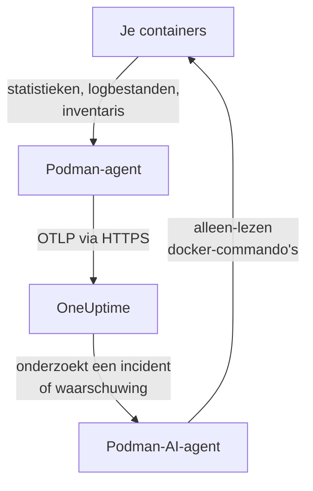

# Podman-agent

De OneUptime Podman-agent is één container die je op een Podman-host draait. Hij leest de statistieken en logbestanden van elke container op de host en stuurt ze naar OneUptime, waar de host verschijnt met zijn containers, metrics en logs. Met een tweede container, de Podman-AI-agent, kan OneUptime AI de host onderzoeken. [Podman-monitors](/docs/monitor/podman-monitor) waarschuwen op basis van wat de agent stuurt.

:::cards
- [De agent installeren](#de-agent-installeren): Twee containers, met `podman run` of Podman Compose.
- [Wat de agent verzamelt](#wat-de-agent-verzamelt): Metrics, logs en een inventaris van elke container.
- [Containerlogs hebben k8s-file nodig](#containerlogs-hebben-de-logdriver-k8s-file-nodig): Podman logt naar journald, tenzij je overschakelt.
- [Problemen oplossen](#problemen-oplossen): Herstartlussen, ontbrekende metrics, ontbrekende logs.
:::

## Hoe het werkt

De agent is een OpenTelemetry Collector met de configuratie van OneUptime ingebouwd. Via de Docker-compatibele API-socket van Podman leest hij elke 30 seconden de statistieken van elke container en toont hij elke 5 minuten elke container, image, netwerk en volume. Hij volgt de logbestanden van de containers en stuurt alles via OTLP naar je OneUptime-URL, met de ingestiesleutel die je hem geeft.



De host registreert zich met zijn eerste gegevens, onder de naam die je hem geeft in `PODMAN_HOST_NAME`. De AI-agent is optioneel: laat hem weg en de collector werkt precies hetzelfde.

## Voordat je begint

- Podman 4.0 of later, en roottoegang op de host.
- De API-socket van Podman op `/run/podman/podman.sock`. Zet hem aan met `sudo systemctl enable --now podman.socket`.
- Een ingestiesleutel. Maak er een aan onder **Projectinstellingen → Telemetrie & APM → Ingestiesleutels** en kopieer de waarde.
- Uitgaand HTTPS van de host naar je OneUptime-URL.
- Voor containerlogs: containers die de logdriver `k8s-file` gebruiken. Rootful Podman logt standaard naar `journald`, dat de agent niet kan lezen. Zie [Containerlogs hebben de logdriver k8s-file nodig](#containerlogs-hebben-de-logdriver-k8s-file-nodig).

## De agent installeren

:::steps
### De agent starten

Vervang `YOUR_ONEUPTIME_URL` door je OneUptime-URL, `YOUR_TELEMETRY_INGESTION_TOKEN` door de ingestiesleutel en `my-podman-host` door een naam voor deze host, zoals `prod-podman-01`. Onder die naam verschijnt de host in OneUptime, dus houd hem stabiel: een nieuwe naam registreert een nieuwe host.

:::tabs
@tab Podman CLI
```bash
podman run -d \
  --name oneuptime-podman-agent \
  --user 0:0 \
  --restart unless-stopped \
  -v /run/podman/podman.sock:/run/podman/podman.sock:ro \
  -v /var/lib/containers/storage:/var/lib/containers/storage:ro \
  -e ONEUPTIME_URL="YOUR_ONEUPTIME_URL" \
  -e ONEUPTIME_SERVICE_TOKEN="YOUR_TELEMETRY_INGESTION_TOKEN" \
  -e PODMAN_HOST_NAME="my-podman-host" \
  oneuptime/podman-agent:release
```

Start daarna de [AI-agent](#ai-agent) ernaast, met dezelfde waarden. **AI-onderzoeken staan standaard aan**: terwijl OneUptime AI een incident of waarschuwing op deze host onderzoekt, voert die via de AI-agent alleen-lezen `docker`-commando's uit tegen de Docker-compatibele API van Podman, en verandert niets tenzij je correcties toestaat. Sla dit commando over om zonder AI-onderzoeken te installeren.

```bash
podman run -d \
  --name oneuptime-podman-ai-agent \
  --user 0:0 \
  --restart unless-stopped \
  --read-only --tmpfs /tmp \
  -v /run/podman/podman.sock:/run/podman/podman.sock:ro \
  -e ONEUPTIME_URL="YOUR_ONEUPTIME_URL" \
  -e ONEUPTIME_SERVICE_TOKEN="YOUR_TELEMETRY_INGESTION_TOKEN" \
  -e ONEUPTIME_AI_AGENT_RESOURCE_TYPE=podman \
  -e PODMAN_HOST_NAME="my-podman-host" \
  oneuptime/resource-ai-agent:release
```
@tab Podman Compose
Sla dit op als `docker-compose.yml` in een map op de host. De tweede service is de [AI-agent](#ai-agent): laat die weg om de collector zonder AI-onderzoeken te draaien.

```yaml title="docker-compose.yml"
services:
  oneuptime-podman-agent:
    image: oneuptime/podman-agent:release
    container_name: oneuptime-podman-agent
    user: "0:0"
    restart: unless-stopped
    volumes:
      - /run/podman/podman.sock:/run/podman/podman.sock:ro
      - /var/lib/containers/storage:/var/lib/containers/storage:ro
    environment:
      - ONEUPTIME_URL=YOUR_ONEUPTIME_URL
      - ONEUPTIME_SERVICE_TOKEN=YOUR_TELEMETRY_INGESTION_TOKEN
      - PODMAN_HOST_NAME=my-podman-host
    logging:
      driver: json-file
      options:
        max-size: "10m"
        max-file: "3"
  oneuptime-podman-ai-agent:
    image: oneuptime/resource-ai-agent:release
    container_name: oneuptime-podman-ai-agent
    user: "0:0"
    restart: unless-stopped
    read_only: true
    tmpfs:
      - /tmp
    volumes:
      - /run/podman/podman.sock:/run/podman/podman.sock:ro
    environment:
      - ONEUPTIME_URL=YOUR_ONEUPTIME_URL
      - ONEUPTIME_SERVICE_TOKEN=YOUR_TELEMETRY_INGESTION_TOKEN
      - ONEUPTIME_AI_AGENT_RESOURCE_TYPE=podman
      - PODMAN_HOST_NAME=my-podman-host
```

Start hem in die map:

```bash
podman compose up -d
```
:::

### Controleren of de agent draait

```bash
podman ps --filter name=oneuptime-podman-agent
podman logs -f oneuptime-podman-agent
```

De logs horen deze regel te tonen zodra de collector is gestart:

```text
Everything is ready. Begin running and processing data.
```

### De host vinden in OneUptime

Open **Producten → Infrastructuur → Podman → Alle hosts**. De host verschijnt binnen ongeveer een minuut onder zijn `PODMAN_HOST_NAME`, met zijn containers, metrics en logs. De AI-agent wordt als verbonden weergegeven op de pagina **AI-agent** van de host, en onderaan zijn **Overzicht**.
:::

## Omgevingsvariabelen

| Variabele | Vereist | Beschrijving |
| --- | --- | --- |
| `ONEUPTIME_URL` | Ja | Je OneUptime-URL, zoals `https://oneuptime.com` of je zelf-gehoste instantie. Gebruik `http://` en de poort als de instantie alleen HTTP spreekt. |
| `ONEUPTIME_SERVICE_TOKEN` | Ja | De ingestiesleutel uit **Projectinstellingen → Telemetrie & APM → Ingestiesleutels**. |
| `PODMAN_HOST_NAME` | Nee | De naam van de host in OneUptime. Standaard `podman-host`, dus geef elke host een eigen naam. |
| `DOCKER_API_VERSION` | Nee | De Docker API-versie die de agent met de Podman-socket spreekt. Standaard `1.44`. Verlaag hem als de socket een ouder maximum meldt, of stel een lege waarde in om hem te laten onderhandelen (zie [Problemen oplossen](#problemen-oplossen)). |

Om een waarde te wijzigen, verwijder je de agent en voer je zijn commando opnieuw uit (Podman CLI), of bewerk je `docker-compose.yml` en voer je `podman compose up -d` uit (Podman Compose).

## Wat de agent verzamelt

| Gegevens | Wat het is |
| --- | --- |
| Containermetrics | CPU (gebruik, percentage, throttling), geheugen (gebruik, limiet, percentage), netwerk- en blok-I/O, uptime, herstarts en aantal processen, per container, elke 30 seconden. |
| Containerlogs | De stdout en stderr van elke container, uit het bestand `ctr.log` dat de logdriver `k8s-file` schrijft. |
| Inventaris | Elke container in elke status, en elke image, elk netwerk en elk volume, elke 5 minuten. |

De metrics en logs van elke container worden opgeslagen onder een service die naar de container is genoemd. Elke logregel krijgt een severity op basis van het niveau dat hij noemt, zoals `[ERROR]`, `level=warn` of `{"level":"info"}`; een regel die er geen noemt, krijgt die van zijn stream: stderr is `ERROR`, stdout is `INFO`. Regels die beginnen met witruimte of een sluitend haakje worden aan de vorige regel toegevoegd, dus een stacktrace komt binnen als één record. De eigen logs van de agent worden weggelaten.

[Podman-monitor](/docs/monitor/podman-monitor#verzamelde-metrieken) toont elke metric en wat die betekent.

## Containerlogs hebben de logdriver k8s-file nodig

De agent volgt `/var/lib/containers/storage/overlay-containers/*/userdata/ctr.log`, de bestanden die de logdriver `k8s-file` van Podman schrijft (`json-file` is in Podman dezelfde driver). De standaarddriver van rootful Podman is `journald`, die geen bestand achterlaat om te lezen, en dat geldt ook voor een externe driver zoals `syslog`. De metrics van zo'n container komen nog steeds binnen; zijn logs niet.

Controleer de logdriver van een container en de standaard van Podman:

```bash
podman inspect <container> --format '{{.HostConfig.LogConfig.Type}}'
podman info --format '{{.Host.LogDriver}}'
```

Draai een container met `k8s-file`, of zet een Compose-service daarop over:

```bash
podman run --log-driver k8s-file --log-opt max-size=100m ... <image>
```

```yaml
services:
  my-app:
    image: my-app:latest
    logging:
      driver: "k8s-file"
      options:
        max-size: "100m"
```

Of maak hem de standaard voor elke container die daarna wordt aangemaakt, in `containers.conf` (`/etc/containers/containers.conf` rootful, `~/.config/containers/containers.conf` rootless):

```toml title="containers.conf"
[containers]
log_driver = "k8s-file"
log_size_max = 104857600
```

Maak daarna de containers opnieuw aan. Een container houdt de logdriver waarmee hij is aangemaakt, dus herstarten is niet genoeg.

## De agent upgraden

Is de agent ouder dan je OneUptime, dan verschijnt er een waarschuwingsteken naast **Agentversie** in het **Overzicht** van de host. Selecteer het om deze commando's te zien.

:::tabs
@tab Podman CLI
```bash
podman pull oneuptime/podman-agent:release
podman pull oneuptime/resource-ai-agent:release
podman rm -f oneuptime-podman-agent oneuptime-podman-ai-agent
```

Voer daarna beide `podman run`-commando's uit [De agent starten](#de-agent-starten) opnieuw uit.
@tab Podman Compose
```bash
podman compose pull
podman compose up -d
```
:::

De tag `release` wijst altijd naar de nieuwste release. Gebruik `oneuptime/podman-agent:<version>` om een versie vast te zetten, zoals `oneuptime/podman-agent:10.0.31`. Dezelfde image staat in de GitHub Container Registry als `ghcr.io/oneuptime/podman-agent:release`.

## De agent verwijderen

:::tabs
@tab Podman CLI
```bash
podman rm -f oneuptime-podman-agent
podman rm -f oneuptime-podman-ai-agent
```
@tab Podman Compose
```bash
podman compose down
```
:::

De host blijft in OneUptime staan met de gegevens die hij heeft gestuurd. Heb je hem niet meer nodig, verwijder hem dan met **Host verwijderen** in zijn menu.

## AI-agent

De commando's en het Compose-bestand hierboven, het `install.sh` van de Podman-agent en de `docker-compose.yml` in zijn [PodmanAgent-map](https://github.com/OneUptime/oneuptime/tree/master/agents/PodmanAgent) draaien allemaal de **Podman-AI-agent**: een tweede container, `oneuptime-podman-ai-agent` (image `oneuptime/resource-ai-agent:release`), die de alleen-lezen-commando's uitvoert waarom OneUptime AI vraagt terwijl die een incident of waarschuwing op deze host onderzoekt — via de Docker-compatibele API van Podman, met de `docker`-CLI: `docker ps -a`, `docker logs --tail 200 web`, `docker container inspect web` — en, alleen als je het toestaat, correcties toepast zoals het herstarten van een bepaalde container. Hij leest dezelfde `ONEUPTIME_URL`, `ONEUPTIME_SERVICE_TOKEN` en `PODMAN_HOST_NAME` als de collector, dus hij bedient precies deze host, en hij verschijnt op de pagina **AI-agent** van de host in OneUptime.

- **AI-onderzoeken staan standaard aan.** Zodra de agent verbinding maakt, onderzoekt OneUptime AI er incidenten en waarschuwingen op deze host mee, en het **Overzicht** van de host toont de status van de agent. Om te stoppen, stel je `ONEUPTIME_AI_INVESTIGATION=false` in waar de agent draait (**Wijzigen** onder **Wat AI mag doen** op de pagina van de AI-agent laat zien hoe), of laat je de agent weg.
- Hij is alleen-lezen, tenzij je hem start met `ONEUPTIME_AI_ALLOW_WRITES=true`; `ONEUPTIME_AI_WRITE_TARGETS` (bijvoorbeeld `web-*,api-*`) beperkt welke containers een correctie mag aanraken. Start hem ook met `ONEUPTIME_AI_FIXES` om te bepalen hoe correcties verlopen — `ask-for-approval` (iemand keurt elke correctie goed), `automatic` of `bypass-approval` — en de pagina van de AI-agent toont het alleen-lezen ([Wat AI mag doen, ingesteld door de agent](/docs/ai/infrastructure-ai-agents#what-ai-may-do-set-by-the-agent)).
- Hij heeft dezelfde socket nodig als de collector en draait als root met die socket gemount, omdat de socket van root is — en bij rootful Podman is wie de socket kan gebruiken root op deze host, `:ro` of niet. Het commandobeleid van de agent is de grens: hij voert nooit `exec`, `run`, `rm` of `prune` uit, en wijzigt nooit zichzelf, de collector of iets in `ONEUPTIME_AI_PROTECTED_TARGETS` (globs voor containernamen).
- `install.sh --no-ai-agent` laat hem weg; `podman rm -f oneuptime-podman-ai-agent` verwijdert hem. Upgrade hem zoals de collector: `podman pull oneuptime/resource-ai-agent:release`, verwijder hem en start hem opnieuw.

Wat hij mag uitvoeren, hoe correcties werken en hoe je problemen oplost: [Infrastructure AI Agents](/docs/ai/infrastructure-ai-agents#docker-and-podman-hosts).

## Problemen oplossen

:::details De agent herstart met "client version is too new"
De logs van de agent tonen:

```text
Error: cannot start pipelines: failed to start "docker_stats" receiver:
Error response from daemon: client version 1.44 is too new.
Maximum supported API version is 1.41
```

Een Docker-API-server die een maximale clientversie afdwingt, weigert een nieuwere, dus de receiver start nooit en de collector stopt mee. Controleer de API-versie die de Podman-socket meldt:

```bash
curl -s -o /dev/null -D - --unix-socket /run/podman/podman.sock http://localhost/_ping | grep -i '^api-version'
```

Voeg daarna `-e DOCKER_API_VERSION=1.41` (of de waarde die je kreeg) toe aan `podman run`, of stel `DOCKER_API_VERSION` in Compose in. Nieuwere servers bedienen nog steeds oudere API-versies, dus de instelling blijft na een upgrade geldig.

Liever het nummer niet opzoeken? Stel `DOCKER_API_VERSION` in op de lege string. De agent onderhandelt de versie dan met de socket (één `HEAD /_ping`, daarna het maximum dat de socket meldt) in plaats van er een vast te zetten:

```bash
podman run -d ... -e DOCKER_API_VERSION= ...
```
:::

:::details Toegang geweigerd tot de Podman-socket, of geen socket
De agent moet als root draaien om `/run/podman/podman.sock` te lezen. Controleer of `--user 0:0` in je `podman run`-commando staat, of `user: "0:0"` in Compose, en of de socket aan staat: `sudo systemctl enable --now podman.socket`. Rootless Podman heeft zijn socket in plaats daarvan op `/run/user/<uid>/podman/podman.sock` (`systemctl --user enable --now podman.socket`): mount dat pad in plaats van `/run/podman/podman.sock`.
:::

:::details De host wordt als verbroken weergegeven
1. Controleer of de agent draait: `podman ps --filter name=oneuptime-podman-agent`
2. Zoek naar fouten in zijn logs: `podman logs oneuptime-podman-agent 2>&1 | grep -i error`
3. Controleer `ONEUPTIME_URL` en `ONEUPTIME_SERVICE_TOKEN`: de sleutel moet een geldige ingestiesleutel zijn die niet is uitgeschakeld.
4. Controleer of de host je OneUptime-URL via het netwerk kan bereiken.
:::

:::details Er verschijnen geen metrics
1. Controleer of de Podman-socket in de agent is gemount. Zijn image heeft geen shell, dus kijk vanuit een wegwerpcontainer die zijn mounts deelt: `podman run --rm --volumes-from oneuptime-podman-agent alpine:3.19 ls -la /run/podman/podman.sock`
2. Zoek naar exportfouten in zijn logs: `podman logs oneuptime-podman-agent 2>&1 | tail -100`
3. Controleer of de ingestiesleutel geldig is en niet is verlopen.
:::

:::details Metrics komen binnen, maar geen containerlogs
Je containers gebruiken waarschijnlijk `journald`, de standaardlogdriver van Podman. Controleer welke bestanden de agent bewaakt, en welke driver een container gebruikt:

```bash
podman logs oneuptime-podman-agent 2>&1 | grep -E "Started watching file|no files match"
podman inspect <container> --format '{{.HostConfig.LogConfig.Type}}'
```

Meldt de agent `no files match the configured criteria`, zet de containers dan over op `k8s-file` en maak ze opnieuw aan, zoals [Containerlogs hebben de logdriver k8s-file nodig](#containerlogs-hebben-de-logdriver-k8s-file-nodig) laat zien.
:::

:::details De logs staan bij een andere host, of de host heet podman-host
De naam van de host komt uit `PODMAN_HOST_NAME`. Een agent die zonder deze variabele is gestart, meldt `podman-host`, dus elke host die zo is ingericht, lijkt dezelfde; wijzig je de naam later, dan registreert OneUptime een tweede host, die dan de nieuwe gegevens bevat. Stel `PODMAN_HOST_NAME` op elke host in op een eigen naam, en maak de agent opnieuw aan. Om de naam te controleren die de agent meldt:

```bash
podman inspect oneuptime-podman-agent --format '{{range .Config.Env}}{{println .}}{{end}}' | grep PODMAN_HOST_NAME
```
:::

## Volgende stappen

:::cards
- [Podman-monitor](/docs/monitor/podman-monitor): Waarschuw op CPU, geheugen en herstarts van containers.
- [Databases](/docs/telemetry/databases): Databasecontainers op de host worden gevonden en krijgen eigen pagina's.
- [Kubernetes-agent](/docs/telemetry/kubernetes-agent): Monitor in plaats daarvan een Kubernetes-cluster.
- [OpenTelemetry-collector op de host](/docs/telemetry/host-otel-collector): Monitor de machine zelf: CPU, schijven, processen en logs.
:::
