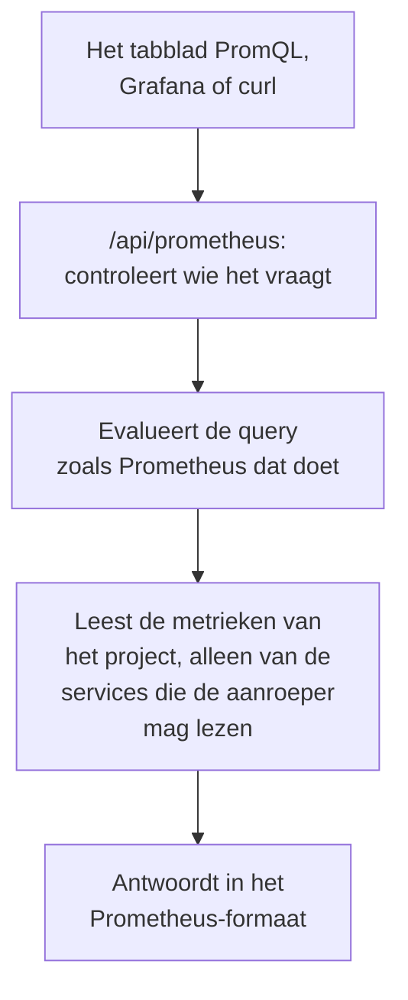

# Metrieken bevragen met PromQL

PromQL is de querytaal van Prometheus, en de taal die de meeste mensen die metrieken in grafieken zetten al kennen. OneUptime leest de metrieken van uw project ermee: op het tabblad **PromQL** van Metrieken, en via een Prometheus-compatibele API waarop u Grafana, of elke tool met een Prometheus-gegevensbron, kunt aansluiten.

:::cards
- [Een query schrijven](#een-query-schrijven): PromQL uitvoeren op de pagina Metrieken en een grafiek of een tabel zien.
- [Hoe metrieken heten](#hoe-metrieken-heten): Hoe namen en attributen uit OpenTelemetry in PromQL worden gelezen.
- [Grafana koppelen](#grafana-koppelen): OneUptime toevoegen als Prometheus-gegevensbron.
- [Limieten](#limieten): Wat een query mag lezen, en hoe lang.
:::

## Hoe het werkt

Het tabblad PromQL en Grafana bevragen dezelfde API. OneUptime controleert of de aanroeper de metrieken van het project mag lezen, leest alleen de services die hij mag lezen, en evalueert de query zoals Prometheus dat doet.



## Voordat u begint

- **Binnenkomende metrieken.** Stuur ze met [OpenTelemetry](/docs/telemetry/open-telemetry), of vanuit een agent zoals de [OpenTelemetry-collector voor hosts](/docs/telemetry/host-otel-collector).
- **Een rol die metrieken mag lezen.** Project Owner, Project Admin, Project Member, Viewer, Telemetry Admin, Telemetry Member of Telemetry Viewer, of een aangepaste rol met de machtiging Read Metrics. Een rol die tot bepaalde services is beperkt, leest alleen hun metrieken.
- **Voor Grafana of een script: een API-sleutel van het project** met een van die rollen of de machtiging Read Metrics. Zie [Een API-sleutel aanmaken](/docs/api-reference/api-reference#een-api-sleutel-aanmaken). In OneUptime Cloud hebben API-sleutels het abonnement **Growth** nodig.

## Een query schrijven

:::steps
### PromQL openen

Open **Metrieken** en klik op het tabblad **PromQL**.

### De query schrijven

Typ hem in de editor, kies een voorbeeld onder **Voorbeelden**, of begin bij **Een metriekenaam toevoegen**, dat de metrieken van uw project toont met de namen die PromQL ze geeft.

### Uitvoeren

Klik op **Query uitvoeren**, of druk op Ctrl+Enter (⌘+Enter op een Mac). **Grafiek** tekent de query over het tijdsbereik; **Tabel** toont de waarde van elke reeks aan het einde ervan.
:::

Een paar query's om mee te beginnen:

```text title="PromQL"
# Requests per second, by service
sum by (job) (rate(http_requests_total[5m]))

# The 95th percentile of a latency histogram
histogram_quantile(0.95, sum by (le) (rate(http_server_request_duration_bucket[5m])))

# The five hosts using the most memory
topk(5, system_memory_usage)
```

De editor toont wat er misging bij een query die niet wordt uitgevoerd, en waar: bij `rate(http_requests_total)` meldt hij bijvoorbeeld dat de functie een bereik nodig heeft, zoals `[5m]`.

## Hoe metrieken heten

OneUptime slaat metrieken op zoals OpenTelemetry dat doet. PromQL leest ze met de namen die de eigen OpenTelemetry-ondersteuning van Prometheus ze geeft, dus een query die voor Prometheus is geschreven, werkt hier:

| In OneUptime | In PromQL |
| --- | --- |
| Een gauge `system.cpu.utilization` | `system_cpu_utilization` |
| Een teller `http.requests` | `http_requests`, of `http_requests_total` |
| Een histogram `http.server.request.duration` | `http_server_request_duration_bucket` (met `le`), `_count` en `_sum` |
| Een summary `rpc.latency` | `rpc_latency` (met `quantile`), `_count` en `_sum` |
| Een attribuut `http.route` | Het label `http_route` |
| Een resource-attribuut `service.name` | Het label `resource_service_name`, en `job` |
| Een resource-attribuut `service.instance.id` | Het label `resource_service_instance_id`, en `instance` |

- **Punten en streepjes worden underscores** in metriek- en labelnamen. Om een metriek of een label precies zo te noemen als hij is opgeslagen, zet u de naam tussen aanhalingstekens, zoals Prometheus 3 doet: `{"http.server.request.duration", "http.route"="/checkout"}`.
- **Deltatellers worden opgeteld** vanaf het begin van het tijdsbereik van de query, zodat `rate()` en `increase()` ze lezen zoals elke andere teller.
- **Exponentiële histogrammen** hebben `_count` en `_sum`, maar geen buckets.

## Grafana koppelen

:::steps
### Een API-sleutel aanmaken

Open in OneUptime **Projectinstellingen → Geavanceerd → API-sleutels** en klik op **API-sleutel aanmaken**. Geef de sleutel een rol die telemetrie mag lezen, of de machtiging Read Metrics.

### Een Prometheus-gegevensbron toevoegen

Open in Grafana **Connections → Data sources → Add data source** en kies **Prometheus**.

### De server-URL invullen

Stel **Prometheus server URL** in op uw OneUptime-adres, gevolgd door `/api/prometheus`. In OneUptime Cloud is dat `https://oneuptime.com/api/prometheus`. Het tabblad **PromQL** toont het adres van uw eigen server, met een kopieerknop.

### De API-sleutel meesturen

Voeg onder **HTTP headers** de header `Authorization` toe, met als waarde `Bearer` gevolgd door een spatie en uw API-sleutel. Basic-authenticatie werkt ook: een willekeurige gebruikersnaam, met de API-sleutel als wachtwoord.

### Opslaan en testen

Klik op **Save & test**. Grafana voert een query uit en meldt dat de gegevensbron werkt.
:::

Elke andere Prometheus-client werkt op dezelfde manier. Met curl:

```bash title="Query OneUptime's Prometheus API"
curl -H "Authorization: Bearer $ONEUPTIME_API_KEY" \
  "https://oneuptime.com/api/prometheus/api/v1/query?query=up"
```

## De API

De API beantwoordt de routes van de Prometheus HTTP API, met `GET` of `POST`, onder `/api/prometheus`:

| Route | Wat die beantwoordt |
| --- | --- |
| `/api/v1/query` | Een query op één tijdstip (`time`, standaard nu). |
| `/api/v1/query_range` | Een query bij elke `step` van `start` tot `end`. |
| `/api/v1/series` | De reeksen die `match[]` selecteert. |
| `/api/v1/labels` | Labelnamen, van de reeksen die `match[]` selecteert of van elke metriek. |
| `/api/v1/label/<name>/values` | De waarden van één label. `__name__` toont de metrieknamen. |
| `/api/v1/metadata` | Het type, de helptekst en de eenheid van elke metriek. |

Tijdstippen zijn Unix-seconden of RFC 3339, tijdsduren zijn seconden of een duur zoals `15s`, en antwoorden volgen het formaat van Prometheus. `/api/v1/status/buildinfo` antwoordt als een Prometheus 3-server; regels en waarschuwingen zijn leeg, omdat OneUptime waarschuwt met [monitors](/docs/monitor/metrics-monitor).

## Wat PromQL ondersteunt

- **Selectors** met elke matcher (`=`, `!=`, `=~`, `!~`), bereiken, `offset`, `@` (met `start()` en `end()`) en subquery's.
- **Operatoren**: rekenkunde, vergelijkingen (met `bool`), `and`, `or`, `unless`, en vectormatching met `on`, `ignoring`, `group_left` en `group_right`.
- **Aggregaties**: `sum`, `avg`, `min`, `max`, `count`, `group`, `stddev`, `stdvar`, `topk`, `bottomk`, `quantile` en `count_values`, met `by` of `without`.
- **Functies**: `rate`, `irate`, `increase`, `delta`, `idelta`, `deriv`, `predict_linear`, `histogram_quantile`, elke `*_over_time`-functie, `changes`, `resets`, `absent`, `label_replace`, `label_join`, `sort`, `clamp`, `round`, de wiskundige functies en datumfuncties, en meer.

De functies voor native histogrammen van Prometheus, zoals `histogram_count()`, zijn niet beschikbaar: OneUptime slaat histogrammen op met buckets, die `histogram_quantile()` en de reeksen `_count` en `_sum` lezen.

## Limieten

Elke query is begrensd, zodat een dashboard met veel panelen OneUptime niet kan overbelasten:

| Limiet | Waarde |
| --- | --- |
| Punten in één reeks van een bereikquery | 11.000 |
| Meetwaarden die één query mag lezen en vasthouden | 5.000.000 |
| Metriekpunten die één selector mag lezen | 1.000.000 |
| Tijd die een leesactie mag duren | 30 seconden |
| Tijd die het evalueren mag duren | 30 seconden |
| Hoe ver een selector terugkijkt naar de laatste meetwaarde van een reeks | 5 minuten |
| De stap van een subquery, als de query die weglaat | 1 minuut |

## Problemen oplossen

:::details Grafana meldt dat de gegevensbron niet werkt
Controleer of de URL eindigt op `/api/prometheus`, en of de header `Authorization` de waarde `Bearer` bevat, gevolgd door een spatie en de API-sleutel. Een sleutel zonder rol die metrieken mag lezen, wordt geweigerd: geef hem er een in **Projectinstellingen → Geavanceerd → API-sleutels**.
:::

:::details Een metriek uit de verkenner levert niets op
De PromQL-naam ervan heeft underscores waar de opgeslagen naam punten heeft, en een histogram wordt gelezen via `_bucket`, `_count` of `_sum`. **Een metriekenaam toevoegen** op het tabblad PromQL toont elke naam zoals PromQL hem schrijft.
:::

:::details "The query reads more than 1,000,000 metric points"
De query vraagt om meer dan een leesactie mag bevatten. Voeg labelmatchers toe, verkort het tijdsbereik of gebruik een grotere stap.
:::

## Volgende stappen

:::cards
- [Metriekverkenner](/docs/telemetry/metrics-explorer): Metrieken in een grafiek zetten zonder een query te schrijven.
- [Metrics-monitor](/docs/monitor/metrics-monitor): Waarschuwen als een metriek een drempel overschrijdt.
- [Externe gegevensbronnen](/docs/dashboards/data-sources): Een externe Prometheus in grafieken op uw dashboards zetten.
:::
