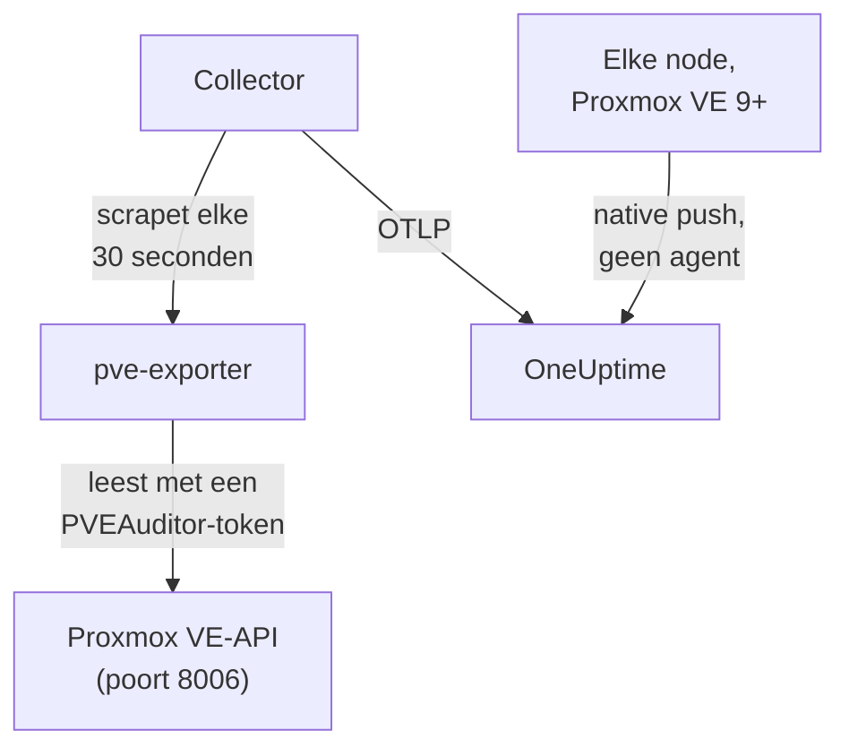

# Proxmox-agent

De OneUptime Proxmox-agent monitort een Proxmox VE-cluster: de nodes, QEMU-VM's, LXC-containers, opslag, HA-status, back-updekking en replicatie. Hij leest het cluster via de Proxmox VE-API met een alleen-lezen token en stuurt wat hij vindt naar OneUptime, waar het cluster verschijnt met zijn nodes, gasten en opslag. Op Proxmox VE 9 en later kunnen de nodes hun eigen metrics ook zelf pushen, zonder iets te installeren. [Proxmox-monitors](/docs/monitor/proxmox-monitor) waarschuwen op basis van wat er binnenkomt.

:::cards
- [Kiezen hoe je verbindt](#kiezen-hoe-je-verbindt): De agent, of de eigen push van Proxmox VE 9.
- [De agent installeren](#de-agent-installeren): Een API-token, daarna het installatiescript of Docker Compose.
- [Native push](#alternatief-zonder-installatie-native-opentelemetry-push-van-proxmox-ve-9): Proxmox VE 9 stuurt zijn metrics zelf.
- [Problemen oplossen](#problemen-oplossen): Een diagnosescript, en de gebruikelijke problemen.
:::

## Hoe het werkt

De agent is een set containers die je met Docker Compose op één machine draait: [prometheus-pve-exporter](https://github.com/prometheus-pve/prometheus-pve-exporter) leest de Proxmox VE-API op poort 8006, een OpenTelemetry Collector scrapet de exporter elke 30 seconden en stempelt elke metric met de naam van je cluster, en met de Proxmox-AI-agent kan OneUptime AI het cluster lezen tijdens een onderzoek. De native push van Proxmox VE 9 stuurt in plaats daarvan de metrics van elke node rechtstreeks naar OneUptime.



Het cluster registreert zich met zijn eerste gegevens, onder de naam die de agent als `proxmox.cluster.name` op elke metric stempelt.

## Kiezen hoe je verbindt

| | De agent | Native push |
| --- | --- | --- |
| Proxmox VE | Elke ondersteunde versie | 9.0 of later |
| Te installeren | Docker Compose op één machine | Niets: een metricserver in de Proxmox-webinterface |
| Nodes, gasten en opslag | Ja | Ja |
| HA-status, opstarten bij boot, back-updekking en replicatie | Ja | Nee |
| Proxmox-AI-agent | Ja | Nee |

De sjablonen **HA Resource in Error State**, **Guest Down**, **Guest Not Backed Up** en **Replication Failing** hebben de agent nodig. Gebruik voor een cluster het een of het ander: beide draaien meldt elke resource twee keer.

## Voordat je begint

- Docker Engine 20.10 of later met de Docker Compose v2-plugin, op een machine die de Proxmox VE-API op poort 8006 kan bereiken.
- Een rootshell op een willekeurige Proxmox VE-node, of de Proxmox-webinterface, om een API-token aan te maken.
- Een ingestiesleutel. Maak er een aan onder **Projectinstellingen → Telemetrie & APM → Ingestiesleutels** en kopieer de waarde.
- Uitgaand HTTPS van die machine naar je OneUptime-URL.

### Waar je de agent draait

De agent bevraagt de Proxmox VE-API via het netwerk, dus hij hoeft niet op een clusternode te staan, en dat moet hij ook niet: draai hem op een machine die een node-uitval overleeft (een kleine monitoring-VM op aparte hardware, een beheerhost), of wijs `PVE_HOST` naar een virtueel IP of een round-robin-DNS-naam in plaats van het adres van één node. Als het API-doel van de agent de node is die net is uitgevallen, valt je monitoring mee uit. De enige uitzondering is de optionele journald-logpipeline, die op een Proxmox VE-node moet draaien (zie [Proxmox-servicelogs versturen](#optioneel-proxmox-servicelogs-versturen)).

## De agent installeren

:::steps
### Een alleen-lezen API-token aanmaken

De agent leest het cluster met een API-token dat de rol **PVEAuditor** heeft, die kan lezen en verder niets.

:::tabs
@tab Shell
Als root op een willekeurige Proxmox VE-node:

```bash
pveum user add monitoring@pam
pveum acl modify / --roles PVEAuditor --users monitoring@pam
pveum user token add monitoring@pam oneuptime --privsep 1
pveum acl modify / --roles PVEAuditor --tokens 'monitoring@pam!oneuptime'
```

Het eerste commando mislukt alleen, onschadelijk, als `monitoring@pam` al bestaat: API-tokens hebben een eigen secret, dus de gebruiker heeft geen wachtwoord of systeemaccount nodig. `pveum user token add` drukt het secret van het token één keer af; de token-ID is `monitoring@pam!oneuptime`.
@tab Proxmox web UI
1. Ga naar *Datacenter → Permissions → API Tokens* en klik op **Add**.
2. Kies (of maak) een gebruiker, geef het token een ID zoals `oneuptime`, en laat **Privilege Separation** aangevinkt.
3. Kopieer de token-ID (`user@realm!tokenname`) en het secret: het secret wordt maar één keer getoond.
4. Voeg onder *Datacenter → Permissions* de rol **PVEAuditor** twee keer toe op pad `/`: één keer als **API Token Permission** voor het token, en één keer als **User Permission** voor de gebruiker ervan.
:::

De rol hoort zowel op de gebruiker als op het token, omdat een token met privilege separation alleen de rechten krijgt die zijn gebruiker ook heeft. Hij moet op het rootpad `/` staan, omdat de exporter elk node-, gast- en opslagobject leest: een smaller pad verbergt de rest van het cluster en mislukt met `401`/`403 Permission check failed (/, Sys.Audit)`.

### De agent installeren en starten

:::tabs
@tab install.sh
Download het installatiescript en voer het uit op de machine die de agent gaat hosten:

```bash
curl -sSL https://raw.githubusercontent.com/OneUptime/oneuptime/master/agents/ProxmoxAgent/install.sh -o install.sh
bash install.sh
```

Het script vraagt naar je OneUptime-URL, de ingestiesleutel, een naam voor het cluster, de Proxmox VE-API-host, of de meegeleverde exporter moet draaien, en de token-ID en het secret — en of de [AI-agent](#ai-agent) correcties mag toepassen, en zo ja naar een eigen token daarvoor en de gasten die hij nooit mag wijzigen. Het installeert naar `/opt/oneuptime-proxmox-agent`, schrijft een `.env`-bestand met `0600` en start de agent met Docker Compose. Voer je het script opnieuw uit, dan hergebruikt het alles in die `.env` in plaats van opnieuw te vragen; zo [upgrade je de agent](#de-agent-upgraden).
@tab Docker Compose
Download `docker-compose.yml` en `otel-collector-config.yaml` uit de [ProxmoxAgent-map](https://github.com/OneUptime/oneuptime/tree/master/agents/ProxmoxAgent) naar een nieuwe map:

```bash
mkdir oneuptime-proxmox-agent && cd oneuptime-proxmox-agent
curl -fsSLO https://raw.githubusercontent.com/OneUptime/oneuptime/master/agents/ProxmoxAgent/docker-compose.yml
curl -fsSLO https://raw.githubusercontent.com/OneUptime/oneuptime/master/agents/ProxmoxAgent/otel-collector-config.yaml
```

Maak er een `.env`-bestand naast. Dat bevat het secret van het token, dus houd het privé met `chmod 600 .env`:

```bash title=".env"
ONEUPTIME_URL=YOUR_ONEUPTIME_URL
ONEUPTIME_TELEMETRY_INGESTION_KEY=YOUR_TELEMETRY_INGESTION_TOKEN
PROXMOX_CLUSTER_NAME=my-proxmox-cluster
PVE_HOST=192.168.1.10
PVE_API_TOKEN_ID=monitoring@pam!oneuptime
PVE_API_TOKEN_SECRET=your-token-secret
COMPOSE_PROFILES=pve-exporter
```

`COMPOSE_PROFILES=pve-exporter` start ook de meegeleverde exporter. Start de agent:

```bash
docker compose up -d
```
:::

Draai je al prometheus-pve-exporter? Antwoord **n** als het script vraagt of de meegeleverde moet draaien, of haal `COMPOSE_PROFILES` uit `.env`, en wijs de agent naar de jouwe (`host:port`, geen schema, een adres dat de container van de agent kan bereiken: `localhost` is de container zelf). Houd `PVE_API_TOKEN_ID` en `PVE_API_TOKEN_SECRET` als je de [AI-agent](#ai-agent) gebruikt, die de API met dat token aanroept:

```bash
PVE_EXPORTER_URL=your-exporter-host:9221
```

### Controleren of de agent draait

```bash
docker compose ps
docker logs -f oneuptime-proxmox-agent
```

`docker compose ps` toont de collector (`oneuptime-proxmox-agent`), de meegeleverde exporter (`oneuptime-pve-exporter`, tenzij je je eigen gebruikt) en de AI-agent (`oneuptime-proxmox-ai-agent`). De logs van de collector horen deze regel te tonen zodra hij is gestart:

```text
Everything is ready. Begin running and processing data.
```

### Het cluster vinden in OneUptime

Open **Producten → Infrastructuur → Proxmox → Alle clusters**. Het cluster verschijnt ongeveer een minuut na de eerste scrape onder zijn `PROXMOX_CLUSTER_NAME`, met zijn nodes, gasten en opslag.
:::

## Omgevingsvariabelen

Het installatiescript schrijft deze naar `/opt/oneuptime-proxmox-agent/.env`; een Docker Compose-installatie leest ze uit de `.env` naast `docker-compose.yml`. Voer na het wijzigen van een waarde `docker compose up -d` uit in die map.

| Variabele | Vereist | Beschrijving |
| --- | --- | --- |
| `ONEUPTIME_URL` | Ja | Je OneUptime-URL, zoals `https://oneuptime.com` of je zelf-gehoste instantie. Gebruik `http://` en de poort als de instantie alleen HTTP spreekt. |
| `ONEUPTIME_TELEMETRY_INGESTION_KEY` | Ja | De ingestiesleutel uit **Projectinstellingen → Telemetrie & APM → Ingestiesleutels**. |
| `PROXMOX_CLUSTER_NAME` | Ja | De naam van het cluster in OneUptime, op elke metric gestempeld als het resource-attribuut `proxmox.cluster.name`. Houd hem stabiel: een latere wijziging registreert een tweede cluster. Standaard `proxmox-cluster`. |
| `PVE_HOST` | Ja | De Proxmox VE-API-host (een willekeurige node van het cluster) die de exporter en de AI-agent bevragen, zoals `192.168.1.10`. |
| `PVE_EXPORTER_URL` | Nee | Het adres (`host:port`, geen schema) van prometheus-pve-exporter. Standaard de meegeleverde exporter, `pve-exporter:9221`. |
| `PVE_API_TOKEN_ID` | Meegeleverde exporter of AI-agent | De volledige ID van het Proxmox-API-token, zoals `monitoring@pam!oneuptime`. De AI-agent leest de API daarmee, tenzij hij een eigen token heeft (`ONEUPTIME_AI_PVE_API_TOKEN_ID` / `ONEUPTIME_AI_PVE_API_TOKEN_SECRET`). |
| `PVE_API_TOKEN_SECRET` | Meegeleverde exporter of AI-agent | Het secret van het Proxmox-API-token. |
| `PVE_VERIFY_SSL` | Nee | Het TLS-certificaat van de Proxmox-API verifiëren (de exporter en de AI-agent). Standaard `false`, omdat Proxmox met zelfondertekende certificaten wordt geleverd. |
| `COMPOSE_PROFILES` | Nee | Stel in op `pve-exporter` om de meegeleverde exportercontainer te starten. |

## Wat de agent verzamelt

De collector scrapet de exporter elke 30 seconden met zowel zijn cluster- als zijn nodecollectors aan, wat ook de standaard ingeschakelde collectors `backup-info` (clusterniveau) en `replication` (nodeniveau) van de exporter dekt. Elke serie draagt een label `id` dat de resource benoemt: `node/<name>`, `qemu/<vmid>`, `lxc/<vmid>` of `storage/<node>/<storage>`.

| Categorie | Metrics |
| --- | --- |
| Beschikbaarheid | `pve_up`, `pve_uptime_seconds` |
| Node | `pve_node_info`, `pve_cpu_usage_ratio`, `pve_cpu_usage_limit`, `pve_memory_usage_bytes`, `pve_memory_size_bytes` |
| Gast (VM of LXC) | `pve_guest_info`, en CPU-, geheugen- en netwerkseries op de ID's `qemu/*` en `lxc/*` (`pve_network_receive_bytes`, `pve_network_transmit_bytes`) |
| Opslag | `pve_disk_usage_bytes`, `pve_disk_size_bytes`, `pve_storage_info` |
| HA | `pve_ha_state` |
| Back-updekking | `pve_not_backed_up_total` (de gasten die geen back-upjob dekt; één serie op clusterniveau, zonder label `id`) en `pve_not_backed_up_info` (één serie per niet-gedekte gast, met zijn `id`). Gedekt betekent dat minstens één job de gast selecteert: of back-ups onlangs zijn gedraaid of zijn gelukt, stelt de exporter niet beschikbaar. |
| Replicatie | `pve_replication_failed_syncs`, `pve_replication_duration_seconds`, `pve_replication_last_sync_timestamp_seconds`, `pve_replication_last_try_timestamp_seconds`, `pve_replication_next_sync_timestamp_seconds`, `pve_replication_info`, per opslagreplicatiejob. Hun label `id` is de job-ID (zoals `100-0`), geen resource. |

Monitorcriteria en attribuutfilters matchen op gelijkheid, niet op een voorvoegsel, dus de processor `transform/pve-identity` van de collector splitst `id` ook op in drie attributen. De ingebouwde Proxmox-waarschuwingssjablonen filteren daarop, dus houd de processor als je de configuratie aanpast:

| Attribuut | Waarden | Voor `qemu/100` |
| --- | --- | --- |
| `pve.scope` | `node`, `guest`, `storage`, `cluster` (`qemu` en `lxc` zijn allebei `guest`) | `guest` |
| `pve.type` | `node`, `qemu`, `lxc`, `storage` | `qemu` |
| `pve.id` | Alles na de eerste `/` van `id` (`pve1`, `100`, `pve1/local`) | `100` |

Het oorspronkelijke label `id` blijft behouden zoals het is.

## Optioneel — Proxmox-servicelogs versturen

Standaard stuurt de agent alleen metrics, dus de pagina **Logboeken** van het cluster blijft leeg. De Proxmox VE-services loggen naar de systemd-journal onder acht units: `pveproxy`, `pvedaemon`, `pve-firewall`, `pve-ha-crm`, `pve-ha-lrm`, `pvescheduler`, `pvestatd` en `qmeventd`. De meegeleverde `otel-collector-config.yaml` heeft een uitgecommentarieerde `journald`-receiver voor precies die units, gekoppeld aan een uitgecommentarieerde `logs`-pipeline die `proxmox.cluster.name` stempelt, zodat de logs bij je cluster terechtkomen.

:::steps
### De agent op een node draaien

De journal is per host, dus een externe agent kan hem niet lezen. Dit is de enige opzet die ingaat tegen [Waar je de agent draait](#waar-je-de-agent-draait): om de metricsagent buiten het cluster te houden, draai je in plaats daarvan een tweede collector, alleen voor logs, op de node (kopieer de configuratie en verwijder daarna de receiver `prometheus` en de pipeline `metrics`).

### De receiver inschakelen

Haal het commentaar weg bij de receiver `journald` en de pipeline `logs` in `otel-collector-config.yaml`, en bij de journal-volumes in `docker-compose.yml`, zodat de container de journal van de host kan lezen:

```yaml
- /var/log/journal:/var/log/journal:ro
- /etc/machine-id:/etc/machine-id:ro
```

### De collectorimage vervangen

De standaardimage `otel/opentelemetry-collector-contrib` is `FROM scratch` gebouwd: hij heeft geen `journalctl`, dat de journald-receiver uitvoert, en draait als een gebruiker die de journal niet kan lezen. Bouw deze wrapper en wijs `image:` in `docker-compose.yml` ernaar:

```dockerfile title="Dockerfile"
FROM otel/opentelemetry-collector-contrib:0.161.0 AS otelcol
FROM debian:stable-slim
RUN apt-get update \
    && apt-get install -y --no-install-recommends systemd \
    && rm -rf /var/lib/apt/lists/*
COPY --from=otelcol /otelcol-contrib /otelcol-contrib
ENTRYPOINT ["/otelcol-contrib"]
CMD ["--config", "/etc/otelcol-contrib/config.yaml"]
```

Het pakket `systemd` zit er alleen in voor `journalctl`, en deze image draait als root, die de journal kan lezen. Of sla Docker over voor de logs en draai de `.deb` van de `otelcol-contrib`-release op de node zelf, waar `journalctl` al aanwezig is.
:::

Elke node stuurt alleen zijn eigen journal: draai voor servicelogs van elke node de collector voor alleen logs op elke node.

### Alternatief zonder eigen image: filelog op /var/log/syslog

Om de standaardimage te houden, volg je in plaats daarvan syslog. Installeer rsyslog op de node (`apt install rsyslog`; Debian 12 en Proxmox VE 8 en later leveren het niet meer mee), mount de map `/var/log` in de container (`- /var/log:/var/log:ro`; de map, niet het bestand, zodat logrotatie geen verouderd bestand vasthoudt), en gebruik een `filelog`-receiver in plaats van de journald-receiver:

```yaml
receivers:
  filelog:
    include:
      - /var/log/syslog
    start_at: end
```

Je verliest het filter per unit (syslog bevat alles, niet alleen de acht services), en de gebruiker van de standaardimage moet het bestand kunnen lezen. Koppel hem aan dezelfde uitgecommentarieerde `logs`-pipeline (`receivers: [filelog]`).

## Alternatief zonder installatie: native OpenTelemetry-push van Proxmox VE 9+

Proxmox VE 9.0 en later leveren een OpenTelemetry-metricserver mee die node-, gast- en opslagmetrics naar elk OTLP/HTTP-endpoint pusht, zonder agent of exporter om te installeren. Ga in de Proxmox-webinterface naar *Datacenter → Metric Server → Add → OpenTelemetry* en vul in:

| Veld | Waarde |
| --- | --- |
| Server | Je OneUptime-host, zoals `oneuptime.com`, of je zelf-gehoste host |
| Port | `443` |
| Protocol | `https` |
| Path | `/otlp/v1/metrics` |
| Headers | `{"x-oneuptime-token": "YOUR_TELEMETRY_INGESTION_TOKEN"}` |

Voeg hem één keer toe: elke node van het cluster pusht zijn eigen metrics. OneUptime herkent de push en vertaalt hem naar dezelfde `pve_*`-series die de agent stuurt, dus:

- het cluster registreert zich onder de naam van je Proxmox-cluster (een losse node onder zijn nodenaam), en een `proxmox.cluster.name` die je onder *Resource Attributes* instelt, wordt in plaats daarvan gebruikt;
- de pagina's Nodes, Gasten en Opslag, de overzichtsgrafieken, de metriccatalogus en de waarschuwingssjablonen voor CPU, geheugen en opslag werken zoals met de agent;
- de oorspronkelijke series `proxmox_node_*`, `proxmox_vm_*` en `proxmox_storage_*` blijven in [Metrics Explorer](/docs/monitor/metrics-monitor) voor al het andere dat Proxmox VE meldt (load average, swap, pressure stall, verkeer per NIC).

### Als een node niet meer rapporteert

Elke node pusht alleen zijn eigen status, dus een node die uitvalt, kan dat zelf niet melden. De nodes die nog leven, melden het voor hem:

- Ongeveer 2 minuten na zijn laatste melding staat de node op **Offline** op de pagina Nodes. **Laatst gezien** op de eigen pagina van de node houdt het tijdstip van zijn laatste eigen melding vast.
- Na ongeveer 5 minuten gaat **Node Offline** voor hem af. **Cluster Quorum at Risk** telt hem ook als offline; omdat dat sjabloon een volledig venster van 5 minuten aan meldingen nodig heeft, gaat het ongeveer 7–9 minuten nadat de node stil viel af.
- Met zijn volgende melding is hij weer **Online** en herstelt zijn waarschuwing.

Offline betekent hier dat de node niet meer rapporteert, niet per se dat hij down is. Een node die draait maar waarvan `pvestatd` hangt of is beëindigd, waarvan het clusterbestandssysteem (`pmxcfs`) down is, of waarvan het netwerk naar OneUptime is verbroken, wordt op dezelfde manier gemeld.

Wat dit niet kan dekken:

- Een losse host, of een heel cluster dat in één keer stil valt: er is niemand meer om het te melden, dus er gaat geen waarschuwing per node af. Het cluster wordt in plaats daarvan **Verbinding verbroken**, zoals wanneer de agent stopt.
- Een node die langer dan 7 dagen stil is, wordt niet meer gemeld: zijn waarschuwing wordt opgelost en hij verdwijnt van de pagina Nodes. Een zelf-gehoste OneUptime wijzigt de 7 dagen met `PVE_SILENT_NODE_RETENTION_HOURS`.
- Een node die je uit het cluster haalt, ziet er hetzelfde uit als een uitgevallen node. Gebruik **Remove Node** op zijn pagina: hij verdwijnt en zijn waarschuwing wordt opgelost. Anders blijft hij tot 7 dagen Offline.
- De gasten en opslag van de node: alleen de node zelf blijft als Offline staan. Zijn VM's, containers en opslag verdwijnen ongeveer 15 minuten na zijn laatste melding van hun pagina's, en gasten die HA op een andere node herstart, komen terug onder die node.

Na een ingeststoring bij OneUptime wordt een node die net stil is gevallen pas gemeld zodra een van de andere weer 2 minuten heeft gepusht, dus de storing zelf alarmeert nooit voor elke node. Een node die al Offline was, blijft tijdens een korte storing Offline en houdt zijn waarschuwing; na een storing van meer dan 5 minuten wordt hij opnieuw gemeld zodra de andere 2 minuten hebben gepusht.

In [Metrics Explorer](/docs/monitor/metrics-monitor) zijn deze meldingen de punten `pve_up` = 0 met het label `oneuptime.proxmox.inferred` = `not-reporting`, zodat je ze altijd kunt onderscheiden van wat een node over zichzelf zei.

### Wat de native push niet kan

De native push stuurt alleen wat elke node over zichzelf weet, dus een deel van wat de agent verzamelt, heeft geen native tegenhanger:

| Heeft de agent nodig | Waarom |
| --- | --- |
| HA-status | Niet gepusht: het sjabloon **HA Resource in Error State** heeft de agent nodig. |
| Vlag voor opstarten bij boot | Niet gepusht: **Guest Down**, dat alleen alarmeert voor gasten die bij het opstarten moeten starten, heeft de agent nodig. |
| Back-updekking en replicatie | Niet gepusht: **Guest Not Backed Up** en **Replication Failing** hebben de agent nodig. |

Heb je die nodig, draai dan in plaats daarvan de agent, en verwijder de metricserver: beide draaien meldt elke resource twee keer.

## Draaien als systemd-service

Installeer de systemd-unit van de agent om hem met de machine te starten en hem te herstarten als hij faalt. De unit gaat ervan uit dat de agent in `/opt/oneuptime-proxmox-agent` staat, waar het installatiescript hem neerzet:

```bash
sudo cp systemd/oneuptime-proxmox-agent.service /etc/systemd/system/
sudo systemctl daemon-reload
sudo systemctl enable --now oneuptime-proxmox-agent
```

## De agent upgraden

De agent meldt de collectorversie die zijn bestanden vastzetten als zijn **Agentversie**. Is die ouder dan de versie die deze OneUptime-release vastzet, dan verschijnt er een waarschuwingsteken naast in het **Overzicht** van het cluster. Selecteer het om deze commando's te zien. Een agent die is geïnstalleerd voordat zijn bestanden een versie meldden, toont er geen tot hij op deze manier is geüpgraded.

De collectorimage is vastgezet in `docker-compose.yml` en de configuratie ervan is een bestand ernaast, dus alleen pullen brengt de agent niet verder. Voer `install.sh` opnieuw uit: het hergebruikt elke waarde in je bestaande `.env` (er wordt niets opnieuw gevraagd), vernieuwt `docker-compose.yml` en `otel-collector-config.yaml` (een bestand dat je hebt bewerkt, wordt bewaard als `<file>.bak.<timestamp>`), pullt de images en maakt de agent opnieuw aan zodat de collector zijn nieuwe configuratie leest.

```bash
curl -sSL https://raw.githubusercontent.com/OneUptime/oneuptime/master/agents/ProxmoxAgent/install.sh -o install.sh
bash install.sh
```

Heb je hem in plaats daarvan met Docker Compose geïnstalleerd? Download in de map van de agent beide bestanden opnieuw (en voer eventuele wijzigingen die je erin had gedaan opnieuw door), pull daarna de images en maak de agent opnieuw aan:

```bash
curl -fsSLO https://raw.githubusercontent.com/OneUptime/oneuptime/master/agents/ProxmoxAgent/docker-compose.yml
curl -fsSLO https://raw.githubusercontent.com/OneUptime/oneuptime/master/agents/ProxmoxAgent/otel-collector-config.yaml
docker compose pull
docker compose up -d --force-recreate
```

## De agent verwijderen

```bash
cd /opt/oneuptime-proxmox-agent
docker compose down
```

Verwijder daarna het API-token onder *Datacenter → Permissions → API Tokens* als je het niet meer nodig hebt.

## AI-agent

De `docker-compose.yml` van de agent draait ook de **Proxmox-AI-agent**, `oneuptime-proxmox-ai-agent` (image `oneuptime/resource-ai-agent:release`). Terwijl OneUptime AI een incident of waarschuwing op dit cluster onderzoekt, voert die er alleen-lezen `pvesh`-commando's mee uit — `pvesh get /cluster/status`, `pvesh get /nodes/pve1/qemu/101/status/current`, `pvesh get /nodes/pve1/tasks --errors 1 --limit 20` — en past, alleen als je het toestaat, correcties toe zoals het starten of herstarten van een gast. Er zit geen `pvesh`-binary in: elk commando wordt precies één aanroep naar de Proxmox VE-API op `PVE_HOST`, met een token uit dezelfde `.env`. Hij registreert zich, net als de collector, als het cluster met de naam `PROXMOX_CLUSTER_NAME`, en verschijnt op de pagina **AI-agent** van het cluster in OneUptime.

- **AI-onderzoeken staan standaard aan.** Zodra de agent verbinding maakt, onderzoekt OneUptime AI er incidenten en waarschuwingen op dit cluster mee, en het **Overzicht** van het cluster toont de status van de agent. Om te stoppen, stel je `ONEUPTIME_AI_INVESTIGATION=false` in waar de agent draait (**Wijzigen** onder **Wat AI mag doen** op de pagina van de AI-agent laat zien hoe), of laat je de agent weg.
- Het API-token is de harde grens. Onderzoeken gebruiken het PVEAuditor-token van de collector (`PVE_API_TOKEN_ID` / `PVE_API_TOKEN_SECRET`), dat kan lezen en verder niets; draai je je eigen exporter en heb je geen token in `.env`, voeg er dan een toe. Correcties hebben een eigen token van de AI-agent nodig dat gasten aan en uit mag zetten (`VM.PowerMgmt`, bijvoorbeeld de rol `PVEVMUser` op `/vms` of op één pool), ingesteld als `ONEUPTIME_AI_PVE_API_TOKEN_ID` / `ONEUPTIME_AI_PVE_API_TOKEN_SECRET`.
- Hij is alleen-lezen, tenzij je `ONEUPTIME_AI_ALLOW_WRITES=true` instelt; `ONEUPTIME_AI_WRITE_TARGETS` (VMID's zoals `100,101`, en `<node>/<service>` voor nodeservices) beperkt wat een correctie mag aanraken. Draait de agent in een gast van dit cluster, zet de VMID van die gast dan in `ONEUPTIME_AI_PROTECTED_TARGETS`. `ONEUPTIME_AI_FIXES` in dezelfde `.env` bepaalt hoe correcties verlopen — `ask-for-approval` (iemand keurt elke correctie goed), `automatic` of `bypass-approval` — en de pagina van de AI-agent toont het alleen-lezen ([Wat AI mag doen, ingesteld door de agent](/docs/ai/infrastructure-ai-agents#what-ai-may-do-set-by-the-agent)).
- Net als de exporter verifieert hij het zelfondertekende certificaat van de API niet, tenzij je `PVE_VERIFY_SSL=true` instelt of `PVE_CA_FILE` naar de CA van het cluster wijst (`/etc/pve/pve-root-ca.pem`, in de container gemount).
- Hij draait als UID 1000 zonder capabilities en met een alleen-lezen rootbestandssysteem, en leest nooit `/access`, opent nooit een console en wijzigt nooit configuratie. Verwijder de service `oneuptime-proxmox-ai-agent` uit `docker-compose.yml` als je OneUptime AI niet gebruikt.

Wat hij mag uitvoeren, hoe correcties werken en hoe je problemen oplost: [Infrastructure AI Agents](/docs/ai/infrastructure-ai-agents#proxmox-clusters). De README van de agent bevat de exacte `pveum`-commando's voor een token voor correcties.

## Problemen oplossen

:::details Voer eerst het diagnosescript uit
De agent wordt geleverd met een script, [`troubleshoot.sh`](https://github.com/OneUptime/oneuptime/blob/master/agents/ProxmoxAgent/troubleshoot.sh), dat de hele keten controleert: de container-runtime, de scrape van de exporter, de clusternaam die op elke metric is gestempeld, de vorm van het token, de eigen metrics van de collector, en of OneUptime de ingestiesleutel accepteert. Die laatste controle is het belangrijkst. OneUptime weigert een onjuiste sleutel met `401` (`422` voor een uitgeschakelde sleutel of een browsersleutel), en de collector behandelt beide als permanent: hij laat de batch vallen en logt één fout `Exporting failed`, die makkelijk over het hoofd wordt gezien terwijl de container gezond blijft. Het script vraagt `GET <url>/otlp/v1/validate` op vanuit het netwerk van de agent voor een direct `200` (geldig) of `401` (ongeldig), en valt op oudere servers terug op `POST /fluentd/v1/logs`.

```bash
curl -sSL https://raw.githubusercontent.com/OneUptime/oneuptime/master/agents/ProxmoxAgent/troubleshoot.sh -o troubleshoot.sh
bash troubleshoot.sh    # add -d <dir> if you installed outside /opt/oneuptime-proxmox-agent
```

Het eindigt met een oordeel dat de meest waarschijnlijke oorzaak noemt.
:::

:::details Er verschijnt geen cluster in OneUptime
1. Lees de logs van de collector: `docker logs oneuptime-proxmox-agent`. Een `401` bij het exporteren betekent een onjuiste ingestiesleutel; een geweigerde verbinding betekent een onjuiste `ONEUPTIME_URL`.
2. Controleer of de exporter antwoordt. De meegeleverde exporter publiceert zijn poort niet op de host, dus vraag het vanuit zijn netwerk: `docker run --rm --network container:oneuptime-pve-exporter curlimages/curl -s "http://localhost:9221/pve?target=YOUR_PVE_HOST" | head` hoort `pve_*`-regels af te drukken. Vraag het bij je eigen exporter rechtstreeks aan zijn `host:9221`.
3. Controleer of `PROXMOX_CLUSTER_NAME` is ingesteld: het cluster wordt gevonden aan de hand van zijn resource-attribuut `proxmox.cluster.name`.
:::

:::details De exporter geeft 401- of 595-fouten
Het API-token is onjuist of heeft niet de juiste rechten. Controleer de vorm van de token-ID (`user@realm!tokenname`), het secret, en of de rol **PVEAuditor** op pad `/` staat voor het token en voor de gebruiker ervan. De eigen logs van de exporter tonen het antwoord van de API: `docker logs oneuptime-pve-exporter`.
:::

:::details Alleen nodemetrics, geen gastmetrics
Gastseries (ID's `qemu/*` en `lxc/*`) komen van de clustercollector van de exporter, die de meegeleverde configuratie inschakelt met de scrapeparameter `cluster=1`. Heb je `otel-collector-config.yaml` aangepast, zet de parameter `cluster: ["1"]` dan terug.
:::

:::details Metrics komen bij het verkeerde cluster terecht
OneUptime registreert een Proxmox-cluster op zijn `proxmox.cluster.name`, die de agent uit `PROXMOX_CLUSTER_NAME` haalt. Die wijzigen na de eerste gegevens maakt een tweede cluster aan in plaats van het eerste te hernoemen.
:::

:::details Met native push staat een node op Offline
Hij rapporteert niet meer: een node die down is, een hangende `pvestatd`, een gestopte `pmxcfs` of een verbroken netwerk naar OneUptime zien er hetzelfde uit. Zijn volgende melding brengt hem terug. Heb je de node uit het cluster gehaald, gebruik dan **Remove Node** op zijn pagina; anders blijft hij tot 7 dagen Offline. Zie [Als een node niet meer rapporteert](#als-een-node-niet-meer-rapporteert).
:::

:::details Met native push gaan Guest Down-, HA- of back-upwaarschuwingen nooit af
De native push stuurt geen HA-status, opstarten bij boot, back-updekking of replicatie. [Installeer de agent](#de-agent-installeren) daarvoor, en verwijder de metricserver: beide draaien meldt elke resource twee keer.
:::

## Volgende stappen

:::cards
- [Proxmox-monitor](/docs/monitor/proxmox-monitor): Waarschuw op nodes, gasten, opslag, HA, back-ups en replicatie.
- [Ceph-agent](/docs/telemetry/ceph): Monitor de Ceph-opslag onder je Proxmox-cluster.
- [Infrastructure AI Agents](/docs/ai/infrastructure-ai-agents): Wat de Proxmox-AI-agent mag uitvoeren, en hoe correcties werken.
- [OpenTelemetry-collector op de host](/docs/telemetry/host-otel-collector): Het zicht op OS-niveau op elke node.
:::
