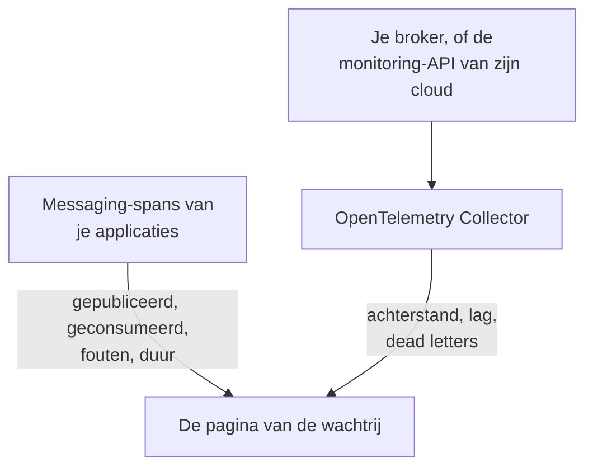

# Wachtrijen

**Queues** geeft elke berichtenwachtrij, elk topic en elk abonnement dat je applicaties gebruiken een eigen pagina: welke services erin publiceren en welke eruit consumeren, hoeveel berichten erdoorheen gaan, hoeveel er mislukken en hoe lang de verwerking duurt, de traces en metrics ervan en, zodra de eigen metrics van de broker OneUptime bereiken, de achterstand, de consumer-lag, dead letters en throttling. Wachtrijen hebben labels, eigenaren, label- en eigenaarregels en archivering, net als elke andere resource. Open ze via **Producten → Bronnen → Wachtrijen**.

:::cards
- [Applicaties instrumenteren](#applicaties-instrumenteren): De messaging-spans die je OpenTelemetry-instrumentatie al verstuurt.
- [Gezondheidsmetrics van de broker](#gezondheidsmetrics-van-de-broker): Achterstand, lag en dead letters uit je broker, systeem voor systeem.
- [Waarschuwingen](#waarschuwingen): Kant-en-klare sjablonen, en late of getelde metrics.
- [Problemen oplossen](#problemen-oplossen): Een wachtrij die niet is aangemaakt, of een brokergezondheid die leeg blijft.
:::

## Hoe het werkt

Het werkt op dezelfde manier voor elke broker (Apache Kafka, RabbitMQ, Apache ActiveMQ en andere JMS-brokers, Amazon SQS en SNS, Google Cloud Pub/Sub, Azure Service Bus, Event Hubs en Event Grid, Apache Pulsar, Apache RocketMQ, NATS en BullMQ; zie [Ondersteunde berichtensystemen](#ondersteunde-berichtensystemen)) en voor elke andere broker die je spans in `messaging.system` noemen. De meeste wachtrijen verschijnen vanzelf, uit twee bronnen:

| Bron | Wat het van jou nodig heeft | Wat het toevoegt aan de pagina van de wachtrij |
| --- | --- | --- |
| **Applicatietraces** | Geïnstrumenteerde applicaties (OpenTelemetry); zie [Applicaties instrumenteren](#applicaties-instrumenteren) | Gepubliceerde en geconsumeerde berichten, fouten en verwerkingstijd, de services aan elke kant en de traces zelf |
| **Brokermetrics** (een OpenTelemetry Collector) | De collector-receiver of de scrape voor je broker; zie [Gezondheidsmetrics van de broker](#gezondheidsmetrics-van-de-broker) | **Brokergezondheid**: achterstand, consumer-lag, dead letters, leeftijd van het oudste bericht, throttling en de eigen berichtsnelheden van de broker |



Traces vertellen OneUptime dat een wachtrij bestaat en hoe applicaties hem gebruiken, maar niet hoe vol hij is. Dat komt van de broker zelf of van de monitoring-API van zijn cloudprovider, of, voor [BullMQ](#bullmq), dat zijn jobs in Redis bewaart en geen broker heeft om te vragen, van een gauge die de applicatie rapporteert.

Je kunt een wachtrij ook handmatig toevoegen: **Queues → Queue aanmaken**, met het berichtensysteem en de naam van de bestemming en, voor Azure Service Bus en Event Hubs, de namespace. Het formulier vraagt daarnaar in de eerste stap, **Berichtensysteem**, en daarna om een optionele naam en beschrijving, met labels onder **Meer velden** (**Wachtrijgegevens**). Laat de namespace alleen leeg voor een wachtrij die je applicaties via een emulator of een eigen domeinnaam bereiken: hun spans noemen geen namespace, en de metrics van Azure Monitor bereiken zo'n wachtrij nooit (zie [Beperkingen](#beperkingen)).

## Aan de slag

:::steps
### Verstuur de traces van je applicaties

Instrumenteer de applicaties die publiceren en consumeren, en verstuur hun traces naar OneUptime (zie [Applicaties instrumenteren](#applicaties-instrumenteren)). Er is niets OneUptime-specifieks nodig: de messaging-spans die je instrumentatie al maakt, noemen de wachtrijen.

### Verstuur de metrics van je broker

Zoek je berichtensysteem op onder [Gezondheidsmetrics van de broker](#gezondheidsmetrics-van-de-broker) en draai de collectorconfiguratie ervan met je ingestiesleutel. Het tabblad **Documentatie** van elke wachtrij bevat de configuratie voor die wachtrij, klaar om te kopiëren.

### Open de wachtrij

Open **Producten → Bronnen → Wachtrijen**. De detectie draait elke 10 minuten: een wachtrij verschijnt zodra minstens 3 van haar spans binnen 15 minuten zijn binnengekomen, of een brokermetric haar heeft genoemd.
:::

## Ondersteunde berichtensystemen

OneUptime kent de berichtensystemen hieronder bij naam. Het normaliseert wat instrumentaties in `messaging.system` zetten naar de waarde in de tweede kolom (de bekende OpenTelemetry-waarde als die er is), zonder op hoofdletters te letten, zodat `AmazonSQS`, `aws.sqs` en `aws_sqs` één systeem zijn. `nats` en `bullmq` zijn geen bekende OpenTelemetry-waarden: `nats` is wat de NATS-instrumentatie van de Java-agent rapporteert, en `bullmq` is de waarde die je voor BullMQ instelt (zie [BullMQ](#bullmq)).

Een systeem dat OneUptime niet kent, werkt toch: een goed gevormde waarde (`ibmmq`, `solace`, `mqtt`: kleine letters, cijfers, `.`, `_` en `-`, tot 64 tekens) blijft behouden zoals ze binnenkwam, zodat de wachtrijen van die broker onder die naam worden gedetecteerd en getoond; alleen de eigen metrics van de broker hebben een systeem uit deze tabel nodig. `spring_integration` wordt genegeerd: de kanalen van Spring Integration zijn methodeaanroepen binnen één proces, geen broker.

**Brokermetrics** geeft aan waar de gezondheidsmetrics van een systeem vandaan komen: een collector-contrib-receiver, een Prometheus-endpoint (`:port/path`, gescrapet met de `prometheus`-receiver van de collector), de monitoring-API van de cloudprovider, of een programma buiten de collector dat ze via OTLP pusht. Elk systeem linkt hieronder naar de inrichting ervan, en het tabblad **Documentatie** van elke wachtrij maakt er een configuratie voor die wachtrij van.

| Systeem | `messaging.system` | Ook geaccepteerd | Brokermetrics |
| --- | --- | --- | --- |
| [Amazon SNS](#amazon-sns) | `aws.sns` | `aws_sns`, `amazonsns`, `sns` | receiver `aws_cloudwatch` of `awsfirehose` (cloudmonitoring) |
| [Amazon SQS](#amazon-sqs) | `aws_sqs` | `aws.sqs`, `amazonsqs`, `sqs` | receiver `aws_cloudwatch` of `awsfirehose` (cloudmonitoring) |
| [Apache ActiveMQ](#apache-activemq) | `activemq` | `artemis`, `activemq_artemis` | OpenTelemetry JMX Scraper (pusht via OTLP) |
| [Apache Kafka](#apache-kafka) | `kafka` | — | receiver `kafka_metrics` |
| [Apache Pulsar](#apache-pulsar) | `pulsar` | `apache_pulsar` | Prometheus (Pulsar-broker), `:8080/metrics/` |
| [Apache RocketMQ](#apache-rocketmq) | `rocketmq` | — | Prometheus (RocketMQ-broker), `:5557/metrics` |
| [Azure Event Grid](#azure-event-grid) | `eventgrid` | `azure_eventgrid`, `azure.eventgrid`, `microsoft.eventgrid` | receiver `azure_monitor` (cloudmonitoring) |
| [Azure Event Hubs](#azure-event-hubs) | `eventhubs` | `azure_eventhubs`, `azure.eventhubs`, `microsoft.eventhub` | receiver `azure_monitor` (cloudmonitoring) |
| [Azure Service Bus](#azure-service-bus) | `servicebus` | `azure_servicebus`, `azure.servicebus`, `microsoft.servicebus` | receiver `azure_monitor` (cloudmonitoring) |
| [BullMQ](#bullmq) | `bullmq` | — | Niets ingebouwd |
| [Google Cloud Pub/Sub](#google-cloud-pubsub) | `gcp_pubsub` | `gcp.pubsub`, `pubsub`, `google_pubsub` | receiver `googlecloudmonitoring` (cloudmonitoring) |
| [JMS](#jms) | `jms` | — | Niets ingebouwd |
| [NATS](#nats) | `nats` | `jetstream` | Prometheus (prometheus-nats-exporter), `:7777/metrics` |
| [RabbitMQ](#rabbitmq) | `rabbitmq` | — | receiver `rabbitmq` |

Een wachtrij is één bestemming van één systeem. Bij **Azure Service Bus** en **Azure Event Hubs** hoort ook de namespace erbij, omdat twee namespaces elk een wachtrij met de naam `orders` kunnen bevatten. **JMS** en **Apache ActiveMQ** delen hun wachtrijen: Java-applicaties bereiken ActiveMQ via de JMS-API, waarvan de spans `jms` zeggen, welke broker er ook achter zit, terwijl de eigen metrics van de broker alleen `activemq` kunnen zeggen; daarom komen beide op één wachtrij terecht (zie [Wat twee waarnemingen tot één wachtrij maakt](#wat-twee-waarnemingen-tot-één-wachtrij-maakt)).

## Hoe wachtrijen worden gedetecteerd

Elke wachtrij houdt bij of traces, brokermetrics of een persoon haar hebben aangemaakt. Alles wat later dezelfde wachtrij noemt, vult haar aan in plaats van een nieuwe aan te maken (zie [Wat twee waarnemingen tot één wachtrij maakt](#wat-twee-waarnemingen-tot-één-wachtrij-maakt)).

### Uit applicatietraces

Elke 10 minuten vat OneUptime de spans samen die je applicaties in de laatste 15 minuten hebben verstuurd en die een van de sleutels `messaging.system`, `messaging.destination.name`, `messaging.destination`, `message_bus.destination`, `az.namespace`, `azure.resource_provider.namespace`, `aws.sqs.queue.url`, `aws.queue_url` of `aws.sns.topic.arn` dragen. Elke span behalve een SERVER-span telt mee: PRODUCER-, CONSUMER-, CLIENT- en INTERNAL-spans, en spans die de **Span Kind-hertoewijzer** van een tracepipeline een ander soort (zoals Unspecified) of geen soort heeft gegeven; een SERVER-span noemt nooit een wachtrij.

Ook de eigen spans van een broker zijn SERVER-spans. De eBPF-tracer van de [Kubernetes-agent](/docs/telemetry/kubernetes-agent#hoe-ebpf-traces-eruitzien) legt bij elke uitwisseling de kant van een Kafka-, MQTT- of NATS-broker vast (een bericht dat hij ontvangt, een bericht dat hij aflevert) en verstuurt de meeste daarvan als PRODUCER of CONSUMER; OneUptime slaat ze op als SERVER, zodat een broker niet tussen de producers of consumers staat van de topics die hij vervoert. Een MQTT-broker die een bericht doorgeeft aan een abonnee, schrijft dezelfde PUBLISH als een client, en de tracer rapporteert beide hetzelfde; daarom gaat OneUptime bij publicaties via MQTT en NATS uit van de poort aan de andere kant van de verbinding: vanaf poort 32768 (waar besturingssystemen de poort van een verbindende client kiezen; het standaardbereik van Linux begint daar; Windows en macOS gebruiken 49152–65535) is het die van een abonnee, en is de span van de broker. Een applicatie die publiceert naar een MQTT- of NATS-broker die zelf op een poort vanaf 32768 luistert, zoals een willekeurig gepubliceerde Docker-poort, staat daarom niet als producer van haar topics, en een topic dat alleen zulke applicaties gebruiken, wordt misschien helemaal niet uit de spans van de tracer gedetecteerd. Een abonnee die vanaf een poort onder 32768 verbinding maakt met een broker (een beperkt poortbereik, of een poort die een NAT heeft herschreven), ziet de broker nog steeds als producer van de topics die aan hem worden afgeleverd.

Elk messaging-attribuut in OpenTelemetry is nog gemarkeerd als in ontwikkeling, dus applicaties in één project rapporteren dezelfde dingen onder tot vijf generaties namen. OneUptime leest ze allemaal, de nieuwste eerst, en ontleedt nooit spannamen, waarvan het formaat veranderde in de semantische conventies 1.27 en die leveranciers vrij kiezen:

- **Het systeem**: `messaging.system`, genormaliseerd zoals in [Ondersteunde berichtensystemen](#ondersteunde-berichtensystemen). Zonder die sleutel `az.namespace` of `azure.resource_provider.namespace` van de Azure-SDK's (`Microsoft.ServiceBus`, `Microsoft.EventHub`), de oudere sleutel `component` van de Azure-SDK, een span van de AWS-SDK (`rpc.system` = `aws-api`) die SQS of SNS aanroept (de SNS-spans van de Java-agent dragen geen `messaging.system`), of een sleutel met een SQS-wachtrij-URL of een SNS-topic-ARN.
- **De bestemming**: de eerste van de sleutels `messaging.destination.template`, `messaging.destination.name`, `messaging.source.template`, `messaging.source.name`, `messaging.destination` en `message_bus.destination` die de span draagt. Een span zonder een van die sleutels valt terug op de eigen sleutels van zijn systeem: de SQS-wachtrij-URL (`aws.sqs.queue.url`, `aws.queue_url`, of een wachtrij-URL in `messaging.url`, `server.address` of `net.peer.name`), de SNS-topic-ARN (`aws.sns.topic.arn`) en, voor RabbitMQ, de routing key (`messaging.rabbitmq.destination.routing_key` of `messaging.rabbitmq.routing_key`), die de naam van de wachtrij is wanneer een bericht via de standaard-exchange gaat.
- **De richting**: eerst `messaging.operation.type`, dan het soort span (PRODUCER publiceert, CONSUMER consumeert), dan het oudere `messaging.operation`, dan `messaging.operation.name` en, voor SQS en SNS, de operatie van de AWS-SDK in `rpc.method` (`SendMessage`, `ReceiveMessage`, …). Het soort gaat voor de oudere sleutels, omdat sommige instrumentaties die verkeerd invulden: confluent-kafka voor Python schreef `receive` op zijn producer-spans.

Een wachtrij wordt uit traces **aangemaakt** zodra haar spans in het venster van 15 minuten dat een run bekijkt minstens 3 tellen (`MESSAGE_QUEUE_MIN_SPANS`), zodat een eenmalig script er geen aanmaakt, en alleen zolang het project onder zijn [budget voor automatisch aanmaken](#het-budget-voor-automatisch-aanmaken) zit. Spans die geen wachtrij aanmaken, tellen nog steeds mee voor een bestaande.

Elke messaging-span wordt bij ingestie ook gemarkeerd met zijn wachtrij, zodat het tabblad **Traces** van de wachtrij elke span toont die haar noemt, ook spans die zijn verstuurd voordat de wachtrij werd aangemaakt.

### Uit brokermetrics

Een brokermetric uit de lijsten onder [Gezondheidsmetrics van de broker](#gezondheidsmetrics-van-de-broker) noemt zijn wachtrij in het eigen attribuut van de broker (`topic` bij Kafka, `rabbitmq.queue.name` bij RabbitMQ, de dimensie `EntityName` van Azure Monitor, `QueueName` bij CloudWatch), en OneUptime koppelt hem bij ingestie aan die wachtrij. Brokermetrics dragen geen `messaging.system`: elke metric wordt herkend aan zijn naam (`kafka.consumer_group.lag_sum`) en, waar twee systemen een naam delen (Azure Monitor noemt de metrics van Service Bus en Event Hubs gelijk), aan het resourcetype dat het datapunt draagt.

De volgende detectierun maakt de wachtrij aan als die nog niet bestaat: één brokermetric is genoeg, binnen het [budget voor automatisch aanmaken](#het-budget-voor-automatisch-aanmaken). Zo verschijnt ook een wachtrij die geen enkele geïnstrumenteerde applicatie aanraakt, zodra haar broker haar rapporteert.

Monitoring-API's van clouds (CloudWatch, Azure Monitor en Cloud Monitoring) publiceren elke waarde minuten na het moment dat ze meet, en ze wordt onder dat moment opgeslagen. Daarom leest elke run hun metrics uit het afgelopen uur, in plaats van uit de laatste 15 minuten waaruit hij spans en andere metrics leest: een datapunt dat te laat binnenkomt, neemt zijn wachtrij nog steeds waar, of maakt haar aan.

### Uit metrics van messaging-clients

Geïnstrumenteerde clients kunnen ook metrics rapporteren: de messaging-clientmetrics van OpenTelemetry `messaging.client.sent.messages`, `messaging.client.consumed.messages`, `messaging.client.operation.duration` en `messaging.process.duration`, hun oudere namen `messaging.publish.duration`, `messaging.receive.duration`, `messaging.publish.messages`, `messaging.receive.messages`, `messaging.process.messages` en `messaging.client.published.messages`, en die van de Azure-SDK voor Java `messaging.servicebus.messages.sent`, `messaging.servicebus.receiver.lag`, `messaging.servicebus.settlement.request.duration` en `messaging.servicebus.settlement.sequence_number`. Elk datapunt noemt zijn systeem en bestemming zoals een span dat doet (de Service Bus-metrics van de Azure-SDK noemen geen systeem, dus hun naam staat daarvoor in) en wordt bij ingestie aan die wachtrij gekoppeld, zodat het op het tabblad **Metrieken** van de wachtrij verschijnt. Dat geldt ook voor elke eigen metric die `messaging.system` en `messaging.destination.name` op elk datapunt draagt (niet op de resource, waar ze niet worden gelezen), zoals een gauge voor de wachtrijdiepte (zie [BullMQ](#bullmq)).

Metrics van messaging-clients maken nooit een wachtrij aan: dat doen traces, brokermetrics of een persoon. Een clientmetric die een bestaande wachtrij noemt, houdt haar **Laatst gezien** actueel, zoals haar spans doen. Een eigen metric doet geen van beide: hij verschijnt alleen op het tabblad **Metrieken** van de wachtrij.

### Wat twee waarnemingen tot één wachtrij maakt

De identiteit van een wachtrij is haar **systeem** en haar **bestemming**, vergeleken zonder op hoofdletters te letten: `Orders` en `orders` zijn één wachtrij, getoond onder de naam zoals die het eerst is gezien. Bij Azure Service Bus en Event Hubs hoort ook de **namespace** bij de identiteit:

- op een span het eerste DNS-label van de host waarmee de SDK verbinding maakte, uit `server.address`, `net.peer.name`, `peer.address` of `network.peer.address` in die volgorde, als die host een namespace-host is: `<namespace>.servicebus.windows.net`, of `.servicebus.usgovcloudapi.net`, `.servicebus.chinacloudapi.cn` of `.servicebus.cloudapi.de` van een soevereine cloud. Event Hubs deelt het domein van Service Bus;
- op een Azure Monitor-metric de `name` van de namespace waarover hij rapporteert.

Niets anders hoort erbij, dus geen van deze splitst ooit een wachtrij: het adres van de broker (Kafka-clients rapporteren er zelden een, en een Azure-namespace antwoordt op vele), de consumergroep of het abonnement (de consumers van een topic zijn geen aparte wachtrijen), de partitie en een dead-letter-subwachtrij. Hiervan bewaart een wachtrij alleen het adres van de broker, voor de weergave.

**JMS en ActiveMQ zijn één familie.** Elke JMS-span zegt `jms`, welke broker er ook achter zit, en de eigen metrics van de broker (de [OpenTelemetry JMX Scraper](#apache-activemq)) kunnen alleen `activemq` zeggen, dus OneUptime identificeert een ActiveMQ-wachtrij via haar JMS-familie: de spans en de brokermetrics van `orders` komen op één wachtrij terecht. Ze wordt getoond als JMS tot de metrics van de broker binnenkomen, en vanaf dan als Apache ActiveMQ, nooit andersom. Een wachtrij die je handmatig als Apache ActiveMQ aanmaakt, is diezelfde wachtrij.

### Hoe bestemmingsnamen worden gelezen

Instrumentaties noemen één wachtrij op veel manieren, en OneUptime brengt wat ze rapporteren terug tot de eigen naam van de wachtrij:

| Systeem | Gerapporteerd als | Wachtrij |
| --- | --- | --- |
| Amazon SQS | `https://sqs.us-east-1.amazonaws.com/123456789012/orders`, een wachtrij-URL (`otelaws` voor Go zet hem in `server.address`) | `orders` |
| Amazon SNS | `arn:aws:sns:us-east-1:123456789012:order-events`, een topic-ARN | `order-events` |
| Google Cloud Pub/Sub | `projects/shop/topics/orders`, een resourcenaam | `orders` |
| Azure Service Bus | `orders/Subscriptions/billing`, het entiteitspad van het abonnement `billing` van het topic | `orders` |
| Azure Service Bus | `orders/$DeadLetterQueue`, het entiteitspad van de dead-letter-subwachtrij van de wachtrij | `orders` |
| Azure Event Hubs | `telemetry/ConsumerGroups/$Default/Partitions/3`, het entiteitspad van een ontvanger, voor consumergroep `$Default` | `telemetry` |
| Apache Pulsar | `orders-partition-3`, een partitie van een topic met een korte naam | `persistent://public/default/orders` |
| Apache Pulsar | `acme/shop/orders`, een topic zonder zijn domein | `persistent://acme/shop/orders` |
| JMS | `queue://orders`, met het voorvoegsel voor het bestemmingstype | `orders` |
| RabbitMQ | `shop:new-order:orders`, exchange, routing key en wachtrij bij een consumer (semantische conventies 1.30 en later) | `orders` |
| RabbitMQ | `amq.default`, de standaard-exchange, met routing key `orders` | `orders` |
| RabbitMQ | `,orders`, het `{exchange},{routing key}` van aio-pika via de standaard-exchange | `orders` |
| RabbitMQ | `shop,new-order`, het `{exchange},{routing key}` van aio-pika | `shop` |

Een Pulsar-partitie gaat op in haar topic, en een naam zonder domein wordt aangevuld zoals Pulsar hem zelf aanvult (een korte naam in de namespace `public/default`), zodat de namen van de Java-agent aansluiten bij de volledig gekwalificeerde metriclabels van de brokers. Een RabbitMQ-span noemt meestal de exchange waarlangs een bericht ging, aan de publicerende én de consumerende kant; de standaard-exchange (`amq.default`, `<default>` of een lege naam) staat voor zijn routing key, de naam van de wachtrij. De semantische conventies 1.30 verbinden exchange, routing key en wachtrij met `:` (de opt-in-namen van de Java-agent), en OneUptime neemt de wachtrij uit de samengevoegde naam van een consumer en de exchange uit die van een publisher. aio-pika verbindt exchange en routing key aan de publicerende kant met een komma, en OneUptime splitst dat op dezelfde manier.

### Wat wordt genegeerd

OneUptime kiest bij twijfel voor geen wachtrij: een naam die per aanvraag of per consumer wordt verzonnen, zou anders voor elk bericht een wachtrij aanmaken die van niemand is. Deze worden nooit wachtrijen:

- **SERVER-spans**, en spans waarvan `messaging.system` `spring_integration` is.
- **Bestemmingen gemarkeerd als tijdelijk of anoniem**: `messaging.destination.temporary`, `messaging.destination.anonymous`, `messaging.source.temporary` of `messaging.source.anonymous` ingesteld op `true`. Het oudere `messaging.temp_destination` wordt niet vertrouwd: de instrumentaties pika en aio-pika voor Python zetten het bij elke publicatie.
- **Plaatshouders die instrumentaties rapporteren in plaats van een naam**: `(temporary)`, `(anonymous)`, `<generated>`, `unknown` (een Kafka-batch over meerdere topics), `aws:sqs` (de Lambda-SQS-events van de Java-agent), `-NamespaceOnlyMetric-` van Azure Monitor en een waarde die de eigen gegevensopschoning van OneUptime volledig heeft vervangen (`[REDACTED]`).
- **Gegenereerde en antwoordbestemmingen**: door de server benoemde wachtrijen van RabbitMQ in de stijl `amq.gen-JzTY20BRgKO-HjmUJj0wLg`, de wachtrijen `spring.gen-…` van Spring en de wachtrijen `<destination>.anonymous.<id>` van Spring Cloud Stream voor consumers zonder groep, en direct reply-to (`amq.rabbitmq.reply-to…`); tijdelijke JMS-bestemmingen (`temp-queue://…`, `temp-topic://…`) en `$TMP$…` van TIBCO; de advisory-topics van ActiveMQ (`ActiveMQ.Advisory.…`); NATS-inboxen (`_INBOX.…`) en bevestigingssubjects van JetStream (`$JS.ACK.…`); de systeemtopics van Pulsar (`__change_events`, `__transaction_…` en alles onder een segment `/__`); en een bestemming die niets anders is dan een UUID.
- **SNS-sms'jes en mobiele pushberichten**: een telefoonnummer (`+15555550123`, of `phone_number:**` uit botocore) of een platform-endpoint-ARN (`arn:aws:sns:us-east-1:123456789012:endpoint/GCM/shop-app/1234`) is een apparaat, geen topic.
- **Namen die geen enkele wachtrij kunnen zijn**: een lijst bestemmingen uit een batch (`["orders","payments"]`), een naam met een stuurteken en een naam van meer dan 255 tekens.

**UUID's worden een sjabloon.** Elke UUID binnen een bestemming wordt vervangen door `{uuid}`, zodat namen per aanvraag zoals `reply-7f1c2a9e-4b1d-4c3e-9f1a-2b3c4d5e6f70` één wachtrij worden, `reply-{uuid}`, in plaats van elk een eigen wachtrij.

### Het budget voor automatisch aanmaken

Traces en brokermetrics maken alleen zelf wachtrijen aan zolang het project minder dan 500 actieve, niet-gearchiveerde gedetecteerde wachtrijen heeft (`MESSAGE_QUEUE_AUTO_CREATE_BUDGET`, zie [Afstemming voor self-hosting](#afstemming-voor-self-hosting)). Wachtrijen die je handmatig aanmaakt, tellen nooit mee en worden nooit geblokkeerd; gearchiveerde wachtrijen tellen niet mee, dus [automatische archivering](#levenscyclus-en-archivering) maakt budget vrij; en wachtrijen die al bestaan, worden gewoon verder gekoppeld en bijgewerkt.

### Levenscyclus en archivering

- **Laatst gezien** is wanneer de detectie de wachtrij het laatst heeft gezien, in traces, metrics van messaging-clients of brokermetrics.
- **Archiveren om weg te doen.** Een gedetecteerde wachtrij verwijderen haalt haar alleen weg tot ze weer wordt gezien: haar volgende waarneming brengt haar terug als een nieuwe wachtrij. Om er een definitief weg te doen, **archiveer** je haar. Een gearchiveerde wachtrij behoudt haar identiteit, zodat alles wat haar noemt aan de gearchiveerde wachtrij gekoppeld blijft in plaats van een nieuwe aan te maken.
- **Automatische archivering.** Een gedetecteerde wachtrij die 7 dagen niet is gezien (`MESSAGE_QUEUE_AUTO_ARCHIVE_DAYS`), wordt automatisch gearchiveerd, tenzij een persoon haar heeft hernoemd, beschreven, van labels heeft voorzien of eigenaren heeft gegeven. Labels en eigenaren die label- of eigenaarregels zelf hebben toegevoegd, tellen niet mee.
- **Herstellen.** Een automatisch gearchiveerde wachtrij wordt automatisch hersteld zodra ze weer wordt gezien. Wachtrijen die je handmatig hebt aangemaakt, en wachtrijen die een persoon heeft gearchiveerd, worden door de detectie nooit gearchiveerd of hersteld. Een wachtrij die een persoon herstelt, blijft 30 dagen hersteld (of het archiefvenster, als dat langer is), ook als niets haar ziet; vanaf haar volgende waarneming geldt de regel van 7 dagen weer.

## Applicaties instrumenteren

Wachtrijen komen uit de messaging-spans die je OpenTelemetry-instrumentatie al maakt; er is niets OneUptime-specifieks nodig. Verstuur de traces naar OneUptime zoals beschreven onder [OpenTelemetry](/docs/telemetry/open-telemetry), en bekijk daarna de lijst voor jouw taal.

:::tabs
@tab Java
De OpenTelemetry-Java-agent tracet Kafka-, RabbitMQ-, JMS- (ActiveMQ, Artemis, IBM MQ en elke andere JMS-broker), Amazon SQS- en SNS-, Pulsar-, RocketMQ- en NATS-clients zonder codewijzigingen. OneUptime leest zowel de attribuutnamen die hij standaard uitstuurt als de nieuwere die hij met `OTEL_SEMCONV_STABILITY_OPT_IN=messaging` uitstuurt (agent 2.31.0 en later). JMS-spans zeggen `jms`, welke broker er ook achter zit (zie [JMS](#jms)).

- **Azure Service Bus en Event Hubs**: de Azure-SDK voor Java tracet zichzelf, en de Java-agent koppelt die tracing aan OpenTelemetry.
- **Google Cloud Pub/Sub**: de client tracet zichzelf zodra zijn builders `Publisher` en `Subscriber` een OpenTelemetry-instantie en de tracingschakelaar krijgen: `setOpenTelemetry(GlobalOpenTelemetry.get())` en `setEnableOpenTelemetryTracing(true)`. Een van beide aanroepen alleen tracet niets.
@tab .NET
- **Azure Service Bus en Event Hubs** (`Azure.Messaging.ServiceBus`, `Azure.Messaging.EventHubs`): hun OpenTelemetry-spans zijn experimenteel in de Azure-SDK. Zet ze aan met de omgevingsvariabele `AZURE_EXPERIMENTAL_ENABLE_ACTIVITY_SOURCE=true` (of de schakelaar `Azure.Experimental.EnableActivitySource` hieronder) en abonneer je op de bronnen `Azure.*`.
- **RabbitMQ.Client** 7 tracet zichzelf: abonneer je op `RabbitMQ.Client.*`.
- **MassTransit** tracet zichzelf: abonneer je op `MassTransit` (zie [Beperkingen](#beperkingen) voor wat zijn spans weglaten).
- **Confluent.Kafka**: het pakket `OpenTelemetry.Instrumentation.ConfluentKafka`.
- **Amazon SQS en SNS**: het pakket `OpenTelemetry.Instrumentation.AWS`, met `.AddAWSInstrumentation(opt => opt.SemanticConventionVersion = SemanticConventionVersion.Latest)`. De standaardset attributen (`V1_28_0`) noemt een SQS-wachtrij alleen via haar URL (`aws.queue_url`, die OneUptime leest) en een SNS-topic helemaal niet.

```csharp
// Before any Azure client is created; or set AZURE_EXPERIMENTAL_ENABLE_ACTIVITY_SOURCE=true.
AppContext.SetSwitch("Azure.Experimental.EnableActivitySource", true);

builder.Services.AddOpenTelemetry()
    .WithTracing(tracing => tracing
        .AddSource("Azure.*")
        .AddSource("RabbitMQ.Client.*")
        .AddSource("MassTransit")
        .AddOtlpExporter());
```
@tab Node.js
- `@opentelemetry/auto-instrumentations-node` tracet `amqplib` (RabbitMQ), `kafkajs` en de AWS-SDK (SQS en SNS).
- **Azure Service Bus en Event Hubs**: registreer `createAzureSdkInstrumentation()` uit `@azure/opentelemetry-instrumentation-azure-sdk`.
- **Google Cloud Pub/Sub**: `new PubSub({ enableOpenTelemetryTracing: true })`.
- **BullMQ**: zie [BullMQ](#bullmq); de eigen telemetrie ervan heeft twee extra attributen nodig.
@tab Python
- Kafka: `opentelemetry-instrumentation-kafka-python`, `opentelemetry-instrumentation-confluent-kafka` of `opentelemetry-instrumentation-aiokafka`. RabbitMQ: `opentelemetry-instrumentation-pika` of `opentelemetry-instrumentation-aio-pika`. SQS en SNS: `opentelemetry-instrumentation-botocore`, of `opentelemetry-instrumentation-boto3sqs` voor SQS. `opentelemetry-bootstrap -a install` kiest de pakketten die je geïnstalleerde bibliotheken nodig hebben.
- **Azure Service Bus en Event Hubs**: installeer `azure-core-tracing-opentelemetry` en stel `settings.tracing_implementation = "opentelemetry"` in (uit `azure.core.settings`).
- **Google Cloud Pub/Sub**: `PublisherOptions(enable_open_telemetry_tracing=True)` en `SubscriberOptions(enable_open_telemetry_tracing=True)`.
- De spans van Celery dragen geen `messaging.system` en noemen geen broker, dus maken ze geen wachtrijen aan.
@tab Go
- **Amazon SQS en SNS**: `otelaws` (`go.opentelemetry.io/contrib/instrumentation/github.com/aws/aws-sdk-go-v2/otelaws`), toegevoegd met `otelaws.AppendMiddlewares(&cfg.APIOptions)`. Zijn SQS-spans dragen de wachtrij-URL in `server.address`, die OneUptime leest als de wachtrij.
- **Google Cloud Pub/Sub**: `pubsub.ClientConfig{EnableOpenTelemetryTracing: true}`.
- **Kafka** met `segmentio/kafka-go`: de automatische instrumentatie van OpenTelemetry voor Go (`go.opentelemetry.io/auto`, eBPF, op Linux) tracet de producers en consumers ervan zonder codewijzigingen.
- De Go-contribbibliotheken van OpenTelemetry hebben geen instrumentatie voor Kafka, RabbitMQ of NATS. Gebruik voor andere clients de eigen OpenTelemetry-ondersteuning van de clientbibliotheek, of stel `messaging.system`, `messaging.destination.name` en het soort span in op de spans rond je verzendingen en handlers.
:::

## Gezondheidsmetrics van de broker

Een broker weet wat geen applicatie kan zien: hoeveel berichten wachten, hoe ver elke consumergroep achterloopt, wat er in een dead-letterwachtrij is beland. Elke sectie hieronder bevat de collectorconfiguratie voor één systeem: een volledige OpenTelemetry Collector-configuratie die eindigt met de OTLP-exporter die naar OneUptime verstuurt. Zet een telemetrie-ingestiesleutel (**Projectinstellingen → Telemetrie & APM → Ingestiesleutels**) in `x-oneuptime-token`, vervang `https://oneuptime.com` door je eigen host als je zelf host, en draai haar met `otel/opentelemetry-collector-contrib` 0.161.0 of later (elke configuratie hier is gevalideerd tegen 0.161.0). Recente collectors loggen dat `otlphttp` verouderd is ten gunste van `otlp_http`; beide namen zijn dezelfde exporter. Om meerdere systemen te verzamelen, voeg je hun receivers samen in één collector.

De sectie **Brokergezondheid** van elke wachtrij toont de metrics die voor haar systeem staan vermeld (een gauge als zijn waarde, een aantal per periode opgeteld per interval, een teller als snelheid per seconde) en combineert de reeksen van een wachtrij zoals elke metric dat nodig heeft (de gereedstaande en onbevestigde berichten van een RabbitMQ-wachtrij tellen op; de consumergroep die het verst achterloopt, is de lag). Alles wat de collector verstuurt, staat ook in de verkenner **Metrieken**. Zolang er voor een wachtrij geen vermelde metric is binnengekomen, toont de sectie waar de metrics van dat systeem vandaan komen, met een link naar de sectie ervan hier.

### Amazon SNS

Lees de CloudWatch-metrics van de topics met de `aws_cloudwatch`-receiver van de collector, of stream ze via een CloudWatch Metric Stream en Amazon Data Firehose naar zijn `awsfirehose`-receiver.

De `aws_cloudwatch`-receiver vraagt de API `GetMetricData` van CloudWatch op, één namespace per receiver, dus SNS krijgt een eigen instantie naast die van [Amazon SQS](#amazon-sqs). Hij gebruikt de standaardreferenties van de AWS-SDK (omgeving, gedeeld profiel of instantierol), die `cloudwatch:ListMetrics` en `cloudwatch:GetMetricData` nodig hebben:

```yaml
receivers:
  aws_cloudwatch/sns:
    region: us-east-1
    metrics:
      collection_interval: 5m
      period: 1m
      delay: 10m
      discovery:
        filters:
          namespace: AWS/SNS
        limit: 500

processors:
  batch: {}

exporters:
  otlphttp:
    endpoint: https://oneuptime.com/otlp
    headers:
      x-oneuptime-token: YOUR_TELEMETRY_INGESTION_TOKEN

service:
  pipelines:
    metrics:
      receivers: [aws_cloudwatch/sns]
      processors: [batch]
      exporters: [otlphttp]
```

Laat `stats` onbepaald, zoals bij [Amazon SQS](#amazon-sqs). Een Metric Stream vervoert SNS en SQS samen: voeg `AWS/SNS` toe aan de namespaces van de stream in de inrichting van [Amazon SQS](#amazon-sqs).

Een topic heet aan beide kanten hetzelfde: spans rapporteren zijn ARN of zijn naam, en OneUptime houdt de naam na de laatste `:` van de ARN.

| Metric | Getoond als | Type |
| --- | --- | --- |
| `amazonaws.com/aws/sns/numberofmessagespublished` (JSON-stream: `numberofmessagespublished`) | Messages published | Aantal per periode |
| `amazonaws.com/aws/sns/numberofnotificationsdelivered` (JSON-stream: `numberofnotificationsdelivered`) | Notifications delivered | Aantal per periode |
| `amazonaws.com/aws/sns/numberofnotificationsfailed` (JSON-stream: `numberofnotificationsfailed`) | Notifications failed | Aantal per periode |
| `amazonaws.com/aws/sns/numberofnotificationsredriventodlq` (JSON-stream: `numberofnotificationsredriventodlq`) | Redriven to dead-letter queue | Aantal per periode |

### Amazon SQS

Lees de CloudWatch-metrics van de wachtrijen met de `aws_cloudwatch`-receiver van de collector, of stream ze via een CloudWatch Metric Stream en Amazon Data Firehose naar zijn `awsfirehose`-receiver.

**CloudWatch opvragen** heeft aan de AWS-kant niets nodig behalve referenties. De receiver gebruikt de standaardreferenties van de AWS-SDK (omgeving, gedeeld profiel of instantierol), die `cloudwatch:ListMetrics` en `cloudwatch:GetMetricData` nodig hebben:

```yaml
receivers:
  aws_cloudwatch/sqs:
    region: us-east-1
    metrics:
      collection_interval: 5m
      period: 1m
      delay: 10m
      discovery:
        filters:
          namespace: AWS/SQS
        # Metrics per scrape: about nine per queue. Must be set.
        limit: 500

processors:
  batch: {}

exporters:
  otlphttp:
    endpoint: https://oneuptime.com/otlp
    headers:
      x-oneuptime-token: YOUR_TELEMETRY_INGESTION_TOKEN

service:
  pipelines:
    metrics:
      receivers: [aws_cloudwatch/sqs]
      processors: [batch]
      exporters: [otlphttp]
```

- **Laat `stats` onbepaald.** Zonder deze sleutel komt elke metric binnen als één samenvatting per periode, en dat is wat OneUptime leest; met de sleutel wordt elke statistiek een eigen reeks en mengen de grafieken ze.
- `discovery.limit` moet zijn ingesteld en begrenst de metrics die per scrape worden gelezen: ongeveer negen per wachtrij. Elke metric kost per scrape vier subquery's van `GetMetricData`, die AWS in rekening brengt.
- `delay` wacht tot CloudWatch een periode publiceert (dat duurt een paar minuten), dus met deze configuratie komen de brokermetrics van een wachtrij 11 tot 17 minuten te laat binnen: een monitor daarover heeft een langer venster nodig (zie **Late metrics** onder [Waarschuwingen](#waarschuwingen)).
- Eén receiver leest één regio en één namespace: voeg per regio een instantie toe.

**Streaming** pusht de metrics zodra CloudWatch ze publiceert. Maak voor de namespaces `AWS/SQS` (en `AWS/SNS`) een CloudWatch Metric Stream met het uitvoerformaat **OpenTelemetry 1.0** die aflevert aan een Amazon Data Firehose-stream waarvan de bestemming een HTTP-endpoint is: je collector, met een toegangssleutel. Firehose levert alleen af aan `https://` op poort 443, dus de collector heeft een certificaat en een openbare poort 443 nodig (bijvoorbeeld achter een load balancer):

```yaml
extensions:
  awscloudwatchmetricstreams_encoding:
    format: opentelemetry1.0

receivers:
  awsfirehose:
    # Firehose delivers to HTTPS on port 443 only: expose this port as 443,
    # for example behind a load balancer.
    endpoint: 0.0.0.0:4433
    encoding: awscloudwatchmetricstreams_encoding
    access_key: ${env:FIREHOSE_ACCESS_KEY}
    tls:
      cert_file: /etc/otelcol/tls/server.crt
      key_file: /etc/otelcol/tls/server.key

processors:
  batch: {}

exporters:
  otlphttp:
    endpoint: https://oneuptime.com/otlp
    headers:
      x-oneuptime-token: YOUR_TELEMETRY_INGESTION_TOKEN

service:
  extensions: [awscloudwatchmetricstreams_encoding]
  pipelines:
    metrics:
      receivers: [awsfirehose]
      processors: [batch]
      exporters: [otlphttp]
```

Een stream in het uitvoerformaat **JSON** (`format: json`) werkt ook: die verstuurt elke metric onder zijn kale naam, en OneUptime onderscheidt die van SQS van die van SNS aan de `service.name` die de stream zet (`SQS`, `SNS`).

Een dead-letterwachtrij is een gewone SQS-wachtrij met eigen metrics, dus in OneUptime een eigen wachtrij. Wachtrijen worden alleen naar hun naam benoemd, niet naar hun account of regio (zie [Beperkingen](#beperkingen)).

| Metric | Getoond als | Type |
| --- | --- | --- |
| `amazonaws.com/aws/sqs/approximatenumberofmessagesvisible` (JSON-stream: `approximatenumberofmessagesvisible`) | Messages visible | Gauge |
| `amazonaws.com/aws/sqs/approximateageofoldestmessage` (JSON-stream: `approximateageofoldestmessage`) | Oldest message age | Gauge |
| `amazonaws.com/aws/sqs/approximatenumberofmessagesnotvisible` (JSON-stream: `approximatenumberofmessagesnotvisible`) | Messages in flight | Gauge |
| `amazonaws.com/aws/sqs/numberofmessagessent` (JSON-stream: `numberofmessagessent`) | Messages sent | Aantal per periode |
| `amazonaws.com/aws/sqs/numberofmessagesreceived` (JSON-stream: `numberofmessagesreceived`) | Messages received | Aantal per periode |
| `amazonaws.com/aws/sqs/numberofmessagesdeleted` (JSON-stream: `numberofmessagesdeleted`) | Messages deleted | Aantal per periode |

### Apache ActiveMQ

De collector heeft geen JMX-receiver, dus draai de OpenTelemetry JMX Scraper met `OTEL_JMX_TARGET_SYSTEM=activemq` naast een ActiveMQ Classic-broker; hij pusht de bestemmingsmetrics van de broker via OTLP.

1. Laat de broker JMX-verbindingen accepteren. Stel bij de image `apache/activemq-classic` of het script `bin/activemq` vóór het starten `ACTIVEMQ_SUNJMX_START` in. Dit voorbeeld zet authenticatie uit: houd de poort in een privénetwerk, of zet `jmxremote.authenticate` aan met een wachtwoordbestand en geef de scraper `OTEL_JMX_USERNAME` en `OTEL_JMX_PASSWORD`.

```bash
ACTIVEMQ_SUNJMX_START="-Dcom.sun.management.jmxremote.port=1099 -Dcom.sun.management.jmxremote.rmi.port=1099 -Dcom.sun.management.jmxremote.authenticate=false -Dcom.sun.management.jmxremote.ssl=false -Djava.rmi.server.hostname=activemq"
```

2. Draai de scraper waar hij die poort kan bereiken, met een Java-runtime. Hij verstuurt rechtstreeks naar OneUptime; om hem in plaats daarvan via je eigen collector te leiden, richt je `OTEL_EXPORTER_OTLP_ENDPOINT` op de OTLP-receiver van de collector.

```bash
curl -fsSLo opentelemetry-jmx-scraper.jar https://github.com/open-telemetry/opentelemetry-java-contrib/releases/latest/download/opentelemetry-jmx-scraper.jar

export OTEL_JMX_SERVICE_URL=service:jmx:rmi:///jndi/rmi://activemq:1099/jmxrmi
export OTEL_JMX_TARGET_SYSTEM=activemq
export OTEL_JMX_TARGET_SOURCE=instrumentation
export OTEL_METRIC_EXPORT_INTERVAL=30000
export OTEL_SERVICE_NAME=activemq-prod
export OTEL_EXPORTER_OTLP_PROTOCOL=http/protobuf
export OTEL_EXPORTER_OTLP_ENDPOINT=https://oneuptime.com/otlp
export OTEL_EXPORTER_OTLP_HEADERS=x-oneuptime-token=YOUR_TELEMETRY_INGESTION_TOKEN
java -jar opentelemetry-jmx-scraper.jar
```

`OTEL_JMX_TARGET_SOURCE=instrumentation` behoudt de metricnamen die de scraper sinds 1.53.0-alpha gebruikt (`activemq.message.queue.size`, met de bestemming in `messaging.destination.name`). OneUptime leest ook de namen van oudere scrapers en van `OTEL_JMX_TARGET_SOURCE=legacy` (`activemq.message.current`, met de bestemming in `destination`).

De metrics van de broker sluiten aan bij de wachtrij die de spans van zijn JMS-clients hebben aangemaakt, en vanaf dan wordt de wachtrij als Apache ActiveMQ getoond (zie [Wat twee waarnemingen tot één wachtrij maakt](#wat-twee-waarnemingen-tot-één-wachtrij-maakt)). De scraper rapporteert elke bestemming: OneUptime negeert de advisory-topics, terwijl dead-letterwachtrijen (`ActiveMQ.DLQ`, of `DLQ.<destination>` met een individuele dead-letterstrategie) eigen wachtrijen zijn. ActiveMQ Artemis heeft andere MBeans, die deze regels niet lezen: Artemis-wachtrijen komen nog steeds uit hun JMS-spans, zonder brokergezondheid.

| Metric | Getoond als | Type |
| --- | --- | --- |
| `activemq.message.queue.size` | Queue size | Gauge |
| `activemq.message.current` | Queue size (legacy names) | Gauge |
| `activemq.message.enqueued` | Enqueued | Teller, per seconde weergegeven |
| `activemq.message.dequeued` | Dequeued | Teller, per seconde weergegeven |
| `activemq.message.expired` | Expired | Teller, per seconde weergegeven |
| `activemq.consumer.count` | Consumers | Gauge |
| `activemq.message.enqueue.average_duration` | Average time in queue | Gauge |
| `activemq.message.wait_time.avg` | Average time in queue (legacy names) | Gauge |

### Apache Kafka

De `kafka_metrics`-receiver van de collector leest de lag van consumergroepen en de offsets van partities bij de brokers; schakel zijn scrapers `topics` en `consumers` in.

```yaml
receivers:
  kafka_metrics:
    brokers: ["kafka-1:9092", "kafka-2:9092"]
    # topics: each partition's log-end offset; consumers: each group's
    # committed offsets and lag. brokers: the broker count.
    scrapers: [brokers, topics, consumers]
    collection_interval: 30s
    # auth:
    #   sasl:
    #     mechanism: SCRAM-SHA-512
    #     username: ${env:KAFKA_USERNAME}
    #     password: ${env:KAFKA_PASSWORD}
    # tls:
    #   ca_file: /etc/kafka/ca.pem

processors:
  batch: {}

exporters:
  otlphttp:
    endpoint: https://oneuptime.com/otlp
    headers:
      x-oneuptime-token: YOUR_TELEMETRY_INGESTION_TOKEN

service:
  pipelines:
    metrics:
      receivers: [kafka_metrics]
      processors: [batch]
      exporters: [otlphttp]
```

Haal voor een cluster met SASL of TLS het commentaar weg bij `auth` en `tls`. De receiver noemt elk topic in `topic`, en zo vinden de metrics de wachtrij van het topic. Hij rapporteert de lag en de gecommitte offsets van een consumergroep alleen voor topics waarvoor de groep een offset heeft gecommit, en slaat topics over waarvan de naam met `_` begint, de interne topics van Kafka (`topic_match` is standaard `^[^_].*$`).

| Metric | Getoond als | Type |
| --- | --- | --- |
| `kafka.consumer_group.lag_sum` | Consumer lag | Gauge |
| `kafka.consumer_group.lag` | Partition lag | Gauge |
| `kafka.consumer_group.offset_sum` | Consumed | Teller, per seconde weergegeven |
| `kafka.partition.current_offset` | Produced | Teller, per seconde weergegeven |

### Apache Pulsar

Elke broker biedt zijn topic- en abonnementsmetrics aan op de poort van zijn webservice; scrape elke broker, want een broker rapporteert alleen de topics die hij op dat moment bezit.

```yaml
receivers:
  prometheus:
    config:
      scrape_configs:
        - job_name: pulsar-broker
          scrape_interval: 30s
          metrics_path: /metrics/
          # Every broker: each one reports only the topics it owns.
          static_configs:
            - targets: ["pulsar-broker-0:8080", "pulsar-broker-1:8080"]
          # Keeps the families the queue page charts; remove it to keep all.
          metric_relabel_configs:
            - source_labels: [__name__]
              regex: "pulsar_(msg_backlog|subscription_back_log|storage_backlog_age_seconds|in_messages_total|out_messages_total)"
              action: keep

processors:
  batch: {}

exporters:
  otlphttp:
    endpoint: https://oneuptime.com/otlp
    headers:
      x-oneuptime-token: YOUR_TELEMETRY_INGESTION_TOKEN

service:
  pipelines:
    metrics:
      receivers: [prometheus]
      processors: [batch]
      exporters: [otlphttp]
```

- Topic- en abonnementsreeksen hebben `exposeTopicLevelMetricsInPrometheus=true` in `broker.conf` nodig, wat de standaard is.
- Pulsar labelt elke reeks met de volledige naam van het topic (`persistent://public/default/orders`) en die van een partitie met die van de partitie (`persistent://public/default/orders-partition-3`): partities tellen op tot hun topic.
- De achterstand wordt in entries geteld, en Pulsar telt een batch berichten als één entry.
- Pulsar herhaalt `pulsar_out_messages_total` per consumer wanneer `exposeConsumerLevelMetricsInPrometheus=true`; die reeksen per consumer blijven buiten de grafieken, zodat geen bericht dubbel telt.
- `pulsar_storage_backlog_age_seconds` geeft `-1` zolang de broker het niet kan zeggen.
- De native OpenTelemetry-metrics van Pulsar 3.3 en later (experimenteel, standaard uit) gebruiken andere namen, die niet in grafieken worden getoond.

| Metric | Getoond als | Type |
| --- | --- | --- |
| `pulsar_msg_backlog` | Backlog | Gauge |
| `pulsar_subscription_back_log` | Subscription backlog | Gauge |
| `pulsar_storage_backlog_age_seconds` | Backlog age | Gauge |
| `pulsar_in_messages_total` | Messages in | Teller, per seconde weergegeven |
| `pulsar_out_messages_total` | Messages out | Teller, per seconde weergegeven |

### Apache RocketMQ

Stel `metricsExporterType=PROM` in in de `broker.conf` van de broker, zodat de broker zijn lag- en doorvoermetrics aanbiedt.

```text
metricsExporterType=PROM
metricsPromExporterPort=5557
metricsPromExporterHost=0.0.0.0
```

Scrape daarna elke broker:

```yaml
receivers:
  prometheus:
    config:
      scrape_configs:
        - job_name: rocketmq-broker
          scrape_interval: 30s
          metrics_path: /metrics
          static_configs:
            - targets: ["rocketmq-broker-a:5557", "rocketmq-broker-b:5557"]

processors:
  batch: {}

exporters:
  otlphttp:
    endpoint: https://oneuptime.com/otlp
    headers:
      x-oneuptime-token: YOUR_TELEMETRY_INGESTION_TOKEN

service:
  pipelines:
    metrics:
      receivers: [prometheus]
      processors: [batch]
      exporters: [otlphttp]
```

Dit is de ingebouwde exporter van RocketMQ 5. RocketMQ 4 heeft er geen; de aparte `rocketmq-exporter` die het gebruikt, rapporteert andere metricnamen, die niet in grafieken worden getoond. Het dead-lettertopic van een consumergroep (`%DLQ%<group>`) is een eigen wachtrij.

| Metric | Getoond als | Type |
| --- | --- | --- |
| `rocketmq_consumer_lag_messages` | Consumer lag | Gauge |
| `rocketmq_consumer_ready_messages` | Ready messages | Gauge |
| `rocketmq_send_to_dlq_messages_total` | Sent to dead-letter queue | Teller, per seconde weergegeven |
| `rocketmq_messages_in_total` | Messages in | Teller, per seconde weergegeven |

### Azure Event Grid

Azure Monitor heeft de aflever- en dead-lettermetrics van de topics, die de `azure_monitor`-receiver van de collector leest; ze worden nog niet op een wachtrijpagina getoond, dus verken ze onder Metrics.

De receiver meldt zich aan via de extensie `azure_auth`. Geef de service-principal de rol **Monitoring Reader** op het abonnement:

```yaml
extensions:
  azure_auth:
    service_principal:
      tenant_id: ${env:AZURE_TENANT_ID}
      client_id: ${env:AZURE_CLIENT_ID}
      client_secret: ${env:AZURE_CLIENT_SECRET}

receivers:
  azure_monitor/eventgrid:
    subscription_ids: ["${env:AZURE_SUBSCRIPTION_ID}"]
    auth:
      authenticator: azure_auth
    collection_interval: 60s
    services:
      - Microsoft.EventGrid/topics
      - Microsoft.EventGrid/systemTopics
      - Microsoft.EventGrid/domains
    maximum_number_of_records_per_resource: 1000

processors:
  batch: {}

exporters:
  otlphttp:
    endpoint: https://oneuptime.com/otlp
    headers:
      x-oneuptime-token: YOUR_TELEMETRY_INGESTION_TOKEN

service:
  extensions: [azure_auth]
  pipelines:
    metrics:
      receivers: [azure_monitor/eventgrid]
      processors: [batch]
      exporters: [otlphttp]
```

OneUptime toont de metrics van Event Grid niet op de pagina van een wachtrij: Azure Monitor rapporteert ze per Event Grid-resource en eventabonnement, niet in een vorm die een van je wachtrijen noemt. Ze komen binnen in de verkenner **Metrieken**: `azure_publishsuccesscount_total`, `azure_deliverysuccesscount_total`, `azure_deadletteredcount_total` en de rest. Voeg voor Event Grid-namespaces `Microsoft.EventGrid/namespaces` toe aan `services`.

### Azure Event Hubs

Lees de metrics van de namespace uit Azure Monitor met de `azure_monitor`-receiver van de collector, die ze per event hub opsplitst via de dimensie EntityName.

De receiver meldt zich aan via de extensie `azure_auth`. Geef de service-principal de rol **Monitoring Reader** op het abonnement:

```yaml
extensions:
  azure_auth:
    service_principal:
      tenant_id: ${env:AZURE_TENANT_ID}
      client_id: ${env:AZURE_CLIENT_ID}
      client_secret: ${env:AZURE_CLIENT_SECRET}

receivers:
  azure_monitor/eventhubs:
    subscription_ids: ["${env:AZURE_SUBSCRIPTION_ID}"]
    auth:
      authenticator: azure_auth
    collection_interval: 60s
    services: [Microsoft.EventHub/namespaces]
    maximum_number_of_records_per_resource: 1000
    metrics:
      "Microsoft.EventHub/namespaces":
        IncomingMessages: [Total]
        OutgoingMessages: [Total]
        ServerErrors: [Total]
        UserErrors: [Total]
        QuotaExceededErrors: [Total]
        ThrottledRequests: [Total]

processors:
  batch: {}

exporters:
  otlphttp:
    endpoint: https://oneuptime.com/otlp
    headers:
      x-oneuptime-token: YOUR_TELEMETRY_INGESTION_TOKEN

service:
  extensions: [azure_auth]
  pipelines:
    metrics:
      receivers: [azure_monitor/eventhubs]
      processors: [batch]
      exporters: [otlphttp]
```

De metrics vinden hun event hub via de namespace (`name`) en de event hub (`EntityName`); de namespace die spans rapporteren als `<namespace>.servicebus.windows.net`. `maximum_number_of_records_per_resource` is het aantal reeksen dat Azure per metric en namespace teruggeeft, 10 tenzij je het verhoogt: houd het boven je aantal event hubs, anders worden de rest niet gerapporteerd. Laat `use_batch_api` uit, zoals het standaard is: de batch-API mislukt sinds collector 0.155.0 voor Event Hubs-namespaces.

Azure Monitor heeft geen consumer-lagmetric voor Event Hubs: zijn `ConsumerLag` bestaat alleen in de applicatiemetriclogs van de tiers Premium en Dedicated, die deze receiver niet leest.

| Metric | Getoond als | Type |
| --- | --- | --- |
| `azure_incomingmessages_total` | Incoming messages | Aantal per periode |
| `azure_outgoingmessages_total` | Outgoing messages | Aantal per periode |
| `azure_servererrors_total` | Server errors | Aantal per periode |
| `azure_usererrors_total` | User errors | Aantal per periode |
| `azure_quotaexceedederrors_total` | Quota exceeded errors | Aantal per periode |
| `azure_throttledrequests_total` | Throttled requests | Aantal per periode |

### Azure Service Bus

Lees de metrics van de namespace uit Azure Monitor met de `azure_monitor`-receiver van de collector, die ze per wachtrij en topic opsplitst via de dimensie EntityName.

De receiver meldt zich aan via de extensie `azure_auth`. Geef de service-principal de rol **Monitoring Reader** op het abonnement:

```yaml
extensions:
  azure_auth:
    service_principal:
      tenant_id: ${env:AZURE_TENANT_ID}
      client_id: ${env:AZURE_CLIENT_ID}
      client_secret: ${env:AZURE_CLIENT_SECRET}

receivers:
  azure_monitor/servicebus:
    subscription_ids: ["${env:AZURE_SUBSCRIPTION_ID}"]
    auth:
      authenticator: azure_auth
    collection_interval: 60s
    services: [Microsoft.ServiceBus/namespaces]
    # Series Azure returns per metric and namespace (default 10): keep it
    # above your number of queues and topics.
    maximum_number_of_records_per_resource: 1000
    metrics:
      "Microsoft.ServiceBus/namespaces":
        ActiveMessages: [Average]
        DeadletteredMessages: [Average]
        IncomingMessages: [Total]
        OutgoingMessages: [Total]
        CompleteMessage: [Total]
        AbandonMessage: [Total]
        ServerErrors: [Total]
        UserErrors: [Total]
        ThrottledRequests: [Total]

processors:
  batch: {}

exporters:
  otlphttp:
    endpoint: https://oneuptime.com/otlp
    headers:
      x-oneuptime-token: YOUR_TELEMETRY_INGESTION_TOKEN

service:
  extensions: [azure_auth]
  pipelines:
    metrics:
      receivers: [azure_monitor/servicebus]
      processors: [batch]
      exporters: [otlphttp]
```

- De metrics vinden hun wachtrij of topic via de namespace (`name`) en de entiteit (`EntityName`); de spans van de SDK's noemen dezelfde namespace als `<namespace>.servicebus.windows.net`. Een span op `orders/Subscriptions/billing` of `orders/$DeadLetterQueue` hoort bij `orders`, net als de metrics.
- `maximum_number_of_records_per_resource` is het aantal reeksen dat Azure per metric en namespace teruggeeft, 10 tenzij je het verhoogt: houd het boven je aantal wachtrijen en topics (de foutmetrics splitsen elke entiteit verder op naar resultaat), anders worden de rest niet gerapporteerd.
- Azure Monitor splitst niet op naar topicabonnement: de tellingen van een topic dekken al zijn abonnementen.
- De lijst `metrics` verzamelt precies wat de wachtrijpagina toont, elk met de ene aggregatie die ze toont; voeg een metric toe (`ScheduledMessages`, `Size`, …) om die ook te verzamelen.
- De receiver somt je namespaces één keer per dag op, dus een nieuwe namespace kan tot 24 uur nodig hebben om te verschijnen.

| Metric | Getoond als | Type |
| --- | --- | --- |
| `azure_activemessages_average` | Active messages | Gauge |
| `azure_deadletteredmessages_average` | Dead-lettered messages | Gauge |
| `azure_incomingmessages_total` | Incoming messages | Aantal per periode |
| `azure_outgoingmessages_total` | Outgoing messages | Aantal per periode |
| `azure_completemessage_total` | Completed messages | Aantal per periode |
| `azure_abandonmessage_total` | Abandoned messages | Aantal per periode |
| `azure_servererrors_total` | Server errors | Aantal per periode |
| `azure_usererrors_total` | User errors | Aantal per periode |
| `azure_throttledrequests_total` | Throttled requests | Aantal per periode |

### BullMQ

BullMQ bewaart zijn jobs in Redis en heeft geen broker om te scrapen; rapporteer de wachtrijdiepte vanuit de applicatie als metric met `messaging.system` en `messaging.destination.name`, zoals de eigen workers van OneUptime doen met `queue.size`.

Met de [eBPF-tracer van de Kubernetes-agent](/docs/telemetry/kubernetes-agent#hoe-ebpf-traces-eruitzien) leest OneUptime ook BullMQ-wachtrijen (BullMQ 5 en later) uit de Redis-commando's die BullMQ verstuurt, zonder wijziging in je applicatie: het toevoegen van een job toont de service als producer van zijn wachtrij, en het afronden van een job als consumer. De agent laat standaard databaseaanroepen buiten een request vallen (`ebpf.dropUnlinkedDatabaseCalls`), en een worker die een job afhandelt zit buiten een request, dus een wachtrij die zo wordt gevonden toont standaard vooral zijn producers; stel `ebpf.dropUnlinkedDatabaseCalls=false` in om ook zijn consumers te zien.

De eigen telemetrie van BullMQ (zijn optie `telemetry`, die het pakket `bullmq-otel` implementeert) noemt de wachtrij in `bullmq.queue.name` en zet geen `messaging.system`, dus op zichzelf maakt ze geen wachtrij aan. Een `transform`-processor in de collector waarnaar je applicaties versturen, voegt de twee sleutels toe die OneUptime leest, op de spans die jobs toevoegen en verwerken en op de eigen metrics van BullMQ:

```yaml
receivers:
  otlp:
    protocols:
      grpc:
        endpoint: 0.0.0.0:4317
      http:
        endpoint: 0.0.0.0:4318

processors:
  # BullMQ names the queue in bullmq.queue.name and sets no
  # messaging.system: copy it into the keys OneUptime reads, on the spans
  # that publish (add) and process jobs, and on BullMQ's own metrics.
  transform/bullmq:
    error_mode: ignore
    trace_statements:
      - set(span.attributes["messaging.system"], "bullmq") where span.attributes["bullmq.queue.name"] != nil and span.attributes["messaging.system"] == nil and (span.kind == SPAN_KIND_PRODUCER or span.kind == SPAN_KIND_CONSUMER)
      - set(span.attributes["messaging.destination.name"], span.attributes["bullmq.queue.name"]) where span.attributes["messaging.system"] == "bullmq" and span.attributes["messaging.destination.name"] == nil
    metric_statements:
      - set(datapoint.attributes["messaging.system"], "bullmq") where datapoint.attributes["bullmq.queue.name"] != nil and datapoint.attributes["messaging.system"] == nil
      - set(datapoint.attributes["messaging.destination.name"], datapoint.attributes["bullmq.queue.name"]) where datapoint.attributes["messaging.system"] == "bullmq" and datapoint.attributes["messaging.destination.name"] == nil
  batch: {}

exporters:
  otlphttp:
    endpoint: https://oneuptime.com/otlp
    headers:
      x-oneuptime-token: YOUR_TELEMETRY_INGESTION_TOKEN

service:
  pipelines:
    traces:
      receivers: [otlp]
      processors: [transform/bullmq, batch]
      exporters: [otlphttp]
    metrics:
      receivers: [otlp]
      processors: [transform/bullmq, batch]
      exporters: [otlphttp]
```

Alleen de PRODUCER-spans die jobs toevoegen en de CONSUMER-spans die ze verwerken, worden gemarkeerd: de interne spans van BullMQ (de volgende job ophalen, locks verlengen) noemen de wachtrij ook, maar zijn geen berichten. Kijk voor de wachtrijdiepte naar de jobtellingen in de applicatie; een gauge die de twee sleutels zelf draagt, heeft geen transformatie nodig:

```ts
import { metrics } from "@opentelemetry/api";
import { Queue } from "bullmq";

const queue = new Queue("orders", { connection: { host: "redis" } });

metrics
  .getMeter("bullmq-queues")
  .createObservableGauge("queue.size", { unit: "{job}" })
  .addCallback(async (result) => {
    const counts = await queue.getJobCounts("waiting", "active", "delayed", "failed");
    for (const [state, count] of Object.entries(counts)) {
      result.observe(count, {
        "messaging.system": "bullmq",
        "messaging.destination.name": queue.name,
        state,
      });
    }
  });
```

Hij verschijnt op het tabblad **Metrieken** van de wachtrij. OneUptime heeft geen eigen BullMQ-metrics om onder **Brokergezondheid** te tonen.

### Google Cloud Pub/Sub

Lees de metrics van de topics en abonnementen uit Cloud Monitoring met de `googlecloudmonitoring`-receiver van de collector, en vermeld elk metrictype onder `metrics_list`.

De receiver meldt zich aan met Application Default Credentials (`GOOGLE_APPLICATION_CREDENTIALS`, of het serviceaccount waaronder de collector draait), die de rol **Monitoring Viewer** op het project nodig hebben:

```yaml
receivers:
  googlecloudmonitoring:
    project_id: my-gcp-project
    collection_interval: 2m
    # Only the metric types listed here are read.
    metrics_list:
      - metric_name: pubsub.googleapis.com/subscription/num_undelivered_messages
      - metric_name: pubsub.googleapis.com/subscription/oldest_unacked_message_age
      - metric_name: pubsub.googleapis.com/subscription/dead_letter_message_count
      - metric_name: pubsub.googleapis.com/subscription/ack_message_count
      - metric_name: pubsub.googleapis.com/topic/send_request_count

processors:
  batch: {}

exporters:
  otlphttp:
    endpoint: https://oneuptime.com/otlp
    headers:
      x-oneuptime-token: YOUR_TELEMETRY_INGESTION_TOKEN

service:
  pipelines:
    metrics:
      receivers: [googlecloudmonitoring]
      processors: [batch]
      exporters: [otlphttp]
```

- Een metrictype dat ontbreekt in `metrics_list`, wordt nooit gelezen, en de lijst wordt gelezen bij het starten van de collector: start hem na een wijziging opnieuw.
- `collection_interval` is minstens één minuut. Cloud Monitoring publiceert de metrics van Pub/Sub twee tot vier minuten te laat.
- Abonnementsmetrics horen bij de wachtrij van het abonnement (`subscription_id`), topicmetrics bij die van het topic (`topic_id`); zo noemen ook de spans van de clientbibliotheken ze (zie [Beperkingen](#beperkingen)).

| Metric | Getoond als | Type |
| --- | --- | --- |
| `pubsub.googleapis.com/subscription/num_undelivered_messages` | Undelivered messages | Gauge |
| `pubsub.googleapis.com/subscription/oldest_unacked_message_age` | Oldest unacked message age | Gauge |
| `pubsub.googleapis.com/subscription/dead_letter_message_count` | Dead-lettered messages | Aantal per periode |
| `pubsub.googleapis.com/subscription/ack_message_count` | Acknowledged messages | Aantal per periode |
| `pubsub.googleapis.com/topic/send_request_count` | Publish requests | Aantal per periode |

### JMS

JMS is een API, en de spans ervan noemen de broker erachter niet; als de broker Apache ActiveMQ is, draai je de OpenTelemetry JMX Scraper ertegen en sluiten de metrics ervan aan bij dezelfde wachtrij, die dan als ActiveMQ-wachtrij wordt getoond, terwijl andere JMS-brokers zoals IBM MQ geen kant-en-klaar metricpad hebben.

Wachtrijen van JMS-applicaties verschijnen uit hun spans, welke broker het ook is: zie [Apache ActiveMQ](#apache-activemq) voor de scraper. Verstuur voor elke andere broker de metrics ervan met `messaging.system` ingesteld op `jms` en `messaging.destination.name` ingesteld op de naam van de wachtrij op elk datapunt: dan horen ze bij dezelfde wachtrij als de spans en verschijnen ze op haar tabblad **Metrieken**.

### NATS

Draai prometheus-nats-exporter met `-jsz=all` tegen de monitoringpoort van de server. Zijn JetStream-metrics gelden per stream en consumer, niet per subject, dus horen ze niet bij wachtrijen op subjectniveau.

Zet de monitoringpoort van de server aan met `-m 8222` (of `http_port: 8222` in zijn configuratie), en draai daarna de exporter:

```bash
prometheus-nats-exporter -varz -jsz=all http://nats:8222
```

En scrape hem:

```yaml
receivers:
  prometheus:
    config:
      scrape_configs:
        - job_name: nats
          scrape_interval: 30s
          metrics_path: /metrics
          static_configs:
            - targets: ["nats-exporter:7777"]

processors:
  batch: {}

exporters:
  otlphttp:
    endpoint: https://oneuptime.com/otlp
    headers:
      x-oneuptime-token: YOUR_TELEMETRY_INGESTION_TOKEN

service:
  pipelines:
    metrics:
      receivers: [prometheus]
      processors: [batch]
      exporters: [otlphttp]
```

NATS-wachtrijen zijn subjects (`orders.created`), benoemd door de spans van de Java-agent, en de streams en consumers van JetStream zijn niet op één subject af te beelden, dus OneUptime toont er geen enkele op de pagina van een wachtrij. Ze komen binnen in de verkenner **Metrieken**: `jetstream_consumer_num_pending`, `jetstream_consumer_num_ack_pending`, `jetstream_stream_total_messages` en de rest.

### RabbitMQ

De `rabbitmq`-receiver van de collector leest de diepte, de consumers en de berichtsnelheden van elke wachtrij uit de HTTP-API van de beheerplugin, als gebruiker met de tag `monitoring` en toegang tot elke virtuele host.

Schakel de beheerplugin in en maak die gebruiker aan. De tag `monitoring` alleen toont hem geen enkele wachtrij: de beheer-API toont een gebruiker alleen de wachtrijen van de virtuele hosts waartoe hij toegang heeft, dus geef hem toegang tot elke virtuele host die je wilt bewaken. Lege patronen verlenen die toegang zonder enig recht om te configureren, te publiceren of te consumeren:

```bash
rabbitmq-plugins enable rabbitmq_management
rabbitmqctl add_user otel 'a-strong-password'
rabbitmqctl set_user_tags otel monitoring
# Once per virtual host to monitor; "/" is the default one.
rabbitmqctl set_permissions -p / otel "" "" ""
```

```yaml
receivers:
  rabbitmq:
    endpoint: http://rabbitmq:15672
    username: ${env:RABBITMQ_USERNAME}
    password: ${env:RABBITMQ_PASSWORD}
    collection_interval: 30s

processors:
  batch: {}

exporters:
  otlphttp:
    endpoint: https://oneuptime.com/otlp
    headers:
      x-oneuptime-token: YOUR_TELEMETRY_INGESTION_TOKEN

service:
  pipelines:
    metrics:
      receivers: [rabbitmq]
      processors: [batch]
      exporters: [otlphttp]
```

- De receiver rapporteert elke wachtrij onder haar RabbitMQ-naam. De spans van de meeste instrumentaties noemen in plaats daarvan de exchange, bij publishers en consumers, dus komen ze in OneUptime op een eigen wachtrij terecht. Spans noemen de wachtrij zelf bij berichten die via de standaard-exchange worden verstuurd, en bij consumers die de Java-agent met `OTEL_SEMCONV_STABILITY_OPT_IN=messaging` tracet (zie [Beperkingen](#beperkingen)).
- Zonder toegang tot een virtuele host ziet de receiver geen van haar wachtrijen: hij verstuurt er niets voor en logt geen fout.
- De tellers voor gepubliceerd, afgeleverd, bevestigd en verworpen verschijnen pas zodra de wachtrij die activiteit heeft gezien: tot dan verstuurt de receiver niets, ook geen 0.

| Metric | Getoond als | Type |
| --- | --- | --- |
| `rabbitmq.message.current` | Queue depth | Gauge |
| `rabbitmq.message.published` | Published | Teller, per seconde weergegeven |
| `rabbitmq.message.delivered` | Delivered | Teller, per seconde weergegeven |
| `rabbitmq.message.acknowledged` | Acknowledged | Teller, per seconde weergegeven |
| `rabbitmq.message.dropped` | Dropped | Teller, per seconde weergegeven |
| `rabbitmq.consumer.count` | Consumers | Gauge |

## Waarschuwingen

Wachtrijen worden bewaakt met **Metrieken**-monitors over hun brokermetrics (zie [Metrics-monitor](/docs/monitor/metrics-monitor)).

**Vanaf de pagina van de wachtrij.** Elke gauge en elk aantal per periode onder **Brokergezondheid** heeft **Create monitor**: dat opent een nieuwe metrics-monitor over die metric, gefilterd op precies de attribuutwaarden die deze wachtrij erin noemen, met een startdrempel waar de metric iets meet met een duidelijke slechte richting: achterstand, dead letters, consumer-lag, leeftijd van het oudste bericht, throttling of fouten. Vier daarvan beginnen zonder drempel, omdat een vaste drempel daarop misleidt: de partitielag van Kafka (`kafka.consumer_group.lag`), die de lag van zijn consumergroep al dekt; de gemiddelde tijd in de wachtrij van ActiveMQ (`activemq.message.enqueue.average_duration`, `activemq.message.wait_time.avg`), een gemiddelde sinds de start van de broker dat nog lang na een stilstand hoog blijft; en de leeftijd van de achterstand van Pulsar (`pulsar_storage_backlog_age_seconds`), die `-1` geeft zolang de broker het niet kan zeggen. Tellers krijgen geen monitor: hun grafiek toont een snelheid, en een monitor heeft geen snelheidsfunctie.

**Tellers.** De tellers van RabbitMQ, Apache ActiveMQ en Apache RocketMQ bereiken de collector als cumulatieve sommen, die een `cumulative_to_delta`-processor (`cumulativetodelta` in oudere collectors) omzet in delta's waarop een monitor kan waarschuwen. Zet een kopie onder een eigen naam om, nooit de teller zelf: de wachtrijpagina leest elk van deze tellers als een lopend totaal en toont hoe snel het groeit, dus een teller die in delta's is omgezet, geeft onzin onder **Brokergezondheid** en op het tabblad **Metrieken**: gelijkmatig verkeer verschijnt als 0 berichten per seconde. De offsets van Apache Kafka (`kafka.consumer_group.offset_sum`, `kafka.partition.current_offset`) en `pulsar_in_messages_total` en `pulsar_out_messages_total` van Apache Pulsar komen binnen als gauges, die `cumulative_to_delta` met rust laat: waarschuw bij die systemen in plaats daarvan op de gauges voor lag en achterstand.

De configuratie voor [RabbitMQ](#rabbitmq) met een kopie van `rabbitmq.message.published` om op te waarschuwen:

```yaml
receivers:
  rabbitmq:
    endpoint: http://rabbitmq:15672
    username: ${env:RABBITMQ_USERNAME}
    password: ${env:RABBITMQ_PASSWORD}
    collection_interval: 30s

processors:
  # A copy of each counter to alert on, under a name of its own: the queue
  # page keeps charting the original.
  transform/alerting:
    error_mode: ignore
    metric_statements:
      - copy_metric(name="rabbitmq.message.published.delta") where metric.name == "rabbitmq.message.published"
  # Turns only the copies into deltas. `drop` keeps back each copy's first
  # point after a start, which would otherwise be the counter's whole total.
  cumulative_to_delta/alerting:
    initial_value: drop
    include:
      metrics:
        - rabbitmq.message.published.delta
      match_type: strict
  batch: {}

exporters:
  otlphttp:
    endpoint: https://oneuptime.com/otlp
    headers:
      x-oneuptime-token: YOUR_TELEMETRY_INGESTION_TOKEN

service:
  pipelines:
    metrics:
      receivers: [rabbitmq]
      processors: [transform/alerting, cumulative_to_delta/alerting, batch]
      exporters: [otlphttp]
```

Elk punt van `rabbitmq.message.published.delta` is het aantal berichten dat sinds de vorige scrape is gepubliceerd, dus een metrics-monitor erop, gefilterd op `resource.rabbitmq.queue.name` en opgeteld over zijn venster, telt wat in dat venster is gepubliceerd: onder 1 in 15 minuten betekent dat niemand publiceert. Na elke start van de collector heeft de processor geen eerdere waarde om het eerste punt van een wachtrij van af te trekken, en standaard verstuurt hij dat punt zoals het is: het hele lopende totaal van de teller, alsof elk bericht dat de wachtrij ooit heeft gehad in één scrape is gepubliceerd. `initial_value: drop` houdt dat punt tegen, zodat de kopie van een wachtrij begint met de tweede scrape die haar teller rapporteert. Kopieer een andere teller op dezelfde manier, met elk een `copy_metric`-instructie en een `include`-item. De JMX Scraper van ActiveMQ moet dan via zo'n collector versturen, naar een `otlp`-receiver in plaats van `rabbitmq`; de tellers van RocketMQ krijgen dezelfde twee processors in de pipeline van zijn `prometheus`-receiver.

**Handmatig** filter je op het attribuut dat de wachtrij in die metric noemt; het is voor elke wachtrij van een systeem hetzelfde:

| Waarschuwen wanneer | Metric | Filter | Aggregatie |
| --- | --- | --- | --- |
| Een Kafka-consumergroep achterraakt | `kafka.consumer_group.lag_sum` | `topic` = `orders` | Max |
| Het oudste bericht van een SQS-wachtrij oud wordt | `amazonaws.com/aws/sqs/approximateageofoldestmessage` | `Dimensions.QueueName` = `orders` | Max |
| Berichten een dead-letterwachtrij van Service Bus bereiken | `azure_deadletteredmessages_average` | `name` = `shop-prod`, `metadata_entityname` = `orders` | Max |
| De achterstand van een Pub/Sub-abonnement groeit | `pubsub.googleapis.com/subscription/num_undelivered_messages` | `resource.subscription_id` = `orders-billing` | Max |
| Niemand een RabbitMQ-wachtrij consumeert | `rabbitmq.consumer.count` | `resource.rabbitmq.queue.name` = `orders` | Min |

Om elke wachtrij van een systeem met één monitor te bewaken, groepeer je op dat attribuut in plaats van erop te filteren: elke wachtrij waarschuwt dan afzonderlijk (zie [Waarschuwingen per reeks](/docs/monitor/metrics-monitor#waarschuwingen-per-reeks-group-by)). De diepte van een RabbitMQ-wachtrij (`rabbitmq.message.current`) komt binnen als twee reeksen, `state` = `ready` en `state` = `unacknowledged`. De monitor die **Create monitor** bouwt, telt ze op zoals de wachtrijpagina doet: één query per status, `a_ready` en `a_unacknowledged`, en de formule `a_ready + a_unacknowledged`, op wiens alias `a` zijn startdrempel van toepassing is. Een handmatig gebouwde monitor moet hetzelfde doen, met zijn criteria op de formule.

**Late metrics.** Monitoring-API's van clouds publiceren hun waarden minuten na het feit: het nieuwste punt van de `aws_cloudwatch`-receiver is met de configuratie op deze pagina 11 tot 17 minuten oud, en tot 25 met de standaard `period` van vijf minuten van de receiver; dat van de `googlecloudmonitoring`-receiver tot 9. Een monitor over metrics van SQS, SNS of Pub/Sub heeft daarom een langer venster nodig, anders ziet hij geen gegevens en gaat hij nooit af; **Create monitor** start die monitors met 30 en 15 minuten.

## Beperkingen

- **Gelijknamige bestemmingen op twee clusters of accounts zijn één wachtrij.** Een Kafka-topic, een RabbitMQ-wachtrij of een SQS-wachtrij wordt alleen op naam geïdentificeerd: spans noemen zelden hun cluster (de Java-agent, kafkajs en de .NET-client van Confluent rapporteren geen brokeradres), dus een cluster in de identiteit zou in plaats daarvan elk topic per instrumentatie opsplitsen. Twee clusters met een topic genaamd `orders`, of twee AWS-accounts of -regio's met een wachtrij genaamd `orders`, delen in een project één wachtrij. Azure Service Bus en Event Hubs zijn de uitzondering: hun namespace hoort bij de identiteit.
- **Kafka-clients op Event Hubs zijn Kafka.** Een Kafka-client die met het Kafka-endpoint van Event Hubs is verbonden, rapporteert `kafka`, dus zijn topic is een Kafka-wachtrij, los van de eigen Azure Event Hubs-wachtrij van de event hub en haar Azure Monitor-metrics.
- **Service Bus-spans zonder namespace-host worden apart geïdentificeerd.** De namespace komt van de host waarmee de SDK verbinding maakte. Spans die naar de Service Bus-emulator of via een eigen domeinnaam worden verstuurd, noemen geen namespace, dus hun wachtrij is een andere dan de wachtrij waarbij de metrics van Azure Monitor horen.
- **RabbitMQ-spans noemen meestal exchanges; de metrics van de broker noemen wachtrijen.** De meeste instrumentaties (de Java-agent standaard, amqplib voor Node.js, pika en aio-pika voor Python, RabbitMQ.Client voor .NET) noemen de exchange waarlangs een bericht ging, aan de publicerende én de consumerende kant. Hun spans komen terecht op een wachtrij die naar de exchange is genoemd, en de metrics van de `rabbitmq`-receiver op de wachtrij zelf. De twee ontmoeten elkaar bij berichten die via de standaard-exchange worden verstuurd, waarvan de routing key de naam van de wachtrij is, en bij consumers die de Java-agent 2.31.0 of later met `OTEL_SEMCONV_STABILITY_OPT_IN=messaging` tracet, waarvan de spans exchange, routing key en wachtrij noemen (`shop:new-order:orders`), waaruit OneUptime de wachtrij neemt. MassTransit noemt één exchange per berichttype (`Namespace:Type`), die heel blijft, en zijn ontvangstspans zetten geen `messaging.system`, dus maken ze geen wachtrij aan en verschijnen ze niet als haar consumers.
- **Pub/Sub-publishers noemen topics; abonnees noemen abonnementen.** Elke Google-clientbibliotheek rapporteert aan de publicerende kant het topic en aan de consumerende kant het abonnement, dus een topic en elk van zijn abonnementen zijn aparte wachtrijen: publicatiespans en topicmetrics op de ene, consumptiespans en abonnementsmetrics op de andere.
- **De reeksen per consumer van Pulsar blijven buiten de grafieken**, zodat berichten die aan een abonnement worden afgeleverd niet dubbel worden geteld.
- **Azure Storage Queues hebben geen metrics per wachtrij.** Azure Monitor rapporteert alleen het aantal berichten van een heel opslagaccount, één keer per uur, dus ze hebben geen brokergezondheid.
- **De retry- en systeemtopics van RocketMQ worden niet uit de brokermetrics gefilterd.** Reeksen die RocketMQ markeert met `is_retry` of `is_system`, tellen mee zoals alle andere.

## Afstemming voor self-hosting

Self-hosted installaties kunnen de detectie afstemmen met deze omgevingsvariabelen op de OneUptime-app:

| Variabele | Standaard | Wat hij regelt |
| --- | --- | --- |
| `MESSAGE_QUEUE_MIN_SPANS` | `3` | Spans die een bestemming nodig heeft binnen het venster van 15 minuten dat elke run van 10 minuten bekijkt, voordat traces er een wachtrij voor aanmaken |
| `MESSAGE_QUEUE_AUTO_CREATE_BUDGET` | `500` | Actieve, niet-gearchiveerde gedetecteerde wachtrijen die een project kan hebben voordat traces en brokermetrics geen nieuwe meer aanmaken. Handmatig aangemaakte wachtrijen zijn uitgezonderd; `0` zet automatisch aanmaken uit |
| `MESSAGE_QUEUE_AUTO_ARCHIVE_DAYS` | `7` | Dagen zonder waarneming voordat een onaangeroerde gedetecteerde wachtrij wordt gearchiveerd (minimaal 1) |

## Problemen oplossen

### Een wachtrij die mijn applicaties gebruiken, is niet aangemaakt

- Haar spans noemen geen berichtensysteem dat OneUptime kan herkennen: de spans van Celery, de eigen telemetrie van BullMQ (zie [BullMQ](#bullmq)) of een zelfgebouwde client. Voeg `messaging.system` en `messaging.destination.name` toe, en geef de spans het soort PRODUCER of CONSUMER.
- Haar naam is er een die OneUptime negeert (zie [Wat wordt genegeerd](#wat-wordt-genegeerd)), of alleen SERVER-spans noemen haar.
- Er zijn in de laatste 15 minuten minder dan 3 van haar spans binnengekomen, of het project heeft zijn [budget voor automatisch aanmaken](#het-budget-voor-automatisch-aanmaken) bereikt.

Als haar spans haar wel noemen, maak haar dan handmatig aan met hetzelfde systeem en dezelfde bestemming (**Queues → Queue aanmaken**): haar tabblad **Traces** vult zich met de spans die al zijn opgeslagen.

### De brokergezondheid blijft leeg

- Controleer de log van de collector. OneUptime weigert een verkeerde ingestiesleutel met `401` (`422` voor een uitgeschakelde sleutel of een browsersleutel), en de collector logt `Exporting failed` voor elke batch die hij laat vallen.
- De metric noemt de wachtrij anders dan de spans. RabbitMQ-spans noemen meestal de exchange, terwijl de metrics van de broker wachtrijen beschrijven; een Pub/Sub-topic heeft de topicmetrics en zijn abonnementen de abonnementsmetrics; spans van Service Bus en Event Hubs zonder namespace-host staan op een andere wachtrij dan de metrics van Azure Monitor (zie [Beperkingen](#beperkingen)).
- De receiver rapporteert haar niet. Kafka rapporteert de lag van een consumergroep pas nadat de groep een offset heeft gecommit; RabbitMQ rapporteert alleen de wachtrijen van virtuele hosts waartoe zijn gebruiker toegang heeft, en logt geen fout voor de rest (zie [RabbitMQ](#rabbitmq)); de tellers van RabbitMQ verschijnen bij de eerste activiteit; Azure Monitor geeft per metric en namespace 10 wachtrijen terug, tenzij `maximum_number_of_records_per_resource` wordt verhoogd; Cloud Monitoring leest alleen de typen in `metrics_list`.
- Ze is te laat. `aws_cloudwatch` wacht `delay` (10 minuten) tot CloudWatch publiceert, dus zijn punten komen 11 tot 17 minuten te laat binnen, en de metrics van Pub/Sub komen minuten te laat binnen.
- Het systeem heeft geen metrics in grafieken: Azure Event Grid, NATS, andere JMS-brokers dan ActiveMQ en BullMQ (zie hun secties). Hun metrics staan in de verkenner **Metrieken**.

### Twee wachtrijen voor één bestemming

- Twee systemen noemen haar: een Kafka-client op het Kafka-endpoint van Event Hubs rapporteert `kafka`, de Event Hubs-SDK `eventhubs`.
- Een waarneming van Service Bus of Event Hubs heeft geen namespace: de emulator of een eigen domein.
- RabbitMQ-spans noemen meestal de exchange, en de metrics van de broker de wachtrij: twee wachtrijen in OneUptime, tenzij de exchange en de wachtrij dezelfde naam hebben (zie [Beperkingen](#beperkingen)).

Archiveer de wachtrij die je niet wilt: een gearchiveerde wachtrij blijft gearchiveerd, en wat haar noemt, maakt geen nieuwe meer aan.

### Een nieuwe wachtrij voor elke aanvraag

Een bestemming die per aanvraag of per consumer wordt benoemd en die OneUptime niet herkent (een numeriek achtervoegsel, een hash), maakt per naam een wachtrij. UUID's worden al samengevoegd (zie [Wat wordt genegeerd](#wat-wordt-genegeerd)). Markeer zulke bestemmingen in je instrumentatie met `messaging.destination.temporary=true` of geef ze een stabiele naam, en archiveer daarna de wachtrijen die al zijn aangemaakt.

## Volgende stappen

:::cards
- [Metrics-monitor](/docs/monitor/metrics-monitor): Waarschuw bij de achterstand, de lag of de dead letters van een wachtrij.
- [OpenTelemetry](/docs/telemetry/open-telemetry): Verstuur de traces van je applicaties, zodat hun wachtrijen verschijnen.
- [Serverless functies](/docs/telemetry/serverless-functions#azure-functions): Azure Functions die door Service Bus of Event Hubs worden gestart.
:::
