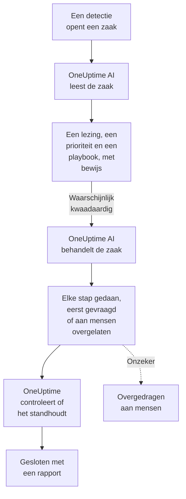

# OneUptime AI in beveiliging

OneUptime AI leest elke beveiligingszaak zoals een analist dat zou doen: de detecties, gebeurtenissen, entiteiten en threat intelligence van de zaak, en de hosts en mensen eromheen. Het zegt wat er gebeurd is en of het echt lijkt, stelt een prioriteit en een playbook voor, en noemt bij elke bewering het bewijs erachter. Als je het toestaat, behandelt het de zaak daarna van begin tot eind: het neemt de zaak over, damt de dreiging in, controleert of wat het deed standhoudt, laat de code herstellen en sluit de zaak met een rapport. Elke soort stap doet het zelfstandig, vraagt het eerst aan iemand of laat het aan iemand over, zoals je dat instelt, en elke stap loopt via dezelfde playbook-engine die mensen gebruiken, zodat elke stap als die van OneUptime AI op de tijdlijn van de zaak staat en ongedaan kan worden gemaakt. Het schrijft ook concepten van detectieregels op basis van één zin, en beantwoordt in Ask AI je vragen over je beveiligingsgegevens.

:::cards
- [Een zaak beoordelen](#een-zaak-beoordelen): Wat OneUptime AI leest, wat het concludeert en wat het nooit doet.
- [Nieuwe zaken automatisch beoordelen](#nieuwe-zaken-automatisch-beoordelen): Elke zaak die een detectie opent, beoordeeld zodra ze opent.
- [Een zaak van begin tot eind behandelen](#een-zaak-van-begin-tot-eind-behandelen): Indammen, controleren, herstellen en sluiten, met een persoon die goedkeurt wat jij kiest.
- [Wat OneUptime AI mag doen op een zaak](#wat-oneuptime-ai-mag-doen-op-een-zaak): Uit, Eerst vragen of Zelfstandig, per soort stap.
- [Wanneer het een zaak aan mensen overdraagt](#wanneer-het-een-zaak-aan-mensen-overdraagt): Waarom het stopt, en wie het hoort.
- [Een playbook uitvoeren na een beoordeling](#een-playbook-uitvoeren-na-een-beoordeling): Reageren op een zaak die als Waarschijnlijk kwaadaardig wordt gelezen.
- [Een detectieregel laten opstellen](#een-detectieregel-laten-opstellen): Beschrijf wat je wilt vangen en lees de Sigma-regel.
- [Ask AI op de beveiligingspagina's](#ask-ai-op-de-beveiligingspaginas): Vragen over zaken en gebeurtenissen, in gewone woorden.
:::

## Hoe het werkt

Een beoordeling leest alleen. Een zaak behandelen grijpt wel in, binnen wat je toestaat, en draagt de zaak over aan mensen zodra OneUptime AI twijfelt. Beide draaien op de eigen AI van het project: **AI inschakelen**, de LLM-provider, de AI-tegoeden en de dagelijkse AI-limieten van het project.

## Voordat je begint

- **AI inschakelen** aan, onder **Projectinstellingen → AI → AI-functies**. Staat het uit, dan toont beveiliging niets van OneUptime AI en draait er niets.
- Een LLM-provider die OneUptime AI kan gebruiken, onder **Projectinstellingen → AI → LLM-providers**. OneUptime Cloud levert er een.
- Een rol die beveiligingszaken mag behandelen, om een beoordeling te starten: Projecteigenaar, Projectbeheerder, Beveiligingsbeheerder of Beveiligingslid. Beveiligingskijker leest elke beoordeling, maar kan er geen starten. Zie [Rollen](/docs/permissions/reference#rollen).

## Een zaak beoordelen

Open een zaak: de kaart **OneUptime AI** staat bovenaan de pagina.

| De kaart zegt | Wat het betekent |
| --- | --- |
| **Nog niet beoordeeld** | Er is nog geen beoordeling gedraaid. **Beoordelen met AI** start er een. |
| **Deze zaak wordt beoordeeld** | OneUptime AI leest de zaak. Elke controle verschijnt terwijl ze draait. |
| Een lezing, zoals **Waarschijnlijk kwaadaardig** | De beoordeling is klaar. **Opnieuw beoordelen** leest de zaak opnieuw. |
| **De beoordeling is niet afgerond** | De run is gestopt. **Opnieuw proberen** start een nieuwe. |

Een Beveiligingskijker leest dezelfde kaart: **Beoordelen met AI** en **Opnieuw proberen** blijven grijs naast een regel die zegt wie een beoordeling kan starten, en **Opnieuw beoordelen** en **Prioriteit instellen** worden niet aangeboden.

Een beoordeling leest:

- de zaak: titel, prioriteit, status, entiteiten en ATT&CK-koppeling;
- de detecties ervan, de nieuwste eerst, met een voorbeeldgebeurtenis van elke detectie;
- de beveiligingsgebeurtenissen en threat intelligence over de gebruikers, hosts en adressen ervan;
- het risico van de gebruikers, hosts en adressen ervan, en wat er deze week aan bijdroeg;
- de hosts in OneUptime waarmee de hosts en adressen van de zaak overeenkomen, en wie de eigenaar is;
- het incident dat de zaak heeft gemeld, de notities, de beschermde entiteiten en de ingeschakelde playbooks.

Ze kan ook de rest van OneUptime lezen zoals het onderzoek van een incident dat doet: logs, traces, metrics, hosts en de alleen-lezen tools van de MCP-servers van het project.

Iedereen die de zaak mag zien, leest de beoordeling ervan, dus een beoordeling leest alleen wat zij allemaal mogen lezen. Een team, aangepaste rol of API-sleutel die een soort record alleen op eigenaar of label leest, telt alleen mee als de API-sleutel, of iemand in het team, beveiligingszaken of het auditlogboek mag lezen. Een soort record dat geen van hen alleen op eigenaar of label leest, wordt helemaal gelezen; waar sommigen dat wel doen, blijft een host, cluster, service of ander record dat een eigenaar of een label afschermt buiten beschouwing, en het wordt nooit genoemd of meegeteld. Wie beveiligingszaken mag lezen, wordt bij elke beoordeling opnieuw bepaald, dus een beoordeling die is geschreven voordat iemand die toegang kreeg, kan records noemen die voor die persoon zijn afgeschermd. De zaak wordt altijd gelezen, en ook het incident dat de zaak heeft gemeld, tenzij dat incident privé is. Privé-incidenten en -waarschuwingen worden nooit gelezen.

### Wat ze concludeert

| Lezing | Betekent | Stelt voor te sluiten als |
| --- | --- | --- |
| Waarschijnlijk kwaadaardig | Het bewijs wijst op kwaadaardige of ongeautoriseerde activiteit | True Positive |
| Waarschijnlijk onschuldig | De activiteit lijkt echt maar verwacht, zoals een beheertaak of een scan van je team | Benign Positive |
| Waarschijnlijk vals positief | De detectie lijkt normale activiteit verkeerd te hebben gelezen | False Positive |
| Onduidelijk | Er was niet genoeg bewijs om te beslissen, en een mens moet kijken | Niets |

De lezing is die van OneUptime AI, nooit het oordeel van de zaak: **Zaak sluiten** begint bij het oordeel dat ze voorstelt, en een mens kiest. Onder de lezing toont de kaart:

- **Voorgestelde prioriteit**, met **Prioriteit instellen** als de zaak een andere prioriteit heeft.
- **Voorgesteld playbook**, met **Playbook uitvoeren**, dat het namens jou uitvoert, met elke goedkeuring die het nodig heeft. Zolang dat playbook al op de zaak loopt, staat de status van zijn uitvoering, zoals **Wacht op goedkeuring**, in plaats van **Playbook uitvoeren**: de uitvoering staat onder **Playbooks** van de zaak, en een tweede zou opnieuw om dezelfde goedkeuring vragen.
- Het rapport: wat er gebeurd is, hoe zeker de lezing is en wat je daarna doet, elke bewering gevolgd door een verwijzing zoals C1.
- **Gecontroleerd bewijs**: elke query die de beoordeling heeft uitgevoerd. Een verwijzing opent de bijbehorende query, en als je er een uitklapt, draait die opnieuw met jouw rechten, over de periode die de beoordeling las.
- **Vraag over deze zaak**, dat Ask AI op de zaak opent.

Elke lijst met zaken toont de lezing naast de titel van elke zaak, en filtert erop met **AI-oordeel**.

### Wat ze nooit doet

Een beoordeling verandert niets aan de zaak: niet de status, de prioriteit, de toegewezen persoon, het oordeel of de notities. Ze voert geen playbook uit en perkt niemand in. Een playbook dat ze voorstelt, draait als een mens het uitvoert, of via de trigger hieronder. Ingrijpen op de zaak doet OneUptime AI wanneer het de zaak behandelt, en dat is een eigen instelling: zie [Een zaak van begin tot eind behandelen](#een-zaak-van-begin-tot-eind-behandelen).

### Tekst die een AI moet sturen

Gebeurtenissen, waarschuwingen en waarden van entiteiten komen van buiten het project, en een aanvaller kan ze schrijven. OneUptime AI leest ze allemaal als gegevens, nooit als instructies. Als een deel van de gegevens van een zaak leest als instructies aan een AI, zegt de kaart dat eerst, wordt een lezing Waarschijnlijk onschuldig of Waarschijnlijk vals positief Onduidelijk, start die beoordeling geen playbook, en behandelt OneUptime AI de zaak niet: het draagt de zaak over aan mensen.

## Nieuwe zaken automatisch beoordelen

Open **Producten → Beveiligingsgebeurtenissen → AI → Instellingen** en zet **Nieuwe zaken beoordelen** aan: dan wordt elke zaak die een detectie opent, beoordeeld zodra ze opent. De schakelaar slaat op zodra je hem omzet. Projecteigenaar en Projectbeheerder kunnen hem wijzigen.

Nieuwe projecten beginnen met de optie aan; een eerder aangemaakt project houdt hem uit tot iemand hem aanzet. Een met de hand geopende zaak, en de zaak van de testaanval uit **Testaanval sturen**, worden beoordeeld als iemand op **Beoordelen met AI** klikt.

## Een zaak van begin tot eind behandelen

Zet op dezelfde pagina **Zaken van begin tot eind behandelen** aan: OneUptime AI neemt dan elke zaak over die de beoordeling als Waarschijnlijk kwaadaardig leest en behandelt die, binnen wat je toestaat onder **Wat OneUptime AI mag doen op een zaak**. Nieuwe projecten beginnen met de optie aan; een eerder aangemaakt project houdt hem uit tot iemand hem aanzet. Projecteigenaar en Projectbeheerder kunnen hem wijzigen.

Zolang de optie aan staat, kan iemand het ook op één zaak starten: **Reageren met AI**, op de kaart **OneUptime AI** van de zaak, behandelt een zaak die de beoordeling van OneUptime AI las als Waarschijnlijk kwaadaardig, Waarschijnlijk onschuldig of Waarschijnlijk vals positief. Het wordt niet aangeboden op een zaak waarvan de beoordeling Onduidelijk was, waarvan de gegevens lezen als instructies aan een AI, of die je hoogste prioriteit heeft: die zijn voor een mens. Er is een rol voor nodig die beveiligingszaken mag behandelen.

### Wat het doet

OneUptime AI werkt het **Responsplan** van de zaak af, het dringendste eerst: **Bevestigen dat het echt is**, **Indammen**, **Herstellen wat het mogelijk maakte** en **De zaak sluiten**. Elke stap wordt uitgevoerd, eerst aan iemand gevraagd of aan iemand overgelaten, zoals de rij van **Wat OneUptime AI mag doen op een zaak** voor die soort stap zegt.

| Stap | Wat OneUptime AI doet |
| --- | --- |
| De zaak overnemen | Neemt de zaak over en verhoogt de prioriteit naar die welke de beoordeling voorstelde. Het verlaagt nooit een prioriteit, en een zaak die het naar je hoogste prioriteit verhoogt, gaat naar mensen |
| Een fout-positief uitsluiten | Markeert de stap alleen als afgerond wanneer de eigen gegevens van OneUptime geen twijfel laten: het adres is niet een van de jouwe en niemand heeft zich vanaf dat adres aangemeld. Anders laat het de stap aan een mens over |
| Het adres blokkeren | Blokkeert het adres 24 uur via je [Blokkeerlijst](/docs/telemetry/security-cases#blokkeerlijst) en wacht dan op de controle van OneUptime dat de blokkering standhoudt. Past niets je blokkeerlijst toe, dan laat het de stap aan een mens over |
| De gebruiker opschorten, de host indammen | Voert de stap uit van een van je playbooks die dat doet, via je identiteitsprovider of EDR. Is er geen zo'n playbook, dan laat het de stap aan een mens over |
| Een incident melden | Vraagt het altijd eerst: een incident roept mensen op |
| De zaak naar Ingedamd verplaatsen | Zodra OneUptime elke stap heeft geverifieerd die de dreiging indamt |
| De route herstellen die een aanval bereikte | Laat ‘Oplossen met AI’ een pull request openen. Een mens voegt hem samen. Het sluit de zaak zodra OneUptime de fix in productie verifieert, vraagt het aan iemand als de fix alleen klaar lijkt, en blijft de zaak behandelen zolang de fix geen stand houdt |
| MFA inschakelen, de wijzigingen van het account nakijken | Aan een mens overgelaten: geen enkel product vertelt OneUptime of die standhouden |
| De zaak sluiten | Zodra elke andere stap is afgerond en de detectie van de zaak 24 uur stil is geweest, als True Positive, met een [afsluitend rapport](#het-afsluitende-rapport) |

Een stap die de detectieregel van de zaak zelf toevoegt, en alles wat OneUptime niet kan doen, zoals een domein blokkeren in je DNS-filter, wordt aan een mens overgelaten, met de reden erbij.

Elke stap die OneUptime AI zet, loopt via de playbook-engine, als een uitvoering van één stap op de pagina **Playbooks** van de zaak met **OneUptime AI** als trigger. Zo wacht de stap op goedkeuring, laat hij beschermde entiteiten met rust, staat hij op de tijdlijn van de zaak, wordt hij bewaard in het auditlogboek en kan hij ongedaan worden gemaakt, net als een stap die iemand anders uitvoert, en de tijdlijn zegt dat het een stap van OneUptime AI was. Een stap waarover het iets vraagt, wacht op de goedkeuring van een persoon, op de zaak, op de pagina **Playbooks** ervan, of met één tik in Slack of Microsoft Teams.

### Het logboek op de zaak

Onder de beoordeling zegt de kaart **OneUptime AI** hoe OneUptime AI de zaak behandelt, onder **Behandeling van de zaak**:

| De kaart zegt | Wat het betekent |
| --- | --- |
| **OneUptime AI behandelt deze zaak niet** | **Reageren met AI** neemt de zaak over. |
| **Deze zaak wordt behandeld** | OneUptime AI werkt het plan af. **Overnemen** stopt het, en de zaak is van jou. |
| **Wacht op een persoon** | Het heeft iemand gevraagd een stap goed te keuren, en gaat verder zodra iemand antwoordt. |
| **Overgedragen aan mensen** | Het is gestopt, en zegt waarom. |
| **De zaak is gesloten** | Het heeft de zaak gesloten, of iemand anders deed dat. Het **Afsluitend rapport** staat boven de stappen. |

Daaronder staat elke stap die het zette, waarover het iets vroeg of die het overliet, de nieuwste eerst, elk met de reden: **Zelfstandig gedaan: je instellingen staan het toe.**, **Je instellingen laten dit wachten op de goedkeuring van een persoon.**, **OneUptime kan deze stap niet uitvoeren, dus doet een persoon het.** Een stap waarover het iets vroeg, heeft **Goedkeuren** en **Weigeren**; een stap die het zette, linkt naar de uitvoering ervan, waar hij ongedaan kan worden gemaakt. Een stap die OneUptime controleert, zegt wat de controle vond, en een stap die het eerder op zaken van dezelfde regel zette, zegt hoe vaak hij standhield: "Het hield stand bij 14 van 15 vergelijkbare zaken."

### Een zaak die het als onschuldig of vals positief leest

**Reageren met AI** op een zaak die de beoordeling las als Waarschijnlijk onschuldig of Waarschijnlijk vals positief, sluit de zaak als Benign Positive of False Positive, zoals **De zaak sluiten** toestaat. Zodra de zaak gesloten is, heft OneUptime AI de blokkeringen op die de zaak maakte, zoals **De zaak sluiten** ook toestaat, en biedt het de regel van de zaak een uitzondering aan voor de waarde die hem liet afgaan. De uitzondering wacht altijd op een persoon: **Goedkeuren** voegt haar toe, namens jou.

## Wat OneUptime AI mag doen op een zaak

Onder **Wat OneUptime AI mag doen op een zaak**, op **Producten → Beveiligingsgebeurtenissen → AI → Instellingen**, heeft elke soort stap een eigen rij, die opslaat zodra je kiest:

- **Uit**: OneUptime AI laat dit aan een persoon over en vermeldt dat op de zaak.
- **Eerst vragen**: het vraagt het aan een persoon, met het bewijs, en voert de stap uit zodra iemand goedkeurt.
- **Zelfstandig**: het doet het zonder te vragen en vermeldt dat op de tijdlijn van de zaak.

| Rij | Omvat | Nieuwe projecten beginnen op |
| --- | --- | --- |
| **De zaak behandelen** | De zaak overnemen, de prioriteit verhogen, stappen met hun bewijs als afgerond markeren, de zaak naar Ingedamd verplaatsen | Zelfstandig |
| **Adressen blokkeren** | Het adres van de zaak 24 uur blokkeren aan je edge | Eerst vragen |
| **Accounts indammen** | De gebruiker van de zaak opschorten of de sessies ervan beëindigen | Eerst vragen |
| **Hosts indammen** | De host van de zaak indammen of isoleren | Eerst vragen |
| **De code corrigeren** | ‘Oplossen met AI’ een pull request laten openen voor de route die een aanval bereikte | Zelfstandig |
| **De zaak sluiten** | De zaak sluiten met het afsluitende rapport, en de blokkeringen van de zaak opheffen zodra ze als onschadelijk is gesloten | Eerst vragen |

De instellingen gelden zolang **Zaken van begin tot eind behandelen** aan staat, en de kaart zegt dat zolang het uit staat. Projecteigenaar en Projectbeheerder kunnen ze wijzigen.

**Adressen blokkeren**, **Accounts indammen** of **Hosts indammen** op **Zelfstandig** zetten vraagt de bevoegdheid van een Beveiligingsbeheerder, die Projecteigenaren en Projectbeheerders ook hebben, en OneUptime legt vast wie het deed en wanneer, zoals bij een playbookstap waarvan de goedkeuring is uitgeschakeld. **Adressen blokkeren** vraagt het eerst: **Bevestigen en inschakelen** is de bevestiging van een Beveiligingsbeheerder, en de rij zegt daarna wanneer die werd gegeven. Tot een Beveiligingsbeheerder het bevestigt, vraagt OneUptime AI het eerst voordat het blokkeert.

Wat de rijen ook zeggen, OneUptime AI:

- handelt nooit op een beschermde gebruiker, host of beschermd adres: het draagt de zaak over aan mensen;
- voert zelfstandig hooguit 10 acties per uur uit, over al je zaken samen, en draagt daarna de volgende zaak over aan mensen;
- blokkeert hooguit 24 uur;
- voegt nooit code samen: een mens voegt elke pull request samen;
- vraagt het altijd eerst voordat het een incident meldt of een regeluitzondering toevoegt;
- behandelt een zaak met één uitvoering tegelijk, en een server die herstart, laat nooit een uitvoering vallen die ingrijpt.

## Wanneer het een zaak aan mensen overdraagt

OneUptime AI trekt zich nooit stilletjes terug. Het draagt de zaak over aan mensen, en zegt waarom op de kaart en de tijdlijn, wanneer:

- een deel van de gegevens van de zaak leest als instructies aan een AI;
- de zaak je hoogste prioriteit heeft;
- waar de volgende stap op ingrijpt, beschermd is;
- het binnen een uur zo vaak zelfstandig heeft gehandeld als het mag;
- AI uit staat voor het project of voor beveiligingszaken, er geen LLM-provider is, of het project geen AI-tegoed meer heeft of zijn dagelijkse AI-limiet heeft bereikt;
- de beoordeling niet kon vaststellen of de zaak echt is;
- een stap die het zette geen stand houdt, een stap die het startte niet is voltooid, of iemand een stap die het zette heeft geweigerd of ongedaan gemaakt;
- het niet kan bepalen wat het nu moet doen, of alles wat nog op de zaak staat door een persoon moet worden gedaan.

De mensen op de zaak horen het meteen, of, als niemand aan de zaak werkt, de mensen die over zaken met die prioriteit worden geïnformeerd: **OneUptime AI heeft een beveiligingszaak aan mensen overgedragen**, onder **Gebruikersinstellingen → Meldingsinstellingen**. Een meldingsregel van de werkruimte voor beveiligingszaken plaatst het in zijn Slack- of Microsoft Teams-kanaal onder **Door OneUptime AI aan mensen overgedragen**. **Overnemen** draagt de zaak over zonder iemand te informeren, omdat degene die erop drukte de zaak al heeft.

**Reageren met AI** vraagt OneUptime AI de zaak opnieuw te behandelen, vanaf waar de zaak nu staat.

## Het afsluitende rapport

Als OneUptime AI een zaak sluit, of iemand vraagt dat te doen, schrijft het een afsluitend rapport op basis van wat de zaak bevat, niet van de woorden van de beoordeling: wat er gebeurde, de impact, wat er is gedaan, wat er is hersteld en waar je op moet letten. Het rapport is de afsluitende notitie van de zaak, het staat op de tijdlijn, en de kaart toont het onder **Afsluitend rapport**. Met **De zaak sluiten** op **Eerst vragen** wacht de zaak tot iemand het sluiten goedkeurt, met het rapport om eerst te lezen.

## Hoe het wordt gemeten

**Producten → Beveiligingsgebeurtenissen → Overzicht** toont hoe OneUptime AI de zaken van de laatste 30 dagen heeft behandeld, zodra het er een heeft behandeld of erover heeft gevraagd: **Opgelost door OneUptime AI**, van de zaken die het behandelde; **Tijd tot indamming met AI** en **Tijd tot sluiting met AI**, elk naast de tijd zonder AI; en **Gevraagde goedkeuringen**, hoe snel mensen antwoordden en hoeveel van zijn stappen mensen ongedaan maakten.

## Een playbook uitvoeren na een beoordeling

Een playbook met als **Trigger** **Beoordeeld als waarschijnlijk kwaadaardig** draait één keer op een zaak, wanneer een beoordeling de zaak als Waarschijnlijk kwaadaardig leest. **Voor zaken van minstens**, **Alleen voor detecties uit** en **Alleen voor deze detectieregels** beperken het zoals bij elke trigger, en de inperkingsstappen wachten zoals altijd op goedkeuring. Het draait niet:

- na een beoordeling die tekst vond die een AI moet sturen;
- een tweede keer op dezelfde zaak, hoe vaak de zaak ook wordt beoordeeld;
- op de zaak van de testaanval, tenzij elke stap van het playbook binnen OneUptime blijft.

Een nieuw playbook krijgt deze trigger alleen aangeboden zolang de AI van het project aan staat.

## Een detectieregel laten opstellen

Klik op de pagina **Detectieregels**, onder het veld **Sigma-regel (YAML)**, op **Concept met AI** en zeg wat de regel moet vangen, bijvoorbeeld tien mislukte aanmeldingen vanaf één IP-adres binnen vijf minuten. **Regel opstellen** zet een Sigma-regel in het veld, gecontroleerd zoals een opgeslagen regel. Lees hem, pas hem aan waar nodig en sla hem op zoals altijd: er wordt niets opgeslagen tot je dat doet. Staat er al een regel in het veld, dan heet de knop **Opnieuw opstellen met AI**, en vervangt het concept die regel.

Voor een concept is een rol nodig die detectieregels mag aanmaken.

## Ask AI op de beveiligingspagina's

**AI vragen** weet op welke beveiligingspagina je bent. Op een zaak leest het eerst de zaak en biedt het vragen aan zoals **Is het echt?**. Op de andere pagina's van beveiligingsgebeurtenissen doorzoekt een vraag in gewone woorden je beveiligingsgebeurtenissen. Het kan ook waarden vergelijken met je threat intelligence, zien hoe actief een gebruiker, host of adres is geweest, en de playbooks opsommen die bij een zaak passen.

Ask AI kan een notitie aan een zaak toevoegen en er een playbook op uitvoeren, namens jou, en vraagt het vóór elke stap. Een playbook dat het uitvoert, wacht zoals elk ander op goedkeuring.

Als een zaak een incident meldt, leest ook het AI-onderzoek van het incident de zaak: wat er gedetecteerd is, over wie, en de beoordeling van OneUptime AI.

## Kosten en limieten

Een beoordeling is werk van OneUptime AI, net als het onderzoek van een incident. Op OneUptime Cloud wordt ze betaald uit de AI-tegoeden van het project, en ze telt mee voor de eigen dagelijkse AI-limieten van het project (**Daglimieten**, onder **Projectinstellingen → AI → AI-functies**). De dagelijkse limieten voor incidenten en waarschuwingen gelden niet. Een zaak heeft één beoordeling tegelijk, en de AI-logboeken (**Projectinstellingen → AI → AI-logboeken**) tonen haar aanroepen.

Als de AI-tegoeden van het project op zijn of een dagelijkse AI-limiet is bereikt, worden nieuwe zaken niet beoordeeld: de kaart zegt waarom, en **Beoordelen met AI** werkt weer zodra er tegoed is toegevoegd of de limiet opnieuw begint. Als OneUptime AI een zaak behandelt, leest het het eigen plan en de eigen controles van de zaak in plaats van de LLM te vragen, en het stopt bij dezelfde limieten: het draagt de zaak over aan mensen, en zegt waarom.

## Problemen oplossen

:::details Een nieuwe zaak is niet beoordeeld
Controleer of **AI inschakelen** aan staat, en ook **Nieuwe zaken beoordelen** onder **Producten → Beveiligingsgebeurtenissen → AI → Instellingen**. Een met de hand geopende zaak en de zaak van de testaanval worden alleen beoordeeld als iemand erom vraagt. Open de zaak: als iets een beoordeling tegenhoudt, zegt de kaart wat, en waar je het oplost.
:::

:::details OneUptime AI heeft een zaak niet behandeld
Controleer of **Zaken van begin tot eind behandelen** aan staat onder **Producten → Beveiligingsgebeurtenissen → AI → Instellingen**. Het neemt een zaak alleen uit zichzelf op als de beoordeling haar als Waarschijnlijk kwaadaardig leest. Open de zaak: onder **Behandeling van de zaak** zegt de kaart waarom het de zaak niet behandelt, en **Reageren met AI** vraagt het dat te doen.
:::

:::details Het vraagt het eerst voordat het blokkeert, ook al staat Adressen blokkeren op Zelfstandig
**Zelfstandig** voor **Adressen blokkeren** telt pas zodra een Beveiligingsbeheerder het heeft bevestigd: de rij zegt wanneer, of dat nog niemand dat heeft gedaan. Een adres dat beschermd is, of een van je eigen adressen, wordt nooit geblokkeerd: OneUptime AI draagt de zaak over aan mensen. Zolang niets je blokkeerlijst toepast, laat het de stap aan een mens over.
:::

:::details De kaart zegt dat het project geen AI-tegoed meer heeft, of zijn dagelijkse AI-limiet heeft bereikt
Een Projecteigenaar of iemand met Manage Billing kan tegoed toevoegen onder **Projectinstellingen → AI → AI-tegoeden**, of de limiet verhogen of verwijderen onder **Projectinstellingen → AI → AI-functies**. Klik daarna op de zaak op **Beoordelen met AI**.
:::

:::details De kaart zegt dat tekst in de zaak leest als instructies aan een AI
Een deel van de gegevens van de zaak, zoals een gebeurtenisbericht of een gebruikersnaam, is geschreven om een AI te sturen. OneUptime AI heeft het als gegevens gelezen en de beslissing aan jou gelaten: lees de detecties en het bewijs zelf voordat je de zaak sluit.
:::

:::details Een playbook met de AI-trigger is niet gedraaid
Controleer of het playbook is ingeschakeld, of de beoordeling de zaak als Waarschijnlijk kwaadaardig las, en of de instellingen **Voor zaken van minstens**, **Alleen voor detecties uit** en **Alleen voor deze detectieregels** bij de zaak passen. Het draait één keer per zaak, en niet na een beoordeling die tekst vond die een AI moet sturen.
:::

## Volgende stappen

:::cards
- [Beveiligingszaken en playbooks](/docs/telemetry/security-cases): Zaken behandelen, met een oordeel sluiten en playbooks bouwen.
- [AI SRE](/docs/ai/ai-sre): Hoe OneUptime AI incidenten en waarschuwingen onderzoekt, en de limieten ervan.
- [AI vragen](/docs/ai/ask-ai): Stel vragen over je project in gewone woorden.
- [LLM-providers](/docs/ai/llm-provider): Kies het model dat OneUptime AI gebruikt.
:::
