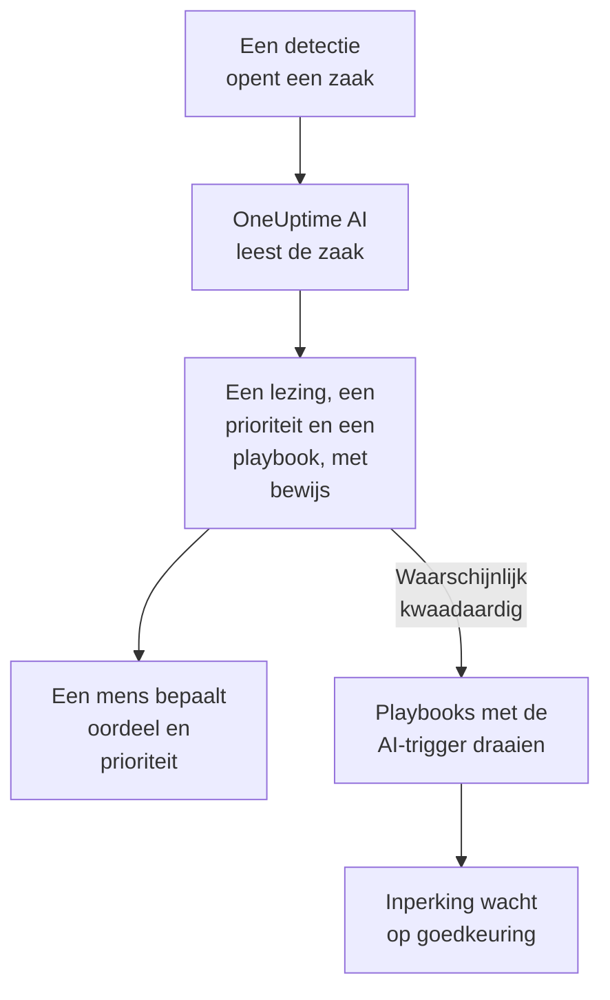

# OneUptime AI in beveiliging

OneUptime AI leest elke beveiligingszaak zoals een analist dat zou doen: de detecties, gebeurtenissen, entiteiten en threat intelligence van de zaak, en de hosts en mensen eromheen. Het zegt wat er gebeurd is en of het echt lijkt, stelt een prioriteit en een playbook voor, en noemt bij elke bewering het bewijs erachter. Uit zichzelf verandert het niets: een mens bepaalt het oordeel en de prioriteit, en voert het playbook uit. Het schrijft ook concepten van detectieregels op basis van één zin, en beantwoordt in Ask AI je vragen over je beveiligingsgegevens.

:::cards
- [Een zaak beoordelen](#een-zaak-beoordelen): Wat OneUptime AI leest, wat het concludeert en wat het nooit doet.
- [Nieuwe zaken automatisch beoordelen](#nieuwe-zaken-automatisch-beoordelen): Elke zaak die een detectie opent, beoordeeld zodra ze opent.
- [Een playbook uitvoeren na een beoordeling](#een-playbook-uitvoeren-na-een-beoordeling): Reageren op een zaak die als Waarschijnlijk kwaadaardig wordt gelezen.
- [Een detectieregel laten opstellen](#een-detectieregel-laten-opstellen): Beschrijf wat je wilt vangen en lees de Sigma-regel.
- [Ask AI op de beveiligingspagina's](#ask-ai-op-de-beveiligingspaginas): Vragen over zaken en gebeurtenissen, in gewone woorden.
:::

## Hoe het werkt

Een beoordeling leest alleen. Ze draait op de eigen AI van het project: **AI inschakelen**, de LLM-provider, de AI-tegoeden en de dagelijkse AI-limieten van het project.

## Voordat je begint

- **AI inschakelen** aan, onder **Projectinstellingen → AI → AI Features**. Staat het uit, dan toont beveiliging niets van OneUptime AI en draait er niets.
- Een LLM-provider die OneUptime AI kan gebruiken, onder **Projectinstellingen → AI → LLM-providers**. OneUptime Cloud levert er een.
- Een rol die beveiligingszaken mag behandelen, om een beoordeling te starten: Project Owner, Project Admin, Security Admin of Security Member. Security Viewer leest elke beoordeling, maar kan er geen starten. Zie [Rollen](/docs/permissions/reference#rollen).

## Een zaak beoordelen

Open een zaak: de kaart **OneUptime AI** staat bovenaan de pagina.

| De kaart zegt | Wat het betekent |
| --- | --- |
| **Nog niet beoordeeld** | Er is nog geen beoordeling gedraaid. **Beoordelen met AI** start er een. |
| **Deze zaak wordt beoordeeld** | OneUptime AI leest de zaak. Elke controle verschijnt terwijl ze draait. |
| Een lezing, zoals **Waarschijnlijk kwaadaardig** | De beoordeling is klaar. **Opnieuw beoordelen** leest de zaak opnieuw. |
| **De beoordeling is niet afgerond** | De run is gestopt. **Opnieuw proberen** start een nieuwe. |

Een Security Viewer leest dezelfde kaart: **Beoordelen met AI** en **Opnieuw proberen** blijven grijs naast een regel die zegt wie een beoordeling kan starten, en **Opnieuw beoordelen** en **Prioriteit instellen** worden niet aangeboden.

Een beoordeling leest:

- de zaak: titel, prioriteit, status, entiteiten en ATT&CK-koppeling;
- de detecties ervan, de nieuwste eerst, met een voorbeeldgebeurtenis van elke detectie;
- de beveiligingsgebeurtenissen en threat intelligence over de gebruikers, hosts en adressen ervan;
- het risico van de gebruikers, hosts en adressen ervan, en wat er deze week aan bijdroeg;
- de hosts in OneUptime waarmee de hosts en adressen van de zaak overeenkomen, en wie de eigenaar is;
- het incident dat de zaak heeft gemeld, de notities, de beschermde entiteiten en de ingeschakelde playbooks.

Ze kan ook de rest van OneUptime lezen zoals het onderzoek van een incident dat doet: logs, traces, metrics, hosts en de alleen-lezen tools van de MCP-servers van het project.

### Wat ze concludeert

| Lezing | Betekent | Stelt voor te sluiten als |
| --- | --- | --- |
| Waarschijnlijk kwaadaardig | Het bewijs wijst op kwaadaardige of ongeautoriseerde activiteit | True Positive |
| Waarschijnlijk onschuldig | De activiteit lijkt echt maar verwacht, zoals een beheertaak of een scan van je team | Benign Positive |
| Waarschijnlijk vals positief | De detectie lijkt normale activiteit verkeerd te hebben gelezen | False Positive |
| Onduidelijk | Er was niet genoeg bewijs om te beslissen, en een mens moet kijken | Niets |

De lezing is die van OneUptime AI, nooit het oordeel van de zaak: **Zaak sluiten** begint bij het oordeel dat ze voorstelt, en een mens kiest. Onder de lezing toont de kaart:

- **Voorgestelde prioriteit**, met **Prioriteit instellen** als de zaak een andere prioriteit heeft.
- **Voorgesteld playbook**, met **Playbook uitvoeren**, dat het namens jou uitvoert, met elke goedkeuring die het nodig heeft. Zolang dat playbook al op de zaak loopt, staat de status van zijn uitvoering, zoals **Wacht op goedkeuring**, in plaats van **Playbook uitvoeren**: de uitvoering staat onder **Playbooks** van de zaak, en een tweede zou opnieuw om dezelfde goedkeuring vragen.
- Het rapport: wat er gebeurd is, hoe zeker de lezing is en wat je daarna doet, elke bewering gevolgd door een verwijzing zoals C1.
- **Evidence checked**: elke query die de beoordeling heeft uitgevoerd. Een verwijzing opent de bijbehorende query, en als je er een uitklapt, draait die opnieuw met jouw rechten, over de periode die de beoordeling las.
- **Vraag over deze zaak**, dat Ask AI op de zaak opent.

Elke lijst met zaken toont de lezing naast de titel van elke zaak, en filtert erop met **AI-oordeel**.

### Wat ze nooit doet

Een beoordeling verandert niets aan de zaak: niet de status, de prioriteit, de toegewezen persoon, het oordeel of de notities. Ze voert geen playbook uit en perkt niemand in. Een playbook dat ze voorstelt, draait als een mens het uitvoert, of via de trigger hieronder.

### Tekst die een AI moet sturen

Gebeurtenissen, waarschuwingen en waarden van entiteiten komen van buiten het project, en een aanvaller kan ze schrijven. OneUptime AI leest ze allemaal als gegevens, nooit als instructies. Als een deel van de gegevens van een zaak leest als instructies aan een AI, zegt de kaart dat eerst, wordt een lezing Waarschijnlijk onschuldig of Waarschijnlijk vals positief Onduidelijk, en start die beoordeling geen playbook.

## Nieuwe zaken automatisch beoordelen

Open **Producten → Security Events → AI → Instellingen** en zet **Nieuwe zaken beoordelen** aan: dan wordt elke zaak die een detectie opent, beoordeeld zodra ze opent. De schakelaar slaat op zodra je hem omzet. Project Owner en Project Admin kunnen hem wijzigen.

Nieuwe projecten beginnen met de optie aan; een eerder aangemaakt project houdt hem uit tot iemand hem aanzet. Een met de hand geopende zaak, en de zaak van de testaanval uit **Testaanval sturen**, worden beoordeeld als iemand op **Beoordelen met AI** klikt.

## Een playbook uitvoeren na een beoordeling

Een playbook met als **Trigger** **Beoordeeld als waarschijnlijk kwaadaardig** draait één keer op een zaak, wanneer een beoordeling de zaak als Waarschijnlijk kwaadaardig leest. **Voor zaken van minstens**, **Alleen voor detecties uit** en **Alleen voor deze detectieregels** beperken het zoals bij elke trigger, en de inperkingsstappen wachten zoals altijd op goedkeuring. Het draait niet:

- na een beoordeling die tekst vond die een AI moet sturen;
- een tweede keer op dezelfde zaak, hoe vaak de zaak ook wordt beoordeeld;
- op de zaak van de testaanval, tenzij elke stap van het playbook binnen OneUptime blijft.

Een nieuw playbook krijgt deze trigger alleen aangeboden zolang de AI van het project aan staat.

## Een detectieregel laten opstellen

Klik op de pagina **Detectieregels**, onder het veld **Sigma-regel (YAML)**, op **Concept met AI** en zeg wat de regel moet vangen, bijvoorbeeld tien mislukte aanmeldingen vanaf één IP-adres binnen vijf minuten. **Regel opstellen** zet een Sigma-regel in het veld, gecontroleerd zoals een opgeslagen regel. Lees hem, pas hem aan waar nodig en sla hem op zoals altijd: er wordt niets opgeslagen tot je dat doet. Staat er al een regel in het veld, dan heet de knop **Opnieuw opstellen met AI**, en vervangt het concept die regel.

Voor een concept is een rol nodig die detectieregels mag aanmaken.

## Ask AI op de beveiligingspagina's

**Ask AI** weet op welke beveiligingspagina je bent. Op een zaak leest het eerst de zaak en biedt het vragen aan zoals **Is het echt?**. Op de andere pagina's van beveiligingsgebeurtenissen doorzoekt een vraag in gewone woorden je beveiligingsgebeurtenissen. Het kan ook waarden vergelijken met je threat intelligence, zien hoe actief een gebruiker, host of adres is geweest, en de playbooks opsommen die bij een zaak passen.

Ask AI kan een notitie aan een zaak toevoegen en er een playbook op uitvoeren, namens jou, en vraagt het vóór elke stap. Een playbook dat het uitvoert, wacht zoals elk ander op goedkeuring.

Als een zaak een incident meldt, leest ook het AI-onderzoek van het incident de zaak: wat er gedetecteerd is, over wie, en de beoordeling van OneUptime AI.

## Kosten en limieten

Een beoordeling is werk van OneUptime AI, net als het onderzoek van een incident. Op OneUptime Cloud wordt ze betaald uit de AI-tegoeden van het project, en ze telt mee voor de eigen dagelijkse AI-limieten van het project (**Daglimieten**, onder **Projectinstellingen → AI → AI Features**). De dagelijkse limieten voor incidenten en waarschuwingen gelden niet. Een zaak heeft één beoordeling tegelijk, en de AI-logboeken (**Projectinstellingen → AI → AI-logboeken**) tonen haar aanroepen.

Als de AI-tegoeden van het project op zijn of een dagelijkse AI-limiet is bereikt, worden nieuwe zaken niet beoordeeld: de kaart zegt waarom, en **Beoordelen met AI** werkt weer zodra er tegoed is toegevoegd of de limiet opnieuw begint.

## Problemen oplossen

:::details Een nieuwe zaak is niet beoordeeld
Controleer of **AI inschakelen** aan staat, en ook **Nieuwe zaken beoordelen** onder **Producten → Security Events → AI → Instellingen**. Een met de hand geopende zaak en de zaak van de testaanval worden alleen beoordeeld als iemand erom vraagt. Open de zaak: als iets een beoordeling tegenhoudt, zegt de kaart wat, en waar je het oplost.
:::

:::details De kaart zegt dat het project geen AI-tegoed meer heeft, of zijn dagelijkse AI-limiet heeft bereikt
Een projecteigenaar of iemand met Manage Billing kan tegoed toevoegen onder **Projectinstellingen → AI → AI-tegoeden**, of de limiet verhogen of verwijderen onder **Projectinstellingen → AI → AI Features**. Klik daarna op de zaak op **Beoordelen met AI**.
:::

:::details De kaart zegt dat tekst in de zaak leest als instructies aan een AI
Een deel van de gegevens van de zaak, zoals een gebeurtenisbericht of een gebruikersnaam, is geschreven om een AI te sturen. OneUptime AI heeft het als gegevens gelezen en de beslissing aan jou gelaten: lees de detecties en het bewijs zelf voordat je de zaak sluit.
:::

:::details Een playbook met de AI-trigger is niet gedraaid
Controleer of het playbook is ingeschakeld, of de beoordeling de zaak als Waarschijnlijk kwaadaardig las, en of de instellingen **Voor zaken van minstens**, **Alleen voor detecties uit** en **Alleen voor deze detectieregels** bij de zaak passen. Het draait één keer per zaak, en niet na een beoordeling die tekst vond die een AI moet sturen.
:::

## Volgende stappen

:::cards
- [Beveiligingszaken en playbooks](/docs/telemetry/security-cases): Zaken behandelen, met een oordeel sluiten en playbooks bouwen.
- [AI SRE](/docs/ai/ai-sre): Hoe OneUptime AI incidenten en waarschuwingen onderzoekt, en de limieten ervan.
- [AI vragen](/docs/ai/ask-ai): Stel vragen over je project in gewone woorden.
- [LLM-providers](/docs/ai/llm-provider): Kies het model dat OneUptime AI gebruikt.
:::
