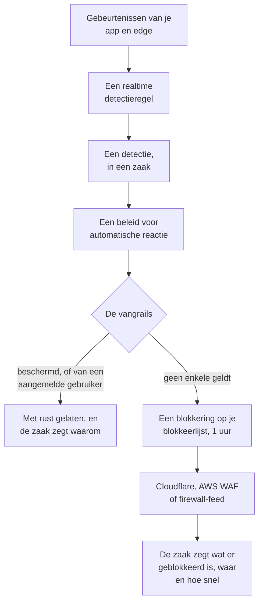

# Automatische reactie

Beleidsregels voor automatische reactie geven een aanvallend adres een challenge of blokkeren het zodra de detectie er is, nog voordat iemand de zaak beoordeelt: scanners die je app aftasten en bots die wachtwoord na wachtwoord proberen, worden binnen een paar minuten na hun eerste verzoek tegengehouden. Elk project heeft drie kant-en-klare beleidsregels, elk uit tot je het aanzet, en elk begint met een proefperiode van een week die alleen vastlegt wat het zou hebben gedaan. Vangrails maken een beleid veilig om aan te laten: het raakt nooit je eigen adressen of een adres dat je aangemelde gebruikers gebruiken, en het stopt en roept iemand op wanneer een aanval groter is dan het alleen zou moeten afhandelen.

:::cards
- [Een beleid aanzetten](#een-beleid-aanzetten): Eerst een week proefperiode, dan één klik.
- [De vangrails](#de-vangrails): Wat een beleid nooit doet, en wanneer het stopt.
- [Tijd tot blokkering](#tijd-tot-blokkering): Hoe snel elk beleid blokkeert, op de kaart en in de zaak.
- [Je eigen beleid](#je-eigen-beleid): Reageer op de technieken, regels of dreigingsinformatie die je kiest.
:::

## Hoe het werkt

Een beleid reageert op een detectie zodra die in de zaak is vastgelegd, een paar seconden nadat de regel afgaat. De blokkering komt op je [blokkeerlijst](/docs/telemetry/security-cases#blokkeerlijst) zoals bij de playbookstap **Adres blokkeren**, met de naam van het beleid als maker: de bestemmingen die je blokkeerlijst afdwingen houden haar vast, ze verschijnt in de tijdlijn van de zaak en in het auditlogboek, en ze verloopt vanzelf. Ze heeft niemands goedkeuring nodig: wie het beleid aanzette, keurde de blokkeringen goed.

## Voordat je begint

- Een bestemming die je blokkeerlijst afdwingt: Cloudflare, AWS WAF, of een firewall of proxy die een [blokkeerlijstfeed](/docs/telemetry/blocklist-feeds) leest. Zolang niets haar afdwingt, zegt de pagina dat, en gelden de blokkeringen van een beleid nergens.
- De gebeurtenissen die de regels van een beleid lezen: de toegangslogboeken of traces van je app, of de gebeurtenissen van je edge, zoals de firewallgebeurtenissen van Cloudflare, en je aanmeldingen. Zie [Beveiligingsgebeurtenissen](/docs/telemetry/security-events).
- Een rol die een beleid mag aanzetten: Beveiligingsbeheerder, Projectbeheerder of Projecteigenaar. Beveiligingslid en Beveiligingskijker zien de beleidsregels en wat ze deden. Zie [Rollen](/docs/permissions/reference#rollen).

## De kant-en-klare beleidsregels

| Beleid | Reageert op | Doet | Eerste blokkering |
| --- | --- | --- | --- |
| **Scanners** | Webscans en exploitpogingen (ATT&CK T1595, T1190): pogingen tot SQL-injectie, path traversal en Log4Shell, en veel treffers van beheerde Cloudflare-regels vanaf één adres, zolang elk verzoek van het adres werd afgewezen | Challenge | 1 uur |
| **Wachtwoorden raden** | Brute force en password spraying (ATT&CK T1110): mislukte aanmeldingen vanaf één adres, en mislukte aanmeldingen gevolgd door een geslaagde vanaf hetzelfde adres | Blokkeren | 1 uur |
| **Bekende kwaadaardige adressen** | Elke detectie over een adres dat je [dreigingsinformatie](/docs/telemetry/threat-intelligence) vermeldt | Blokkeren | 24 uur |

Mensen doorstaan een challenge, scripts en bots niet. Scanners geeft een adres alleen een challenge zolang geen enkel verzoek ervan je app heeft bereikt: een adres waarvan verzoeken erdoor kwamen, is een zaak voor een persoon.

Als je Scanners of Wachtwoorden raden aanzet, in de proefperiode of helemaal, draaien de regels uit de **Regelbibliotheek** waarop het reageert in realtime, en worden de regels die je project nog niet heeft toegevoegd: een realtime regel gaat af enkele seconden nadat de gebeurtenissen binnenkomen, waar een geplande regel minuten achterloopt. Een regel die iemand heeft uitgezet, blijft uit. Een project draait hoogstens 50 regels in realtime: daarboven blijft een regel op zijn schema, en de kaart van het beleid toont **Volgens schema** ernaast.

## Een beleid aanzetten

:::steps
### Open Automatische reactie

Open **Producten → Beveiligingsgebeurtenissen → Playbooks → Automatische reactie**. Elk beleid heeft een kaart: wat het doet, een label met **Uit**, **Proefperiode**, **Proef afgerond** of **Aan**, en een schakelaar.

### Start de proefperiode

Zet de schakelaar van het beleid om. 7 dagen lang legt het vast wat het zou hebben gedaan, en raakt het geen verkeer: de zaak zegt "Trial run: the Scanners policy would have challenged 35.205.11.131 for 1 hour." De kaart telt de adressen tot nu toe, en wat de vangrails met rust lieten.

### Zet het aan

Als de week om is, zegt de kaart wat het beleid zou hebben gedaan, bijvoorbeeld "In 7 dagen had dit 1.283 adressen een challenge gegeven. Geen enkel had aangemelde gebruikers, en geen enkel was van jou. Aanzetten?", en je beveiligingsverantwoordelijken krijgen hetzelfde per e-mail. Klik op **Aanzetten**: vanaf dan reageert het beleid.
:::

Om een beleid aan te zetten zonder de week proefperiode, open je **Meer instellingen** op de kaart en klik je op **Aanzetten zonder proefperiode**. De vangrails blijven gelden. Zet de schakelaar opnieuw om om een beleid uit te zetten; weer aangezet na een volledige week proefperiode, reageert het meteen.

## De vangrails

- **Nooit je eigen of beschermde adressen.** De items van **Beschermde entiteiten**, en alles wat OneUptime zelf beschermt: je hosts, cloudresources en sondes, de bereiken die niet op internet zitten, en de edge voor je app. Zie [Blokkeerlijst](/docs/telemetry/security-cases#blokkeerlijst).
- **Nooit een adres dat een aangemelde gebruiker in de laatste 30 dagen heeft gebruikt.** Het netwerk van een kantoor, de proxy van een klant of iemands huis: OneUptime zoekt het adres in de aanmeldingen van je identiteitsprovider en in de verzoeken die je app voor een aangemelde gebruiker afhandelde, die met een gebruikers-ID in hun traces of logboeken. Een adres dat het niet kan controleren, omdat die gebeurtenissen niet gelezen konden worden of omdat je scrubregels adressen verbergen op een manier die het niet kan vergelijken, wordt aan een persoon overgelaten.
- **Langere blokkeringen voor een adres dat terugkomt.** De eerste blokkering duurt 1 uur, daarna 24 uur, daarna 7 dagen voor een adres dat binnen 30 dagen opnieuw wordt geblokkeerd. Bekende kwaadaardige adressen begint bij 24 uur.
- **Hoogstens 50 automatische blokkeringen per uur.** Daarboven stoppen je beleidsregels met blokkeren en roepen ze je beveiligingsverantwoordelijken op: een aanval van die omvang heeft een persoon nodig. De pagina zegt dat zolang het duurt.
- **Ongedaan maken bij twijfel.** Als vanaf een adres dat een beleid blokkeerde een aangemelde gebruiker wordt gezien, heft het beleid de blokkering op en laat het je beveiligingsverantwoordelijken weten.

Je beveiligingsverantwoordelijken zijn de Beveiligingsbeheerders van je project, of de Projecteigenaren als het die niet heeft. Elk adres dat een vangrail met rust liet, staat in de zaak ervan, met de reden.

## Waar een bestemming geen challenge kan geven

Cloudflare en AWS WAF geven challenges. Een firewall die een blokkeerlijstfeed leest, kan dat niet, dus daar is de challenge van een beleid een blokkering, even lang, en de kaart van het beleid en de zaak zeggen dat, bijvoorbeeld "FortiGate feed cannot challenge, so it blocks the address there for the same time." Een challenge die je zelf geeft, wordt nooit een blokkering.

## Tijd tot blokkering

De tijd tot blokkering loopt van het eerste verzoek van het adres, de vroegste gebeurtenis van de detectie, tot de blokkering aan je edge werkt. De kaart van elk beleid toont het 50e en 95e percentiel dag voor dag over de laatste 30 dagen. Een zaak die een automatische reactie blokkeerde, zegt dat onder **Tijd tot indamming** op het **Overzicht**, bijvoorbeeld "Automatisch geblokkeerd 41s na het eerste verzoek", en de tijdlijn ervan zegt wat er geblokkeerd is, waar en hoe snel: "OneUptime challenged 35.205.11.131 at Cloudflare for 1 hour (Scanners policy), 41 seconds after its first request." De stap van het adres in het **Responsplan** van de zaak is klaar, met **Opheffen** ernaast.

## Je eigen beleid

Klik op **Beleid maken** onder de kant-en-klare beleidsregels. Een eigen beleid heeft een **Naam** nodig en waar het op reageert:

| Veld | Wat het doet |
| --- | --- |
| **ATT&CK-technieken** | De technieken die een detectie moet hebben, gescheiden door komma's, zoals `T1110, T1190`. Een techniek omvat de subtechnieken. |
| **Actie** | **Blokkeren** of **Challenge**. |
| **Eerste blokkering duurt** | Onder **Meer velden**: 1 uur, 24 uur of 7 dagen. Een adres dat terugkomt, wordt langer geblokkeerd. |
| **Detectieregels** | Onder **Meer velden**: of een detectie van een van deze regels. |
| **Alleen adressen die je dreigingsinformatie vermeldt** | Onder **Meer velden**: reageert alleen op adressen die je dreigingsinformatie vermeldt. Op zichzelf reageert het op elke detectie over zo'n adres. |
| **Alleen zolang elk verzoek werd afgewezen** | Onder **Meer velden**: reageert alleen zolang geen enkel verzoek van het adres je app heeft bereikt. |

Een eigen beleid begint uit, draait een week proefperiode zoals een kant-en-klaar beleid en heeft dezelfde vangrails. **Beleid bewerken** en **Beleid verwijderen** staan op de kaart; als je het verwijdert, blijven de blokkeringen op je blokkeerlijst tot ze verlopen.

## Problemen oplossen

:::details Een beleid staat aan, maar heeft een adres niet geblokkeerd
Kijk in de tijdlijn van de zaak: een beleid dat een adres met rust liet, zegt waarom, bijvoorbeeld omdat een aangemelde gebruiker het had gebruikt. Controleer of een bestemming je blokkeerlijst afdwingt, en of de regels van het beleid **Realtime** tonen op de kaart.
:::

:::details De pagina zegt dat de automatische blokkeringen van het uur op zijn
Je beleidsregels hebben in het laatste uur 50 automatische blokkeringen gemaakt en je beveiligingsverantwoordelijken opgeroepen. Ze gaan weer verder naarmate de blokkeringen van dat uur ouder worden. Bekijk de zaken van de aanval, en blokkeer een bereik vanaf de **Blokkeerlijst** als de aanval uit één netwerk komt.
:::

## Volgende stappen

:::cards
- [Beveiligingszaken en playbooks](/docs/telemetry/security-cases): Behandel de zaken waarop je beleidsregels reageren, en blokkeer met de hand.
- [Blokkeerlijstfeeds](/docs/telemetry/blocklist-feeds): Dwing je blokkeerlijst af op een firewall of proxy.
- [Dreigingsinformatie](/docs/telemetry/threat-intelligence): De feeds waarop Bekende kwaadaardige adressen reageert.
:::
