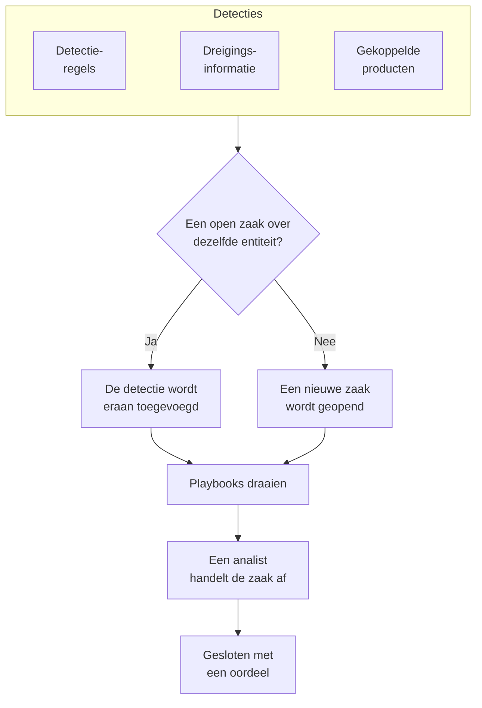

# Beveiligingszaken en playbooks (SOAR)

Security Events maakt zaken van wat je detectieregels, je threat intelligence en je gekoppelde beveiligingsproducten vinden: één zaak voor alles wat het onderzoeken waard is, waarin elke detectie over dezelfde gebruiker, dezelfde host of hetzelfde adres wordt gebundeld. Analisten handelen de zaken af in een wachtrij, en playbooks reageren erop, vanzelf of met één klik.

:::cards
- [Waar zaken vandaan komen](#waar-zaken-vandaan-komen): Detectieregels, threat intelligence, gekoppelde producten, entiteitrisico en mensen.
- [Een zaak afhandelen](#een-zaak-afhandelen): Toewijzen, de entiteiten onderzoeken en sluiten met een oordeel.
- [Zaakprioriteiten en zaakstatussen](#zaakprioriteiten-en-zaakstatussen): Hernoem ze, geef ze een andere kleur en volgorde, en voeg je eigen toe.
- [Meldingen](#meldingen): Wie hoort over een nieuwe zaak, een toewijzing en een stap die op goedkeuring wacht.
- [Playbooks](#playbooks): Stappen die op een zaak draaien, met goedkeuring waar het ertoe doet.
- [Het overzicht](#het-overzicht): Wat nu aandacht nodig heeft, en hoe snel zaken worden afgehandeld.
:::

## Hoe het werkt

Open **Producten → Security Events → Beveiligingszaken → Open zaken** voor de wachtrij. **Mijn zaken**, **Niet toegewezen**, **Gesloten zaken** en **Alle zaken** zijn eigen pagina's ernaast, die elk de zaken tonen die hun naam zegt.

## Voordat je begint

Zaken en playbooks volgen de drie Security-rollen. Project Owner en Project Admin kunnen alles.

| Rol | Wat hij kan doen |
| --- | --- |
| Security Admin | Alles, inclusief zaken verwijderen en playbooks instellen |
| Security Member | Zaken openen, toewijzen, wijzigen en sluiten, notities schrijven, playbooks uitvoeren en hun stappen goedkeuren of afwijzen |
| Security Viewer | Zaken, detecties, notities, playbooks en hun uitvoeringen lezen |

Elk van deze rechten kan ook afzonderlijk worden toegekend, van het aanmaken van een zaak tot het goedkeuren van de stappen van een playbook; zie [Machtigingsreferentie](/docs/permissions/reference).

## Waar zaken vandaan komen

| Bron | Opent een zaak wanneer | Uitzetten met |
| --- | --- | --- |
| Detectieregels | Een regel matcht | **Open a Case on Match**, in de stap **Bij overeenkomst** van de regel |
| Dreigingsinformatie | Een gebeurtenis een bekende indicator noemt | **Open a Case on Match**, in de stap **Bij overeenkomst** van de feed |
| Gekoppelde producten | Een eigen waarschuwing van het product op of boven de drempel van de verbinding wordt geïmporteerd | **Open Cases From** op **Nooit** gezet, in de stap **Polling** van de verbinding |
| Entiteitrisico | Het risico van een gebruiker, host of adres de drempel van het project haalt | **Risicozaken**, onder **Instellingen → Risicoscoring** |
| Mensen | Iemand er een opent vanuit **Beveiligingszaken**, of met **Open Case** in het paneel van een gebeurtenis | Niet uit te zetten |

Elke bron opent standaard zaken, behalve entiteitrisico in projecten die zijn aangemaakt voordat het bestond: zet daar eerst **Risicozaken** aan ([Entiteitrisico](/docs/telemetry/security-entity-risk)). Een verbinding opent zaken voor **Hoog en hoger**, tenzij je een ander niveau kiest; de waarschuwingen daaronder worden nog steeds als gebeurtenissen geïmporteerd.

### Hoe detecties worden gegroepeerd

Een detectie gaat over een entiteit: de waarde waarop haar regel groepeert, zoals het IP-adres bij een brute-forceregel, of de indicator die een threat-intelmatch noemt. Een detectie zonder entiteit staat op zichzelf.

- Is er al een open zaak over die entiteit, dan wordt de detectie eraan toegevoegd. De entiteiten en de ATT&CK-mapping van de zaak groeien, en haar prioriteit stijgt naar die van de detectie, maar daalt nooit.
- Is er geen, dan wordt er een nieuwe zaak geopend, vernoemd naar de detectie en met de prioriteit van de detectie.
- Een detectie die opnieuw afgaat, telt op in haar rij in plaats van er een toe te voegen.

De prioriteit van een zaak volgt uit de ernst van de detectie, als de ingebouwde prioriteit van het project voor dat niveau, hoe je die ook hebt genoemd:

| Ernst | Prioriteit |
| --- | --- |
| Critical of Fatal | Kritiek |
| High | High |
| Medium, Unknown of Other | Medium |
| Low | Low |
| Informational | Informatief |

## Een zaak afhandelen

De zaken van een nieuw project doorlopen vier statussen, die je kunt hernoemen en aanvullen (zie [Zaakprioriteiten en zaakstatussen](#zaakprioriteiten-en-zaakstatussen)). Een zaak kan er een overslaan, bijvoorbeeld een false positive die rechtstreeks vanuit Nieuw wordt gesloten, en ze kan worden heropend.

| Status | Betekenis |
| --- | --- |
| Nieuw | Nog niemand heeft ernaar gekeken |
| Onderzoeken | Iemand zoekt uit wat er is gebeurd |
| Contained | De dreiging kan geen schade meer aanrichten; het opruimen moet nog gebeuren |
| Gesloten | Klaar, met een oordeel over wat het was |

Een zaak heeft een eigen zijmenu, zoals een incident, en elk deel van de zaak is een eigen pagina:

| Sectie van het zijmenu | Pagina's |
| --- | --- |
| **Overzicht** | **Overzicht**, **Tijdlijn** |
| **Onderzoek** | **Detections**, **Entiteiten**, **Verbonden signalen**, **Playbooks** |
| **Notities** | **Privénotities** |
| **Geavanceerd** | **Auditlogboeken**, **Zaak verwijderen**, ingeklapt tot je op **Geavanceerd** klikt |

Elke pagina houdt bovenaan de kop van de zaak: nummer, prioriteit, status en titel, **Aan mij toewijzen**, **Run Playbook**, **Incident melden** en **Close Case**, en in het menu ⋯ ernaast **Prioriteit instellen**, **Aan iemand anders toewijzen**, **Status wijzigen**, **Zaak bewerken** en **Zaak verwijderen**. Zo handel je de zaak af vanaf elk van haar pagina's, en een link naar de zaak opent nog steeds haar **Overzicht**.

- **Overzicht**: de beschrijving, labels en statusstappen van de zaak, wie haar heeft en wat haar opende, en haar cijfers: hoeveel detecties ze heeft, hoe lang ze al open is, en hoe lang het duurde tot ze bevestigd en ingedamd was.
- **OneUptime AI**, op het **Overzicht**: wat OneUptime AI van de zaak maakt, de prioriteit en het playbook die het voorstelt, en het bewijs erachter. Zie [OneUptime AI in beveiliging](/docs/telemetry/security-ai).
- **MITRE ATT&CK**, op het **Overzicht**: de tactieken en technieken waarop haar detecties zijn gemapt, elk gelinkt aan de bijbehorende pagina op attack.mitre.org.
- **Tijdlijn**: alles wat er met de zaak gebeurde, met wie het deed.
- **Detections**: wat afging en zo de zaak opende of eraan werd toegevoegd, hoe vaak, en de laatste overeenkomende gebeurtenis.
- **Entiteiten**: de gebruikers, hosts en adressen waar de zaak over gaat, met hun activiteit in al je beveiligingsgebeurtenissen van de afgelopen 7 dagen. Elk ervan opent in **Correleren**.
- **Verbonden signalen**: de hosts, clusters, services en leden die de zaak noemt, zoals OneUptime ze kent, en wat er op elk ervan gebeurde rond de detecties: hun logboeken, traces en metrieken, wat erop openstaat en wat er is veranderd. Zie [Verbonden signalen](/docs/telemetry/security-connected-signals).
- **Playbooks**: wat elk playbook met de zaak deed, stap voor stap, en de stappen die op goedkeuring wachten. Zolang er uitvoeringen wachten, toont het menu hoeveel naast **Playbooks**.
- **Privénotities**: wat het team over de zaak schreef.
- **Auditlogboeken**: elke wijziging aan de zaak, en wie die maakte. Zie [Auditlogboeken](/docs/configuration/audit-logs).
- **Zaak verwijderen**: verwijdert de zaak voorgoed, met haar detecties, notities, tijdlijn en playbook-uitvoeringen. Wil je haar als verslag bewaren, sluit haar dan met een oordeel.

### Zaken afhandelen vanuit de wachtrij

Je hoeft een zaak niet te openen om ermee aan de slag te gaan. In de lijsten van de wachtrij heeft het menu ⋯ in de rij van een zaak **Aan mij toewijzen**, **Aan iemand anders toewijzen**, **Status wijzigen** en **Prioriteit wijzigen**. Om meerdere zaken tegelijk af te handelen, selecteer je ze en gebruik je dezelfde acties onder **Bulkacties**: die laten zien welke zaken zijn gewijzigd, welke zijn gelaten zoals ze waren, en waarom.

- Om een zaak aan iemand anders te geven, gebruik je **Aan iemand anders toewijzen** en kies je één persoon of een team. Een zaak van een team wacht onder **Niet toegewezen** tot iemand van het team hem oppakt.
- Een status die een zaak sluit, vraagt om een oordeel en een afsluitende notitie, zoals **Close Case** doet.
- Een gesloten zaak wordt aan niemand toegewezen. Om er weer mee aan de slag te gaan, heropen je hem met **Status wijzigen**.

### Een zaak sluiten

**Close Case** vraagt om een oordeel en een optionele afsluitende notitie:

| Oordeel | Betekenis |
| --- | --- |
| True Positive | Er vond echt kwaadaardige of ongeautoriseerde activiteit plaats |
| Benign Positive | De activiteit was echt maar verwacht, zoals een penetratietest of een beheertaak |
| False Positive | De detectie klopte niet: de regel of de gegevens zagen normale activiteit verkeerd aan |
| Undetermined | Er was niet genoeg informatie om het te bepalen |

De oordelen worden geteld in het overzicht. Een regel waarvan de zaken steeds als False Positive worden gesloten, is een regel om bij te stellen.

Een zaak die uit Google SecOps-waarschuwingen is geopend, sluit die ook in Google SecOps, met het oordeel en de sluitnotitie, wanneer bij de verbinding **Waarschuwingen sluiten wanneer hun zaak sluit** aan staat: zie [Google SecOps](/docs/integrations/google-secops#waarschuwingen-sluiten-wanneer-hun-zaak-sluit).

### Een incident melden

**Incident melden** opent een OneUptime-incident voor de zaak, met de ernst die je kiest, en koppelt de twee in beide richtingen: de beschrijving van het incident noemt de zaak, en de kop van de zaak linkt naar het incident. On-call, statuspagina's en de postmortem nemen het vanaf daar over. Daarvoor is een rol nodig die zowel zaken mag afhandelen als incidenten mag aanmaken.

## Zaakprioriteiten en zaakstatussen

Elk project heeft zijn eigen zaakprioriteiten en zaakstatussen, onder **Producten → Security Events → Instellingen → Zaakprioriteiten** en **Zaakstatussen**. Hernoem ze, geef ze een andere kleur, sleep ze in een andere volgorde en voeg je eigen toe, zoals een status "Triage" of een prioriteit "Noodgeval" boven **Kritiek**. Een nieuwe naam verschijnt overal tegelijk: in de wachtrij, op de zaakpagina's en het overzicht, in meldingen, in Slack en Microsoft Teams, en in playbookberichten.

Sommige zijn ingebouwd, omdat OneUptime leest wat ze betekenen. Je kunt ze hernoemen en een andere kleur geven, maar niet verwijderen of archiveren, en ze houden hun volgorde:

| Ingebouwd | Wat OneUptime ermee doet |
| --- | --- |
| De nieuwe status | Nieuwe zaken beginnen erin |
| De bevestigde status | Bereikt een zaak hem, dan wordt vastgelegd wanneer ze is bevestigd, en **Reopen** zet een gesloten zaak erop terug |
| De ingeperkte status | Bereikt een zaak hem, dan wordt vastgelegd wanneer ze is ingeperkt |
| De gesloten status | **Close Case** zet een zaak erop, met een oordeel |
| De prioriteiten Kritiek, High, Medium, Low en Informatief | Een detectie opent haar zaak met de prioriteit van haar ernst, en een zaak die iemand opent, begint op Medium |

- Waar een status staat, bepaalt hoe een zaak erin telt, zoals de kolom **Telt als** laat zien: vanaf de bevestigde status omlaag als bevestigd, vanaf de ingeperkte status omlaag als ingeperkt, vanaf de gesloten status omlaag als gesloten. Een status die je toevoegt, komt net boven de gesloten status, en wie een zaak in een status zet die haar sluit, wordt eerst om een oordeel gevraagd.
- De rang van een prioriteit is hoe dringend ze is, de dringendste eerst: **For Cases At Least**, de keuzes bij meldingen en de regels voor Slack en Microsoft Teams lezen deze volgorde. Een prioriteit die je toevoegt, komt achteraan, en de kolom **Ernst van de detectie** laat zien welke detecties hun zaken met welke ingebouwde prioriteit openen.

Wil je een eigen status of prioriteit niet meer gebruiken, gebruik dan **Archiveren** in de rij ervan. Niemand kan hem dan nog kiezen, en de API, Terraform en MCP weigeren hem, maar de zaken die hem hebben, houden hem, en je kunt er nog steeds op filteren. Gearchiveerde waarden staan in de ingeklapte sectie **Gearchiveerde zaakstatussen** of **Gearchiveerde zaakprioriteiten** onder de tabel, waar **Uit archief halen** er een terugzet. **Verwijderen** wordt geweigerd zolang zaken de waarde hebben of een playbook vanaf de prioriteit draait.

## Meldingen

OneUptime brengt mensen op de hoogte van drie dingen op een zaak. Niemand hoeft iets in te stellen: een project dat alleen op **Aanbevolen inschakelen** heeft geklikt, hoort per e-mail en push over zijn zaken met prioriteit High en Kritiek.

| Melding | Wie het hoort | Standaard |
| --- | --- | --- |
| Nieuwe beveiligingszaak | Iedereen die de zaken van het project kan zien, wanneer een zaak wordt geopend of in prioriteit stijgt, op de prioriteit die hij koos of hoger | E-mail en push, voor zaken met High en Kritiek |
| Beveiligingszaak aan mij toegewezen | De persoon aan wie de zaak is toegewezen, en de leden van het team waaraan ze is toegewezen | E-mail en push |
| Playbookstap wacht op mijn goedkeuring | De mensen van de zaak die de stap mogen goedkeuren: de persoon aan wie ze is toegewezen en de leden van haar team. Mag geen van hen goedkeuren, dan iedereen in het project die het mag | E-mail en push |

- Alleen mensen die de zaak kunnen zien, horen erover: Project Owners, Project Admins en de rollen Security Admin, Security Member en Security Viewer. Een rol die tot bepaalde labels is beperkt, hoort alleen over de zaken met die labels.
- Niemand hoort over wat hij zelf deed: wie een zaak met de hand opent, haar toewijst of een uitvoering start, krijgt daar geen melding van.
- Ieder hoort één keer over een zaak. Een zaak die op Medium wordt geopend en later naar Kritiek stijgt, bereikt bij die stijging de mensen die High of Kritiek kozen, en niet opnieuw de mensen die Medium kozen, want die hoorden erover toen ze werd geopend.
- De testaanval van **Testaanval sturen** opent een zaak die niemand een melding geeft.
- Een zaak met Kritiek en een stap die op goedkeuring wacht, worden meteen verstuurd en nooit vastgehouden in een [e-mailbundeling](/docs/emails/notification-rollup).
- De **Tijdlijn** van de zaak laat zien wie het hoorde, en wanneer.

### Kiezen wat je hoort

Ieder kiest dat voor zichzelf, onder **Gebruikersinstellingen → Meldingsinstellingen → Beveiliging**: de kanalen voor elke melding (e-mail, sms, oproep, push, Telegram, Slack, Microsoft Teams of webhook), en onder **Nieuwe beveiligingszaak** de prioriteit die hem een melding geeft:

| Keuze | Meldt zaken met |
| --- | --- |
| Alleen Kritiek | Kritiek |
| Hoog en hoger | Kritiek en High (de standaard) |
| Gemiddeld en hoger | Kritiek, High en Medium |
| Laag en hoger | Elke prioriteit behalve Informatief |
| Elke zaak | Elke prioriteit |

De keuzes volgen de zaakprioriteiten van het project, onder hun eigen namen: dit zijn die van een nieuw project.

Voor beveiligingszaken worden geen WhatsApp-berichten verstuurd. Een pushmelding opent de zaak in de app OneUptime On-Call (1.7.0 of nieuwer), waar u een wachtende playbookstap kunt goedkeuren of afwijzen, de zaak kunt oppakken en sluiten. De link erin opent de zaak in de browser.

### Plaatsen in kanalen van Slack en Microsoft Teams

Om in een kanaal te plaatsen, voeg je een regel toe onder **Producten → Security Events → Werkruimte → Slack** (of **Microsoft Teams**). Is geen van beide gekoppeld, dan is de enige vermelding in dat onderdeel **Slack of Teams koppelen**. Een regel noemt de kanalen waarin hij plaatst (en, in Microsoft Teams, de chats) en, als je wilt, de zaken waarvoor hij geldt:

| Voorwaarde | Matcht op |
| --- | --- |
| Prioriteit van beveiligingszaak | Een van de zaakprioriteiten van het project, zoals Kritiek of High |
| Titel van beveiligingszaak, Beschrijving van beveiligingszaak | Tekst die de titel of de beschrijving van de zaak bevat, waarmee die begint of waarmee die eindigt |
| Status van beveiligingszaak | Een van de zaakstatussen van het project, zoals Nieuw of Gesloten |
| Bron van beveiligingszaak | Detection Rule, Threat Intel, Connected Product, Entiteitrisico of Manual |
| Labels van beveiligingszaak | De labels van de zaak |

De drie meldingen worden elk geplaatst in de kanalen van elke regel waaraan de zaak op dat moment voldoet. Een regel waarin **Prioriteit van beveiligingszaak** een van **Kritiek** en **High** bevat, plaatst zaken met High en Kritiek zodra ze worden geopend, en een zaak met Medium wanneer die naar High stijgt. Een beveiligingszaak krijgt nooit een eigen kanaal.

## Playbooks

Een playbook is een lijst met stappen die op een zaak draaien. Maak er een aan onder **Producten → Security Events → Playbooks**, vanuit een sjabloon of leeg, en voeg de stappen toe op de pagina ervan. Een project zonder playbooks ziet de sjablonen in plaats van een lege lijst; zodra er playbooks zijn, opent **Maken op basis van sjabloon** bij de lijst ze, met **Toegevoegd** bij de sjablonen die het project al heeft.

### Wanneer een playbook draait

| Trigger | Wanneer het draait |
| --- | --- |
| Case Opened | Eén keer, wanneer een zaak wordt geopend |
| Detection Added | Telkens wanneer een nieuwe detectie aan een open zaak wordt toegevoegd |
| Beoordeeld als waarschijnlijk kwaadaardig | Eén keer, wanneer de beoordeling van OneUptime AI de zaak als Waarschijnlijk kwaadaardig leest |
| Manual | Alleen wanneer iemand het vanuit een zaak uitvoert |

Elk ingeschakeld playbook kan ook met de hand worden uitgevoerd, met **Run Playbook** op een zaak. Een playbook dat vanzelf draait, kun je beperken:

- **For Cases At Least**: alleen zaken met deze prioriteit of hoger.
- **Only For Detections From**: alleen wanneer de detectie achter de zaak uit deze bron komt.
- **Only For These Detection Rules**: alleen wanneer ze uit een van deze regels komt.

Een uitgeschakeld playbook draait niet vanzelf en ook niet met de hand.

### Stappen

| Categorie | Stap | Wat hij doet |
| --- | --- | --- |
| Zaak | Assign the case | Geeft de zaak aan een persoon, een team of beide |
| Zaak | Set the priority | Verhoogt of verlaagt de prioriteit van de zaak |
| Zaak | Set the status | Zet de zaak op een andere status van het project, met het oordeel dat je kiest als die status haar sluit |
| Zaak | Add a note | Schrijft een notitie bij de zaak, zoals een checklist voor de analist |
| Zaak | Add labels | Voorziet de zaak van labels |
| Onderzoeken | Check entities against threat intel | Zoekt elke entiteit op in je threat intelligence, en kan bij een match de prioriteit verhogen |
| Onderzoeken | Look up entity activity | Telt de beveiligingsgebeurtenissen van elke entiteit over een recent venster, en noteert dat bij de zaak |
| Informeren | Email people | Mailt gebruikers en teams een samenvatting van de zaak, met een link ernaartoe |
| Informeren | Post to Slack | Plaatst een samenvatting van de zaak in een Slack-kanaal |
| Informeren | Post to Microsoft Teams | Plaatst een samenvatting van de zaak in een kanaal van Microsoft Teams |
| Escaleren | Page on-call | Voert een on-callbeleid uit |
| Escaleren | Declare an incident | Opent een OneUptime-incident dat aan de zaak is gekoppeld |
| Inperken | Suspend the user in Okta | Schorst in Okta de gebruiker waar de zaak over gaat |
| Inperken | End the user's Okta sessions | Meldt de gebruiker waar de zaak over gaat af bij Okta en trekt zijn tokens in |
| Inperken | Contain the host in CrowdStrike | Isoleert de host waar de zaak over gaat van het netwerk met CrowdStrike Falcon |
| Inperken | Isolate the device in Microsoft Defender | Isoleert de host waar de zaak over gaat met Microsoft Defender for Endpoint |
| Inperken | Unsuspend the user in Okta | Heft in Okta de schorsing op van de gebruiker waar de zaak over gaat |
| Inperken | Lift containment in CrowdStrike | Heft voor de host waar de zaak over gaat de netwerkisolatie van CrowdStrike Falcon op |
| Inperken | Release the device in Microsoft Defender | Haalt in Microsoft Defender for Endpoint de host waar de zaak over gaat uit isolatie |
| Automatiseren | Send a webhook | Post de zaak als JSON naar een URL |
| Automatiseren | Run a workflow | Start een OneUptime-workflow met de zaak als invoer |

Een playbook heeft hoogstens 25 stappen. Ze draaien op volgorde, elk zodra de vorige klaar is. Elke stap kan ook:

- **Needs Approval**: de uitvoering vóór de stap stilzetten totdat iemand hem op de zaak goedkeurt. De vier stappen die iemand de toegang ontnemen, zetten de uitvoering altijd stil, tenzij een Security Admin dit uitzet.
- **Only If Threat Intel Matched**: de stap overslaan, tenzij een eerdere stap **Check entities against threat intel** van dezelfde uitvoering een bekende indicator vond.
- **Carry On If It Fails**: de volgende stap uitvoeren, ook als deze mislukt. Staat dit uit, dan stopt een mislukte stap de uitvoering.

### Inperking

De inperkingsstappen werken via een [verbinding voor beveiligingsgebeurtenissen](/docs/telemetry/security-events#een-beveiligingsproduct-koppelen) met het product, die daarvoor meer dan leestoegang nodig heeft:

| Stap | Verbinding | Vereist |
| --- | --- | --- |
| Suspend the user in Okta, End the user's Okta sessions, Unsuspend the user in Okta | Okta System Log | Een API-token dat gebruikers mag beheren |
| Contain the host in CrowdStrike, Lift containment in CrowdStrike | CrowdStrike Falcon | Een API-client met schrijfrechten in de scope Hosts |
| Isolate the device in Microsoft Defender, Release the device in Microsoft Defender | Microsoft Defender XDR | Een app met de machtiging Machine.Isolate |

Een inperkingsstap werkt alleen op de gebruikers of hosts waar de zaak over gaat, nooit op alle gebruikers en hosts die ze noemt:

- De waarde waarop een detectie van de zaak is gegroepeerd, zoals het account waarop een regel voor onmogelijke reizen groepeert, of de host die de waarschuwing van een gekoppeld product noemt.
- Een gebruiker of host van de zaak die je threat intelligence als indicator kent.

Een zaak die op een adres is gegroepeerd, zoals een brute-forceaanval op je VPN, gaat over geen van beide: haar inperkingsstappen worden overgeslagen, en het geprobeerde account en de geraakte gateway blijven ongemoeid. Een stap werkt op hoogstens 10 gebruikers of hosts. Hij zoekt elk ervan op naam op in het product, en meldt op de uitvoering wat hij met elk deed: uitgevoerd, al uitgevoerd, niet gevonden, geweigerd of beschermd.

#### Beschermde entiteiten

**Protected Entities**, onder **Playbooks** in het menu, toont de gebruikers en hosts die geen enkel playbook inperkt, zoals noodaccounts, domeincontrollers en VPN-gateways. Een waarde matcht ongeacht hoofdletters, en `*` staat voor elke reeks tekens: `svc-*` beschermt elk serviceaccount. Een stap meldt een beschermde gebruiker of host als beschermd en laat hem ongemoeid. Security Admins houden de lijst bij.

#### Goedkeuring

De vier stappen die iemand de toegang ontnemen, wachten op goedkeuring. Alleen een Security Admin kan **Needs Approval** voor een ervan uitzetten, en OneUptime legt vast wie dat deed. De goedkeuring toont onder **Act On** de gebruikers of hosts waarop de stap zou werken, allemaal aangevinkt: vink uit wat hij ongemoeid moet laten. Beschermde gebruikers en hosts staan er niet tussen. Wie een uitvoering heeft gestart, kan haar stappen niet goedkeuren: dat doet iemand anders, maar afwijzen kan die persoon nog wel.

#### Ongedaan maken

De herstelstappen werken op de gebruikers of hosts waar de zaak over gaat, net als de stappen die ze terugdraaien. Zodra de uitvoering is gestopt, heeft een ingeperkte gebruiker of host ook een eigen knop op zijn stap: **Unsuspend**, **Lift Containment** of **Vrijgeven**. Een beëindigde Okta-sessie kan niet ongedaan worden gemaakt. Elke herstelactie wordt bewaard op de tijdlijn van de zaak en in het auditlogboek van het project.

### Berichten

Een notitie, een e-mail, een Slack-bericht en een Teams-bericht kunnen de waarden van de zaak gebruiken:

| Placeholder | Wordt |
| --- | --- |
| `{{case.number}}` | Het zaaknummer, zoals CASE-42 |
| `{{case.title}}` | De titel van de zaak |
| `{{case.priority}}` | De prioriteit van de zaak, zoals je project die noemt, bijvoorbeeld High |
| `{{case.status}}` | De status van de zaak, zoals je project die noemt, bijvoorbeeld Investigating |
| `{{case.assignee}}` | Aan wie de zaak is toegewezen |
| `{{case.url}}` | Een link naar de zaak in OneUptime |
| `{{case.entities}}` | De gebruikers, hosts en adressen waar de zaak over gaat |
| `{{case.detections}}` | Hoeveel detecties de zaak bevat |

Een e-mail of bericht zonder eigen tekst stuurt een samenvatting van de zaak.

### Uitvoeringen en goedkeuringen

Elke uitvoering staat stap voor stap vermeld bij haar zaak en onder **Producten → Security Events → Playbooks → Playbook-uitvoeringen**:

| Status van de uitvoering | Betekenis |
| --- | --- |
| Queued | Wacht op een worker |
| Actief | Voert haar stappen uit |
| Waiting for Approval | Stilgezet vóór een stap die goedkeuring nodig heeft |
| Geslaagd | Elke stap is uitgevoerd of overgeslagen |
| Mislukt | Een stap mislukte en de uitvoering stopte |
| Geannuleerd | Iemand heeft haar geannuleerd, of een stap afgewezen |

Een stap die op goedkeuring wacht, toont **Approve** en **Reject** op de uitvoering, met een optionele opmerking. Goedkeuren zet de uitvoering voort vanaf die stap; afwijzen beëindigt haar. De beslissing, wie haar nam en de opmerking worden bewaard bij de stap, op de tijdlijn van de zaak en in het auditlogboek van het project. De pagina **Goedkeuringen**, onder **Playbooks** in het menu, toont de uitvoeringen die op een beslissing wachten en telt ze; **Playbook-uitvoeringen** toont elke uitvoering. Op **Playbook-uitvoeringen** en op de pagina van een playbook is elke uitvoering één regel die zegt hoe ver ze kwam, of bij welke stap ze stopte; **Stappen tonen** opent haar stappen. Een uitvoering die op goedkeuring wacht, gaat vanzelf open.

Een uitvoering die niets meer van haar worker hoort, bijvoorbeeld na een herstart, wordt weer opgepakt: een uitvoering in de wachtrij wordt na 2 minuten opnieuw in de wachtrij gezet, en een uitvoering die 30 minuten niets heeft gemeld, wordt als mislukt gemarkeerd.

## Het overzicht

**Producten → Security Events → Overzicht** is de pagina waarop het product opent:

- De open zaken die aan jou zijn toegewezen, de open zaken die nog niemand heeft opgepakt, en de playbookstappen die op goedkeuring wachten; elk getal opent de pagina die ze toont.
- **Gemiddelde tijd tot bevestiging**, **Gemiddelde tijd tot indamming** en **Gemiddelde tijd tot sluiting**, over de zaken die in de afgelopen 30 dagen zijn geopend: van het openen van een zaak tot iemand haar oppakt (een persoon toewijst, of haar in een status zet die als bevestigd telt), tot een status die als ingeperkt telt, en tot een die als gesloten telt. Een zaak die nog wacht, telt niet mee in een gemiddelde.
- De zaken die per dag zijn geopend, over 30 dagen, per prioriteit, en de detecties die per dag zijn opgeworpen, over 14 dagen, per bron.
- De open zaken per prioriteit en per status, de entiteiten die in de meeste bevindingen voorkomen, de detecties die het vaakst afgingen, de ATT&CK-tactieken achter de zaken en de oordelen van de afgelopen 30 dagen.

Daarboven toont een strook hoe beveiliging is ingericht: de bronnen, detecties, zaken en playbooks, elk met hun cijfers. Een project dat het nog niet heeft ingericht, ziet daar **Aanbevolen inschakelen** en **Testaanval sturen**; zie [Aan de slag met beveiliging](/docs/telemetry/security-getting-started). Als niets iemand nodig heeft, zegt de pagina **Alles rustig**, en de grafieken verschijnen zodra er iets te tonen is.

## Dreigingen vinden

- **Entiteiten** rangschikt de gebruikers, hosts, adressen en hashes die je bevindingen het vaakst noemen, over de afgelopen dag, week of maand, en zoekt elke waarde op in 30 dagen aan gebeurtenissen. Selecteer een entiteit om haar te openen in **Correleren**.
- **Rule Library** bevat kant-en-klare detectieregels voor dreigingen rond identiteit, endpoints, cloud, netwerk, web en Kubernetes. Elke regel is een Sigma-regel, geschreven voor de velden waarnaar elke gekoppelde bron wordt genormaliseerd. De rij van een regel toont wat hij vindt, de MITRE ATT&CK-tactieken en -technieken waarmee hij is gelabeld, de gebeurtenissen die hij leest en of daarvan in de afgelopen 7 dagen iets is binnengekomen (**Ontvangen** of **Niet ontvangen**), en zijn ernst. Beperk de lijst op categorie, op de gegevens die de regels lezen en op of u ze hebt toegevoegd, of doorzoek hem op naam, ATT&CK-techniek of ernst; het adres van de pagina bewaart de filters. Selecteer een regel voor de details: hoe u begint met het verzenden van de gebeurtenissen die hij leest, hoe hij draait en zijn Sigma-regel. **Toevoegen** maakt hem aan als een eigen detectieregel, ingeschakeld en zo ingesteld dat hij zaken opent in plaats van waarschuwingen; wijzig hem onder **Detection Rules** zoals elke andere. De regels die als **Aanbevolen** zijn gemarkeerd, vinden bedreigingen in gegevens die OneUptime al heeft, en één knop voegt de regels toe die u nog niet hebt.
- **ATT&CK Coverage** toont de tactieken van MITRE ATT&CK, elk met hoeveel van haar technieken je ingeschakelde regels dekken en voor hoeveel meer de **Rule Library** regels heeft. Open een tactiek voor haar technieken, of schakel over naar **Matrix** voor de hele matrix. Selecteer een techniek om de regels uit de bibliotheek te zien die hem dekken, en open de **Rule Library** op die regels.

## Automatiseren

- **Workflows**: een zaak of een notitie kan een workflow starten wanneer ze wordt aangemaakt, bijgewerkt of verwijderd. Een stap **Run a workflow** start een workflow waarvan de trigger een webhook is.
- **API**: zaken, notities, detecties, playbooks, uitvoeringen, beschermde entiteiten en zaakprioriteiten en zaakstatussen hebben dezelfde REST API als de rest van OneUptime, onder `/security-case`, `/security-case-note`, `/security-detection`, `/security-playbook`, `/security-playbook-run`, `/security-protected-entity`, `/security-case-priority` en `/security-case-status`. Zie [API-referentie](/docs/api-reference/api-reference).
- AI-agents: de MCP-server heeft tools voor zaken, notities, detecties, playbooks en zaakprioriteiten en zaakstatussen. Zie [MCP-server](/docs/ai/mcp-server).
- Terraform: de resources `oneuptime_security_case_priority` en `oneuptime_security_case_status` leggen de prioriteiten en statussen van een project vast als code.

## Probleemoplossing

:::details Een regel matcht, maar er wordt geen zaak geopend
Controleer **Open a Case on Match** in de stap **Bij overeenkomst** van de regel. Een detectie over een entiteit die al een open zaak heeft, wordt aan die zaak toegevoegd in plaats van een nieuwe te openen: zoek haar onder **Detections** in de open zaak.
:::

:::details Niemand hoorde over een zaak
Kijk op de **Tijdlijn** van de zaak, die laat zien wie een melding kreeg. Een melding **Nieuwe beveiligingszaak** gaat naar de mensen van wie de zaak de gekozen prioriteit haalt, dus een zaak met Medium geeft geen melding aan wie de standaard, **Hoog en hoger**, heeft gehouden. Controleer of de mensen die het zouden moeten horen beveiligingszaken kunnen zien (een Security-rol, of Project Owner of Project Admin), en of de melding voor hen aanstaat onder **Gebruikersinstellingen → Meldingsinstellingen → Beveiliging**.
:::

:::details Een playbook draaide niet
Controleer of het is ingeschakeld, of de **Trigger** klopt (Case Opened draait één keer, wanneer een zaak wordt geopend), en of de zaak voldoet aan de instellingen **For Cases At Least**, **Only For Detections From** en **Only For These Detection Rules**. Een met de hand geopende zaak heeft geen detectie, dus een playbook dat tot een bron of tot regels is beperkt, draait er niet op.
:::

:::details Een inperkingsstap is mislukt
Open de uitvoering op de zaak: de stap meldt voor elke gebruiker of host of het product de actie weigerde, hem niet vond, of niet bereikbaar was. Controleer of de referentie van de verbinding de wijziging mag doorvoeren, en gebruik **Verbinding testen** in haar rij.
:::

:::details Een inperkingsstap is overgeslagen
De zaak gaat over geen enkele gebruiker of host, bijvoorbeeld alleen over een adres, of elke gebruiker of host waar ze over gaat, is beschermd. Open de uitvoering op de zaak: de stap meldt welke van de twee.
:::

:::details Een status of prioriteit kan niet worden verwijderd of gearchiveerd
Een ingebouwde kun je hernoemen en een andere kleur geven, maar nooit verwijderen of archiveren: het **Archiveren** ervan is vergrendeld, met de reden. Een eigen kun je niet verwijderen zolang zaken hem hebben of een playbook vanaf hem draait: zet de zaken eerst op een andere, of archiveer hem.
:::

## Volgende stappen

:::cards
- [Beveiligingsgebeurtenissen](/docs/telemetry/security-events): Stuur gebeurtenissen, schrijf detectieregels en koppel beveiligingsproducten.
- [Dreigingsinformatie](/docs/telemetry/threat-intelligence): Vergelijk je gebeurtenissen met STIX/TAXII-feeds.
- [OneUptime AI in beveiliging](/docs/telemetry/security-ai): Zaken beoordelen, detectieregels laten opstellen en vragen stellen over beveiliging, met AI.
- [Machtigingsreferentie](/docs/permissions/reference): De Security-rollen, en wat elk ervan kan.
:::
